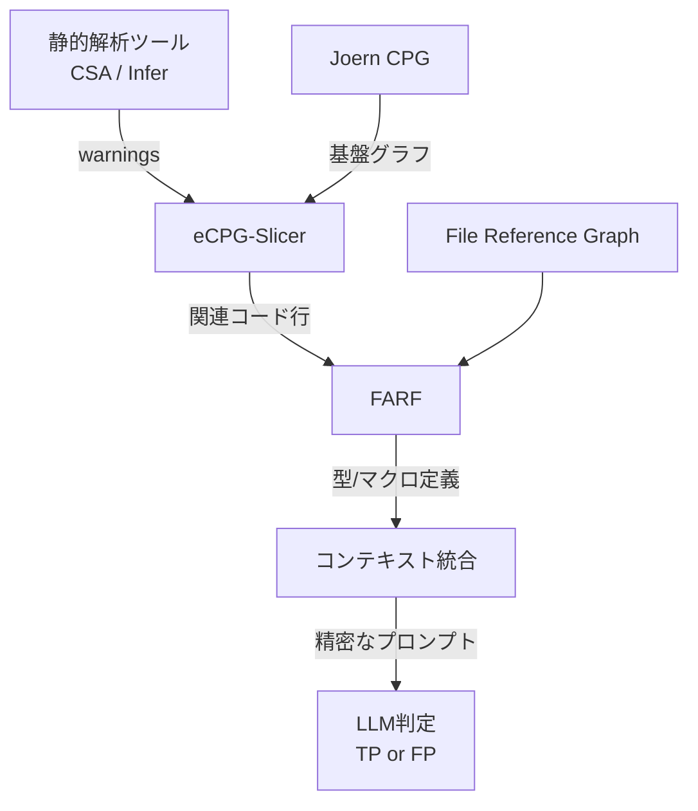

本記事は [https://arxiv.org/abs/2411.03079](https://arxiv.org/abs/2411.03079) の解説記事です。

## 論文概要（Abstract）

静的解析ツール（CSA、Infer等）は大規模コードベースの脆弱性検出に有用だが、誤検知（False Positive）の多さが深刻な課題である。著者らは、LLMに対して「精密かつ完全なコードコンテキスト」を提供することで誤検知を自動判定するフレームワークLLM4FPMを提案している。拡張コードプロパティグラフ（eCPG）によるスライシングでwarning行に関連するコード行を抽出し、ファイル依存解析（FARF）でプロジェクト全体の型・マクロ定義を補完することで、LLMの判定精度を向上させた。

この記事は [Zenn記事: Claude Code×GitHub Actionsで構築するPR自動レビューの誤検知削減とコスト最適化](https://zenn.dev/0h_n0/articles/5ee2c4913ba8aa) の深掘りです。

## 情報源

- **arXiv ID**: 2411.03079
- **URL**: [https://arxiv.org/abs/2411.03079](https://arxiv.org/abs/2411.03079)
- **著者**: Jinbao Chen, Hongjing Xiang, Zuohong Zhao et al.（University of Science and Technology of China）
- **発表年**: 2024（v1: 2024年11月5日、v2: 2025年5月31日）
- **分野**: cs.SE（ソフトウェア工学）

## 背景と動機（Background & Motivation）

静的解析ツールはソフトウェアの脆弱性検出に広く使われているが、誤検知率の高さが実務上の大きな障壁となっている。著者らは、開発者が誤検知の確認作業に多大な時間を費やしている問題を指摘している。

従来のLLMベースの誤検知判定手法には2つの課題があった。第一に、LLMに投入するコードコンテキストが不十分であること。ファイル全体を入力すると無関係なコードが混入しLLMの判定精度が低下する。第二に、warningに関連するファイル外の型定義やマクロ定義が欠落すること。C/C++プロジェクトではヘッダファイルのtypedefやマクロがwarningの真偽判定に不可欠だが、既存手法はこれらを十分に考慮していなかった。

LLM4FPMは、プログラム解析技術（CPGスライシング、ファイル依存グラフ）とLLMの推論能力を組み合わせることで、この2つの課題を同時に解決する。

## 主要な貢献（Key Contributions）

- **eCPG-Slicer**: Joernの既存CPGを3種類のエッジ（F-edges、S-edges、V-edges）で拡張し、warning行から到達可能なコード行のみを線形時間で抽出するスライシングアルゴリズム
- **FARFアルゴリズム**: File Reference Graph（FRG）を構築し、TarjanのSCCアルゴリズムと凝縮グラフによるBFS走査で、warning関連ファイルの型・マクロ定義を収集するファイルレベル依存解析
- **LLM4FPMフレームワーク**: eCPG-SlicerとFARFを統合し、LLMへの入力コンテキストを精密化する誤検知自動判定パイプライン

## 技術的詳細（Technical Details）

### LLM4FPMの全体アーキテクチャ

LLM4FPMは3つのフェーズで動作する。



フェーズ1（eCPG-Slicer）では、warning行を起点にCPG上でグラフ到達性解析を行い、関連するコード行を特定する。フェーズ2（FARF）では、抽出されたコード行が参照する外部ファイルの型定義・マクロ定義を収集する。フェーズ3では、統合されたコンテキストをLLMに入力し、warningが真陽性か偽陽性かを判定させる。

### eCPG（拡張コードプロパティグラフ）

JoernのCPGは、AST（抽象構文木）、CFG（制御フローグラフ）、PDG（プログラム依存グラフ）を統合したグラフ表現であるが、著者らはこれに3種類のエッジを追加している。

**F-edges（呼び出し依存エッジ）**: 関数呼び出し元から呼び出し先の関数定義への接続。JoernのCPGにはCallノードが存在するが、呼び出し先の関数本体との直接リンクが欠落しており、F-edgesがこれを補完する。

**S-edges（構造依存エッジ）**: 構造体メンバアクセス（例: `p->member`）から構造体定義への接続。フィールドの型情報を取得可能にする。

**V-edges（変数依存エッジ）**: グローバル変数の使用箇所から定義箇所への接続。ファイルをまたいだグローバル変数の依存関係を追跡する。

### eCPG-Slicerアルゴリズム

スライシングアルゴリズムは、warning行を起点としたBFSによるグラフ到達性解析である。

```python
from collections import deque
from dataclasses import dataclass, field


@dataclass
class ECPGNode:
    """eCPG上のノード

    Attributes:
        node_id: ノードの一意識別子
        line_number: ソースコード上の行番号
        neighbors: 隣接ノード（全エッジ種別を含む）
    """
    node_id: int
    line_number: int
    neighbors: list["ECPGNode"] = field(default_factory=list)


def ecpg_slice(
    ecpg: dict[int, ECPGNode],
    warning_line: int,
) -> set[int]:
    """eCPG上でwarning行から到達可能なコード行を抽出する

    Args:
        ecpg: ノードIDからECPGNodeへの辞書
        warning_line: 静的解析ツールが報告したwarning行番号

    Returns:
        到達可能なソースコード行番号の集合
    """
    seed_nodes = [
        n for n in ecpg.values() if n.line_number == warning_line
    ]
    visited: set[int] = set()
    reachable_lines: set[int] = set()
    queue: deque[int] = deque()

    for node in seed_nodes:
        queue.append(node.node_id)
        visited.add(node.node_id)

    while queue:
        current_id = queue.popleft()
        current = ecpg[current_id]
        reachable_lines.add(current.line_number)
        for neighbor in current.neighbors:
            if neighbor.node_id not in visited:
                visited.add(neighbor.node_id)
                queue.append(neighbor.node_id)

    return reachable_lines
```

計算量は以下の通りである。

$$
T_{\text{slice}} = O(|V| + |E|)
$$

ここで $V$ はeCPG上のノード集合、$E$ はエッジ集合（AST + CFG + PDG + F + S + V）である。

### FARFアルゴリズム（File-level Dependency Extraction）

eCPG-Slicerが抽出したコード行には、他ファイルの型定義（`typedef`）やマクロ定義（`#define`）への参照が含まれることがある。FARFはこれらの外部定義を3ステップで収集する。

**ステップ1**: File Reference Graph（FRG）を構築する。FRGは有向グラフ $G_f = (V_f, E_f)$ で、$V_f$ はプロジェクト内の全ファイル、$E_f = \{(f_i, f_j) \mid f_i \text{ が } f_j \text{ を } \texttt{\#include} \text{ している}\}$ である。

**ステップ2**: C/C++では循環includeが発生しうるため、TarjanのSCCアルゴリズム（$O(|V_f| + |E_f|)$）で強連結成分を検出し、凝縮グラフ（DAG）を構築する。

**ステップ3**: eCPG-Slicerが出力したコード行を含むファイルを起点として、凝縮グラフ上でBFS走査し、到達可能ファイルから型定義・マクロ定義を収集する。最悪計算量は $O(|V_{G_f}|)$（プロジェクト内のファイル数）と報告されている。

```python
from collections import defaultdict, deque


def collect_reachable_definitions(
    include_map: dict[str, list[str]],
    seed_files: set[str],
    file_definitions: dict[str, list[str]],
) -> list[str]:
    """BFS走査で到達可能ファイルの型/マクロ定義を収集する

    Args:
        include_map: ファイルパス -> includeしているファイルパスのリスト
        seed_files: eCPG-Slicerが出力したコード行を含むファイル集合
        file_definitions: 各ファイルのtypedef/macro定義リスト

    Returns:
        収集された定義のリスト
    """
    visited: set[str] = set()
    queue: deque[str] = deque()
    definitions: list[str] = []

    for f in seed_files:
        queue.append(f)
        visited.add(f)

    while queue:
        current = queue.popleft()
        if current in file_definitions:
            definitions.extend(file_definitions[current])
        for neighbor in include_map.get(current, []):
            if neighbor not in visited:
                visited.add(neighbor)
                queue.append(neighbor)

    return definitions
```

### LLMへのプロンプト構成

eCPG-SlicerとFARFの出力を統合し、以下の4要素をLLMに入力する。(1) warningの種別（CWE番号）と該当行、(2) スライスされたコード行、(3) FARFが収集した型・マクロ定義、(4) True Positive / False Positiveの二値判定指示。

## 実装のポイント（Implementation）

**Joernのパース制限**: C/C++のマクロ展開、関数ポインタ、`#ifdef`による条件付きコンパイルはJoernが正しくパースできない場合がある。マクロ展開が原因でeCPG上にノードが生成されないケースが報告されている。

**コンテキストウィンドウの制約**: ablation study（論文Table 4）で、FARFなしの変異体では40件のwarningがLLMのコンテキストウィンドウを超過したと報告されている。FARFがファイルレベル粒度であるため、大規模プロジェクトでは収集定義量が増大する。

**エッジ種別の重要性**: S-edges（構造体依存）とV-edges（グローバル変数依存）がスライシング精度に寄与する。構造体のフィールドアクセスパターンはメモリ安全性系CWE（CWE-121, CWE-122, CWE-416等）で特に重要となる。

**LLMの選択**: 著者らは4x RTX 3090 GPU上でqwen2.5-32bを使用している。GPT-4使用時のコスト見積もりは1 warningあたり約$0.384（平均処理時間4.7秒）と報告されている。

## Production Deployment Guide

LLM4FPMをCI/CDパイプライン上の誤検知フィルタとして運用する場合のAWSデプロイメント構成を示す。

### AWS実装パターン（コスト最適化重視）

| 構成 | 想定規模 | アーキテクチャ | 月額概算 |
|------|---------|--------------|---------|
| Small | ~100 warnings/日 | Lambda + Bedrock | $50-150 |
| Medium | ~1,000 warnings/日 | ECS Fargate + Bedrock | $300-800 |
| Large | 10,000+ warnings/日 | EKS + vLLM (Spot) | $2,000-5,000 |

**Small構成**: GitHub Actionsのwebhookを受信するAPI Gateway + Lambda構成。JoernはECS Task（4vCPU / 8GB RAM）で起動しCPG結果をS3保存。LLM判定はBedrock（Claude 3.5 Sonnet）、DynamoDB On-Demandでwarning判定キャッシュ。

**Medium構成**: ECS Fargate上でJoern + スライシングサービスを常駐。Bedrock Batch APIで50%コスト削減。

**Large構成**: EKS上でvLLMサーバを自前ホスティング、Karpenter + Spot Instances（g5.2xlarge）で推論コスト削減。

**コスト削減テクニック**: Spot Instancesで最大90%削減、Bedrock Batch APIで50%削減、Prompt Cachingで30-90%削減、DynamoDBキャッシュで同一commit+warning行の再判定回避。

**注意**: 2026年10月時点のAWS ap-northeast-1リージョン料金に基づく概算値。最新料金はAWS料金計算ツールで確認を推奨。

### Terraformインフラコード

**Small構成（Serverless）**:

```hcl
resource "aws_iam_role" "fpm_lambda" {
  name = "llm4fpm-lambda-role"
  assume_role_policy = jsonencode({
    Version = "2012-10-17"
    Statement = [{ Action = "sts:AssumeRole", Effect = "Allow",
      Principal = { Service = "lambda.amazonaws.com" } }]
  })
}

resource "aws_iam_role_policy" "fpm_policy" {
  name = "llm4fpm-policy"
  role = aws_iam_role.fpm_lambda.id
  policy = jsonencode({
    Version = "2012-10-17"
    Statement = [
      { Effect = "Allow", Action = ["bedrock:InvokeModel"],
        Resource = "arn:aws:bedrock:ap-northeast-1::foundation-model/anthropic.claude-3-5-sonnet-*" },
      { Effect = "Allow", Action = ["dynamodb:GetItem", "dynamodb:PutItem"],
        Resource = aws_dynamodb_table.cache.arn },
      { Effect = "Allow", Action = ["s3:GetObject", "s3:PutObject"],
        Resource = "${aws_s3_bucket.artifacts.arn}/*" },
      { Effect = "Allow", Action = ["logs:CreateLogGroup", "logs:CreateLogStream", "logs:PutLogEvents"],
        Resource = "arn:aws:logs:*:*:*" }
    ]
  })
}

resource "aws_lambda_function" "judge" {
  function_name = "llm4fpm-judge"
  role          = aws_iam_role.fpm_lambda.arn
  runtime       = "python3.12"
  handler       = "handler.lambda_handler"
  memory_size   = 256
  timeout       = 30
  environment { variables = { CACHE_TABLE = aws_dynamodb_table.cache.name } }
}

resource "aws_dynamodb_table" "cache" {
  name         = "llm4fpm-cache"
  billing_mode = "PAY_PER_REQUEST"
  hash_key     = "commit_warning_key"
  attribute { name = "commit_warning_key"; type = "S" }
  server_side_encryption { enabled = true }
  ttl { attribute_name = "expires_at"; enabled = true }
}

resource "aws_s3_bucket" "artifacts" {
  bucket = "llm4fpm-cpg-artifacts"
}

resource "aws_s3_bucket_server_side_encryption_configuration" "enc" {
  bucket = aws_s3_bucket.artifacts.id
  rule { apply_server_side_encryption_by_default { sse_algorithm = "aws:kms" } }
}
```

**Large構成（Container）**: EKS 1.31 + terraform-aws-modules/eks v20 + Karpenter NodePool（`g5.2xlarge` Spot優先、On-Demandフォールバック、`WhenEmptyOrUnderutilized`で自動縮退）+ AWS Budgets（月額$5,000上限、80%到達で通知）の構成。Small構成と同様にKMS暗号化・最小権限IAMを適用する。

### 運用・監視設定

**CloudWatch Logs Insights**:

```
# 1時間あたりトークン使用量の異常検知
fields @timestamp, @message
| filter @message like /token_count/
| stats sum(input_tokens) as total by bin(1h)
| filter total > 100000
```

**アラーム・トレーシング（Python）**:

```python
import boto3
from aws_xray_sdk.core import xray_recorder, patch_all


def setup_monitoring(sns_topic_arn: str) -> None:
    """CloudWatchアラームとX-Rayトレーシングを設定する

    Args:
        sns_topic_arn: 通知先SNSトピックのARN
    """
    cw = boto3.client("cloudwatch", region_name="ap-northeast-1")
    cw.put_metric_alarm(
        AlarmName="llm4fpm-token-spike",
        MetricName="InputTokenCount", Namespace="AWS/Bedrock",
        Statistic="Sum", Period=3600, EvaluationPeriods=1,
        Threshold=100000, ComparisonOperator="GreaterThanThreshold",
        AlarmActions=[sns_topic_arn],
    )
    patch_all()  # X-Ray boto3自動計装
```

**Cost Explorer日次レポート**: Cost Explorer APIで`Project=llm4fpm`タグのサービス別日次コストを取得し、$100/日超過時にSNS通知を送信する。

### コスト最適化チェックリスト

**アーキテクチャ選択**:
- [ ] warnings/日に応じてServerless / Hybrid / Container構成を選択
- [ ] バースト特性を考慮（PR集中時のスパイク対応）

**リソース最適化**:
- [ ] GPU: Spot Instances優先（g5.2xlarge Spot $0.38/h vs On-Demand $1.21/h）
- [ ] Reserved Instances 1年コミットで最大72%削減
- [ ] Savings Plans検討
- [ ] Lambda: Power Tuningで256-512MBの最適値特定
- [ ] ECS/EKS: 夜間・週末スケールダウン

**LLMコスト削減**:
- [ ] Bedrock Batch API使用（非同期で50%削減）
- [ ] Prompt Caching有効化（型定義キャッシュで30-90%削減）
- [ ] モデル選択ロジック（単純CWEはHaiku、複雑ケースのみSonnet）
- [ ] トークン数制限（スライス結果のトランケーション戦略）
- [ ] DynamoDBキャッシュ（同一commit+warning行ペア再判定回避）

**監視・アラート**:
- [ ] AWS Budgets（月額上限 + 80%到達通知）
- [ ] CloudWatchアラーム（トークン使用量、Lambda Duration）
- [ ] Cost Anomaly Detection有効化
- [ ] 日次コストレポート自動送信

**リソース管理**:
- [ ] 未使用CPGアーティファクトS3オブジェクト削除
- [ ] タグ戦略（`Project=llm4fpm`全リソース）
- [ ] S3ライフサイクル（30日後Glacier移行）
- [ ] 開発環境夜間停止

## 実験結果（Results）

### Julietベンチマーク

Juliet Test Suite（C/C++用NIST標準テストスイート）での評価結果（論文Table 2より）。

| 静的解析ツール | ベースラインF1 | LLM4FPM F1 | 改善幅 |
|--------------|-------------|-----------|-------|
| CSA (Clang Static Analyzer) | 93.48% | 99.75% | +6.27pt |
| Infer (Meta) | 88.65% | 99.57% | +10.92pt |

対応CWEはCWE-121（スタックバッファオーバーフロー）、CWE-122（ヒープバッファオーバーフロー）、CWE-369（ゼロ除算）、CWE-401（メモリリーク）、CWE-416（Use After Free）、CWE-457（未初期化変数）、CWE-476（NULLポインタ参照）の7種類。

### Ablation Study

各コンポーネントの寄与を検証した結果（論文Table 4、7,194件のwarning）。

| 変異体 | TP | TN | FP | FN | Accuracy | F1 |
|-------|------|-----|-----|-----|---------|------|
| LLM4FPM-nofarf | 5,955 | 531 | 569 | 139 | 90.16% | 94.39% |
| LLM4FPM-noslice | 6,041 | 804 | 296 | 53 | 95.15% | 97.19% |
| LLM4FPM (full) | 6,072 | 990 | 110 | 22 | 98.17% | 98.92% |

完全版のPrecisionは98.22%、Recallは99.64%である。FARFの寄与（nofarf → full: +4.53pt F1）がeCPG-Slicerの寄与（noslice → full: +1.73pt F1）を上回っている。著者らは、ファイル外の型定義・マクロ定義がLLMの判定に大きく影響していると分析している。

### 実プロジェクトでの評価

著者らは8つのオープンソースプロジェクト（redis、git、curl、openssl等）の5,754件のwarningに対してLLM4FPMを適用し、86.05%の正答率で誤検知を正しく特定したと報告している。D2Aデータセット（881件）では86%のラベル精度を達成し、元のD2Aラベル精度53%を大幅に上回った。

コスト面では、GPT-4使用時に1 warningあたり約$0.384、平均処理時間4.7秒と報告されている（論文Section 5.4）。

## 実運用への応用（Practical Applications）

LLM4FPMのアプローチは、CI/CDパイプラインにおける静的解析の誤検知フィルタとして応用できる。GitHub Actionsでの自動PRレビューにおいて、CSAやInferの出力をLLM4FPMに通すことで、開発者に提示するwarningを真陽性に絞り込める。

**スケーリング**: 各warningに対するeCPG-Slicer + FARF + LLM判定は独立に実行できるため、ワーカー数に比例してスループットが向上する。

**レイテンシ**: 1 warningあたり4.7秒はCI/CDの許容範囲内だが、Joernによるプロジェクト全体のCPG構築は初回に数分を要する。CPGキャッシュ（変更ファイルのみ再解析）で差分ビルドのレイテンシを削減できる。

**注意点**: FARFのファイルレベル粒度は、ヘッダオンリーライブラリや大規模monorepoでは収集定義量が膨大になりうる。探索深度の上限設定が実用上は有効と考えられる。

## 関連研究（Related Work）

- **Li et al. (LLMDFA, OOPSLA 2024)**: LLMをデータフロー解析エンジンとして直接使用する手法。LLM4FPMはプログラム解析で精密なコンテキストを抽出した上でLLMに判定させるアプローチであり、解析精度の役割分担が異なる。
- **Wen et al. (2024)**: GPT-4にソースコードを直接入力してwarning真偽を判定する手法。LLM4FPMはこれをベースライン比較対象とし、コンテキスト精密化でF1を約6-11ポイント改善している。
- **Joern (Yamaguchi et al.)**: コードプロパティグラフの基盤ツール。LLM4FPMはJoernのCPGをF/S/Vエッジで拡張している。

## まとめと今後の展望

LLM4FPMは、eCPG-SlicerとFARFによるコードコンテキストの精密化を通じて、LLMベースの誤検知判定精度をJulietベンチマークでF1 99%超まで向上させたフレームワークである。ablation studyにより、ファイル外の型・マクロ定義の補完（FARF）がスライシング以上に判定精度に寄与することが示された。

実務ではJoernのパース制限（マクロ、関数ポインタ、`#ifdef`）への対策とFARFの探索範囲制御が実装の鍵となる。今後の研究方向として、著者らはファイルレベルから関数レベルへのFARF粒度の細分化を挙げている。

## 参考文献

- **arXiv**: [https://arxiv.org/abs/2411.03079](https://arxiv.org/abs/2411.03079)
- **Joern**: [https://joern.io/](https://joern.io/)（CPG基盤ツール）
- **Related Zenn article**: [https://zenn.dev/0h_n0/articles/5ee2c4913ba8aa](https://zenn.dev/0h_n0/articles/5ee2c4913ba8aa)
