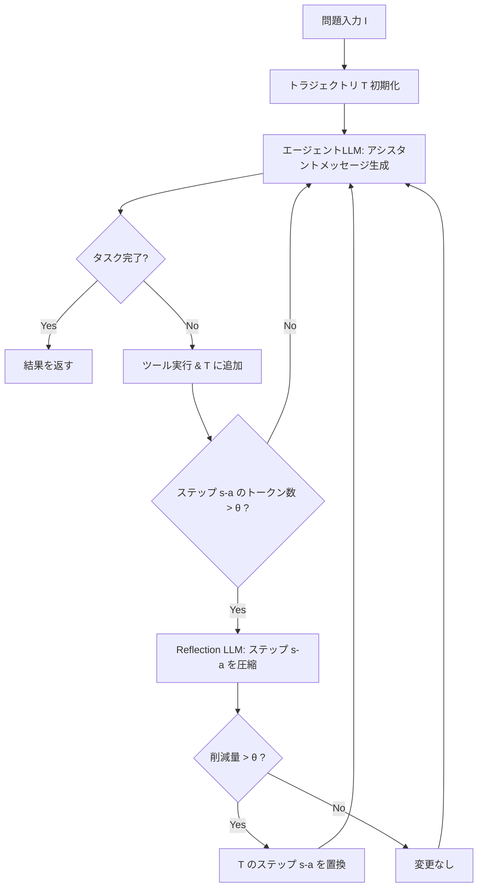

## 論文概要（Abstract）

本記事は [arXiv:2509.23586](https://arxiv.org/abs/2509.23586) の解説記事です。

マルチターンLLMエージェントはソフトウェアエンジニアリングタスクで高い性能を発揮するが、ターンを重ねるごとに入力トークンが蓄積し、コストが急増する問題を抱えている。著者らはコーディングエージェントのトラジェクトリ（実行軌跡）を手動分析し、無駄情報（useless）、冗長情報（redundant）、期限切れ情報（expired）の3種類の情報浪費が広範に存在することを発見した。この知見に基づき、推論時にトラジェクトリを圧縮する手法AgentDietを提案している。SWE-bench VerifiedおよびMulti-SWE-bench Flashの2ベンチマークで評価した結果、エージェント性能を維持しつつ入力トークンを39.9%-59.7%、総コストを21.1%-35.9%削減したと報告されている。

この記事は [Zenn記事: Codex CLI×AGENTS.mdでモノレポのサブエージェント分割とトークン削減を設計する](https://zenn.dev/0h_n0/articles/4b48fc9d7a50a9) の深掘りです。

## 情報源

- **arXiv ID**: 2509.23586
- **URL**: [https://arxiv.org/abs/2509.23586](https://arxiv.org/abs/2509.23586)
- **著者**: Yuan-An Xiao, Pengfei Gao, Chao Peng, Yingfei Xiong
- **発表年**: 2025（初版）、2026年3月改訂
- **分野**: cs.SE, cs.AI
- **採択**: FSE 2026（ACM SIGSOFT International Symposium on the Foundations of Software Engineering）
- **DOI**: 10.1145/3797084
- **データ**: [https://doi.org/10.6084/m9.figshare.30073654](https://doi.org/10.6084/m9.figshare.30073654)

## 背景と動機（Background & Motivation）

2025年9月時点で、OpenRouterにおけるClaude 4 Sonnetの日次トークン消費量は1000億トークンに達しており、そのうち約99%が入力トークンであったと著者らは報告している。この入力トークンの大部分は、マルチターンエージェントのトラジェクトリに蓄積された過去のやり取りである。

LLMエージェントは各ステップでシステムメッセージ、全過去メッセージ、新たなツール実行結果をまとめてLLMに送信する。ステップ数が増えるほど入力トークンは線形に増大し、SWE-bench Verifiedの1課題あたり平均で累計約100万トークンが消費される。この蓄積構造が高コストの根本原因である。

既存手法としてツール出力の16KB打ち切り（Trae Agent）やLLM圧縮（Cursor、Claude Code）があるが、情報の質を考慮した体系的な削減ではない。著者らは100件のトラジェクトリを手動分析し、打ち切り後もなお大量の無駄が残存していることを確認した。

## 主要な貢献（Key Contributions）

- **3種類の情報浪費の体系化**: コーディングエージェントのトラジェクトリに含まれる無駄情報を、useless・redundant・expiredの3カテゴリに分類し、定義した
- **AgentDiet手法の提案**: 推論時にトラジェクトリを圧縮するreflectionモジュールを設計。エージェント自体を変更せず、外部モジュールとして動作する
- **大規模実証実験**: 2つのLLM（Claude 4 Sonnet、Gemini 2.5 Pro）と2つのベンチマーク（SWE-bench Verified、Multi-SWE-bench Flash）で有効性を検証し、性能を維持しつつ大幅なコスト削減を達成

## 技術的詳細（Technical Details）

### 3種類の情報浪費

著者らは100件のTrae Agent（Claude 4 Sonnet使用）のトラジェクトリをSWE-bench Verified上で手動分析し、以下の3カテゴリを定義している。

**Useless情報**: タスクに無関係なコンテンツ。具体例として、ファイル一覧に含まれる`__pycache__`や`.egg-info`、GNU makeの`Entering/Leaving directory`メッセージ、テスト実行結果中の全テスト一覧（失敗したのは1件のみ）などが挙げられている。

**Redundant情報**: トラジェクトリ内で重複するコンテンツ。`str_replace_editor`では`new_str`がレスポンスに再出現し、`old_str`と`new_str`の共通部分や以前のステップで表示済みのコードも重複となる。

**Expired情報**: 一時的に必要だったが不要になったコンテンツ。grepで複数ファイルを開いた後、問題ファイル特定後に他のファイル内容は不要となる。

### AgentDietのアーキテクチャ

AgentDietは、エージェントのメインループの外側に配置されるreflectionモジュールとして動作する。エージェント自体には変更を加えず、外部システムが各ステップ後にreflectionを呼び出す設計である。



### アルゴリズム詳細

AgentDietのコアアルゴリズムは以下のパラメータで制御される。

- $a$: 遅延パラメータ。現在のステップ$s$から$a$ステップ前のステップを圧縮対象とする
- $b$: コンテキストパラメータ。圧縮対象ステップの前$b$ステップ分をコンテキストとして提供する
- $\theta$: トークン数の閾値。圧縮対象ステップが$\theta$以下の場合はスキップし、削減量が$\theta$未満の場合も適用しない

ステップ$s$において、reflectionモジュールはステップ$s - a$を圧縮対象とし、ステップ$\max(0, s - a - b)$からステップ$s$までをコンテキストとして使用する。この設計により、1回のreflection呼び出しで処理するトークン数は最大$a + 1 + b$ステップ分に制限される。

圧縮効率の指標として、著者らはKeep%を定義している。

$$
\text{Keep\%} = \frac{\sum l_{\text{reduced}}}{\sum l_{\text{orig}}} \times 100
$$

ここで、$l_{\text{orig}}$は圧縮対象ステップの元のトークン数、$l_{\text{reduced}}$は圧縮後のトークン数である。

```python
def agentdiet_loop(
    problem: str, env: Environment,
    agent_llm: LLM, reflect_llm: LLM,
    a: int = 2, b: int = 1, theta: int = 500, s_max: int = 50,
) -> str:
    """AgentDietのメインループ（擬似コード）"""
    trajectory: list[Step] = initialize(problem)

    for s in range(1, s_max + 1):
        assistant_msg = agent_llm.generate(trajectory)
        if assistant_msg.signals_completion():
            return "finished"
        tool_result = env.execute(assistant_msg.tool_call)
        trajectory.append(Step(assistant_msg, tool_result))

        # Reflectionフェーズ: ステップ s-a を圧縮
        target_idx = s - a
        if target_idx <= 0:
            continue
        l_orig = trajectory[target_idx].token_count()
        if l_orig <= theta:
            continue

        context = trajectory[max(0, target_idx - b) : s + 1]
        reduced = reflect_llm.reduce(target=trajectory[target_idx], context=context)
        if l_orig - reduced.token_count() > theta:
            trajectory[target_idx] = reduced

    return "interrupted"
```

### なぜ自己削減は失敗するか

著者らはエージェント自身にトラジェクトリを編集させる`erase`ツールを試みたが、Claude 4 SonnetもGemini 2.5 Proも明示的なプロンプト下でさえこのツールを無視し、元のタスク作業を続行したと報告している。モデルが学習時に獲得した修復手順への帰納バイアスが原因と推測され、エージェントとは独立した外部reflectionモジュールの設計に至っている。

## 実装のポイント（Implementation）

AgentDietを実際のコーディングエージェントに適用する際の重要な設計判断を整理する。

**Reflection LLMの選択**: 5種類のLLMを比較し、GPT-5 miniを選択している。Originalと同等のPass%（65%）を達成しつつ唯一ステップ数を削減した（39.74 → 38.90）モデルであった。

**ハイパーパラメータチューニング**: Hill climbing法で初期値から2イテレーションで収束。最終設定は$\theta=500$、$a=2$、$b=1$、GPT-5 miniである。

**KVキャッシュとの親和性**: reflectionは常に1つの固定的な過去ステップのみを書き換えるため、それ以前のステップに対するKVキャッシュは無効化されない。これは推論基盤のキャッシュ機構と互換性が高い設計である。

**コスト具体例**: SWE-bench Verified上でClaude 4 Sonnet使用時、1課題あたりのコストはOriginal $0.535からAgentDiet適用後$0.422に削減されている（reflectionオーバーヘッド込み）。

## Production Deployment Guide

AgentDietのトラジェクトリ圧縮をコーディングエージェント基盤に組み込む際のAWSデプロイパターンを示す。

### AWS実装パターン（コスト最適化重視）

AgentDietは2つのLLM呼び出し（エージェントLLMとreflection LLM）を組み合わせるため、それぞれのコスト最適化が重要となる。

**Small構成（~100 req/日）: Serverless**
- Lambda（reflection処理、512MB、30秒タイムアウト）+ Bedrock（エージェントLLM）+ DynamoDB（トラジェクトリ保存）
- reflection LLMにはBedrock上の低コストモデルを使用
- 月額概算: $80-200（Bedrockトークン費用がドミナント）
- 注: コスト試算は2026年10月時点のap-northeast-1リージョン概算。トラフィックパターンにより変動

**Medium構成（~1000 req/日）: Hybrid**
- ECS Fargate（エージェントオーケストレーション）+ Bedrock（LLM呼び出し）+ ElastiCache（トラジェクトリキャッシュ）
- reflection処理をバッチ化してBedrock Batch API使用で50%削減
- 月額概算: $500-1200

**Large構成（10000+ req/日）: Container**
- EKS + Karpenter（Spot Instances優先）+ Bedrock + S3（トラジェクトリストレージ）
- Spot Instancesで最大90%のコンピュートコスト削減
- Reserved Capacity for Bedrockで最大72%のLLMコスト削減
- 月額概算: $3,000-8,000

### Terraformインフラコード

**Small構成（Serverless）**:

```hcl
# AgentDiet Reflection Lambda + DynamoDB（2026-10時点）

resource "aws_lambda_function" "reflection" {
  function_name = "agentdiet-reflection"
  runtime       = "python3.12"
  handler       = "handler.lambda_handler"
  role          = aws_iam_role.agentdiet_lambda.arn
  memory_size   = 512
  timeout       = 30

  environment {
    variables = {
      THETA          = "500"
      DELAY_A        = "2"
      CONTEXT_B      = "1"
      REFLECT_MODEL  = "anthropic.claude-3-5-haiku-20241022-v1:0"
      DYNAMODB_TABLE = aws_dynamodb_table.trajectory.name
    }
  }
}

resource "aws_dynamodb_table" "trajectory" {
  name         = "agentdiet-trajectories"
  billing_mode = "PAY_PER_REQUEST"  # On-Demandでコスト最適化
  hash_key     = "session_id"
  range_key    = "step_id"

  attribute { name = "session_id"; type = "S" }
  attribute { name = "step_id";    type = "N" }

  ttl { attribute_name = "expires_at"; enabled = true }
  server_side_encryption { enabled = true }  # KMS暗号化
}

resource "aws_cloudwatch_metric_alarm" "bedrock_cost" {
  alarm_name          = "agentdiet-bedrock-token-spike"
  comparison_operator = "GreaterThanThreshold"
  evaluation_periods  = 1
  metric_name         = "InputTokenCount"
  namespace           = "AWS/Bedrock"
  period              = 3600
  statistic           = "Sum"
  threshold           = 1000000
  alarm_actions       = [aws_sns_topic.alerts.arn]
}
```

**Large構成（Container）**:

```hcl
# EKS + Karpenter（Spot優先）構成
module "eks" {
  source          = "terraform-aws-modules/eks/aws"
  version         = "~> 20.0"
  cluster_name    = "agentdiet-cluster"
  cluster_version = "1.31"
  vpc_id          = module.vpc.vpc_id
  subnet_ids      = module.vpc.private_subnets
  cluster_endpoint_public_access = false
}

resource "kubectl_manifest" "karpenter_nodepool" {
  yaml_body = yamlencode({
    apiVersion = "karpenter.sh/v1"
    kind       = "NodePool"
    metadata   = { name = "agentdiet-pool" }
    spec = {
      template.spec.requirements = [
        { key = "karpenter.sh/capacity-type", operator = "In", values = ["spot", "on-demand"] },
        { key = "node.kubernetes.io/instance-type", operator = "In",
          values = ["m7i.xlarge", "m7a.xlarge", "m6i.xlarge"] }
      ]
      limits     = { cpu = "128", memory = "512Gi" }
      disruption = { consolidationPolicy = "WhenEmptyOrUnderutilized", consolidateAfter = "30s" }
    }
  })
}

resource "aws_budgets_budget" "monthly" {
  name         = "agentdiet-monthly"
  budget_type  = "COST"
  limit_amount = "5000"
  limit_unit   = "USD"
  time_unit    = "MONTHLY"

  notification {
    comparison_operator       = "GREATER_THAN"
    threshold                 = 80
    threshold_type            = "PERCENTAGE"
    notification_type         = "ACTUAL"
    subscriber_sns_topic_arns = [aws_sns_topic.alerts.arn]
  }
}
```

### 運用・監視設定

**CloudWatch Logs Insights: トークン使用量分析**

```
fields @timestamp, @message
| filter @message like /token/
| stats sum(input_tokens) as total_input, sum(reflection_tokens) as overhead,
        avg(input_tokens) as avg_per_step by bin(1h) as hour
| sort hour desc
```

**X-Ray トレーシング + Cost Explorer日次レポート（Python）**:

```python
from aws_xray_sdk.core import xray_recorder, patch_all
import boto3
from datetime import date, timedelta

patch_all()  # boto3自動計装

@xray_recorder.capture("reflection_step")
def run_reflection(trajectory: list, target_idx: int) -> dict:
    """Reflectionステップをトレーシング付きで実行する"""
    xray_recorder.current_subsegment().put_annotation("step_idx", target_idx)
    result = invoke_reflect_llm(trajectory, target_idx)
    xray_recorder.current_subsegment().put_metadata("tokens_saved", result["tokens_saved"])
    return result

def daily_cost_report() -> None:
    """日次コストレポート取得、$100超過でSNS通知する"""
    ce = boto3.client("ce", region_name="us-east-1")
    resp = ce.get_cost_and_usage(
        TimePeriod={"Start": (date.today() - timedelta(days=1)).isoformat(),
                    "End": date.today().isoformat()},
        Granularity="DAILY", Metrics=["UnblendedCost"],
        Filter={"Tags": {"Key": "Project", "Values": ["agentdiet"]}},
        GroupBy=[{"Type": "DIMENSION", "Key": "SERVICE"}],
    )
    total = sum(float(g["Metrics"]["UnblendedCost"]["Amount"])
                for r in resp["ResultsByTime"] for g in r["Groups"])
    if total > 100:
        boto3.client("sns", region_name="ap-northeast-1").publish(
            TopicArn="arn:aws:sns:ap-northeast-1:ACCOUNT:agentdiet-alerts",
            Subject="AgentDiet Daily Cost Alert",
            Message=f"Daily cost ${total:.2f} exceeds $100 threshold",
        )
```

### コスト最適化チェックリスト

**アーキテクチャ選択**: トラフィック量に応じた構成選択 / Reflection LLMに低コストモデル使用 / TTL付きストレージ

**リソース最適化**: Spot Instances優先（最大90%削減） / Reserved Instances 1年コミット（最大72%削減） / Savings Plans検討 / Lambda 512MB最適化 / Karpenterアイドル時スケールダウン / DynamoDB On-Demand

**LLMコスト削減**: Bedrock Batch APIでreflectionバッチ化（50%削減） / Prompt Caching有効化（30-90%削減） / $\theta$閾値で不要reflection呼び出しスキップ / エージェントLLMは高性能・reflection LLMは低コスト

**監視・アラート**: AWS Budgets月額80%閾値 / CloudWatch Bedrockトークンスパイク検知 / Cost Anomaly Detection / Cost Explorer日次レポート+SNS / X-Rayレイテンシトレーシング

**リソース管理**: NAT Gateway不要時削除 / Project/Environmentタグ必須 / DynamoDB TTL自動削除 / 開発環境夜間停止 / CloudWatch Logs保持30日

## 実験結果（Results）

### 実験設定

著者らはTrae Agent（当時SWE-bench Verified 1位）を対象に、Claude 4 SonnetとGemini 2.5 Proの2つのLLMで評価を行っている。ベンチマークはSWE-bench Verified（200インスタンス、最大50ステップ）とMulti-SWE-bench Flash（300インスタンス、7言語、最大100ステップ）である。ハイパーパラメータはSWE-bench Verifiedの別の100インスタンスでHill climbing法により最適化されている。

### 主要結果（論文Table 4より）

| 指標 | SbV+Claude | SbV+Gemini | MSbF+Claude | MSbF+Gemini |
|------|-----------|-----------|------------|------------|
| Keep% | 30.8 | 22.6 | 30.2 | 25.7 |
| 入力トークン（正規化） | 0.601 | 0.591 | 0.596 | 0.403 |
| エージェントコスト（正規化） | 0.714 | 0.623 | 0.676 | 0.559 |
| Reflectionオーバーヘッド | 7.4% | 11.8% | 5.5% | 8.2% |
| Pass%（Original → AgentDiet） | 64.5 → 66.5 | 50.5 → 52.0 | 40.0 → 39.0 | 21.7 → 22.7 |
| ステップ数（Original → AgentDiet） | 39.62 → 39.95 | 37.98 → 37.44 | 70.37 → 70.45 | 57.20 → 43.90 |

入力トークンは39.9%-59.7%削減され、reflectionオーバーヘッド込みの総コストは21.1%-35.9%削減されている。Pass%の変動は-1.0%から+2.0%の範囲であり、著者らは性能劣化は認められないと報告している。

### ステップ数削減効果

Gemini 2.5 Pro + Multi-SWE-bench Flashでは平均ステップ数が57.20から43.90に減少し、100ステップ上限到達インスタンスが66から26に大幅減少した。不要情報の除去によりLLMの迷走が抑制されると著者らは分析している。

### Reflection LLM比較（論文Table 2より）

| Reflection LLM | Keep% | 入力トークン | Pass% | ステップ数 | Reflectionコスト |
|---------------|-------|------------|-------|----------|----------------|
| Claude 3.5 Haiku | 14.4 | 0.473 | 60 | 42.39 | 14.8% |
| Gemini 2.5 Flash | 21.9 | 0.553 | 63 | 40.95 | 7.8% |
| **GPT-5 mini** | **28.6** | **0.586** | **65** | **38.90** | **7.7%** |
| DeepSeek v3 | 23.7 | 0.606 | 64 | 40.41 | 5.2% |
| Qwen 3 | 29.0 | 0.722 | 62 | 41.10 | 6.5% |

Claude 3.5 Haikuは最も積極的に圧縮する（Keep% 14.4%）がPass%が60に低下しており、過度な圧縮が情報損失を招くことを示唆している。GPT-5 miniは圧縮の積極性と情報保持のバランスが最も良いと著者らは評価している。

### 具体例: pytest-dev__pytest-6202

テストスイート実行出力にパスした全テスト一覧が含まれていた（useless情報）。元の1,995トークンのうち1,714が浪費であり、GPT-5 miniがパステスト一覧を短い要約に置換し、圧縮後259トークン（約87%削減）となった。

## 実運用への応用（Practical Applications）

AgentDietの知見は、Codex CLIやClaude Codeのコンテキスト管理と直接関連する。Zenn記事で解説したAGENTS.mdによるサブエージェント分割はタスク分割でトラジェクトリ長を短縮するマクロレベルのアプローチであり、AgentDietはミクロレベルで個々のトラジェクトリ内の浪費を除去する。両者は相補的に機能する。

**CI/CDパイプラインへの統合**: reflectionモジュールはエージェント非依存の外部モジュールであるため、既存パイプラインにコスト削減ミドルウェアとして組み込みやすい。Keep%指標によるタスク別トークン消費の事前推定も予算管理に有用である。

## 関連研究（Related Work）

- **LLMLingua-2**: トークンレベルのプロンプト圧縮手法。ベースライン比較では入力トークン正規化0.603でAgentDiet（0.586）より多く残し、Pass%も61%対65%と下回った。汎用圧縮ではドメイン知識が欠落する問題が示唆される
- **Lindenbauer et al. (2025)**: 並行開発された手法で、Deleteベースラインに10ステップ遅延を加えたもの。情報を完全削除するため性能低下リスクがある
- **DietCode (Zhang et al., 2022)**: コード特化の圧縮手法。AgentDietはコードに限らずツール出力全般を対象とする点で適用範囲が広い

## まとめと今後の展望

AgentDietは3種類の情報浪費（useless・redundant・expired）を推論時にLLMベースで除去する手法であり、入力トークンを最大59.7%、総コストを最大35.9%削減できることがFSE 2026で報告されている。

制約として1エージェント（Trae Agent）のみでの検証であり、マルチエージェントへの適用やレイテンシ影響は未検証である。今後はself-reduction手法や軽量reflectionモデルの開発が期待される。

## 参考文献

- **arXiv**: [https://arxiv.org/abs/2509.23586](https://arxiv.org/abs/2509.23586)
- **DOI**: [10.1145/3797084](https://doi.org/10.1145/3797084)
- **Artifacts**: [figshare.30073654](https://doi.org/10.6084/m9.figshare.30073654)
- **Related Zenn article**: [https://zenn.dev/0h_n0/articles/4b48fc9d7a50a9](https://zenn.dev/0h_n0/articles/4b48fc9d7a50a9)
