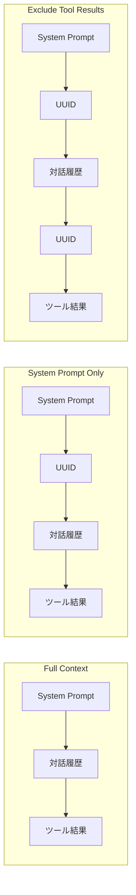

本記事は https://arxiv.org/abs/2601.06007 の解説記事です。

## 論文概要（Abstract）

LLMベースのエージェントシステムでは、マルチターン対話を通じて入力コンテキストが累積的に増大し、APIコストとレイテンシが問題となる。本論文でLumer, Nizar, Jangiti, Frank, Gulati, Phadate, Subbiah らは、OpenAI・Anthropic・Google の3プロバイダ4モデルに対し、3種のプロンプトキャッシュ戦略を500以上のエージェントセッションで体系的に評価している。著者らは、システムプロンプトキャッシュだけでAPIコスト41--80%削減、Time to First Token（TTFT）6--31%改善が達成可能であると報告している。

この記事は [Zenn記事: Claude Code×GitHub Actionsで構築するPR自動レビューの誤検知削減とコスト最適化](https://zenn.dev/0h_n0/articles/5ee2c4913ba8aa) の深掘りです。

## 情報源

- **arXiv ID**: 2601.06007
- **URL**: [https://arxiv.org/abs/2601.06007](https://arxiv.org/abs/2601.06007)
- **著者**: Elias Lumer, Faheem Nizar, Akshaya Jangiti et al.（7名）
- **発表年**: 2026（v1: 2026年1月9日、v2: 2026年1月31日）
- **分野**: cs.CL

## 背景と動機（Background & Motivation）

LLMのAPI呼び出しでは入力トークン数に比例した課金が発生する。エージェントシステムではツール呼び出し結果やマルチターンの対話履歴がコンテキストに蓄積され、セッションが長くなるほどコストが膨らむ。特にDeepResearch Bench（PhDレベルの研究質問100問）のようなタスクでは50回を超えるツール呼び出しも珍しくない。

主要プロバイダ（OpenAI、Anthropic、Google）はいずれもプロンプトキャッシュ機構を提供しているが、課金体系はプロバイダごとに異なる。OpenAIとGoogleは自動キャッシュ（書き込みコストなし）を採用する一方、Anthropicはキャッシュブレイクポイントの明示的指定が必要で書き込みコストも発生する。著者らは、エージェントタスクに適したキャッシュ戦略を体系的に比較した先行研究がないことを指摘し、本評価研究を実施している。

## 主要な貢献（Key Contributions）

- **3プロバイダ4モデルの横断比較**: GPT-5.2、GPT-4o、Claude Sonnet 4.5、Gemini 2.5 Proの4モデルに対し統一条件下でキャッシュ効果を定量評価
- **3種のキャッシュ戦略の体系化**: Full Context（全文キャッシュ）、System Prompt Only（システムプロンプトのみ）、Exclude Tool Results（ツール結果除外）の3戦略を定義し、モデルごとの適性を分析
- **スケーリング特性のアブレーション**: プロンプトサイズ（500--50,000トークン）とツール呼び出し回数（3--50回）の2軸でキャッシュ効果のスケーリングを評価
- **実装ベストプラクティスの提示**: UUID挿入によるキャッシュ制御手法と、プロバイダ別の推奨戦略を実験に基づいて提示

## 技術的詳細（Technical Details）

### プロンプトキャッシュの動作原理

プロンプトキャッシュは、API呼び出し間で共通するプレフィックス部分をサーバ側に保持し、再利用することで入力トークンの処理コストを削減する機構である。LLMの推論ではKey-Value（KV）キャッシュとして内部的にも利用されているが、ここではAPIレベルのキャッシュを指す。

キャッシュのヒット判定は**最長プレフィックスマッチ**に基づく。すなわち、リクエスト先頭から連続して一致するトークン列が対象となり、途中で不一致が発生した時点以降はキャッシュミスとなる。

$$
C_{\text{total}} = C_{\text{hit}} \cdot N_{\text{cached}} + C_{\text{input}} \cdot N_{\text{uncached}} + C_{\text{output}} \cdot N_{\text{output}}
$$

ここで、
- $C_{\text{hit}}$: キャッシュヒット時の1トークンあたりコスト（通常入力の10--50%）
- $N_{\text{cached}}$: キャッシュヒットしたトークン数
- $C_{\text{input}}$: 通常の入力トークンコスト
- $N_{\text{uncached}}$: キャッシュミスしたトークン数
- $C_{\text{output}}$: 出力トークンコスト
- $N_{\text{output}}$: 出力トークン数

### 3つのキャッシュ戦略

著者らは、UUID（ランダム文字列）の挿入位置を変えることでキャッシュの適用範囲を制御する手法を考案している。UUIDを挿入するとその位置以降のプレフィックスマッチが強制的に破壊されるため、キャッシュ対象を精密に制御できる。



**戦略1: Full Context（全文キャッシュ）**

UUIDを一切挿入せず、プロバイダの自動キャッシュに完全に委ねる。プレフィックスが一致する限り最大限キャッシュされるが、ツール結果など動的な部分が変わるとその位置以降はすべてキャッシュミスとなる。

**戦略2: System Prompt Only（システムプロンプトのみキャッシュ）**

システムプロンプトの直後にUUIDを挿入し、システムプロンプト部分のみを確実にキャッシュさせる。ツール定義やシステム指示は通常セッション中に変化しないため、安定したキャッシュヒット率が期待できる。

**戦略3: Exclude Tool Results（ツール結果除外）**

システムプロンプト後と各ツール結果の後にUUIDを挿入する。ツール結果は実行ごとに変化するため、それをキャッシュから除外することで中間のプロンプト部分のキャッシュヒットを維持する狙いがある。

### 実験設定

著者らは以下の条件で実験を実施している。

- **ベンチマーク**: DeepResearch Bench（22分野にわたるPhDレベルの研究質問100問）
- **セッション数**: モデル×キャッシュ条件ごとに40セッション、合計500以上
- **システムプロンプト**: 10,000トークン
- **計測指標**: APIコスト（USD）およびTime to First Token（TTFT、ミリ秒）

各モデルのトークン単価（2026年1月時点、USD/1Mトークン）は以下の通りである。

| モデル | 入力 | 出力 | キャッシュ読取 | キャッシュ書込 |
|---|---|---|---|---|
| GPT-4o | 2.50 | 10.00 | 1.25 | --- |
| GPT-5.2 | 1.75 | 14.00 | 0.175 | --- |
| Claude Sonnet 4.5 | 3.00 | 15.00 | 0.30 | 3.75 |
| Gemini 2.5 Pro (≤200K) | 1.25 | 10.00 | 0.125 | --- |

OpenAIとGoogleはキャッシュ書き込みコストが無料である一方、Anthropicはキャッシュ書き込みに通常入力の1.25倍のコストが発生する点が特徴的である。

### アルゴリズム：UUID挿入によるキャッシュ制御

著者らが用いたキャッシュ制御の実装は、APIリクエスト構築時にUUIDを適切な位置に挿入するだけの単純な手法である。

```python
import uuid
from typing import Any


def build_messages_with_cache_strategy(
    system_prompt: str,
    history: list[dict[str, Any]],
    strategy: str,
) -> list[dict[str, Any]]:
    """キャッシュ戦略に基づいてメッセージリストを構築する

    Args:
        system_prompt: システムプロンプト文字列
        history: 対話履歴のリスト
        strategy: "full", "system_only", "exclude_tool" のいずれか
    """
    breaker = str(uuid.uuid4())
    msgs: list[dict[str, Any]] = [{"role": "system", "content": system_prompt}]

    if strategy in ("system_only", "exclude_tool"):
        msgs.append({"role": "system", "content": f"session_id: {breaker}"})

    for msg in history:
        msgs.append(msg)
        if strategy == "exclude_tool" and msg.get("role") == "tool":
            msgs.append({"role": "system", "content": f"break: {uuid.uuid4()}"})

    return msgs
```

この実装により、同一のシステムプロンプトは常にキャッシュヒットし、動的に変化する部分のみキャッシュミスとなるよう制御できる。

## 実装のポイント（Implementation）

著者らの実験から導かれる実装上の注意点を整理する。

**キャッシュブレイクポイントの位置**: Anthropicでは`cache_control: {"type": "ephemeral"}`の位置が重要で、システムプロンプト末尾に1つだけ配置するのが最も安定する。

**最小トークン閾値**: Anthropicは1,024トークン以上が必要であり、短すぎるとキャッシュが機能しない。500トークンではTTFTがむしろ10--18%悪化するケースが報告されている。

**動的要素の排除**: タイムスタンプやセッションIDをシステムプロンプトに含めるとキャッシュヒット率が0%になる。これらはユーザメッセージに配置すべきである。

**ツール定義の固定**: ツール定義セットをリクエスト間で一定に保つことでキャッシュヒットを維持する。動的なツール追加・削除はキャッシュミスを引き起こす。

## 実験結果（Results）

### メイン結果

著者らは、キャッシュなし（ベースライン）と比較した各モデル・各戦略のコスト削減率およびTTFT改善率を報告している（論文Table 1, Table 2相当）。

**モデル別の最良キャッシュ戦略**:

| モデル | 最良戦略 | コスト削減 | TTFT改善 |
|---|---|---|---|
| GPT-5.2 | Exclude Tool Results | 79.6% | 13.0% |
| Claude Sonnet 4.5 | System Prompt Only | 78.5% | 22.9% |
| Gemini 2.5 Pro | System Prompt Only | 41.4% | 6.1% |
| GPT-4o | System Prompt Only | 45.9% | 30.9% |

GPT-5.2はキャッシュ読取単価が入力の10%（$0.175 vs $1.75）と低いため、コスト削減効果が大きい。Claude Sonnet 4.5もキャッシュ読取が入力の10%であり同様の削減率を達成しているが、キャッシュ書き込みコスト（$3.75/1Mトークン）が発生するため、「Exclude Tool Results」戦略では書き込みコストが増加し、「System Prompt Only」戦略がわずかに優位となっている。

**全戦略の詳細比較（コスト削減% / TTFT改善%）**:

| モデル | Full Context | System Prompt Only | Exclude Tool Results |
|---|---|---|---|
| GPT-5.2 | 79.3% / 9.5% | 81.4% / 10.5% | 79.6% / 13.0% |
| Claude Sonnet 4.5 | 77.8% / 21.8% | 78.5% / 22.9% | 78.1% / 20.9% |
| Gemini 2.5 Pro | 38.3% / 6.0% | 41.4% / 6.1% | 27.8% / -2.9% |
| GPT-4o | 47.8% / -8.8% | 45.9% / 30.9% | 46.8% / 28.1% |

Gemini 2.5 Proのコスト削減率が他モデルより低い理由について、著者らはキャッシュ読取単価が入力の10%（$0.125 vs $1.25）である点では同等だが、元の入力トークン単価が$1.25と低いため、絶対的な削減額が小さくなると分析している。GPT-4oのFull ContextでTTFTが-8.8%（悪化）となった点は、自動キャッシュの管理オーバーヘッドがレイテンシに影響した可能性があると指摘されている。

### アブレーション：プロンプトサイズの影響

著者らは、システムプロンプトのサイズを500--50,000トークンの範囲で変化させた際のキャッシュ効果を報告している。

**50,000トークンでの結果**:

| モデル | ベースラインコスト | キャッシュ後コスト | コスト削減率 |
|---|---|---|---|
| GPT-5.2 | $0.253 | $0.029 | 89% |
| Claude Sonnet 4.5 | $0.667 | $0.080 | 88% |
| GPT-4o | --- | --- | 54% |

GPT-4oではTTFTが4,290msから1,699msへと60%改善している。プロンプトサイズが大きいほどキャッシュヒット時のトークン数が増えるため、削減効果が増大する傾向が確認される。

一方、500トークン（プロバイダの最小閾値を下回る可能性がある）では、TTFTがむしろ10--18%悪化するケースが報告されている。キャッシュ管理のオーバーヘッドがキャッシュヒットの恩恵を上回るためと著者らは推察している。

### アブレーション：ツール呼び出し回数の影響

ツール呼び出し回数を3--50回の範囲で変化させた結果も報告されている。

GPT-5.2はツール呼び出し回数によらず77--81%のコスト削減を維持している。一方、Claude Sonnet 4.5のTTFT改善率はツール呼び出し回数の増加に伴って低下し、3回では19%の改善だったものが50回では5%にまで低下している。著者らは、ツール呼び出し回数が増えるとキャッシュミス部分のトークン数が相対的に増大し、TTFTへの寄与が薄まるためと分析している。

## Production Deployment Guide

本論文のキャッシュ戦略は、PR自動レビューやCI/CDパイプラインなどLLM APIを定常的に呼び出すシステムで直接活用できる。以下にAWS上での実装パターンを示す。

### AWS実装パターン（コスト最適化重視）

**トラフィック量別の推奨構成**:

| 構成 | 想定規模 | アーキテクチャ | 月額目安 |
|---|---|---|---|
| Small | ~100 PR/日 | Lambda + Bedrock + DynamoDB | $50--150 |
| Medium | ~1,000 PR/日 | ECS Fargate + ElastiCache + Bedrock | $300--800 |
| Large | 10,000+ PR/日 | EKS + Karpenter + Spot Instances | $2,000--5,000 |

注: 上記は2026年10月時点のAWS ap-northeast-1（東京）リージョン料金に基づく概算値である。実際のコストはトラフィックパターン、リージョン、バースト使用量により変動する。最新料金はAWS料金計算ツールで確認を推奨する。

**Small構成の詳細**:
- Lambda（512MB、最大60秒）: レビューリクエストごとに起動、月額$5--15
- Bedrock（Claude Sonnet 4.5）: プロンプトキャッシュ有効化で入力コスト78%削減、月額$30--100
- DynamoDB（On-Demandモード）: システムプロンプトバージョン管理・レビュー結果保存、月額$5--15
- CloudWatch: ログ・メトリクス、月額$5--10

**コスト削減テクニック**:
- **Prompt Caching有効化**: 本論文の結果に基づきシステムプロンプト部分をキャッシュすることで入力コスト78--89%削減
- **Bedrock Batch API**: 非リアルタイムのバッチレビューに使用して50%削減
- **Spot Instances活用**: Large構成のワーカーノードをSpotにすることで最大90%削減
- **Reserved Instances**: Mediumの常時起動ECSタスクに対し1年コミットで最大72%削減

### Terraformインフラコード

**Small構成（Serverless）**:

```hcl
# VPCエンドポイント経由でBedrock接続（NAT Gateway不要でコスト削減）
resource "aws_vpc_endpoint" "bedrock" {
  vpc_id              = aws_vpc.main.id
  service_name        = "com.amazonaws.ap-northeast-1.bedrock-runtime"
  vpc_endpoint_type   = "Interface"
  subnet_ids          = aws_subnet.private[*].id
  private_dns_enabled = true
  security_group_ids  = [aws_security_group.vpc_endpoint.id]
}

# IAMロール（最小権限: BedrockのInvokeModelのみ許可）
resource "aws_iam_role_policy" "lambda_bedrock" {
  name = "bedrock-invoke"
  role = aws_iam_role.lambda_role.id
  policy = jsonencode({
    Version = "2012-10-17"
    Statement = [{
      Effect   = "Allow"
      Action   = ["bedrock:InvokeModel"]
      Resource = "arn:aws:bedrock:ap-northeast-1::foundation-model/anthropic.claude-sonnet-4-5-*"
    }]
  })
}

# Lambda関数（キャッシュ戦略を環境変数で設定）
resource "aws_lambda_function" "pr_reviewer" {
  function_name = "pr-review-handler"
  runtime       = "python3.12"
  handler       = "handler.lambda_handler"
  role          = aws_iam_role.lambda_role.arn
  memory_size   = 512  # Power Tuningで最適化推奨
  timeout       = 60
  filename      = "lambda.zip"

  environment {
    variables = {
      CACHE_STRATEGY        = "system_prompt_only"  # 本論文推奨
      SYSTEM_PROMPT_VERSION = "v1"
      DYNAMODB_TABLE        = aws_dynamodb_table.reviews.name
    }
  }
}

# DynamoDB（On-Demandモード、KMS暗号化、PITR有効）
resource "aws_dynamodb_table" "reviews" {
  name         = "pr-review-results"
  billing_mode = "PAY_PER_REQUEST"
  hash_key     = "pr_id"
  range_key    = "review_timestamp"

  attribute { name = "pr_id"; type = "S" }
  attribute { name = "review_timestamp"; type = "S" }

  server_side_encryption { enabled = true; kms_key_arn = aws_kms_key.dynamodb.arn }
  point_in_time_recovery { enabled = true }
}
```

**Large構成（Container）**:

```hcl
# EKSクラスタ（パブリックアクセス無効化）
module "eks" {
  source          = "terraform-aws-modules/eks/aws"
  version         = "~> 20.0"
  cluster_name    = "pr-review-cluster"
  cluster_version = "1.31"
  vpc_id          = aws_vpc.main.id
  subnet_ids      = aws_subnet.private[*].id
  cluster_endpoint_public_access = false
}

# Karpenter NodePool（Spot優先、自動統合・スケールダウン）
resource "kubectl_manifest" "karpenter_provisioner" {
  yaml_body = yamlencode({
    apiVersion = "karpenter.sh/v1"
    kind       = "NodePool"
    metadata   = { name = "pr-review-pool" }
    spec = {
      template = { spec = {
        requirements = [
          { key = "karpenter.sh/capacity-type", operator = "In", values = ["spot", "on-demand"] },
          { key = "node.kubernetes.io/instance-type", operator = "In",
            values = ["m7i.xlarge", "m6i.xlarge", "c7i.xlarge"] },
        ]
      }}
      limits     = { cpu = "100", memory = "400Gi" }
      disruption = { consolidationPolicy = "WhenEmptyOrUnderutilized", consolidateAfter = "30s" }
    }
  })
}

# AWS Budgets（月額$5,000の80%で通知）
resource "aws_budgets_budget" "monthly" {
  name = "pr-review-monthly-budget"
  budget_type = "COST"; limit_amount = "5000"; limit_unit = "USD"; time_unit = "MONTHLY"
  notification {
    comparison_operator = "GREATER_THAN"; threshold = 80; threshold_type = "PERCENTAGE"
    notification_type = "ACTUAL"; subscriber_sns_topic_arns = [aws_sns_topic.alerts.arn]
  }
}
```

### 運用・監視設定

**CloudWatch Logs Insights クエリ（キャッシュヒット率監視）**:

```
fields @timestamp, @message
| filter @message like /cached_tokens|input_tokens/
| stats sum(input_tokens) as total_input,
        sum(cached_tokens) as total_cached,
        sum(cached_tokens) / sum(input_tokens) * 100 as cache_hit_rate
  by bin(1h)
| filter cache_hit_rate < 50
| sort @timestamp desc
```

**X-Rayトレーシング設定（Python）**:

```python
from aws_xray_sdk.core import xray_recorder, patch_all

patch_all()  # boto3自動計装


@xray_recorder.capture("invoke_bedrock_with_cache")
def invoke_with_cache(prompt: str, system_prompt: str) -> dict:
    """キャッシュ戦略付きBedrock呼び出しにトレーシングを追加する"""
    subsegment = xray_recorder.current_subsegment()
    subsegment.put_annotation("cache_strategy", "system_prompt_only")
    subsegment.put_metadata("prompt_length", len(prompt))
    response = call_bedrock(prompt, system_prompt)
    subsegment.put_metadata("cached_tokens", response.get("cached_tokens", 0))
    return response
```

**Cost Explorer日次レポート（Python）**:

```python
import boto3
from datetime import datetime, timedelta


def get_daily_cost_report(sns_topic_arn: str) -> None:
    """日次コストレポートを取得し、$100/日超過でSNS通知する"""
    ce = boto3.client("ce")
    today = datetime.utcnow().strftime("%Y-%m-%d")
    yesterday = (datetime.utcnow() - timedelta(days=1)).strftime("%Y-%m-%d")

    response = ce.get_cost_and_usage(
        TimePeriod={"Start": yesterday, "End": today},
        Granularity="DAILY", Metrics=["UnblendedCost"],
        Filter={"Tags": {"Key": "Project", "Values": ["pr-review"]}},
        GroupBy=[{"Type": "DIMENSION", "Key": "SERVICE"}],
    )
    total = sum(
        float(g["Metrics"]["UnblendedCost"]["Amount"])
        for r in response["ResultsByTime"] for g in r["Groups"]
    )
    if total > 100:
        boto3.client("sns").publish(
            TopicArn=sns_topic_arn, Subject="PR Review Cost Alert",
            Message=f"Daily cost exceeded $100: ${total:.2f}",
        )
```

### コスト最適化チェックリスト

**アーキテクチャ選択**:
- [ ] トラフィック量に応じた構成選択（~100 PR/日: Serverless、~1,000: Hybrid、10,000+: Container）
- [ ] リージョン選択でBedrock料金を比較（us-east-1 vs ap-northeast-1）

**リソース最適化**:
- [ ] EC2/EKS: Spot Instances優先（Karpenterで自動フォールバック、最大90%削減）
- [ ] Reserved Instances/Savings Plans: 常時起動コンポーネントに1年コミット（最大72%削減）
- [ ] Lambda: Power Tuningでメモリサイズ最適化（512MB--1024MB）
- [ ] ECS/EKS: Karpenterでアイドル時ノード統合・スケールダウン

**LLMコスト削減**:
- [ ] Prompt Caching有効化（本論文推奨: システムプロンプトキャッシュで78%削減）
- [ ] Bedrock Batch API使用（非リアルタイム処理で50%削減）
- [ ] モデル振り分け（簡易: Haiku / 詳細: Sonnet）、max_tokens制限
- [ ] システムプロンプトから動的要素を排除してキャッシュヒット率を維持

**監視・リソース管理**:
- [ ] AWS Budgets: 月次予算の80%で通知、Cost Anomaly Detection有効化
- [ ] CloudWatch: Lambda実行時間・Bedrockトークン使用量アラーム
- [ ] 日次コストレポート: Cost Explorer API + SNS通知
- [ ] タグ戦略: `Project`, `Environment`, `CostCenter`必須化
- [ ] CloudWatch Logs保持期間30日、未使用リソース定期棚卸し、開発環境夜間停止

## 実運用への応用（Practical Applications）

PR自動レビューシステムでは、レビュールールやコーディング規約をシステムプロンプトに記述し、PRのdiffをユーザメッセージとして送るパターンが一般的である。システムプロンプトはリクエスト間で不変であるため、「System Prompt Only」戦略により78--89%のコスト削減が見込める。10ファイルのPRでは、2ファイル目以降の9回のAPI呼び出しでキャッシュヒットが期待できる。

ただし、PRレビューではdiff部分がコンテキストの大半を占めるため、システムプロンプトのキャッシュによる削減率は論文のデータよりやや低くなる可能性がある点に留意が必要である。

## 関連研究（Related Work）

- **KV Cache Compression（Liu et al., 2024）**: モデル内部のKVキャッシュ圧縮。本論文はAPIレベルのキャッシュに焦点を当てており補完的である。
- **Prompt Compression（Jiang et al., 2023）**: プロンプト自体を短縮してトークン数を削減する手法。キャッシュ戦略とは直交し、併用で追加削減が可能である。
- **SGLang RadixAttention（Zheng et al., 2024）**: サービングフレームワーク側でプレフィックス共有を最適化する手法。自前ホスティングではRadixAttention、マネージドAPI利用では本論文の戦略が適する。

## まとめと今後の展望

著者らは、エージェントタスクにおけるプロンプトキャッシュの効果をプロバイダ横断で初めて体系的に評価し、システムプロンプトキャッシュだけでAPIコスト41--80%削減、TTFT 6--31%改善が達成可能であることを実証した。実装面では、システムプロンプトから動的要素を排除し、ツール定義セットを固定するという単純な設計原則がキャッシュ効果を最大化する。

今後の方向性として、著者らはキャッシュ戦略の自動選択、マルチテナント環境でのキャッシュ共有、およびプロンプト圧縮との併用効果の評価を挙げている。

## 参考文献

- **arXiv**: [https://arxiv.org/abs/2601.06007](https://arxiv.org/abs/2601.06007)
- **Related Zenn article**: [https://zenn.dev/0h_n0/articles/5ee2c4913ba8aa](https://zenn.dev/0h_n0/articles/5ee2c4913ba8aa)
