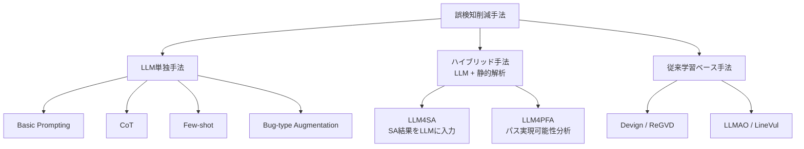

本記事は https://arxiv.org/abs/2601.18844 の解説記事です。

## 論文概要（Abstract）

Du, Feng, Zouらは、Tencent社の広告マーケティングサービス（Advertising and Marketing Services）のコードベースに対する静的解析ツール（SAT: Static Analysis Tool）の誤検知（False Positive）をLLMで自動削減する手法を包括的に評価した。産業規模のデータセット433件のアラーム（うち328件が誤検知、105件が真陽性）を用い、基本的なプロンプティングからハイブリッド手法まで12の手法をGPT-4o、Claude Opus 4、Qwen-3-Coder、DeepSeek-R1の4モデルで検証している。著者らは、LLM4PFA（LLM for Path-Feasibility Analysis）手法が最大94-98%の誤検知除去率（FPR_R）と0.93-0.94の精度を達成したと報告している。

この記事は [Zenn記事: Claude Code×GitHub Actionsで構築するPR自動レビューの誤検知削減とコスト最適化](https://zenn.dev/0h_n0/articles/5ee2c4913ba8aa) の深掘りです。

## 情報源

- **arXiv ID**: 2601.18844
- **URL**: [https://arxiv.org/abs/2601.18844](https://arxiv.org/abs/2601.18844)
- **著者**: Xueying Du, Jiayi Feng, Yi Zou, et al.
- **発表年**: 2026
- **分野**: cs.SE, cs.AI

## 背景と動機（Background & Motivation）

静的解析ツール（SAT）はCI/CDパイプラインに広く統合されているが、産業規模では誤検知率の高さが深刻な運用課題となっている。著者らは、Tencent社内のSAT（BkCheck）においてアラームの約76%が誤検知であり、1件の手動検証に10〜20分を要すると報告している。この「アラーム疲れ」は真のバグの見落としリスクを増大させる。

従来のGNN/Transformerベース手法（Devign、ReGVD、LLMAO、LineVul等）はAST・PDGなど限定的なコード表現に依存し、プログラムの意味的理解に限界があった。LLMの登場により自然言語レベルのコード理解を活用した新アプローチが期待されるが、産業規模での体系的評価は行われていなかった。

## 主要な貢献（Key Contributions）

- **産業規模データセット**: Tencent社の広告マーケティングサービスから収集した433件のアラーム（NPD: 136件、DBZ: 158件、OOB: 139件）による評価
- **12手法の体系的比較**: 基本プロンプティング、CoT、Few-shot、バグタイプ拡張、LLM4SA、LLM4PFAの6手法 × 4モデル + 従来学習ベース手法4種
- **ハイブリッド手法の有効性実証**: 静的解析のパス情報とLLMの意味理解を組み合わせたLLM4PFA手法が最高精度を達成
- **失敗要因の定性分析**: 長文脈推論、カスケード制約、セマンティック理解の3カテゴリで失敗パターンを分類

## 技術的詳細（Technical Details）

### 対象バグタイプと静的解析の基礎

本研究が対象とするバグタイプは以下の3種類である。

| バグタイプ | 略称 | 内容 | データ数 |
|-----------|------|------|---------|
| Null Pointer Dereference | NPD | nullポインタの参照 | 136 |
| Division By Zero | DBZ | ゼロ除算 | 158 |
| Out Of Bounds | OOB | 配列境界外アクセス | 139 |

静的解析ツールはこれらのバグを検出するが、プログラムの実行パスの実現可能性（path feasibility）を完全に判定できないため、誤検知が発生する。例えば、ある変数がnullになるパスが論理的に到達不可能であっても、SATはそれを検知してアラームを出す。

### 評価手法の階層構造



### LLM4PFA: パス実現可能性分析

本研究で最高精度を達成したLLM4PFA（LLM for Path-Feasibility Analysis）は、静的解析ツールが出力するバグレポートの中から**実行パス情報**を抽出し、そのパスが実際に実行可能かどうかをLLMに判定させるハイブリッド手法である。

具体的な処理フローは以下の通りである。

1. **バグレポート解析**: SATが出力したアラームからバグの種類、関連するソースコード、実行パス（source → sink）を抽出
2. **パス情報の構造化**: 静的解析が特定した実行パス上の各分岐条件と変数の状態遷移を構造化テキストとして整理
3. **LLMへの入力構成**: ソースコード、パス情報、バグタイプの説明を統合したプロンプトを構築
4. **判定**: LLMが「このパスは実行可能か（真のバグか）」「このパスは実行不可能か（誤検知か）」を二値分類

LLM4SAとの違いは、LLM4SAがSATの最終的な検出結果（「この行にNPDがある」等）のみをLLMに渡すのに対し、LLM4PFAはパスの**実現可能性分析に必要な中間情報**（分岐条件、変数の定義-使用チェーン等）を含めて渡す点にある。

### 評価指標

著者らは、通常の分類指標に加えて誤検知削減に特化した2つの指標を定義している。

$$
\text{FPR\_P} = \frac{TP_{\text{FP}}}{TP_{\text{FP}} + FN_{\text{FP}}}
$$

$$
\text{FPR\_R} = \frac{TP_{\text{FP}}}{TP_{\text{FP}} + FP_{\text{FP}}}
$$

ここで、
- $TP_{\text{FP}}$: 正しく誤検知と判定されたアラーム数（LLMが「誤検知」と判定し、実際に誤検知だったもの）
- $FN_{\text{FP}}$: 見逃された誤検知の数（LLMが「真のバグ」と判定したが、実際は誤検知だったもの）
- $FP_{\text{FP}}$: 真のバグを誤検知と誤判定した数（LLMが「誤検知」と判定したが、実際は真のバグだったもの）

FPR_P（False Positive Reduction Precision）は「誤検知と判定したもののうち、本当に誤検知だった割合」、FPR_R（False Positive Reduction Recall）は「実際の誤検知のうち、正しく除去できた割合」を表す。産業運用では**FPR_Rの高さ**（多くの誤検知を除去すること）と**Recallの高さ**（真のバグを見落とさないこと）の両立が求められる。

## 実装のポイント（Implementation）

### プロンプト設計の実装例

LLM4PFA手法をCI/CDパイプラインに統合する際の実装パターンを以下に示す。

```python
from dataclasses import dataclass
from enum import Enum


class BugType(Enum):
    """静的解析が検出するバグタイプ"""
    NPD = "Null Pointer Dereference"
    DBZ = "Division By Zero"
    OOB = "Out Of Bounds"


@dataclass(frozen=True)
class SATAlarm:
    """静的解析ツールのアラーム情報"""
    file_path: str
    line_number: int
    bug_type: BugType
    source_code: str
    execution_path: str
    path_conditions: list[str]


def build_llm4pfa_prompt(alarm: SATAlarm) -> str:
    """LLM4PFA手法のプロンプトを構築する

    Args:
        alarm: 静的解析ツールのアラーム情報

    Returns:
        LLMに送信するプロンプト文字列
    """
    conditions = "\n".join(
        f"  - Condition {i+1}: {c}" for i, c in enumerate(alarm.path_conditions)
    )
    return f"""You are a static analysis expert. Determine if this alarm
is a true positive or false positive.

Bug Type: {alarm.bug_type.value}
Source Code:
{alarm.source_code}

Execution Path: {alarm.execution_path}
Path Conditions:
{conditions}

Answer: VERDICT (TRUE_POSITIVE/FALSE_POSITIVE) + REASONING
"""
```

### 実装上の注意点

論文の失敗分析から導出される実装上の重要な考慮事項が3つある。

1. **関数サイズの制限**: 失敗ケースでは成功ケースに比べて平均95.6行多い関数が対象であった（論文Section 5.2より）。LLMのコンテキストウィンドウと推論精度の関係から、巨大な関数は事前に関連部分のみを抽出するスライシングが有効である。

2. **条件分岐の複雑さ対応**: 失敗ケースでは成功ケースに比べて平均21個多い条件文が含まれていた（論文Section 5.2より）。カスケードされた条件の推論はLLMの弱点であるため、静的解析側でパス条件を事前に簡約化する前処理が推奨される。

3. **コスト制御**: API呼び出しコストは1アラームあたり$0.0011〜$0.12と幅がある（論文Table 4より）。モデル選択とバッチ処理によるコスト最適化が不可欠である。

## Production Deployment Guide

本論文はTencent社での産業運用を対象としており、CI/CDパイプラインへの統合に直接適用可能な知見を含んでいる。

### AWS実装パターン（コスト最適化重視）

LLM4PFA手法をAWS上でCI/CDパイプラインに統合する場合のトラフィック量別推奨構成を以下に示す。

| 構成 | 想定規模 | 主要サービス | 月額概算 |
|------|---------|------------|---------|
| Small | ~100 アラーム/日 | Lambda + Bedrock | $50-150 |
| Medium | ~1,000 アラーム/日 | ECS Fargate + Bedrock | $300-800 |
| Large | 10,000+ アラーム/日 | EKS + Spot + Bedrock Batch | $2,000-5,000 |

**Small構成（~100 アラーム/日）**: Lambda関数がGitHub ActionsのWebhookを受信し、静的解析結果をパースしてBedrock（Claude Sonnet）に判定を依頼する。DynamoDBにアラーム履歴と判定結果を保存する。月額内訳はLambda $5、Bedrock $30-100（アラーム数とモデル依存）、DynamoDB $10-15、CloudWatch $5程度。

**Medium構成（~1,000 アラーム/日）**: ECS Fargateでワーカーコンテナを常時稼働させ、SQSキューからアラームをバッチ処理する。並列処理により1日分のアラームを数時間で完了できる。月額内訳はECS Fargate $80-150、Bedrock $200-500、SQS $5、DynamoDB $30-50程度。

**Large構成（10,000+ アラーム/日）**: EKS上でKarpenterによるSpot Instancesの自動スケーリングを行い、Bedrock Batch APIでコストを半減する。月額内訳はEKS $150、EC2 Spot $300-800、Bedrock Batch $1,000-3,000、ElastiCache $100-200程度。

**コスト削減テクニック**:
- Spot Instances活用で計算コスト最大90%削減
- Reserved Instances（1年コミット）で最大72%削減
- Bedrock Batch API使用で推論コスト50%削減
- Prompt Caching有効化で類似アラームの推論コスト30-90%削減

**注意**: 上記コスト試算は2026年10月時点のAWS ap-northeast-1（東京）リージョン料金に基づく概算値である。実際のコストはトラフィックパターン、リージョン、バースト使用量により変動する。最新料金はAWS料金計算ツールで確認を推奨する。

### Terraformインフラコード

**Small構成（Serverless）: Lambda + Bedrock + DynamoDB**

```hcl
# SAT誤検知フィルタ — Small構成（Serverless）
# 月額$50-150、~100アラーム/日対応

resource "aws_iam_role" "sat_filter_lambda" {
  name = "sat-filter-lambda-role"
  assume_role_policy = jsonencode({
    Version = "2012-10-17"
    Statement = [{
      Action = "sts:AssumeRole", Effect = "Allow"
      Principal = { Service = "lambda.amazonaws.com" }
    }]
  })
}

resource "aws_iam_role_policy" "sat_filter_policy" {
  name = "sat-filter-policy"
  role = aws_iam_role.sat_filter_lambda.id
  policy = jsonencode({
    Version = "2012-10-17"
    Statement = [
      { Effect = "Allow", Action = ["bedrock:InvokeModel"]
        Resource = "arn:aws:bedrock:ap-northeast-1::foundation-model/anthropic.claude-sonnet-*" },
      { Effect = "Allow"
        Action = ["dynamodb:PutItem", "dynamodb:GetItem", "dynamodb:Query"]
        Resource = aws_dynamodb_table.alarm_history.arn },
    ]
  })
}

resource "aws_lambda_function" "sat_filter" {
  function_name = "sat-false-positive-filter"
  runtime       = "python3.12"
  handler       = "handler.lambda_handler"
  role          = aws_iam_role.sat_filter_lambda.arn
  timeout       = 120  # LLM応答待ち考慮
  memory_size   = 512
  tracing_config { mode = "Active" }
  environment {
    variables = {
      DYNAMODB_TABLE = aws_dynamodb_table.alarm_history.name
      MODEL_ID       = "anthropic.claude-sonnet-4-20250514"
    }
  }
}

resource "aws_dynamodb_table" "alarm_history" {
  name         = "sat-alarm-history"
  billing_mode = "PAY_PER_REQUEST"  # On-Demand: 低トラフィック最適
  hash_key     = "alarm_id"
  range_key    = "timestamp"
  attribute { name = "alarm_id"; type = "S" }
  attribute { name = "timestamp"; type = "S" }
  server_side_encryption { enabled = true }
  point_in_time_recovery { enabled = true }
}
```

**Large構成（Container）**: EKS（`terraform-aws-modules/eks/aws ~> 20.0`、Kubernetes 1.31）+ KarpenterのNodePool（Spot優先、`m6i.xlarge`/`m6a.xlarge`/`m5.xlarge`で多様化、`WhenEmptyOrUnderutilized`ポリシーで30秒後にアイドルノード回収）+ AWS Budgets（月額$5,000上限、80%到達で通知）の構成を推奨する。

### 運用・監視設定

**CloudWatch Logs Insights クエリ: コスト異常検知**

```
fields @timestamp, @message
| filter @message like /bedrock/
| stats sum(input_tokens) as total_input, sum(output_tokens) as total_output,
        count(*) as invocation_count
  by bin(1h) as hour
| filter invocation_count > 200
| sort hour desc
```

**CloudWatch Logs Insights クエリ: レイテンシ分析**

```
fields @timestamp, duration_ms
| filter event = "llm4pfa_classify"
| stats percentile(duration_ms, 95) as p95,
        percentile(duration_ms, 99) as p99,
        avg(duration_ms) as avg_ms
  by bin(1h) as hour
| sort hour desc
```

**CloudWatch アラーム・X-Ray設定（Python boto3）**

```python
import boto3
from aws_xray_sdk.core import xray_recorder, patch_all

patch_all()  # boto3自動計装


def create_bedrock_alarm(
    cloudwatch: boto3.client,
    sns_topic_arn: str,
    threshold_tokens: int = 100000,
) -> dict:
    """Bedrockトークン使用量スパイク検知アラームを作成する

    Args:
        cloudwatch: CloudWatch クライアント
        sns_topic_arn: 通知先SNSトピックARN
        threshold_tokens: 1時間あたりのトークン閾値

    Returns:
        CloudWatch put_metric_alarm のレスポンス
    """
    return cloudwatch.put_metric_alarm(
        AlarmName="sat-filter-token-spike",
        MetricName="InputTokenCount",
        Namespace="AWS/Bedrock",
        Statistic="Sum",
        Period=3600,
        EvaluationPeriods=1,
        Threshold=threshold_tokens,
        ComparisonOperator="GreaterThanThreshold",
        AlarmActions=[sns_topic_arn],
    )


@xray_recorder.capture("classify_alarm")
def classify_alarm(alarm_id: str, source_code: str) -> str:
    """アラームを分類し、X-Rayにトレース情報を記録する

    Args:
        alarm_id: アラームの一意識別子
        source_code: 解析対象のソースコード

    Returns:
        "TRUE_POSITIVE" または "FALSE_POSITIVE"
    """
    subsegment = xray_recorder.current_subsegment()
    subsegment.put_annotation("alarm_id", alarm_id)
    subsegment.put_metadata("code_length", len(source_code))
    result = invoke_bedrock_model(source_code)
    subsegment.put_annotation("verdict", result)
    return result
```

Cost Explorerによる日次コストレポートは、`get_cost_and_usage` APIでProject タグ「sat-filter」のサービス別コストを集計し、閾値（$100/日）超過時にSNS通知する構成が推奨される。

### コスト最適化チェックリスト

**アーキテクチャ選択**: トラフィック量に応じた構成選択（~100/日: Serverless、~1,000/日: Hybrid、10,000+/日: Container）

**リソース最適化**: Spot Instances優先（最大90%削減）、Reserved Instances 1年コミット（最大72%削減）、Savings Plans検討、Lambda メモリサイズ最適化（512MB推奨）、Karpenterでアイドル時自動スケールダウン、VPCエンドポイントでNAT Gateway削減

**LLMコスト削減**: Bedrock Batch API（50%削減）、Prompt Caching（30-90%削減）、モデル選択ロジック（簡単なケースはHaiku、複雑なケースのみSonnet）、入力トークン数制限（関数スライシング）、キュー経由バッチ処理

**監視・アラート**: AWS Budgets（月額上限80%通知）、CloudWatch アラーム（トークンスパイク検知）、Cost Anomaly Detection、日次コストレポート（SNS経由）

**リソース管理**: 未使用リソース定期削除、タグ戦略（Project/Environment/Owner必須）、ログライフサイクルポリシー（30日→S3 Glacier）、開発環境夜間停止、DynamoDB TTL設定

## 実験結果（Results）

### LLM4PFAの性能比較

著者らが報告したLLM4PFA手法の主要結果を以下に示す（論文Table 2より）。

| モデル | Accuracy | Precision | Recall | F1 | FPR_P | FPR_R |
|--------|----------|-----------|--------|-----|-------|-------|
| GPT-4o | 0.93 | 0.93 | 0.75 | 0.83 | 0.93 | 0.98 |
| Claude Opus 4 | 0.93 | 0.83 | 0.88 | 0.85 | 0.96 | 0.94 |
| Qwen-3-Coder | 0.94 | 0.93 | 0.79 | 0.86 | 0.94 | 0.98 |
| DeepSeek-R1 | 0.93 | 0.84 | 0.86 | 0.85 | 0.95 | 0.95 |

FPR_R（誤検知除去率）はGPT-4oとQwen-3-Coderが0.98で最高であり、全アラームの98%の誤検知を正しく除去できている。一方、Recall（真のバグの検出率）はClaude Opus 4が0.88で最高であり、モデルごとにFPR_RとRecallのトレードオフが存在することがわかる。

### コスト効率の比較

各手法・モデルの処理コストを以下に示す（論文Table 4より）。

| 手法 | モデル | 処理時間(秒/件) | APIコスト($/件) |
|------|--------|-----------------|----------------|
| LLM4PFA | GPT-4o | 12.6 | 0.020 |
| LLM4PFA | Claude Opus 4 | 16.7 | 0.120 |
| LLM4PFA | Qwen-3-Coder | 16.1 | 0.0056 |
| LLM4PFA | DeepSeek-R1 | 58.3 | 0.0025 |

手動レビューが1件あたり10〜20分を要するのに対し、LLM4PFAは12.6〜58.3秒で処理が完了する。コスト面ではDeepSeek-R1が$0.0025/件と最安価だが、処理時間は58.3秒と最長である。GPT-4oは処理時間12.6秒、コスト$0.020/件でバランスが取れている。

1日100件のアラームを処理する場合、GPT-4oで$2.0/日（月額約$60）、DeepSeek-R1で$0.25/日（月額約$7.5）となる。手動レビューの人件費（10分/件 × 100件 = 約16.7時間/日）と比較すると、コスト効率は数桁改善される。

### 従来手法との比較

従来のGNN/Transformerベース手法（Devign、ReGVD、LLMAO、LineVul）はAccuracy 0.50-0.76にとどまり、LLM4PFAの0.93-0.94と大きな差がある（論文Table 2より）。著者らは、従来手法がコードの構造的特徴のみに依存するのに対し、LLM4PFAはパス情報とLLMの意味的理解の組み合わせが精度向上に寄与していると分析している。

### 失敗要因分析

著者らはLLM4PFAが失敗したケースを3カテゴリに分類している（論文Section 5.2より）。

**1. 長文脈推論（Long-Context Reasoning）**: 失敗ケースの関数は成功ケースに比べて平均95.6行長く、LLMのコンテキストウィンドウ内での推論が困難であった。関数全体を入力する必要があるが、長い関数ほど重要な情報が埋もれやすい。

**2. カスケード制約（Cascaded Constraints）**: 失敗ケースでは成功ケースに比べて平均21個多い条件文が存在した。複数の条件が連鎖的に変数の状態を制約する場合、LLMは全ての条件の相互依存関係を追跡しきれない。

**3. セマンティック理解（Semantic Understanding）**: 珍しい構文パターン、ポインタ操作、マクロ展開後のコードなど、LLMの事前学習データに十分に含まれていない可能性があるパターンで失敗が発生した。

### Recallの企業閾値問題

著者らはRecallが0.75-0.88にとどまり、企業が求める90%閾値を下回ることを指摘している。真のバグの10-25%が見落とされるため、LLM4PFAを完全自動化ではなく開発者の手動レビューを補助するフィルタとして活用する運用形態を推奨している。

## 実運用への応用（Practical Applications）

### CI/CDパイプラインへの統合パターン

本論文の知見をGitHub Actions等のCI/CDパイプラインに適用する場合、以下の2段階アプローチが考えられる。

**Phase 1: フィルタリング**: SATが検出したアラームをLLM4PFAで前処理し、高確信度の誤検知を自動除去する。FPR_Rが0.94-0.98であるため、誤検知の大半を除去でき、開発者が確認すべきアラーム数を大幅に削減できる。

**Phase 2: 人間レビュー**: LLM4PFAが「真のバグ」と判定したアラーム、および低確信度の判定結果を開発者が確認する。Recallが90%未満であるため、LLMが「誤検知」と判定したアラームも定期的にサンプリング検査することが推奨される。

### Zenn記事との関連

Zenn記事で扱われているPR自動レビューの誤検知問題は、本論文の静的解析誤検知問題と本質的に同じ構造を持つ。LLM4PFAの「パス情報を補助入力として与える」アプローチは、PRレビューにおいても「変更差分に加えて制御フロー・データフロー情報を入力する」形で応用できる。コスト面でのモデル使い分け（簡易ケースは軽量モデル、複雑ケースは高性能モデル）も共通する設計パターンである。

## 関連研究（Related Work）

- **Devign (Zhou et al., 2019)**: GNNベースの脆弱性検出。コードをAST+CFG+DFGのグラフ構造で表現し分類。本データセットではAccuracy 0.50-0.65にとどまった。
- **LLMAO (Wen et al., 2024)**: LLMの埋め込みベクトルを特徴量として活用する手法。パス情報は考慮しない。Accuracy 0.52-0.72。
- **LineVul (Fu & Tantithamthavorn, 2022)**: RoBERTaベースの行レベル脆弱性検出。DBZタスクではLLM4PFAと同等の性能を示す場面もあった。

## まとめと今後の展望

本論文は、LLMを活用した静的解析の誤検知削減について、産業規模で初めて体系的な評価を行った研究である。LLM4PFA手法がFPR_R 0.94-0.98、Accuracy 0.93-0.94を達成し、従来の学習ベース手法を大幅に上回ることが示された。一方で、Recallは0.75-0.88にとどまり、完全自動化には課題が残る。

今後の研究方向として、著者らは長文脈推論能力の向上（コードスライシングとの組み合わせ）、カスケード制約の事前簡約化、Confidence-based Filteringの導入を挙げている。実務的には、LLMの判定結果に対する確信度スコアを活用し、低確信度のケースのみ人間レビューに回すハイブリッド運用が現実的な適用形態として期待される。

## 参考文献

- **arXiv**: [https://arxiv.org/abs/2601.18844](https://arxiv.org/abs/2601.18844)
- **Related Zenn article**: [https://zenn.dev/0h_n0/articles/5ee2c4913ba8aa](https://zenn.dev/0h_n0/articles/5ee2c4913ba8aa)
