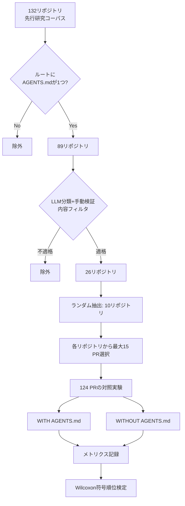

## 論文概要（Abstract）

本記事は [arXiv:2601.20404](https://arxiv.org/abs/2601.20404) の解説記事です。AGENTS.mdファイルがAIコーディングエージェントの実行効率に与える影響を、10リポジトリ・124件のプルリクエストを対象に対照実験で定量評価した研究を解説します。著者らは、AGENTS.mdファイルの有無で同一タスクを実行し、ファイル存在時に実行時間の中央値が28.64%短縮、出力トークン数の中央値が16.58%削減されたと報告しています。タスク完了の質については同等であったとされています。

この記事は [Zenn記事: Codex CLI×AGENTS.mdでモノレポのサブエージェント分割とトークン削減を設計する](https://zenn.dev/0h_n0/articles/4b48fc9d7a50a9) の深掘りです。

## 情報源

- **arXiv ID**: 2601.20404
- **URL**: [https://arxiv.org/abs/2601.20404](https://arxiv.org/abs/2601.20404)
- **著者**: Jai Lal Lulla, Seyedmoein Mohsenimofidi, Matthias Galster, et al.
- **発表年**: 2026（v1: 2026年1月、v2: 2026年3月改訂）
- **分野**: cs.SE, cs.AI, cs.ET, cs.HC
- **会議**: ICSE JAWs 2026
- **ページ数**: 5ページ、1図、1表

## 背景と動機（Background & Motivation）

AIコーディングエージェント（OpenAI Codex、Claude Code、GitLab Duo等）がGitHubプルリクエストの作成・レビューに利用される場面が増加している。これらのエージェントはリポジトリ内のファイルを探索し、コードを理解し、変更を生成するが、その過程で大量のトークンと実行時間を消費する。AGENTS.mdファイルはリポジトリのルートに配置し、プロジェクトの構造・コーディング規約・ビルドコマンド等をエージェントに伝える設定ファイルとして普及しつつある。しかし、このファイルが実際にエージェントの効率にどの程度寄与するかを定量的に評価した研究は存在しなかった。本論文は、AGENTS.mdの有無がエージェントのリソース消費に与える影響を対照実験で初めて定量評価したものである。

## 主要な貢献（Key Contributions）

- **対照実験による定量評価**: 同一タスク・同一リポジトリスナップショットでAGENTS.mdの有無を切り替え、ペア比較を実施した初の研究
- **実行時間の削減効果**: AGENTS.md存在時に実行時間の中央値が28.64%短縮されることを確認（Wilcoxon符号順位検定で有意）
- **出力トークンの削減効果**: 出力トークン数の中央値が16.58%削減されることを確認（同検定で有意）
- **研究ロードマップの提示**: 正確性評価・複数エージェント比較・AGENTS.mdの内容分析等、今後の研究方向を体系的に提示

## 技術的詳細（Technical Details）

### 実験設計

本研究の実験設計は、ペア内比較（paired within-task comparison）を採用している。各タスクに対してAGENTS.mdの有無の2条件で実行し、同一のリポジトリスナップショットとタスク記述を用いることで交絡因子を排除している。



### リポジトリ選定基準

著者らはMohsenimofidi et al.（2026）の132リポジトリコーパスから出発し、以下の基準で絞り込んでいる。

1. **AGENTS.mdの存在**: ルートディレクトリに正確に1つのAGENTS.mdファイルを持つリポジトリを89件抽出
2. **内容フィルタ**: gpt-oss-120b（Ollama経由で実行）でAGENTS.mdの内容を分類し、手動検証を実施。コーディング規約・ベストプラクティス、アーキテクチャ・プロジェクト構造、プロジェクト説明のいずれかを含む26件を選定
3. **ランダムサンプリング**: 26件から10リポジトリをランダムに抽出

### プルリクエスト選定基準

各リポジトリから最大15件のマージ済みPRを選択する。選定条件は以下の通りである。

- 追加行数+削除行数が100行以下
- 変更ファイル数が5ファイル以下
- マージ済みであること
- AGENTS.md導入後に作成・マージされたPR
- コードファイルのみを変更（ドキュメント・設定ファイルの変更は除外）

### タスク記述の生成

PRの説明文が不十分な場合、gpt-oss-120b（ローカルLLM）を用いてPR diffとマージ前のファイルツリーからGitHub Issue形式のタスク記述を自動生成している。タスク記述には問題文・期待される動作・制約・受入基準が含まれる。

### 実行環境

```python
"""実験実行の概念的なフロー（論文の記述に基づく再構成）"""
from dataclasses import dataclass
from typing import Literal


@dataclass
class ExperimentConfig:
    """実験設定を表すデータクラス

    Attributes:
        agent: 使用するエージェント名
        model: 基盤モデル
        condition: AGENTS.mdの有無
        pr_max_lines: PRの最大変更行数
        pr_max_files: PRの最大変更ファイル数
    """
    agent: str = "codex"
    model: str = "gpt-5.2-codex"
    condition: Literal["with_agents_md", "without_agents_md"] = "with_agents_md"
    pr_max_lines: int = 100
    pr_max_files: int = 5


@dataclass
class TaskResult:
    """タスク実行結果を表すデータクラス

    Attributes:
        wall_clock_seconds: 実行時間（秒）
        input_tokens: 入力トークン数
        cached_input_tokens: キャッシュ済み入力トークン数
        output_tokens: 出力トークン数
        total_tokens: 合計トークン数
    """
    wall_clock_seconds: float
    input_tokens: int
    cached_input_tokens: int
    output_tokens: int
    total_tokens: int
```

各タスクはDockerコンテナ内で実行される。リポジトリはコンテナ内の一時ディレクトリにクローンされ、PRごとにマージ前コミットにチェックアウトされる。タスク実行後にはワークスペースがクリーンアップされ、キャッシュやアーティファクトは次のタスクに引き継がれない。

### 統計手法

ペアデータの比較にはWilcoxon符号順位検定を使用している。有意水準は$p < 0.05$に設定されている。Wilcoxon符号順位検定は、対応のある2標本のノンパラメトリック検定であり、差の分布が正規分布に従う必要がない。

$$
W = \sum_{i=1}^{N} \text{sgn}(x_{i,\text{with}} - x_{i,\text{without}}) \cdot R_i
$$

ここで、
- $x_{i,\text{with}}$: AGENTS.mdあり条件でのメトリクス値
- $x_{i,\text{without}}$: AGENTS.mdなし条件でのメトリクス値
- $R_i$: 差の絶対値の順位
- $\text{sgn}$: 符号関数

## 実装のポイント（Implementation）

### 効果的なAGENTS.mdの設計

論文の知見に基づき、効果的なAGENTS.mdファイルに含めるべき内容を整理する。著者らの分類では、以下の3カテゴリがエージェント効率向上に寄与するとされている。

```markdown
# AGENTS.md の推奨構成

## Project Description
- プロジェクトの概要と目的
- 主要な技術スタック

## Architecture & Project Structure
- ディレクトリ構成と各ディレクトリの役割
- モジュール間の依存関係

## Coding Conventions & Best Practices
- コードスタイル（リンター設定、命名規則）
- テスト方針
- ビルド・デプロイコマンド
```

### 注意点

- **ファイル配置**: リポジトリのルートディレクトリに1つだけ配置する。サブディレクトリに複数配置するケースは本研究の対象外である
- **内容の具体性**: 抽象的な記述よりも、具体的なコマンドやディレクトリパスを含める方が効果的と考えられる
- **更新の維持**: AGENTS.mdがリポジトリの現状と乖離すると、エージェントに誤った文脈を与える可能性がある
- **モノレポでの活用**: Zenn記事で解説されているように、モノレポ環境ではサブエージェント分割と組み合わせることでさらなる効率化が期待できる

## Production Deployment Guide

AIコーディングエージェントのインフラをAWS上で構築・運用するためのガイドを示す。AGENTS.mdによるトークン削減効果（出力トークン16-20%削減）を前提としたコスト試算を含む。以下は2026年10月時点のAWS ap-northeast-1（東京）リージョン料金に基づく概算値であり、実際のコストはトラフィックパターンやバースト使用量により変動する。

### AWS実装パターン（コスト最適化重視）

| 構成 | 想定規模 | 主要サービス | 月額概算 |
|------|---------|-------------|---------|
| Small | ~100タスク/日 | Lambda + Bedrock + DynamoDB | $50-150 |
| Medium | ~1,000タスク/日 | ECS Fargate + Bedrock + ElastiCache | $300-800 |
| Large | 10,000+タスク/日 | EKS + Spot Instances + Bedrock Batch | $2,000-5,000 |

**Small構成の内訳**:
- Lambda（1,024MB, 平均120秒/タスク）: ~$15/月
- Bedrock API（Claude Sonnet, 平均5,000出力トークン/タスク）: ~$60/月
- DynamoDB On-Demand（タスク結果保存）: ~$5/月
- CloudWatch Logs: ~$5/月

**コスト削減テクニック**:
- Spot Instances活用（EKS構成）: 最大90%削減
- Reserved Instances（1年コミット）: 最大72%削減
- Bedrock Batch API使用: 50%削減
- Prompt Caching有効化: 30-90%削減
- AGENTS.mdによるトークン削減: 出力トークン約16-20%削減（本論文の知見）

### Terraformインフラコード

**Small構成（Serverless）**:

```hcl
# Lambda + Bedrock + DynamoDB構成
# コスト最適化: NAT Gateway不使用、On-Demandモード

resource "aws_iam_role" "agent_runner" {
  name = "ai-agent-runner"
  assume_role_policy = jsonencode({
    Version = "2012-10-17"
    Statement = [{
      Action = "sts:AssumeRole"
      Effect = "Allow"
      Principal = { Service = "lambda.amazonaws.com" }
    }]
  })
}

resource "aws_iam_role_policy" "bedrock_invoke" {
  name = "bedrock-invoke"
  role = aws_iam_role.agent_runner.id
  policy = jsonencode({
    Version = "2012-10-17"
    Statement = [{
      Effect   = "Allow"
      Action   = ["bedrock:InvokeModel", "bedrock:InvokeModelWithResponseStream"]
      Resource = "arn:aws:bedrock:ap-northeast-1::foundation-model/anthropic.claude-*"
    }]
  })
}

resource "aws_lambda_function" "agent_task" {
  function_name = "ai-agent-task-runner"
  runtime       = "python3.12"
  handler       = "handler.lambda_handler"
  role          = aws_iam_role.agent_runner.arn
  timeout       = 300  # 5分（エージェントタスク実行用）
  memory_size   = 1024

  environment {
    variables = {
      DYNAMODB_TABLE = aws_dynamodb_table.task_results.name
      AGENTS_MD_BUCKET = aws_s3_bucket.agents_md.id
    }
  }
}

resource "aws_dynamodb_table" "task_results" {
  name         = "agent-task-results"
  billing_mode = "PAY_PER_REQUEST"  # On-Demandでコスト最適化
  hash_key     = "task_id"
  range_key    = "timestamp"

  attribute {
    name = "task_id"
    type = "S"
  }
  attribute {
    name = "timestamp"
    type = "S"
  }

  server_side_encryption {
    enabled = true  # KMS暗号化
  }
}

resource "aws_cloudwatch_metric_alarm" "token_spike" {
  alarm_name          = "bedrock-token-usage-spike"
  comparison_operator = "GreaterThanThreshold"
  evaluation_periods  = 2
  metric_name         = "OutputTokenCount"
  namespace           = "Custom/AIAgent"
  period              = 3600
  statistic           = "Sum"
  threshold           = 50000
  alarm_actions       = [aws_sns_topic.alerts.arn]
}
```

**Large構成（Container）**:

```hcl
# EKS + Karpenter + Spot Instances構成

module "eks" {
  source          = "terraform-aws-modules/eks/aws"
  version         = "~> 20.0"
  cluster_name    = "ai-agent-cluster"
  cluster_version = "1.31"
  vpc_id          = module.vpc.vpc_id
  subnet_ids      = module.vpc.private_subnets
  cluster_endpoint_public_access = false
}

resource "kubectl_manifest" "karpenter_nodepool" {
  yaml_body = yamlencode({
    apiVersion = "karpenter.sh/v1"
    kind       = "NodePool"
    metadata   = { name = "agent-workers" }
    spec = {
      template = { spec = { requirements = [
        { key = "karpenter.sh/capacity-type", operator = "In", values = ["spot", "on-demand"] },
        { key = "node.kubernetes.io/instance-type", operator = "In",
          values = ["m7i.xlarge", "m7i.2xlarge", "m6i.xlarge"] }
      ]}}
      limits     = { cpu = "100", memory = "400Gi" }
      disruption = { consolidationPolicy = "WhenEmpty", consolidateAfter = "60s" }
    }
  })
}
```

### 運用・監視設定

**CloudWatch Logs Insights クエリ**（コスト異常検知）:

```
fields @timestamp, task_id, output_tokens, input_tokens, wall_clock_seconds
| filter output_tokens > 10000
| stats avg(output_tokens) as avg_tokens,
        max(output_tokens) as max_tokens,
        count(*) as spike_count
  by bin(1h)
| sort spike_count desc
```

**CloudWatch アラーム設定**（Python）:

```python
import boto3


def create_token_usage_alarm(sns_topic_arn: str) -> dict:
    """Bedrockトークン使用量のスパイク検知アラームを作成する

    Args:
        sns_topic_arn: 通知先SNSトピックのARN

    Returns:
        CloudWatch APIのレスポンス
    """
    client = boto3.client("cloudwatch", region_name="ap-northeast-1")
    return client.put_metric_alarm(
        AlarmName="bedrock-output-token-spike",
        MetricName="OutputTokenCount",
        Namespace="Custom/AIAgent",
        Statistic="Sum",
        Period=3600,
        EvaluationPeriods=2,
        Threshold=50000,
        ComparisonOperator="GreaterThanThreshold",
        AlarmActions=[sns_topic_arn],
    )
```

**X-Ray トレーシング**: `aws_xray_sdk`の`patch_all()`でboto3を自動計装し、タスクIDとリポジトリ名をアノテーションとして記録する。

**Cost Explorer自動レポート**: `ce`クライアントの`get_cost_and_usage`でBedrock/Lambda/EKSの日次コストを取得し、$100/日超過時にSNS通知を送信する構成を推奨する。

### コスト最適化チェックリスト

**アーキテクチャ選択**:
- [ ] トラフィック量に基づいて構成を選定（~100/日: Serverless、~1,000/日: Hybrid、10,000+/日: Container）
- [ ] レイテンシ要件を確認（リアルタイム: Lambda、バッチ: Step Functions）

**リソース最適化**:
- [ ] EC2/EKS: Spot Instances優先（最大90%削減）
- [ ] Reserved Instances: 1年コミットで最大72%削減
- [ ] Savings Plans: Compute Savings Plans検討
- [ ] Lambda: メモリサイズをPower Tuningで最適化
- [ ] ECS/EKS: アイドル時にKarpenterでスケールダウン

**LLMコスト削減**:
- [ ] Bedrock Batch API使用（50%削減）
- [ ] Prompt Caching有効化（30-90%削減）
- [ ] AGENTS.mdファイル導入（出力トークン16-20%削減、本論文の知見）
- [ ] タスク複雑度に応じたモデル選択ロジック実装
- [ ] 最大トークン数制限の設定

**監視・アラート**:
- [ ] AWS Budgets: 月次予算の80%/100%でアラート
- [ ] CloudWatch: トークン使用量スパイク検知
- [ ] Cost Anomaly Detection: 異常コスト自動検知
- [ ] 日次コストレポート: SNS通知で自動配信

**リソース管理**:
- [ ] 未使用リソース: 月次で棚卸し・削除
- [ ] タグ戦略: Environment/Project/CostCenterタグ必須
- [ ] ライフサイクルポリシー: CloudWatch Logs保持期間設定
- [ ] 開発環境: 夜間・休日の自動停止設定
- [ ] NAT Gateway: 不要なら削除（$30-45/月の固定費）

## 実験結果（Results）

### トークン使用量

論文Table 1より、AGENTS.mdの有無によるリソース使用量の比較結果を示す。アスタリスク（*）はWilcoxon符号順位検定で$p < 0.05$の有意差を示す。

| メトリクス | 統計量 | AGENTS.mdなし | AGENTS.mdあり | 差分 | 削減率 |
|-----------|--------|--------------|--------------|------|--------|
| **実行時間（秒）*** | 平均 | 162.94 | 129.91 | 33.03 | 20.27% |
| | 中央値 | 98.57 | 70.34 | 28.23 | 28.64% |
| | 標準偏差 | 182.24 | 136.84 | 45.40 | 24.91% |
| **出力トークン*** | 平均 | 5,744.81 | 4,591.46 | 1,153.35 | 20.08% |
| | 中央値 | 2,925 | 2,440 | 485 | 16.58% |
| | 標準偏差 | 6,987.74 | 5,161.67 | 1,826.06 | 26.13% |
| 入力トークン | 平均 | 353,010.01 | 318,651.51 | 34,358.50 | 9.73% |
| | 中央値 | 116,609 | 120,587 | -3,978 | -3.41% |
| 合計トークン | 平均 | 687,632.13 | 619,321.70 | 68,310.43 | 9.93% |
| | 中央値 | 223,707 | 226,582 | -2,875 | -1.29% |

### 結果の解釈

著者らは以下の点を指摘している（論文Section 4より）。

1. **実行時間**: 平均値（20.27%削減）と中央値（28.64%削減）の整合性が高く、効果が一部の極端なケースだけでなく全体的に生じていることを示唆している
2. **出力トークン**: 平均値の削減率（20.08%）が中央値の削減率（16.58%）を上回っており、AGENTS.mdが特にトークン消費の大きいタスクで効果を発揮している可能性がある
3. **入力トークン**: 中央値ではわずかに増加（-3.41%）しており、AGENTS.md自体の読み込みによるオーバーヘッドが反映されていると考えられる
4. **標準偏差**: 全メトリクスで21-26%の削減が見られ、実行結果のばらつきが抑制されていることを示している

### 品質確認

著者らは50件のタスク出力をランダムサンプリングし、マージ済みPRと手動比較している。出力が空でないこと、非自明な変更であることを確認したが、正確性（correctness）や保守性（maintainability）の厳密な評価は実施していない。この点は著者ら自身が限界として明記している。

## 実運用への応用（Practical Applications）

### AGENTS.mdの導入効果

本論文の知見は、実務において以下のように応用できる。

- **コスト削減**: 出力トークン16-20%の削減は、大規模チームで多数のPRをエージェントに処理させる場合に顕著なコスト削減につながる。月間1,000タスクを処理するチームでは、出力トークンだけで約15-20%のAPI費用削減が見込まれる
- **レイテンシ改善**: 実行時間20-28%の短縮により、CI/CDパイプラインでのエージェント実行ボトルネックが緩和される
- **結果の安定性**: 標準偏差の21-26%削減は、エージェント出力の予測可能性が向上することを意味する。SLAの設定や実行時間の見積もりが容易になる

### モノレポでの活用

Zenn記事で解説されているCodex CLI×AGENTS.mdのモノレポ運用パターンは、本論文の知見を発展させたものである。論文では単一のルートAGENTS.mdのみを対象としているが、モノレポ環境ではサブディレクトリごとのAGENTS.mdによるサブエージェント分割が有効と考えられる。ただし、この手法は本論文の実験対象外であり、効果の定量的な検証は今後の課題である。

### 留意事項

- 本研究はOpenAI Codex（gpt-5.2-codex）のみで実験しており、Claude CodeやGitLab Duo等の他エージェントでの効果は未検証である
- 100行以下・5ファイル以下のPRに限定しており、大規模リファクタリングや複数モジュールにまたがる変更での効果は不明である
- タスク記述はLLMで自動生成しており、人間が書いたIssueとの品質差が結果に影響する可能性がある

## 関連研究（Related Work）

- **SWE-bench**（Jimenez et al., 2024）: 実際のGitHub Issueを用いたAIコーディングエージェントのベンチマーク。本論文はSWE-benchのようなタスク完了率ではなく、効率性（トークン消費・実行時間）に焦点を当てている点で差別化される
- **SWE-agent**（Yang et al., 2024）: エージェントとコンピュータのインタフェース設計に注目した研究。AGENTS.mdはこのインタフェースの一部として機能する
- **AutoCodeRover**（Zhang et al., 2024）: LLM推論と構造化検索を組み合わせたエージェント。コスト効率の測定を動機として挙げており、本論文と問題意識を共有する
- **Context Engineering for AI Agents**（Mohsenimofidi et al., 2026, MSR 2026）: AGENTS.md・CLAUDE.md・copilot-instructions.md等のコンテキストファイルの採用状況を調査した先行研究。本論文のリポジトリコーパスのベースとなっている
- **EET**（Guo et al., 2026）: 経験に基づく早期終了メカニズムによるコスト効率化の研究。AGENTS.mdによる効率化とは異なるアプローチだが、エージェントのコスト最適化という共通テーマを持つ

## まとめと今後の展望

本論文は、AGENTS.mdファイルがAIコーディングエージェントの効率に与える影響を対照実験で初めて定量評価した研究である。124件のPRを対象とした実験で、実行時間の中央値28.64%短縮と出力トークンの中央値16.58%削減が統計的に有意な結果として確認された。

今後の研究方向として、著者らは以下を挙げている。
- 複数エージェント・モデルファミリーでの再現実験
- より大規模なPR・リポジトリでの評価
- タスク完了の正確性・アライメント評価の追加
- AGENTS.mdの内容特性（具体性・構成・ワークフロー指示）と効率の関係分析
- 実行トレースの分析によるメカニズムの解明（探索的ナビゲーションの削減仮説の検証）

## 参考文献

- **arXiv**: [https://arxiv.org/abs/2601.20404](https://arxiv.org/abs/2601.20404)
- **Supplementary Material**: [https://doi.org/10.5281/zenodo.18348507](https://doi.org/10.5281/zenodo.18348507)
- **Related Zenn article**: [https://zenn.dev/0h_n0/articles/4b48fc9d7a50a9](https://zenn.dev/0h_n0/articles/4b48fc9d7a50a9)
