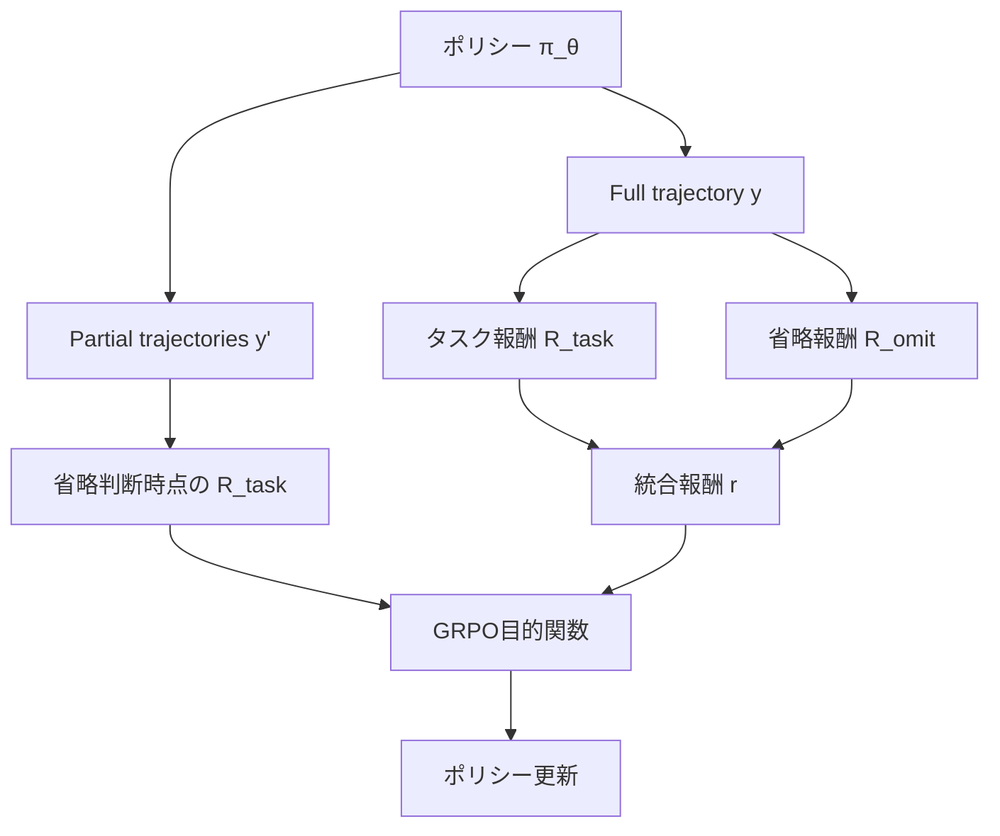

## 論文概要

本記事は [arXiv:2602.04284](https://arxiv.org/abs/2602.04284) の解説記事です。

Agent-Omitは、LLMエージェントがマルチターンのツール使用において冗長なthought（思考過程）とobservation（ツール出力）を適応的に省略する能力を獲得するための学習フレームワークである。従来の効率化手法がトラジェクトリ全体を一律に圧縮するのに対し、Agent-Omitはターン単位で省略の要否を判断する。2段階の学習パイプライン（cold-start SFTとomit-aware agentic RL）により、8Bパラメータのモデルが7つのフロンティアLLMエージェントと同等の性能を達成しつつ、トークン消費を大幅に削減したと著者らは報告している。

この記事は [Zenn記事: Codex CLI×AGENTS.mdでモノレポのサブエージェント分割とトークン削減を設計する](https://zenn.dev/0h_n0/articles/4b48fc9d7a50a9) の深掘りです。

## 情報源

- **arXiv ID**: 2602.04284
- **URL**: [https://arxiv.org/abs/2602.04284](https://arxiv.org/abs/2602.04284)
- **著者**: Yansong Ning, Jun Fang, Naiqiang Tan, Hao Liu（HKUST, Didichuxing）
- **発表年**: 2026年2月（改訂版 2026年5月）
- **分野**: cs.AI, cs.LG
- **採択**: ICML 2026 Poster（タイトル: "Training Efficient LLM Agents for Adaptive Thought and Observation Omission via Agentic Reinforcement Learning"）
- **コード**: [https://github.com/usail-hkust/Agent-Omit](https://github.com/usail-hkust/Agent-Omit)

## 背景と動機

LLMエージェントがツールを反復的に呼び出すマルチターンタスクでは、コンテキスト長がターン数に比例して増大する。この増大は2つの冗長性に起因する。

第一に**thought（思考過程）の冗長性**である。初期ターンで十分な計画を立てた場合、後続ターンでは同様の推論を繰り返す必要がない。しかし現行のLLMは各ターンで長いchain-of-thoughtを生成し続ける傾向がある。

第二に**observation（ツール出力）の冗長性**である。ツールから返される情報は最終回答に直接関係しないものも多い。特に初期ターンのobservationは後半のターンでは既に不要な情報となっているにもかかわらず、コンテキストウィンドウを占有し続ける。

著者らはこれらの冗長性を定量的に分析し、ターンによってthoughtとobservationの重要度が大きく異なることを示している（論文Figure 1）。従来手法はThought Management（DEPO、ToolLight等）、Observation Management（Observation-Mask、DeepMiner等）、またはその両方（MEM-Agent、ReSum等）に分類されるが、いずれもトラジェクトリ全体を一律に処理する。Agent-Omitはこの制約を解消し、ターン単位の適応的省略を学習させることを目指す。

## 主要な貢献

- **Agent-Omitフレームワーク**: cold-start SFTとomit-aware agentic RLの2段階学習により、LLMエージェントにthoughtとobservationの適応的省略能力を獲得させる手法の提案
- **KL-divergence上界の理論的保証**: 省略ポリシーの性能偏差がKLダイバージェンスで上界づけられることの証明（Theorem 5.2）
- **5つのベンチマークでの実証**: 8Bモデル（Agent-Omit-8B-RL）が7つのフロンティアLLMと同等以上の性能を達成し、7つの効率化手法の中で最良の性能-効率トレードオフを記録

## 技術的詳細

### 問題定式化

マルチターンエージェントのポリシーを以下のように定式化する。

$$
\{\tau_t, a_t\} = \pi_\theta(q, \{\tau_1, a_1, o_1, \ldots, \tau_{t-1}, a_{t-1}, o_{t-1}\})
$$

ここで、
- $q$: ユーザクエリ
- $\tau_t$: ターン$t$におけるthought（思考過程）
- $a_t$: ターン$t$におけるaction（ツール呼び出し）
- $o_t$: ターン$t$におけるobservation（ツール出力）
- $\pi_\theta$: パラメータ$\theta$を持つポリシー

省略行動は2種類定義される。thought省略では$\tau_t = \emptyset$（空文字列）とし、observation省略ではactionに省略集合$\Gamma_t \subseteq \{1, \ldots, t-1\}$を含め、過去ターンのobservationをコンテキストから除去する。

### Cold-Start Data Synthesis

第1段階では、省略行動のフォーマットを教えるためのSFTデータを合成する。

**省略ターンの特定**: 完全なトラジェクトリを前方走査し、各ターンで$\tau_t$または$o_t$を省略した上でエージェントに残りを完了させる。トークンコストが削減され、かつ精度が維持される場合にそのターンを「省略可能」とマークする。

**Single-turn省略データ**: システムプロンプトで省略フォーマットを教示する。thought省略は空の`<think></think>`タグを出力し、observation省略は`<omit_tool_response_N_...>`コマンドを発行する。

**Multi-turn省略データ**: 完全トラジェクトリ中のthoughtとobservationを省略行動に置換し、省略後のコンテキストで推論を継続する能力を学習させる。

学習損失は以下の通り。

$$
\mathcal{L} = -\mathbb{E}_{(x,y) \sim \mathcal{D}_{\text{single}} \cup \mathcal{D}_{\text{multi}}}[\log P_{\pi_\theta}(y \mid x)]
$$

著者らは2,000-4,000サンプル、学習率$5 \times 10^{-6}$、約3エポックのfull-parameter fine-tuningで訓練したと報告している。

### Omit-Aware Agentic RL

第2段階では、省略の質を強化学習で最適化する。

**Dual Sampling戦略**: RLの学習信号を2種類のサンプリングから取得する。



- **Full trajectory $y$**: 省略を適用した完全なロールアウト。タスクの成否と全体の効率を評価する
- **Partial trajectories $y'$**: 各省略ターンにおいて、そのターンまでのコンテキストとsingle-turnのthought/actionを取得する。1つのfull trajectoryから$p(y)$個のpartialが生成される

**報酬設計**: タスク報酬$R_{\text{task}}$は最終回答の正否で決まる。省略報酬$R_{\text{omit}}$は以下で定義される。

$$
R_{\text{omit}} = \frac{\text{Tok}(\tau_{\text{omitted}})}{\text{Tok}(y)} + \frac{\text{Tok}(o_{\text{omitted}})}{\text{Tok}(y)}
$$

ここで$\text{Tok}(\cdot)$はトークン数を返す関数である。$R_{\text{task}} = 0$のとき$R_{\text{omit}} = 0$に設定し、タスクを失敗させてトークンだけ削減するreward hackingを防止する。

**GRPO目的関数**: full trajectoryの報酬$r$とpartial trajectoryの報酬$r'$を組み合わせてポリシーを更新する。

$$
r = (1 - \mu) \cdot R_{\text{task}} + \mu \cdot R_{\text{omit}}
$$

著者らは$\mu = 0.2$を使用し、$r' = R_{\text{task}}$としている。KL正則化項$\beta \cdot \text{KL}[\pi_\theta \| \pi_{\text{ref}}]$を加えた目的関数で最適化する。

### KL-Divergence上界の理論的保証

著者らは省略ポリシーの性能偏差に対する理論的保証を与えている。

**仮定 5.1（意味的リプシッツ連続性）**: トラジェクトリ埋め込み空間上の距離$d$に対し、以下が成り立つ。

$$
|R(y^*) - R(y)| \leq K_r \cdot d(y^*, y), \quad |C(y^*) - C(y)| \leq K_c \cdot d(y^*, y)
$$

ここで$R$は報酬関数、$C$はコスト関数、$K_r, K_c$はリプシッツ定数である。

**定理 5.2（省略誤差の上界）**: 最適ポリシー$\pi^*$と学習済みポリシー$\pi_\theta$に対し、以下が成り立つ。

$$
|\mathbb{E}[R(y^*)] - \mathbb{E}[R(y)]| \leq \delta_r + K'_r \cdot \text{KL}(\pi^* \| \pi_\theta)
$$

$$
|\mathbb{E}[C(y^*)] - \mathbb{E}[C(y)]| \leq \delta_c + K'_c \cdot \text{KL}(\pi^* \| \pi_\theta)
$$

ここで$\delta_r, \delta_c$は不可約な近似誤差、$K'_r, K'_c$はスケーリングされたリプシッツ定数である。

**証明概略**: Kantorovich-Rubinstein双対性により報酬ギャップをリプシッツ定数$\times$Wasserstein-1距離で上界づけ、Talagrand型の輸送不等式により$W_1 \leq \varepsilon \sqrt{\text{KL}}$を得る。AM-GM不等式を適用して線形上界に変換する。

**含意**: $\pi_\theta$が$\pi^*$に近づくにつれ、性能ギャップは不可約誤差$\delta$に収束する。ただし、$W_1 \leq \varepsilon\sqrt{\text{KL}}$のステップは意味空間の有界性・集中性に依存しており、この仮定は実験的に検証されていない点に留意が必要である。

## 実装のポイント

### 学習パイプライン

- **バックボーン**: Qwen3-4BおよびQwen3-8Bを使用
- **SFT段階**: 2,000-4,000サンプル、学習率$5 \times 10^{-6}$、約3エポック、full-parameter fine-tuning
- **RL段階**: 学習率$5 \times 10^{-7}$、GRPO、最大応答長32Kトークン
- **ハードウェア**: 8B: A100 8台、4B: A100 4台

### 省略トークンフォーマット

出力は3種類のタグで構造化される。

```xml
<!-- 通常のthought -->
<think>ユーザのクエリを分析する。まず検索APIを...</think>

<!-- thought省略（冗長と判断した場合） -->
<think></think>

<!-- ツール呼び出し -->
<tool_call>{"name": "search", "arguments": {"query": "..."}}</tool_call>

<!-- observation省略コマンド（ターン2と3のobservationを除去） -->
<omit_tool_response_2_3>
```

cold-startデータ合成時の省略可能判定は、省略後のトラジェクトリでタスク精度が維持されるかを逐次検証する。この判定にはベースモデルでの再生成が必要であり、データセットあたり2,000-3,000サンプルの合成に相当の計算コストがかかる。

## Production Deployment Guide

Agent-Omitのコンテキスト省略機構をプロダクション環境で活用するためのAWSデプロイメントパターンを示す。省略によるトークン削減はLLM推論コストに直結するため、適切なインフラ設計が重要となる。

### AWS実装パターン（コスト最適化重視）

Agent-Omitの推論では、省略判断を含むマルチターン処理が発生するため、ステートフルなセッション管理が必要となる。

| 構成 | トラフィック | 主要サービス | 月額目安 |
|------|------------|-------------|---------|
| Small | ~100 req/日 | Lambda + Bedrock + DynamoDB | $50-150 |
| Medium | ~1,000 req/日 | ECS Fargate + Bedrock + ElastiCache | $300-800 |
| Large | 10,000+ req/日 | EKS + Spot + vLLM (Self-hosted) | $2,000-5,000 |

**コスト試算の注意事項**: 上記は2026年10月時点のAWS ap-northeast-1（東京）リージョン料金に基づく概算値である。実際のコストはトラフィックパターン、バースト使用量、省略率により変動する。最新料金は[AWS料金計算ツール](https://calculator.aws/)で確認を推奨する。

**Small構成のポイント**: Lambda + Bedrockの組み合わせでは、Agent-Omitの省略機構によりBedrockへの入力トークンが30-50%削減されるため、従来のエージェント実装と比較してAPI課金を大幅に抑制できる。DynamoDBでセッション状態（省略集合$\Gamma_t$を含む）を管理する。

**Large構成のポイント**: Qwen3-8B相当のモデルをvLLMでセルフホストする場合、`g5.2xlarge`（NVIDIA A10G）のSpot Instancesを活用し、最大90%のコスト削減が見込める。省略トークンのパース処理はvLLMのカスタムsamplerとして実装する。

**コスト削減テクニック**:
- Spot Instances活用（g5/p4d）で最大90%削減
- Reserved Instances 1年コミットで最大72%削減
- Bedrock Batch APIで非リアルタイム処理を50%削減
- Agent-Omitの省略機構自体が入力トークンを30-50%削減

### Terraformインフラコード

**Small構成（Serverless）**:

```hcl
# Agent-Omit Serverless推論基盤
# Lambda + Bedrock + DynamoDB

resource "aws_iam_role" "agent_omit_lambda" {
  name = "agent-omit-lambda-role"
  assume_role_policy = jsonencode({
    Version = "2012-10-17"
    Statement = [{
      Action = "sts:AssumeRole"
      Effect = "Allow"
      Principal = { Service = "lambda.amazonaws.com" }
    }]
  })
}

resource "aws_iam_role_policy" "bedrock_invoke" {
  name = "bedrock-invoke"
  role = aws_iam_role.agent_omit_lambda.id
  policy = jsonencode({
    Version = "2012-10-17"
    Statement = [{
      Effect   = "Allow"
      Action   = ["bedrock:InvokeModel", "bedrock:InvokeModelWithResponseStream"]
      Resource = "arn:aws:bedrock:ap-northeast-1::foundation-model/*"
    }]
  })
}

resource "aws_dynamodb_table" "session_state" {
  name         = "agent-omit-sessions"
  billing_mode = "PAY_PER_REQUEST"
  hash_key     = "session_id"

  attribute {
    name = "session_id"
    type = "S"
  }

  ttl {
    attribute_name = "expires_at"
    enabled        = true
  }

  server_side_encryption {
    enabled = true  # KMS暗号化
  }
}

resource "aws_lambda_function" "agent_omit" {
  function_name = "agent-omit-inference"
  runtime       = "python3.12"
  handler       = "handler.lambda_handler"
  role          = aws_iam_role.agent_omit_lambda.arn
  timeout       = 300  # マルチターン処理のため長めに設定
  memory_size   = 1024

  environment {
    variables = {
      SESSION_TABLE   = aws_dynamodb_table.session_state.name
      OMIT_THRESHOLD  = "0.2"  # μパラメータ
      MAX_TURNS       = "12"
    }
  }
}

resource "aws_cloudwatch_metric_alarm" "token_cost" {
  alarm_name          = "agent-omit-token-spike"
  comparison_operator = "GreaterThanThreshold"
  evaluation_periods  = 1
  metric_name         = "InputTokenCount"
  namespace           = "AWS/Bedrock"
  period              = 3600
  statistic           = "Sum"
  threshold           = 100000
  alarm_actions       = [aws_sns_topic.alerts.arn]
}
```

**Large構成（Container）**:

```hcl
# Agent-Omit EKS + Spot推論基盤
# vLLMセルフホスト + Karpenter自動スケーリング

module "eks" {
  source          = "terraform-aws-modules/eks/aws"
  version         = "~> 20.0"
  cluster_name    = "agent-omit-cluster"
  cluster_version = "1.31"

  vpc_id     = module.vpc.vpc_id
  subnet_ids = module.vpc.private_subnets

  cluster_endpoint_public_access = false  # プライベートアクセスのみ
}

resource "kubectl_manifest" "karpenter_nodepool" {
  yaml_body = yamlencode({
    apiVersion = "karpenter.sh/v1"
    kind       = "NodePool"
    metadata   = { name = "gpu-spot" }
    spec = {
      template = {
        spec = {
          requirements = [
            { key = "karpenter.sh/capacity-type", operator = "In", values = ["spot", "on-demand"] },
            { key = "node.kubernetes.io/instance-type", operator = "In", values = ["g5.2xlarge", "g5.4xlarge"] }
          ]
        }
      }
      disruption = {
        consolidationPolicy = "WhenEmptyOrUnderutilized"
      }
      limits = { "nvidia.com/gpu" = 8 }
    }
  })
}

resource "aws_secretsmanager_secret" "model_config" {
  name = "agent-omit/model-config"
}

resource "aws_budgets_budget" "monthly" {
  name         = "agent-omit-monthly"
  budget_type  = "COST"
  limit_amount = "5000"
  limit_unit   = "USD"
  time_unit    = "MONTHLY"

  notification {
    comparison_operator       = "GREATER_THAN"
    threshold                 = 80
    threshold_type            = "PERCENTAGE"
    notification_type         = "ACTUAL"
    subscriber_sns_topic_arns = [aws_sns_topic.alerts.arn]
  }
}
```

### 運用・監視設定

**CloudWatch Logs Insightsクエリ（トークン消費分析）**:

```sql
fields @timestamp, @message
| filter @message like /token_count/
| stats sum(input_tokens) as total_input,
        sum(omitted_tokens) as total_omitted,
        avg(omit_ratio) as avg_omit_ratio
  by bin(1h) as hour
| sort hour desc
```

**CloudWatchアラーム設定（Python）**:

```python
import boto3

cloudwatch = boto3.client("cloudwatch", region_name="ap-northeast-1")

def create_token_alarm(threshold: int = 500000) -> None:
    """Bedrockトークン使用量スパイク検知アラームを作成する。

    Args:
        threshold: 1時間あたりの入力トークン数閾値
    """
    cloudwatch.put_metric_alarm(
        AlarmName="agent-omit-token-spike",
        MetricName="InputTokenCount",
        Namespace="AWS/Bedrock",
        Statistic="Sum",
        Period=3600,
        EvaluationPeriods=1,
        Threshold=threshold,
        ComparisonOperator="GreaterThanThreshold",
        AlarmActions=["arn:aws:sns:ap-northeast-1:ACCOUNT:agent-omit-alerts"],
    )
```

**X-Rayトレーシング設定（Python）**:

```python
from aws_xray_sdk.core import xray_recorder, patch_all

patch_all()  # boto3自動計装

@xray_recorder.capture("agent_omit_inference")
def run_agent_turn(session_id: str, query: str) -> dict:
    """1ターンのエージェント推論を実行する。"""
    subsegment = xray_recorder.current_subsegment()
    subsegment.put_annotation("session_id", session_id)
    subsegment.put_metadata("omit_set", omit_set, "agent-omit")
    # ... 推論処理
    return result
```

**Cost Explorer日次レポート（Python）**:

```python
import boto3
from datetime import date, timedelta

ce = boto3.client("ce", region_name="us-east-1")

def get_daily_cost() -> dict:
    """直近のBedrock・Lambda・EKSコストを取得する。"""
    end = date.today().isoformat()
    start = (date.today() - timedelta(days=1)).isoformat()
    response = ce.get_cost_and_usage(
        TimePeriod={"Start": start, "End": end},
        Granularity="DAILY",
        Filter={"Dimensions": {"Key": "SERVICE", "Values": [
            "Amazon Bedrock", "AWS Lambda", "Amazon Elastic Kubernetes Service"
        ]}},
        Metrics=["UnblendedCost"],
    )
    return response["ResultsByTime"]
```

### コスト最適化チェックリスト

**アーキテクチャ選択**:
- [ ] トラフィック量に応じた構成選択（Small: Serverless / Medium: Hybrid / Large: Container）
- [ ] Agent-Omitの省略率を考慮したトークン消費見積もり
- [ ] マルチターンセッション管理方式の決定

**リソース最適化**:
- [ ] EC2/EKS: GPU Spot Instances優先（g5.2xlarge等）
- [ ] Reserved Instances: 1年コミットで72%削減
- [ ] Savings Plans: Compute Savings Plans検討
- [ ] Lambda: メモリサイズ最適化（Power Tuning）
- [ ] ECS/EKS: アイドル時のスケールダウン設定

**LLMコスト削減**:
- [ ] Agent-Omitの省略機構による入力トークン30-50%削減
- [ ] Bedrock Batch APIで非同期処理を50%削減
- [ ] Prompt Caching有効化で30-90%削減
- [ ] モデル選択ロジック（単純タスクは小型モデル）
- [ ] max_tokensによるトークン数制限

**監視・アラート**:
- [ ] AWS Budgets設定（月額上限アラート）
- [ ] CloudWatchアラーム（トークンスパイク検知）
- [ ] Cost Anomaly Detection有効化
- [ ] 日次コストレポート（SNS通知）
- [ ] 省略率モニタリング（低下はモデル劣化の兆候）

**リソース管理**:
- [ ] 未使用GPUインスタンス削除
- [ ] リソースタグ戦略（Environment/Service/Cost-Center）
- [ ] S3ログのライフサイクルポリシー（90日でGlacier）
- [ ] 開発環境の夜間・週末停止

## 実験結果

### ベンチマーク構成

著者らは5つのベンチマークで評価を行っている（論文Table 1より）。

| データセット | cold-start / RL サンプル数 | テストサンプル数 | 最大ターン数 |
|-------------|--------------------------|----------------|------------|
| DeepSearch | 3,257 / 2,000 | 400 | 8 |
| WebShop | 2,134 / 2,000 | 200 | 12 |
| TextCraft | 2,911 / 374 | 100 | 20 |
| BabyAI | 2,758 / 810 | 90 | 10 |
| SciWorld | 2,514 / 2,120 | 200 | 10 |

### フロンティアLLMとの比較

論文Table 2より主要な結果を示す（Pass@1 / 平均トークン数）。

| モデル | DeepSearch | WebShop | TextCraft | BabyAI | SciWorld |
|-------|-----------|---------|-----------|--------|---------|
| DeepSeek-R1-0528 | 25.25 / 6,412 | 19.37 / 11,308 | 83.00 / 7,435 | 81.74 / 9,578 | 13.23 / 18,288 |
| OpenAI o3 | 31.50 / - | 12.43 / - | 73.00 / - | 78.54 / - | 10.08 / - |
| Qwen3-32B | 19.00 / 6,640 | 11.31 / 11,872 | 59.00 / 16,294 | 64.10 / 19,489 | 3.57 / 19,211 |
| **Agent-Omit-8B-RL** | **26.56 / 4,356** | **23.57 / 8,764** | **87.00 / 7,328** | **84.36 / 6,643** | **18.45 / 9,643** |

Agent-Omit-8B-RLは8Bパラメータでありながら、DeepSeek-R1-0528（671B MoE）やOpenAI o3を複数のベンチマークで上回っていると著者らは報告している。特にWebShop（+4.20 vs DeepSeek-R1）、TextCraft（+4.00 vs DeepSeek-R1）、SciWorld（+5.22 vs DeepSeek-R1）での改善が顕著である。同時にトークン消費はDeepSeek-R1と比較して32-51%削減されている。

### 効率化手法との比較

Qwen3-8Bベースの効率化手法との比較（論文Table 3より）。

| 手法 | DeepSearch | WebShop | TextCraft | SciWorld |
|------|-----------|---------|-----------|---------|
| Base（Qwen3-8B） | 17.75 / 8,281 | 6.93 / 16,741 | 55.00 / 19,587 | 2.47 / 17,052 |
| Tool-Light | 21.29 / 6,239 | 14.57 / 10,892 | 68.00 / 11,247 | 17.29 / 12,865 |
| ReSum | 22.28 / 5,724 | 17.80 / 9,251 | 72.00 / 9,258 | 14.48 / 11,782 |
| **Agent-Omit-8B-RL** | **24.56 / 4,356** | **23.57 / 8,764** | **87.00 / 7,328** | **18.45 / 9,643** |

全5ベンチマークにおいて、Agent-Omit-8B-RLが最高の性能と最少のトークン消費を同時に達成していると報告されている。

### アブレーション分析

論文Figure 5（WebShop、Qwen3-8B）に基づくアブレーション結果は以下の通り。
- Single-turn SFTデータがSFT段階の主要な性能向上要因である
- Partial trajectory samplingがRL段階ではfull trajectory samplingより大きく寄与する
- 省略報酬$R_{\text{omit}}$を除去するとSFT以上のトークン削減効果が失われる
- $\mu = 0.2$が最良で、$\mu = 0.1$および$\mu = 0.3$ではトレードオフが悪化する

### 省略パターン分析

論文Figure 6によると、平均3-4ターンが省略され、省略はターン3-10の中間フェーズに集中する。これは初期ターンの計画立案と最終ターンの回答生成は省略すべきでないが、中間の情報収集フェーズでは冗長性が高いという直感と一致する。

## 実運用への応用

Agent-Omitのコンテキスト省略機構は、Zenn記事で扱ったCodex CLI + AGENTS.mdによるモノレポのサブエージェント分割と密接に関連する。

**トークン削減との接続**: AGENTS.mdでサブエージェントにタスクを分割する際、各エージェントが持つコンテキストの最適化が課題となる。Agent-Omitのターン単位の省略判断は、エージェント間でやり取りされる中間結果のフィルタリングに応用できる。過去ターンのobservationを選択的に除去する$\Gamma_t$の設計は、サブエージェントへのコンテキスト受け渡しポリシーとして参考になる。

**スケーリングの観点**: Agent-Omit-8B-RLは8Bパラメータで671B MoEモデルに匹敵する性能を示しており、セルフホスティングのコスト効率が高い。モノレポの各サブタスクに対して軽量な省略対応エージェントを配置することで、並列処理時のトークンコストを大幅に削減できる可能性がある。

**制約**: 著者らはRL段階の学習データ合成にかかる計算コストをスケーラビリティの制約として挙げている。また、仮定5.1（意味的リプシッツ連続性）の実験的検証が不十分であり、理論保証の実用上の適用範囲は限定的である。

## 関連研究

- **DEPO** (Ning et al.): thoughtを直接省略するアプローチ。Agent-Omitはこれを拡張し、observationの省略も統合している
- **MEM-Agent**: メモリツールを用いてthoughtとobservationを要約・格納する手法。Agent-Omitは外部ツールに依存せず、ポリシー自体に省略能力を内在化させている点で異なる
- **ReSum**: トラジェクトリ全体を要約する手法。Agent-Omitはターン単位の選択的省略を行い、必要な情報を保持する精度が高いと著者らは主張している
- **ReTool / AgentEvolver**: エージェントのRL学習手法。Agent-Omitはこれらのagentic RLの枠組みを省略学習に特化させ、dual samplingと省略報酬を導入した

## まとめと今後の展望

Agent-Omitは、LLMエージェントのマルチターン対話における冗長なthoughtとobservationの適応的省略を、SFTとRLの2段階で学習させるフレームワークである。8Bモデルがフロンティアモデルと同等の性能をトークン消費30-50%削減で達成したことは、コンテキスト効率化の実用性を示している。

今後の研究方向として、著者らは省略データ合成のプレトレーニングへの統合と、より大規模なモデルへの拡張を挙げている。Codex CLIのようなマルチエージェントフレームワークにおける省略ポリシーの自動最適化は、実務上の有望な応用先である。

## 参考文献

- **arXiv**: [https://arxiv.org/abs/2602.04284](https://arxiv.org/abs/2602.04284)
- **Code**: [https://github.com/usail-hkust/Agent-Omit](https://github.com/usail-hkust/Agent-Omit)
- **ICML 2026 Poster**: [https://icml.cc/virtual/2026/poster/63271](https://icml.cc/virtual/2026/poster/63271)
- **Related Zenn article**: [https://zenn.dev/0h_n0/articles/4b48fc9d7a50a9](https://zenn.dev/0h_n0/articles/4b48fc9d7a50a9)
