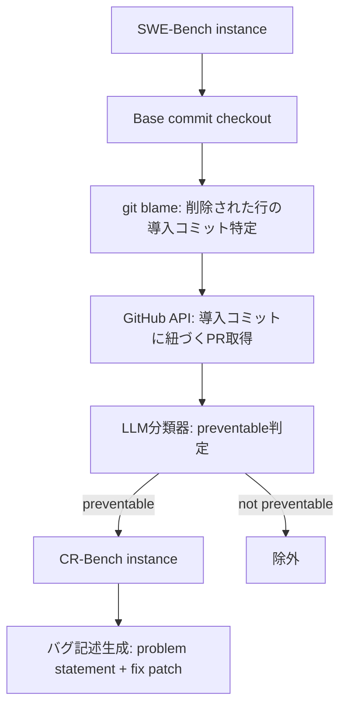
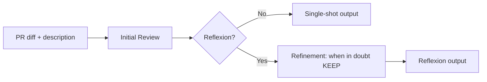

本記事は https://arxiv.org/abs/2603.11078 の解説記事です。

## 論文概要（Abstract）

CR-Benchは、AIコードレビューエージェントが実際のソフトウェア開発でどの程度有用かを評価するためのベンチマークである。SWE-Benchの修正パッチから「レビューで防げたはずのバグ」を逆算して584件のデータセットを構築し、再現率・適合率だけでなくSNR（信号対雑音比）やUsefulness Rate（有用性比率）といった実務寄りの指標でエージェントを評価している。著者らは、Reflexion型エージェントが再現率を向上させる一方でSNRを低下させるという精度とノイズのトレードオフを定量的に示している。

この記事は [Zenn記事: Claude Code×GitHub Actionsで構築するPR自動レビューの誤検知削減とコスト最適化](https://zenn.dev/0h_n0/articles/5ee2c4913ba8aa) の深掘りです。

## 情報源

- **arXiv ID**: 2603.11078
- **URL**: [https://arxiv.org/abs/2603.11078](https://arxiv.org/abs/2603.11078)
- **著者**: Kristen Pereira, Neelabh Sinha, Rajat Ghosh, et al.
- **発表年**: 2026
- **分野**: cs.SE, cs.AI, cs.CL

## 背景と動機（Background & Motivation）

AIを活用したコードレビューツールはGitHub CopilotやCodeRabbit、Qodoなど急速に普及しているが、これらのツールが実際のバグをどれだけ検出でき、どれだけノイズ（誤検知・無意味な指摘）を出すのかを定量的に評価するベンチマークが不足していた。

従来のコードレビュー研究では、レビューコメントの分類やコード修正の自動化が中心であり、「レビューエージェントが現実のバグを事前に検出できるか」という観点での評価は体系的に行われていなかった。既存のベンチマーク（例: SWE-Bench）はバグ修正の自動化を評価するものであり、レビュー段階での検出能力を測るものではない。

著者らは、実際のオープンソースプロジェクトで発生したバグのうち「注意深いレビューで防げたはずのもの」だけを抽出し、レビューエージェントの検出能力とノイズレベルを同時に評価するフレームワークが必要だと主張している。

## 主要な貢献（Key Contributions）

- **CR-Benchデータセットの構築**: SWE-Benchから584件（検証済み174件）の「レビューで防止可能なバグ」を自動抽出するパイプラインを開発
- **実務指向の評価指標**: 再現率・適合率に加え、SNR（信号対雑音比）やUsefulness Rate（有用なコメントの割合）を導入し、実開発チームでの使い勝手を定量化
- **エージェント戦略の比較評価**: Single-shot型とReflexion型の2種類のエージェントを複数モデルで評価し、精度とノイズのトレードオフを明らかにした

## 技術的詳細（Technical Details）

### CR-Benchデータセット構築パイプライン

CR-Benchの構築は、SWE-Benchのバグ修正パッチから出発して「レビューで防止可能だったバグ」を逆算する手法を取っている。

具体的な手順は以下の通りである。

1. **ベースコミットのチェックアウト**: SWE-Benchの各インスタンスからバグが存在するベースコミットを取得
2. **git blameによる原因コミットの特定**: 修正パッチで削除された行に対してgit blameを実行し、バグを導入したコミットを特定
3. **PRの紐付け**: GitHub APIを使い、バグ導入コミットに紐づくPull Requestを取得
4. **防止可能性の分類**: LLM分類器で各バグが「注意深いレビューで防止可能だったか」を判定。設計上の問題や外部要因によるバグは除外する
5. **バグ記述の生成**: SWE-Benchのproblem statementと修正パッチから100語以内のバグ記述を生成

このパイプラインにより、CR-Benchは584件、手動検証済みのCR-Bench-Verifiedは174件のインスタンスを含む。

### バグの分類体系（Taxonomy）

著者らはバグを根本原因（Root Cause）と影響（Impact）の2軸で分類している。

**根本原因の分類**:

- **Structural（構造的）**: 全体の79.9%を占める最大カテゴリ。コードの構造的な誤り
- **IIS（Incorrect Input/State）**: 入力やステートの不正な処理
- **RFF（Resource/Flow/Failure）**: リソース管理やフロー制御の問題
- **Data**: データ処理に関するバグ
- **Concurrency**: 並行処理に起因するバグ
- **Memory**: メモリ管理のバグ
- **Security**: セキュリティ上の脆弱性
- **Coding**: 単純なコーディングミス

**影響の分類**はISO/IEC 25010のソフトウェア品質特性に準拠しており、Functional Suitability（機能適合性）やPerformance Efficiency（性能効率性）などで整理されている。

**深刻度の分布**: Medium + High + Criticalが検証済みデータセットで93.1%、全体で90.2%を占めており、CR-Benchが実務的に重要なバグを捉えていることを示している（論文より）。

### CR-Evaluatorパイプライン

レビューエージェントが生成したコメントの品質を評価するため、著者らはCR-Evaluatorパイプラインを設計している。

評価にはClaude Sonnet 4.5をzero-shotの判定器として使用し、各コメントを以下の3カテゴリに分類する。

$$
\text{Classification}(c) \in \{\text{BUG\_HIT}, \text{VALID\_SUGGESTION}, \text{NOISE}\}
$$

ここで、
- $c$: レビューエージェントが生成した1つのコメント
- **BUG_HIT**: データセット中の既知のバグを正しく指摘したコメント
- **VALID_SUGGESTION**: バグではないが有用な改善提案
- **NOISE**: 誤検知や無意味な指摘

これらの分類から、以下の評価指標を算出する。

$$
\text{Recall} = \frac{|\text{BUG\_HIT instances}|}{|\text{Total instances}|}
$$

$$
\text{Precision} = \frac{|\text{BUG\_HIT comments}|}{|\text{Total comments}|}
$$

$$
\text{Usefulness Rate} = \frac{|\text{BUG\_HIT}| + |\text{VALID\_SUGGESTION}|}{|\text{Total comments}|}
$$

$$
\text{SNR} = \frac{|\text{BUG\_HIT}| + |\text{VALID\_SUGGESTION}|}{|\text{NOISE}|}
$$

SNRは信号対雑音比であり、値が高いほどノイズの少ないレビューを意味する。実務では、ノイズの多いレビューは開発者のレビュー疲れ（alert fatigue）を引き起こし、重要な指摘も無視されるようになるため、この指標は再現率や適合率と同等に重要である。

### エージェントアーキテクチャ

著者らは2種類のエージェントアーキテクチャを評価している。

**Single-shot型**:
PRのdiffとdescriptionを1回のLLM呼び出しに入力し、JSONフォーマットのレビューコメントを生成する。処理が単純で低コストだが、見落としが発生しやすい。

**Reflexion型**:
初回レビューの後に反復的な改善ステップを追加する。改善時のプロンプトには「迷ったら指摘を残す（when in doubt, KEEP the issue）」というバイアスが含まれており、再現率の向上を狙っている。

## 実験結果（Results）

### 主要結果

以下は、CR-Bench-Verified（174件、手動検証済み）における各エージェントの性能を示す（論文Table 4より）。

| エージェント | モデル | Recall | Precision | F1 | Usefulness | SNR |
|---|---|---|---|---|---|---|
| Single-shot | GPT-5.2 | 27.01% | 3.56% | 6.30% | 83.63% | 5.11 |
| Single-shot | GPT-5-mini | 18.39% | 3.51% | 5.90% | 74.29% | 2.89 |
| Reflexion | GPT-5.2 | 32.76% | 5.10% | 8.83% | 66.10% | 1.95 |
| Reflexion | GPT-5-mini | 27.59% | 3.19% | 5.72% | 47.72% | 0.91 |

**データセット統計**（論文よりインスタンス平均）:

| データセット | 修正行数 | PRコメント数 | PR説明文長 |
|---|---|---|---|
| CR-Bench | 10.28 | 41.03 | 906.63 |
| CR-Bench-Verified | 8.69 | 35.83 | 893.59 |

### SNR分析：精度とノイズのトレードオフ

著者らの実験結果から、以下のトレードオフが明確に読み取れる。

**Reflexionの効果と副作用**:
- 再現率はSingle-shotの27.01%からReflexionの32.76%に向上（GPT-5.2の場合、+5.75ポイント）
- しかしSNRは5.11から1.95に低下（約62%の悪化）
- Usefulness Rateも83.63%から66.10%に低下

この結果は、Reflexionの「迷ったら残す」戦略が、確かにバグ検出数を増やす一方で、ノイズ（誤検知・不要な指摘）も大幅に増加させることを示している。

**モデル能力によるSNR耐性の差**:
- GPT-5.2はReflexion適用後もSNR 1.95を維持している
- GPT-5-miniではSNRが2.89から0.91に崩壊しており、ノイズが信号を上回る状態（SNR < 1.0）に陥っている

著者らはこの差についてGPT-5-miniのhallucination（幻覚）傾向がReflexionの反復プロセスで増幅されることが原因であると報告している。能力の低いモデルでReflexionを適用すると、反復のたびに「それらしいが根拠のない指摘」が蓄積し、SNRが急速に劣化する。

### バグカテゴリ別の検出能力

著者らの分析では、バグの種類によってエージェントの検出能力に顕著な差が存在する。

**Memoryバグの再現率はすべてのエージェントでゼロ**であった。これは、メモリリークやバッファオーバーフローなどのバグがdiffの静的解析だけでは検出困難であることを意味する。

一方、**深刻度が高いバグほど再現率が高い**という結果が得られている。High-severityのバグは明確なコードの誤りを伴うことが多く、LLMが差分から異常を検出しやすいためと考えられる。Low-severityのバグは微妙なエッジケースに起因するものが多く、再現率は低い。

**影響カテゴリ別**では、Performance Efficiency（性能効率性）とReliability（信頼性）に影響するバグの再現率が高い。これらは非効率なアルゴリズムやエラーハンドリングの欠如など、コード差分から比較的特定しやすいパターンであるためと著者らは分析している。

**Data関連バグ**については、Single-shot GPT-5.2のみが許容可能な再現率を示しており、Reflexion型やGPT-5-miniでは検出できていない（論文Table 4の詳細分析より）。

### バイアスとバリアンスのトレードオフ

著者らはコードレビューエージェントの設計にバイアスとバリアンスのトレードオフが存在すると指摘している。

$$
\text{Total Error} = \text{Bias}^2 + \text{Variance} + \text{Irreducible Error}
$$

ここでの対応は以下の通りである。

- **保守的なエージェント（高バイアス）**: 確信度の高い指摘のみを出力する。見落とし（false negative）が増加するが、ノイズは少ない。Single-shot型がこれに該当し、SNRは高いが再現率は低い
- **許容的なエージェント（高バリアンス）**: 疑わしい箇所を広く指摘する。見落としは減るが、誤検知（false positive）が増加しノイズが多くなる。Reflexion型の「迷ったら残す」戦略がこれに該当し、再現率は高いがSNRは低い

実務的には、このトレードオフはレビューエージェントの運用方針に直結する。ノイズが多すぎると開発者はレビューコメントを無視するようになり（alert fatigue）、結果的にバグ検出の実効性が失われる。著者らは、SNRが1.0を下回る構成（Reflexion + GPT-5-mini: SNR 0.91）は実用上許容できないと指摘している。

## 実装のポイント（Implementation）

### CR-Benchの構築における注意点

CR-Benchの構築パイプラインを参考に、自社のコードレビューデータセットを構築する際の要点を整理する。

**git blameの活用**: バグ修正パッチから削除された行をgit blameで追跡し、バグを導入したコミットを特定する手法は、任意のリポジトリに適用可能である。ただし、リファクタリングで行が移動したケースではblameの結果が不正確になるため、`git log -S`（pickaxe search）との併用が推奨される。

**防止可能性の分類精度**: LLM分類器による「preventable」判定は、CR-Bench-Verified（174件）の手動検証と突合されている。自動分類の精度が評価全体の信頼性に直結するため、評価ベンチマーク構築時にはサンプリング検証が不可欠である。

**バグ記述の100語制限**: バグ記述を100語以内に制限することで、評価時にLLM判定器が過剰な情報に依存することを防いでいる。実務でレビューエージェントを評価する際にも、バグの記述粒度を統一することが再現性の確保に重要である。

### レビューエージェント設計の指針

論文の結果から、レビューエージェントの設計には以下の指針が導かれる。

- **モデル選択**: SNR耐性を考慮し、能力の高いモデルを優先する。GPT-5-miniのような軽量モデルはSingle-shot構成ではSNR 2.89を確保できるが、Reflexionを適用するとSNR 0.91に崩壊する
- **反復戦略の制御**: Reflexionの反復回数やKEEP基準の閾値を調整することで、再現率とSNRのバランスを制御できる可能性がある。論文ではこの制御パラメータの最適化は今後の課題とされている
- **カテゴリ別の期待値管理**: Memoryバグはすべてのエージェントで検出不能であり、静的解析ツール（Valgrind、AddressSanitizer等）との併用が必要である

## 実運用への応用（Practical Applications）

CR-Benchの知見は、GitHub ActionsなどのCI/CDパイプラインにAIコードレビューを組み込む際に直接活用できる。

**SNRベースの構成選択**: 論文の結果から、実運用ではSingle-shot + 高能力モデルの組み合わせ（SNR 5.11）が最もバランスが取れていると考えられる。Reflexionによる再現率向上（+5.75ポイント）がSNRの低下（-3.16）に見合うかは、チームのレビュー文化やバグの深刻度分布に依存する。

**段階的な導入戦略**: SNRが高い構成からスタートし、開発者のレビュー疲れを防ぎながら信頼を築くアプローチが有効である。信頼が確立された後に、再現率重視の構成（Reflexion等）への移行を検討できる。

**コスト最適化との関連**: Zenn記事で扱っているPR自動レビューのコスト最適化において、Reflexion型は推論呼び出し回数が増えるためコストも増加する。SNRの低下を考慮すると、コスト増に見合う価値があるかを慎重に評価すべきである。

**Memoryバグへの対応**: AIレビューではMemoryバグの検出が困難であることが判明しており、Valgrind、AddressSanitizerなどの専用ツールをCI/CDに組み込むことでカバレッジの補完が必要である。

## 関連研究（Related Work）

- **SWE-Bench** (Jimenez et al., 2024): ソフトウェアエンジニアリングタスクのベンチマーク。CR-Benchはこのデータセットからバグインスタンスを構築しており、直接の上流に位置する
- **Reflexion** (Shinn et al., 2023): LLMに自己反省と改善の反復を行わせるエージェントフレームワーク。CR-Benchではこの手法をコードレビューに適用し、再現率向上とSNR低下のトレードオフを確認した
- **LLM-based Code Review** (Li et al., 2022; Tufano et al., 2024): LLMを用いたコードレビューの自動化研究。レビューコメントの生成やコード修正提案に焦点を当てているが、バグ検出能力の体系的評価は行っていない

## まとめと今後の展望

CR-Benchは、AIコードレビューエージェントの実用性を再現率・適合率だけでなくSNRやUsefulness Rateで評価する枠組みを提供した。著者らの実験により、Reflexion型エージェントが再現率を27%から33%に向上させる一方でSNRを5.11から1.95に低下させること、またモデル能力の低いGPT-5-miniではReflexion適用時にSNRが1.0を下回ることが示された。

今後の研究方向として、著者らはReflexionの反復制御パラメータの最適化、Memoryバグの検出手法の開発、およびより大規模なデータセットでの検証を挙げている。実務的には、SNRベースでレビューエージェントの構成を選択し、開発チームのレビュー疲れを防ぎながらバグ検出率を段階的に向上させるアプローチが重要である。

## 参考文献

- **arXiv**: [https://arxiv.org/abs/2603.11078](https://arxiv.org/abs/2603.11078)
- **Related Zenn article**: [https://zenn.dev/0h_n0/articles/5ee2c4913ba8aa](https://zenn.dev/0h_n0/articles/5ee2c4913ba8aa)
