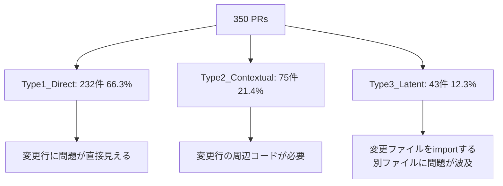

本記事は https://arxiv.org/abs/2603.26130 の解説記事です。

## 論文概要（Abstract）

SWE-PRBenchは、AIによるコードレビューの品質を実際のPull Requestフィードバックと照合して評価するベンチマークである。著者らは65リポジトリから350件のマージ済みPRを厳選し、8つのフロンティアLLMがどの程度人間レビュアーと同等の指摘を再現できるかを計測している。結果として、検出率（DRA）は最高でも31.2%にとどまり、コンテキスト情報を追加するほど性能が低下するという逆説的な傾向が報告されている。

この記事は [Zenn記事: Claude Code×GitHub Actionsで構築するPR自動レビューの誤検知削減とコスト最適化](https://zenn.dev/0h_n0/articles/5ee2c4913ba8aa) の深掘りです。

## 情報源

- **arXiv ID**: 2603.26130
- **URL**: [https://arxiv.org/abs/2603.26130](https://arxiv.org/abs/2603.26130)
- **著者**: Deepak Kumar
- **発表年**: 2026
- **分野**: cs.SE, cs.AI

## 背景と動機（Background & Motivation）

AIを活用したコードレビューツールは急速に普及しているが、その品質評価は体系化されていなかった。従来の評価手法には以下の課題があると著者らは指摘している。

第一に、既存のコードレビューベンチマーク（CodeReviewer等）は合成データや単一ファイルの静的解析に依存しており、実際のPRワークフローにおけるレビュー品質を反映していない。第二に、多くの評価がモデル出力の表面的な一致度に基づいており、指摘の実質的な有用性を測定していない。第三に、コンテキスト情報（実行環境、テスト構造等）がレビュー品質にどう影響するかの体系的な分析が欠けていた。

SWE-PRBenchはこれらの課題に対し、人間レビュアーが実際に行った指摘を正解データとして使用し、LLMの出力をLLM-as-Judgeで多面的に評価するアプローチを提案している。

## 主要な貢献（Key Contributions）

- **貢献1**: 65リポジトリ・350 PRからなる品質管理されたベンチマークデータセットの構築。Repository Quality Score（RQS）による定量的なリポジトリ選定基準を導入している
- **貢献2**: diff-only / diff+実行コンテキスト / フルコンテキストの3段階で、コンテキスト量がレビュー品質に与える影響を制御実験として定量化
- **貢献3**: 8つのフロンティアモデルのレビュー能力を比較するリーダーボードの構築。誤検知率（FPR）や検出率（DRA）を含む多面的な評価指標を提供

## 技術的詳細（Technical Details）

### ベンチマーク構築

著者らは700件のPR候補からRepository Quality Score（RQS、最大100点）に基づいて350件を厳選している。RQSは以下の5因子で構成される（論文Section 3より）。

| 因子 | 配点 | 内容 |
|------|------|------|
| Review culture | 30 | レビューコメントの質と頻度 |
| PR recency | 25 | PRの新しさ（データ汚染回避） |
| Test quality | 20 | テストカバレッジと品質 |
| PR volume | 15 | 十分なPR数があるか |
| Contamination | 10 | 訓練データ混入リスクの低さ |

RQSが60未満のリポジトリは除外され、採用リポジトリのRQS中央値は74であると報告されている。言語分布はPython 69.1%、JavaScript 10.6%、Go 10.0%、TypeScript 6.0%、Java 4.3%で、PR種別はFeature 61.1%、Bug fix 33.7%、残りがRefactor/Performance/Securityである。

### 難易度分類（Difficulty Taxonomy）

著者らはレビュー指摘の難易度を3段階に分類している。この分類はAIレビューの限界を理解する上で重要である。



- **Type1_Direct（66.3%、232件）**: 変更された行自体に問題が存在する。diffのみで検出可能なケース
- **Type2_Contextual（21.4%、75件）**: 変更行の周辺にある未変更コードを参照する必要がある。関数シグネチャの整合性やAPIの使用パターンなど
- **Type3_Latent（12.3%、43件）**: 変更されたファイルをimportまたは依存する別ファイルに問題が波及するケース。最も検出が困難

### 3つのコンテキスト構成

著者らは各モデルに与えるコンテキスト情報を3段階に固定し、その影響を制御実験として測定している。

- **config_A（diff only、約2,000トークン）**: タスクの焦点、主要変更の要約、diff、メタデータ
- **config_B（diff + 実行コンテキスト、約2,200トークン）**: config_Aに加え、実行コンテキストと振る舞いマッピング
- **config_C（フルコンテキスト、約2,500トークン）**: config_Bに加え、テストシグネチャ

### 評価手法: LLM-as-Judge

評価にはGPT-5.2をジャッジモデルとして使用し、Cohen's $\kappa$ = 0.75（substantial agreement）を達成していると報告されている。各モデル出力は CONFIRMED / PLAUSIBLE / FABRICATED の3段階で分類される。

総合スコアは以下の複合スコア関数で算出される（論文Section 4.2より）。

$$
s = \text{clip}_{[0,1]}\bigl(0.40 \cdot r + 0.25 \cdot p + 0.15 \cdot a + 0.10 \cdot q^{*} + 0.05 \cdot e - 0.25 \cdot h - 0.15 \cdot \rho - 0.10 \cdot \phi\bigr)
$$

ここで、
- $r$: Recall（人間レビュアーの指摘をどの程度再現したか）
- $p$: Precision（モデルの指摘のうち有用なものの割合）
- $a$: Actionability（指摘の実行可能性）
- $q^{*}$: Quality bonus（指摘の具体性・明確性）
- $e$: Elaboration（説明の充実度）
- $h$: Hallucination penalty（幻覚による誤指摘のペナルティ）
- $\rho$: Redundancy penalty（冗長な指摘の繰り返しに対するペナルティ）
- $\phi$: False positive penalty（偽陽性のペナルティ）

この関数は正の項（指摘の質と網羅性）と負の項（ノイズとなる出力）のバランスを取る設計になっている。$\text{clip}_{[0,1]}$によりスコアは0から1の範囲にクリッピングされる。Recallの重み（0.40）が最大であることから、人間の指摘を漏れなく再現することを最重視する設計思想が読み取れる。

## 実験結果（Results）

### リーダーボード

論文Table 8より、100件のPRサンプルに対する8モデルの評価結果を以下に示す。

| モデル | $s_A$ | $s_B$ | $s_C$ | $\bar{s}$ | DRA | $\text{FPR}_{\text{avg}}$ |
|--------|-------|-------|-------|-----------|------|------|
| Claude Haiku 4.5 | 0.172 | 0.129 | 0.126 | 0.153 | 0.306 | 0.346 |
| Claude Sonnet 4.6 | 0.190 | 0.135 | 0.122 | 0.152 | 0.297 | 0.227 |
| DeepSeek V3 | 0.181 | 0.132 | 0.118 | 0.150 | 0.312 | 0.315 |
| Mistral Large 3 | 0.170 | 0.125 | 0.135 | 0.147 | 0.305 | 0.353 |
| GPT-4o | 0.134 | 0.110 | 0.090 | 0.113 | 0.220 | 0.193 |
| GPT-4o-mini | 0.110 | 0.095 | 0.093 | 0.108 | 0.210 | 0.353 |
| Mistral Small | 0.131 | 0.080 | 0.091 | 0.106 | 0.257 | 0.251 |
| Llama 3.3 70B | 0.088 | 0.071 | 0.065 | 0.079 | 0.223 | 0.417 |

$s_A$, $s_B$, $s_C$はそれぞれconfig_A, config_B, config_Cでの複合スコア、$\bar{s}$は3構成の平均スコア、DRAは検出率（Detection Rate Accuracy）、$\text{FPR}_{\text{avg}}$は平均誤検知率（False Positive Rate）を表す。

### 主要な知見

**Tier構造の存在**: 著者らは95%ブートストラップ信頼区間を用いた分析で、上位4モデル（$\bar{s}$ = 0.147--0.153）の間に統計的有意差がないことを報告している。一方、4位（0.147）と5位（0.113）の間には明確なギャップが存在する。つまり、上位Tierと下位Tierの間に境界がある2層構造が見られる。

**コンテキスト増加による性能低下**: 8モデル全てがconfig_Aからconfig_Cにかけて単調に性能が低下している。これはコンテキスト情報を増やせばレビュー品質が向上するという直感に反する結果である。著者らはこの現象をLiu et al. (2024)の"Lost in the middle"で報告されたattention dilution（注意の希薄化）に帰着させている。

**コスト効率**: DeepSeek V3はDRA 0.312（最高値）を約$0.28/MTokで達成しており、GPT-4oの約$2.50/MTok（DRA 0.220）と比較して約9倍のコスト効率を示している（論文Table 8より）。

### Type2_Contextualの崩壊

特に注目すべきは、Type2_Contextual（周辺コードの参照が必要な指摘）におけるconfig_B以降の急激な性能低下である。

| モデル | Type2 at config_A | Type2 at config_B | 低下幅 |
|--------|-------------------|-------------------|--------|
| Claude Sonnet 4.6 | 0.22 | 0.10 | -0.12 |
| DeepSeek V3 | 0.20 | 0.10 | -0.10 |

著者らはこの現象を以下のように分析している。config_Aではモデルがdiffから周辺コードの構造を推論する必要があり、この制約がかえってdiffへの集中的な注意を促進する。config_Bで実行コンテキストが追加されると、モデルの注意が分散し、本来集中すべきdiffの微妙な問題を見落とすようになる。

この結果は、Liu et al. (2024)が長文コンテキストで報告した"Lost in the middle"現象と一致しており、入力の中間部分に位置する情報への注意が希薄化する問題がコードレビューでも再現されることを示唆している。

### 誤検知率の傾向

GPT-4oは$\text{FPR}_{\text{avg}}$ = 0.193で最も低い誤検知率を示す一方、Llama 3.3 70Bは0.417と最も高い。Claude Sonnet 4.6は0.227と比較的低い誤検知率を維持しつつ、上位Tierの検出率を達成している（論文Table 8より）。

誤検知率と検出率のトレードオフを見ると、Claude Sonnet 4.6（DRA 0.297、FPR 0.227）はバランスの取れたプロファイルを示しているのに対し、Claude Haiku 4.5（DRA 0.306、FPR 0.346）やDeepSeek V3（DRA 0.312、FPR 0.315）は検出率が高い代わりに誤検知も増加する傾向がある。

## 実装のポイント（Implementation）

### ベンチマーク評価パイプラインの構造

SWE-PRBenchの評価パイプラインは再現可能な設計になっている。以下に著者らが報告しているパイプラインの構造を擬似コードで示す。

```python
def evaluate_model(
    model: str,
    config: str,  # "A", "B", "C"
    prs: list[dict],
) -> dict[str, float]:
    """SWE-PRBench評価パイプラインの擬似コード

    Args:
        model: 評価対象のモデル名
        config: コンテキスト構成 (A/B/C)
        prs: 評価対象のPRリスト

    Returns:
        複合スコアと各指標の辞書
    """
    results = []
    for pr in prs:
        # 1. コンテキスト構築
        context = build_context(pr, config)
        # 2. モデルによるレビュー生成
        review = generate_review(model, context)
        # 3. LLM-as-Judge による評価
        judgment = judge_review(
            review=review,
            human_comments=pr["human_comments"],
            judge_model="gpt-5.2",
        )
        # 4. 複合スコア計算
        score = compute_composite_score(judgment)
        results.append(score)
    return aggregate_metrics(results)


def compute_composite_score(judgment: dict) -> float:
    """複合スコア計算

    Args:
        judgment: ジャッジモデルの評価結果

    Returns:
        0-1にクリッピングされた複合スコア
    """
    s = (
        0.40 * judgment["recall"]
        + 0.25 * judgment["precision"]
        + 0.15 * judgment["actionability"]
        + 0.10 * judgment["quality_bonus"]
        + 0.05 * judgment["elaboration"]
        - 0.25 * judgment["hallucination"]
        - 0.15 * judgment["redundancy"]
        - 0.10 * judgment["false_positive"]
    )
    return max(0.0, min(1.0, s))
```

### 実装上の注意点

著者らの設計から読み取れる実装上の注意点は以下の通りである。

- **コンテキストウィンドウの管理**: config_A（約2,000トークン）からconfig_C（約2,500トークン）への増加は比較的小さいにもかかわらず性能が低下している。これはトークン数ではなく情報の種類と配置が重要であることを示唆する
- **ジャッジモデルの選択**: Cohen's $\kappa$ = 0.75を達成するためにGPT-5.2を使用している。ジャッジモデル自体の品質が評価全体の信頼性を左右する点に注意が必要である
- **RQSによるデータ品質管理**: レビュー文化のスコアに最大の配点（30点）を与えることで、形式的なLGTMのみのリポジトリを排除している

## 実運用への応用（Practical Applications）

本論文の知見は、GitHub ActionsでのAIコードレビュー構築（Zenn記事のテーマ）に直接的な示唆を与える。

**コンテキスト設計の最適化**: 著者らの結果は「情報を詰め込むほど良い」という素朴な仮定を否定している。diffに集中したコンパクトなプロンプト（config_A相当）が最も高い性能を示す点は、実運用でのプロンプト設計に直結する。テストシグネチャや実行コンテキストは別パスで処理し、diff分析と混在させないアーキテクチャが有効と考えられる。

**モデル選択とコスト効率**: DeepSeek V3が最高のDRA（0.312）を約$0.28/MTokで達成している事実は、コスト制約のあるCI/CD環境でのモデル選択に影響する。一方、誤検知率を重視する場合はGPT-4o（FPR 0.193）やClaude Sonnet 4.6（FPR 0.227）が候補となる。用途に応じた使い分けが合理的である。

**誤検知削減の重要性**: 全モデルのFPRが0.193--0.417の範囲にあり、5件中1--2件が誤検知となる。開発者の信頼を維持するには、AIレビュー結果のフィルタリング機構（信頼度スコアによるゲーティング等）が不可欠である。

**Type分類に基づく期待値管理**: Type1_Direct（diff内で完結する問題）が検出対象の66.3%を占める一方、Type3_Latent（依存先への波及）は12.3%しかなく、現状のAIレビューでは後者の検出は困難である。AIレビューの適用範囲を明確にし、Type2/Type3は人間レビュアーに委ねるといった役割分担が現実的である。

## 関連研究（Related Work）

- **CodeReviewer (Li et al., 2022)**: コードレビューの自動化をseq2seqタスクとして定式化した先行研究。SWE-PRBenchとの違いは、CodeReviewerが単一ファイルの差分を対象とするのに対し、SWE-PRBenchはPR全体のマルチファイル差分を評価する点にある
- **SWE-bench (Jimenez et al., 2024)**: GitHubのIssueからコード修正を生成するベンチマーク。SWE-PRBenchはこのベンチマークのPRレビュー版と位置づけられ、コード生成ではなくレビュー品質の評価に特化している
- **"Lost in the middle" (Liu et al., 2024)**: 長文コンテキストにおいてモデルが中間部分の情報を見落とす現象を報告した研究。SWE-PRBenchのconfig_B/Cでの性能低下はこの現象と一致しており、コードレビュータスクにおける再現例として位置づけられる

## まとめと今後の展望

SWE-PRBenchは、AIコードレビューの品質を実際のPRフィードバックに基づいて定量評価するベンチマークである。350件のPRに対する8モデルの評価から、以下の知見が得られている。

検出率は最高でも31.2%（DeepSeek V3）にとどまり、AIによるコードレビューは人間レビュアーの補助ツールとしての位置づけが妥当である。コンテキスト情報の追加が性能を低下させるという結果は、プロンプト設計における「少ないほど良い」原則を支持する。上位4モデルに統計的有意差がないことから、モデル選択はコスト効率や誤検知率などの副次的指標で判断すべきである。

今後の研究方向として、著者らはType3_Latent（依存先への波及）への対応、マルチターンレビュー（対話的な指摘と修正のサイクル）、および言語・ドメイン固有の評価拡張を挙げている。

## 参考文献

- **arXiv**: [https://arxiv.org/abs/2603.26130](https://arxiv.org/abs/2603.26130)
- **Related Zenn article**: [https://zenn.dev/0h_n0/articles/5ee2c4913ba8aa](https://zenn.dev/0h_n0/articles/5ee2c4913ba8aa)
