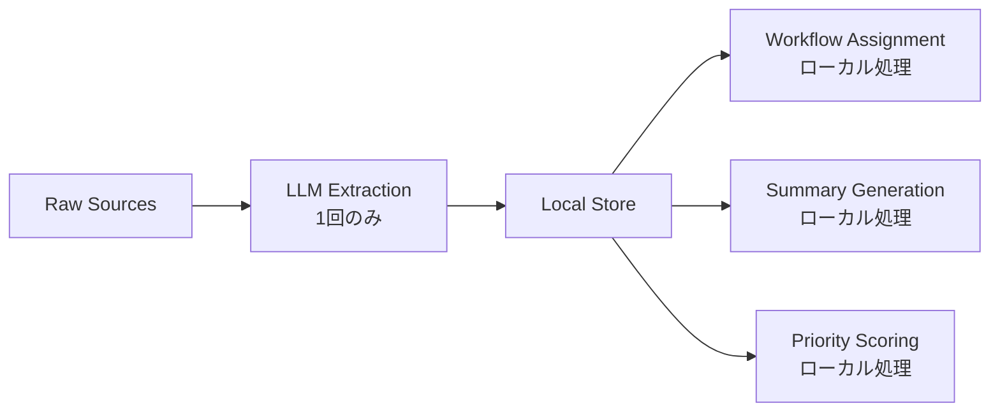

## 論文概要（Abstract）

本記事は [arXiv:2608.17188](https://arxiv.org/abs/2608.17188) の解説記事です。

マルチエージェントAIワークフローの性能ボトルネックはモデル品質ではなく、トークンコスト・レイテンシ・コンテキストウィンドウの質にあるという観点から、実務者向けの最適化フレームワークを提案した論文である。著者は社内の本番ダッシュボード（会議・メール・チャットから構造化ワークアイテムを抽出し、ワークストリーム間でサマリを配信するシステム）での運用経験に基づき、6つの最適化パターンを体系化している。コールドロードレイテンシは3.5-10.5分のベースラインから61-116秒へ短縮、トークン消費量は推定60-70%削減と報告されている。さらに、661件の匿名化ワークプレイスアイテムを用いた2,420回の確認実験を11モデル構成で実施し、プロンプト構成が関連度スコアリングに与える影響を定量的に分析している。

この記事は [Zenn記事: Codex CLI×AGENTS.mdでモノレポのサブエージェント分割とトークン削減を設計する](https://zenn.dev/0h_n0/articles/4b48fc9d7a50a9) の深掘りです。

## 情報源

- **arXiv ID**: 2608.17188
- **URL**: [https://arxiv.org/abs/2608.17188](https://arxiv.org/abs/2608.17188)
- **著者**: Dvir Shamay
- **発表年**: 2026年8月
- **分野**: cs.CL（計算言語学）, cs.AI（人工知能）
- **ページ数**: 29ページ（本文＋技術付録）、3図
- **ライセンス**: CC BY 4.0
- **Zenodo**: [doi.org/10.5281/zenodo.21924612](https://doi.org/10.5281/zenodo.21924612)

## 背景と動機（Background & Motivation）

マルチエージェントLLMシステムの本番運用では、複数のエージェントが協調してタスクを遂行する。各エージェントへの入力はコンテキストウィンドウの制約を受け、冗長なトークンの送受信がコスト増大とレイテンシ悪化を招く。

従来のアプローチには2つの問題があった。第一に、モデルの性能向上（より大きなモデルへの切り替え）がコスト最適化の手段として過度に重視されていた。第二に、プロンプト構成（何をコンテキストに含め、何を除外するか）が体系化されておらず、エンジニアリング規律として確立されていなかった。

著者は、コンテキストウィンドウ管理を「ソフトウェアにおけるメモリ管理」と同種の工学的課題として扱うべきだと主張している。本論文は、会議録・メール・チャットからワークアイテムを抽出する実稼働中のダッシュボードシステムをケーススタディとして、トークン最適化の実践的パターンを提示している。

## 主要な貢献（Key Contributions）

- **6つの最適化パターンの体系化**: コンテキスト層化、Fetch-Once/Process-Locally、スキーマ契約プロンプト、トークンアウェアフォールバックチェイン、セマンティックキャッシング、エージェント間通信圧縮の6パターンを本番環境の実績に基づき整理
- **Relevance-Contrast Contextの発見**: 高関連度アイテムのみでプロンプトを構成するよりも、同ドメインの低関連度アイテムを混合する方が関連度スコアリング精度が向上することを2,420回の実験で確認
- **Fusion-of-N分析**: 複数回の抽出結果を統合する際に、学習ベースのLLM融合よりも機械的な集合和（set union）が同等以上の再現率を示すことを報告
- **測定手法の提示**: RelAcc（Relevance Accuracy）スコアやCohen's d等の統計手法を用いた再現可能な評価方法の確立

## 技術的詳細（Technical Details）

### パターン1: Context Stratification（コンテキスト層化）

各エージェントに対して、そのサブタスクに関連する情報のみを選択的に供給するパターンである。オーケストレーション層でフィルタリングを行い、エージェントあたりの入力トークン数を削減する。

著者らの本番システムでは、会議録・メール・チャットという3種類のデータソースを、信号密度（signal density）に基づいて分離処理している。高密度ソース（会議メモ）と低密度ソース（メール）を別々のエージェントで処理することで、関連度精度が約+0.16改善したと報告されている。

```python
from dataclasses import dataclass
from enum import Enum
from typing import Sequence

class SourceType(Enum):
    """データソースの種別"""
    MEETING = "meeting"
    EMAIL = "email"
    CHAT = "chat"

@dataclass(frozen=True)
class WorkItem:
    """構造化ワークアイテム"""
    item_id: str
    source_type: SourceType
    content: str
    relevance_score: float  # 0.0-3.0

def stratify_context(
    items: Sequence[WorkItem],
    target_source: SourceType,
    max_items: int = 10,
) -> list[WorkItem]:
    """ソースタイプ別にコンテキストを層化する

    Args:
        items: 全ワークアイテム
        target_source: 対象ソースタイプ
        max_items: 最大アイテム数

    Returns:
        層化されたアイテムリスト
    """
    filtered = [item for item in items if item.source_type == target_source]
    sorted_items = sorted(filtered, key=lambda x: x.relevance_score, reverse=True)
    return sorted_items[:max_items]
```

### パターン2: Fetch-Once / Process-Locally

生データの取得を1回だけ行い、ローカルにキャッシュした結果を後続のステップで再利用するアーキテクチャである。ワークアイテムのワークフローへの割り当て等の処理はローカルロジックで行い、API呼び出しの繰り返しを避ける。これにより、コールドスタートレイテンシの大幅な短縮が実現される。



### パターン3: Schema-Contracted Prompts（スキーマ契約プロンプト）

モデルの出力を厳密なJSONスキーマに制約するパターンである。冗長な自然言語の応答を排除し、出力トークン数を削減すると同時に、後続の自動処理の信頼性を向上させる。

```python
import json
from typing import Any

# スキーマ契約の定義例
EXTRACTION_SCHEMA: dict[str, Any] = {
    "type": "object",
    "properties": {
        "items": {
            "type": "array",
            "items": {
                "type": "object",
                "properties": {
                    "id": {"type": "string"},
                    "action": {"type": "string", "maxLength": 100},
                    "assignee": {"type": "string"},
                    "priority": {"type": "integer", "minimum": 1, "maximum": 5},
                    "source": {"type": "string", "enum": ["meeting", "email", "chat"]},
                },
                "required": ["id", "action", "source"],
            },
        }
    },
    "required": ["items"],
}

def build_schema_contracted_prompt(
    raw_content: str,
    schema: dict[str, Any],
) -> str:
    """スキーマ契約付きプロンプトを構築する

    Args:
        raw_content: 抽出対象のテキスト
        schema: 出力JSONスキーマ

    Returns:
        スキーマ制約付きプロンプト文字列
    """
    return (
        "Extract structured work items from the following content.\n"
        f"Output MUST conform to this JSON schema:\n{json.dumps(schema, indent=2)}\n\n"
        f"Content:\n{raw_content}"
    )
```

### パターン4: Token-Aware Fallback Chains（トークンアウェアフォールバックチェイン）

レートリミットやモデルエラー発生時に、事前検証済みのフォールバックモデルへ切り替えるパターンである。重要な点として、コストの高いデータ取得ステージは再実行せず、抽出ステップのみをリトライする設計になっている。

```python
from dataclasses import dataclass

@dataclass
class ModelConfig:
    """モデル設定"""
    name: str
    cost_per_1k_tokens: float
    max_context_length: int

# フォールバックチェインの定義
FALLBACK_CHAIN: list[ModelConfig] = [
    ModelConfig("gpt-4o", cost_per_1k_tokens=0.005, max_context_length=128_000),
    ModelConfig("gpt-4o-mini", cost_per_1k_tokens=0.00015, max_context_length=128_000),
    ModelConfig("claude-3-5-haiku", cost_per_1k_tokens=0.0008, max_context_length=200_000),
]

async def extract_with_fallback(
    prompt: str,
    chain: list[ModelConfig],
) -> dict:
    """フォールバックチェイン付きで抽出を実行する

    Args:
        prompt: 抽出プロンプト
        chain: フォールバックモデルのリスト（優先度順）

    Returns:
        抽出結果の辞書

    Raises:
        RuntimeError: 全モデルで失敗した場合
    """
    for model in chain:
        try:
            # トークン数チェック
            token_count = estimate_tokens(prompt)
            if token_count > model.max_context_length:
                continue
            return await call_model(model.name, prompt)
        except (RateLimitError, ModelError):
            continue
    raise RuntimeError("All models in fallback chain failed")
```

### パターン5: Semantic Caching（セマンティックキャッシング）

パイプライン全体の結果を入力パラメータでキャッシュし、キャッシュヒット時にはLLM呼び出しを完全にバイパスするパターンである。著者の記述によれば、意味的類似性マッチングよりも厳密なパラメータ一致によるキャッシングが採用されている。

```python
import hashlib
import json
from typing import Any

class PipelineCache:
    """パイプライン結果のキャッシュ

    入力パラメータのハッシュをキーとして結果を保存する。
    セマンティック類似性ではなく厳密一致を使用。
    """

    def __init__(self, ttl_seconds: int = 3600) -> None:
        self._store: dict[str, tuple[float, Any]] = {}
        self._ttl = ttl_seconds

    def _make_key(self, params: dict[str, Any]) -> str:
        """入力パラメータからキャッシュキーを生成"""
        serialized = json.dumps(params, sort_keys=True)
        return hashlib.sha256(serialized.encode()).hexdigest()

    def get(self, params: dict[str, Any]) -> Any | None:
        """キャッシュから結果を取得（TTL考慮）"""
        key = self._make_key(params)
        if key in self._store:
            timestamp, result = self._store[key]
            if time.time() - timestamp < self._ttl:
                return result
            del self._store[key]
        return None

    def set(self, params: dict[str, Any], result: Any) -> None:
        """結果をキャッシュに保存"""
        key = self._make_key(params)
        self._store[key] = (time.time(), result)
```

### パターン6: Inter-Agent Communication Compression（エージェント間通信圧縮）

エージェント間の状態更新を、人間可読な自然言語からスキーマ制約付きの機械最適化メッセージに置き換えるパターンである。エージェント間の調整で発生する「ラッパー」トークンを削減する。

```python
from dataclasses import dataclass, asdict
from typing import Literal
import json

@dataclass(frozen=True)
class AgentMessage:
    """エージェント間通信の圧縮メッセージ

    自然言語の状態報告を構造化メッセージに置換する。
    例: "I found 3 high-priority items from the meeting..."
    → AgentMessage(status="complete", item_ids=["m1","m2","m3"], count=3)
    """
    agent_id: str
    status: Literal["complete", "partial", "error"]
    item_ids: list[str]
    count: int
    metadata: dict | None = None

    def to_compressed(self) -> str:
        """圧縮形式でシリアライズ（自然言語の約1/5のトークン数）"""
        return json.dumps(asdict(self), separators=(",", ":"))
```

## 実装のポイント（Implementation）

著者はリファレンス実装として`context_arranger.py`を公開している。実装時の要点は以下の通りである。

**キャリブレーションバッチング**: プロンプトを100%高関連度アイテムで構成するのではなく、20-50%の同ドメイン低関連度アイテムを意図的に混合する。これはモデルの関連度判定を「キャリブレーション」する効果がある。

**ソースタイプ別ルーティング**: 信号密度が大きく異なるソースは分離処理する。著者のシステムでは、メールの信号密度が約5.1%と低く、会議メモに比べて大幅に異なるため、別パイプラインで処理している。

**機械的集約の優先**: 複数回の抽出結果を統合する際は、まず集合和（set union）をベースラインとして検証すべきである。LLMによる学習ベース融合は、1回のサンプルにしか出現しないアイテムを脱落させるリスクがある。

**配置戦略**: 短いプロンプト（約2,000-3,000トークン）では、重要アイテムを末尾に配置する戦略が+0.022の改善を示したが、補正後は有意でなかった（$p_{\text{adj}} = 0.098$）。著者はキャリブレーション効果の方が配置効果よりも重要だと結論している。

## Production Deployment Guide

本論文のマルチエージェントパイプラインをAWS上で構築する場合の実装パターンを解説する。

### AWS実装パターン（コスト最適化重視）

**トラフィック量別の推奨構成**:

| 構成 | トラフィック | アーキテクチャ | 月額目安 |
|------|-------------|---------------|---------|
| Small | ~100 req/日 | Lambda + Bedrock + DynamoDB | $50-150 |
| Medium | ~1,000 req/日 | ECS Fargate + ElastiCache + Bedrock | $300-800 |
| Large | 10,000+ req/日 | EKS + Spot + Karpenter + ElastiCache Cluster | $2,000-5,000 |

**Small構成の詳細**: Lambda関数で各エージェント（抽出・分類・サマリ生成）を実装し、Step Functionsでオーケストレーションする。DynamoDBをキャッシュストアとして利用し、セマンティックキャッシング（パターン5）を実現する。Bedrockのバッチ推論APIを活用して非リアルタイム処理のコストを50%削減可能。

**Medium構成の詳細**: ECS Fargateでエージェントコンテナを実行し、ElastiCache（Redis）でパイプラインキャッシュを管理する。フォールバックチェイン（パターン4）はBedrockの複数モデルエンドポイントで実装。ALB + Auto Scalingで負荷分散。

**Large構成の詳細**: EKS上でKarpenterによるSpot優先の自動スケーリング。エージェント間通信圧縮（パターン6）はSQS FIFOキューで実装し、メッセージサイズを最小化する。

**コスト削減テクニック**:
- Spot Instances活用で最大90%のコンピュート費削減
- Reserved Instances（1年コミット）で最大72%削減
- Bedrock Batch API使用で推論コスト50%削減
- Prompt Caching有効化で入力トークンコスト30-90%削減

注意: 上記コスト試算は2026年10月時点のAWS ap-northeast-1（東京）リージョン料金に基づく概算値である。実際のコストはトラフィックパターン、リージョン、バースト使用量により変動する。最新料金はAWS料金計算ツールで確認を推奨する。

### Terraformインフラコード

**Small構成（Serverless）**:

```hcl
# Lambda + Bedrock + DynamoDB構成
# マルチエージェントパイプライン向けServerless構成

resource "aws_dynamodb_table" "pipeline_cache" {
  name         = "multi-agent-pipeline-cache"
  billing_mode = "PAY_PER_REQUEST"
  hash_key     = "cache_key"
  range_key    = "created_at"

  attribute {
    name = "cache_key"
    type = "S"
  }
  attribute {
    name = "created_at"
    type = "N"
  }

  ttl {
    attribute_name = "expires_at"
    enabled        = true
  }

  server_side_encryption {
    enabled = true  # KMS暗号化
  }

  tags = {
    Project = "multi-agent-pipeline"
    CostCenter = "ai-infra"
  }
}

resource "aws_iam_role" "agent_lambda_role" {
  name = "multi-agent-lambda-role"
  assume_role_policy = jsonencode({
    Version = "2012-10-17"
    Statement = [{
      Action = "sts:AssumeRole"
      Effect = "Allow"
      Principal = { Service = "lambda.amazonaws.com" }
    }]
  })
}

resource "aws_iam_role_policy" "bedrock_invoke" {
  name = "bedrock-invoke-policy"
  role = aws_iam_role.agent_lambda_role.id
  policy = jsonencode({
    Version = "2012-10-17"
    Statement = [{
      Effect   = "Allow"
      Action   = ["bedrock:InvokeModel", "bedrock:InvokeModelWithResponseStream"]
      Resource = "arn:aws:bedrock:ap-northeast-1::foundation-model/*"
    }]
  })
}

resource "aws_lambda_function" "extraction_agent" {
  function_name = "extraction-agent"
  runtime       = "python3.12"
  handler       = "handler.lambda_handler"
  memory_size   = 512  # Bedrock呼び出し用に十分なメモリ
  timeout       = 300  # 5分（LLM応答待ち考慮）
  role          = aws_iam_role.agent_lambda_role.arn

  environment {
    variables = {
      CACHE_TABLE   = aws_dynamodb_table.pipeline_cache.name
      FALLBACK_MODELS = "anthropic.claude-3-5-sonnet,anthropic.claude-3-haiku"
    }
  }

  tracing_config {
    mode = "Active"  # X-Ray有効化
  }
}

resource "aws_cloudwatch_metric_alarm" "token_cost_alarm" {
  alarm_name          = "bedrock-token-cost-spike"
  comparison_operator = "GreaterThanThreshold"
  evaluation_periods  = 1
  metric_name         = "InputTokenCount"
  namespace           = "AWS/Bedrock"
  period              = 3600
  statistic           = "Sum"
  threshold           = 1000000
  alarm_actions       = [aws_sns_topic.alerts.arn]
}
```

**Large構成（Container）**:

```hcl
# EKS + Karpenter + Spot構成

module "eks" {
  source  = "terraform-aws-modules/eks/aws"
  version = "~> 20.31"

  cluster_name    = "multi-agent-cluster"
  cluster_version = "1.31"

  vpc_id     = module.vpc.vpc_id
  subnet_ids = module.vpc.private_subnets

  cluster_endpoint_public_access = false  # プライベートアクセスのみ

  eks_managed_node_groups = {
    system = {
      instance_types = ["m7i.large"]
      min_size       = 2
      max_size       = 4
      desired_size   = 2
    }
  }
}

resource "helm_release" "karpenter" {
  name       = "karpenter"
  repository = "oci://public.ecr.aws/karpenter"
  chart      = "karpenter"
  version    = "1.1.1"
  namespace  = "kube-system"
}

# Karpenter NodePool: Spot優先でコスト削減
resource "kubectl_manifest" "spot_nodepool" {
  yaml_body = yamlencode({
    apiVersion = "karpenter.sh/v1"
    kind       = "NodePool"
    metadata   = { name = "agent-pool" }
    spec = {
      template = {
        spec = {
          requirements = [
            { key = "karpenter.sh/capacity-type", operator = "In", values = ["spot", "on-demand"] },
            { key = "node.kubernetes.io/instance-type", operator = "In",
              values = ["m7i.xlarge", "m7i.2xlarge", "c7i.xlarge", "c7i.2xlarge"] },
          ]
        }
      }
      limits   = { cpu = "100", memory = "400Gi" }
      disruption = { consolidationPolicy = "WhenEmptyOrUnderutilized" }
    }
  })
}

resource "aws_budgets_budget" "monthly" {
  name         = "multi-agent-monthly"
  budget_type  = "COST"
  limit_amount = "5000"
  limit_unit   = "USD"
  time_unit    = "MONTHLY"

  notification {
    comparison_operator       = "GREATER_THAN"
    threshold                 = 80
    threshold_type            = "PERCENTAGE"
    notification_type         = "ACTUAL"
    subscriber_email_addresses = ["ops-team@example.com"]
  }
}
```

### 運用・監視設定

**CloudWatch Logs Insights クエリ（トークンコスト異常検知）**:

```
fields @timestamp, @message
| filter @message like /token_count/
| stats sum(input_tokens) as total_input, sum(output_tokens) as total_output by bin(1h) as hour
| filter total_input > 500000
| sort hour desc
```

**CloudWatch アラーム設定**:

```python
import boto3

cloudwatch = boto3.client("cloudwatch", region_name="ap-northeast-1")

def create_latency_alarm(function_name: str) -> None:
    """Lambda関数のP95レイテンシアラームを作成する"""
    cloudwatch.put_metric_alarm(
        AlarmName=f"{function_name}-p95-latency",
        Namespace="AWS/Lambda",
        MetricName="Duration",
        Dimensions=[{"Name": "FunctionName", "Value": function_name}],
        ExtendedStatistic="p95",
        Period=300,
        EvaluationPeriods=2,
        Threshold=120_000,  # 120秒（論文の上限116秒を参考）
        ComparisonOperator="GreaterThanThreshold",
        AlarmActions=["arn:aws:sns:ap-northeast-1:123456789012:ops-alerts"],
    )
```

**X-Ray トレーシング設定**:

```python
from aws_xray_sdk.core import xray_recorder, patch_all

patch_all()  # boto3, requests等を自動計装

@xray_recorder.capture("extract_work_items")
def extract_work_items(source_type: str, content: str) -> dict:
    """ワークアイテム抽出をX-Rayでトレースする"""
    subsegment = xray_recorder.current_subsegment()
    subsegment.put_annotation("source_type", source_type)
    subsegment.put_metadata("content_length", len(content))
    # ... 抽出処理
    return result
```

**Cost Explorer日次レポート**:

```python
import boto3
from datetime import date, timedelta

ce = boto3.client("ce", region_name="us-east-1")

def get_daily_cost_report() -> dict:
    """Bedrock/Lambda/DynamoDBの日次コストを取得する"""
    end = date.today().isoformat()
    start = (date.today() - timedelta(days=1)).isoformat()
    response = ce.get_cost_and_usage(
        TimePeriod={"Start": start, "End": end},
        Granularity="DAILY",
        Metrics=["BlendedCost"],
        Filter={
            "Dimensions": {
                "Key": "SERVICE",
                "Values": [
                    "Amazon Bedrock", "AWS Lambda",
                    "Amazon DynamoDB", "Amazon ElastiCache",
                ],
            }
        },
        GroupBy=[{"Type": "DIMENSION", "Key": "SERVICE"}],
    )
    return response["ResultsByTime"]
```

### コスト最適化チェックリスト

**アーキテクチャ選択**:
- [ ] トラフィック量に基づく構成選択（Small/Medium/Large）
- [ ] Serverless優先（100 req/日以下はLambda + Step Functions）

**リソース最適化**:
- [ ] EC2/EKS: Spot Instances優先（最大90%削減）
- [ ] Reserved Instances: 1年コミット（最大72%削減）
- [ ] Savings Plans検討（コンピュート全般に適用）
- [ ] Lambda: Power Tuningでメモリサイズ最適化
- [ ] ECS/EKS: アイドル時スケールダウン設定

**LLMコスト削減**:
- [ ] Bedrock Batch API使用（非リアルタイム処理で50%削減）
- [ ] Prompt Caching有効化（同一プロンプトパターンで30-90%削減）
- [ ] フォールバックチェインのコスト順設計
- [ ] トークン数上限設定（max_tokens制御）
- [ ] スキーマ契約プロンプトで出力トークン削減

**監視・アラート**:
- [ ] AWS Budgets設定（月額上限の80%で通知）
- [ ] CloudWatch アラーム（トークン使用量スパイク検知）
- [ ] Cost Anomaly Detection有効化
- [ ] 日次コストレポートのSNS通知設定

**リソース管理**:
- [ ] 未使用リソース定期削除（Lambda未使用バージョン等）
- [ ] タグ戦略統一（Project, CostCenter, Environment）
- [ ] DynamoDB TTLでキャッシュライフサイクル管理
- [ ] 開発環境の夜間・休日停止スケジュール
- [ ] CloudTrail/Config有効化（監査・コンプライアンス）

## 実験結果（Results）

### コンテキスト構成実験（2,420 trials）

著者は661件の匿名化ワークプレイスアイテム（会議録・メール・チャット）を0-3の関連度スコアで手動ラベリングし、11モデル構成・9モデルファミリで2,420回の確認実験を実施している。

**実験設計**: 固定10アイテムのプロンプトにおいて、高関連度アイテムの割合を変化させた条件間で、モデルの関連度スコアリング精度（RelAcc: Relevance Accuracy）を比較している。

**主要結果**:

| 条件 | RelAcc変化 | 95% CI | Cohen's d | p値 |
|------|-----------|--------|-----------|-----|
| 50:50 vs 100%高関連度 | +0.077 | [+0.056, +0.098] | 0.49 | < .001 (Holm調整) |
| 全9ファミリ平均 | +0.084 | [+0.064, +0.103] | - | - |

50:50条件（高関連度5件＋同ドメイン低関連度5件）は、100%高関連度条件を上回る精度を示した。Cohen's $d = 0.49$ は中程度の効果量に相当する。著者はこの結果をコーパス内の記述的比較として報告しており、母集団推論としては扱っていない。

**ソース別分析**: メール（信号密度約5.1%）での効果が最大（+0.119）であり、会議メモやチャットではほぼゼロに近い改善にとどまっている。著者はこれを、信号基底率が低いソースほどキャリブレーション効果が大きいと解釈している。

**精度曲線**: 関連度精度は信号割合が30-50%付近でピークを示す一方、再現率は信号密度の低下とともに上昇し続けると報告されている（Figure 2より）。

### 本番パフォーマンス

6回の計測による運用結果:

| 指標 | ベースライン | 最適化後 |
|------|------------|---------|
| コールドロードレイテンシ | 3.5-10.5分 | 61-116秒 |
| トークン消費量 | - | 推定60-70%削減 |

トークン削減量は推定値であり、直接測定値ではない点に注意が必要である。

### Fusion-of-N実験

複数回の抽出サンプルからアイテムIDを統合する際、機械的な集合和（set union）がLLMによる学習ベース融合と同等以上の再現率を示した。LLM融合では1回のサンプルにしか出現しないアイテムを脱落させるケースが観察されている。この実験は1モデル・1コーパスでの結果である。

## 実運用への応用（Practical Applications）

本論文の6パターンは、Zenn記事で解説したCodex CLIのマルチエージェント構成に直接適用可能である。

**AGENTS.mdとの対応**: Codex CLIのAGENTS.md設計において、サブエージェントごとのコンテキスト制限はContext Stratification（パターン1）の実装にあたる。モノレポのサブディレクトリ単位でエージェントを分割し、各エージェントに必要最小限のコンテキストのみを供給する設計は、本論文の知見と整合する。

**コスト管理**: トークンアウェアフォールバックチェイン（パターン4）は、OpenAIのモデル選択戦略（GPT-4o → GPT-4o-mini → o3-mini）の形式化と捉えられる。高コストモデルの失敗時に低コストモデルへフォールバックすることで、品質とコストのバランスを自動管理できる。

**Relevance-Contrast Contextの実務的含意**: RAGパイプラインにおいて、検索結果を全て高関連度ドキュメントで構成するのではなく、同ドメインの低関連度ドキュメントを意図的に混合することで、モデルの判断精度が向上する可能性がある。ただし、この効果はメールのような低信号密度ソースで顕著であり、高密度ソースでは限定的である点に留意が必要である。

## 限界と注意点

- グラウンドトゥルースが著者1名の手動ラベリングに基づいており、評価者間信頼性が検証されていない
- 効果がメールに集中しており、会議メモ・チャットではほぼゼロ
- 本番システムのトークン削減量は推定値であり、直接測定ではない
- 50:50条件と100%条件の比較では、低関連度アイテムの追加と高関連度アイテムの除去が同時に行われており、交絡が指摘されている
- データやコードは完全には公開されておらず、独立再現が困難
- v1プレプリントであり、査読を経ていない

## 関連研究（Related Work）

- **Liu et al., "Lost in the Middle" (TACL 2024, arXiv:2307.03172)**: LLMがコンテキスト中央部の情報を無視する傾向を報告した研究。本論文はこの知見を踏まえた上で、短いコンテキスト（約2,000-3,000トークン）ではこの効果がスケール依存的であることを示している。
- **Cuconasu et al., "The Power of Noise" (SIGIR 2024, arXiv:2401.14887)**: RAGシステムにおいてランダムなドキュメントをプロンプトに追加すると精度が向上するケースがあることを報告した研究。本論文のRelevance-Contrast Contextの発見に最も近い先行研究であり、同ドメイン低関連度アイテムの混合という点で発展的な位置づけにある。
- **Jiang et al., "LLMLingua" (EMNLP 2023, arXiv:2310.05736)**: プロンプト圧縮により最大20倍の圧縮率を実現する手法。本論文の著者は、低関連度コンテンツを過度に圧縮・除去すると、モデルの関連度判定能力が損なわれる可能性（圧縮対キャリブレーションのトレードオフ）を指摘している。
- **Park et al., "Generative Agents" (2023)**: マルチエージェントアーキテクチャの基盤的研究。本論文はこのようなエージェントアーキテクチャにおけるトークン最適化レイヤーを提供する位置づけである。

## まとめと今後の展望

本論文は、マルチエージェントLLMワークフローのトークン最適化を6つのパターンとして体系化し、本番環境での有効性を報告した実務者視点の研究である。特にRelevance-Contrast Context（高関連度アイテムに低関連度アイテムを混合する手法）は、直感に反する興味深い知見である。

ただし、交絡の問題（高関連度アイテム数の同時変化）、単一アノテータによるラベリング、メール以外のソースでの効果の限定性など、結果の解釈には慎重さが求められる。Pith.scienceのAIレビューでは、高関連度アイテムの干渉効果との区別がつかないという批判が提示されている。

今後の研究方向として、著者も認めているように、独立した複数アノテータによるラベリング、ソースタイプのバランスを取った再現実験、フィラータイプ（同ドメイン低関連度 vs 無関係ドキュメント）の比較実験が必要である。また、6つの最適化パターンの個別貢献度の定量的分離も重要な課題として残されている。

## 参考文献

- **arXiv**: [https://arxiv.org/abs/2608.17188](https://arxiv.org/abs/2608.17188)
- **Zenodo**: [https://doi.org/10.5281/zenodo.21924612](https://doi.org/10.5281/zenodo.21924612)
- **Related Zenn article**: [https://zenn.dev/0h_n0/articles/4b48fc9d7a50a9](https://zenn.dev/0h_n0/articles/4b48fc9d7a50a9)
- **Liu et al. (TACL 2024)**: [https://arxiv.org/abs/2307.03172](https://arxiv.org/abs/2307.03172)
- **Cuconasu et al. (SIGIR 2024)**: [https://arxiv.org/abs/2401.14887](https://arxiv.org/abs/2401.14887)
- **Jiang et al. (EMNLP 2023)**: [https://arxiv.org/abs/2310.05736](https://arxiv.org/abs/2310.05736)
