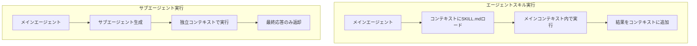

## 論文概要（Abstract）

本記事は [arXiv:2609.09233](https://arxiv.org/abs/2609.09233) の解説記事です。

LLMエージェントが再利用可能な知識パッケージ（エージェントスキル）をどのように活用すべきかを研究した論文を紹介する。エージェントスキルとは、指示ファイル・スクリプト・リソースを含むマルチファイルパッケージであり、従来はメインエージェントのコンテキストに指示を直接ロードして実行していた。著者らは、スキルを独立したサブエージェントとして新しいコンテキストウィンドウで実行する方式を提案し、両者を体系的に比較している。主な結果として、明確な入出力契約（I/Oコントラクト）を持つ手続き的スキルでは、サブエージェント実行がエージェントスキル実行を上回ると報告されている。一方で、トークン消費量の増加という通信オーバーヘッドが伴う。

この記事は [Zenn記事: Codex CLI×AGENTS.mdでモノレポのサブエージェント分割とトークン削減を設計する](https://zenn.dev/0h_n0/articles/4b48fc9d7a50a9) の深掘りです。

## 情報源

- **arXiv ID**: 2609.09233
- **URL**: [https://arxiv.org/abs/2609.09233](https://arxiv.org/abs/2609.09233)
- **著者**: Wasu Top Piriyakulkij, Rachel Lawrence, Alicia Curth, Sushrut Karmalkar, Niranjani Prasad
- **発表年**: 2026年9月
- **分野**: cs.AI, cs.CL, cs.LG
- **ライセンス**: CC BY 4.0

## 背景と動機（Background & Motivation）

LLMエージェントの能力を拡張するために、再利用可能な知識をスキルとしてパッケージ化し、ライブラリとして蓄積する手法が注目されている。Voyager（Wang et al., 2023）のスキルライブラリやSkillsBench（Li et al., 2026）のベンチマークなど、スキルの獲得・評価に関する研究が進んでいる。

しかし、スキルの**実行方法**についてはほとんど検討されてこなかった。従来はスキルの指示ファイル（SKILL.md）をメインエージェントのコンテキストにロードし、メインエージェント自身が指示に従って実行する「エージェントスキル」方式が一般的であった。この方式には根本的な問題がある。長期タスクではコンテキストが膨張し、「Lost in the Middle」現象（Liu et al., 2023）に代表されるように、コンテキスト内の情報利用精度が低下する。スキルの指示がコンテキストに追加されるほど、この問題は悪化する。

著者らはこの課題に対し、階層的強化学習のオプションフレームワーク（Sutton et al., 1999）からの着想を得て、スキルを独立したサブエージェントとして実行する方式を提案している。サブエージェントは新しいコンテキストウィンドウを持ち、スキルの指示のみをシードとして受け取るため、コンテキスト汚染を回避できる。

## 主要な貢献（Key Contributions）

- **実行戦略の体系的比較**: エージェントスキル実行（コンテキスト内ロード）とサブエージェント実行（独立コンテキスト）の性能を、複数のLLMと条件で比較した初の研究
- **I/Oコントラクトの重要性の実証**: 明確な入出力契約を持つ手続き的スキルでサブエージェント実行が優位であることを示し、スキルパッケージの設計指針を提供
- **スキルの自動合成パイプライン**: 成功軌跡からI/Oコントラクト付きの手続き的スキルパッケージを自動生成する手法を提示（87タスク中64タスクで合成に成功）
- **ライブラリ組織構造の評価**: フラット・階層ツリー・階層グラフなど、スキルライブラリの組織方法と実行戦略の相互作用を分析

## 技術的詳細（Technical Details）

### エージェントループの形式化

著者らはエージェントの動作を以下の反復ループとして形式化している。各ターン$t$で、エージェントはコンテキスト$c_t$に基づいて応答$r_t$、ツール選択$k_t$、ツール引数$x_t$を生成する。

$$
(r_t, k_t, x_t) = \pi_{\text{LLM}}(c_t)
$$

ツール実行の結果$o_t$がコンテキストに追加され、次のターンに進む。

$$
c_{t+1} = c_t \oplus (r_t, k_t, x_t, o_t)
$$

ここで、
- $\pi_{\text{LLM}}$: LLMのポリシー関数
- $c_t$: ターン$t$時点のコンテキスト（全履歴を含む）
- $\oplus$: コンテキスト結合演算子
- $E(k_t, x_t)$: ツール$k_t$を引数$x_t$で実行する関数

### スキルパッケージの構造

スキルパッケージ$s$は3つの要素から構成される。

$$
s = (d, m, R)
$$

ここで、
- $d = (q_{\text{in}}, h, q_{\text{out}})$: 説明文（入力契約$q_{\text{in}}$、概要$h$、出力契約$q_{\text{out}}$）
- $m$: 指示ファイル（SKILL.md）
- $R$: リソースコレクション（スクリプト、サンプル、参照文書等）

### 2つの実行戦略

**エージェントスキル実行**では、スキルの指示ファイル$m$がメインエージェントのコンテキストに直接ロードされる。

$$
E(\text{AgentSkill}(s), \emptyset) = m_k
$$

メインエージェント$\pi_{\text{LLM}}$自身が$m_k$に従って処理を実行する。この方式では、コンテキスト$c_t$にスキルの指示が追加されるため、タスクが長期化するにつれてコンテキストが肥大化する。

**サブエージェント実行**では、スキルごとに独立したポリシーが生成される。

$$
\pi^{(k)}(\cdot) \triangleq \pi_{\text{LLM}}(m_k \oplus \cdot)
$$

サブエージェントはタスク入力$x_t$のみを初期コンテキストとして受け取り、最終応答のみを返す。

$$
E(\text{Subagent}(s), x_t) = r_T^{(k)}
$$



### オプションフレームワークとの対応

著者らは階層的強化学習のオプション$\omega = (I_\omega, \pi_\omega, \beta_\omega)$との対応関係を示している。

| オプション要素 | スキルパッケージ要素 | 役割 |
|:---:|:---:|:---|
| $I_\omega$（開始集合） | $q_{\text{in}}$（入力契約） | スキルが適用可能な条件 |
| $\pi_\omega$（ポリシー） | $m$（指示ファイル） | タスク実行の手続き |
| $\beta_\omega$（終了条件） | $q_{\text{out}}$（出力契約） | 完了判定と出力形式 |

この対応により、サブエージェントは$X_{\text{in}} \to X_{\text{out}}$のマッピングとして機能する。入力契約がスキル起動の判断基準を、出力契約が完了時に返すべき情報の仕様を規定する。

### I/Oコントラクトの具体例

論文のFigure 10-11に示された例として、脆弱性レコード正規化スキルの説明文は以下のような構造を持つ。

```
Summary: スキャナJSON形式のレポートからCVEレコードを抽出・正規化する

Expected input:
  - scanner_report_path: スキャナJSON形式のレポートファイルパス
  - severity_filter: フィルタリングする重大度レベル

Output:
  - JSON形式のレコードリスト
    各レコード: Package, Version, CVE_ID, Severity, CVSS_Score,
    Fixed_Version, Title, Url
```

### スキルの自動合成プロセス

著者らはスキルパッケージの自動合成パイプラインを以下の手順で構築している。

1. **軌跡収集**: OpenHands上でGPT-5.3 Codexを用いて、87タスクそれぞれに対し3回の独立実行を行い、成功軌跡を収集
2. **スキル合成**: GitHub Copilot CLI（Claude Opus 5ベース）を使用し、成功軌跡からI/Oコントラクト付きの手続き的スキルパッケージを生成。タスクあたり3-5パッケージを生成
3. **品質検証**: 各スキルが期待される入出力記述を持ち、入力を出力に忠実に変換することを手動で確認

この手法により、87タスク中64タスクでスキルパッケージの合成に成功している。

## 実装のポイント（Implementation）

### サブエージェント実行の設計指針

サブエージェント実行を効果的に活用するには、以下のポイントが重要である。

**1. I/Oコントラクトの明確な定義**

入力契約には受け取るデータの型・形式・制約を、出力契約には返すべきデータの構造を具体的に記述する。曖昧な記述（「適切に処理する」等）は避け、パースや検証が可能なレベルの詳細度が求められる。

**2. サブエージェントプロンプトの設計**

論文のFigure 9に示されたテンプレートは以下の構造を持つ。

```
あなたはタスクと、それを解決するための知識を受け取ります。

TASK: {task}
INPUT INFORMATION: {input_info}  # 非空の場合のみ
KNOWLEDGE: {skill_body}          # SKILL.mdの内容

知識内で言及されたリソースは {skill_dir} にあります。
出力がファイルの場合はパスを、テキストの場合は結果を最終メッセージに含めてください。
```

**3. タイムアウトの適切な設定**

著者らは実験において、サブエージェントのタイムアウトをデフォルトの5分から2時間に延長している。長期タスクでは十分なタイムアウトの確保が必要である。

**4. ハイブリッド実行の検討**

ライブラリを階層的に組織する場合、ルーティングノード（上位レベル）はエージェントスキルとして、リーフスキル（実際の処理を行うもの）はサブエージェントとして実行するハイブリッド方式が論文の実験では一貫して最良の結果を示している。

## Production Deployment Guide

### AWS実装パターン（コスト最適化重視）

マルチエージェントシステムのプロダクション環境では、サブエージェント実行によるトークン消費量の増加を踏まえたアーキテクチャ設計が必要である。以下に2026年10月時点のAWS東京リージョン（ap-northeast-1）の料金に基づく構成を示す。実際のコストはトラフィックパターンやバースト使用量により変動するため、最新料金はAWS料金計算ツールで確認を推奨する。

**トラフィック量別の推奨構成**

| 構成 | トラフィック | アーキテクチャ | 月額概算 |
|:---:|:---:|:---|:---:|
| Small | ~100 req/日 | Lambda + Bedrock + DynamoDB | $80-200 |
| Medium | ~1,000 req/日 | ECS Fargate + Bedrock + ElastiCache | $400-900 |
| Large | 10,000+ req/日 | EKS + Karpenter (Spot) + Bedrock | $2,500-5,500 |

**Small構成の内訳**: Lambda（サブエージェントオーケストレーター、最大15分タイムアウト）$5-10、Bedrock（Claude/Titan API呼び出し）$50-150、DynamoDB（セッション状態・スキルメタデータ、On-Demand）$3-5、S3（スキルパッケージ保存）$1-2、CloudWatch（ログ・メトリクス）$5-10。サブエージェント実行ではメインエージェントとサブエージェントの両方でBedrock呼び出しが発生するため、LLMコストが支配的になる。

**コスト削減テクニック**:
- Bedrock Batch APIの使用でリアルタイム不要な処理のLLMコストを50%削減
- Prompt Cachingの有効化でスキル指示の繰り返しロードコストを30-90%削減（サブエージェント実行では各サブエージェントにスキル指示を送信するため、キャッシュ効果が大きい）
- Spot Instances活用（EKS構成）で最大90%のコンピュートコスト削減
- Reserved Instances（1年コミット）で最大72%のコスト削減

### Terraformインフラコード

**Small構成（Serverless）**: Lambda + Bedrock + DynamoDB

```hcl
# --- Lambda関数（サブエージェントオーケストレーター） ---
resource "aws_lambda_function" "orchestrator" {
  function_name = "subagent-orchestrator"
  role          = aws_iam_role.orchestrator_lambda.arn
  handler       = "orchestrator.handler"
  runtime       = "python3.12"
  timeout       = 900  # 15分（サブエージェント実行に十分な時間）
  memory_size   = 512  # コスト最適化：512MBで十分
  filename      = "lambda_package.zip"

  environment {
    variables = {
      SKILL_BUCKET     = aws_s3_bucket.skill_packages.id
      SESSION_TABLE    = aws_dynamodb_table.session_state.name
      BEDROCK_MODEL_ID = "anthropic.claude-sonnet-4-20250514"
      SUBAGENT_TIMEOUT = "120"
    }
  }
  tracing_config { mode = "Active" }
}

# --- DynamoDB（セッション状態、On-Demand） ---
resource "aws_dynamodb_table" "session_state" {
  name         = "subagent-sessions"
  billing_mode = "PAY_PER_REQUEST"
  hash_key     = "session_id"
  range_key    = "turn_id"

  attribute { name = "session_id"; type = "S" }
  attribute { name = "turn_id"; type = "N" }

  server_side_encryption { enabled = true }
  point_in_time_recovery { enabled = true }
}
```

IAMロールはBedrock InvokeModel、DynamoDB CRUD、S3 GetObjectの最小権限で構成する。VPCはNAT Gateway不使用でコスト削減、S3・DynamoDBはKMS暗号化を適用する。

**Large構成（Container）**: EKS + Karpenter + Spot Instances

```hcl
# --- Karpenter NodePool（Spot優先） ---
resource "kubectl_manifest" "karpenter_provisioner" {
  yaml_body = yamlencode({
    apiVersion = "karpenter.sh/v1"
    kind       = "NodePool"
    metadata   = { name = "subagent-pool" }
    spec = {
      template = {
        spec = {
          requirements = [
            { key = "karpenter.sh/capacity-type", operator = "In",
              values = ["spot", "on-demand"] },
            { key = "node.kubernetes.io/instance-type", operator = "In",
              values = ["m6i.xlarge", "m6i.2xlarge", "m7i.xlarge"] }
          ]
        }
      }
      disruption = {
        consolidationPolicy = "WhenEmptyOrUnderutilized"
        consolidateAfter    = "30s"
      }
      limits = { cpu = "128", memory = "512Gi" }
    }
  })
}
```

EKSクラスタ（v1.31）はプライベートエンドポイントのみ、IRSA有効化。Secrets ManagerでBedrock設定を管理し、AWS Budgetsで月額$5,000の80%超過アラートを設定する。

### 運用・監視設定

**CloudWatch Logs Insights クエリ**（コスト異常検知）

```
fields @timestamp, @message
| filter @message like /bedrock/
| stats sum(input_tokens) as total_input, sum(output_tokens) as total_output,
        count(*) as invocation_count by bin(1h)
| filter total_input > 500000
| sort @timestamp desc
```

**X-Ray トレーシング設定（Python）**

```python
from aws_xray_sdk.core import xray_recorder, patch_all
import boto3

patch_all()  # boto3自動計装

def invoke_subagent(skill_body: str, task_input: str, model_id: str) -> str:
    """サブエージェントを呼び出し、結果を返す。

    Args:
        skill_body: SKILL.mdの内容
        task_input: タスク入力情報
        model_id: BedrockモデルID

    Returns:
        サブエージェントの最終応答
    """
    with xray_recorder.in_subsegment("subagent_invocation") as subsegment:
        subsegment.put_annotation("model_id", model_id)
        subsegment.put_metadata("skill_length", len(skill_body))

        bedrock = boto3.client("bedrock-runtime")
        response = bedrock.invoke_model(
            modelId=model_id,
            body=build_subagent_prompt(skill_body, task_input),
        )
        return parse_response(response)
```

CloudWatch アラームではBedrockトークン使用量スパイク（1時間あたり100,000トークン超過）とLambda実行時間異常（10分超過）を検知し、SNSで通知する。Cost Explorer APIによる日次コストレポートを設定し、$100/日超過でSNS通知を行う。

### コスト最適化チェックリスト

**アーキテクチャ選択**
- [ ] トラフィック量でServerless/Hybrid/Container構成を判断
- [ ] サブエージェント並列度に応じたコンピュートリソースの確保
- [ ] スキルライブラリサイズに応じたストレージ構成

**リソース最適化**
- [ ] EC2/EKS: Spot Instances優先（最大90%削減）
- [ ] Reserved Instances: 1年コミット（最大72%削減）
- [ ] Savings Plans: コンピュート使用量に応じた購入
- [ ] Lambda: メモリサイズ最適化（Power Tuningで検証）
- [ ] ECS/EKS: Karpenterでアイドル時スケールダウン

**LLMコスト削減**
- [ ] Bedrock Batch API: 非リアルタイム処理で50%削減
- [ ] Prompt Caching: スキル指示の反復ロードコスト削減（30-90%）
- [ ] モデル選択ロジック: タスク複雑度に応じたモデル切替
- [ ] トークン数制限: 出力トークン上限の設定
- [ ] サブエージェントの出力圧縮: 最終応答のみ返却で中間トークン削減

**監視・アラート**
- [ ] AWS Budgets: 月次予算アラート設定
- [ ] CloudWatch アラーム: Lambda実行時間・Bedrockトークン使用量
- [ ] Cost Anomaly Detection: 自動異常検知の有効化
- [ ] 日次コストレポート: Cost Explorer APIで自動生成

**リソース管理**
- [ ] 未使用リソース削除: 定期的な棚卸し
- [ ] タグ戦略: Project/Environment/Ownerタグの徹底
- [ ] ライフサイクルポリシー: S3スキルパッケージの古いバージョン削除
- [ ] 開発環境夜間停止: EKSノードのスケジュールスケーリング
- [ ] CloudTrail/Config: 監査ログの有効化

## 実験結果（Results）

### 実験設定

著者らはSkillsBench（Li et al., 2026）の87タスクのうち64タスクで実験を実施している。評価はOpenHands上で行われ、使用モデルはGPT-5.xファミリー、GPT-5.3 Codex、Kimi K2.6、Mistral-Large-3、Qwen3.5（2B/4B/9B）、Ministral-3-8B、Gemma-4-12B-itと多岐にわたる。メトリクスとしてタスク精度、ピークコンテキスト長、総トークン使用量、スキル呼び出し回数が計測された。

### 主要な結果

**スキルタイプ別の実行戦略比較**

| スキルタイプ | エージェントスキル | サブエージェント | 優位な方 |
|:---|:---:|:---:|:---|
| キュレーションスキル（I/Oコントラクトなし） | 高 | 低 | エージェントスキル |
| 合成スキル（I/Oコントラクトあり） | 低 | 高 | サブエージェント |

著者らは以下の傾向を報告している。

1. **キュレーションスキル（人手作成、コントラクトなし）**: エージェントスキル実行が全モデルでサブエージェント実行と同等以上の精度を示した
2. **合成スキル（手続き的、コントラクトあり）**: サブエージェント実行が優位であり、特に小型モデル（帯域制約が大きいモデル）で差が顕著であった
3. **合成スキル vs キュレーションスキル**: 合成パッケージが両実行方式で高いスコアを記録（ただし統制された比較ではないと著者らは注記している）

### コンテキストとトークンのトレードオフ

強力なモデル（GPT-5.3 Codex、Kimi K2.6）では、サブエージェント実行により**80%以上のタスク**でピークコンテキスト長が削減されたと報告されている（論文Figure 4左）。一方で、サブエージェント実行は総トークン使用量が大幅に増加する。これはサブエージェントごとにスキル指示を再送信し、コンテキストを複製する必要があるためである。

弱いモデルにおけるピークコンテキスト比較は信頼性が低いと著者らは指摘している。エージェントスキル実行で早期にタスクを放棄するケースでは、コンテキストが短いまま終了するため、サブエージェントとの公平な比較にならないためである。

### ディストラクタスケーリング

無関係なツール記述（ディストラクタ）をコンテキストに追加した実験では、サブエージェント実行のほうがエージェントスキル実行よりも精度の劣化が緩やかであったと報告されている。サブエージェントは独立したコンテキストウィンドウで動作するため、メインコンテキストのノイズの影響を受けにくいと考えられる。

## 実運用への応用（Practical Applications）

### Codex CLI・AGENTS.mdとの関連

本論文の知見は、Zenn記事で解説したCodex CLIのfork_turnsやAGENTS.mdベースのサブエージェント分割に直接関連する。

**fork_turnsとサブエージェント実行の対応**: Codex CLIのfork_turnsは、本論文のサブエージェント実行と同じアーキテクチャに相当する。メインエージェントがタスクを委任し、サブエージェントが独立したコンテキストで処理を行い、結果のみを返す。論文の知見に基づけば、AGENTS.mdに明確な入出力契約を記述することが、fork_turnsの効果を最大化する鍵となる。

**AGENTS.mdのI/Oコントラクト設計**: 本論文のスキル説明文$d = (q_{\text{in}}, h, q_{\text{out}})$のフォーマットは、AGENTS.mdにそのまま適用できる。各エージェントの説明に「Expected input」と「Output」セクションを設けることで、サブエージェントの精度向上が期待される。

**モノレポでのハイブリッド実行**: 論文のハイブリッド実行モード（ルーティングノードはエージェントスキル、リーフスキルはサブエージェント）は、モノレポのディレクトリ構造と対応する。ルートのAGENTS.mdがルーティングを担い、各サブディレクトリのAGENTS.mdが具体的な処理をサブエージェントとして実行する構成が推奨される。

### 制約と注意点

- サブエージェント実行はトークンコストが増加するため、コスト制約の厳しい環境では慎重な判断が必要
- I/Oコントラクトのないスキル（既存のドキュメントベースの指示等）では、エージェントスキル実行のほうが適している可能性がある
- サブエージェント間の効率的な通信手法は未解決の課題として残されている

## 関連研究（Related Work）

- **Voyager** (Wang et al., 2023, [arXiv:2305.16291](https://arxiv.org/abs/2305.16291)): Minecraft環境でLLMエージェントがスキルライブラリを構築し再利用する手法を提案。コードとしてスキルを保存する点が本論文のスキルパッケージと対応するが、実行方式の比較は行っていない
- **SkillsBench** (Li et al., 2026, [arXiv:2602.12670](https://arxiv.org/abs/2602.12670)): 87の長期タスクとキュレーションスキルを含むベンチマーク。キュレーションスキルで平均16.2ポイントのパス率向上を報告。本論文はこのベンチマークの64タスクを使用し、実行戦略の比較を行っている
- **CoEvoSkills** (Zhang et al., 2026, [arXiv:2604.01687](https://arxiv.org/abs/2604.01687)): スキル生成器と検証器を共進化させる手法。SkillsBenchで複数ベースラインを上回るパス率を達成。本論文のスキル合成パイプラインとは異なるアプローチでスキル品質の向上を目指している
- **Lost in the Middle** (Liu et al., 2023, [arXiv:2307.03172](https://arxiv.org/abs/2307.03172)): LLMがコンテキストの中間部分の情報を活用しにくい現象を報告。本論文のサブエージェント実行はこの問題の緩和策として位置づけられる

## まとめと今後の展望

本論文は、LLMエージェントにおけるスキル実行戦略としてエージェントスキル実行とサブエージェント実行を体系的に比較し、明確なI/Oコントラクトを持つ手続き的スキルではサブエージェント実行が優位であることを示した。一方で、サブエージェント実行にはトークン消費量の増加という代償があり、スキルの性質に応じた実行戦略の選択が重要であるという結論が示されている。

今後の課題として、サブエージェント間の効率的な通信プロトコル、スキルライブラリの原則に基づいたリファクタリング手法、および限られた計算予算下でのハイブリッド実行戦略の最適化が挙げられている。実務的には、AGENTS.mdやCodex CLIのfork_turnsにI/Oコントラクトの概念を導入し、タスク特性に応じて実行方式を切り替えるアプローチが有望と考えられる。

## 参考文献

- **arXiv**: [https://arxiv.org/abs/2609.09233](https://arxiv.org/abs/2609.09233)
- **SkillsBench**: [https://arxiv.org/abs/2602.12670](https://arxiv.org/abs/2602.12670)
- **Voyager**: [https://arxiv.org/abs/2305.16291](https://arxiv.org/abs/2305.16291)
- **CoEvoSkills**: [https://arxiv.org/abs/2604.01687](https://arxiv.org/abs/2604.01687)
- **Lost in the Middle**: [https://arxiv.org/abs/2307.03172](https://arxiv.org/abs/2307.03172)
- **Related Zenn article**: [https://zenn.dev/0h_n0/articles/4b48fc9d7a50a9](https://zenn.dev/0h_n0/articles/4b48fc9d7a50a9)
