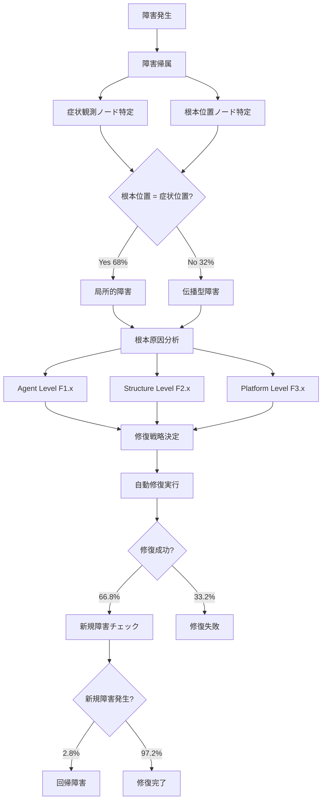

## 論文概要

本記事は [https://arxiv.org/abs/2509.23735](https://arxiv.org/abs/2509.23735) の解説記事です。

本論文は、DifyやCozeなどのローコードオーケストレーションプラットフォーム上に構築されたマルチエージェントワークフローにおける障害（failure）を体系的に分析した研究である。著者らは307件の実障害事例からなるデータセット**AgentFail**を構築し、障害の**発生（manifestation）・伝播（propagation）・根本原因（root cause）・修復（repair）**という障害ライフサイクル全体を通じた分析を行っている。エージェント間の自然言語によるやり取り、ツール呼び出し、動的制御ロジックを通じて障害が伝播するという、従来のソフトウェアシステムとは異なる特性を明らかにした点が特徴的である。

この記事は [Zenn記事: LangGraph 1.2 Command APIで設計する耐障害ステートマシン実践ガイド](https://zenn.dev/0h_n0/articles/1a312e389e08e1) の関連1次情報です。

## 情報源

- **arXiv ID**: 2509.23735
- **URL**: [arXiv:2509.23735](https://arxiv.org/abs/2509.23735)
- **著者**: Xuyan Ma, Xiaofei Xie, Yawen Wang, Junjie Wang, Boyu Wu, Mingyang Li, Qing Wang
- **発表年**: 2025年9月（v2: 2026年2月）
- **分野**: Artificial Intelligence (cs.AI), Software Engineering (cs.SE)

## 背景と動機

マルチエージェントシステムは、複数のLLMエージェントがツール呼び出しや自然言語でのやり取りを通じて協調動作するアーキテクチャである。DifyやCozeのようなローコードプラットフォームの登場により、ノードベースのビジュアルエディタでこうしたワークフローを構築できるようになった。

しかし、こうしたワークフローには従来のソフトウェアとは異なる障害特性がある。具体的には以下の3点が問題となる。

1. **自然言語ベースの通信**: エージェント間のメッセージが構造化されていないため、意味の曖昧性がエラーの温床となる
2. **ツール呼び出しの連鎖**: あるノードの不正な出力が後続ノードのツール呼び出しに伝播する
3. **動的制御ロジック**: 分岐・ループ・並列実行などの制御フローが実行時に決定されるため、障害の予測と追跡が困難

著者らは、既存研究がエージェントの能力評価（ベンチマーク）に偏っており、障害の発生メカニズム・伝播経路・修復戦略を包括的に分析した研究が不足していると指摘している。

## 主要な貢献

本論文の貢献は以下の5点に整理できる。

1. **AgentFailデータセット**: 2つのプラットフォーム（Dify・Coze）上の10ワークフローから収集した307件の実障害事例。クエリ、障害ログ（完全な会話トレース）、ワークフロー構成、アノテーション（根本位置・根本原因ラベル・修復戦略）を含む
2. **障害分類体系（タクソノミー）**: Agent・Structure・Platformの3層12カテゴリからなる修復指向の障害分類
3. **障害帰属手法（RLDetect）**: 反事実的再実行（re-rollout）による障害の根本位置の自動特定手法
4. **修復難易度分析**: 根本原因カテゴリ別・ノードタイプ別の修復成功率・反復回数・新規障害率の定量評価
5. **設計ガイドライン**: 信頼性の高いエージェントワークフロー設計のための4つの指針

## 技術的詳細

### 障害ライフサイクルモデル

本論文の中核は、エージェントワークフローの障害を「ライフサイクル」として捉える視点である。著者らは障害を以下の3つのフェーズで分析している。

1. **障害帰属（Failure Attribution）**: 障害がどのノードで発生し、どこまで伝播したかを特定する
2. **根本原因分析（Root Cause Analysis）**: 障害の根本的な原因を3層のタクソノミーで分類する
3. **障害修復（Failure Repair）**: 根本原因に基づく修復戦略と、その自動修復性能を評価する

以下のフローは、障害が発生してから修復に至るまでのライフサイクルを示す。

### ワークフローノードの分類

著者らは、プラットフォーム上のノードを以下の6タイプに分類している。

| ノードタイプ | 役割 | 障害リスク |
|:---|:---|:---|
| **LLM & Agent** | 推論・計画を担うLLMベースノード | 最も障害が多い |
| **Logic & Control** | 分岐・ループなどの制御フロー | 2番目に障害が多い |
| **Knowledge** | 知識検索ノード | 3番目に障害が多い |
| **Tool & Integration** | 外部ツール・APIとの連携 | 修復が困難 |
| **Code & Template** | 確定的なコード実行・テンプレート | 障害は少ないが発生時は修復容易 |
| **Start & Termination** | 入出力マーカー | 分析対象外 |

### 障害分類タクソノミー（3層12カテゴリ）

著者らはGrounded Theory（Glaser & Strauss, 1968）に基づき、3名の専門アノテータによるラベリングとクロスバリデーションを経て、以下のタクソノミーを構築している。

**Agent Level（F1.x）** — 個々のエージェント内部の障害。LLMの限界やローカルリソースとの相互作用に起因する。最も頻度が高い。

| コード | 名称 | 説明 |
|:---|:---|:---|
| F1.2 | Response Formatting Error | 出力フォーマットの不整合 |
| F1.3 | Response Content Deviation | 応答内容のずれ |
| F1.4 | Knowledge/Reasoning Limitation | 知識・推論能力の限界（最頻出） |
| F1.5 | Poor Prompt Design | プロンプト設計の不備（最頻出） |
| F1.6 | Encoding Issues | エンコーディングの問題 |

**Structure Level（F2.x）** — エージェント間の協調・通信に関する障害。オーケストレーション構造に起因する。

| コード | 名称 | 説明 |
|:---|:---|:---|
| F2.1 | Missing Input Validation | 入力バリデーションの欠如 |
| F2.2 | Unreasonable Node Dependency | 不合理なノード依存関係 |
| F2.3 | Loops and Deadlock | ループ・デッドロック |
| F2.4 | Faulty Conditional Judgment | 条件判定の誤り |
| F2.5 | Improper Task Decomposition | タスク分解の不備 |

**Platform Level（F3.x）** — プラットフォーム・ランタイム環境に起因する障害。最も頻度が低い。

| コード | 名称 | 説明 |
|:---|:---|:---|
| F3.1 | Network/Resource Fluctuations | ネットワーク・リソースの変動 |
| F3.2 | Service Unavailability | サービスの利用不能 |

このタクソノミーは「修復指向」であり、各根本原因カテゴリが特定の修復戦略に対応する設計になっている。たとえばF1.2（フォーマットエラー）にはフォーマット検証モジュールの追加、F2.1（入力バリデーション欠如）にはバリデーションノードの挿入が対応する。

### 障害帰属手法（RLDetect）

著者らは、障害の根本位置を自動特定するRLDetect手法を提案している。この手法は2段階で構成される。

**Step 1: 精密分析（Fine-grained Analysis）**
障害の実行トレースとワークフロー構成を分析し、少数の疑わしい候補ノードを特定する。

**Step 2: 根本位置検出（Root Location Detection）**
各候補ノードの出力を「Oracle Generator」が生成した正しい出力に置き換え、残りの実行をそのまま維持した状態でワークフローを再実行する。この反事実的再実行（re-rollout verification）により、修正によって障害が解消される最も早いノードを根本位置として特定する。

著者らはこの手法を「決定的行動（decisive action）」の概念で定式化している。あるノードの行動を正しいものに置き換えた場合に（それ以前のステップは固定して）障害が成功に変わるなら、そのノードの行動は「決定的」である。複数の決定的行動が存在する場合、最も早いものが根本位置となる。

### 障害伝播の特性

307件の障害事例の分析から、以下の伝播特性が明らかになっている。

- **32%** の障害で、根本原因ノードと症状が観測されるノードが異なる
- **10%以上** の障害で、伝播距離がワークフロー全体の長さの40%を超える
- **LLM & Agent** ノードに起因する障害の約**40%** が非局所的に伝播
- **Logic & Control** ノードに起因する障害の約**45%** が非局所的に伝播

著者らは正規化伝播距離 $$\mathbb{D}$$ を、根本原因ノードと障害露出ノードの間の距離をワークフロー全体の長さで除した値として定義している。この指標により、ワークフロー規模に依存しない伝播距離の比較が可能となる。

## 実装のポイント：設計ガイドライン

著者らは分析結果に基づき、信頼性の高いエージェントワークフロー設計のための4つのガイドラインを提示している。

1. **明確な役割仕様とモジュール化されたプロンプト設計**: 計画エラーや応答のずれ（F1.3、F1.5）を低減するため、各エージェントの役割と出力フォーマットを厳密に定義する
2. **各ノードでの入出力バリデーション**: 不正データのカスケード伝播（F1.2、F2.1）を防止するため、ノード間の境界で明示的な検証を行う
3. **包括的なフォールバック設計**: 局所的エラーの伝播を防ぐため、二次検証エージェントや代替ツールパスなどのフォールバック機構を設ける（F2.4）。ただし、オーバーヘッドとのトレードオフがある
4. **段階的なワークフロー設計**: 単純な直列・並列フローから開始し、段階的に複雑性を追加する（F2.2、F2.3）

さらに、**LLM & Agent** および **Tool & Integration** ノードを高リスクとして扱い、**Code & Template** や **Knowledge** などの確定的ノードには厳格な仕様と自動チェックを適用することを推奨している。

## 実験結果

### AgentFailデータセットの構成

著者らは2つのプラットフォームから10ワークフロー、計1,387件のテスト入力を用いて307件の障害事例を収集している。

| プラットフォーム | タスク | 構造 | テスト入力 | 障害数 |
|:---|:---|:---|---:|---:|
| Dify | コード生成（HumanEval） | ループ型 | 163 | 23 |
| Dify | プログラム修復（SWE-bench） | ループ型 | 100 | 62 |
| Dify | 製品QAアシスタント | 分岐型 | 100 | 18 |
| Dify | 旅行アシスタント（TravelPlanner） | 並列型 | 180 | 32 |
| Dify | ディープリサーチ（ninja-x） | ハイブリッド型 | 182 | 27 |
| Coze | 製品QAアシスタント | ハイブリッド型 | 100 | 37 |
| Coze | 旅行アシスタント（TravelPlanner） | 並列型 | 180 | 31 |
| Coze | マーケットリサーチ | 直列型 | 100 | 30 |
| Coze | ディープリサーチ（ninja-x） | 直列型 | 182 | 27 |
| Coze | 産業分析 | 並列型 | 100 | 20 |
| **合計** | | | **1,387** | **307** |

307件のうち293件は著者らの実行から、14件はオープンソースコミュニティの報告を再現したものである。

### 自動障害帰属の性能

| 手法 | 帰属精度 |
|:---|---:|
| 精密分析のみ（RLDetectなし） | 46.3% |
| RLDetect（再実行検証あり） | 65.8% |

### 根本原因の自動特定精度

| 条件 | 特定精度 |
|:---|---:|
| 位置情報なし・タクソノミーなし | 9.6% |
| タクソノミーのみ | 27.4% |
| 位置情報のみ | 22.8% |
| 位置情報+タクソノミー | 45.6% |

この結果は、障害の根本位置と分類体系の両方が根本原因の自動特定に不可欠であることを示している。

### 修復性能

| ガイダンス条件 | 修復成功率 | 新規障害率 |
|:---|---:|---:|
| 位置なし・根本原因なし | 16.3% | 13.9% |
| 位置情報のみ | 34.9% | 8.4% |
| 位置情報+根本原因 | 66.8% | 2.8% |

ここで「新規障害率」は、修復後のワークフローを従来成功していた1,080件の入力で再実行した際に新たに失敗する割合を指す。位置情報と根本原因の両方を修復エージェントに提供することで、修復成功率が大幅に向上し、回帰的な新規障害も低減される。

### 根本原因別・ノードタイプ別の修復難易度

著者らの分析によると、修復難易度は以下のパターンを示す。

**根本原因別**:
- Agent Level（F1.x）の障害は修復成功率が高く、必要な反復回数も少ない（修復が容易）
- Structure Level（F2.x）の障害は修復成功率が低く、反復回数も多い（修復が困難）
- ただしF2.1（入力バリデーション欠如）はバリデーション追加で対処可能なため例外的に修復が容易
- F1.5（プロンプト設計不備）は根本原因情報なしでは修復成功率が急落する

**ノードタイプ別**:
- **Code & Template**: 修復成功率が最も高い（確定的な動作のため）
- **Knowledge**: 比較的修復が容易
- **LLM & Agent**: 修復が困難（高リスクノード）
- **Tool & Integration**: 修復が最も困難（高リスクノード）

## 実運用への応用

本論文の知見は、[Zenn記事で紹介しているLangGraph 1.2 Command APIによる耐障害ステートマシン設計](https://zenn.dev/0h_n0/articles/1a312e389e08e1)と密接に関連する。

- **障害伝播の32%が非局所的**という知見は、LangGraphにおける各ノードでのState検証（入出力バリデーション）の重要性を裏付ける。Zenn記事で解説している3層エラーハンドリング（ノード内try-except、State検証、グラフレベルフォールバック）は、本論文のガイドライン2（各ノードでの入出力バリデーション）と3（包括的フォールバック設計）に対応する
- **LLM & Agentノードが高リスク**という知見は、LLMノードの出力を後続ノードに渡す前にPydanticなどで構造化検証する設計パターンの妥当性を支持する
- **段階的なワークフロー設計**のガイドラインは、LangGraphのサブグラフ機能を活用した段階的な複雑性追加の設計方針と整合する

## 関連研究

- **SWE-agent**（Yang et al., 2024）: ソフトウェアエンジニアリングタスクにおけるLLMエージェントのバグ修復。本論文の修復エージェント設計の参考となった
- **Agentless**（Xia et al., 2024）: エージェントを用いないソフトウェア障害の自動修復手法。修復戦略の設計に影響を与えた
- **TravelPlanner**（Xie et al., 2024）: 複雑な旅行計画タスクにおけるLLMエージェントのベンチマーク。AgentFailのテストデータの一つとして使用された
- **HumanEval**（Chen et al., 2021）: コード生成能力のベンチマーク。AgentFailのテストデータとして使用された

## まとめと今後の展望

本論文は、エージェントワークフローの障害を「ライフサイクル」として体系的に捉え、307件の実障害事例に基づく定量的な分析を行った研究である。障害の32%が非局所的に伝播すること、根本原因の自動特定に位置情報とタクソノミーの両方が必要であること、根本原因情報の提供で修復成功率が16.3%から66.8%に向上することなど、実用的な知見を多数提示している。

今後の展望として、著者らは修復エージェントの能力向上（認知的バイアスの克服、テンプレートベースの修復戦略の活用）や、より多くのプラットフォーム・タスクへの拡張を示唆している。AgentFailデータセットの公開により、エージェントワークフローの信頼性に関する研究の加速が期待される。

## 参考文献

1. Ma, X., Xie, X., Wang, Y., Wang, J., Wu, B., Li, M., & Wang, Q. (2025). Demystifying the Lifecycle of Failures in Platform-Orchestrated Agentic Workflows. arXiv:2509.23735.
2. Yang, J., Jimenez, C. E., Wettig, A., Liber, K., Narasimhan, K., & Press, O. (2024). SWE-agent: Agent-Computer Interfaces Enable Automated Software Engineering. arXiv:2405.15793.
3. Xia, C. S., Deng, Y., Dunn, S., & Zhang, L. (2024). Agentless: Demystifying LLM-based Software Engineering Agents. arXiv:2407.01489.
4. Xie, J., Zhang, K., Chen, J., Zhu, T., Lou, R., Tian, Y., Xiao, Y., & Su, Y. (2024). TravelPlanner: A Benchmark for Real-World Planning with Language Agents. ICML 2024.
5. Chen, M., Tworek, J., Jun, H., et al. (2021). Evaluating Large Language Models Trained on Code. arXiv:2107.03374.
