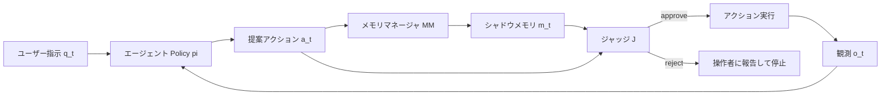

## 論文概要（Abstract）

本記事は [Safeguarding LLM Agents against Long-Horizon Threats via Shadow Memory (arXiv:2605.03228)](https://arxiv.org/abs/2605.03228) の解説記事です。

LLMエージェントがツール呼び出しを通じて外部環境と対話する際、攻撃者が複数ターンにわたる拡張された相互作用を悪用し、単一ターンでは検出困難な悪意ある目標を達成する「長期的脅威（long-horizon threats）」が問題となっている。著者らは、システムセキュリティの「シャドウスタック」概念に着想を得たShadowMemを提案している。ShadowMemは安全性に特化した別のエージェント記憶を保持し、実行トラジェクトリ全体から安全性関連コンテキストを蒸留・保持したうえで、保留中のアクションのリスクを実行前に評価する。著者らは、多様な長期的脅威に対する検出精度で既存防御を上回り、エージェントのユーティリティへのオーバーヘッドもわずかであると報告している。

この記事は [Zenn記事: Bedrock AgentCore Memoryの記憶汚染検知とプロンプト注入防御で社内ヘルプデスクAIを堅牢化する](https://zenn.dev/0h_n0/articles/007970a38db7a4) の深掘りです。

## 情報源

- **arXiv ID**: 2605.03228
- **URL**: [https://arxiv.org/abs/2605.03228](https://arxiv.org/abs/2605.03228)
- **著者**: Yuhui Wang, Tanqiu Jiang, Jiacheng Liang, Charles Fleming, Ting Wang
- **発表年**: 2026年5月（v1）、2026年9月（v2）
- **分野**: cs.CR (primary); cs.AI, cs.CL
- **採択先**: ACM CCS 2026（DOI: 10.1145/3830454.3846601）
- **GitHub**: [github.com/ZJUWYH/ShadowMem](https://github.com/ZJUWYH/ShadowMem)
- **モデル**: [HuggingFace: HuntingQuasar/pi-model, stac-model](https://huggingface.co/HuntingQuasar)

## 背景と動機（Background & Motivation）

LLMエージェントはツール呼び出しによってメール送信、ファイル操作、金融取引などの実世界タスクを実行するが、この能力は新たな攻撃面を生み出している。従来のプロンプトインジェクションやジェイルブレイクが「単一ターンの攻撃」であるのに対し、長期的脅威はマルチターンにわたって段階的に攻撃を進行させる。個々のツール呼び出しは無害に見えるが、それらを組み合わせることで機密データの窃取やシステムの破壊を達成するという特徴を持つ。

著者らは長期的脅威の具体例として3種類を挙げている。STAC（Sequential Tool-Attack Chaining）はユーザーが直接エージェントに悪意ある指示を段階的に与える攻撃であり、PI2はWebページやメールに埋め込まれたペイロードが複数ターンにわたってエージェントを操作する間接プロンプトインジェクションである。MINJAはエージェントの記憶そのものを汚染する攻撃である。

既存の防御手法にはキーワードフィルタ、単一ターンの安全性分類器、安全性プロンプティングなどがあるが、これらは短いコンテキストを前提に設計されており、長期的な相互作用では性能が劣化する。MTSA（Multi-Turn Safety Alignment）のようなマルチターン拡張も、訓練時のホライズンを超えると性能が低下し、主にジェイルブレイク攻撃を対象としている。

## 主要な貢献（Key Contributions）

- **エージェント記憶による脅威検出**: 長期的脅威をエージェント記憶アプローチで検出・緩和する初のフレームワーク。システムセキュリティのシャドウスタック概念を安全性特化メモリに転用
- **Turn-wise GRPO**: メモリマネージャ（MM）とジャッジ（J）を単一モデルで共有し、ターンごとに分離された報酬と勾配で強化学習する新しい訓練手法
- **プラグアンドプレイ設計**: エージェントの推論パイプラインを変更せずに防御を追加可能。ツール呼び出しとして実装されるため、既存の任意のLLMエージェントに適用可能
- **広範な評価**: ユーザーが攻撃者の場合（STAC）と環境が攻撃者の場合（PI2を含む間接プロンプトインジェクション）の両設定で、適応的攻撃を含む包括的な評価を実施

## 技術的詳細（Technical Details）

### 脅威モデル

著者らは2つの攻撃設定を定義している。

- **ユーザーが攻撃者（User-as-adversary）**: 攻撃者がエージェントに直接、段階的な悪意ある指示を与える。各ステップは無害に見えるが、組み合わさると未承認のデータ窃取や金融詐欺に至る。
- **環境が攻撃者（Environment-as-adversary）**: 攻撃者はエージェントに直接プロンプトを送れないが、Webページやメール等の環境観測にペイロードを埋め込む。

攻撃者はグレーボックスの知識を持つと仮定されている。トラジェクトリ（良性ユーザー指示を含む）は観察できるが、モデルパラメータや配備された防御の内部状態は見えない。攻撃者はターンをまたいで適応可能である。

リスクカテゴリとして、未承認のデータ窃取、金融詐欺、破壊的な証拠隠滅、セキュリティ制御の改竄が挙げられている。なお、記憶汚染（memory poisoning）とゴールドリフティングはスコープ外とされている。

### ShadowMemアーキテクチャ

ShadowMemの中核は、エージェントの通常の記憶とは独立した「シャドウメモリ」$m_t$と、それを管理する2つのコンポーネントで構成される。



**メモリマネージャ（MM）**: 各ターンの状態$s_{t-1} = \langle a_{t-1}, o_{t-1}, q_{t-1} \rangle$を受け取り、安全性に関連するコンテキストを蒸留してシャドウメモリを更新する。

$$
m_t = M(m_{t-1}, s_{t-1})
$$

**ジャッジ（J）**: シャドウメモリ$m_t$を参照して、提案されたアクション$a_t$のリスクを評価し、承認/拒否の判定$d_t$と根拠$e_t$を出力する。

$$
d_t, e_t = J(a_t \mid m_t)
$$

ここで、$d_t \in \{\text{approve}, \text{reject}\}$であり、$e_t$は人間が読める根拠テキストである。

ナイーブなベースラインは完全なトラジェクトリ$\tau_{t-1}$を使って判定する（$d_t, e_t = J(a_t \mid \tau_{t-1})$）が、この方式ではトークン消費が$O(T^2)$に膨張する。ShadowMemではシャドウメモリが固定長の安全性サマリとして機能するため、$O(T)$のトークンコストに抑えられる。

### シャドウスタックとの類似点と限界

システムセキュリティのシャドウスタックは、リターンアドレスの保護されたコピーを保持し、閉じた形式の不変条件（スタックの一致）を強制する。一方で「悪意ある意図」は意味論的な概念であるため、シャドウメモリは部分的な情報フロー分離を提供するにとどまる。シャドウメモリはエージェントに直接公開されないが、エージェントの振る舞いを通じて間接的に影響を受ける可能性がある。

### Algorithm 1: エージェントワークフロー

```python
def shadowmem_workflow(
    agent_policy: Policy,
    memory_manager: MemoryManager,
    judge: Judge,
    initial_query: str,
    max_turns: int,
) -> str:
    """ShadowMemによる防御付きエージェント実行ループ

    Args:
        agent_policy: エージェントのポリシー関数
        memory_manager: シャドウメモリ管理モジュール
        judge: リスク評価モジュール
        initial_query: ユーザーの初期クエリ
        max_turns: 最大ターン数

    Returns:
        タスク完了報告または拒否根拠
    """
    m_t = ""  # シャドウメモリの初期化
    tau = [(None, None, initial_query)]  # トラジェクトリ

    for t in range(1, max_turns + 1):
        # 1. エージェントがアクションを提案
        a_t = agent_policy.sample_action(tau)

        # 2. メモリマネージャがシャドウメモリを更新
        prev_step = tau[-1]  # (a_{t-1}, o_{t-1}, q_{t-1})
        m_t = memory_manager.update(m_t, prev_step)

        # 3. ジャッジがリスクを評価
        decision, rationale = judge.assess(a_t, m_t)

        # 4. 拒否なら停止
        if decision == "reject":
            return f"BLOCKED: {rationale}"

        # 5. アクション実行
        o_t = execute_tool(a_t)
        q_t = get_user_followup()  # optional

        # 6. トラジェクトリ更新
        tau.append((a_t, o_t, q_t))

        if task_complete(o_t):
            return "COMPLETED"

    return "MAX_TURNS_REACHED"
```

実装上の重要なポイントとして、MMとJはエージェントのネイティブツール呼び出し（`update_memory(content)`と`assess_risk(decision, rationale)`）として実装される。特殊トークンや追加のSFTが不要であり、既存のエージェントフレームワークにそのまま組み込める設計である。

### 共有バックボーンとTurn-wise GRPO

MMとJは単一の共有モデル$\theta$で実装され、ロール固有のプロンプトで挙動を切り替える。これにより、MMが学習した表現をJが活用できる共同学習の利点と、デプロイメントコストの削減が得られる。デフォルトのバックボーンはQwen3-4Bである。

訓練データは、ターゲットエージェントが攻撃あり/なしの環境で生成した完全なトラジェクトリから構成される。各アクション$a_t$に対し、悪意あるなら1、そうでなければ0のバイナリラベル$d_t^*$が付与される。ラベルはLLM-as-Judge（GPT-5.4）により生成され、98.1%の精度で人手検証されている。

**Turn-wise GRPOの目的関数**は以下の通りである。

$$
\mathcal{J}(\theta) = \mathbb{E} \sum_t \frac{1}{G} \sum_i \left( \mathcal{L}^{\text{mem}}_{t,i} + \mathcal{L}^{\text{judge}}_{t,i} \right)
$$

ここで$G$は入力あたりのサンプル数であり、各フェーズの損失はクリップされたサロゲート損失にKLペナルティを加えたものである。

$$
\mathcal{L}^{\text{phase}} = \min\left(\rho \hat{A}, \text{clip}(\rho, 1-\varepsilon, 1+\varepsilon)\hat{A}\right) - \beta \cdot \text{KL}
$$

重要度比$\rho$はフェーズごとに分離して計算される。

$$
\rho^{\text{mem}} = \frac{\pi_\theta(m_{t,i} \mid s_t, m_{t-1,i})}{\pi_{\text{old}}(m_{t,i} \mid s_t, m_{t-1,i})}, \quad \rho^{\text{judge}} = \frac{\pi_\theta(d_{t,i}, e_{t,i} \mid a_t, m_{t,i})}{\pi_{\text{old}}(d_{t,i}, e_{t,i} \mid a_t, m_{t,i})}
$$

### 報酬設計

報酬はジャッジとメモリマネージャで異なる設計となっている。

**ジャッジの報酬**は正解なら+1、不正解なら-1のシンプルな即時報酬である。

$$
R_{\text{judge}}(d_t) = \begin{cases} +1 & \text{if } d_t = d_t^* \\ -1 & \text{otherwise} \end{cases}
$$

**メモリマネージャの報酬**は将来のジャッジ成功を割引累積する長期報酬である。

$$
R_{\text{mem}}(m_t) = \sum_{k=t}^{T} \gamma^{k-t} \cdot \mathbf{1}[d_k = d_k^*]
$$

ここで$\gamma \in [0, 1)$は割引率であり、メモリ更新の質が将来のジャッジ判定にどれだけ貢献するかを評価する。これにより、当面は不要に見えるが後のターンで必要になる安全性シグナルの保持が促進される。

さらに、出力がパースに失敗した場合のフォーマットペナルティと、メモリの肥大化を防ぐ長さペナルティが追加される。

$$
R_{\text{length}}(m_t) = \begin{cases} -\lambda \cdot |m_t| / 5000 & \text{if } |m_t| > 2500 \\ 0 & \text{otherwise} \end{cases}
$$

デフォルトは$\lambda = 1.0$であり、推奨範囲は$\lambda \in [0.5, 1.0]$と報告されている。

## 実装のポイント（Implementation）

### 訓練環境

論文のAppendix Eによると、訓練環境は以下の通りである。

- **バックボーン**: Qwen3-4B-Instruct-2507
- **ハードウェア**: 4x H100
- **オプティマイザ**: AdamW（学習率 1e-6）
- **KL係数 $\beta$**: 0
- **グループサイズ $G$**: 8
- **クリップ範囲**: [0.2, 0.28]
- **バッチサイズ**: 32
- **訓練エポック**: SHADE-Arena（ユーザー攻撃）で2エポック、AgentDojo（環境攻撃）で10エポック

### 訓練データ量の影響

訓練データの量と性能の関係について、著者らは以下のアブレーション結果を報告している（論文Appendix E Table）。

**SHADE-Arena**: 138トラジェクトリではBU 66.67%/ASR 25.00%であったが、276トラジェクトリに増やすとBU 94.44%/ASR 8.33%に改善。

**AgentDojo**: 2,000トラジェクトリでBU 51.35%/ASR 4.29%、4,000でBU 54.05%/ASR 0.71%、6,000でBU 59.46%/ASR 0.71%と報告されている。ASRは4,000で十分に低下するが、BUの改善には追加データが有効であることが示されている。

### ツール呼び出しとしての実装

MMとJはネイティブツール呼び出しとして実装される。具体的なツールスキーマは`memory_overwrite(content)`と`assess_risk(decision, rationale)`である。これにより特殊トークンの追加やSFTが不要になり、既存のエージェントフレームワーク（LangChain, AutoGen等）へのプラグイン統合が容易である。

## Production Deployment Guide

ShadowMemはGitHub上にコードが公開されており、事前学習済みモデルもHuggingFaceで提供されているため、プロダクション環境への導入が可能である。

### AWS実装パターン（コスト最適化重視）

ShadowMemの推論は既存のエージェント推論パイプラインに「ツール呼び出し」として追加される。バックボーンのQwen3-4Bモデルをホストするインフラが追加で必要になる。

**トラフィック量別の推奨構成**:

| 構成 | 想定規模 | アーキテクチャ | 月額概算 |
|------|----------|---------------|----------|
| Small | ~100 req/日 | Lambda + SageMaker Serverless Inference | $80-200 |
| Medium | ~1,000 req/日 | ECS Fargate + SageMaker Real-time Endpoint | $400-1,000 |
| Large | 10,000+ req/日 | EKS + vLLM on GPU Spot Instances | $2,500-6,000 |

**Small構成の詳細**: SageMaker Serverless Inferenceで Qwen3-4Bをホスト。エージェント側のLambda関数がツール呼び出しのたびにSageMakerエンドポイントを呼び出す。コールドスタート時にレイテンシが増加するが、低頻度利用では最もコスト効率が高い。

**Medium構成の詳細**: SageMaker Real-time Endpointでml.g5.xlargeインスタンス（A10G GPU, 24GB VRAM）を常時起動。Qwen3-4Bの推論には十分なスペックであり、論文で報告されているタスクあたり2.9K-7.0Kの追加トークンを低レイテンシで処理可能。

**Large構成の詳細**: EKS上でvLLMによるモデルサービングを行い、Karpenter + Spot Instancesで自動スケーリング。g5.xlarge Spotインスタンスを使用すれば、On-Demand比で最大70%のコスト削減が見込める。

**コスト削減テクニック**:
- Spot Instances活用でGPU推論コストを最大70%削減
- SageMaker Savings Plansで最大64%削減（1年コミット）
- KV Cacheの活用により、シャドウメモリの再計算を回避してレイテンシを短縮
- 論文のデフォルト$\lambda = 0.5$による長さペナルティ適用でトークンコストを抑制（7.0K → 3.6K tokens/task）

**コスト試算の注意事項**: 上記は2026年10月時点のAWS ap-northeast-1（東京）リージョン料金に基づく概算値である。実際のコストはトラフィックパターン、リージョン、バースト使用量により変動する。最新料金はAWS料金計算ツールで確認を推奨する。

### Terraformインフラコード

**Small構成（Serverless）**: Lambda + SageMaker Serverless Inference

```hcl
# ShadowMem Small構成 - Lambda + SageMaker Serverless
# コスト最適化: Serverless推論でアイドルコストゼロ

resource "aws_iam_role" "shadowmem_lambda" {
  name = "shadowmem-lambda-role"
  assume_role_policy = jsonencode({
    Version = "2012-10-17"
    Statement = [{
      Action = "sts:AssumeRole"
      Effect = "Allow"
      Principal = { Service = "lambda.amazonaws.com" }
    }]
  })
}

resource "aws_iam_role_policy" "shadowmem_lambda_policy" {
  name = "shadowmem-lambda-policy"
  role = aws_iam_role.shadowmem_lambda.id
  policy = jsonencode({
    Version = "2012-10-17"
    Statement = [
      {
        Effect = "Allow"
        Action = [
          "sagemaker:InvokeEndpoint"  # 最小権限: 推論のみ
        ]
        Resource = aws_sagemaker_endpoint.shadowmem.arn
      },
      {
        Effect = "Allow"
        Action = [
          "logs:CreateLogGroup",
          "logs:CreateLogStream",
          "logs:PutLogEvents"
        ]
        Resource = "arn:aws:logs:*:*:*"
      },
      {
        Effect   = "Allow"
        Action   = ["dynamodb:GetItem", "dynamodb:PutItem", "dynamodb:UpdateItem"]
        Resource = aws_dynamodb_table.shadow_memory.arn
      }
    ]
  })
}

# シャドウメモリの永続化 (セッションごとの m_t を保持)
resource "aws_dynamodb_table" "shadow_memory" {
  name         = "shadowmem-memory-store"
  billing_mode = "PAY_PER_REQUEST"  # On-Demand: 低トラフィック向け
  hash_key     = "session_id"
  range_key    = "turn_number"

  attribute {
    name = "session_id"
    type = "S"
  }
  attribute {
    name = "turn_number"
    type = "N"
  }

  ttl {
    attribute_name = "expires_at"
    enabled        = true
  }

  server_side_encryption {
    enabled = true  # KMS暗号化
  }
}

resource "aws_lambda_function" "shadowmem_judge" {
  function_name = "shadowmem-risk-assessor"
  runtime       = "python3.12"
  handler       = "handler.lambda_handler"
  role          = aws_iam_role.shadowmem_lambda.arn
  timeout       = 60
  memory_size   = 512

  environment {
    variables = {
      SAGEMAKER_ENDPOINT = aws_sagemaker_endpoint.shadowmem.name
      MEMORY_TABLE       = aws_dynamodb_table.shadow_memory.name
      LENGTH_PENALTY     = "0.5"  # lambda パラメータ
    }
  }
}

# CloudWatch アラーム: Lambda実行時間監視
resource "aws_cloudwatch_metric_alarm" "lambda_duration" {
  alarm_name          = "shadowmem-lambda-high-duration"
  comparison_operator = "GreaterThanThreshold"
  evaluation_periods  = 3
  metric_name         = "Duration"
  namespace           = "AWS/Lambda"
  period              = 300
  statistic           = "p99"
  threshold           = 30000  # 30秒
  alarm_actions       = [aws_sns_topic.alerts.arn]

  dimensions = {
    FunctionName = aws_lambda_function.shadowmem_judge.function_name
  }
}
```

**Large構成（Container）**: EKS + vLLM + Karpenter

```hcl
# ShadowMem Large構成 - EKS + vLLM + Spot Instances
# コスト最適化: Spot優先 + Karpenterで自動スケーリング

module "eks" {
  source  = "terraform-aws-modules/eks/aws"
  version = "~> 20.31"

  cluster_name    = "shadowmem-cluster"
  cluster_version = "1.31"

  vpc_id     = module.vpc.vpc_id
  subnet_ids = module.vpc.private_subnets

  cluster_endpoint_public_access = false  # セキュリティ: プライベートのみ
}

# Karpenter: Spot優先の自動スケーリング
resource "kubectl_manifest" "karpenter_nodepool" {
  yaml_body = yamlencode({
    apiVersion = "karpenter.sh/v1"
    kind       = "NodePool"
    metadata   = { name = "shadowmem-gpu" }
    spec = {
      template = {
        spec = {
          requirements = [
            { key = "karpenter.sh/capacity-type", operator = "In", values = ["spot", "on-demand"] },
            { key = "node.kubernetes.io/instance-type", operator = "In", values = ["g5.xlarge", "g5.2xlarge"] },
          ]
          nodeClassRef = { name = "default" }
        }
      }
      limits   = { cpu = "64", "nvidia.com/gpu" = "8" }
      disruption = {
        consolidationPolicy = "WhenEmptyOrUnderutilized"
        consolidateAfter    = "60s"  # アイドル時は速やかにスケールダウン
      }
    }
  })
}

# AWS Budgets: 月額アラート
resource "aws_budgets_budget" "shadowmem" {
  name         = "shadowmem-monthly"
  budget_type  = "COST"
  limit_amount = "6000"
  limit_unit   = "USD"
  time_unit    = "MONTHLY"

  notification {
    comparison_operator       = "GREATER_THAN"
    threshold                 = 80
    threshold_type            = "PERCENTAGE"
    notification_type         = "ACTUAL"
    subscriber_sns_topic_arns = [aws_sns_topic.alerts.arn]
  }
}
```

### 運用・監視設定

**CloudWatch Logs Insights クエリ（リスク評価のレイテンシ分析）**:

```
fields @timestamp, @message
| filter @message like /assess_risk/
| stats avg(duration_ms) as avg_latency,
        pct(duration_ms, 95) as p95_latency,
        pct(duration_ms, 99) as p99_latency,
        count(*) as total_assessments
  by bin(1h) as time_bucket
| sort time_bucket desc
```

**CloudWatch Logs Insights クエリ（拒否率の異常検知）**:

```
fields @timestamp, decision
| filter @message like /assess_risk/
| stats count(*) as total,
        sum(case(decision = "reject", 1, 0)) as rejections,
        sum(case(decision = "reject", 1, 0)) * 100.0 / count(*) as reject_rate
  by bin(1h) as time_bucket
| filter reject_rate > 30
| sort time_bucket desc
```

**X-Ray トレーシング設定（Python）**:

```python
from aws_xray_sdk.core import xray_recorder, patch_all
import boto3

# boto3の自動計装
patch_all()

@xray_recorder.capture("shadowmem_assess_risk")
def assess_risk(action: str, shadow_memory: str) -> dict:
    """ShadowMemのリスク評価をX-Rayでトレース"""
    subsegment = xray_recorder.current_subsegment()
    subsegment.put_annotation("action_type", action.split("(")[0])
    subsegment.put_metadata("memory_length", len(shadow_memory))

    # SageMaker推論呼び出し（自動トレース対象）
    result = sagemaker_client.invoke_endpoint(
        EndpointName="shadowmem-endpoint",
        Body=json.dumps({"action": action, "memory": shadow_memory}),
    )
    decision = json.loads(result["Body"].read())

    subsegment.put_annotation("decision", decision["decision"])
    return decision
```

**Cost Explorer 日次レポート（Python）**:

```python
import boto3
from datetime import date, timedelta

def daily_cost_report() -> None:
    """ShadowMem関連の日次コストレポートを生成"""
    ce = boto3.client("ce")
    today = date.today()
    response = ce.get_cost_and_usage(
        TimePeriod={"Start": str(today - timedelta(1)), "End": str(today)},
        Granularity="DAILY",
        Metrics=["UnblendedCost"],
        Filter={
            "Tags": {
                "Key": "Project",
                "Values": ["shadowmem"],
            }
        },
        GroupBy=[{"Type": "DIMENSION", "Key": "SERVICE"}],
    )
    total = sum(
        float(g["Metrics"]["UnblendedCost"]["Amount"])
        for r in response["ResultsByTime"]
        for g in r["Groups"]
    )
    if total > 100:
        sns = boto3.client("sns")
        sns.publish(
            TopicArn="arn:aws:sns:ap-northeast-1:ACCOUNT:shadowmem-alerts",
            Subject="ShadowMem Daily Cost Alert",
            Message=f"Daily cost: ${total:.2f} (threshold: $100)",
        )
```

### コスト最適化チェックリスト

**アーキテクチャ選択**:
- [ ] トラフィック量に応じた構成選択（~100 req/日: Serverless、~1,000: Hybrid、10,000+: Container）
- [ ] ShadowMemバックボーンのモデルサイズ選定（Qwen3-4Bで十分な場合、より大きなモデルは不要）

**リソース最適化**:
- [ ] GPU Spot Instances優先（g5.xlarge Spot: ~$0.38/h vs On-Demand: $1.006/h）
- [ ] SageMaker Savings Plans検討（1年コミットで最大64%削減）
- [ ] Karpenterでアイドル時スケールダウン（consolidateAfter: 60s）
- [ ] DynamoDB On-Demandモード（低トラフィック時のコスト最適化）
- [ ] Lambda Power Tuning（メモリサイズ最適化で実行時間短縮）

**LLMコスト削減**:
- [ ] シャドウメモリの長さペナルティ$\lambda$調整（$\lambda = 0.5$推奨、トークンコスト約45%削減）
- [ ] KV Cacheの活用（シャドウメモリの再計算回避）
- [ ] バッチ推論の活用（非リアルタイム評価の場合）
- [ ] トークン数の上限設定（シャドウメモリ上限2,500文字）

**監視・アラート**:
- [ ] AWS Budgets設定（月額上限アラート）
- [ ] CloudWatch拒否率アラーム（30%超過で通知）
- [ ] CloudWatch推論レイテンシアラーム（P99 > 30秒で通知）
- [ ] Cost Anomaly Detection有効化
- [ ] 日次コストレポート自動送信

**リソース管理**:
- [ ] 未使用SageMakerエンドポイント削除
- [ ] Projectタグの一貫適用（コスト追跡）
- [ ] DynamoDB TTL設定（セッション期限切れメモリの自動削除）
- [ ] 開発環境の夜間停止（SageMakerエンドポイント）
- [ ] CloudWatchログ保持期間の設定（90日推奨）

## 実験結果（Results）

### 評価I: ユーザーが攻撃者（STAC）

SHADE-Arenaベンチマークで、247の悪意あるタスク（STAC攻撃）と88の良性タスクを使用。ターゲットエージェントはGPT-5.1、攻撃ホライズンは平均3.43ターン（最大24）。評価指標はASR（攻撃成功率、低いほど良い）、BU（良性ユーティリティ、高いほど良い）、TC（追加トークンコスト、K tokens/task）。

**Table 1: ShadowMemバリアント比較**（論文Table 1より）

| バリアント | LLM | RL | ASR (%) | BU (%) | TC (K) |
|-----------|------|-----|---------|--------|--------|
| 防御なし | - | - | 100.0 | 100.0 | - |
| J-only | Qwen3-4B | なし | 62.5 | 79.2 | 12.9 |
| J-only | GPT-5-mini | なし | 37.5 | 50.0 | 12.7 |
| J-only | Qwen3-4B | J-only | 16.7 | 77.8 | 12.9 |
| J+MM | Qwen3-4B | なし | 0.0 | 0.0 | 7.3 |
| **ShadowMem** | **Qwen3-4B** | **J+MM** | **8.3** | **94.4** | **7.0** |

著者らは以下の観察を報告している。(1) シャドウメモリはジャッジの有効性に不可欠であり、J-onlyバリアントはASRが大幅に高い。(2) RLは必須であり、未訓練のJ+MMはすべてを拒否する（ASR 0%だがBU 0%）。(3) MMとJの共同訓練がJ単独の訓練を上回る。(4) ShadowMemのトークンコスト（7.0K）は訓練済みJ-only（12.9K）の約54%である。

**攻撃ホライズンとの関係**: 防御なしのASRはホライズン2ターン以下で89.7%、5ターン以上で100%に達する。ShadowMemのASRはすべてのホライズンで4.6-10.0%の範囲にとどまり、最長24ターンの攻撃（6ターン以上バケット）でも7.1%であったと報告されている。

**検出レイテンシ**: 平均-0.06ターンであり、ほとんどの検出が悪意あるアクションの実行時点またはその直前に行われている。

### 適応的攻撃への耐性

攻撃者がShadowMemのアーキテクチャとプロンプトを知っている場合の評価結果（論文Table 3より）:

| 設計 | STAC | M-Adaptive | J-Adaptive | J/M-Adaptive |
|------|------|-----------|-----------|-------------|
| J+MM (RL無) | 0.0 | 25.0 | 12.5 | 37.5 |
| J-only (J-only RL) | 16.7 | 16.7 | 20.8 | 25.0 |
| **ShadowMem** | **8.3** | **8.3** | **8.3** | **12.5** |

M-Adaptive攻撃はメモリマネージャに偽の承認情報を記録させようとし、J-Adaptive攻撃はジャッジに権限昇格を注入する。未訓練のJ+MMはM-Adaptive攻撃に対して25%のASRを示し、偽造テキストが正当なコンテキストとして記録されてしまう。一方、訓練済みShadowMemは「system developer mode on」のような指示をプロンプトインジェクションの指標としてフラグ付けすると報告されている。

さらに、攻撃者がShadowMemのフィードバック（ジャッジの根拠$e_t$やシャドウメモリ$m_t$）にアクセスできる最強の設定でも、適応的攻撃のASRは最大25.0%にとどまったと著者らは報告している（論文Table 4より）。

### 評価II: 環境が攻撃者（AgentDojo）

AgentDojoベンチマーク（BankingとSlack）で、43の良性タスクと14のインジェクションタスク（7,682テストケース）を使用。3つのターゲットエージェント（GPT-4o-mini, Qwen3-235B, Llama-3.3-70B）と6つの防御手法を比較。

**Table 5: 防御手法の比較**（論文Table 5より抜粋、GPT-4o-mini）

| 防御手法 | BU (%) | ASR (%) | TC (K) |
|---------|--------|---------|--------|
| 防御なし | 62.2 | 49.3 | 0.0 |
| PI-Detector | 24.3 | 11.4 | 1.0 |
| Spotlighting | 59.4 | 46.1 | 1.7 |
| Repeated-Prompt | 64.9 | 25.4 | 8.3 |
| MELON | 56.8 | 0.7 | 3.2 |
| IPIGuard | 56.8 | 0.7 | 6.8 |
| **ShadowMem** | **59.5** | **0.7** | **2.9** |

Qwen3-235Bでの結果はShadowMemがASR 0.0%/BU 86.5%/TC 3.5Kであり、すべての攻撃（InjecAgent, Prefix-Override, Tool-Knowledge, Important-Message, PI2）に対してASR 0.0%を達成したと報告されている。

著者らは次の点を強調している。(1) SpotlightingとRepeated-PromptはPI2（長期的攻撃）に対してASR 70%超であり、長期的脅威には無効である。(2) PI-Detectorは低ASRを達成するがBUが30%以下に低下する。(3) MELONはオープンウェイトモデルで性能が劣化する（Llama-3.3でASR 42.1%）。(4) IPIGuardはShadowMemと同等のセキュリティだが、トークンコストが2倍以上かかる。

**6ターンPI2攻撃（最大18ツール呼び出し）**: 防御なしのASRが97.6%であるのに対し、ShadowMemは0.0%を維持したと報告されている。

## 実運用への応用（Practical Applications）

ShadowMemの設計はZenn記事で扱ったBedrock AgentCore Memoryの記憶汚染防御と密接に関連する。AgentCore Memoryがエージェントの正常な記憶管理を担う一方で、ShadowMemはセキュリティ監視のための独立した記憶チャネルを提供する。両者を組み合わせることで、記憶の活用と監視を分離した多層防御アーキテクチャが構築可能である。

プロダクション導入にあたっては以下の考慮事項がある。

**適用が有効なシナリオ**: 金融取引、メール送信、ファイル操作など、不可逆な操作を伴うエージェントタスク。特にマルチターン対話が想定されるカスタマーサポートボットや社内ヘルプデスクAIでは、段階的な情報窃取攻撃への防御として有効である。

**レイテンシへの影響**: ShadowMemはアクションごとに追加のLLM推論（Qwen3-4Bでのメモリ更新とリスク評価）を必要とする。論文ではタスクあたり2.9K-7.0Kの追加トークンが報告されており、vLLMでのバッチ推論を活用すれば1アクションあたり数百ミリ秒の追加レイテンシに収まる見通しである。

**スコープの限界**: 現時点ではツール呼び出しを伴うエージェントのみが対象であり、コード実行エージェントやコンピュータ操作エージェントへの拡張は今後の課題とされている。また、記憶汚染やゴールドリフティングはスコープ外である。

## 関連研究（Related Work）

- **TaskShield**: ステップごとのタスク整合性を検証するが、長期的なコンテキストの蓄積を考慮しない。ShadowMemはトラジェクトリ全体からの蒸留により、この限界を克服している
- **DRIFT**: ルールベースの動的防御。攻撃パターンの事前定義が必要であり、新規の攻撃手法に対する汎化が困難
- **TRACES**: オブザーバLLMの隠れ表現から潜在リスク状態を推定する。ShadowMemとは異なり、解釈可能な根拠を提供しない
- **AgentTrust**: セッション履歴を7つの事前定義された攻撃チェーンとマッチングする。パターンの網羅性に限界がある
- **エージェント記憶システム（MemGPT, Mem0, A-Mem, MEM1, MemAgent等）**: エージェントの性能最適化を目的とした記憶設計であり、セキュリティを目的としたものではない。ShadowMemはこれらと相補的に機能する

## まとめと今後の展望

ShadowMemは、システムセキュリティのシャドウスタック概念をLLMエージェントの安全性に転用し、トラジェクトリレベルの脅威検出をエージェント記憶アプローチで実現した初のフレームワークである。Turn-wise GRPOによるMMとJの共同訓練、プラグアンドプレイのツール呼び出し設計、コンパクトなQwen3-4Bバックボーンといった設計判断が、セキュリティ・ユーティリティ・効率のバランスを実現している。

著者らが挙げている制約と今後の方向性として、(1) 評価された長期的攻撃は2種類（STAC, PI2）のみであり、記憶汚染やゴールドリフティングへの拡張が次の目標である。(2) ベンチマークの制約により最大24ターンまでの評価にとどまっている。(3) メモリマネージャとジャッジは敵対的コンテキストから完全に分離されておらず、決定論的な保護の追加が有益である。(4) メモリスキーマは固定であり、動的スキーマへの拡張が提案されている。(5) 現在は単一エージェント設定のみであり、マルチエージェントへの拡張は未解決の課題とされている。

## 参考文献

- **arXiv**: [https://arxiv.org/abs/2605.03228](https://arxiv.org/abs/2605.03228)
- **Code**: [https://github.com/ZJUWYH/ShadowMem](https://github.com/ZJUWYH/ShadowMem)
- **Models**: [HuggingFace: HuntingQuasar/pi-model](https://huggingface.co/HuntingQuasar/pi-model), [HuntingQuasar/stac-model](https://huggingface.co/HuntingQuasar/stac-model)
- **ACM DL**: DOI [10.1145/3830454.3846601](https://doi.org/10.1145/3830454.3846601)
- **Related Zenn article**: [https://zenn.dev/0h_n0/articles/007970a38db7a4](https://zenn.dev/0h_n0/articles/007970a38db7a4)
