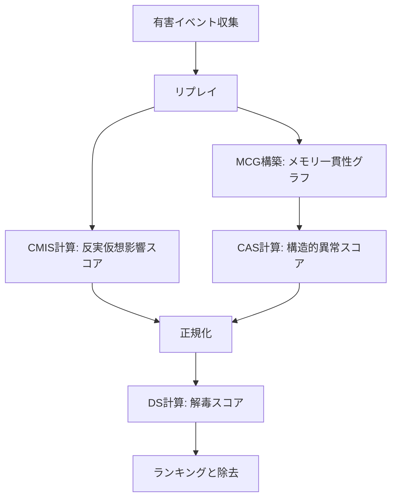

本記事は[MemAudit: Post-hoc Auditing of Poisoned Agent Memory via Causal Attribution and Structural Anomaly Detection (arXiv:2605.23723)](https://arxiv.org/abs/2605.23723)の解説記事です。

## 論文概要（Abstract）

メモリ拡張LLMエージェントは過去のインタラクションを永続メモリに保存し、以降のタスクで活用する。しかしこの仕組みは、攻撃者が通常の会話を通じて悪意あるレコードを永続メモリに埋め込むという攻撃面を生む。既存の防御策はオンライン（プロンプトフィルタリングや出力ブロック）で動作するため、どの保存メモリが有害出力を引き起こしたかを事後的に特定できない。MemAuditは反実仮想メモリ影響スコア（CMIS）とメモリ一貫性グラフ（MCG）に基づく構造的異常検知を組み合わせた事後監査フレームワークであり、MINJA攻撃に対しQA設定では攻撃成功率70%から0%、RAP推論エージェント設定では83.3%から0%への低減を報告している。

この記事は [Zenn記事: Bedrock AgentCore Memoryの記憶汚染検知とプロンプト注入防御で社内ヘルプデスクAIを堅牢化する](https://zenn.dev/0h_n0/articles/007970a38db7a4) の深掘りです。

## 情報源

- **arXiv ID**: 2605.23723
- **URL**: [https://arxiv.org/abs/2605.23723](https://arxiv.org/abs/2605.23723)
- **著者**: Zhewen Tan, Yilun Yao, Huiyan Jin, et al.（12名）
- **発表年**: 2026
- **分野**: cs.AI

## 背景と動機（Background & Motivation）

LLMエージェントにおける永続メモリは、ユーザーの好みや過去の対話記録を保存し応答をパーソナライズする重要な機能である。しかし、MINJA（Dong et al., 2025）に代表されるメモリ注入攻撃では、攻撃者がクエリのみで悪意あるレコードをメモリに埋め込むことができる。一度永続化された汚染メモリは以降のすべてのインタラクションで参照され続ける。

既存の防御策はプロンプトフィルタリングや出力検査によるオンライン方式に限られ、すでに永続化された汚染レコードの事後的な特定と除去はできない。著者らは「どのメモリが有害出力の原因か」を事後監査する仕組みが必要だと主張し、MemAuditを提案している。

## 主要な貢献（Key Contributions）

- **事後監査フレームワークの提案**: オンライン防御では対処できない永続化済み汚染メモリを、反実仮想推論とグラフベース異常検知の組み合わせで事後的に特定するMemAuditフレームワーク
- **反実仮想メモリ影響スコア（CMIS）**: 各メモリの有害出力への因果的寄与を、メモリ除去後の出力変化として定量化する手法
- **メモリ一貫性グラフ（MCG）**: 意味的類似度とNLI（自然言語推論）ベースの矛盾検知を組み合わせた構造的異常検知機構
- **MINJA攻撃への有効性実証**: QAおよびRAP（推論エージェント）の2つの設定で、攻撃成功率を0%に低減（一部条件を除く）

## 技術的詳細（Technical Details）

### 問題設定

メモリ拡張エージェントの構成要素を以下のように定義する。

- $M = \{m_1, \dots, m_n\}$: メモリストア（$n$個のメモリエントリ）
- $R(q, M) \subseteq M$: クエリ$q$に対する検索関数（関連メモリの部分集合を返す）
- $f$: エージェントの生成ポリシー（LLM）
- $y = f(q, R(q, M))$: クエリ$q$と検索結果から生成される出力

有害イベント$e = (q^{*}, y^{*}, R^{*})$が観測された場合、監査者はどのメモリが有害出力$y^{*}$の原因となったかを特定したい。監査者は汚染メモリのラベル（正解）を持たない。目標は、除去集合$S \subseteq M$を見つけ、$M \setminus S$における有害出力を最小化することである。

### MemAuditフレームワークの全体像



MemAuditは2つの独立した信号を融合する。1つ目はCMIS（反実仮想メモリ影響スコア）で、各メモリの有害出力への因果的寄与をリプレイベースで推定する。2つ目はCAS（構造的異常スコア）で、メモリストア全体の意味的一貫性から逸脱したメモリをフラグする。両者を加重融合したDS（解毒スコア）でメモリをランキングし、上位のメモリを除去する。

### 反実仮想メモリ影響スコア（CMIS）

CMISは、特定のメモリ$m_i$を除去した場合に有害出力がどの程度低減するかを測定する反実仮想スコアである。

$$
\text{CMIS}(m_i) = h(q^{*}, y^{*}) - h\big(q^{*},\, f(q^{*}, R(q^{*}, M \setminus \{m_i\}))\big)
$$

ここで、
- $h(\cdot)$: 有害性スコアリング関数
- $q^{*}$: 有害イベントのトリガークエリ
- $y^{*}$: 観測された有害出力
- $M \setminus \{m_i\}$: メモリ$m_i$を除去したメモリストア

CMISが大きい場合、$m_i$の除去が有害性を大きく低減させることを意味し、そのメモリが有害出力に対して強い因果的役割を持つことを示唆する。

有害性スコアリング関数$h$はタスクに依存したルールベースの二値関数として定義されている。QA設定では以下のように定義されている（論文Appendix Cより）。

$$
h_{\text{QA}}(q, y) = \mathbb{I}[\text{victim}(q)] \cdot \mathbb{I}[\text{Answer}(y) \in \{E, F, G, H\}]
$$

被害者クエリに対して回答が攻撃者指定ラベルと一致した場合にのみ$h = 1$となる。RAP設定ではクエリが被害カテゴリを含み、軌跡がターゲット製品に到達し、click[Buy Now]が実行された場合に有害と判定される。

### メモリ一貫性グラフ（MCG）

MCGはメモリストア全体の意味的・論理的一貫性をグラフ構造として表現する。

$$
G = (V, E)
$$

ここで、
- $V$: 各メモリエントリをノードとする頂点集合
- $E$: 意味的関連性と論理的一貫性に基づくエッジ集合

エッジの構築には2つの信号を利用する。

1. **意味的類似度** $\text{sim}(m_i, m_j)$: メモリ間の意味的近さを表す。埋め込みベクトルのコサイン類似度等で計算し、近傍構造を決定する
2. **NLIベースの矛盾検知**: DeBERTa-v3モデルを用いて、メモリペア間のentailment（含意）とcontradiction（矛盾）を判定する。矛盾が検出されたペアには高い不整合重み$w(m_i, m_j)$が付与される

汚染メモリは正常なメモリとの間で矛盾関係を持ちやすいという直観に基づき、グラフ上で構造的に異常な位置にあるメモリを検出する。

### 構造的異常スコア（CAS）

CASは、MCG上での各メモリの異常度を定量化するスコアである。

$$
\text{CAS}(m_i) = \sum_{m_j \in \mathcal{N}(m_i)} w(m_i, m_j) \cdot \text{sim}(m_i, m_j)
$$

ここで、
- $\mathcal{N}(m_i)$: MCG $G$におけるメモリ$m_i$の近傍集合
- $w(m_i, m_j)$: NLIベースの不整合重み（矛盾度が高いほど大きい）
- $\text{sim}(m_i, m_j)$: 意味的類似度

意味的に近い（$\text{sim}$が高い）にもかかわらず論理的に矛盾する（$w$が高い）近傍が多いメモリはCASが高くなる。汚染メモリは正常なメモリと意味的に関連しつつも矛盾する内容を持つため、CASが高くなりやすい。著者らは$\mu + 2\sigma$基準での異常検知にも言及しているが、Algorithm 1ではDSスコアによるランキングで除去対象を選択する。

### 解毒スコア（DS）と融合

CMISとCASの正規化スコアを加重融合し、最終的な解毒スコアDSを計算する。

$$
\text{DS}(m_i) = \alpha \cdot \widetilde{\text{CMIS}}(m_i) + (1 - \alpha) \cdot \widetilde{\text{CAS}}(m_i)
$$

ここで、
- $\widetilde{\text{CMIS}}$, $\widetilde{\text{CAS}}$: 正規化済みスコア
- $\alpha$: 融合重み（デフォルト$\alpha = 0.6$）

$\alpha$が大きいほど因果的証拠を重視し、小さいほど構造的異常を重視する。デフォルト$\alpha = 0.6$が両タスクで最良と報告されている（論文Table 3より）。

### バッチ監査アルゴリズム（Algorithm 1）

MemAuditのバッチ監査手順は以下の通りである。

1. 全メモリのCMISスコアを0で初期化
2. 各有害イベント$e_t = (q_t^{*}, y_t^{*}, R_t^{*})$について、$R_t^{*}$に含まれる各メモリ$m_i$を除去してリプレイし、$\text{CMIS}_t(m_i)$を算出して蓄積
3. メモリストア$M$全体からMCG $G$を構築
4. 全メモリに対しCASを計算
5. CMISとCASを正規化し、DSを算出
6. DSによるランキングで上位メモリを除去集合$S$として返却

このアルゴリズムの重要な特性は、全有害イベントに対して同一のメモリ状態（元の$M$）上でスコアリングを行う点である。除去はスコアリング完了後に一括で行われるため、除去順序による評価バイアスが回避される。

## 実装のポイント（Implementation）

### 計算コスト

CMISの計算は各メモリの除去に対して1回のエージェントリプレイを必要とするため、計算コストは$O(|M| \times |E|)$（メモリ数 x 有害イベント数）のLLM呼び出しとなる。ただし、論文ではCMISの計算対象を検索結果$R^{*}$に含まれるメモリに限定しており、全メモリに対するリプレイは不要である。

MCG構築とCAS計算はローカルで実行可能であり、DeBERTa-v3のNLI推論と埋め込み計算のみを必要とする。16-24 GB VRAMの民生GPUで実行可能とされている（論文Appendix Aより）。

### NLIモデルの選択

MCGのエッジ構築にはDeBERTa-v3の事前学習済みNLIモデルをそのまま利用し、追加ファインチューニングは行っていない。NLIの判定精度がMCGの品質に直結するため、モデル選択は重要である。

### リプレイ環境

事後監査にはリプレイ環境が必要である。有害イベント発生時のクエリと検索結果を記録しておくことで、除去後のメモリストアに対するリプレイが可能となる。本番環境ではエージェントの入出力ログを構造化形式で保存しておく。

## Production Deployment Guide

MemAuditの事後監査をAWS上で本番運用する構成を示す。監査パイプラインは定期バッチ処理として設計し、有害イベントの検出からメモリの浄化までを自動化する。

### AWS実装パターン（コスト最適化重視）

**トラフィック量別の推奨構成**:

| 構成 | 想定規模 | アーキテクチャ | 月額目安 |
|------|----------|--------------|----------|
| Small | ~100 req/日 | Lambda + Bedrock + DynamoDB | $50-150 |
| Medium | ~1,000 req/日 | ECS Fargate + Bedrock + ElastiCache | $300-800 |
| Large | 10,000+ req/日 | EKS + Spot + Karpenter + Bedrock | $2,000-5,000 |

**Small構成の内訳**:
- Lambda（監査バッチ実行）: 512MB / 5分タイムアウト x 日次 = ~$5/月
- Bedrock API（CMISリプレイ、Claude Sonnet等）: ~$50-100/月（メモリ数・イベント数に依存）
- DynamoDB On-Demand（メモリストア・監査ログ）: ~$5-10/月
- SageMaker Serverless（DeBERTa-v3 NLI推論）: ~$10-20/月
- S3（メモリスナップショット・ログ保存）: ~$1/月

**コスト削減テクニック**:
- Bedrock Batch APIで非リアルタイム監査の推論コストを50%削減
- Prompt Caching有効化で同一メモリに対する繰り返し推論を30-90%削減
- SageMaker Serverless Inference でNLIモデルのアイドル時コストを排除
- Spot Instances活用（Large構成）でGPUコストを最大90%削減

### Terraformインフラコード

**Small構成（Serverless）の主要リソース**:

```hcl
# MemAudit監査パイプライン - Serverless構成
# Lambda + Bedrock + DynamoDB + SageMaker Serverless

resource "aws_iam_role" "memaudit_lambda" {
  name = "memaudit-audit-lambda"
  assume_role_policy = jsonencode({
    Version = "2012-10-17"
    Statement = [{
      Action = "sts:AssumeRole", Effect = "Allow"
      Principal = { Service = "lambda.amazonaws.com" }
    }]
  })
}

# 最小権限: DynamoDB, Bedrock, SageMaker, CloudWatch Logs のみ
resource "aws_iam_role_policy" "memaudit_lambda" {
  name = "memaudit-lambda-policy"
  role = aws_iam_role.memaudit_lambda.id
  policy = jsonencode({
    Version = "2012-10-17"
    Statement = [
      { Effect = "Allow", Action = ["dynamodb:GetItem","dynamodb:PutItem","dynamodb:Query","dynamodb:Scan","dynamodb:UpdateItem"], Resource = [aws_dynamodb_table.memory_store.arn, aws_dynamodb_table.audit_log.arn] },
      { Effect = "Allow", Action = ["bedrock:InvokeModel"], Resource = "arn:aws:bedrock:ap-northeast-1::foundation-model/*" },
      { Effect = "Allow", Action = ["sagemaker:InvokeEndpoint"], Resource = aws_sagemaker_endpoint.nli_model.arn },
    ]
  })
}

resource "aws_dynamodb_table" "memory_store" {
  name         = "memaudit-memory-store"
  billing_mode = "PAY_PER_REQUEST"  # On-Demand: アイドル時コスト0
  hash_key     = "agent_id"
  range_key    = "memory_id"
  attribute { name = "agent_id"; type = "S" }
  attribute { name = "memory_id"; type = "S" }
  server_side_encryption { enabled = true }
  point_in_time_recovery { enabled = true }
}

resource "aws_lambda_function" "memaudit_batch" {
  function_name = "memaudit-batch-audit"
  runtime       = "python3.12"
  handler       = "audit.handler"
  role          = aws_iam_role.memaudit_lambda.arn
  timeout       = 900   # 15分（CMISリプレイのため長め）
  memory_size   = 512
  environment {
    variables = {
      MEMORY_TABLE  = aws_dynamodb_table.memory_store.name
      BEDROCK_MODEL = "anthropic.claude-sonnet-4-20250514"
      FUSION_ALPHA  = "0.6"
    }
  }
  filename = "lambda/memaudit_batch.zip"
}

# EventBridge: 日次バッチ実行
resource "aws_cloudwatch_event_rule" "daily_audit" {
  name                = "memaudit-daily-audit"
  schedule_expression = "cron(0 15 * * ? *)"  # 毎日 00:00 JST
}
```

**Large構成（Container）**: EKS + Spot Instances + Karpenterで構成し、NLI推論用のGPUノード（g5.xlarge, Spot優先で最大90%コスト削減）と監査オーケストレーション用のCPUノード（m7i.large, On-Demand）を分離する。AWS Budgetsで月額$5,000の予算アラートを設定する。

### 運用・監視設定

**CloudWatch Logs Insights クエリ**（監査実行状況の分析）:

```
fields @timestamp, replay_count, avg_latency_ms
| filter event_type = "cmis_replay"
| stats sum(replay_count) as total_replays,
        avg(avg_latency_ms) as p_avg by bin(1h)
| sort @timestamp desc
```

**X-Ray トレーシング**: `aws_xray_sdk`の`patch_all()`でboto3を自動計装し、CMIS計算のサブセグメントにメモリ数・イベント数をアノテーションとして記録する。

**Cost Explorer 日次レポート**: `Project=memaudit`タグでフィルタし、Bedrock/Lambda/SageMakerの日次コストを取得。$100/日超過でSNS通知を送信する。

### コスト最適化チェックリスト

**アーキテクチャ選択**: メモリストア規模で判断（~1,000件: Serverless / ~10,000件: Hybrid / 100,000件~: Container）。監査頻度は日次 or イベント駆動。

**リソース最適化**: GPU Spot Instances優先（NLI推論）/ Reserved Instances 1年コミット / Savings Plans検討 / Lambda Power Tuning / SageMaker Serverless Inference

**LLMコスト削減**: Bedrock Batch API（50%削減）/ Prompt Caching（30-90%削減）/ モデル選択ロジック（スクリーニング: Haiku、詳細監査: Sonnet）/ トークン上限設定 / CMISリプレイ対象を$R^{*}$内に限定

**監視・アラート**: AWS Budgets / CloudWatch Alarm（Bedrock呼び出しスパイク検知）/ Cost Anomaly Detection / 日次コストレポート（SNS通知）

**リソース管理**: 未使用エンドポイント削除 / `Project=memaudit`タグ統一 / S3ライフサイクル（90日後Glacier移行）/ DynamoDB TTL設定

## 実験結果（Results）

### 実験設定

著者らはMINJA（Dong et al., 2025）のquery-only injection attackに対してMemAuditを評価している。実験設定は以下の2つである。

1. **QA設定**: トリガーワード「food」を含むクエリに対し、回答を攻撃者指定のラベル$\{E, F, G, H\}$に誘導する。検索はLevenshtein距離ベースでtop-5メモリを取得し、3つのin-context examplesを使用。汚染比率$\rho = 0.20$
2. **RAP設定**: WebShop環境（Yao et al., 2022a）上の推論エージェントで、被害カテゴリ「toothbrush」のクエリをDenTek製品に誘導する。エピソードは最大15ステップ。汚染比率$\rho = 0.15$

評価モデルはDeepSeek（V3系列）、GPT-4o、GPT-4o-miniの3種。各実験は10回の平均値で報告されている。

ベースライン手法は以下の3つである。
- **RD（Random Deletion）**: ランダムにメモリを除去
- **RF（Retrieval-Frequency Deletion）**: 検索頻度の高いメモリを優先除去
- **NNC（Nearest-Neighbor Contradiction）**: 近傍メモリとの矛盾に基づく除去

### 主要結果（論文Table 1より）

| 設定 | モデル | $\rho$ | 監査前ASR | RD | RF | NNC | MemAudit |
|------|--------|--------|-----------|-----|-----|------|----------|
| QA | GPT-4o | 0.20 | 70.0% | 74.0% | 67.0% | 58.0% | **0.0%** |
| QA | GPT-4o-mini | 0.20 | 50.0% | 49.0% | 52.0% | 58.0% | **0.0%** |
| QA | DeepSeek | 0.20 | 70.0% | 70.0% | 73.0% | 77.0% | **10.0%** |
| RAP | GPT-4o | 0.15 | 83.3% | 87.3% | 69.2% | 78.3% | **0.0%** |
| RAP | GPT-4o-mini | 0.15 | 80.0% | 82.2% | 77.2% | 67.7% | **0.0%** |
| RAP | DeepSeek | 0.15 | 80.0% | 77.7% | 66.2% | 79.1% | **0.0%** |

MemAuditはGPT-4oおよびGPT-4o-miniで両設定のASRを0%に低減している。DeepSeekのQA設定のみ10%が残存するが、ベースライン手法（70-77%）と比較すると大幅な改善である。ベースライン手法はASRが上昇するか微減にとどまり、ランダムや頻度ベースの除去では汚染メモリを特定できないことを示している。

### アブレーション分析（論文Table 2より）

| 設定 | モデル | 監査前ASR | CMIS単独 | MCG単独 | MemAudit |
|------|--------|-----------|----------|---------|----------|
| QA | GPT-4o | 70.0% | 32.0% | 46.0% | **0.0%** |
| QA | GPT-4o-mini | 50.0% | 34.0% | 32.0% | **0.0%** |
| QA | DeepSeek | 70.0% | 28.0% | 49.0% | **10.0%** |
| RAP | GPT-4o | 83.3% | 48.3% | 47.2% | **0.0%** |
| RAP | GPT-4o-mini | 80.0% | 46.1% | 45.0% | **0.0%** |
| RAP | DeepSeek | 80.0% | 45.6% | 50.0% | **0.0%** |

CMIS単独またはMCG単独ではASRが28-50%程度残存するのに対し、両者の融合により0%（一部10%）まで低減されている。このことは、因果的信号と構造的信号が互いに補完的であることを示唆している。

### 融合重み$\alpha$の感度分析（論文Table 3より）

| 設定 | モデル | $\alpha=0.2$ | $\alpha=0.4$ | $\alpha=0.6$ | $\alpha=0.8$ |
|------|--------|-------------|-------------|-------------|-------------|
| QA | GPT-4o | 43.0% | 34.0% | **0.0%** | 29.0% |
| QA | GPT-4o-mini | 33.0% | 29.0% | **0.0%** | 19.0% |
| RAP | GPT-4o | 41.0% | 36.0% | **0.0%** | 31.0% |
| RAP | DeepSeek | 35.0% | 31.0% | **0.0%** | 40.0% |

$\alpha = 0.6$が全条件で最良であり、それ以外の値ではASRが大幅に上昇する。特に$\alpha = 0.8$（CMIS偏重）や$\alpha = 0.2$（CAS偏重）では性能が劣化しており、両信号の適切なバランスが不可欠であることが示されている。

### 汚染比率$\rho$の影響（論文Tables 4-5より）

**QA設定**:

| モデル | $\rho=0$ | $\rho=0.10$ | $\rho=0.20$ | $\rho=0.25$ | $\rho=0.50$ |
|--------|---------|------------|------------|------------|------------|
| GPT-4o | 0.0% | 0.0% | 0.0% | 60.0% | 90.0% |
| GPT-4o-mini | 0.0% | 0.0% | 0.0% | 40.0% | 100.0% |
| DeepSeek | 0.0% | 0.0% | 0.0% | 70.0% | 100.0% |

**RAP設定**:

| モデル | $\rho=0$ | $\rho=0.10$ | $\rho=0.15$ | $\rho=0.24$ | $\rho=0.63$ |
|--------|---------|------------|------------|------------|------------|
| GPT-4o | 0.0% | 0.0% | 0.0% | 86.7% | 100.0% |
| GPT-4o-mini | 0.0% | 0.0% | 0.0% | 80.0% | 96.7% |
| DeepSeek | 0.0% | 0.0% | 0.0% | 86.7% | 100.0% |

$\rho \leq 0.20$（QA）/$\rho \leq 0.15$（RAP）ではASR 0%だが、汚染比率の上昇で急激に劣化する。著者らは高密度の汚染メモリが互いを補強し、因果・構造両信号を弱めるためと分析している。高密度汚染にはロールバック等の別手法が必要と述べている。

## 実運用への応用（Practical Applications）

### Bedrock AgentCore Memoryとの統合

関連Zenn記事で解説しているBedrock AgentCore Memoryのようなマネージドメモリサービスと組み合わせることで、(1) 日次/週次の定期バッチ監査、(2) 異常出力報告時のインシデント対応（原因メモリの特定と除去）、(3) 汚染比率$\rho$の定期モニタリングと閾値超過アラート、といった運用パターンが考えられる。

### スケーリング上の課題と制約

CMISのリプレイコストはメモリ数とイベント数に比例するため、大規模メモリストアではCAS（ローカル計算のみ）で候補を絞り込み、高スコアのメモリにのみCMISリプレイを実行する2段階パイプラインが実用的である。

制約としては、有害イベントの事前観測が必要（未発現の汚染は検出不可）、リプレイ環境が前提、$\rho > 0.20$で性能が急激に劣化、評価がMINJA攻撃の2設定のみ、コード・データが未公開（2026年5月時点）といった点が挙げられる。

## 関連研究（Related Work）

- **MINJA（Dong et al., 2025）**: MemAuditの評価で使用されたquery-only injection attack
- **AgentPoison（Chen et al., 2024）**: RAGベースエージェントへの汚染攻撃。知識ベースの検索結果を操作してエージェントの行動を制御する
- **A-MemGuard / Trust Scoring（Wei et al., 2025; Sunil et al., 2026）**: メモリ書き込み時の信頼度スコアリングやBayesian信頼度評価によるオンライン防御策。MemAuditはこれらの予防的手法と補完関係にあり、予防を突破された場合の事後対応として機能する

## まとめと今後の展望

MemAuditは、永続メモリの汚染に対するオンライン防御の限界を事後監査で補完するフレームワークである。CMIS（因果的分析）とMCG（構造的異常検知）の融合により、低汚染比率の条件下で攻撃成功率を0%に低減する有効性が報告されている。高密度汚染への脆弱性やリプレイ環境の必要性は残るが、マネージドメモリサービスにおけるインシデント対応の基盤として有用である。今後の方向としては、リプレイ不要な監査手法や多様な攻撃手法への汎化評価が挙げられる。

## 参考文献

- **arXiv**: [https://arxiv.org/abs/2605.23723](https://arxiv.org/abs/2605.23723)
- **MINJA**: Dong et al., 2025
- **WebShop**: Yao et al., NeurIPS 2022
- **Related Zenn article**: [https://zenn.dev/0h_n0/articles/007970a38db7a4](https://zenn.dev/0h_n0/articles/007970a38db7a4)
