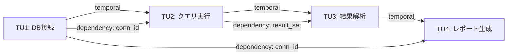

本記事は [AgentTether: Graph-Guided Diagnosis and Runtime Intervention for Reliable LLM Agent Operation (arXiv:2607.06273)](https://arxiv.org/abs/2607.06273) の解説記事です。

## 論文概要（Abstract）

LLMエージェントが複数ステップのツール呼び出しを伴うタスクを実行する際、途中で発生する障害を外部から自動的に検出・修復するフレームワークAgentTetherが提案されている。各実行サイクルをTransition Unit（TU）として記録し、TU間の依存関係をグラフ構造（Critical Transition Graph）で表現する。オフラインで学習した正常行動モデルとオンラインの異常検知器を組み合わせた二段階検出機構と、修復指示の履歴を管理するRepair Memoryにより、エージェント本体を改変せずにτ-benchで69.11%の修復成功率を達成したと著者らは報告している。

この記事は [Zenn記事: LangGraph 1.2 Command APIで設計する耐障害ステートマシン実践ガイド](https://zenn.dev/0h_n0/articles/1a312e389e08e1) の深掘りです。

## 情報源

- **arXiv ID**: 2607.06273
- **URL**: [https://arxiv.org/abs/2607.06273](https://arxiv.org/abs/2607.06273)
- **著者**: Chenyu Zhao, Shenglin Zhang, Minghua Ma et al.
- **発表年**: 2026
- **分野**: cs.SE（Software Engineering）

## 背景と動機（Background & Motivation）

LLMエージェントは単一のAPI呼び出しから、データベース操作やAPI連携を含む複数ステップのタスク実行へと進化している。しかし、途中のツール呼び出しが失敗したり、エージェントが同じ操作を繰り返すループに陥ったり、タスクの意図から逸脱したりする障害が頻繁に発生する。

従来の対処法であるblind retry（単純再試行）は、失敗の原因を分析せずに同じ手順を繰り返すため、同一の障害を再発させやすい。Reflexionに代表されるself-reflection手法は、エージェント自身に失敗を振り返らせるが、エージェントのLLM自体が持つ推論能力の限界に依存するため、複雑な障害の根本原因を正確に特定できないことが多い。

著者らは、エージェントの実行履歴を構造化されたグラフとして外部から観測・分析することで、エージェント本体を改変せずに障害を検出・修復できるアプローチが必要であると主張している。この設計思想は、アプリケーションのコードを変更せずにObservabilityを提供するAPM（Application Performance Monitoring）の考え方と共通している。

## 主要な貢献（Key Contributions）

- **Transition Unit（TU）表現**: エージェントの各実行サイクルを観測・信念・行動・フィードバックの4要素で構造化し、実行履歴を分析可能な形式で記録する手法の提案
- **Critical Transition Graph（CTG）**: TU間の時系列関係と状態依存関係をグラフ構造で表現し、障害の伝播経路を追跡可能にするデータ構造の設計
- **二段階異常検知**: オフラインの異種グラフTransformerとオンラインのIsolation Forestを組み合わせ、既知パターンと未知パターンの両方の異常を検出する機構
- **Repair Memory**: 過去の修復指示の成否を記録し、同一障害への再適用や無効な指示の回避を可能にするイテレーション横断の学習機構
- **Runtime Intervention**: ツール応答とテキスト応答のフックポイントにおいて、ループ・意図逸脱・期待値逸脱・構造的チェックポイントの4種類のシグナルで実行時介入を行う仕組み

## 技術的詳細（Technical Details）

### Transition Unit（TU）の定義

各TUは以下の4要素で構成される。

1. **Observation（観測）**: ツール実行後の環境状態、エラーメッセージ、返却値
2. **Belief（信念）**: エージェントのChain-of-Thought推論、現在の状況認識
3. **Action（行動）**: ツール呼び出し名、引数、API呼び出しの具体的な内容
4. **Feedback（フィードバック）**: ツール実行結果、成功/失敗のステータス

これらに加えて、TUからは以下の派生属性が抽出される。

- **Execution Status**: 成功、失敗、タイムアウト等の実行結果分類
- **Error Signature**: エラーメッセージのハッシュによる障害パターンの識別子
- **Tool**: 呼び出されたツールの識別子
- **Intent**: LLMで抽出された操作意図の自然言語要約
- **Artifacts**: 生成・参照されたファイルやデータの識別子リスト

```python
from dataclasses import dataclass, field
from typing import Optional


@dataclass(frozen=True)
class TransitionUnit:
    """エージェント実行サイクルの構造化表現。

    各TUは観測→信念→行動→フィードバックの1サイクルを表す。
    frozen=Trueで不変性を保証し、グラフノードとして安全に使用可能。
    """

    observation: str
    belief: str
    action: str
    feedback: str
    execution_status: str  # "success" | "failure" | "timeout"
    error_signature: Optional[str] = None
    tool: str = ""
    intent: str = ""
    artifacts: tuple[str, ...] = field(default_factory=tuple)
```

### Critical Transition Graph（CTG）

CTGはTUをノードとする有向グラフであり、2種類のエッジを持つ。

- **Temporal Edge（時系列エッジ）**: 連続するTU間の実行順序を表す。$TU_i \to TU_{i+1}$
- **Dependency Edge（依存エッジ）**: 共有する状態やArtifactsを介した論理的依存関係を表す。$TU_i$が生成したArtifactを$TU_j$が参照する場合に$TU_i \to TU_j$のエッジが張られる



### オフライン異常検知: 異種グラフTransformer（HGT）

正常な実行軌跡21,143件を用いて、自己教師あり学習でCTGの正常パターンを学習する。学習タスクは以下の2つである。

1. **エッジ再構成**: CTG内のエッジをランダムにマスクし、正しいエッジの存在を予測する
2. **フィールド復元**: TUの属性（tool、intent等）をランダムにマスクし、元の値を復元する

学習済みモデルは、新しい実行軌跡のCTGに対して各TUの異常スコアを算出する。正常パターンから逸脱したTUほど再構成誤差が大きくなり、高い異常スコアが付与される。

異常スコアは以下のように定義される。

$$
s_{\text{offline}}(TU_i) = \alpha \cdot \mathcal{L}_{\text{edge}}(TU_i) + (1 - \alpha) \cdot \mathcal{L}_{\text{field}}(TU_i)
$$

ここで$\mathcal{L}_{\text{edge}}$はエッジ再構成損失、$\mathcal{L}_{\text{field}}$はフィールド復元損失、$\alpha$は重み係数である。

### オンライン異常検知: Isolation Forest

オフラインモデルでは捕捉できない、実行中に初めて出現するパターンの異常を検出するために、各TUから25次元の特徴ベクトルを抽出し、Isolation Forestで異常判定を行う。特徴量には以下が含まれる。

- ツール呼び出しの連続失敗回数
- 直近N個のTUにおけるintentの埋め込みベクトルの分散
- Artifactの生成・消費バランス
- エラーシグネチャの出現頻度
- グラフ構造特徴（ノード次数、クラスタ係数等）

二段階検知の統合スコアは以下の通りである。

$$
s_{\text{combined}}(TU_i) = \beta \cdot s_{\text{offline}}(TU_i) + (1 - \beta) \cdot s_{\text{online}}(TU_i)
$$

閾値$\theta$を超えた場合に異常と判定し、修復プロセスが起動する。

### Repair Memory

修復指示の履歴をイテレーション横断で管理する機構である。各修復指示について以下の情報を記録する。

- 対象TUの異常パターン（エラーシグネチャ、ツール、intent）
- 生成された修復指示の内容
- 適用結果（fixed / unresolved）
- 適用回数

同一の異常パターンが再発した場合、過去に成功した修復指示を優先的に再利用し、失敗した指示は回避される。これにより、イテレーションを重ねるごとに修復精度が向上する。

### Runtime Intervention

エージェントの実行中にリアルタイムで介入するため、以下の2つのフックポイントと4種類の検出シグナルが設計されている。

**フックポイント**:
- **Tool Return Hook**: ツール実行結果が返却された直後に介入判定を行う
- **Text Response Hook**: エージェントのテキスト応答生成後に介入判定を行う

**検出シグナル**:

1. **Loop Repetition（ループ検出）**: 同一ツール・同一引数の呼び出しが閾値回数を超えた場合
2. **Intent Drift（意図逸脱）**: TUのintent埋め込みベクトルの類似度を指数移動平均（EMA）で追跡し、タスク目標からの逸脱を検出

$$
\text{EMA}_t = \gamma \cdot \text{sim}(\mathbf{e}_t, \mathbf{e}_{\text{goal}}) + (1 - \gamma) \cdot \text{EMA}_{t-1}
$$

ここで$\mathbf{e}_t$は現在のTUのintent埋め込み、$\mathbf{e}_{\text{goal}}$はタスク目標の埋め込み、$\gamma$は平滑化係数である。

3. **Expectation Deviation（期待値逸脱）**: ツール実行結果が期待されるスキーマや値の範囲から逸脱した場合
4. **Structural Checkpoints（構造的チェックポイント）**: タスクの進行度をCTGの構造から推定し、期待される進行パターンからの逸脱を検出

## 実装のポイント（Implementation Notes）

### Monkey-patchingによるトレース取得

AgentTetherはエージェント本体のコードを改変しない設計を採用している。ツール呼び出しのインターフェースに対してmonkey-patchingを適用し、呼び出し前後のコンテキスト（引数、返却値、エラー情報）を透過的に記録する。この方式により、任意のLLMエージェントフレームワーク（LangChain、LangGraph、AutoGen等）に対して後付けで適用可能である。

### 介入フックの設計

介入はエージェントのプロンプトに修復指示を注入する形で行われる。ツール実行結果の改竄やエージェントの内部状態の直接操作は行わず、追加のコンテキスト情報としてガイダンスを提供する。これにより、エージェントの自律性を維持しつつ、障害からの回復を促す設計となっている。

## Production Deployment Guide

AgentTetherの異常検知・修復メカニズムを本番環境でエージェント監視・修復システムとして運用する際のAWSデプロイ構成を、規模別に解説する。

### Small: CloudWatch + SageMaker構成

月間1,000タスク未満の小規模運用向け。TUの記録にCloudWatch Logs、異常検知モデルのホスティングにSageMaker Serverless Inferenceを使用する。

```hcl
# --- Small構成: CloudWatch + SageMaker Serverless ---

resource "aws_cloudwatch_log_group" "agent_tether_tus" {
  name              = "/agent-tether/transition-units"
  retention_in_days = 90

  tags = {
    Environment = "production"
    System      = "agent-tether"
  }
}

resource "aws_sagemaker_endpoint_config" "hgt_anomaly_detector" {
  name = "agent-tether-hgt-detector"

  production_variants {
    variant_name = "primary"
    model_name   = aws_sagemaker_model.hgt_model.name

    serverless_config {
      max_concurrency   = 4
      memory_size_in_mb = 4096
    }
  }
}

resource "aws_sagemaker_model" "hgt_model" {
  name               = "agent-tether-hgt-model"
  execution_role_arn = aws_iam_role.sagemaker_role.arn

  primary_container {
    image          = "${data.aws_caller_identity.current.account_id}.dkr.ecr.ap-northeast-1.amazonaws.com/agent-tether-hgt:latest"
    model_data_url = "s3://${aws_s3_bucket.models.bucket}/hgt-model/model.tar.gz"
  }
}

resource "aws_cloudwatch_metric_alarm" "anomaly_rate" {
  alarm_name          = "agent-tether-high-anomaly-rate"
  comparison_operator = "GreaterThanThreshold"
  evaluation_periods  = 3
  metric_name         = "AnomalyDetectionRate"
  namespace           = "AgentTether"
  period              = 300
  statistic           = "Average"
  threshold           = 0.3
  alarm_description   = "異常検知率が30%を超過"
  alarm_actions       = [aws_sns_topic.alerts.arn]
}
```

**コスト目安**: SageMaker Serverless（月$50-100程度）+ CloudWatch Logs（月$10-30程度）

### Medium: ECS + OpenSearch + SageMaker構成

月間1,000-50,000タスクの中規模運用向け。TUの蓄積とCTGの検索にOpenSearch、異常検知パイプラインをECS Fargateで実行し、Repair MemoryをDynamoDBで管理する。

```hcl
# --- Medium構成: ECS + OpenSearch + SageMaker ---

resource "aws_opensearch_domain" "agent_tether" {
  domain_name    = "agent-tether-ctg"
  engine_version = "OpenSearch_2.11"

  cluster_config {
    instance_type          = "r6g.large.search"
    instance_count         = 2
    zone_awareness_enabled = true
  }

  ebs_options {
    ebs_enabled = true
    volume_size = 100
    volume_type = "gp3"
  }
}

resource "aws_dynamodb_table" "repair_memory" {
  name         = "agent-tether-repair-memory"
  billing_mode = "PAY_PER_REQUEST"
  hash_key     = "error_signature"
  range_key    = "iteration_id"

  attribute {
    name = "error_signature"
    type = "S"
  }

  attribute {
    name = "iteration_id"
    type = "S"
  }

  ttl {
    attribute_name = "expires_at"
    enabled        = true
  }
}

resource "aws_ecs_service" "anomaly_pipeline" {
  name            = "agent-tether-anomaly-pipeline"
  cluster         = aws_ecs_cluster.main.id
  task_definition = aws_ecs_task_definition.anomaly_pipeline.arn
  desired_count   = 2
  launch_type     = "FARGATE"

  network_configuration {
    subnets          = var.private_subnets
    security_groups  = [aws_security_group.anomaly_pipeline.id]
    assign_public_ip = false
  }
}

resource "aws_sagemaker_endpoint_config" "hgt_realtime" {
  name = "agent-tether-hgt-realtime"

  production_variants {
    variant_name           = "primary"
    model_name             = aws_sagemaker_model.hgt_model.name
    instance_type          = "ml.g5.xlarge"
    initial_instance_count = 1
  }
}
```

**コスト目安**: OpenSearch r6g.large x2（月$400程度）+ ECS Fargate（月$100-200程度）+ SageMaker g5.xlarge（月$800程度）+ DynamoDB（月$20-50程度）

### Large: EKS + Kafka + SageMaker構成

月間50,000タスク以上の大規模運用向け。TUイベントのストリーミングにAmazon MSK（Managed Kafka）、異常検知パイプラインをEKSで水平スケーリングし、SageMakerのマルチモデルエンドポイントでドメイン別のHGTモデルを効率的にホスティングする。

```hcl
# --- Large構成: EKS + Kafka + SageMaker ---

resource "aws_msk_cluster" "agent_tether" {
  cluster_name           = "agent-tether-events"
  kafka_version          = "3.6.0"
  number_of_broker_nodes = 3

  broker_node_group_info {
    instance_type   = "kafka.m7g.large"
    client_subnets  = var.private_subnets
    security_groups = [aws_security_group.msk.id]

    storage_info {
      ebs_storage_info {
        volume_size = 500
      }
    }
  }
}

resource "aws_eks_node_group" "anomaly_workers" {
  cluster_name    = aws_eks_cluster.main.name
  node_group_name = "agent-tether-anomaly-workers"
  node_role_arn   = aws_iam_role.eks_node.arn
  subnet_ids      = var.private_subnets

  scaling_config {
    desired_size = 3
    max_size     = 10
    min_size     = 1
  }

  instance_types = ["m6i.xlarge"]
}

resource "aws_sagemaker_endpoint_config" "hgt_multi_model" {
  name = "agent-tether-hgt-multi-model"

  production_variants {
    variant_name           = "primary"
    model_name             = aws_sagemaker_model.hgt_multi.name
    instance_type          = "ml.g5.2xlarge"
    initial_instance_count = 2
  }
}
```

**コスト目安**: MSK m7g.large x3（月$600程度）+ EKS m6i.xlarge x3（月$500程度）+ SageMaker g5.2xlarge x2（月$2,400程度）

### デプロイチェックリスト

- [ ] HGTモデルの学習データ（正常軌跡）を最低1,000件以上収集
- [ ] Isolation Forestの特徴量エンジニアリングをドメインに合わせて調整
- [ ] 異常検知閾値$\theta$をバリデーションセットで最適化
- [ ] Repair Memoryのスキーマ設計とTTL設定
- [ ] monkey-patchingの対象フレームワーク（LangGraph等）のバージョン互換性検証
- [ ] 介入フックのレイテンシがエージェント応答時間の5%以内であることを確認
- [ ] ログのPII除去パイプラインの構築（TUにユーザデータが含まれる場合）
- [ ] カナリアデプロイで偽陽性率を計測し、閾値を段階的に調整
- [ ] A/Bテストで修復あり/なしのタスク成功率を比較
- [ ] Repair Memoryの肥大化防止（TTL + 定期的なガベージコレクション）

## 実験結果（Experimental Results）

### τ-benchベンチマーク（261タスク）

著者らはτ-bench（Retail、Airline、Bankingの3ドメイン、計261タスク）で評価を行い、以下の結果を報告している。

| 手法 | Retail | Airline | Banking | Overall |
|---|---|---|---|---|
| Blind retry | 88.46% | 57.14% | 26.51% | 43.09% |
| Reflexion | 88.46% | 71.43% | 26.51% | 44.72% |
| AgentTether (post-run) | 92.31% | 78.57% | 46.99% | 60.16% |
| AgentTether (full) | 96.15% | 78.57% | 59.04% | 69.11% |

AgentTether（full）はblind retryに対して26.02ポイント、Reflexionに対して24.39ポイントの改善を達成している。特にBankingドメインでの改善幅が大きく、複雑な状態遷移を伴うタスクにおいてグラフベースの診断が有効であることを示唆している。

### アブレーション結果

各コンポーネントの寄与を検証するアブレーション実験では、以下の結果が報告されている。

- **オフラインHGTモデル除去**: Overall 69.11% → 46.34%（-22.77ポイント）。既知の障害パターンの検出に不可欠
- **Repair Memory除去**: Overall 69.11% → 52.03%（-17.08ポイント）。イテレーション横断の学習効果が大きい

### 効率性

AgentTether（full）はblind retryと比較して、消費トークン数が13%削減され、エージェントのターン数も減少したと報告されている。異常の早期検出と的確な修復指示により、無駄な試行が削減されたためと著者らは分析している。

## 実運用への応用（Practical Applications）

AgentTetherのアーキテクチャは、Zenn記事で解説したLangGraph 1.2のCommand APIによる耐障害ステートマシン設計と相補的な関係にある。

LangGraphのCommand APIはエージェント内部の状態遷移を明示的に定義し、ステートマシンとして制御する「ホワイトボックス」アプローチである。一方、AgentTetherはエージェント外部から実行履歴を観測・分析する「ブラックボックス」アプローチを採る。

実運用では、LangGraphで設計した耐障害ステートマシンに対してAgentTetherの外部監視を追加することで、多層的な信頼性保証が実現できる。具体的には、LangGraphの`Command`による内部リトライで対処できない障害（ループや意図逸脱）を、AgentTetherのRuntime Interventionで外部から検出・修復する構成が考えられる。

また、AgentTetherのTU表現はLangGraphのノード実行ログと自然に対応するため、LangGraphベースのエージェントへの適用は実装上の親和性が高い。

## 関連研究（Related Work）

- **Reflexion** (Shinn et al., 2023): エージェント自身の自然言語による自己反省を次回の試行に活用する手法。AgentTetherとは異なり、エージェント内部の推論能力に依存するため、複雑な障害パターンの診断には限界がある
- **TaskWeaver** (Qiao et al., 2024): コード生成ベースのタスク実行フレームワーク。実行時の障害検出機構は限定的であり、AgentTetherのようなグラフベースの体系的な診断は行わない
- **SWE-agent** (Yang et al., 2024): ソフトウェアエンジニアリングタスク向けのエージェント。エージェントとコンピュータのインターフェース設計に焦点を置いており、実行時の障害診断・修復は補助的な位置づけ

## まとめと今後の展望

AgentTetherは、LLMエージェントの実行履歴をグラフ構造として捉え、オフライン学習モデルとオンライン検知器の二段階異常検知、修復履歴を活用するRepair Memory、4種類のシグナルによるRuntime Interventionを統合したフレームワークである。エージェント本体を改変せずに適用可能であり、τ-benchで69.11%の修復成功率を達成している。

今後の課題として、著者らはマルチエージェント環境への拡張、より多様なタスクドメインでの評価、HGTモデルのドメイン適応の効率化を挙げている。エージェントの信頼性向上は、LLMエージェントの本番運用拡大において重要な研究課題であり、AgentTetherの外部監視アプローチは実用的な一つの方向性を示している。

## 参考文献

1. Zhao, C., Zhang, S., Gu, W., Sun, Y., Pei, D., Bansal, C., Rajmohan, S., & Ma, M. (2026). AgentTether: Graph-Guided Diagnosis and Runtime Intervention for Reliable LLM Agent Operation. arXiv:2607.06273.
2. Shinn, N., Cassano, F., Gopinath, A., Shakkottai, S., Labash, K., & Kass-Hout, T. (2023). Reflexion: Language Agents with Verbal Reinforcement Learning. NeurIPS 2023.
3. Qiao, B., et al. (2024). TaskWeaver: A Code-First Agent Framework. arXiv:2311.17541.
4. Yang, J., Jimenez, C. E., Wettig, A., Liber, K., Narasimhan, K., & Press, O. (2024). SWE-agent: Agent-Computer Interfaces Enable Automated Software Engineering. arXiv:2405.15793.
