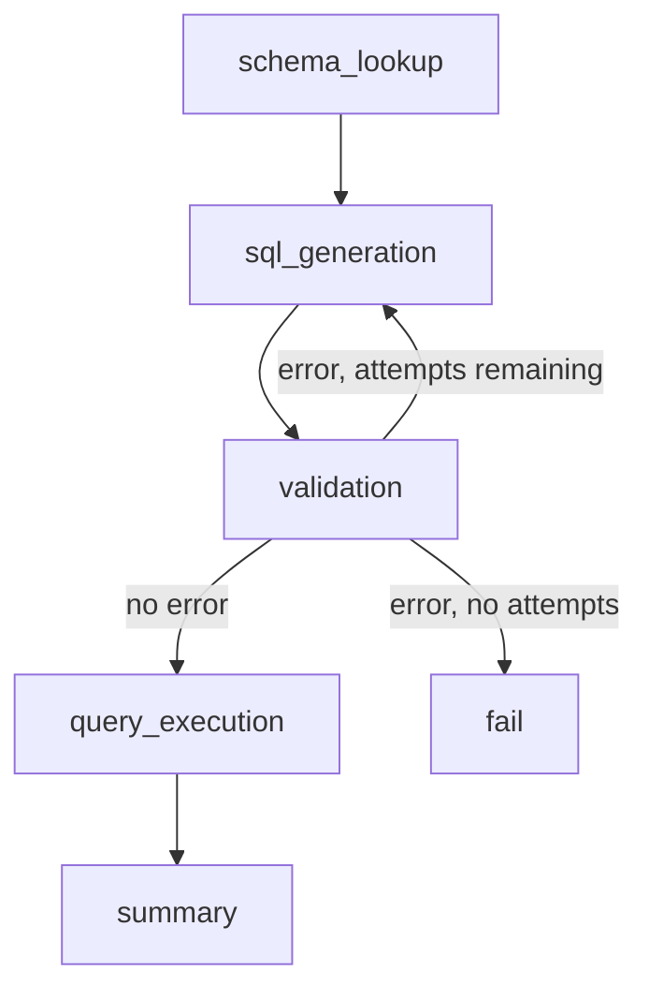
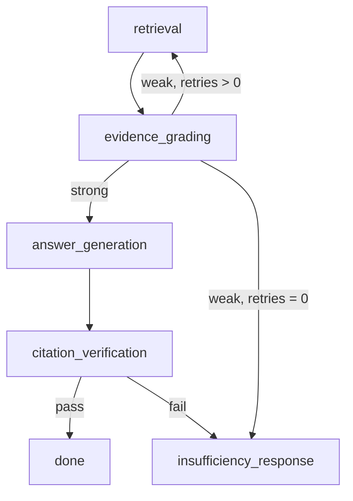
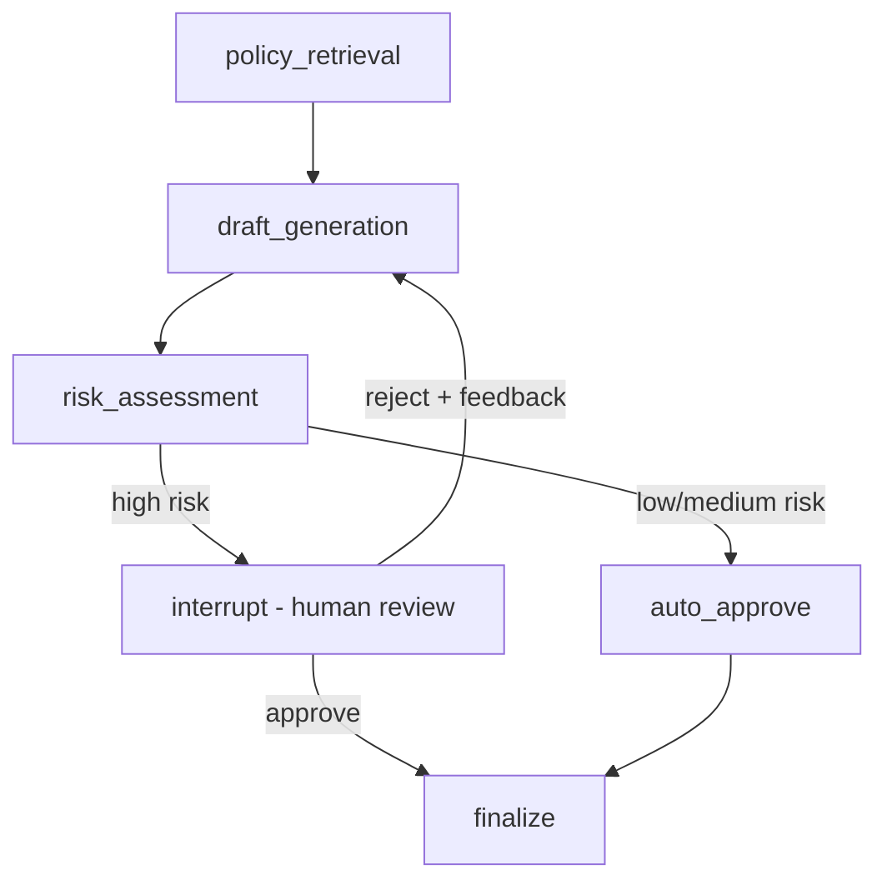

本記事は [Graph-Based Agentic AI with LangGraph: Workflow Pathways for Long-Running Stateful Business Processes (arXiv:2607.19297)](https://arxiv.org/abs/2607.19297) の解説記事です。

## 論文概要（Abstract）

LangGraphを用いた長時間稼働・マルチステップの生成AIワークフロー構築に関する実践者向けガイドである。著者らは3つの実行可能なレシピ（SQL分析修復ループ、証拠ゲーティング付きエージェンティックRAG、Human-in-the-Loop政策レビュー）を提示し、型付き状態・条件分岐ルーティング・チェックポイントの統合方法を示している。ワークフローの複雑度に応じてLangGraphの採否を判断すべきとする設計指針も述べられている。

この記事は [Zenn記事: LangGraph 1.2 Command APIで設計する耐障害ステートマシン実践ガイド](https://zenn.dev/0h_n0/articles/1a312e389e08e1) の深掘りです。

## 情報源

- **arXiv ID**: 2607.19297
- **URL**: [https://arxiv.org/abs/2607.19297](https://arxiv.org/abs/2607.19297)
- **著者**: Daniel Pearson, Sidney Shapiro, Emiliano Sebastian Gonzalez Venegas et al.
- **発表年**: 2026
- **分野**: cs.AI, cs.SE

## 背景と動機（Background & Motivation）

LLMベースのエージェントが業務プロセスに導入されるにつれ、外部ツール呼び出しの失敗復旧、複数ステップにまたがる状態永続化、人間による承認待機と再開といった要件が増加している。従来のReActスタイルのエージェントループは柔軟だが、長時間稼働プロセスでは中間状態の喪失、失敗時の再試行パスの欠如、監査証跡の不在が問題となる。

著者らは、LangGraphのStateGraphアーキテクチャがこれらの課題に構造的な解を提供すると位置づけている。ノードが処理単位、エッジが遷移条件を明示的に定義することで可視性と制御性を確保し、チェックポイント機構で耐障害性を実現する設計思想である。

## 主要な貢献（Key Contributions）

- **3つの実行可能レシピの体系化**: SQL修復ループ、RAG証拠ゲーティング、HITL政策レビューをTypedDict状態定義からルーティングロジックまで完全に提示
- **設計指針の明文化**: ルーティング関数の小型化、graph.pyとlogic.pyの分離、ノード境界のイベント整合、ルート関連フィールドの永続化
- **テスト戦略**: 回答品質ではなくルートと状態遷移をアサートするアプローチ
- **LangGraph採否判断基準**: 状態永続化・明示的状態依存・修復ルート・監査証跡の4条件を提示し、代替手段（plain SDK、schema-first、DSPy）との使い分けを明確化

## 技術的詳細（Technical Details）

### Recipe 1: SQL分析修復ループ

自然言語の質問からSQL生成・実行・要約を自動化し、エラーを修復ループで自動回復するワークフローである。

```python
from typing import TypedDict, Optional

class SQLAnalyticsState(TypedDict):
    """SQL分析ワークフローの状態定義"""
    question: str
    schema: str
    generated_sql: str
    error: Optional[str]
    attempts: int
    rows: Optional[list[dict]]
    status: str  # "success" | "failed"
```



ルーティング関数は状態フィールドのみを参照する純粋関数として設計される。

```python
def route_after_validation(state: SQLAnalyticsState) -> str:
    """バリデーション結果に基づくルーティング"""
    if state["error"] is None:
        return "query_execution"
    if state["attempts"] < 3:
        return "sql_generation"
    return "fail"
```

### Recipe 2: エージェンティックRAG証拠ゲーティング

検索結果の証拠品質を評価し、弱い証拠には再検索、十分な証拠が得られなければ明示的に「不十分」と回答するRAGワークフローである。



引用検証でfailした場合もclosed（安全側）に倒してinsufficiency_responseに遷移させ、根拠のない回答の生成を防ぐ。状態には`evidence_grade`（strong/weak/insufficient）と`retries`を含め、ルーティング判断の根拠を監査トレースとして保持する。

### Recipe 3: HITL政策レビュー

リスクレベルに応じて人間の承認を求めるワークフローであり、LangGraphの`interrupt()`と`Command(resume=...)`で実行の一時停止と再開を実現する。



```python
from langgraph.types import interrupt

def human_review_node(state: dict) -> dict:
    """人間レビューノード: 実行を一時停止しレビュアーの判断を待つ"""
    review_result = interrupt({
        "draft": state["draft"],
        "risk_level": state["risk_level"],
    })
    return {
        **state,
        "approval": review_result["decision"] == "approve",
        "feedback": review_result.get("feedback"),
        "decision_record": {
            "reviewer": review_result.get("reviewer"),
            "decision": review_result["decision"],
        },
    }
```

テスト環境では`InMemorySaver`、本番環境ではSQLiteまたはPostgresベースの永続ストアを使用する。チェックポイント機構により、サーバー再起動後でもinterrupt地点からワークフローを再開できる。

## 実装のポイント（Implementation）

**Typed State設計**: 3レシピすべてで状態を`TypedDict`で厳密に型定義し、`Optional`フィールドを明示的に定義してKeyErrorを防止する。

**ルーティング関数の分離**: ルーティング関数はgraph.pyに、ビジネスロジック（SQL生成、証拠評価等）はlogic.pyに分離する。これによりグラフ構造のテストとドメインロジックのテストを独立して実行できる。

**テスト戦略**: LLMの出力は非決定的であるため、回答品質のアサーションはflaky testの原因となる。代わりに状態遷移の正しさを検証する。

```python
def test_validation_error_routes_to_retry() -> None:
    """バリデーションエラー時にリトライに遷移することを検証"""
    state = SQLAnalyticsState(
        question="売上合計は？", schema="CREATE TABLE sales (amount INT)",
        generated_sql="SELEC * FROM sales", error="syntax error",
        attempts=1, rows=None, status="",
    )
    assert route_after_validation(state) == "sql_generation"
```

## Production Deployment Guide

LangGraphワークフローをAWS上に展開する際のトラフィック量別構成を整理する。

### AWS実装パターン（コスト最適化重視）

| 構成 | トラフィック | サービス構成 | 月額概算 |
|------|-------------|-------------|---------|
| Small | ~100 req/日 | Lambda + Step Functions + DynamoDB | $50-150 |
| Medium | ~1,000 req/日 | ECS Fargate + ElastiCache Redis + RDS | $300-800 |
| Large | 10,000+ req/日 | EKS + MSK (Kafka) + Aurora + ElastiCache | $2,000-5,000 |

**Small構成**: Lambda上でLangGraphの各ノードをStep Functionsタスクとして実行。状態はDynamoDBに永続化。Lambda 128MB平均10秒~$3、Step Functions~$1、DynamoDB On-Demand~$5、Bedrock~$30-100、CloudWatch~$5。

**Medium構成**: ECS Fargate上でLangGraphサーバーを常駐させ、Redisでチェックポイントを高速永続化。HITL interruptが頻繁なユースケースに適する。Fargate 0.5vCPU x2~$60、Redis~$25、RDS~$30、Bedrock~$150-500。

**Large構成**: EKS上でLangGraphワーカーをスケーラブルに展開し、MSK (Kafka)でイベントを非同期処理。Karpenter+Spot Instancesでコスト抑制。EKS~$75、Spot m5.xlarge x3-10~$200-700、MSK~$500、Aurora~$200、Bedrock~$800-3,000。

**注意**: 2026年10月時点のAWS東京リージョン料金に基づく概算値。最新料金はAWS Pricing Calculatorで確認を推奨。

**コスト削減**: Spot Instances最大90%削減、Reserved Instances最大72%削減、Bedrock Batch API 50%削減、Prompt Caching 30-90%削減。

### Terraformインフラコード

**Small構成（Serverless）**:

```hcl
# LangGraph Workflow - Small構成 (Lambda + Step Functions + DynamoDB)
resource "aws_iam_role" "lambda_langgraph" {
  name = "langgraph-workflow-lambda"
  assume_role_policy = jsonencode({
    Version = "2012-10-17"
    Statement = [{ Action = "sts:AssumeRole", Effect = "Allow",
      Principal = { Service = "lambda.amazonaws.com" } }]
  })
}

resource "aws_iam_role_policy" "lambda_perms" {
  name = "langgraph-lambda-perms"
  role = aws_iam_role.lambda_langgraph.id
  policy = jsonencode({
    Version = "2012-10-17"
    Statement = [
      { Effect = "Allow", Action = ["dynamodb:GetItem","dynamodb:PutItem","dynamodb:UpdateItem","dynamodb:Query"],
        Resource = aws_dynamodb_table.workflow_state.arn },
      { Effect = "Allow", Action = ["bedrock:InvokeModel"],
        Resource = "arn:aws:bedrock:ap-northeast-1::foundation-model/anthropic.claude-*" },
      { Effect = "Allow", Action = ["logs:CreateLogGroup","logs:CreateLogStream","logs:PutLogEvents"],
        Resource = "arn:aws:logs:ap-northeast-1:*:*" },
    ]
  })
}

resource "aws_dynamodb_table" "workflow_state" {
  name = "langgraph-workflow-state"
  billing_mode = "PAY_PER_REQUEST"  # On-Demand: 低トラフィックでコスト最適
  hash_key = "workflow_id"
  range_key = "checkpoint_ns"
  attribute { name = "workflow_id"; type = "S" }
  attribute { name = "checkpoint_ns"; type = "S" }
  server_side_encryption { enabled = true }
}

resource "aws_lambda_function" "langgraph_worker" {
  function_name = "langgraph-workflow-worker"
  runtime = "python3.12"
  handler = "handler.lambda_handler"
  role = aws_iam_role.lambda_langgraph.arn
  timeout = 300
  memory_size = 256
  filename = "lambda.zip"
  source_code_hash = filebase64sha256("lambda.zip")
  environment { variables = { DYNAMODB_TABLE = aws_dynamodb_table.workflow_state.name, MAX_SQL_RETRIES = "3" } }
  tracing_config { mode = "Active" }  # X-Ray有効化
}
```

**Large構成（Container）**:

```hcl
# LangGraph Workflow - Large構成 (EKS + Karpenter + Spot)
module "eks" {
  source  = "terraform-aws-modules/eks/aws"
  version = "~> 20.24"
  cluster_name = "langgraph-production"
  cluster_version = "1.31"
  vpc_id = module.vpc.vpc_id
  subnet_ids = module.vpc.private_subnets
  cluster_endpoint_public_access = false  # プライベートのみ
  eks_managed_node_groups = {
    system = { instance_types = ["m5.large"], min_size = 2, max_size = 2, desired_size = 2 }
  }
}

# Karpenter NodePool: Spot優先オートスケーリング
resource "kubectl_manifest" "karpenter_nodepool" {
  yaml_body = yamlencode({
    apiVersion = "karpenter.sh/v1", kind = "NodePool"
    metadata = { name = "langgraph-workers" }
    spec = {
      template = { spec = {
        requirements = [
          { key = "karpenter.sh/capacity-type", operator = "In", values = ["spot","on-demand"] },
          { key = "node.kubernetes.io/instance-type", operator = "In", values = ["m5.xlarge","m5a.xlarge","m6i.xlarge"] },
        ]
        nodeClassRef = { group = "karpenter.k8s.aws", kind = "EC2NodeClass", name = "default" }
      } }
      limits = { cpu = "100", memory = "400Gi" }
      disruption = { consolidationPolicy = "WhenEmptyOrUnderutilized", consolidateAfter = "30s" }
    }
  })
}

resource "aws_budgets_budget" "langgraph_monthly" {
  name = "langgraph-monthly-budget"
  budget_type = "COST"
  limit_amount = "5000"
  limit_unit = "USD"
  time_unit = "MONTHLY"
  notification {
    comparison_operator = "GREATER_THAN"
    threshold = 80
    threshold_type = "PERCENTAGE"
    notification_type = "FORECASTED"
    subscriber_email_addresses = ["ops-team@example.com"]
  }
}
```

### 運用・監視設定

**CloudWatch Logs Insights クエリ**:

```
# トークン使用量の異常検知
fields @timestamp, @message | filter @message like /bedrock/
| stats count() as invocations by bin(1h) | sort invocations desc

# レイテンシ P95/P99
fields @timestamp, duration_ms | filter event = "workflow_complete"
| stats percentile(duration_ms, 95) as p95, percentile(duration_ms, 99) as p99 by bin(1h)
```

**X-Ray トレーシング + Cost Explorerレポート（Python）**:

```python
from aws_xray_sdk.core import xray_recorder, patch_all
import boto3
from datetime import datetime, timedelta

patch_all()  # boto3自動計装

def trace_workflow_node(node_name: str, state: dict) -> None:
    """ワークフローノードのX-Rayトレースを記録"""
    sub = xray_recorder.begin_subsegment(f"langgraph.{node_name}")
    sub.put_annotation("node", node_name)
    sub.put_metadata("state", {"status": state.get("status"), "attempts": state.get("attempts", 0)})
    xray_recorder.end_subsegment()

def daily_cost_report(sns_topic_arn: str) -> None:
    """日次コストレポート: $100超過でSNS通知"""
    ce = boto3.client("ce", region_name="us-east-1")
    yesterday = (datetime.utcnow() - timedelta(days=1)).strftime("%Y-%m-%d")
    today = datetime.utcnow().strftime("%Y-%m-%d")
    result = ce.get_cost_and_usage(
        TimePeriod={"Start": yesterday, "End": today}, Granularity="DAILY",
        Metrics=["UnblendedCost"],
        Filter={"Tags": {"Key": "Project", "Values": ["langgraph-workflow"]}},
    )
    total = sum(float(g["Metrics"]["UnblendedCost"]["Amount"])
                for t in result["ResultsByTime"] for g in t["Groups"])
    if total > 100:
        boto3.client("sns").publish(TopicArn=sns_topic_arn, Subject="LangGraph Cost Alert",
                                    Message=f"日次コスト: ${total:.2f}")
```

### コスト最適化チェックリスト

**アーキテクチャ選択**:
- [ ] ~100 req/日 → Small (Lambda + Step Functions)
- [ ] ~1,000 req/日 → Medium (ECS + Redis)
- [ ] 10,000+ req/日 → Large (EKS + Kafka)
- [ ] HITL interrupt頻度を考慮（高頻度 → Medium以上）

**リソース最適化**:
- [ ] EC2: Spot Instances優先（Karpenterで自動フォールバック）
- [ ] Reserved Instances: ECS/RDS用1年コミット（最大72%削減）
- [ ] Savings Plans: Lambda/Fargateの予測可能ワークロードに適用
- [ ] Lambda: Power Tuningでメモリサイズ最適化
- [ ] ECS/EKS: アイドル時スケールダウン（最小タスク数=0検討）
- [ ] DynamoDB: On-Demandモードで低トラフィック時コスト削減

**LLMコスト削減**:
- [ ] Bedrock Batch API: 非リアルタイム処理で50%削減
- [ ] Prompt Caching: スキーマ・ポリシー文書キャッシュで30-90%削減
- [ ] モデル選択ロジック: 低リスクにHaiku、高リスクにSonnet
- [ ] max_tokens適切設定で無駄な生成防止

**監視・アラート**:
- [ ] AWS Budgets: プロジェクトタグ別月次予算アラート
- [ ] CloudWatch: Lambda実行時間・Bedrockトークン使用量の異常検知
- [ ] Cost Anomaly Detection有効化
- [ ] 日次コストレポート: Cost Explorer API + SNS通知

**リソース管理**:
- [ ] 未使用リソース（ENI/EBS/EIP）定期スキャン
- [ ] タグ戦略: Project/Environment/Owner必須化
- [ ] S3/ECRライフサイクルポリシー設定
- [ ] 開発環境夜間停止（EventBridge）
- [ ] CloudWatch Logs保持期間30日制限

## 実験結果（Results）

本論文はベンチマーク比較を目的としておらず、3つのレシピの動作例を通じて設計パターンの有効性を示す構成をとっている。

**sql_tool_failure**: 初回SQL生成でカラム名誤りが発生した場合、バリデーションノードがエラーを検出し、`attempts`をインクリメントしてSQL生成ノードに遷移する。エラーメッセージを含む状態を受け取ったLLMが修正SQLを生成し、2回目で正常実行される。3回失敗するとfailノードに遷移する。

**rag_weak_evidence**: 初回検索でweak評価の場合、リトライ残があればクエリを再構成して再検索する。リトライが0のままweakなら「十分な証拠が見つかりませんでした」と明示的に回答する。

**hitl_high_risk**: リスク評価がhighの場合、interrupt()でワークフローが一時停止する。レビュアーがCommand(resume=...)で判断を入力すると、decision_recordに記録されてワークフローが再開する。

## 実運用への応用（Practical Applications）

本論文の3レシピは、Zenn記事「LangGraph 1.2 Command APIで設計する耐障害ステートマシン実践ガイド」で解説されているCommand APIの設計パターンと直接関連する。特にRecipe 3のHITL政策レビューは、Zenn記事の`Command(resume=...)`の実践的な適用例である。

著者らが提示するLangGraph採否判断基準は実務上有用である。(1)状態がステップ間で永続化される必要がある、(2)次のステップが明示的な状態に依存する、(3)失敗に修復ルートが必要、(4)判断に監査証跡が必要、のいずれかに該当する場合にLangGraph導入を検討すべきとされている。一方で単純なQ&Aにはplain SDK、構造化抽出にはschema-first、プロンプト最適化にはDSPyが適するとして過剰適用を戒めている。

## 関連研究（Related Work）

- **ReAct (Yao et al., 2023)**: 思考-行動-観察ループでLLMにツール使用を可能にするフレームワーク。本論文はReActの限界（状態永続化の欠如、明示的ルーティングの不在）を補完する位置づけにある
- **DSPy (Khattab et al., 2023)**: プロンプト自動最適化フレームワーク。著者らはプロンプト最適化が主目的ならDSPy、ワークフロー構造制御が必要ならLangGraphを推奨
- **LangChain (Chase, 2022)**: LangGraphの基盤。LangChainのchainベース直線パイプラインを、グラフベース非線形ワークフローに拡張したものがLangGraph

## まとめと今後の展望

本論文は、LangGraphを用いた長時間稼働ステートフルワークフローの設計パターンを3つの実践レシピとして体系化した。型付き状態、条件分岐ルーティング、チェックポイント、テスト戦略を統合的に提示し、ツール選択指針を示した点に価値がある。今後の方向としては、マルチエージェント間のグラフ合成、動的グラフ構造変更、分散チェックポイント同期、OpenTelemetry統合による可観測性の実現が考えられる。

## 参考文献

- **arXiv**: [https://arxiv.org/abs/2607.19297](https://arxiv.org/abs/2607.19297)
- **LangGraph Documentation**: [https://langchain-ai.github.io/langgraph/](https://langchain-ai.github.io/langgraph/)
- **Related Zenn article**: [https://zenn.dev/0h_n0/articles/1a312e389e08e1](https://zenn.dev/0h_n0/articles/1a312e389e08e1)
