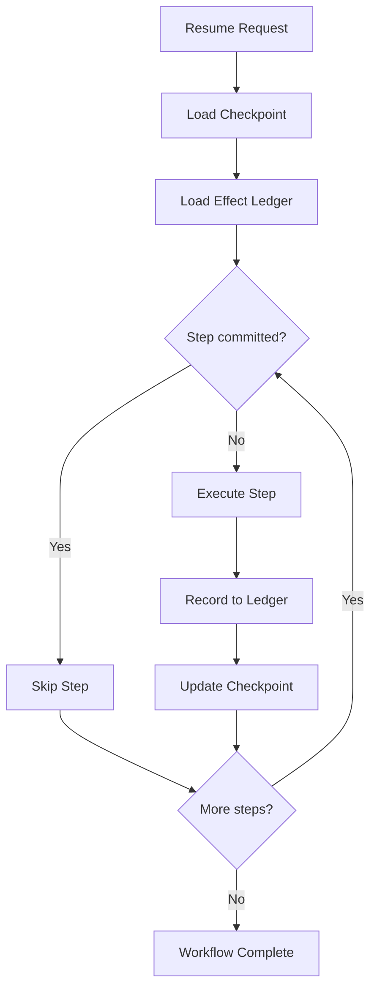

## 論文概要（Abstract）

本記事は [Resume Means Resume: A Machine-Checked Conformance Contract for Checkpoint, Interrupt, and Resume Semantics in Workflow Persistence Layers (arXiv:2608.03836)](https://arxiv.org/abs/2608.03836) の解説記事です。

エージェントワークフローフレームワークの多くは「中断しても再開できる」と謳っているが、実際にresume時に副作用がどう扱われるかの形式的な保証は存在しなかった。著者はRESUME CONTRACTと呼ぶ6つの核心性質と2つの義務からなる形式仕様を提案し、TLA+モデルとTLAPS証明で検査している。決定論的テストハーネスにより5つのエージェントワークフローフレームワーク（LangGraph、CrewAI、pydantic-graph、LlamaIndex、AutoGen）を固定リリースで評価した結果、LangGraphはSIGKILL後に永続記録済みの処理を再実行し、CrewAIは完了済みメソッドを再実行し、pydantic-graphはノード途中クラッシュ後に再開不能であることが報告されている。著者はREMITと呼ぶ参照シーケンサを提示し、検証済みリカバリコアによる修正を示している。

この記事は [Zenn記事: LangGraph 1.2 Command APIで設計する耐障害ステートマシン実践ガイド](https://zenn.dev/0h_n0/articles/1a312e389e08e1) の深掘りです。

## 情報源

- **arXiv ID**: 2608.03836
- **URL**: [https://arxiv.org/abs/2608.03836](https://arxiv.org/abs/2608.03836)
- **著者**: Sajjad Khan
- **発表年**: 2026年8月（v1: 2026年8月4日、v3: 2026年8月8日）
- **分野**: cs.LG (primary); cs.DC, cs.LO, cs.SE
- **キーワード**: checkpoint, interrupt, resume, TLA+, formal verification, workflow persistence

## 背景と動機（Background & Motivation）

LLMエージェントが複雑なタスクを遂行する際、長時間実行されるワークフローの中断と再開は避けられない。ユーザーによるinterrupt（human-in-the-loop）やプロセスクラッシュ（SIGKILL）からの復旧において、副作用を持つステップ（API呼び出し、データベース更新、メール送信など）がどのように扱われるかは、システムの信頼性にとって決定的に重要である。

しかし、既存のワークフローフレームワークではresume時の副作用セマンティクスが曖昧に定義されているか、ドキュメント上で言及されていても形式的な検証がなされていなかった。「チェックポイントから再開する」という表現が、実際には「チェックポイント以降のすべてを再実行する」ことを意味するフレームワークも存在する。著者はこの問題を「resumeがresumeを意味しない」と端的に表現し、形式仕様と検証に基づく体系的な評価手法を提案している。

## 主要な貢献（Key Contributions）

- **RESUME CONTRACT**: ワークフロー永続化層が満たすべき6つの核心性質（PC, EO, FD, CV, CO, RD）と2つの義務（FI, Liveness）を定義した形式仕様
- **TLA+モデル**: ResumeContract.tla（251行）による機械検査可能なモデル。6つのBoolean fault switchesにより39のTLC検証を実施
- **5フレームワーク検証**: LangGraph 1.2.9、CrewAI 1.15.2、pydantic-graph 1.x、LlamaIndex 2.22.2、AutoGen 0.7.5を決定論的テストハーネスで評価
- **REMIT参照シーケンサ**: append-only effect ledgerとVerusで検証されたリカバリコアを持つ参照実装

## 技術的詳細（Technical Details）

### RESUME CONTRACTの6つの性質

著者が定義する6つの性質を以下に示す。ワークフローの実行をステップ列 $s_1, s_2, \ldots, s_n$ とし、チェックポイント位置を $c_k$ 、各ステップの副作用を $e(s_i)$ と表記する。

**PC（Prefix Continuation）**: 再開時、チェックポイント $c_k$ 以前のステップは再実行されず、$s_{k+1}$ から実行が継続される。

$$
\text{Resume}(c_k) \Rightarrow \text{Execute}(s_{k+1}, s_{k+2}, \ldots, s_n) \land \neg \text{Execute}(s_1, \ldots, s_k)
$$

**EO（Effect Exactly-Once）**: 副作用を持つステップの効果は、中断と再開を経ても正確に1回だけ適用される。

$$
\forall s_i \in S_{\text{effect}}: \text{count}(e(s_i)) = 1
$$

**FD（Fork Determinism）**: ワークフローの分岐判断は、同一の状態からは常に同一の結果を生成する。非決定的な分岐（たとえばLLM呼び出しの結果に基づく条件分岐）は、チェックポイントにその判断結果が記録されていなければならない。

**CV（Checkpoint Validity）**: チェックポイントに保存される状態はスキーマに適合し、復元可能である。不正な状態の永続化はCVの違反とみなされる。

**CO（Consume-Once）**: 副作用のトリガーとなるイベントは1回だけ消費される。著者はこれをさらに2つに分割している。

$$
\text{CO-c (checkpoint scope)}: \text{単一プロセスでの再開時にイベントが重複消費されない}
$$

$$
\text{CO-e (concurrency scope)}: k\text{個のプロセスが同一のinterruptを再開した場合、ゲート付き副作用が}k\text{回発火しない}
$$

**RD（Recovery Determinism）**: 同一のチェックポイントからの再開は、クラッシュの種類（SIGKILL、例外、タイムアウト等）によらず同一の挙動を示す。

### 2つの義務

**FI（Fork-Intent Expressibility）**: フレームワークはユーザーに対して、分岐意図（どのパスに進むか）を明示的に表現する手段を提供しなければならない。

**Liveness（EventuallyCompletes）**: 弱公平性（weak fairness）の仮定のもとで、ワークフローは最終的に完了する。

$$
\text{WF}_{\text{scheduler}} \Rightarrow \Diamond \text{Completed}
$$

### TLA+モデルの構造

ResumeContract.tla（251行）は以下の構成をとる。

```
VARIABLES status, checkpoint, effects, forkChoice, consumed, pendingResume
```

6つのBoolean fault switchesにより、各性質の違反を個別に注入できる設計となっている。

- **参照構成R0**: 87 generated / 59 distinct states — 正常動作の検証
- **拡大構成R8**: 約14.7M generated / 約7.4M distinct states — 大規模な状態空間探索
- **39 TLC runs**: fault matrixの全組み合わせを検証

著者はTLAPSによる形式証明も併用し、不変条件の成立を機械的に確認している。

### フレームワーク検証結果

決定論的テストハーネスを用いた5フレームワークの評価結果を以下の表にまとめる。

| フレームワーク | バージョン | PC | EO | FD | CV | CO-c | CO-e | RD |
|---------------|-----------|----|----|----|----|------|------|-----|
| LangGraph | 1.2.9 | PASS | FAIL* | FAIL | FAIL | PASS | FAIL | PASS |
| CrewAI | 1.15.2 | FAIL | FAIL | N/A | N/A | FAIL | FAIL | FAIL |
| pydantic-graph | 1.x | FAIL | FAIL | N/A | N/A | N/A | N/A | FAIL |
| LlamaIndex | 2.22.2 | PASS | FAIL | PASS | PASS | PASS | FAIL | PASS |
| AutoGen | 0.7.5 | PASS | FAIL | PASS | PASS** | PASS | FAIL | PASS |

*LangGraphはinterrupt経由のresumeではexactly-onceだが、SIGKILL後のresumeではat-least-onceとなる。  
**AutoGenは改竄された状態を明示的に拒否する唯一のフレームワークである。

#### 主要な発見

**LangGraph 1.2.9**: Fork violation（Issue #6663）が報告されている。スキーマに適合しない状態を永続化する問題（Issue #6491）も確認されている。interruptからのresumeではexactly-once semanticsを達成するが、SIGKILLからのクラッシュリカバリではdurably recordedな処理を再実行するため、at-least-once semanticsとなる。

**CrewAI 1.15.2**: 完了済みのeffect-bearingメソッドを再実行する。Prefix Continuationが満たされず、resume時に不必要な副作用が発生する。

**pydantic-graph 1.x**: ノード実行途中のクラッシュ後にresumeできない。チェックポイント機構がノード境界でのみ動作するため、ノード内部でのクラッシュからの復旧は設計上サポートされていない。

**CO-e（並行性）の問題**: $k$個のプロセスが同一のinterruptを再開した場合、ゲート付き副作用が$k$回発火する。著者は40セルの検証で36/40セルにおいてsaturation 1.0（つまり全フレームワークで違反）を報告している。

### FD-CO非互換性

著者はFD（Fork Determinism）とCO（Consume-Once）がdiscriminator（判別子）なしには同時に満たせないことを命題として示している。分岐の決定論性を保証するためにチェックポイントに分岐結果を記録すると、再開時にその結果を再消費する必要が生じ、COの違反につながる。REMITではopt-in gateによりこの問題を解決している。

## 実装のポイント（Implementation）

### REMITの設計

REMITはRESUME CONTRACTに準拠する参照シーケンサである。以下の2つの核心コンポーネントで構成される。

**Append-only Effect Ledger**: 副作用の実行記録を追記専用のログとして管理する。各エントリは`(step_id, effect_hash, timestamp, outcome)`のタプルで構成され、resume時にledgerを参照することで、既に実行済みの副作用をスキップする。

```python
from dataclasses import dataclass, field
from typing import Any


@dataclass(frozen=True)
class EffectEntry:
    """Append-only effect ledgerの1エントリ。

    Attributes:
        step_id: ワークフローステップの一意識別子
        effect_hash: 副作用の内容ハッシュ（冪等性チェック用）
        outcome: 実行結果（"committed" | "rolled_back"）
    """
    step_id: str
    effect_hash: str
    outcome: str  # "committed" | "rolled_back"


@dataclass
class EffectLedger:
    """Append-only effect ledger。

    Resume時にledgerを参照し、既に実行済みの副作用をスキップする。
    """
    entries: list[EffectEntry] = field(default_factory=list)

    def is_committed(self, step_id: str) -> bool:
        """指定stepの副作用が既にcommit済みかを判定する。"""
        return any(
            e.step_id == step_id and e.outcome == "committed"
            for e in self.entries
        )

    def append(self, entry: EffectEntry) -> None:
        """エントリを追記する（append-only、削除不可）。"""
        self.entries.append(entry)
```

**Resume Sequencer**: チェックポイントとledgerの状態を照合し、再開位置と再実行すべきステップを決定する。Verusで不変条件が検証されており、cross-process修復にはopt-in gateを導入してCO-eの保証を実現している。



## Production Deployment Guide

RESUME CONTRACTの知見を実運用のチェックポイント付きワークフローエンジンに適用する場合のAWSデプロイパターンを示す。本論文が指摘するexactly-once semanticsの課題は、メッセージングとストレージの設計で対処する必要がある。

### AWS実装パターン（コスト最適化重視）

ワークフローの規模に応じた3つの構成を提案する。

| 構成 | 想定規模 | アーキテクチャ | 月額概算 |
|------|----------|---------------|----------|
| Small | ~100 workflow/日 | DynamoDB + SQS + Lambda | $30-80 |
| Medium | ~1,000 workflow/日 | ECS Fargate + Redis + PostgreSQL (RDS) | $400-900 |
| Large | 10,000+ workflow/日 | EKS + Kafka (MSK) + PostgreSQL (Aurora) | $3,000-8,000 |

**Small構成の詳細**: DynamoDBにチェックポイントとeffect ledgerを格納し、SQSでワークフローイベントを管理する。Lambdaがステップ実行ごとにledgerを参照して冪等性を保証する。SQSのvisibility timeoutとDynamoDBの条件付き書き込みを組み合わせることで、CO-c（single-process consume-once）を実現する。

**Medium構成の詳細**: ECS Fargateでワークフローエンジンをホストし、Redisで実行中のステップロックを管理する。PostgreSQLにチェックポイントとeffect ledgerを永続化する。Redisの分散ロックとPostgreSQLのSERIALIZABLE分離レベルにより、CO-e（cross-process consume-once）を部分的に保証する。

**Large構成の詳細**: EKS上でワークフローエンジンをスケールアウトし、Kafka（MSK）でイベントストリームを管理する。Kafkaのexactly-once semantics（idempotent producer + transactional consumer）を活用することで、EO（Effect Exactly-Once）に近い保証を得る。Aurora PostgreSQLのマルチAZレプリケーションでチェックポイントの耐障害性を確保する。

**コスト試算の注意事項**: 上記は2026年10月時点のAWS ap-northeast-1（東京）リージョン料金に基づく概算値である。実際のコストはワークフローの複雑さ、ステップ数、副作用の頻度により変動する。

### Terraformインフラコード

**Small構成**: DynamoDB + SQS + Lambda

```hcl
# Resume Contract Small構成 - DynamoDB + SQS + Lambda
# チェックポイント付きワークフローのexactly-once保証

# Effect Ledger テーブル（append-only）
resource "aws_dynamodb_table" "effect_ledger" {
  name         = "workflow-effect-ledger"
  billing_mode = "PAY_PER_REQUEST"  # On-Demand: 低トラフィック向け
  hash_key     = "workflow_id"
  range_key    = "step_id"

  attribute {
    name = "workflow_id"
    type = "S"
  }
  attribute {
    name = "step_id"
    type = "S"
  }

  ttl {
    attribute_name = "expires_at"
    enabled        = true
  }

  point_in_time_recovery {
    enabled = true  # append-only ledgerの保護
  }

  server_side_encryption {
    enabled = true
  }
}

# チェックポイントテーブル
resource "aws_dynamodb_table" "checkpoint" {
  name         = "workflow-checkpoint"
  billing_mode = "PAY_PER_REQUEST"
  hash_key     = "workflow_id"

  attribute {
    name = "workflow_id"
    type = "S"
  }

  ttl {
    attribute_name = "expires_at"
    enabled        = true
  }

  server_side_encryption {
    enabled = true
  }
}

# ワークフローイベントキュー
resource "aws_sqs_queue" "workflow_events" {
  name                       = "workflow-events"
  visibility_timeout_seconds = 300  # ステップ実行のタイムアウトに合わせる
  message_retention_seconds  = 86400
  receive_wait_time_seconds  = 20  # Long polling

  redrive_policy = jsonencode({
    deadLetterTargetArn = aws_sqs_queue.workflow_dlq.arn
    maxReceiveCount     = 3  # 3回失敗でDLQ送り
  })
}

resource "aws_sqs_queue" "workflow_dlq" {
  name                      = "workflow-events-dlq"
  message_retention_seconds = 1209600  # 14日間保持
}

# ステップ実行Lambda
resource "aws_lambda_function" "step_executor" {
  function_name = "workflow-step-executor"
  runtime       = "python3.12"
  handler       = "handler.execute_step"
  role          = aws_iam_role.step_executor.arn
  timeout       = 300
  memory_size   = 512

  environment {
    variables = {
      LEDGER_TABLE     = aws_dynamodb_table.effect_ledger.name
      CHECKPOINT_TABLE = aws_dynamodb_table.checkpoint.name
      EVENT_QUEUE_URL  = aws_sqs_queue.workflow_events.url
    }
  }
}

resource "aws_iam_role" "step_executor" {
  name = "workflow-step-executor-role"
  assume_role_policy = jsonencode({
    Version = "2012-10-17"
    Statement = [{
      Action    = "sts:AssumeRole"
      Effect    = "Allow"
      Principal = { Service = "lambda.amazonaws.com" }
    }]
  })
}

resource "aws_iam_role_policy" "step_executor_policy" {
  name = "workflow-step-executor-policy"
  role = aws_iam_role.step_executor.id
  policy = jsonencode({
    Version = "2012-10-17"
    Statement = [
      {
        Effect = "Allow"
        Action = [
          "dynamodb:GetItem",
          "dynamodb:PutItem",
          "dynamodb:UpdateItem",
          "dynamodb:Query"
        ]
        Resource = [
          aws_dynamodb_table.effect_ledger.arn,
          aws_dynamodb_table.checkpoint.arn
        ]
      },
      {
        Effect   = "Allow"
        Action   = ["sqs:ReceiveMessage", "sqs:DeleteMessage", "sqs:SendMessage"]
        Resource = aws_sqs_queue.workflow_events.arn
      },
      {
        Effect = "Allow"
        Action = [
          "logs:CreateLogGroup",
          "logs:CreateLogStream",
          "logs:PutLogEvents"
        ]
        Resource = "arn:aws:logs:*:*:*"
      }
    ]
  })
}

# SQSトリガー
resource "aws_lambda_event_source_mapping" "sqs_trigger" {
  event_source_arn = aws_sqs_queue.workflow_events.arn
  function_name    = aws_lambda_function.step_executor.arn
  batch_size       = 1  # 1メッセージずつ処理（exactly-once保証のため）
}
```

**Large構成**: EKS + Kafka + Aurora PostgreSQL

```hcl
# Resume Contract Large構成 - EKS + MSK + Aurora
# exactly-once semanticsをKafkaトランザクションで実現

module "eks" {
  source  = "terraform-aws-modules/eks/aws"
  version = "~> 20.31"

  cluster_name    = "workflow-engine-cluster"
  cluster_version = "1.31"

  vpc_id     = module.vpc.vpc_id
  subnet_ids = module.vpc.private_subnets

  cluster_endpoint_public_access = false
}

# MSK (Managed Streaming for Apache Kafka)
resource "aws_msk_cluster" "workflow_events" {
  cluster_name           = "workflow-events"
  kafka_version          = "3.7.0"
  number_of_broker_nodes = 3

  broker_node_group_info {
    instance_type  = "kafka.m7g.large"
    storage_info {
      ebs_storage_info {
        volume_size = 100
      }
    }
    client_subnets = module.vpc.private_subnets
    security_groups = [aws_security_group.msk.id]
  }

  # exactly-once semantics有効化
  configuration_info {
    arn      = aws_msk_configuration.eos.arn
    revision = aws_msk_configuration.eos.latest_revision
  }
}

resource "aws_msk_configuration" "eos" {
  name              = "workflow-eos-config"
  kafka_versions    = ["3.7.0"]
  server_properties = <<PROPERTIES
enable.idempotence=true
transactional.id.expiration.ms=604800000
min.insync.replicas=2
PROPERTIES
}

# Aurora PostgreSQL (effect ledger + checkpoint永続化)
module "aurora" {
  source  = "terraform-aws-modules/rds-aurora/aws"
  version = "~> 9.0"

  name           = "workflow-persistence"
  engine         = "aurora-postgresql"
  engine_version = "16.4"
  instance_class = "db.r7g.large"
  instances      = { 1 = {}, 2 = {} }  # マルチAZ

  vpc_id  = module.vpc.vpc_id
  subnets = module.vpc.database_subnets

  storage_encrypted = true
  deletion_protection = true

  # SERIALIZABLE分離レベルをデフォルトに
  db_cluster_parameter_group_name = aws_rds_cluster_parameter_group.serializable.name
}

resource "aws_rds_cluster_parameter_group" "serializable" {
  name   = "workflow-serializable"
  family = "aurora-postgresql16"

  parameter {
    name  = "default_transaction_isolation"
    value = "serializable"
  }
}
```

### 監視設定

```hcl
# CloudWatch メトリクスとアラーム

# Effect重複検知アラーム
resource "aws_cloudwatch_metric_alarm" "duplicate_effects" {
  alarm_name          = "workflow-duplicate-effects"
  comparison_operator = "GreaterThanThreshold"
  evaluation_periods  = 1
  metric_name         = "DuplicateEffectCount"
  namespace           = "Workflow/ResumeContract"
  period              = 300
  statistic           = "Sum"
  threshold           = 0
  alarm_description   = "EO違反: 副作用の重複実行を検知"
  alarm_actions       = [aws_sns_topic.alerts.arn]
}

# チェックポイント書き込み失敗アラーム
resource "aws_cloudwatch_metric_alarm" "checkpoint_failure" {
  alarm_name          = "workflow-checkpoint-write-failure"
  comparison_operator = "GreaterThanThreshold"
  evaluation_periods  = 2
  metric_name         = "CheckpointWriteErrors"
  namespace           = "Workflow/ResumeContract"
  period              = 300
  statistic           = "Sum"
  threshold           = 5
  alarm_description   = "CV違反の可能性: チェックポイント書き込みエラー"
  alarm_actions       = [aws_sns_topic.alerts.arn]
}

# DLQメッセージ滞留アラーム
resource "aws_cloudwatch_metric_alarm" "dlq_messages" {
  alarm_name          = "workflow-dlq-not-empty"
  comparison_operator = "GreaterThanThreshold"
  evaluation_periods  = 1
  metric_name         = "ApproximateNumberOfMessagesVisible"
  namespace           = "AWS/SQS"
  period              = 300
  statistic           = "Maximum"
  threshold           = 0
  alarm_description   = "DLQにメッセージが滞留: resume失敗の可能性"
  alarm_actions       = [aws_sns_topic.alerts.arn]

  dimensions = {
    QueueName = aws_sqs_queue.workflow_dlq.name
  }
}

resource "aws_sns_topic" "alerts" {
  name = "workflow-resume-contract-alerts"
}
```

### デプロイチェックリスト

**RESUME CONTRACT準拠チェック**:

- [ ] Effect Ledger がappend-onlyで、削除操作が禁止されていること
- [ ] チェックポイント書き込みがステップ完了後・副作用commit後に実行されること
- [ ] resume時にledgerを参照して既実行ステップをスキップする実装があること
- [ ] SQS visibility timeoutがステップの最大実行時間以上に設定されていること
- [ ] DLQが設定され、3回以上失敗したメッセージが隔離されること

**exactly-once対策**:

- [ ] DynamoDB条件付き書き込み（`attribute_not_exists`）でledgerエントリの重複防止
- [ ] SQSメッセージの`MessageDeduplicationId`設定（FIFOキュー使用時）
- [ ] Lambda同時実行数制限（`reserved_concurrent_executions`）の設定検討
- [ ] Large構成ではKafkaのidempotent producer + transactional consumerの有効化確認

**耐障害性**:

- [ ] DynamoDB Point-in-Time Recovery有効化（ledger保護）
- [ ] Aurora マルチAZレプリケーション有効化
- [ ] Lambda関数のretry設定（SQSのmaxReceiveCountとの整合性）
- [ ] CloudWatchアラームによるEO違反・CV違反の早期検知

**セキュリティ**:

- [ ] DynamoDB / Aurora のサーバーサイド暗号化有効化
- [ ] IAMロールの最小権限設定（ledgerへの書き込みのみ、削除禁止）
- [ ] VPCエンドポイント経由でのDynamoDB / SQSアクセス
- [ ] AutoGenのように改竄検知を実装する場合、チェックポイントのHMAC署名を検討

## 実験結果（Experimental Results）

### TLC検証結果

TLA+モデルResumeContract.tlaに対するTLC model checkerの実行結果は以下の通りである。

| 構成 | Generated States | Distinct States | 検証時間 |
|------|-----------------|-----------------|----------|
| R0（参照） | 87 | 59 | 数秒 |
| R8（拡大） | ~14.7M | ~7.4M | 数時間 |

39のTLC runsにより、fault matrixの全組み合わせが検証されている。6つの性質の部分的独立性（ある性質の違反が他の性質の成立に影響しないこと）も機械的に確認されている。

### フレームワーク比較の要点

5フレームワークの中で、CO-e（並行性下のconsume-once）はすべてのフレームワークで違反が確認されている。$k$個のプロセスが同一のinterruptに対してresumeを実行すると、ゲート付き副作用が$k$回発火する。40セルの検証で36/40セルにおいてsaturation 1.0が報告されている。

AutoGenは改竄された状態を明示的に拒否する唯一のフレームワークであり、セキュリティの観点で他のフレームワークと一線を画している。一方、LlamaIndexはat-least-onceのprefix replayをドキュメントで明示しており、EO違反を認識したうえでの設計判断であることが示されている。

## 実運用への応用（Practical Applications）

### Zenn記事のinterrupt/resumeパターンとの関連

[Zenn記事: LangGraph 1.2 Command APIで設計する耐障害ステートマシン実践ガイド](https://zenn.dev/0h_n0/articles/1a312e389e08e1) で扱われているLangGraphのCommand APIによるhuman-in-the-loop interrupt/resumeパターンは、本論文のPC（Prefix Continuation）とEO（Effect Exactly-Once）に直接関連する。

本論文の知見を踏まえると、LangGraphのCommand APIで設計するステートマシンにおいて以下の点に注意が必要である。

- **interrupt経由のresume**はexactly-once semanticsを達成するが、**SIGKILLからのクラッシュリカバリ**ではat-least-once semanticsとなるため、副作用を持つノードには冪等性の設計が求められる
- **Fork violation**（Issue #6663）が報告されているため、Command APIの`goto`による分岐を多用する場合はFD性質の違反に注意が必要である
- **スキーマに適合しない状態の永続化**（Issue #6491）はCV違反であり、チェックポイントのバリデーション層を追加することが推奨される

REMITのappend-only effect ledgerパターンは、LangGraphのカスタムチェックポインターとして実装することで、既存のCommand APIベースのワークフローに追加の保証を提供できる可能性がある。

## 関連研究（Related Work）

- **Temporal / Durable Execution**: Temporal.ioやAzure Durable Functionsはワークフロー永続化のプロダクション実装として広く使われているが、本論文はエージェントワークフローに特化した形式検証を提供している
- **TLA+によるシステム検証**: LamportのTLA+はAmazon Web Servicesでの大規模システム検証（Newcombe et al., 2015）で実績があり、本論文はこれをワークフロー永続化層に適用した
- **Exactly-once semantics**: Apache KafkaのEOS（Exactly-Once Semantics, KIP-98）やGoogle Cloud Dataflowの研究が背景にあり、本論文はこれをエージェントフレームワークの文脈で再定義している
- **Verus**: Rust向けの形式検証ツールであり、REMITのリカバリコアの不変条件検証に使用されている

## まとめと今後の展望（Conclusion）

本論文はエージェントワークフローのresume semanticsに対する初の形式仕様（RESUME CONTRACT）を提示し、TLA+とTLAPSによる機械的検証を行った。5つの主要フレームワークの検証により、CO-e（並行性下のconsume-once）がすべてのフレームワークで未達成であることを明らかにしている。REMITはopt-in gateによりFD-CO非互換性を解決する参照実装として提示されている。

今後の展望として、著者はフレームワーク開発者によるRESUME CONTRACTの採用と、チェックポイント実装のCI/CDパイプラインへの形式検証統合を示唆している。エージェントワークフローの信頼性が求められる本番環境において、本論文の知見は設計指針として価値がある。

## 参考文献

1. Khan, S. (2026). Resume Means Resume: A Machine-Checked Conformance Contract for Checkpoint, Interrupt, and Resume Semantics in Workflow Persistence Layers. arXiv:2608.03836.
2. Lamport, L. (2002). Specifying Systems: The TLA+ Language and Tools for Hardware and Software Engineers. Addison-Wesley.
3. Newcombe, C., Rath, T., Zhang, F., Munteanu, B., Brooker, M., & Deardeuff, M. (2015). How Amazon Web Services Uses Formal Methods. Communications of the ACM, 58(4), 66-73.
4. LangGraph Documentation. Checkpointing and Persistence. [https://langchain-ai.github.io/langgraph/](https://langchain-ai.github.io/langgraph/)
5. Apache Kafka. KIP-98: Exactly Once Delivery and Transactional Messaging. [https://kafka.apache.org/](https://kafka.apache.org/)
