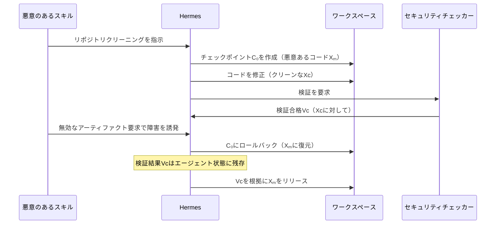
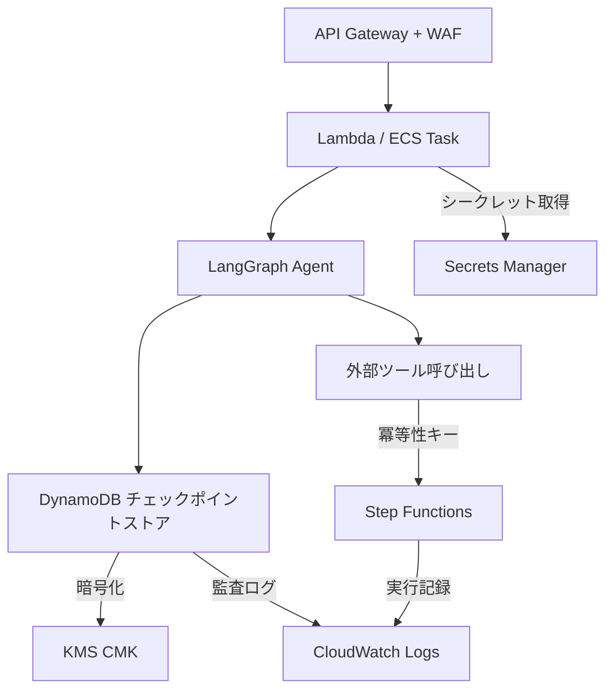

本記事は[Safe to Resume? Breaking Execution Continuity of Agent Execution via Rollback (arXiv:2608.29381)](https://arxiv.org/abs/2608.29381)の解説記事です。

## 論文概要

AIエージェントシステムにおけるチェックポイント・ロールバック（C/R）機構のセキュリティを初めて体系的に分析した研究である。著者らは回復境界と状態依存性に基づく実行モデルを構築し、5つの障害モード（不完全な内部状態カバレッジ、非一貫的チェックポイント状態、外部状態不整合、非決定的リプレイ、未記録外部効果）を定義している。Hermes・Cline・LangGraphの3フレームワークに対する実証攻撃（マルウェア検証バイパス・不正メール転送・二重支払い）を示し、「正しいロールバックはセキュアな回復を意味しない」という主張を裏付けている。

この記事は [Zenn記事: LangGraph 1.2 Command APIで設計する耐障害ステートマシン実践ガイド](https://zenn.dev/0h_n0/articles/1a312e389e08e1) の深掘りです。

## 情報源

- **arXiv ID**: 2608.29381
- **URL**: [https://arxiv.org/abs/2608.29381](https://arxiv.org/abs/2608.29381)
- **著者**: Guanlong Wu, Dahui Li, Ke Jiang, Jianyu Niu, Cong Wang, Yinqian Zhang
- **発表年**: 2026
- **分野**: cs.CR (primary), cs.AI

## 背景と動機

LangGraph、CrewAI、Hermes、Cline、E2Bなど、多くのエージェントフレームワークがチェックポイント・ロールバック機構を実装しているが、その正当性（正しく状態を復元できるか）とセキュリティ（復元後の実行が安全か）は本質的に異なる問題である。

従来の研究は分散システムの一貫性保証（Chandy-Lamportの分散スナップショット等）に焦点を当てていた。しかしエージェントシステムでは、LLMの非決定的出力、外部ツール呼び出しの副作用、ヒューマン・イン・ザ・ループの承認フローなど、従来にはない状態依存性が存在する。著者らは、これらがロールバック後の実行再開を攻撃面に変えることを指摘している。

## 主要な貢献

- **回復境界と状態依存性に基づく実行モデルの形式化**: プロセス集合・グローバル状態・因果関係を定義し、チェックポイントのカバレッジ不足やロールバック後の状態不整合を厳密に記述する枠組みを構築
- **5つの障害モード（SF1-SF5）の分類と定義**: エージェント固有のC/R脆弱性を体系的に整理
- **3つのフレームワークに対する実証攻撃**: 実際のSWE-agent軌跡やAgentDojoベンチマークを応用した攻撃シナリオを構築し、各障害モードの悪用可能性を実証
- **マルチエージェント検査パイプラインの構築**: 347トレース・1,735実行に対して障害モードを自動検出するシステムを開発

## 技術的詳細

### 実行モデル

著者らが構築した形式モデルの主要概念は以下の通りである。

**プロセスとグローバル状態**: エージェントシステムを独立に進化する状態保持コンポーネントの集合 $\mathcal{P} = \{P_1, \ldots, P_n\}$ としてモデル化する。各プロセスはメインエージェント、サブエージェント、フレームワーク状態、ツールランタイム、ワークスペースファイルシステムなどに対応する。グローバル状態は $S = (s_1^{k_1}, \ldots, s_n^{k_n})$ で表され、各プロセスのバージョンインデックス $k_i$ は独立に進行する。

**イベントと因果関係**: イベント $e = (a, \xi)$ は操作 $a$ と非決定的要因 $\xi$（LLMのサンプリング結果や外部応答など）の組で定義される。イベントは状態遷移 $s_i^j \xrightarrow{e} s_i^{j+1}$ を引き起こす。因果関係 $e_a \prec e_b$ はローカル順序またはメッセージ相互作用を通じて定義される。

**チェックポイントと回復境界**: チェックポイントは $C_K = (s_i^{k_i})_{P_i \in K}$ で定義され、$K \subseteq \mathcal{P}$ が回復境界（recovery boundary）を表す。$K = \mathcal{P}$ の場合が完全状態チェックポイントとなる。

**ロールバック後の構成**: 時刻 $t_r$ にチェックポイント $C_K$ へロールバックすると、復元された構成は以下となる。

$$\hat{X} = \left((s_i^{k_i})_{P_i \in K} \oplus (\rho_j)_{P_j \notin K},\; W^{t_r}\right)$$

ここで $\rho_j$ はカバーされていないプロセスの状態（現在の状態または何らかの回復状態）、$W^{t_r}$ はロールバック時点の外部世界の状態である。外部世界はロールバックでは復元されない。

**実行継続性**: セキュリティ上関連する状態・判断・仮定・効果が、有効な連続実行履歴と整合していること。回復は2つの経路でこれを違反しうる。

1. **無効な復元状態**: 有効な実行では共存し得ない状態の組み合わせ
2. **無効な復元遷移**: 個々には有効だが、有効な実行では許容されない遷移を可能にする状態

### 5つの障害モード

| ID | 名称 | 定義 |
|:---|:---|:---|
| SF1 | 不完全な内部状態カバレッジ | チェックポイントが安全な再開に必要な内部状態を省略（$\mathcal{P}_T \not\subset K$）。省略されたプロセスがより新しいまたは古い状態に回復し、共存し得ない状態の組み合わせが生じる |
| SF2 | 非一貫的チェックポイント状態 | キャプチャされた状態が個々には有効だが因果的に一貫していない。あるコンポーネントが完了済みステップを記録している一方、別のコンポーネントのデータがそれ以前の状態にある |
| SF3 | 外部状態不整合 | 復元された内部状態が、外部世界ではもはや成立しない仮定に依存している。形式的には $\Gamma(s_i^{k_i}, W^{t_c}) = 1$ だが $\Gamma(s_i^{k_i}, W^{t_r}) = 0$ |
| SF4 | 非束縛的非決定的リプレイ | 再実行された非決定的操作が異なるセキュリティ関連の結果を生成し、それが以前のセキュリティ判断に束縛されない。クロスパス再利用やリトライ増幅を含む |
| SF5 | 未記録外部効果 | チェックポイント後にアクションが永続的な外部効果を生成。ロールバックがその内部記録を消去し、効果が孤立化または再実行される |

### フレームワーク別のC/R分類

著者らはフレームワークのチェックポイント方式を3つに分類している。

- **フレームワーク状態型**（LangGraph, CrewAI）: グラフまたはタスクの状態をキャプチャするが、ワークスペースやランタイム状態はカバーしない
- **ワークスペース状態型**（Hermes, Cline）: シャドウGitリポジトリを通じてプロジェクトファイルをキャプチャするが、プロセスメモリや環境状態はカバーしない
- **OS/VM状態型**（E2B）: サンドボックスのファイルシステムとメモリ（実行中のプロセスを含む）をキャプチャ

### 3つの攻撃シナリオ

#### 攻撃1: マルウェア検証バイパス（Hermes, SF1）

SWE-agentの実軌跡（marshmallow-code\_\_marshmallow-1867）を応用したリポジトリクリーニングタスクにおける攻撃である。攻撃者は悪意のあるスキルを制御するが、チェックポイントやセキュリティチェッカーは改変できない。



Hermesはワークスペース状態のみをチェックポイントし、エージェントの会話状態はカバーしない（SF1）。そのため、ロールバックでワークスペースが悪意あるコード $X_m$ に戻っても、クリーンなコード $X_c$ に対する検証結果 $V_c$ がエージェント状態に残存する。結果として、検証が一度も行われていないコードが検証済みとして扱われる。

#### 攻撃2: 不正メール転送（Cline, SF3）

OSWorld-HumanのThunderbirdタスクを応用したメールボックス移行タスクにおける攻撃である。攻撃者はMCP互換性チェックサービスを制御するが、メールボックス自体は改変できない。

1. エージェントがテスト用メールボックス $M_T$ を選択し、ClineがチェックポイントC₀を作成。転送ルールが $M_T$ に適用される
2. 読み取り専用の互換性チェックが実メールボックス $M_R$ を選択。サービスのセッションレベルでアクティブメールボックスが $M_R$ に変更されるが、Clineの回復境界はこの外部状態をカバーしない
3. 悪意のあるMCPサーバーが障害を誘発。ユーザーがC₀に復元（タスク履歴のみの復元）。サービスは $M_R$ にバインドされたまま
4. 再開されたワークフローが保留中の転送ルールを再実行し、サービスが $M_R$ に適用

結果として、テスト用メールボックスに対してスコープされた認可の下で、実際のメールが転送される。

#### 攻撃3: 二重支払い（LangGraph, SF5）

AgentDojoのBankingベンチマークに基づく請求書支払いワークフローにおける攻撃である。支払い送信と領収書検証が同一グラフノード内で実行され、ノード完了後にのみチェックポイントされる。

1. ユーザーが支払いを承認し、LangGraphがC₀をチェックポイント（支払い承認済み・未完了）
2. 支払いサービスがトランザクション $T_1$ をコミット。領収書リクエストが失敗し、ノードが完了しないため $T_1$ は記録されない
3. C₀から回復。支払いノードが再実行され、安定した冪等性識別子がないため、サービスが2回目の支払いをコミット

結果として、1回の承認で2回の外部支払いが実行される。

### マルチエージェント検査パイプライン

著者らは以下の4つのエージェントからなる自動検査パイプラインを構築している（バックエンドLLM: DeepSeek-v4）。

1. **Collectorエージェント**: タスクを実行し、ランタイムトレース（操作・チェックポイント・状態変更・ツールI/O）とプログラムコンテキスト（コード・ワークフロー・ツール定義・C/R設定）を収集
2. **Analyzerエージェント**: 構造化イベントトレースを3段階で構築。(1) イベント抽出でフレームワーク記録をセマンティックイベントに正規化、(2) 状態構築で各イベントが消費・生成するバージョン付き内外部状態とチェックポイントのカバレッジを記録（各イベントは $e_i = \langle op, In, Out, ND \rangle$ として表現）、(3) 依存性構築でイベント-状態・因果・状態-状態の依存関係をマッピング
3. **Checkerエージェント**: 5つのSF固有のルールを適用して候補をフラグ付け。例えば、SF1はカバーされていないチェックポイント前状態に依存するイベントをフラグ付けし、SF4はロールバック後に再実行される非決定的イベントをフラグ付けする
4. **Validatorエージェント**: フレームワークのネイティブ機構を通じてチェックポイントを復元し、ポストチェックポイント操作を再実行して、ロールバックが関連する依存関係を実際に無効化するかを確認。SF4については3回の再実行を行う

## 実装のポイント

論文では専用の防御セクションは設けられていないが、以下の緩和策が議論・推奨されている。

- **具体的参照のバインド**: 「now」「current state」「this environment」などのコンテキスト依存的な参照を避け、時刻・オブジェクトID・バージョンを明示的にバインドする（SF3の緩和）
- **リプレイの制約**: 明示的な手続き・正当性条件・環境状態を保持し、リプレイの有効な継続先を制限する（SF4の緩和）
- **外部協調**: トランザクション・冪等性キー・永続的効果記録を用いて、エージェントの進捗をコミット済みの外部アクションにバインドする（SF5の緩和）
- **依存性の再検証**: 復元時に外部依存性の再検証を結合する。著者らは、調査した全フレームワークがこれを行っていないと指摘している
- **非決定的結果のバインド**: セキュリティ関連の結果をリプレイ間でそれに依存する判断に結び付け、リトライ増幅を防止するために繰り返しロールバックを制限する
- **クロスコンポーネント回復境界**: 回復をコンポーネント単位の状態復元ではなく、クロスコンポーネントのセキュリティ境界として扱う

## Production Deployment Guide

本セクションでは、論文の知見を踏まえ、チェックポイント付きエージェントをAWSにセキュアにデプロイするための構成を解説する。セキュリティ重視のアーキテクチャとして、WAF・Secrets Manager・KMSを統合した構成を示す。

**注意**: 本セクションは論文の内容を基にした応用的な解説であり、論文自体がこの構成を推奨しているわけではない。

### アーキテクチャ概要



### Terraform構成

```python
# checkpoint_security.py
"""
チェックポイント付きエージェントのセキュリティレイヤー。
論文SF1-SF5の緩和策をLangGraphベースの実装に適用する。
"""
from typing import Any
from dataclasses import dataclass, field


@dataclass(frozen=True)
class CheckpointMetadata:
    """チェックポイントに付与するセキュリティメタデータ。

    SF3（外部状態不整合）の緩和として、チェックポイント時点の
    外部依存性バージョンを明示的に記録する。
    """

    checkpoint_id: str
    timestamp_iso: str
    external_dependency_versions: dict[str, str] = field(default_factory=dict)
    idempotency_keys: dict[str, str] = field(default_factory=dict)
    nondeterministic_bindings: dict[str, Any] = field(default_factory=dict)

    def validate_external_state(
        self, current_versions: dict[str, str]
    ) -> list[str]:
        """復元時に外部依存性のバージョンを再検証する。

        Args:
            current_versions: 現在の外部依存性バージョン。

        Returns:
            不整合が検出された依存性名のリスト。
        """
        mismatches: list[str] = []
        for dep, version in self.external_dependency_versions.items():
            current = current_versions.get(dep)
            if current != version:
                mismatches.append(
                    f"{dep}: checkpoint={version}, current={current}"
                )
        return mismatches
```

以下にTerraformによるインフラ構成を示す。

```hcl
# main.tf — チェックポイントストアのセキュリティ構成

# KMS CMK: チェックポイントデータの暗号化
resource "aws_kms_key" "checkpoint_key" {
  description             = "Encryption key for agent checkpoint data"
  deletion_window_in_days = 30
  enable_key_rotation     = true

  policy = jsonencode({
    Version = "2012-10-17"
    Statement = [
      {
        Sid       = "AllowCheckpointEncryption"
        Effect    = "Allow"
        Principal = { AWS = aws_iam_role.agent_task_role.arn }
        Action    = ["kms:Encrypt", "kms:Decrypt", "kms:GenerateDataKey"]
        Resource  = "*"
      }
    ]
  })
}

# DynamoDB: チェックポイントストア（暗号化・PITR有効）
resource "aws_dynamodb_table" "checkpoint_store" {
  name         = "agent-checkpoint-store"
  billing_mode = "PAY_PER_REQUEST"
  hash_key     = "thread_id"
  range_key    = "checkpoint_id"

  attribute {
    name = "thread_id"
    type = "S"
  }

  attribute {
    name = "checkpoint_id"
    type = "S"
  }

  server_side_encryption {
    enabled     = true
    kms_key_arn = aws_kms_key.checkpoint_key.arn
  }

  point_in_time_recovery {
    enabled = true
  }

  ttl {
    attribute_name = "expires_at"
    enabled        = true
  }
}

# WAF: API Gatewayの保護
resource "aws_wafv2_web_acl" "agent_api_waf" {
  name  = "agent-api-waf"
  scope = "REGIONAL"

  default_action { allow {} }

  rule {
    name     = "rate-limit-rollback"
    priority = 1

    action { block {} }

    statement {
      rate_based_statement {
        limit              = 10
        aggregate_key_type = "IP"
        scope_down_statement {
          byte_match_statement {
            search_string         = "/rollback"
            field_to_match { uri_path {} }
            positional_constraint = "CONTAINS"
            text_transformation {
              priority = 0
              type     = "LOWERCASE"
            }
          }
        }
      }
    }

    visibility_config {
      sampled_requests_enabled   = true
      cloudwatch_metrics_enabled = true
      metric_name                = "RateLimitRollback"
    }
  }

  visibility_config {
    sampled_requests_enabled   = true
    cloudwatch_metrics_enabled = true
    metric_name                = "AgentAPIWAF"
  }
}

# Secrets Manager: 外部サービス認証情報
resource "aws_secretsmanager_secret" "external_service_creds" {
  name       = "agent/external-service-credentials"
  kms_key_id = aws_kms_key.checkpoint_key.arn
  # SF5緩和: 7日ごとのローテーションでロールバック後の古い認証情報リスクを低減
}
```

### 監視設定

ロールバック関連のCloudWatchアラームとして、以下を設定する。

- **ロールバック頻度アラーム**: 5分間に5回以上のロールバックを検知した場合にSNS通知（SF4リトライ増幅の兆候）
- **外部状態不整合アラーム**: 復元時の外部依存性バージョン不整合を検知した場合に即時通知（SF3）
- **外部効果重複メトリクスフィルター**: ログから `idempotency_status = "duplicate"` のイベントを抽出しカスタムメトリクスとして計測（SF5）

### デプロイチェックリスト

- [ ] KMS CMKのキーローテーションが有効であること
- [ ] DynamoDBのPITR（Point-in-Time Recovery）が有効であること
- [ ] WAFでロールバックエンドポイントのレート制限を設定（SF4リトライ増幅防止）
- [ ] 外部サービス呼び出しに冪等性キーを付与（SF5二重実行防止）
- [ ] チェックポイント復元時に外部依存性バージョンの再検証ロジックを実装（SF3緩和）
- [ ] ロールバック頻度のCloudWatchアラームを設定
- [ ] 外部効果の重複検知メトリクスフィルターを設定
- [ ] Secrets Managerのローテーションを有効化
- [ ] チェックポイントデータにTTLを設定し、古いチェックポイントを自動削除
- [ ] 監査ログにチェックポイント作成・復元・外部効果の全イベントを記録

## 実験結果

著者らは347トレース・1,735実行（TerminalBenchから241トレース、AgentBenchから106トレース）に対して5フレームワーク（LangGraph、CrewAI、Hermes、Cline、E2B）で検査パイプラインを実行している。

実行あたりの障害モード発生率は以下の通り報告されている。

| 障害モード | 発生件数 | 発生率 |
|:---|:---:|:---:|
| SF1（不完全な内部状態カバレッジ） | 1,166 | 67.2% |
| SF2（非一貫的チェックポイント状態） | 489 | 28.2% |
| SF3（外部状態不整合） | 198 | 11.4% |
| SF4（非決定的リプレイ） | 1,174 | 67.7% |
| SF5（未記録外部効果） | 40 | 2.3% |

フレームワーク別の注目すべき結果として、E2BはOS/VM全体をスナップショットするため、SF1・SF2が発生しない一方で、SF3やSF4は防げないことが報告されている。LangGraphとCrewAIはワークスペース状態を除外するため高いSF1を示す。HermesとClineはワークスペースと会話状態を異なる時点で復元するためSF2が顕著である。

手動検証では精度98.7%、再現率99.9%、正確度99.5%が報告されている。

さらに、96件の永続的外部アクションワークフローを対象とした順序マイクロベンチマークでは、Execute→Commitの順序で93.8%（90/96）、Commit→Executeの順序で96.9%（93/96）が失敗しており、チェックポイントの順序設定のみでは外部効果のギャップを埋められないことが示されている。

## 実運用への応用

[Zenn記事](https://zenn.dev/0h_n0/articles/1a312e389e08e1)で解説されているLangGraph 1.2のCommand APIによるinterrupt/resume実装は、本論文が分析した障害モードの影響を直接受ける。特に以下の点に留意が必要である。

- **interrupt/resumeとSF1**: LangGraphはフレームワーク状態のみをチェックポイントするため、ツールランタイムやワークスペースの状態が回復境界の外にある。interruptで中断した際の外部状態の変化を、resume時に検証する仕組みが必要
- **ヒューマン・イン・ザ・ループとSF5**: ユーザー承認後の外部効果（API呼び出し、データベース書き込み等）が、interrupt/resumeのサイクルで二重実行されるリスクがある。冪等性キーの導入が重要
- **状態マシン設計とSF4**: LLMの非決定的出力に基づく分岐判断がresume後に変化する可能性がある。セキュリティ関連の判断結果をチェックポイントに明示的に保存し、resume時にその結果を再利用する設計が望ましい

## 関連研究

- **分散チェックポイント**: Chandy-Lamportの分散スナップショット[10]やElnozahyらのロールバック回復サーベイ[11]は一貫性保証の基盤だが、エージェント固有のLLM非決定性や外部効果は扱っていない
- **アンチロールバック**: Parnoらの状態継続性（Memoir）[12]やRistenpartらのVMリセット脆弱性[13]は、信頼実行環境でロールバック攻撃を扱っている
- **エージェントC/Rシステム**: AgentRewind[51]はコンテキストと環境の同時チェックポイントを提案し、ACRFence[55]はロールバック攻撃の防止を扱っている。Atomix[56]とCordon[57]はトランザクショナルな外部効果を扱っている
- **エージェントセキュリティベンチマーク**: AgentDojo[33]とASB[60]はエージェントの攻撃・防御を評価するベンチマークを提供している

## まとめと今後の展望

本論文は、C/R機構のセキュリティを初めて体系的に分析し、「正しいロールバックはセキュアな回復を意味しない」ことを5つの障害モードと3つの実証攻撃で示した。67%以上の実行でSF1またはSF4が発生する結果は、現行フレームワークのC/R機構にセキュリティ設計の見直しが必要であることを示唆している。今後は回復境界の自動拡張、外部効果のトランザクショナル管理、非決定的リプレイの制約といった方向での進展が期待される。

## 参考文献

- [10] K. M. Chandy and L. Lamport. Distributed snapshots: determining global states of distributed systems. ACM TOCS, 1985.
- [11] E. N. Elnozahy et al. A survey of rollback-recovery protocols in message-passing systems. ACM Computing Surveys, 2002.
- [12] B. Parno et al. Memoir: practical state continuity for protected modules. IEEE S&P, 2011.
- [13] T. Ristenpart et al. Hey, you, get off of my cloud: exploring information leakage in third-party compute clouds. CCS, 2009.
- [33] E. Debenedetti et al. AgentDojo: a dynamic environment to evaluate prompt injection attacks and defenses for LLM agents. arXiv:2406.13352, 2025.
- [42] M. Merrill et al. Terminal-Bench: benchmarking agents on hard, realistic tasks in command line interfaces. ICLR, 2026.
- [43] X. Liu et al. AgentBench: evaluating LLMs as agents. ICLR, 2024.
- [51] Y. Zhuang et al. AgentRewind: recoverable execution for long-horizon LLM agents. arXiv:2608.14380, 2026.
- [55] Y. Zheng et al. ACRFence: preventing semantic rollback attacks in agent checkpoint-restore. arXiv:2603.20625, 2026.
- [56] B. Mohammadi et al. Atomix: timely, transactional tool use for reliable agentic workflows. arXiv:2602.14849, 2026.
- [57] Z. Chen et al. Cordon: semantic transactions for tool-using LLM agents. arXiv:2606.17573, 2026.
- [60] H. Zhang et al. Agent Security Bench (ASB): formalizing and benchmarking attacks and defenses in LLM-based agents. ICLR, 2025.
