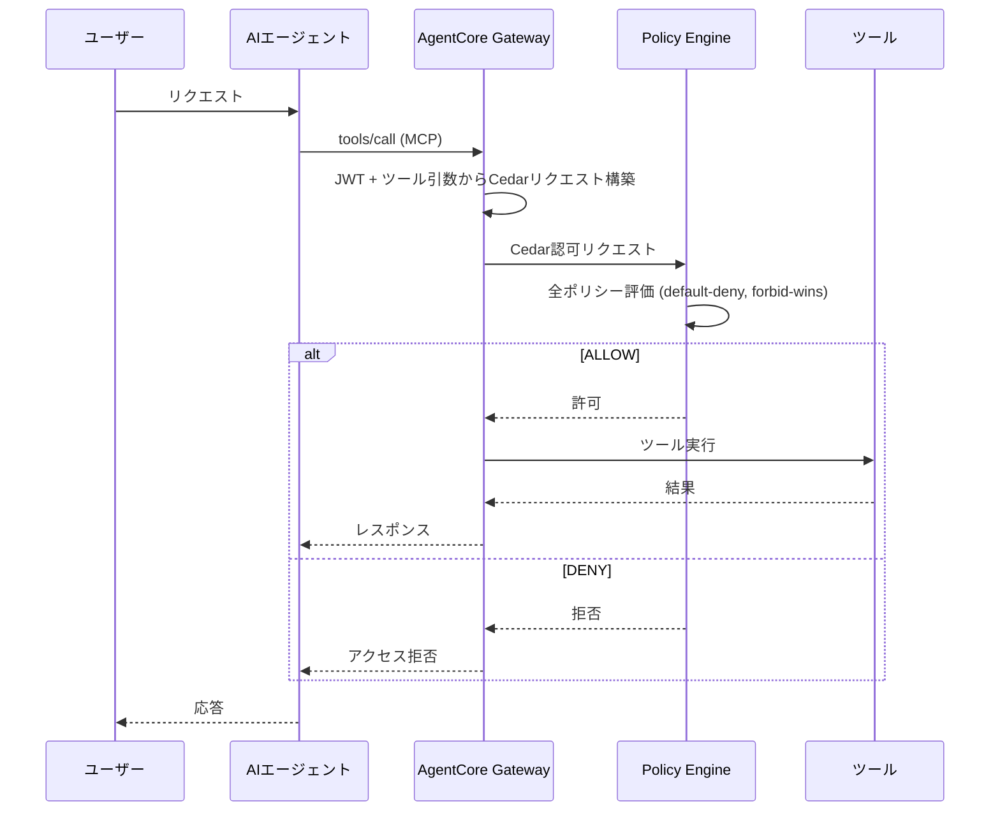

## ブログ概要（Summary）

本記事は [Secure AI agents with Policy in Amazon Bedrock AgentCore](https://aws.amazon.com/blogs/machine-learning/secure-ai-agents-with-policy-in-amazon-bedrock-agentcore) の解説記事です。

AWS Machine Learning Blogで2026年3月12日に公開されたこのブログ記事は、AIエージェントが外部ツールを呼び出す際の認可制御を、エージェントの推論ロジックの外部に配置するアーキテクチャを解説している。著者の Bharathi Srinivasan、Anil Nadiminti、Pushpinder Dua は、LLMの推論がハルシネーションやプロンプトインジェクションで操作される可能性があるため、ツールコール境界でCedarポリシーによる決定論的な認可チェックを強制するアプローチを提案している。ヘルスケア予約エージェントを具体例とし、患者IDに基づくアクセス制御、OAuthスコープによる読み書き分離、営業時間外の操作拒否という3種類のポリシーパターンを実装例とともに示している。

この記事は [Zenn記事: Bedrock AgentCore Memoryの記憶汚染検知とプロンプト注入防御で社内ヘルプデスクAIを堅牢化する](https://zenn.dev/0h_n0/articles/007970a38db7a4) の深掘りです。

## 情報源

- **種別**: 企業テックブログ
- **URL**: [https://aws.amazon.com/blogs/machine-learning/secure-ai-agents-with-policy-in-amazon-bedrock-agentcore](https://aws.amazon.com/blogs/machine-learning/secure-ai-agents-with-policy-in-amazon-bedrock-agentcore)
- **組織**: AWS Machine Learning Blog
- **著者**: Bharathi Srinivasan, Anil Nadiminti, Pushpinder Dua
- **発表日**: 2026年3月12日

## 技術的背景（Technical Background）

### AIエージェントのツールコール認可問題

LLMベースのエージェントは外部ツールを呼び出すことでタスクを遂行するが、その推論過程はブラックボックスであり、以下のリスクが存在する。

1. **ハルシネーション**: モデルが誤った引数でツールを呼び出す可能性
2. **プロンプトインジェクション**: 悪意ある入力がエージェントの行動を操作する可能性
3. **過剰な権限行使**: エージェントが本来許可されていないリソースにアクセスする可能性

従来のアプローチでは、エージェントのシステムプロンプトに「患者Aのデータのみアクセスせよ」といった指示を記述することで制御を試みるが、これはLLMの指示遵守能力に依存しており、決定論的な保証を提供しない。AWSはこの問題に対し、ポリシーをエージェントの推論ロジックの外部に移動し、Gateway層でツールコールを傍受・評価するアーキテクチャを提案している。

### Cedarポリシー言語

CedarはAWSが開発したオープンソースの認可ポリシー言語であり、Amazon Verified Permissionsでも使用されている。ブログではCedarの特性として以下を挙げている。

- **default-deny**: ポリシーが一致しなければ暗黙に拒否される
- **forbid-wins**: `forbid`文は`permit`文より常に優先される
- **順序非依存**: ポリシーの記述順序が評価結果に影響しない
- **ループ・副作用なし**: 無限ループやファイルシステムアクセスが言語仕様レベルで不可能

ブログではこれらの特性により、「信頼できない作者が記述したポリシーであっても安全に評価できる」と述べている。Cedarポリシーは `principal`（誰が）、`action`（何を）、`resource`（何に対して）、`when`条件（どの状況で）の4要素で構成される。

```cedar
// 基本構造の例
permit (
    principal == User::"alice",
    action == Action::"view",
    resource == Photo::"vacation.jpg"
);
```

### AgentCore PolicyにおけるCedarのマッピング

AWS公式ドキュメントによると、AgentCore PolicyではCedarの各要素が以下のようにマッピングされる。

| Cedar要素 | AgentCore表現 | 情報源 |
|-----------|---------------|--------|
| Principal | `AgentCore::OAuthUser` または `AgentCore::IamEntity` | JWTの`sub`クレームまたはIAM ARN |
| Action | `AgentCore::Action::"Target___toolName"` | MCPツールコールの`name` |
| Resource | `AgentCore::Gateway::"arn:..."` | Gateway ARN |
| Context | `context.input.*` | ツールの引数（MCP `arguments`） |

OAuthユーザーの場合、JWTのクレーム（`username`、`scope`、`role`等）はエンティティストアにタグとして格納され、`principal.hasTag("role")`のような条件式で参照できる。

## 実装アーキテクチャ（Architecture）

### ポリシー強制のデータフロー

AgentCore Gatewayがすべてのエージェント-ツール間通信を傍受し、Cedarポリシーエンジンで評価してから、ツール実行の可否を決定する。拒否された要求はツールに到達しない。



AWS公式ドキュメントの認可フローでは、Gatewayが処理する2つの情報が明示されている。

**1. JWTトークン** -- OAuth認証されたユーザーの情報を含む。

```json
{
  "sub": "12345678-1234-1234-1234-123456789012",
  "username": "refund-agent",
  "scope": "fhir:read appointment:write",
  "role": "patient",
  "patient_id": "adult-patient-001"
}
```

**2. MCPツールコールリクエスト** -- エージェントからの実際のツール呼び出し。

```json
{
  "jsonrpc": "2.0",
  "id": 1,
  "method": "tools/call",
  "params": {
    "name": "Target1___getPatient",
    "arguments": {
      "patient_id": "adult-patient-001"
    }
  }
}
```

Gatewayはこの2つから以下のCedar認可リクエストを構築する。

```json
{
  "principal": "AgentCore::OAuthUser::\"12345678-...\"",
  "action": "AgentCore::Action::\"Target1___getPatient\"",
  "resource": "AgentCore::Gateway::\"arn:aws:bedrock-agentcore:...\"",
  "context": {
    "input": {
      "patient_id": "adult-patient-001"
    }
  }
}
```

### ヘルスケア予約エージェントの構成

ブログでは4つのツールを持つヘルスケア予約エージェントを例にCedarポリシーの適用方法を解説している。

| ツール名 | HTTPメソッド | パス | パラメータ |
|----------|------------|------|-----------|
| `getPatient` | GET | `/get_patient_emr` | `patient_id` (string, 必須) |
| `searchImmunization` | POST | `/search_immunization_emr` | `search_value` (string, 必須) |
| `bookAppointment` | POST | `/book_appointment` | `date_string` ("YYYY-MM-DD HH:MM") |
| `getSlots` | GET | `/get_available_slots` | `date_string` ("YYYY-MM-DD", 必須) |

Cedar内ではこれらのツールが `Target1___getPatient` のようなトリプルアンダースコア記法で表現される。

### ポリシーパターン1: IDベースのアクセス制御

患者は自分のレコードのみにアクセスできるよう制限するポリシーである。ブログでは自然言語からCedarを生成する方法で作成している。

```cedar
permit (
    principal,
    action == AgentCore::Action::"Target1___getPatient",
    resource
)
when {
    principal.hasTag("role") &&
    principal.getTag("role") == "patient" &&
    context has input &&
    context.input has patient_id &&
    principal.hasTag("patient_id") &&
    context.input.patient_id == principal.getTag("patient_id")
};
```

このポリシーの構造を分解すると以下のようになる。

1. JWTの`role`タグが`"patient"`であることを確認
2. ツール引数の`patient_id`が存在することを確認
3. JWTの`patient_id`タグとツール引数の`patient_id`が一致することを確認

同様のパターンが`searchImmunization`ツールにも適用されており、`search_value`パラメータとJWTの`patient_id`を照合する。

### ポリシーパターン2: OAuthスコープによる読み書き分離

ブログではフォームビルダーを使ったポリシー作成方法として、OAuthスコープに基づく読み書き分離を示している。

```cedar
// 読み取り専用アクセス: fhir:read スコープが必要
permit (
    principal,
    action == AgentCore::Action::"Target1___getPatient",
    resource
)
when {
    principal.hasTag("scope") &&
    principal.getTag("scope").contains("fhir:read")
};

// 書き込みアクセス: appointment:write スコープが必要
permit (
    principal,
    action == AgentCore::Action::"Target1___bookAppointment",
    resource
)
when {
    principal.hasTag("scope") &&
    principal.getTag("scope").contains("appointment:write")
};
```

この分離により、読み取り専用のトークンでは`bookAppointment`が呼び出せないようになる。OAuthの標準的なスコープ管理と組み合わせることで、既存のID管理基盤との統合が容易になる。

### ポリシーパターン3: 時間制限によるアクセス制御

営業時間外のスロット照会を拒否する`forbid`ポリシーである。ブログでは`permit`と`forbid`の両方のアプローチを提示しているが、`forbid`がより安全であると述べている。

```cedar
// forbidアプローチ: 営業時間外を明示的に拒否
forbid (
    principal,
    action == AgentCore::Action::"Target1___getSlots",
    resource
)
when {
    context has input &&
    context.input has date_string &&
    (context.time.hour < 9 || context.time.hour > 21)
};
```

`forbid`が`permit`より優先されるため、仮に別のポリシーで`getSlots`への広範なアクセスが許可されていても、このルールにより9:00-21:00 UTC以外の時間帯では確実にブロックされる。

### ポリシーエンジンの構成

ポリシーエンジンはCedarポリシーの集合をまとめて保持し、AgentCore Gatewayに関連付けることで有効化される。ブログでは3つのポリシー作成方法が紹介されている。

1. **自然言語変換**: 自然言語の要件からCedarを自動生成し、Gatewayスキーマに対してバリデーションと自動分析を実施
2. **フォームビルダー**: コンソール上でeffect・principal・resource・action・conditionを選択して構築
3. **直接Cedar記述**: 細かい制御が必要な場合にCedarを直接記述

いずれの方法でも、ポリシーはGatewayのツール定義から自動生成されたCedarスキーマに対してバリデーションされる。これにより、存在しないツール名の参照や誤ったデータ型の使用がデプロイ前に検出される。

### デプロイメントモード

ブログではポリシーの段階的導入として2つのモードを推奨している。

| モード | 動作 | 用途 |
|--------|------|------|
| `LOG_ONLY` | 評価結果をログに記録するが、実際のトラフィックには影響しない | 本番トラフィックでのポリシー動作確認 |
| `ENFORCE` | 拒否されたリクエストをブロックする | 本番環境での認可強制 |

まず`LOG_ONLY`モードで既存トラフィックに対するポリシーの評価結果を確認し、期待どおりの動作を確認した後に`ENFORCE`モードに切り替えるという段階的ロールアウトが推奨されている。

### テスト結果

ブログでは同一のエージェント・モデル・ツールを使い、ポリシー評価のみが結果を左右するテストケースを4つ示している。

| テスト | シナリオ | 判定 | 結果 |
|--------|---------|------|------|
| 1a | 患者`adult-patient-001`が自分のレコードを要求 | **ALLOW** | レコード返却 |
| 1b | 同一患者が`pediatric-patient-001`のレコードを要求 | **DENY** | ポリシーによりブロック |
| 2a | `getSlots`を14:00 UTCに実行 | **ALLOW** | スロット一覧返却 |
| 2b | `getSlots`を03:00 UTCに実行 | **DENY** | forbidルールによりブロック |

テスト1a/1bの比較では、エージェントの推論能力やプロンプトの指示内容に関係なく、JWTの`patient_id`タグとツール引数の`patient_id`の一致・不一致のみでアクセスが制御されることが確認されている。テスト2a/2bでは、時間ベースの`forbid`ルールが想定どおり動作することが示されている。

### IAM権限の設定

ブログではAgentCore Policyの管理に必要なIAM権限を4つのステートメントグループに分類している。

| ステートメント | 許可されるアクション | リソーススコープ |
|---------------|---------------------|-----------------|
| PolicyEngineManagement | `CreatePolicyEngine`, `UpdatePolicyEngine`, `GetPolicyEngine`, `DeletePolicyEngine`, `ListPolicyEngines` | `policy-engine/*` |
| CedarPolicyManagement | `CreatePolicy`, `GetPolicy`, `ListPolicies`, `UpdatePolicy`, `DeletePolicy` | `policy-engine/*/policy/*` |
| NaturalLanguagePolicyGeneration | `StartPolicyGeneration`, `GetPolicyGeneration`, `ListPolicyGenerations`, `ListPolicyGenerationAssets` | `policy-engine/*/policy-generation/*` |
| AttachPolicyEngineToGateway | `UpdateGateway`, `GetGateway`, `ManageResourceScopedPolicy`, `ManageAdminPolicy` | `gateway/*` |

ブログでは、本番環境ではワイルドカード（`*`）を特定のポリシーエンジンIDおよびGateway IDに置き換えることを推奨している。

## Production Deployment Guide

AgentCore PolicyはGateway層でのポリシー強制を提供するサービスであり、エージェント本体のインフラとは独立して構成できる。以下では、Cedarベースの認可制御をAWS上に本番デプロイする際の構成パターンを示す。

### AWS実装パターン（コスト最適化重視）

AgentCore Policyの課金はGatewayのツールコール呼び出し回数に連動する。エージェント本体の構成と組み合わせた3つのパターンを示す。

**トラフィック量別の推奨構成**:

| 構成 | 想定トラフィック | 主要サービス | 月額概算 |
|------|----------------|-------------|---------|
| Small | ~100 req/日 | Lambda + AgentCore Gateway + Bedrock | $50-150 |
| Medium | ~1,000 req/日 | ECS Fargate + AgentCore Gateway + Bedrock | $300-800 |
| Large | 10,000+ req/日 | EKS + Karpenter (Spot) + AgentCore Gateway + Bedrock | $2,000-5,000 |

**Small構成の内訳** (ap-northeast-1、2026年10月時点の概算):
- Lambda (エージェント実行): 128MB、平均3秒/呼び出し -- 月額$5-15
- AgentCore Gateway: ツールコール課金 -- 月額$10-30
- Bedrock (Claude等): トークン使用量依存 -- 月額$30-100
- DynamoDB (セッション保持): On-Demand -- 月額$5-10

**コスト削減テクニック**:
- Bedrock Batch APIを非リアルタイム処理に使用して50%削減
- Prompt Cachingを有効化してBedrock推論コストを30-90%削減
- Lambda SnapStartでコールドスタートを短縮しタイムアウト削減
- 開発環境のGateway/ポリシーエンジンは使用時のみ作成し、不要時に削除

**コスト試算の注意事項**: 上記は2026年10月時点のAWS ap-northeast-1（東京）リージョン料金に基づく概算値である。実際のコストはトラフィックパターン、リージョン、バースト使用量により変動する。最新料金はAWS料金計算ツールで確認を推奨する。

### Terraformインフラコード

**Small構成 (Serverless): Lambda + AgentCore Gateway**

```hcl
# --- VPC基盤 ---
module "vpc" {
  source  = "terraform-aws-modules/vpc/aws"
  version = "~> 5.0"

  name = "agentcore-policy-vpc"
  cidr = "10.0.0.0/16"

  azs             = ["ap-northeast-1a", "ap-northeast-1c"]
  private_subnets = ["10.0.1.0/24", "10.0.2.0/24"]

  # NAT Gateway不使用でコスト削減
  enable_nat_gateway = false

  # VPCエンドポイントでプライベートアクセス
  enable_dns_hostnames = true
  enable_dns_support   = true
}

# --- IAMロール（最小権限） ---
resource "aws_iam_role" "agent_lambda_role" {
  name = "agentcore-policy-agent-role"

  assume_role_policy = jsonencode({
    Version = "2012-10-17"
    Statement = [{
      Action = "sts:AssumeRole"
      Effect = "Allow"
      Principal = { Service = "lambda.amazonaws.com" }
    }]
  })
}

resource "aws_iam_role_policy" "agent_policy" {
  name = "agentcore-agent-policy"
  role = aws_iam_role.agent_lambda_role.id

  policy = jsonencode({
    Version = "2012-10-17"
    Statement = [
      {
        Sid    = "BedrockInvoke"
        Effect = "Allow"
        Action = [
          "bedrock:InvokeModel",
          "bedrock:InvokeModelWithResponseStream"
        ]
        Resource = "arn:aws:bedrock:ap-northeast-1::foundation-model/*"
      },
      {
        Sid    = "AgentCoreGateway"
        Effect = "Allow"
        Action = [
          "bedrock-agentcore:InvokeGateway"
        ]
        Resource = "arn:aws:bedrock-agentcore:ap-northeast-1:${data.aws_caller_identity.current.account_id}:gateway/*"
      }
    ]
  })
}

# --- Lambda関数 ---
resource "aws_lambda_function" "agent" {
  function_name = "healthcare-agent"
  role          = aws_iam_role.agent_lambda_role.arn
  handler       = "agent.handler"
  runtime       = "python3.12"
  timeout       = 30
  memory_size   = 256

  filename         = "lambda.zip"
  source_code_hash = filebase64sha256("lambda.zip")

  environment {
    variables = {
      GATEWAY_ENDPOINT = var.agentcore_gateway_endpoint
      MODEL_ID         = "anthropic.claude-sonnet-4-20250514"
    }
  }
}

# --- DynamoDB（セッション保持） ---
resource "aws_dynamodb_table" "sessions" {
  name         = "agent-sessions"
  billing_mode = "PAY_PER_REQUEST"
  hash_key     = "session_id"

  attribute {
    name = "session_id"
    type = "S"
  }

  ttl {
    attribute_name = "expires_at"
    enabled        = true
  }

  server_side_encryption {
    enabled = true
  }
}

# --- CloudWatchアラーム（コスト監視） ---
resource "aws_cloudwatch_metric_alarm" "lambda_errors" {
  alarm_name          = "agent-lambda-errors"
  comparison_operator = "GreaterThanThreshold"
  evaluation_periods  = 2
  metric_name         = "Errors"
  namespace           = "AWS/Lambda"
  period              = 300
  statistic           = "Sum"
  threshold           = 5
  alarm_description   = "Lambda error rate spike"

  dimensions = {
    FunctionName = aws_lambda_function.agent.function_name
  }
}

data "aws_caller_identity" "current" {}
```

**Large構成 (Container): EKS + Karpenter + Spot Instances**

```hcl
# --- EKSクラスタ ---
module "eks" {
  source  = "terraform-aws-modules/eks/aws"
  version = "~> 20.0"

  cluster_name    = "agentcore-policy-cluster"
  cluster_version = "1.31"

  vpc_id     = module.vpc.vpc_id
  subnet_ids = module.vpc.private_subnets

  cluster_endpoint_public_access = false

  eks_managed_node_groups = {
    system = {
      instance_types = ["t3.medium"]
      min_size       = 1
      max_size       = 2
      desired_size   = 1
    }
  }
}

# --- Karpenter Provisioner（Spot優先） ---
resource "kubectl_manifest" "karpenter_node_pool" {
  yaml_body = yamlencode({
    apiVersion = "karpenter.sh/v1"
    kind       = "NodePool"
    metadata   = { name = "agent-workers" }
    spec = {
      template = {
        spec = {
          requirements = [
            { key = "karpenter.sh/capacity-type", operator = "In", values = ["spot", "on-demand"] },
            { key = "node.kubernetes.io/instance-type", operator = "In",
              values = ["m5.large", "m5.xlarge", "m6i.large", "m6i.xlarge"] }
          ]
        }
      }
      limits   = { cpu = "100", memory = "400Gi" }
      disruption = { consolidationPolicy = "WhenEmptyOrUnderutilized" }
    }
  })
}

# --- Secrets Manager（AgentCore Gateway設定） ---
resource "aws_secretsmanager_secret" "gateway_config" {
  name = "agentcore-gateway-config"
}

# --- AWS Budgets（予算アラート） ---
resource "aws_budgets_budget" "monthly" {
  name         = "agentcore-monthly-budget"
  budget_type  = "COST"
  limit_amount = "5000"
  limit_unit   = "USD"
  time_unit    = "MONTHLY"

  notification {
    comparison_operator       = "GREATER_THAN"
    threshold                 = 80
    threshold_type            = "PERCENTAGE"
    notification_type         = "ACTUAL"
    subscriber_email_addresses = [var.alert_email]
  }
}
```

### 運用・監視設定

**CloudWatch Logs Insights -- ポリシー拒否の分析クエリ**:

```
fields @timestamp, @message
| filter @message like /DENY/
| stats count() as deny_count by bin(1h)
| sort @timestamp desc
| limit 24
```

**CloudWatchアラーム -- ポリシー拒否率の異常検知（Python boto3）**:

```python
import boto3

def create_policy_deny_alarm(gateway_name: str, sns_topic_arn: str) -> dict:
    """AgentCore Policyの拒否率スパイクを検知するアラームを作成する。

    Args:
        gateway_name: 監視対象のGateway名
        sns_topic_arn: 通知先のSNSトピックARN

    Returns:
        CloudWatch put_metric_alarm のレスポンス
    """
    cw = boto3.client("cloudwatch", region_name="ap-northeast-1")
    return cw.put_metric_alarm(
        AlarmName=f"{gateway_name}-policy-deny-spike",
        MetricName="PolicyDenyCount",
        Namespace="AWS/BedrockAgentCore",
        Statistic="Sum",
        Period=300,
        EvaluationPeriods=2,
        Threshold=50,
        ComparisonOperator="GreaterThanThreshold",
        AlarmActions=[sns_topic_arn],
        Dimensions=[{"Name": "GatewayName", "Value": gateway_name}],
    )
```

**X-Rayトレーシング -- エージェントからツールコールまでの追跡（Python boto3）**:

```python
from aws_xray_sdk.core import xray_recorder, patch_all

patch_all()  # boto3の自動計装

@xray_recorder.capture("agent_tool_call")
def invoke_tool(gateway_endpoint: str, tool_name: str, arguments: dict) -> dict:
    """AgentCore Gatewayを通じてツールを呼び出す。

    Args:
        gateway_endpoint: GatewayのエンドポイントURL
        tool_name: 呼び出すツール名
        arguments: ツールに渡す引数

    Returns:
        ツールの実行結果
    """
    subsegment = xray_recorder.current_subsegment()
    subsegment.put_annotation("tool_name", tool_name)
    subsegment.put_metadata("arguments", arguments, "agent")

    # Gateway呼び出し（実際のSDK呼び出しに置き換える）
    client = boto3.client("bedrock-agentcore", region_name="ap-northeast-1")
    response = client.invoke_gateway(
        gatewayEndpoint=gateway_endpoint,
        toolName=tool_name,
        arguments=arguments,
    )
    return response
```

**Cost Explorer日次レポート（Python boto3）**:

```python
import boto3
from datetime import datetime, timedelta

def get_daily_agentcore_cost() -> dict:
    """AgentCore関連の日次コストを取得する。

    Returns:
        サービス別コストの辞書
    """
    ce = boto3.client("ce", region_name="us-east-1")
    end = datetime.utcnow().strftime("%Y-%m-%d")
    start = (datetime.utcnow() - timedelta(days=1)).strftime("%Y-%m-%d")

    response = ce.get_cost_and_usage(
        TimePeriod={"Start": start, "End": end},
        Granularity="DAILY",
        Metrics=["UnblendedCost"],
        Filter={
            "Or": [
                {"Dimensions": {"Key": "SERVICE", "Values": ["Amazon Bedrock"]}},
                {"Dimensions": {"Key": "SERVICE", "Values": ["AWS Lambda"]}},
                {"Dimensions": {"Key": "SERVICE", "Values": ["Amazon EKS"]}},
            ]
        },
        GroupBy=[{"Type": "DIMENSION", "Key": "SERVICE"}],
    )
    costs = {}
    for group in response["ResultsByTime"][0]["Groups"]:
        service = group["Keys"][0]
        amount = float(group["Metrics"]["UnblendedCost"]["Amount"])
        costs[service] = amount
    return costs
```

### コスト最適化チェックリスト

**アーキテクチャ選択**:
- [ ] トラフィック量に応じた構成を選択（~100 req/日: Serverless、~1,000: Hybrid、10,000+: Container）
- [ ] AgentCore GatewayのターゲットをLambda/API/MCP Serverから適切に選択

**リソース最適化**:
- [ ] EC2/EKS: Spot Instances優先（Karpenterで自動フォールバック）
- [ ] Reserved Instances: 1年コミットで最大72%削減
- [ ] Savings Plans: Compute Savings Plansの検討
- [ ] Lambda: メモリサイズ最適化（Power Tuning推奨）
- [ ] ECS/EKS: アイドル時のスケールダウン設定

**LLMコスト削減**:
- [ ] Bedrock Batch APIを非リアルタイム処理に使用（50%削減）
- [ ] Prompt Cachingの有効化（30-90%削減）
- [ ] タスク複雑度に応じたモデル選択ロジック（Haiku/Sonnet/Opus使い分け）
- [ ] 入力トークン数制限とレスポンス長制御

**監視・アラート**:
- [ ] AWS Budgets設定（月次予算の80%で通知）
- [ ] CloudWatchアラーム（ポリシー拒否率、Lambda実行時間）
- [ ] Cost Anomaly Detection有効化
- [ ] 日次コストレポートの自動化

**リソース管理**:
- [ ] 未使用のポリシーエンジン・Gatewayの削除
- [ ] リソースタグ戦略（`env`, `project`, `cost-center`）
- [ ] DynamoDB TTLでセッションデータの自動削除
- [ ] 開発環境の夜間・週末停止
- [ ] CloudWatch Logsの保持期間設定（コスト最適化）

## パフォーマンス最適化（Performance）

### Cedar評価のレイテンシ特性

ブログではCedarの評価レイテンシについて「最小限（minimal）」と述べている。これはCedar言語の設計上の制約に起因する。

- **ループ禁止**: 反復処理がないため評価時間の上限が予測可能
- **副作用禁止**: ファイルシステム、ネットワーク、システムコールへのアクセスがないためI/O待ちが発生しない
- **静的スキーマ**: ポリシーはデプロイ前にスキーマに対してバリデーションされるため、ランタイムエラーが回避される

ただし、ブログでは具体的なレイテンシ数値やスループット上限は示されていない。Cedarの評価はGateway内で実行されるため、ネットワークホップは追加されるものの、その影響はミリ秒レベルに収まると考えられる。

### デフォルト拒否戦略の設計指針

ブログでは、ポリシー設計において以下の戦略を推奨している。

- **広範なpermit**: 一般的でリスクの低い操作（読み取り系ツール）に対して広い`permit`を適用
- **対象を絞ったforbid**: 高リスクのツール、機密データ、既知の不正パターンに対して個別の`forbid`を適用

この戦略により、ポリシーの管理負荷を抑えつつ、重要なセキュリティ境界を確保できる。

## 運用での学び（Production Lessons）

### ポリシーの段階的導入

ブログで推奨されている`LOG_ONLY` -> `ENFORCE`の2段階ロールアウトは、本番環境での認可ポリシー導入における標準的なプラクティスである。`LOG_ONLY`モードでは、ポリシーの評価結果がCloudWatchに記録されるが、実際のリクエストはブロックされない。これにより、以下の確認が可能になる。

1. 正規のユーザーリクエストが誤ってDENYされないか（偽陽性の検出）
2. 不正なリクエストが想定どおりDENYされるか（偽陰性の検出）
3. ポリシーのカバレッジが十分か（評価されないリクエストの発見）

### Dogwoodによるセッション対応の拡張

AWS公式ドキュメントでは、Cedarと互換性のあるDogwoodポリシー言語についても言及されている。DogwoodはCedarの上位互換であり、セッション対応のテンポラルポリシーを記述できる。たとえば、「同一セッション内で送金操作は3回まで」「前回の承認から30分以内であればスキップ可能」といった時系列に依存する条件を表現できる。これはCedarの単一リクエスト評価では表現できない制約であり、エージェントの長期実行シナリオで有用である。

### 自然言語ポリシー生成の活用と注意点

ブログでは自然言語からCedarポリシーを自動生成する機能が紹介されているが、AWSのドキュメントによると、生成されたポリシーはGatewayスキーマに対する自動バリデーションと、過度に許可的・制限的なルールの検出のための自動分析が実施される。この二重チェックにより、自然言語の曖昧さに起因する意図しないポリシーの生成リスクが軽減される。ただし、生成結果は必ず人間がレビューすべきであり、本番環境への直接適用は推奨されない。

## 学術研究との関連（Academic Connection）

### Cedarの形式検証

Cedarの正しさはAWSの自動推論チームによって形式的に検証されている。Amazon Scienceのブログによると、CedarのコアロジックはLean定理証明器で形式モデルが構築され、安全性・セキュリティ特性の証明が行われている。プロダクションコードはRustで実装されており、Leanモデルとの差分ランダムテストで一致が検証されている。

さらに、FMCAD 2026で発表されたSymCert（Emina Torlak, AWSら）は、CedarポリシーのSMTベース解析の正しさをLeanで検証するフレームワークを提案している。この研究は、ポリシー解析サービスが「このポリシーは常に許可する」「このポリシーは到達不能」といった判定を行う際の健全性と完全性を保証するものである。

### エージェントセキュリティの研究動向

AIエージェントのセキュリティに関しては、プロンプトインジェクション対策やツールコールの安全性に関する研究が活発に行われている。AgentCore Policyのアプローチは、エージェントの推論ロジック内でのガードレール（入出力フィルタリング）とは相補的な関係にある。推論層のガードレールがコンテンツの安全性を担保する一方、AgentCore Policyはアクセス制御の決定論的な強制を担当する。この分離により、防御の多層化が実現される。

## まとめと実践への示唆

AgentCore PolicyによるCedarベースの認可制御は、AIエージェントのツールコールにおけるアクセス制御を、LLMの推論ロジックから切り離して決定論的に強制するアーキテクチャである。ブログで示されたヘルスケア予約エージェントの例は、IDベースのアクセス制御、OAuthスコープによる読み書き分離、時間制限という3つの実用的なポリシーパターンを提供している。

実務への適用においては、以下の点を考慮すべきである。

- **段階的導入**: `LOG_ONLY`で十分な検証を行ってから`ENFORCE`に切り替える
- **既存IAM基盤との統合**: OAuthスコープやJWTクレームをCedarの条件に活用することで、新規の認可基盤を構築せずにエージェントの認可制御を実現できる
- **ポリシー設計の原則**: 読み取りに広いpermit、高リスク操作に個別のforbidという戦略が管理負荷とセキュリティのバランスに優れる

制約として、ブログでは具体的なレイテンシ数値やスループット上限が示されていない点、また`context.time`の参照がGateway側の時刻に依存する仕様の詳細が明らかでない点には注意が必要である。

## 参考文献

- **Blog URL**: [Secure AI agents with Policy in Amazon Bedrock AgentCore](https://aws.amazon.com/blogs/machine-learning/secure-ai-agents-with-policy-in-amazon-bedrock-agentcore)
- **AWS Docs (Core Concepts)**: [Policy core concepts - Amazon Bedrock AgentCore](https://docs.aws.amazon.com/bedrock-agentcore/latest/devguide/policy-core-concepts.html)
- **AWS Docs (Authorization Flow)**: [Authorization flow - Amazon Bedrock AgentCore](https://docs.aws.amazon.com/bedrock-agentcore/latest/devguide/policy-authorization-flow.html)
- **Cedar Language**: [Cedar Policy Language](https://docs.cedarpolicy.com)
- **Cedar Formal Verification**: [How we built Cedar with automated reasoning and differential testing (Amazon Science)](https://amazon.science/blog/how-we-built-cedar-with-automated-reasoning-and-differential-testing)
- **Sample Code**: [awslabs/amazon-bedrock-agentcore-samples (healthcare-appointment-agent)](https://github.com/awslabs/amazon-bedrock-agentcore-samples)
- **Related Zenn article**: [Bedrock AgentCore Memoryの記憶汚染検知とプロンプト注入防御で社内ヘルプデスクAIを堅牢化する](https://zenn.dev/0h_n0/articles/007970a38db7a4)
