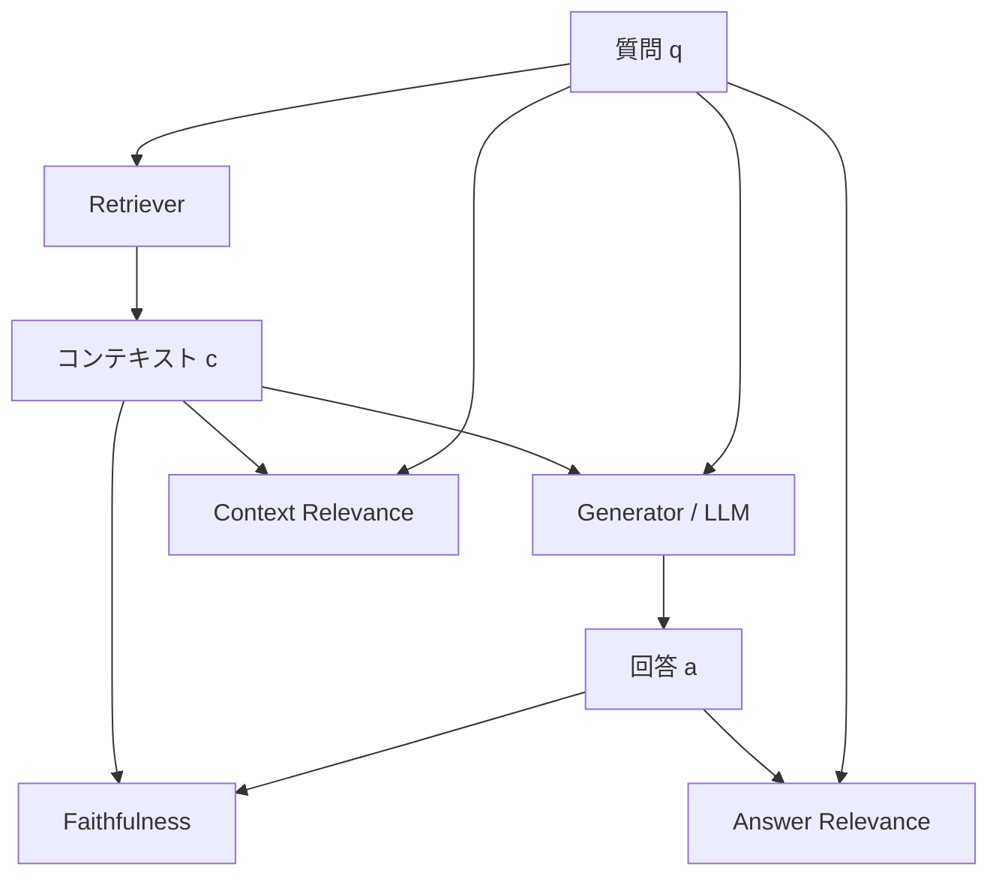
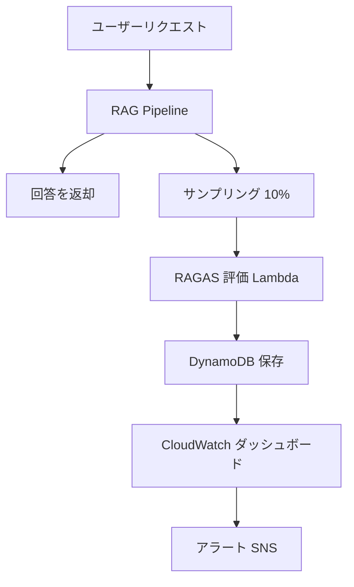

## 論文概要（Abstract）

本記事は、Shahul Es らによる論文「Ragas: Automated Evaluation of Retrieval Augmented Generation」(arXiv:2309.15217) の解説記事です。本記事の著者自身が実験を行ったものではなく、論文の内容を引用・解説したものです。

**出典**: [https://arxiv.org/abs/2309.15217](https://arxiv.org/abs/2309.15217)

RAGAS は、参照回答（ground truth）を必要とせずに RAG パイプラインの品質を自動評価するフレームワークである。著者らは、検索コンポーネントの品質（Context Relevance）、生成された回答が検索されたパッセージにどれだけ忠実か（Faithfulness）、そして回答が元の質問にどれだけ関連しているか（Answer Relevance）の3つのメトリクスを提案している。

この記事は [Zenn記事: LlamaIndex v0.14のIngestionPipelineと評価ループで本番RAGの精度劣化を継続監視する](https://zenn.dev/0h_n0/articles/8fed5e798afc5f) の深掘りです。

## 情報源

- **arXiv ID**: 2309.15217
- **URL**: [https://arxiv.org/abs/2309.15217](https://arxiv.org/abs/2309.15217)
- **著者**: Shahul Es, Jithin James, Luis Espinosa-Anke, Steven Schockaert
- **投稿日**: 2023年9月26日（v2: 2025年4月28日）
- **分野**: cs.CL（Computation and Language）

## 背景と動機（Background & Motivation）

Retrieval Augmented Generation（RAG）は、外部知識ベースから関連文書を検索し、それを文脈として LLM に与えることで、幻覚（hallucination）を抑制しつつ最新情報に基づいた回答を生成する手法である。RAG パイプラインは Retriever（検索）と Generator（生成）の2つのコンポーネントで構成されるが、各コンポーネントの品質を個別に評価し、パイプライン全体のボトルネックを特定する手法が確立されていなかった。

従来の評価手法には以下の課題があった。

- **人間による評価**: コストが高く、スケーラビリティに欠ける。評価者間の一致率も問題になる
- **参照回答ベースの自動評価（BLEU, ROUGE等）**: ground truth の作成コストが高い。また、表現が異なるが意味的に正しい回答を低評価してしまう
- **LLM ベースのスコアリング（GPT Score等）**: 単一のスコアを出力するため、Retriever と Generator のどちらに問題があるか切り分けられない

著者らは、これらの課題に対して、ground truth 不要かつコンポーネント別に評価可能な3つのメトリクスを提案した。

## 主要な貢献（Key Contributions）

- **貢献1**: 参照回答を必要としない3つの評価メトリクス（Faithfulness, Answer Relevance, Context Relevance）の定式化
- **貢献2**: 各メトリクスが RAG パイプラインの異なるコンポーネント（Retriever / Generator）に対応する設計により、ボトルネックの特定が可能
- **貢献3**: WikiEval データセットを用いた人間判定との比較実験で、既存手法（GPT Score, GPT Ranking）を上回る一致率を報告

## 技術的詳細（Technical Details）

### 評価フレームワークの全体像

RAGAS は RAG パイプラインの入出力 $(q, c, a)$（質問、コンテキスト、回答）のみから品質を評価する。



| メトリクス | 評価対象 | 入力 | コンポーネント |
|---|---|---|---|
| Faithfulness | 回答がコンテキストに忠実か | $(c, a)$ | Generator |
| Answer Relevance | 回答が質問に関連するか | $(q, a)$ | Generator |
| Context Relevance | コンテキストが質問に関連するか | $(q, c)$ | Retriever |

### Faithfulness（忠実度）

Faithfulness は、生成された回答 $a$ が検索されたコンテキスト $c$ に根拠を持つかを測定する。回答中のハルシネーション（幻覚）を検出するためのメトリクスである。

**評価手順**:

1. 回答 $a$ を独立した文（statement）の集合 $S = \{s_1, s_2, \ldots, s_{|S|}\}$ に分解する
2. 各文 $s_i$ について、コンテキスト $c$ によって支持されるか（Yes/No）を LLM で判定する
3. 支持された文の集合を $V \subseteq S$ とし、以下の式でスコアを計算する

$$
F = \frac{|V|}{|S|}
$$

ここで、
- $|V|$: コンテキストによって支持されると判定された文の数
- $|S|$: 回答から抽出された文の総数
- $F \in [0, 1]$: 1 に近いほど忠実度が高い

**具体例**: 回答が5文で構成され、そのうち4文がコンテキストに根拠がある場合、$F = 4/5 = 0.8$ となる。

### Answer Relevance（回答関連度）

Answer Relevance は、生成された回答 $a$ が元の質問 $q$ にどれだけ関連しているかを測定する。回答が質問の意図から逸脱していないかを評価するメトリクスである。

**評価手順**:

1. 回答 $a$ から、その回答が適切な回答となりうる質問を $n$ 個生成する: $\{q_1, q_2, \ldots, q_n\}$
2. 元の質問 $q$ と各生成質問 $q_i$ の埋め込みベクトルを取得する（論文では text-embedding-ada-002 を使用）
3. コサイン類似度の平均を計算する

$$
AR = \frac{1}{n} \sum_{i=1}^{n} \text{sim}(q, q_i)
$$

ここで、
- $q$: 元の質問
- $q_i$: 回答から生成された $i$ 番目の質問
- $\text{sim}(\cdot, \cdot)$: コサイン類似度
- $n$: 生成する質問の数
- $AR \in [0, 1]$: 1 に近いほど回答が質問に関連している

この間接的な評価方法の利点は、回答が質問の一部にしか答えていない場合、生成質問 $q_i$ が元の質問の部分集合にしか対応せず、ペナルティとして類似度が下がる点にある。

### Context Relevance（コンテキスト関連度）

Context Relevance は、検索されたコンテキスト $c$ が質問 $q$ に対してどれだけ関連しているかを測定する。Retriever の性能を評価するメトリクスである。

**評価手順**:

1. コンテキスト $c(q)$ から、質問 $q$ に回答するために必要な文を LLM で抽出する
2. 抽出された文の数とコンテキスト全体の文数の比率を計算する

$$
CR = \frac{|\text{extracted sentences}|}{|\text{total sentences in } c(q)|}
$$

ここで、
- $|\text{extracted sentences}|$: 質問に関連すると判定された文の数
- $|\text{total sentences in } c(q)|$: コンテキスト $c(q)$ 中の全文数
- $CR \in [0, 1]$: 1 に近いほどコンテキストが質問に焦点を当てている

$CR = 1$ は質問に直接関連する文のみで構成される理想状態を表し、ノイズが多いほどスコアが下がる。

### アルゴリズム

以下に RAGAS の3つのメトリクスを計算する擬似実装を示す。

```python
from dataclasses import dataclass
from typing import Protocol


class LLMClient(Protocol):
    """LLM API クライアントのインターフェース"""
    def decompose_into_statements(self, answer: str) -> list[str]: ...
    def verify_statement(self, stmt: str, context: str) -> bool: ...
    def generate_questions(self, answer: str, n: int) -> list[str]: ...
    def extract_relevant_sentences(self, q: str, ctx: str) -> list[str]: ...


class EmbeddingClient(Protocol):
    """埋め込みモデルのインターフェース"""
    def embed(self, text: str) -> list[float]: ...


@dataclass
class RAGASResult:
    """RAGAS 評価結果"""
    faithfulness: float
    answer_relevance: float
    context_relevance: float


def cosine_similarity(a: list[float], b: list[float]) -> float:
    """コサイン類似度を計算する"""
    dot = sum(x * y for x, y in zip(a, b))
    norm_a = sum(x * x for x in a) ** 0.5
    norm_b = sum(x * x for x in b) ** 0.5
    return dot / (norm_a * norm_b) if norm_a and norm_b else 0.0


def compute_faithfulness(answer: str, context: str, llm: LLMClient) -> float:
    """Faithfulness: F = |V| / |S|"""
    stmts = llm.decompose_into_statements(answer)
    if not stmts:
        return 0.0
    verified = sum(1 for s in stmts if llm.verify_statement(s, context))
    return verified / len(stmts)


def compute_answer_relevance(
    question: str, answer: str, llm: LLMClient,
    embedder: EmbeddingClient, n: int = 3,
) -> float:
    """Answer Relevance: AR = (1/n) * sum(sim(q, q_i))"""
    gen_qs = llm.generate_questions(answer, n)
    if not gen_qs:
        return 0.0
    q_emb = embedder.embed(question)
    sims = [cosine_similarity(q_emb, embedder.embed(gq)) for gq in gen_qs]
    return sum(sims) / len(sims)


def compute_context_relevance(
    question: str, context: str, llm: LLMClient,
) -> float:
    """Context Relevance: CR = |extracted| / |total sentences|"""
    total = [s.strip() for s in context.split(".") if s.strip()]
    if not total:
        return 0.0
    relevant = llm.extract_relevant_sentences(question, context)
    return min(len(relevant) / len(total), 1.0)
```

上記コードは論文のアルゴリズムを Python で再構成した擬似実装であり、実際の RAGAS ライブラリ（[GitHub: explodinggradients/ragas](https://github.com/explodinggradients/ragas)）とはインターフェースが異なる。

## 実装のポイント（Implementation）

RAGAS を実際に導入する際の注意点を整理する。

### LLM 呼び出しのコスト

各メトリクスの計算には複数回の LLM 呼び出しが必要となる。1件の評価あたりの呼び出し回数は以下の通り。

| メトリクス | LLM 呼び出し回数 | 備考 |
|---|---|---|
| Faithfulness | $1 + |S|$ | 文分解に1回、各文の検証に $|S|$ 回 |
| Answer Relevance | 1 + Embedding $n+1$ 回 | 質問生成に1回 |
| Context Relevance | 1 | 関連文抽出に1回 |

大規模な評価セットで全サンプルを評価するとコストが大きくなる。著者らの実装では GPT-3.5-turbo-16k を使用しているが、本番環境ではコストと精度のトレードオフに応じてモデルを選択する必要がある。

### プロンプト設計への依存

RAGAS の各メトリクスは LLM のプロンプトに依存しており、プロンプトの変更がスコアに影響する。著者ら自身もこの点を論文の限界として挙げている。プロンプトの安定性を確保するためには、以下の対策が有効である。

- **プロンプトのバージョン管理**: 評価に使用したプロンプトを記録し、変更時にはスコアの再キャリブレーションを行う
- **Few-shot 例の固定**: プロンプトに含める例を固定し、評価の再現性を確保する
- **温度パラメータの設定**: `temperature=0` に設定して出力のランダム性を排除する

### Context Relevance の不安定性

論文の実験結果において、Context Relevance は他の2メトリクスと比較して人間判定との一致率が最も低い（0.70）。著者らは、これは長いコンテキストにおいて LLM が関連文の抽出を正確に行うことが困難であるためと分析している。実運用では、コンテキストの長さに上限を設けるか、チャンク単位で評価を行うことが推奨される。

## Production Deployment Guide

RAGAS による RAG 評価パイプラインを AWS 上にデプロイするための構成を示す。LlamaIndex の IngestionPipeline と組み合わせた継続的な品質監視を想定している。

### AWS 実装パターン（コスト最適化重視）

**トラフィック量別の推奨構成**:

| 構成 | 評価頻度 | AWS サービス | 月額概算 |
|---|---|---|---|
| Small | ~100 件/日 | Lambda + Bedrock + DynamoDB | $80-200 |
| Medium | ~1,000 件/日 | ECS Fargate + Bedrock + Aurora Serverless | $400-900 |
| Large | 10,000+ 件/日 | EKS + Spot + Bedrock Batch | $2,500-5,500 |

> **注意**: コスト試算は2026年10月時点の AWS ap-northeast-1（東京）リージョン料金に基づく概算値です。実際のコストはトラフィックパターン、リージョン、バースト使用量により変動します。最新料金は [AWS 料金計算ツール](https://calculator.aws/) で確認してください。

**Small 構成の内訳**: Lambda ~$5 + Bedrock Haiku ~$30-100 + Titan Embeddings ~$5-15 + DynamoDB ~$5 + CloudWatch ~$5 + S3 ~$1（いずれも月額）。

**コスト削減テクニック**: Bedrock Batch API で50%削減、Prompt Caching で30-90%削減、10%サンプリング評価、メトリクス別モデル選択（Faithfulness は Sonnet、Context Relevance は Haiku）。

### Terraform インフラコード

**Small 構成（Serverless）**:

```hcl
# ragas_eval/main.tf — RAGAS 評価パイプライン（Small 構成）
terraform {
  required_version = ">= 1.9"
  required_providers {
    aws = { source = "hashicorp/aws"; version = "~> 5.70" }
  }
}

provider "aws" { region = "ap-northeast-1" }

# --- IAM（最小権限） ---
resource "aws_iam_role" "ragas_lambda" {
  name = "ragas-eval-lambda-role"
  assume_role_policy = jsonencode({
    Version = "2012-10-17"
    Statement = [{ Action = "sts:AssumeRole", Effect = "Allow",
      Principal = { Service = "lambda.amazonaws.com" } }]
  })
}

resource "aws_iam_role_policy" "ragas_lambda_policy" {
  name = "ragas-eval-lambda-policy"
  role = aws_iam_role.ragas_lambda.id
  policy = jsonencode({
    Version = "2012-10-17"
    Statement = [
      { Effect = "Allow", Action = ["bedrock:InvokeModel"],
        Resource = [
          "arn:aws:bedrock:ap-northeast-1::foundation-model/anthropic.claude-3-haiku-*",
          "arn:aws:bedrock:ap-northeast-1::foundation-model/amazon.titan-embed-*"
        ] },
      { Effect = "Allow", Action = ["dynamodb:PutItem", "dynamodb:Query"],
        Resource = [aws_dynamodb_table.ragas_results.arn] },
      { Effect = "Allow", Action = ["logs:CreateLogGroup", "logs:CreateLogStream", "logs:PutLogEvents"],
        Resource = ["arn:aws:logs:ap-northeast-1:*:*"] }
    ]
  })
}

# --- DynamoDB（On-Demand + KMS + TTL 90日） ---
resource "aws_dynamodb_table" "ragas_results" {
  name = "ragas-eval-results"; billing_mode = "PAY_PER_REQUEST"
  hash_key = "evaluation_id"; range_key = "timestamp"
  attribute { name = "evaluation_id"; type = "S" }
  attribute { name = "timestamp"; type = "S" }
  server_side_encryption { enabled = true }
  ttl { attribute_name = "ttl"; enabled = true }
}

# --- Lambda ---
resource "aws_lambda_function" "ragas_evaluator" {
  function_name = "ragas-evaluator"
  role          = aws_iam_role.ragas_lambda.arn
  handler       = "handler.lambda_handler"
  runtime       = "python3.12"
  timeout       = 120  # Bedrock 呼び出しを考慮
  memory_size   = 512
  filename         = "lambda_package.zip"
  source_code_hash = filebase64sha256("lambda_package.zip")
  environment {
    variables = {
      DYNAMODB_TABLE = aws_dynamodb_table.ragas_results.name
      BEDROCK_REGION = "ap-northeast-1"
      EVAL_SAMPLE_RATE = "0.1"
    }
  }
  tracing_config { mode = "Active" }
}

# --- CloudWatch Alarm ---
resource "aws_cloudwatch_metric_alarm" "lambda_errors" {
  alarm_name          = "ragas-evaluator-errors"
  comparison_operator = "GreaterThanThreshold"
  evaluation_periods  = 2
  metric_name = "Errors"; namespace = "AWS/Lambda"
  period = 300; statistic = "Sum"; threshold = 5
  dimensions = { FunctionName = aws_lambda_function.ragas_evaluator.function_name }
}
```

**Large 構成（Container）**:

```hcl
# ragas_eval_large/main.tf — RAGAS 評価パイプライン（Large 構成）

module "eks" {
  source  = "terraform-aws-modules/eks/aws"
  version = "~> 20.24"

  cluster_name    = "ragas-eval-cluster"
  cluster_version = "1.31"
  vpc_id          = module.vpc.vpc_id
  subnet_ids      = module.vpc.private_subnets
  cluster_endpoint_public_access = false

  eks_managed_node_groups = {
    spot = {
      instance_types = ["m6i.large", "m6a.large", "m5.large"]
      capacity_type  = "SPOT"  # 最大 90% コスト削減
      min_size = 2; max_size = 10; desired_size = 3
    }
  }
}

resource "aws_budgets_budget" "ragas_monthly" {
  name         = "ragas-eval-monthly"
  budget_type  = "COST"
  limit_amount = "5000"
  limit_unit   = "USD"
  time_unit    = "MONTHLY"

  notification {
    comparison_operator        = "GREATER_THAN"
    threshold                  = 80
    threshold_type             = "PERCENTAGE"
    notification_type          = "ACTUAL"
    subscriber_email_addresses = ["ops-team@example.com"]
  }
}
```

Karpenter NodePool は `karpenter.sh/capacity-type: ["spot", "on-demand"]` で Spot 優先・On-Demand フォールバックを構成し、`consolidationPolicy: WhenEmptyOrUnderutilized` で未使用ノードを30秒後に自動回収する。

### 運用・監視設定

**CloudWatch Logs Insights クエリ（コスト異常検知）**:

```
# 1時間あたりの Bedrock トークン使用量を集計
fields @timestamp, @message
| filter @message like /bedrock_tokens/
| stats sum(input_tokens) as total_input,
        sum(output_tokens) as total_output,
        count(*) as eval_count
  by bin(1h)
| sort @timestamp desc
```

**CloudWatch Logs Insights クエリ（レイテンシ分析）**:

```
# RAGAS 評価のレイテンシ P95/P99
fields @timestamp, duration_ms
| filter event = "ragas_evaluation_complete"
| stats percentile(duration_ms, 95) as p95,
        percentile(duration_ms, 99) as p99,
        avg(duration_ms) as avg_ms
  by bin(1h)
```

**CloudWatch アラーム設定**: `put_metric_alarm` で `AWS/Bedrock` の `InputTokenCount` を1時間単位で監視し、閾値（例: 100,000トークン/時）超過時に SNS 通知を発火する。Lambda の `Errors` メトリクスも同様に監視する（Terraform 側で設定済み）。

**X-Ray トレーシング設定**: `aws_xray_sdk.core` の `patch_all()` で boto3 を自動計装し、`begin_subsegment("ragas_evaluation")` で各評価をトレースする。`put_annotation("metric_type", "ragas")` でフィルタ可能にし、`put_metadata` で入力長・評価結果を記録する。

**Cost Explorer 自動レポート（Python）**:

```python
import datetime
import boto3

ce = boto3.client("ce", region_name="us-east-1")
sns = boto3.client("sns", region_name="ap-northeast-1")


def daily_cost_report(sns_topic_arn: str, threshold: float = 100.0) -> None:
    """日次コストレポートを生成し閾値超過時に SNS 通知する"""
    today = datetime.date.today()
    yesterday = today - datetime.timedelta(days=1)
    resp = ce.get_cost_and_usage(
        TimePeriod={"Start": yesterday.isoformat(), "End": today.isoformat()},
        Granularity="DAILY", Metrics=["UnblendedCost"],
        Filter={"Tags": {"Key": "Project", "Values": ["ragas-eval"]}},
        GroupBy=[{"Type": "DIMENSION", "Key": "SERVICE"}],
    )
    total = sum(
        float(g["Metrics"]["UnblendedCost"]["Amount"])
        for r in resp["ResultsByTime"] for g in r["Groups"]
    )
    if total > threshold:
        sns.publish(
            TopicArn=sns_topic_arn,
            Subject=f"RAGAS Cost Alert: ${total:.2f}/day",
            Message=f"日次コスト${total:.2f}が閾値${threshold:.2f}を超過({yesterday})",
        )
```

### コスト最適化チェックリスト

| カテゴリ | チェック項目 |
|---|---|
| **アーキテクチャ** | ~100件/日: Serverless / ~1,000件/日: Hybrid / 10,000+件/日: Container |
| **リソース最適化** | Spot Instances優先(90%削減) / Reserved 1年(72%削減) / Savings Plans / Lambda Power Tuning / 夜間スケールダウン |
| **LLMコスト** | Batch API(50%削減) / Prompt Caching(30-90%削減) / メトリクス別モデル選択 / トークン上限4,000 / サンプリング評価 |
| **監視** | AWS Budgets(80%/100%閾値) / CloudWatchアラーム / Cost Anomaly Detection / 日次コストレポート / X-Rayトレーシング |
| **リソース管理** | 未使用リソース定期削除 / `Project=ragas-eval`タグ / S3ライフサイクル(90日Glacier) / DynamoDB TTL 90日 / 開発環境夜間停止 |

## 実験結果（Results）

著者らは WikiEval データセット（Wikipedia 50ページ、2022年以降、注釈者2名、一致率約95%）を用いて RAGAS を人間判定と比較している。

**人間判定との一致率（WikiEval、論文 Table 1 より）**:

| 評価手法 | Faithfulness | Answer Relevance | Context Relevance |
|---|---|---|---|
| **RAGAS** | **0.95** | **0.78** | **0.70** |
| GPT Score | 0.72 | 0.52 | 0.63 |
| GPT Ranking | 0.54 | 0.40 | 0.52 |

著者らは、RAGAS が全3メトリクスにおいて GPT Score および GPT Ranking を上回ったと報告している。特に Faithfulness において 0.95 という高い一致率を達成している点は注目に値する。

**分析ポイント**:

- **Faithfulness が最も高精度**: 文単位での検証という明確な判定基準が、LLM にとって処理しやすいタスクであると考えられる
- **Context Relevance が最も低い（0.70）**: 著者らは、長いコンテキストから関連文を抽出するタスクが LLM にとって困難であることが原因と分析している。コンテキストが長くなるほど判定が不安定になる傾向がある
- **Answer Relevance の中間的な精度（0.78）**: 間接的な評価手法（回答から質問を再生成する）であるため、一部の回答パターンで元の質問との類似度が正しく測定されないケースがあると考えられる

**限界と注意事項**:

著者ら自身が論文で指摘している限界を以下にまとめる。

1. **データセットの規模**: WikiEval は50ページのみで小規模であり、ドメイン固有のデータセットでの検証が不足している
2. **モデル依存性**: 実験は GPT-3.5-turbo-16k に依存しており、他の LLM（Llama, Claude 等）での性能は未検証である
3. **プロンプト感度**: LLM ベースの評価はプロンプト設計に敏感であり、プロンプトの微修正がスコアに影響しうる
4. **Context Relevance の不安定性**: 長いコンテキストでの関連文抽出精度が低く、実用時には補助的な指標として扱う方が安全である

## 実運用への応用（Practical Applications）

### Zenn 記事との関連

関連する [Zenn記事](https://zenn.dev/0h_n0/articles/8fed5e798afc5f) では、LlamaIndex の IngestionPipeline を用いた本番 RAG の精度劣化監視が解説されている。RAGAS は、この評価ループの中核的な評価フレームワークとして位置づけられる。

### 評価パイプラインへの組み込み



- **サンプリング**: 10%をサンプリング評価。層別（トピック別等）で多様性を確保
- **非同期実行**: ユーザー応答に影響を与えない設計。1件あたり30-120秒
- **閾値アラート**: Faithfulness < 0.7、Context Relevance < 0.5 でアラート発火
- **トレンド監視**: 日次・週次の推移で精度劣化を早期検出

## 関連研究（Related Work）

- **ARES**（Saad-Falcon et al., 2024）: 少量の人間アノテーションと PPI（Prediction-Powered Inference）で信頼区間付き推定を行う。RAGAS が完全に ground truth 不要であるのに対し、ARES は少量のラベルで統計的保証を提供する
- **DeepEval**: RAGAS と類似したメトリクスを実装するオープンソースフレームワーク。カスタムメトリクス定義が容易で、pytest プラグインによる CI/CD 統合を重視している
- **TruLens**: Groundedness や Comprehensiveness 等の追加メトリクスとトレーシング機能を内蔵する評価フレームワーク

| フレームワーク | Ground Truth | メトリクス数 | 統計的保証 | CI/CD 統合 |
|---|---|---|---|---|
| RAGAS | 不要 | 3（基本） | なし | ragas ライブラリ |
| ARES | 少量必要 | 3 | PPI で信頼区間 | なし |
| DeepEval | 不要 | 10+ | なし | pytest プラグイン |
| TruLens | 不要 | 5+ | なし | トレーシング内蔵 |

## まとめと今後の展望

RAGAS は参照回答不要で RAG パイプラインの品質を3軸で評価するフレームワークであり、著者らは WikiEval において GPT Score/Ranking を上回る人間判定との一致率を報告している（論文 Table 1 より）。

**実務への示唆**: Retriever と Generator のボトルネック切り分けに有用であり、LlamaIndex の IngestionPipeline と組み合わせた継続的な品質監視で精度劣化を早期に検出できる。

**今後の研究方向**: 大規模データセットでの検証、日本語を含む多言語対応、マルチモーダル RAG への拡張、Context Relevance の長文コンテキストでの精度改善。

## 参考文献

- **arXiv**: [https://arxiv.org/abs/2309.15217](https://arxiv.org/abs/2309.15217)
- **Code**: [https://github.com/explodinggradients/ragas](https://github.com/explodinggradients/ragas)
- **RAGAS Documentation**: [https://docs.ragas.io/](https://docs.ragas.io/)
- **Related Zenn article**: [https://zenn.dev/0h_n0/articles/8fed5e798afc5f](https://zenn.dev/0h_n0/articles/8fed5e798afc5f)
- **ARES**: Saad-Falcon et al., "ARES: An Automated Evaluation Framework for Retrieval-Augmented Generation Systems", arXiv:2311.09476
- **WikiEval Dataset**: 論文付属（Wikipedia 50ページ、注釈者2名）
