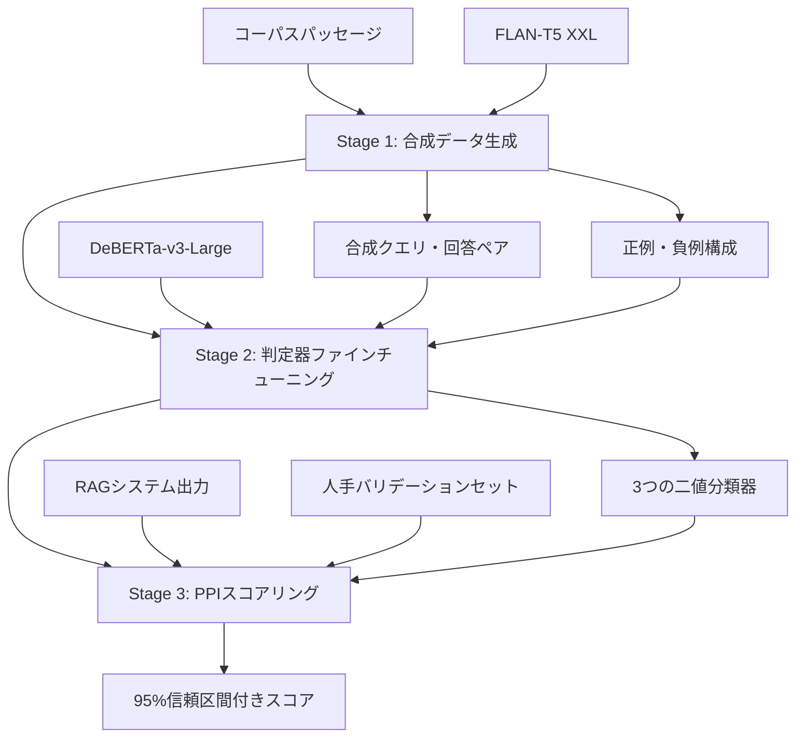

## 論文概要（Abstract）

**出典**: [ARES: An Automated Evaluation Framework for Retrieval-Augmented Generation Systems](https://arxiv.org/abs/2311.09476) (arXiv:2311.09476, NAACL 2024)

本記事は上記論文の引用・解説記事であり、筆者自身が実験を行ったものではありません。全ての実験結果は論文からの引用です。

RAG（Retrieval-Augmented Generation）システムの品質評価は、本番運用において避けて通れない課題です。検索コンポーネントが適切な文書を取得できているか、生成された回答が検索結果に忠実であるか、そしてユーザの質問に対して的確に答えているかを継続的に監視する必要があります。しかし、従来のRAG評価手法には大きな課題がありました。人手評価は高コストかつ再現性が低く、GPT-4等の大規模言語モデルを評価器として用いるアプローチはAPI呼び出しコストが高いうえに、モデルのバージョン変更で評価基準が変動するリスクを抱えています。

ARES（Automated Retrieval-augmented generation Evaluation System）は、これらの課題に対するスタンフォード大学の研究チームによる回答です。著者らは、合成データ生成によるファインチューニング済み軽量判定器と、統計的推論手法であるPPI（Prediction-Powered Inference）を組み合わせた3段階パイプラインを提案しています。著者らの報告によれば、ARESは従来手法と比較してアノテーションコストを約78%削減しつつ、RAGシステムの品質ランキングにおいて高い順位相関を達成しています。

この記事は [Zenn記事: LlamaIndex v0.14のIngestionPipelineと評価ループで本番RAGの精度劣化を継続監視する](https://zenn.dev/0h_n0/articles/8fed5e798afc5f) の深掘りです。Zenn記事で解説しているRAG評価ループの理論的基盤として、ARESのアプローチがどのように機能するかを詳細に解説します。

## 情報源

- **会議名**: NAACL 2024（Annual Conference of the North American Chapter of the Association for Computational Linguistics）
- **年**: 2024
- **URL**: [https://arxiv.org/abs/2311.09476](https://arxiv.org/abs/2311.09476)
- **著者**: Jon Saad-Falcon, Omar Khattab, Christopher Potts, Matei Zaharia
- **分野**: cs.CL, cs.AI, cs.IR
- **初版投稿**: 2023年11月16日（v2: 2024年3月31日）

## カンファレンス情報

**NAACLについて**: NAACLは計算言語学分野の主要国際会議の1つであり、ACL（Association for Computational Linguistics）の北米支部が主催しています。自然言語処理（NLP）分野において、ACL・EMNLP と並ぶトップカンファレンスとして知られています。特にNAACLは情報検索（IR）と言語処理の交差領域での発表が活発であり、ARESのようなRAG評価フレームワークにとって適切な発表先です。著者陣にはDSP/DSPyの提案者であるOmar Khattab、および大規模データシステムの研究で著名なMatei Zahariaが含まれており、検索と言語モデルの統合に関する深い知見が反映された研究です。

## 技術的詳細（Technical Details）

ARESの3段階パイプラインについて、各ステージの設計思想と技術的な詳細を解説します。従来のRAG評価手法がLLMへの単発プロンプトに依存していたのに対し、ARESは機械学習のファインチューニングと統計的推論を組み合わせた体系的なアプローチを採用しています。

### 全体アーキテクチャ

ARESの全体像を以下の図に示します。Stage 1で合成訓練データを生成し、Stage 2で軽量な判定器をファインチューニングし、Stage 3でPPI推論により信頼区間付きのスコアを算出するという3段階構成です。



### Stage 1: 合成データ生成

ARESの最初のステージでは、RAG評価用の訓練データを人手を介さずに合成的に生成します。RAG評価の最大のボトルネックはアノテーションコストであり、「このパッセージはクエリに関連しているか」「この回答は検索結果に忠実か」といった判定を人間が大量に行うことは現実的ではありません。ARESはこの問題を、既存のコーパスから自動的に正例・負例を構成することで解決しています。

著者らは、FLAN-T5 XXL（Google, 2022）を用いてコーパスのパッセージから合成クエリと回答のペアを生成しています。具体的な手順は以下の通りです。

**合成クエリ生成**: コーパス内のパッセージ $d$ を入力として、FLAN-T5 XXLに対して「このパッセージに対する質問を生成せよ」というプロンプトを与え、合成クエリ $q_{\text{synth}}$ を生成します。この手法は、Inparsの研究（Bonifacio et al., 2022）に着想を得ています。コーパスのパッセージには必ず回答可能な質問が存在するという前提のもと、そのパッセージを正解文書として扱うことで正例ペアを自然に構成できます。

**合成回答生成**: 生成された $q_{\text{synth}}$ とパッセージ $d$ のペアから、再度FLAN-T5 XXLを用いて合成回答 $a_{\text{synth}}$ を生成します。パッセージの内容に基づいて生成されるため、この回答はAnswer Faithfulness（忠実性）の正例として機能します。

**負例の構成**: 判定器が真に意味的な関連性を学習するためには、質の高い負例が不可欠です。著者らは2種類の負例を設計しています。

- **弱い負例**: $q_{\text{synth}}$ に対してランダムに選択された無関連パッセージ $d'$ を割り当てます。これは明らかに無関連であり、判定器が基本的な識別能力を獲得するために使用されます。
- **強い負例**: 同一ドキュメント内の別のパッセージや、BM25で検索した語彙的に類似するパッセージを割り当てます。強い負例は表面的にはクエリと語彙的重複があるものの、意味的には回答に必要な情報を含まないケースを表現しています。著者らは、この強い負例の導入が判定器の識別能力向上に寄与すると報告しています。

合成データの品質がパイプライン全体の性能を左右するため、この設計は慎重に検討されています。強い負例がない場合、判定器は単純なキーワードマッチングに依存しがちであり、実際のRAGシステムで頻出する「関連しそうで関連しない」パッセージを見抜けない傾向があります。

### Stage 2: 判定器ファインチューニング

Stage 1で生成した合成データを用いて、3つの独立した二値分類器をファインチューニングします。ベースモデルにはDeBERTa-v3-Large（He et al., 2021、約304Mパラメータ）が使用されています。

著者らがDeBERTaを選択した背景には、コストと性能のバランスがあります。GPT-4等の大規模LLMをゼロショットで評価器として使用する手法（RAGAS等）は、推論あたりのAPIコストが高く、数千件規模の評価では実用的でないコストが発生します。DeBERTa-v3-Largeはファインチューニング後もCPU上で1件あたり50-100ミリ秒程度で推論可能であり、大規模バッチ評価に適しています。

**3つの判定器とその役割**:

| 判定器 | 入力 | 判定内容 | RAG品質への意味 |
|--------|------|----------|----------------|
| Context Relevance | $(q, d)$ | 検索パッセージがクエリに関連するか | 検索コンポーネントの品質 |
| Answer Faithfulness | $(d, a)$ | 回答がパッセージの内容に忠実か | ハルシネーション検出 |
| Answer Relevance | $(q, a)$ | 回答がクエリに対して適切か | エンドツーエンドの品質 |

これら3つの指標は互いに独立した品質次元を捉えています。Context Relevanceが低ければ検索パイプラインの改善が必要であり、Answer Faithfulnessが低ければ生成モデルのハルシネーション対策が、Answer Relevanceが低ければクエリ理解または生成品質の改善が求められます。

各判定器の損失関数はCross-Entropy Lossです。

$$
\mathcal{L}_{\text{CE}} = -\frac{1}{N} \sum_{i=1}^{N} \left[ y_i \log \hat{y}_i + (1 - y_i) \log (1 - \hat{y}_i) \right]
$$

ここで、
- $N$: 訓練サンプル数
- $y_i$: 正解ラベル（1: positive, 0: negative）
- $\hat{y}_i$: 判定器の予測確率

**ハイパーパラメータ（論文より）**:
- オプティマイザ: Adam
- 学習率: $5 \times 10^{-6}$
- バッチサイズ: 32
- ドロップアウト率: 0.1

学習率 $5 \times 10^{-6}$ は、DeBERTaの事前学習で獲得した言語理解能力を維持しつつ、RAG評価という下流タスクに適応させるための慎重な設定です。この値はBERTファインチューニングの標準的な推奨範囲（$2 \times 10^{-5}$ ～ $5 \times 10^{-5}$）よりも一桁小さく、事前学習済み重みの破壊的忘却を抑制する意図があると考えられます。

### Stage 3: PPIによるスコアリングと信頼区間推定

ARESの核となる統計的手法がPPI（Prediction-Powered Inference、Angelopoulos et al., 2023）です。従来のRAG評価では、モデルが出力するスコアをそのまま使用するか、あるいは大量の人手ラベルで精度を推定するかの二者択一でした。PPIは、機械学習モデルの大量予測と少数の人手ラベルを組み合わせることで、統計的に有効な信頼区間を算出する第三の道を提供します。

直感的に説明すると、PPIの考え方は次の通りです。判定器は大量のデータに対して自動的にラベルを付与できますが、その予測には系統的なバイアスが含まれている可能性があります。一方、少数の人手ラベルは正確ですが、それだけでは統計的に信頼性のある推定ができません。PPIは、人手ラベルを使って判定器のバイアスを補正し、大量の自動予測の精度を「較正」することで、少数のアノテーションから統計的に有効なスコアを算出します。

#### PPIの数学的定式化

RAGシステムの真の性能指標 $\theta^*$（例: Context Relevanceの真の値）を推定する問題を考えます。$n$ 個のラベルなしデータに対する判定器の予測を $\hat{Y}_1, \ldots, \hat{Y}_n$ 、$N$ 個の人手ラベル付きバリデーションセットの正解を $Y_1, \ldots, Y_N$ 、対応する判定器の予測を $\hat{Y}'_1, \ldots, \hat{Y}'_N$ とします。

PPI推定量は以下で定義されます。

$$
\hat{\theta}_{\text{PPI}} = \frac{1}{n} \sum_{i=1}^{n} \hat{Y}_i + \frac{1}{N} \sum_{j=1}^{N} \left( Y_j - \hat{Y}'_j \right)
$$

ここで、
- $\hat{\theta}_{\text{PPI}}$: PPIによる推定値
- 第1項 $\frac{1}{n} \sum_{i=1}^{n} \hat{Y}_i$: 判定器による大規模予測の平均（ラベルなしデータ全体でのスコア）
- 第2項 $\frac{1}{N} \sum_{j=1}^{N}(Y_j - \hat{Y}'_j)$: 人手ラベルによる判定器バイアスの補正項

第2項の意味を具体例で考えましょう。判定器がContext Relevanceを系統的に0.05過大評価している場合、バリデーションセット上で $Y_j - \hat{Y}'_j$ の平均は約$-0.05$になります。この補正項が第1項の過大評価を相殺し、より正確な推定値が得られます。判定器が完全に正確であれば第2項はゼロに近づきます。

**95%信頼区間**の算出は以下の通りです。

$$
\text{CI}_{95\%} = \hat{\theta}_{\text{PPI}} \pm z_{0.975} \cdot \hat{\sigma}_{\text{PPI}}
$$

ここで、$z_{0.975} \approx 1.96$ は標準正規分布の97.5パーセンタイルです。$\hat{\sigma}_{\text{PPI}}$ はPPI推定量の標準誤差であり、以下で計算されます。

$$
\hat{\sigma}_{\text{PPI}}^2 = \frac{\hat{\sigma}_{\hat{Y}}^2}{n} + \frac{\hat{\sigma}_{Y - \hat{Y}'}^2}{N}
$$

ここで、
- $\hat{\sigma}_{\hat{Y}}^2$: ラベルなしデータ上の判定器予測の分散
- $\hat{\sigma}_{Y - \hat{Y}'}^2$: バリデーションセット上の補正項（残差）の分散
- $n$: ラベルなしデータ数（通常は数千～数万）
- $N$: 人手ラベル数（150～400件程度）

この分散の式から、ラベルなしデータ $n$ を増やすと第1項が小さくなり、人手ラベル $N$ を増やすと第2項が小さくなることがわかります。ラベルなしデータは自動的に大量に生成できるため、実質的に信頼区間の幅は人手ラベル数 $N$ と判定器の精度（残差の分散）に依存します。

#### システムランキングの評価

複数のRAGシステムを比較するために、著者らはKendall's $\tau$（順位相関係数）を評価指標として使用しています。

$$
\tau = \frac{C - D}{\binom{n}{2}}
$$

ここで、$C$ は一致ペア数（concordant pairs）、$D$ は不一致ペア数（discordant pairs）、$\binom{n}{2}$ は全ペア数です。$\tau = 1.0$ は人手評価による順位と自動評価による順位が完全に一致していることを意味し、$\tau = -1.0$ は完全な逆順を意味します。RAG評価の文脈では、$\tau$ が高いほど自動評価がシステム間の品質差を正確に捉えていることを示します。

### 判定器の入力構成

各判定器への入力は、DeBERTaのペア入力形式（[CLS] テキスト1 [SEP] テキスト2 [SEP]）で構成されます。以下に判定器の構築と入力準備の実装例を示します。

```python
from transformers import AutoModelForSequenceClassification, AutoTokenizer
from typing import list


def build_ares_judge(
    model_name: str = "microsoft/deberta-v3-large",
    num_labels: int = 2,
) -> AutoModelForSequenceClassification:
    """ARES判定器モデルの構築

    Args:
        model_name: ベースモデル名
        num_labels: 分類ラベル数（二値分類のため2）

    Returns:
        ファインチューニング用モデル
    """
    model = AutoModelForSequenceClassification.from_pretrained(
        model_name,
        num_labels=num_labels,
    )
    return model


def prepare_judge_input(
    tokenizer: AutoTokenizer,
    query: str,
    passage: str,
    answer: str | None = None,
    judge_type: str = "context_relevance",
    max_length: int = 512,
) -> dict[str, list[int]]:
    """判定器への入力を構成

    Args:
        tokenizer: トークナイザ
        query: ユーザクエリ
        passage: 検索パッセージ
        answer: 生成された回答（Answer系判定器で使用）
        judge_type: 判定器タイプ
        max_length: 最大トークン長

    Returns:
        トークナイズされた入力
    """
    if judge_type == "context_relevance":
        text_pair = (query, passage)
    elif judge_type == "answer_faithfulness":
        if answer is None:
            raise ValueError("answer is required for answer_faithfulness")
        text_pair = (passage, answer)
    elif judge_type == "answer_relevance":
        if answer is None:
            raise ValueError("answer is required for answer_relevance")
        text_pair = (query, answer)
    else:
        raise ValueError(f"Unknown judge_type: {judge_type}")

    return tokenizer(
        text_pair[0],
        text_pair[1],
        max_length=max_length,
        truncation=True,
        padding="max_length",
        return_tensors="pt",
    )
```

## 実装のポイント

ARESを実際に導入・実装する際に注意すべき点を、論文の記述と著者らの公開実装に基づいてまとめます。

**合成データ生成時の品質管理**: 合成クエリの品質がパイプライン全体の性能に直結します。著者らはFLAN-T5 XXLを使用していますが、合成クエリが過度に単純化される問題（例: パッセージ内の固有名詞を問うだけの事実質問への偏り）に注意が必要です。実際のRAGシステムに投入されるクエリは多様であり、複合質問や推論を要する質問も含まれます。合成データがこの多様性を反映していない場合、判定器のカバレッジが制限される可能性があります。著者らの公開実装ではプロンプトテンプレートが提供されていますが、ドメインに応じたカスタマイズが有効です。

**判定器のファインチューニング環境**: DeBERTa-v3-Largeは約304Mパラメータであり、単一GPU（A100 40GBやV100 32GB等）でファインチューニングが可能です。バッチサイズ32でGPUメモリが不足する場合は、gradient accumulationを用いて実効バッチサイズを維持できます。ファインチューニングの所要時間は、合成データ数万件の場合でも数時間程度に収まります。

**PPIバリデーションセットの設計**: 論文Table 3より、著者らは150ラベルで $\tau = 0.72$、400ラベルで $\tau = 1.0$（NQデータセット）と報告しています。最低150件の人手アノテーションが推奨されますが、ドメインの複雑さやRAGシステム間の性能差の大きさによっては、より多くのラベルが必要になる場合があります。バリデーションセットの品質（アノテーター間一致率）も信頼区間の幅に影響するため、アノテーションガイドラインの整備が重要です。

**クロスドメインの制約**: 論文Table 6より、英語の質問応答・事実検証タスク間では高いクロスドメイン性能（NQ→FEVER: $\tau = 0.89/0.89$）が報告されていますが、クロスリンガル（XGLUE, $\tau = 0.33$）やコード検索（CodeSearchNet, $\tau = 0.28$）では大幅に性能が低下しています。この制約はDeBERTa-v3-Largeの事前学習データが英語中心であることや、コード検索における意味的関連性の性質が自然言語と異なることに起因すると考えられます。ドメイン特化の評価には、そのドメインでの合成データ再生成と判定器の再ファインチューニングが不可欠です。

**推論時のバッチ処理**: 本番環境での推論時には、単一トリプルずつの推論ではなくバッチ処理を行うことで、GPU使用率を最大化できます。DeBERTa-v3-Largeの推論は入力長512トークンでバッチサイズ64の場合、CPU上でも毎秒10-20件程度の処理が可能であり、日次数千件規模の評価であればGPUなしで対応できます。

## Production Deployment Guide

ARESのDeBERTa判定器とPPI推論をAWS上で本番運用するための構成を解説します。RAG評価パイプラインとして、日次または週次のバッチ評価を想定した設計を示します。ARESの特性上、リアルタイム推論よりもバッチ処理のユースケースが主であるため、バッチ処理に最適化した構成を推奨します。

### AWS実装パターン（コスト最適化重視）

**トラフィック量別の推奨構成**:

| 構成 | 想定規模 | アーキテクチャ | 月額概算 |
|------|----------|---------------|----------|
| Small | ~500 評価/日 | Lambda + S3 + Step Functions | $80-200 |
| Medium | ~5,000 評価/日 | ECS Fargate (Spot) + S3 | $400-900 |
| Large | 50,000+ 評価/日 | EKS + Spot GPU + SageMaker Batch | $2,500-6,000 |

**Small構成の詳細（~500評価/日）**: AWS Lambdaにメモリ10GBを割り当て、DeBERTa-v3-Largeの推論を実行します。S3にRAGシステムの出力トリプル（query, document, answer）をJSONL形式で格納し、Step Functionsで3判定器の逐次実行とPPIスコア算出のワークフローを制御します。DynamoDBに評価結果と信頼区間を保存し、CloudWatchでスコアの時系列推移を可視化します。月額内訳はLambda $30-60、S3 $5-10、DynamoDB $10-30、Step Functions $5-10です。

**Medium構成の詳細（~5,000評価/日）**: ECS Fargate Spot（4 vCPU, 16GB RAM）でDeBERTa判定器をコンテナとしてホストします。DeBERTa-v3-LargeはCPU推論で1トリプルあたり約50-100ミリ秒で処理可能であり、この規模ではGPUは不要です。EventBridge Schedulerで日次バッチジョブを起動し、処理完了後にSNS経由でSlack通知を送信します。月額内訳はECS Fargate Spot $150-300、S3 $20-50、DynamoDB $50-100、その他 $50-100です。

**Large構成の詳細（50,000+評価/日）**: EKSクラスタにKarpenter（Spot優先）を導入し、GPU推論（g5.xlarge: NVIDIA A10G）で大量バッチ処理を行います。SageMaker Batch Transformとの組み合わせにより、ピーク時にはGPUノードを自動スケールアウトし、アイドル時にはゼロにスケールダウンします。月額内訳はEKS $300-500、Spot GPU $800-2,000、SageMaker $500-1,500、その他 $500-1,000です。

**コスト試算の注意事項**: 上記はAWS ap-northeast-1（東京）リージョンの2026年10月時点の概算値です。実際のコストはトラフィックパターン、バースト使用量、リージョンにより変動します。最新料金はAWS料金計算ツールで確認を推奨します。

**コスト削減テクニック**:
- ECS Fargate SpotでオンデマンドFargate比最大70%削減
- DeBERTa推論はCPUで十分な規模ではGPU不要（Small/Medium構成）
- Step Functionsの Express Workflowsで Standard比最大90%削減
- S3 Intelligent-Tieringで低頻度アクセスの古い評価データのストレージコスト最適化

### Terraformインフラコード

**Small構成（Serverless）**:

```hcl
# ares_evaluation/main.tf
# ARES RAG評価パイプライン - Small構成（Serverless）

terraform {
  required_version = ">= 1.9"
  required_providers {
    aws = {
      source  = "hashicorp/aws"
      version = "~> 5.70"
    }
  }
}

provider "aws" {
  region = "ap-northeast-1"
}

# S3: 評価データ・モデル重み格納
resource "aws_s3_bucket" "ares_data" {
  bucket = "ares-evaluation-data-${data.aws_caller_identity.current.account_id}"
}

resource "aws_s3_bucket_server_side_encryption_configuration" "ares_data" {
  bucket = aws_s3_bucket.ares_data.id
  rule {
    apply_server_side_encryption_by_default {
      sse_algorithm = "aws:kms"
    }
  }
}

# DynamoDB: 評価結果・PPI信頼区間の保存
resource "aws_dynamodb_table" "ares_results" {
  name         = "ares-evaluation-results"
  billing_mode = "PAY_PER_REQUEST"  # On-Demand: コスト最適化
  hash_key     = "evaluation_id"
  range_key    = "timestamp"

  attribute {
    name = "evaluation_id"
    type = "S"
  }
  attribute {
    name = "timestamp"
    type = "S"
  }

  server_side_encryption {
    enabled = true
  }

  point_in_time_recovery {
    enabled = true
  }
}

# IAMロール: Lambda用（最小権限）
resource "aws_iam_role" "ares_lambda" {
  name = "ares-evaluation-lambda-role"
  assume_role_policy = jsonencode({
    Version = "2012-10-17"
    Statement = [{
      Action = "sts:AssumeRole"
      Effect = "Allow"
      Principal = { Service = "lambda.amazonaws.com" }
    }]
  })
}

resource "aws_iam_role_policy" "ares_lambda" {
  name = "ares-lambda-policy"
  role = aws_iam_role.ares_lambda.id
  policy = jsonencode({
    Version = "2012-10-17"
    Statement = [
      {
        Effect   = "Allow"
        Action   = ["s3:GetObject", "s3:PutObject"]
        Resource = "${aws_s3_bucket.ares_data.arn}/*"
      },
      {
        Effect   = "Allow"
        Action   = ["dynamodb:PutItem", "dynamodb:Query"]
        Resource = aws_dynamodb_table.ares_results.arn
      },
      {
        Effect   = "Allow"
        Action   = ["logs:CreateLogGroup", "logs:CreateLogStream", "logs:PutLogEvents"]
        Resource = "arn:aws:logs:*:*:*"
      }
    ]
  })
}

# Lambda: DeBERTa判定器推論
resource "aws_lambda_function" "ares_judge" {
  function_name = "ares-deberta-judge"
  role          = aws_iam_role.ares_lambda.arn
  handler       = "handler.lambda_handler"
  runtime       = "python3.12"
  timeout       = 900        # 15分（バッチ処理用）
  memory_size   = 10240      # 10GB: DeBERTa-v3-Large推論に必要

  environment {
    variables = {
      MODEL_BUCKET    = aws_s3_bucket.ares_data.id
      RESULTS_TABLE   = aws_dynamodb_table.ares_results.name
      JUDGE_BATCH_SIZE = "16"
    }
  }

  tracing_config {
    mode = "Active"  # X-Ray有効化
  }
}

# CloudWatch アラーム: Lambda実行時間監視
resource "aws_cloudwatch_metric_alarm" "lambda_duration" {
  alarm_name          = "ares-lambda-duration-high"
  comparison_operator = "GreaterThanThreshold"
  evaluation_periods  = 2
  metric_name         = "Duration"
  namespace           = "AWS/Lambda"
  period              = 300
  statistic           = "Average"
  threshold           = 600000  # 10分超過で警告
  alarm_actions       = []      # SNS ARNを設定

  dimensions = {
    FunctionName = aws_lambda_function.ares_judge.function_name
  }
}

data "aws_caller_identity" "current" {}
```

**Large構成（Container）**:

```hcl
# ares_evaluation/eks.tf
# ARES RAG評価パイプライン - Large構成（EKS + Karpenter）

module "eks" {
  source  = "terraform-aws-modules/eks/aws"
  version = "~> 20.24"

  cluster_name    = "ares-evaluation-cluster"
  cluster_version = "1.31"

  vpc_id     = module.vpc.vpc_id
  subnet_ids = module.vpc.private_subnets

  cluster_endpoint_public_access = false  # セキュリティ: プライベートのみ

  eks_managed_node_groups = {
    system = {
      instance_types = ["m7i.large"]
      min_size       = 2
      max_size       = 3
      desired_size   = 2
    }
  }
}

# Karpenter: Spot優先の自動スケーリング
resource "kubectl_manifest" "karpenter_nodepool" {
  yaml_body = <<-YAML
    apiVersion: karpenter.sh/v1
    kind: NodePool
    metadata:
      name: ares-gpu-spot
    spec:
      template:
        spec:
          requirements:
            - key: karpenter.sh/capacity-type
              operator: In
              values: ["spot", "on-demand"]
            - key: node.kubernetes.io/instance-type
              operator: In
              values: ["g5.xlarge", "g5.2xlarge"]
          nodeClassRef:
            group: karpenter.k8s.aws
            kind: EC2NodeClass
            name: default
      limits:
        cpu: "64"
        memory: 256Gi
      disruption:
        consolidationPolicy: WhenEmptyOrUnderutilized
        consolidateAfter: 60s
  YAML
}

# AWS Budgets: 月次予算アラート
resource "aws_budgets_budget" "ares_monthly" {
  name         = "ares-evaluation-monthly"
  budget_type  = "COST"
  limit_amount = "5000"
  limit_unit   = "USD"
  time_unit    = "MONTHLY"

  notification {
    comparison_operator       = "GREATER_THAN"
    threshold                 = 80
    threshold_type            = "PERCENTAGE"
    notification_type         = "ACTUAL"
    subscriber_email_addresses = ["team@example.com"]
  }
}
```

### 運用・監視設定

**CloudWatch Logs Insights クエリ**: 以下のクエリにより、判定器ごとのレイテンシ分布と、PPI信頼区間の幅の推移を監視できます。信頼区間の幅が拡大している場合は、バリデーションセットの追加アノテーションやデータドリフトの調査が必要です。

```
# ARES判定器のレイテンシ分析（P95, P99）
fields @timestamp, @message
| filter @message like /judge_inference/
| stats avg(duration_ms) as avg_ms,
        percentile(duration_ms, 95) as p95_ms,
        percentile(duration_ms, 99) as p99_ms,
        count() as total
  by judge_type
| sort judge_type
```

**CloudWatch アラーム設定（Python）**:

```python
import boto3
from typing import Any


def create_ares_alarms(
    lambda_name: str,
    sns_topic_arn: str,
) -> list[dict[str, Any]]:
    """ARES評価パイプライン用CloudWatchアラームを作成

    Args:
        lambda_name: Lambda関数名
        sns_topic_arn: 通知先SNSトピックARN

    Returns:
        作成されたアラームのリスト
    """
    cw = boto3.client("cloudwatch", region_name="ap-northeast-1")
    alarms: list[dict[str, Any]] = []

    # Lambda実行エラー率アラーム
    cw.put_metric_alarm(
        AlarmName=f"{lambda_name}-error-rate",
        MetricName="Errors",
        Namespace="AWS/Lambda",
        Statistic="Sum",
        Period=300,
        EvaluationPeriods=2,
        Threshold=5,
        ComparisonOperator="GreaterThanThreshold",
        Dimensions=[{"Name": "FunctionName", "Value": lambda_name}],
        AlarmActions=[sns_topic_arn],
    )
    alarms.append({"name": f"{lambda_name}-error-rate", "threshold": 5})

    # PPI信頼区間幅アラーム（カスタムメトリクス）
    cw.put_metric_alarm(
        AlarmName="ares-ppi-ci-width-high",
        MetricName="PPICIWidth",
        Namespace="ARES/Evaluation",
        Statistic="Average",
        Period=3600,
        EvaluationPeriods=1,
        Threshold=0.15,  # 信頼区間幅15%超で警告
        ComparisonOperator="GreaterThanThreshold",
        AlarmActions=[sns_topic_arn],
    )
    alarms.append({"name": "ares-ppi-ci-width-high", "threshold": 0.15})

    return alarms
```

**X-Ray トレーシング設定（Python）**: 判定器推論のレイテンシをトレースし、ボトルネックの特定に活用します。

```python
from aws_xray_sdk.core import xray_recorder, patch_all


# boto3自動計装
patch_all()


def trace_judge_inference(
    judge_type: str,
    query: str,
    passage: str,
    answer: str | None = None,
) -> dict[str, float]:
    """X-Rayトレース付きの判定器推論

    Args:
        judge_type: 判定器タイプ
        query: クエリ
        passage: パッセージ
        answer: 回答

    Returns:
        推論結果（確率とレイテンシ）
    """
    subsegment = xray_recorder.begin_subsegment(f"judge_{judge_type}")
    subsegment.put_annotation("judge_type", judge_type)
    subsegment.put_metadata("input_lengths", {
        "query": len(query),
        "passage": len(passage),
        "answer": len(answer) if answer else 0,
    })

    # 判定器推論（実装は省略）
    result = {"probability": 0.0, "latency_ms": 0.0}

    xray_recorder.end_subsegment()
    return result
```

**Cost Explorer自動レポート（Python）**: 日次でARES関連のAWSコストを集計し、異常検知を行います。

```python
import boto3
from datetime import datetime, timedelta


def get_ares_daily_cost_report() -> dict[str, float]:
    """ARES関連AWSサービスの日次コストレポート取得

    Returns:
        サービス別コスト辞書
    """
    ce = boto3.client("ce", region_name="us-east-1")
    today = datetime.utcnow().strftime("%Y-%m-%d")
    yesterday = (datetime.utcnow() - timedelta(days=1)).strftime("%Y-%m-%d")

    response = ce.get_cost_and_usage(
        TimePeriod={"Start": yesterday, "End": today},
        Granularity="DAILY",
        Metrics=["UnblendedCost"],
        Filter={
            "Tags": {
                "Key": "Project",
                "Values": ["ares-evaluation"],
            }
        },
        GroupBy=[{"Type": "DIMENSION", "Key": "SERVICE"}],
    )

    costs: dict[str, float] = {}
    for group in response["ResultsByTime"][0]["Groups"]:
        service = group["Keys"][0]
        amount = float(group["Metrics"]["UnblendedCost"]["Amount"])
        costs[service] = amount

    total = sum(costs.values())
    if total > 100.0:
        # $100/日超過でSNS通知（実装は省略）
        pass

    return costs
```

### コスト最適化チェックリスト

**アーキテクチャ選択**:
- [ ] 日次500評価以下: Serverless構成（Lambda + Step Functions）を選択
- [ ] 日次500-5,000評価: Hybrid構成（ECS Fargate Spot）を選択
- [ ] 日次5,000以上: Container構成（EKS + GPU Spot）を選択
- [ ] バッチ処理のスケジュールを深夜帯に集約（Spot可用性向上）

**リソース最適化**:
- [ ] DeBERTa推論: Small/MediumではCPU推論を選択（GPU不要でコスト半減）
- [ ] ECS/EKS: Spot Instances優先（オンデマンド比最大70-90%削減）
- [ ] Reserved Instances: 安定稼働部分は1年コミット（最大72%削減）
- [ ] Savings Plans: コンピュート全体で検討
- [ ] Lambda: Power Tuningでメモリサイズを最適化
- [ ] S3: Intelligent-Tieringで低頻度データを自動階層化

**LLMコスト削減（合成データ生成時）**:
- [ ] FLAN-T5をセルフホスト（API課金回避）
- [ ] SageMaker Batch Transformで一括処理
- [ ] 同一パッセージからの合成データはS3にキャッシュ
- [ ] 入力パッセージの最大長を512トークンに制限

**監視・アラート**:
- [ ] AWS Budgets: 月次・日次の予算アラート設定
- [ ] CloudWatch: Lambda実行時間・エラー率のアラーム
- [ ] Cost Anomaly Detection: 自動異常検知有効化
- [ ] 日次コストレポート: Cost Explorer APIで自動取得
- [ ] PPI信頼区間幅: カスタムメトリクスで監視（幅拡大はデータ品質低下のサイン）

**リソース管理**:
- [ ] 週次でタグなしリソースを棚卸し
- [ ] `Project=ares-evaluation` タグを全リソースに付与
- [ ] 90日経過した評価ログをS3 Glacierに移行
- [ ] 開発環境: 夜間・週末のEKSノード自動停止（Karpenter consolidation）
- [ ] モデルアーティファクト: S3バージョニングで旧バージョンを自動削除

## 実験結果（Results）

以下、論文に報告されている実験結果を解説します。全ての数値は論文からの引用であり、筆者が追試験を行ったものではありません。

### Table 1: 疑似RAGシステムでのKendall's $\tau$

著者らは、KILT（Knowledge-Intensive Language Tasks）ベンチマークの各データセットで疑似的なRAGシステムを構成し、ARESとベースライン手法のシステムランキング精度を比較しています。疑似RAGシステムとは、検索モデルと生成モデルの組み合わせを意図的に変化させることで、品質の異なる複数のRAGシステムを模擬したものです。

| データセット | 指標 | ARES | RAGAS | LLM-as-Judge (GPT-3.5) |
|-------------|------|------|-------|------------------------|
| NQ | Context Relevance | 79.3% | 31.4% | 54.3% |
| NQ | Answer Relevance | 97.2% | 71.2% | 82.1% |
| HotpotQA | Context Relevance | 85.7% | 42.9% | 61.4% |

（論文Table 1より抜粋、$\tau$ をパーセント表記）

著者らは、ARESがRAGASよりContext Relevanceで平均0.065、Answer Relevanceで0.132高い $\tau$ を達成したと報告しています。特にContext Relevanceにおける差が顕著です。この差について著者らは、RAGASがGPT-3.5のゼロショット判定に依存しているのに対し、ARESはドメイン固有の合成データでファインチューニングされた判定器を使用するため、パッセージの関連性をより正確に判定できると考察しています。

アノテーション効率の観点では、著者らは300件のアノテーションで従来手法の1,350件に相当する精度を達成しており、アノテーションコストを約78%削減できると主張しています。これは本番RAGシステムの継続的評価において、人的リソースの大幅な節約に繋がります。

### Table 3: PPIバリデーションラベル数と精度の関係

PPIの中核的な特性として、人手ラベル数と評価精度のトレードオフがあります。著者らはNQデータセットで以下の結果を報告しています。

| ラベル数 | Kendall's $\tau$ |
|---------|-----------------|
| 50 | 0.56 |
| 100 | 0.64 |
| 150 | 0.72 |
| 200 | 0.83 |
| 300 | 0.92 |
| 400 | 1.00 |

（論文Table 3より、NQデータセットでの結果）

150ラベルが実用上の最低ラインとして示されています。50ラベルでは $\tau = 0.56$ と不十分ですが、150ラベルで $\tau = 0.72$ に到達し、400ラベルで完全な順位一致（$\tau = 1.0$）が達成されています。著者らは、コストと精度のトレードオフとして150-300ラベルの範囲を推奨しています。ただし、この結果はNQという比較的クリーンなデータセットでの値であり、ノイズの多いドメインや主観的な判定が求められるタスクでは、必要ラベル数が増加する可能性がある点に留意が必要です。

### Table 5: 実RAGシステムでの評価

疑似RAGシステムだけでなく、BM25・DPR・ANCE等の実際の検索モデルを用いたRAGシステムに対する評価結果も論文Table 5で報告されています。

| 指標 | Kendall's $\tau$ |
|------|-----------------|
| Context Relevance | 0.91 |
| Answer Relevance | 0.97 |

疑似RAGシステム（Table 1）と比較しても同等以上の精度が維持されています。著者らはこの結果から、ARESが実際のRAGシステムのランキングにも有効であると結論付けています。特にAnswer Relevanceの $\tau = 0.97$ は、人手評価とほぼ完全に一致する順位付けが可能であることを示しており、実運用での品質監視に十分な精度であると考えられます。

### Table 6: クロスドメイン転移性能と限界

ARESの汎用性を検証するため、著者らはドメイン間の転移性能を評価しています。

| 転移方向 | Context Relevance $\tau$ | Answer Relevance $\tau$ |
|---------|------------------------|------------------------|
| NQ → HotpotQA | 0.86 | 0.92 |
| NQ → FEVER | 0.89 | 0.89 |
| FEVER → NQ | 1.00 | 0.83 |
| NQ → XGLUE | 0.33 | - |
| NQ → CodeSearchNet | 0.28 | - |

（論文Table 6より）

英語の質問応答・事実検証タスク間ではクロスドメイン転移が良好であり、NQで訓練した判定器がFEVERやHotpotQAでも高い $\tau$ を維持しています。これは、質問応答と事実検証が「テキストの意味的関連性を判定する」という共通の能力に依存しているためと解釈できます。

**制約・限界**: 一方で、クロスリンガル設定（XGLUE, $\tau = 0.33$）やコード検索（CodeSearchNet, $\tau = 0.28$）では性能が大幅に低下しています。著者らはこの制約を明確に認めており、これらのドメインではドメイン固有の合成データ生成と判定器の再ファインチューニングが必要であると述べています。特に日本語RAGシステムへの適用を検討する場合、英語で訓練された判定器をそのまま転用することは推奨されず、日本語コーパスでの再訓練が必要です。

## 実運用への応用（Practical Applications）

ARESは、Zenn記事で解説されているLlamaIndex v0.14のIngestionPipelineと組み合わせることで、本番RAGシステムの継続的品質監視に活用できます。以下に具体的な応用シナリオを示します。

**RAG精度劣化の検知パイプライン**: IngestionPipelineでドキュメントの更新・追加を処理した後、ARESの3判定器でContext Relevance・Answer Faithfulness・Answer Relevanceを日次評価し、PPIによる信頼区間付きスコアの推移をモニタリングすることで、精度劣化を早期に検知できます。例えば、Context Relevanceの95%信頼区間の下限が前週比で5ポイント以上低下した場合にアラートを発報するといった運用が考えられます。

**コスト効率の観点**: DeBERTa-v3-Large（約304Mパラメータ）はGPT-4等のLLM-as-Judgeアプローチと比較して推論コストが格段に低く、日次の大量評価に適しています。論文の報告によれば、GPT-3.5ベースのLLM-as-Judgeと比較してAPI呼び出しコストを排除できる一方で、より高い $\tau$ を達成しています。ファインチューニング済みモデルはセルフホスト可能であるため、評価量が増えても変動コストは計算リソース分のみです。

**PPIによるA/Bテスト**: 新旧RAGシステムの比較評価において、PPIの信頼区間を用いることで統計的に有意な差を検出できます。従来の大規模人手評価と比較して、150-300件のアノテーションで同等の判定精度が期待できるため、RAGシステムのイテレーションサイクルを高速化できます。A/Bテストの結果を信頼区間付きで報告することで、意思決定の根拠を明確に示すことが可能です。

**実運用上の注意点**: ARESは英語の質問応答タスクで評価されたフレームワークであり、日本語RAGシステムへの直接適用にはファインチューニングデータの言語適応が必要です。具体的には、日本語コーパスから合成データを生成し、日本語対応のDeBERTaモデル（例: `ku-nlp/deberta-v3-base-japanese`）をベースに判定器を訓練する必要があります。また、PPIのバリデーションセットはRAGシステムの変更ごとに更新が推奨されます。ドメイン特化（医療、法律等）の場合は、そのドメインのアノテーターによるバリデーションセットの作成が不可欠です。

## まとめと今後の展望

ARESは、合成データ生成・軽量判定器・PPIの3段階パイプラインにより、少量のアノテーションでRAGシステムの自動評価を実現するフレームワークです。著者らは、従来手法（RAGAS、LLM-as-Judge）と比較して高いKendall's $\tau$ を達成しつつ、アノテーションコストを約78%削減できると報告しています。特に、150-400件の人手ラベルと判定器の大規模予測を統計的に組み合わせるPPIのアプローチは、コストと精度のバランスを取る実用的な手法です。

一方で、クロスリンガル（$\tau = 0.33$）やコード検索（$\tau = 0.28$）といった英語質問応答以外のドメインでは性能低下が確認されており、汎用的なRAG評価ツールとしてはドメイン適応が課題です。日本語RAGシステムへの適用には、日本語対応の判定器ファインチューニングが必要になります。

今後の研究方向として、著者らはマルチリンガル対応、より多様なドメインへの拡張、判定器のパラメータ効率化（LoRA等のPEFT手法の適用）、およびオンライン評価（ストリーミングでの逐次PPI更新）を挙げています。Zenn記事で解説したLlamaIndexの評価ループと組み合わせることで、本番RAGの品質保証において人手評価のコストを抑えつつ統計的に信頼性のあるスコアリングを実現する基盤として活用できます。

## 参考文献

- **arXiv**: [https://arxiv.org/abs/2311.09476](https://arxiv.org/abs/2311.09476)
- **Code**: [https://github.com/stanford-futuredata/ARES](https://github.com/stanford-futuredata/ARES)
- **PPI論文**: Angelopoulos, A. N., et al. "Prediction-Powered Inference." Science, 2023. [https://arxiv.org/abs/2301.09633](https://arxiv.org/abs/2301.09633)
- **DeBERTa-v3**: He, P., et al. "DeBERTaV3: Improving DeBERTa using ELECTRA-Style Pre-Training with Gradient-Disentangled Embedding Sharing." arXiv:2111.09543, 2021.
- **RAGAS**: Es, S., et al. "RAGAS: Automated Evaluation of Retrieval Augmented Generation." arXiv:2309.15217, 2023.
- **Related Zenn article**: [https://zenn.dev/0h_n0/articles/8fed5e798afc5f](https://zenn.dev/0h_n0/articles/8fed5e798afc5f)
