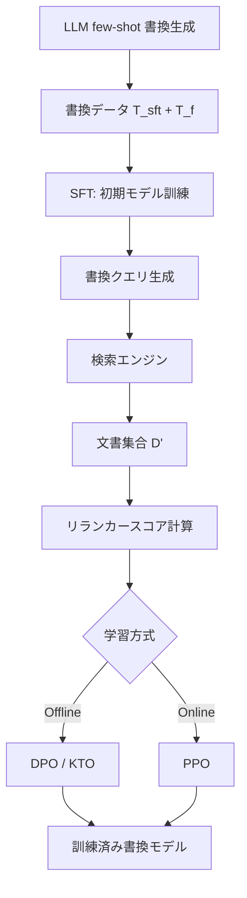

本記事は [RaFe: Ranking Feedback Improves Query Rewriting for RAG](https://arxiv.org/abs/2405.14431) の解説記事です。

## 論文概要（Abstract）

RaFeは、RAG（Retrieval-Augmented Generation）におけるクエリ書換モデルを、人手アノテーションなしで訓練するフレームワークである。著者らは、公開されているリランカーが出力するランキングスコアをフィードバック信号として利用し、オンライン学習（PPO）とオフライン学習（DPO/KTO）の両方に対応する訓練手法を提案している。英語・中国語の複数データセットで、既存のクエリ書換ベースラインを上回る性能が報告されている。

この記事は [Zenn記事: Doctor-RAGの失敗修復ループで社内FAQ検索の回答精度を改善する](https://zenn.dev/0h_n0/articles/1fc1d60c5f09e2) の深掘りです。

## 情報源

- **会議名**: EMNLP 2024 Findings（Findings of the Association for Computational Linguistics: EMNLP 2024）
- **年**: 2024
- **開催地**: Miami, Florida, USA
- **URL**: [https://aclanthology.org/2024.findings-emnlp.49/](https://aclanthology.org/2024.findings-emnlp.49/)
- **著者**: Shengyu Mao, Yong Jiang, Boli Chen, Xiao Li, Peng Wang, et al.
- **DOI**: 10.18653/v1/2024.findings-emnlp.49
- **ページ**: 884--901

## カンファレンス情報

EMNLPは自然言語処理分野のトップカンファレンスの一つであり、実証的手法に重点を置く。EMNLP 2024は2024年11月にMiamiで開催された。Findingsは本会議の選考基準には僅かに届かなかったが品質を認められた論文を収録するトラックである。

## 背景と動機（Background & Motivation）

RAGではユーザクエリをそのまま検索エンジンに投げると、表現のミスマッチや情報の不足により関連文書を取りこぼすことがある。そこでクエリ書換（query rewriting）により検索クエリを改善する手法が研究されてきた。LLMによるゼロショット書換（Query2Doc、HyDEなど）は追加学習不要だが、書換品質がプロンプト設計に依存する。一方、強化学習（RL）ベースの手法は関連文書ラベルやQA正解ラベルなど人手アノテーションを必要とし、ドメインごとにラベル収集コストがかかる。

著者らは、リランカーがクエリと文書の関連度をスコアリングする機能はクエリ書換の目的――検索結果の関連度向上――と本質的に一致すると指摘している。この着想に基づき、公開リランカーのスコアをフィードバック信号として直接利用する教師なし訓練フレームワークRaFeを提案した。

## 主要な貢献（Key Contributions）

- **貢献1**: リランカーのランキングスコアを報酬信号としてクエリ書換モデルを訓練するフレームワーク（RaFe）の提案。アノテーション不要で汎用リランカーを利用可能
- **貢献2**: オフライン学習（DPO/KTO）とオンライン学習（PPO）の双方をサポートし、フィードバック手法の比較分析を提供
- **貢献3**: 英語（NQ, TriviaQA, HotpotQA, FreshQA）および中国語（WebQA, FreshQA-zh）のクロスリンガル評価で有効性を検証

## 技術的詳細（Technical Details）

### タスク定式化

クエリ書換モデル$M_\theta$は元のクエリ$q$を書換クエリ$q' = M_\theta(q)$に変換する。$q'$で検索エンジンから文書集合$D'$を取得し、回答生成モデルに入力する。

### リランカースコア

書換クエリ$q'$の品質を評価するために、取得文書$D'$に対するリランカー$M_r$のスコア平均を用いる。

$$
S(q, q') = \frac{1}{|D'|} \sum_{d' \in D'} M_r(q, d')
$$

ここで、
- $q$: 元のクエリ
- $q'$: 書換クエリ（$M_\theta$の出力）
- $D'$: $q'$で検索した文書集合
- $M_r(q, d')$: リランカーが返す元クエリ$q$と文書$d'$の関連度スコア

重要な点は、リランカーへの入力が書換クエリ$q'$ではなく元クエリ$q$と文書$d'$のペアであることである。これにより「書換クエリで検索した文書が元のクエリの意図にどれだけ合致するか」を直接評価できる。

### 訓練パイプライン



訓練は2段階で構成される。

**Stage 1: SFT（教師あり微調整）**

LLM（論文ではQwen-max）にfew-shotプロンプトで複数の書換候補を生成させ、データセット$T_\text{sft}$で通常のnegative log-likelihood損失により初期モデルを訓練する。著者らは1クエリあたり複数の書換を生成し、多様性を確保したと報告している。

**Stage 2: フィードバック学習**

残りのデータ$T_f$に対し、リランカースコアに基づくフィードバックで書換モデルを改善する。

#### オフライン学習: DPO

$T_f$の各クエリについて複数の書換を生成し、リランカースコアの平均$\mu$を閾値として良い書換$q'_g$（$S > \mu$）と悪い書換$q'_b$（$S \leq \mu$）に分類する。選好ペア$(q, q'_g, q'_b)$でDPO損失を最適化する。

$$
\mathcal{L}_\text{DPO} = -\mathbb{E}\left[\log \sigma\left(\beta \log \frac{M_\theta(q'_g \mid q)}{M_\text{ref}(q'_g \mid q)} - \beta \log \frac{M_\theta(q'_b \mid q)}{M_\text{ref}(q'_b \mid q)}\right)\right]
$$

ここで、
- $M_\text{ref}$: SFT段階で訓練された参照モデル
- $\beta$: 温度パラメータ（論文では$\beta = 0.1$）
- $\sigma$: シグモイド関数

#### オフライン学習: KTO

KTOはペアではなく個別サンプルに対して動作する。プロスペクト理論に基づく重み$\lambda_\text{good}$, $\lambda_\text{bad}$でユーティリティを計算する。著者らは良い・悪いサンプルの不均衡比率を$[1, 4/3]$に維持したと報告している。

#### オンライン学習: PPO

PPOではリランカースコアを報酬として直接利用する。

$$
R(s_t, a_t) = S_\text{reranker}(q' \mid q) - \beta_\text{KL} \cdot \text{KL}(M_\theta \| M_\text{ref})
$$

ここで、
- $R(s_t, a_t)$: 時刻$t$での報酬
- $\beta_\text{KL}$: KLペナルティ係数（$\beta_\text{KL} = 0.2$）
- $\text{KL}(M_\theta \| M_\text{ref})$: 現在のモデルと参照モデル間のKLダイバージェンス

クリップ範囲$\epsilon = 0.2$のPPOサロゲート目的関数と価値関数損失を組み合わせて最適化する。

### アルゴリズム

以下にRaFeのオフライン学習（DPO/KTO）パイプラインの実装イメージを示す。

```python
from dataclasses import dataclass
from typing import Literal

import torch
from transformers import AutoModelForCausalLM, AutoTokenizer


@dataclass
class RewriteSample:
    """書換サンプル

    Attributes:
        query: 元のクエリ
        rewrite: 書換クエリ
        score: リランカースコア
    """
    query: str
    rewrite: str
    score: float


def compute_reranker_score(
    reranker_model: torch.nn.Module,
    reranker_tokenizer: AutoTokenizer,
    original_query: str,
    documents: list[str],
    device: str = "cuda",
) -> float:
    """リランカースコアの計算

    Args:
        reranker_model: リランカーモデル (e.g., bge-reranker-base)
        reranker_tokenizer: リランカートークナイザ
        original_query: 元のクエリ（書換クエリではない）
        documents: 書換クエリで検索した文書リスト
        device: 推論デバイス

    Returns:
        文書全体の平均リランカースコア S(q, q')
    """
    scores: list[float] = []
    for doc in documents:
        inputs = reranker_tokenizer(
            original_query, doc,
            return_tensors="pt", truncation=True, max_length=512,
        ).to(device)
        with torch.no_grad():
            logits = reranker_model(**inputs).logits
        # bge-reranker は2クラス分類: index=1 が関連スコア
        score = torch.softmax(logits, dim=-1)[0, 1].item()
        scores.append(score)
    return sum(scores) / len(scores) if scores else 0.0


def build_preference_pairs(
    samples: list[RewriteSample],
    threshold_mode: Literal["mean", "median"] = "mean",
) -> list[tuple[str, str, str]]:
    """リランカースコアに基づく選好ペア構築

    Args:
        samples: 全書換サンプル（1クエリにつき複数の書換を含む）
        threshold_mode: 閾値の計算方法

    Returns:
        (query, good_rewrite, bad_rewrite) のタプルリスト
    """
    # クエリごとにグループ化
    query_groups: dict[str, list[RewriteSample]] = {}
    for s in samples:
        query_groups.setdefault(s.query, []).append(s)

    pairs: list[tuple[str, str, str]] = []
    for query, group in query_groups.items():
        all_scores = [s.score for s in group]
        if threshold_mode == "mean":
            mu = sum(all_scores) / len(all_scores)
        else:
            sorted_scores = sorted(all_scores)
            mu = sorted_scores[len(sorted_scores) // 2]

        good = [s for s in group if s.score > mu]
        bad = [s for s in group if s.score <= mu]

        # 全組み合わせからペアを生成
        for g in good:
            for b in bad:
                pairs.append((query, g.rewrite, b.rewrite))
    return pairs
```

## 実装のポイント（Implementation）

著者らが報告している主要なハイパーパラメータと実装上の注意点を整理する。

- **ベースモデル**: Qwen-7b-baseを書換モデルとして使用。SFTは2エポック、学習率$5 \times 10^{-5}$
- **リランカー**: bge-reranker-base。1エポックあたりのフィードバック計算は30kインスタンスで約0.67時間（GPU 1基）と報告されており、LLMフィードバック（約78時間）と比較して100倍以上高速
- **DPO/KTO**: 1エポック、学習率$5 \times 10^{-6}$、$\beta = 0.1$
- **PPO**: バッチサイズ32、1000ステップ、$\epsilon = 0.2$、$\beta_\text{KL} = 0.2$
- **書換数**: 著者らの分析（論文Figure 5）では、2--3本の書換が精度とコストのバランスが良いと報告している。QA性能は4--5本でピークに達するが、リランク後の性能は2本で飽和する
- **検索設定**: Expand-Ranked（書換クエリの検索結果を元クエリの検索結果に追加し、リランク）が最も高い性能を示したと報告されている

## Production Deployment Guide

### AWS実装パターン（コスト最適化重視）

RaFeのクエリ書換パイプラインをAWSにデプロイする場合の構成を示す。書換モデル（7Bパラメータ）の推論とリランカーの推論を含むパイプラインが対象である。

**コスト試算の注意事項**: 以下は2026年10月時点のAWS ap-northeast-1（東京）リージョン料金に基づく概算値である。実際のコストはトラフィックパターン、リージョン、バースト使用量により変動する。最新料金はAWS料金計算ツールで確認を推奨する。

| 構成 | トラフィック | サービス構成 | 月額概算 |
|------|------------|------------|---------|
| Small | ~100 req/日 | Lambda + SageMaker Serverless + DynamoDB | $80--150 |
| Medium | ~1,000 req/日 | ECS Fargate + SageMaker Endpoint + ElastiCache | $400--800 |
| Large | 10,000+ req/日 | EKS + Karpenter (Spot) + SageMaker Multi-Model | $2,500--5,000 |

**Small構成の内訳**: Lambda（書換リクエストルーティング、$5/月）+ SageMaker Serverless Inference（書換モデル+リランカー、$50--100/月）+ DynamoDB On-Demand（書換キャッシュ、$5--10/月）+ CloudWatch（$5/月）

**コスト削減テクニック**:
- SageMaker Spot Training: 訓練時に最大90%削減
- SageMaker Savings Plans: 推論に1年コミットで最大64%削減
- 書換結果のDynamoDBキャッシュ: 同一クエリの再計算を回避
- バッチ推論: 非リアルタイム用途ではSageMaker Batch Transformで50%削減

### Terraformインフラコード

**Small構成（Serverless）**:

```hcl
# RaFe Query Rewriting Pipeline - Small構成
# Lambda + SageMaker Serverless + DynamoDB

terraform {
  required_version = ">= 1.9"
  required_providers {
    aws = { source = "hashicorp/aws", version = "~> 5.70" }
  }
}

provider "aws" {
  region = "ap-northeast-1"
}

# --- IAM ---
resource "aws_iam_role" "lambda_role" {
  name = "rafe-rewriter-lambda-role"
  assume_role_policy = jsonencode({
    Version = "2012-10-17"
    Statement = [{
      Action    = "sts:AssumeRole"
      Effect    = "Allow"
      Principal = { Service = "lambda.amazonaws.com" }
    }]
  })
}

resource "aws_iam_role_policy" "lambda_policy" {
  name = "rafe-rewriter-lambda-policy"
  role = aws_iam_role.lambda_role.id
  policy = jsonencode({
    Version = "2012-10-17"
    Statement = [
      {
        Effect   = "Allow"
        Action   = ["sagemaker:InvokeEndpoint"]
        Resource = [aws_sagemaker_endpoint.rewriter.arn]
      },
      {
        Effect   = "Allow"
        Action   = ["dynamodb:GetItem", "dynamodb:PutItem"]
        Resource = [aws_dynamodb_table.rewrite_cache.arn]
      },
      {
        Effect   = "Allow"
        Action   = ["logs:CreateLogGroup", "logs:CreateLogStream", "logs:PutLogEvents"]
        Resource = ["arn:aws:logs:*:*:*"]
      }
    ]
  })
}

# --- DynamoDB (書換キャッシュ) ---
resource "aws_dynamodb_table" "rewrite_cache" {
  name         = "rafe-rewrite-cache"
  billing_mode = "PAY_PER_REQUEST"  # On-Demand: 低トラフィックに最適
  hash_key     = "query_hash"

  attribute {
    name = "query_hash"
    type = "S"
  }

  ttl {
    attribute_name = "expires_at"
    enabled        = true
  }

  server_side_encryption { enabled = true }
}

# --- Lambda ---
resource "aws_lambda_function" "rewriter" {
  function_name = "rafe-query-rewriter"
  runtime       = "python3.12"
  handler       = "handler.lambda_handler"
  role          = aws_iam_role.lambda_role.arn
  timeout       = 60   # 書換 + リランク の推論時間を考慮
  memory_size   = 512

  filename         = "lambda_package.zip"
  source_code_hash = filebase64sha256("lambda_package.zip")

  environment {
    variables = {
      SAGEMAKER_ENDPOINT = aws_sagemaker_endpoint.rewriter.name
      CACHE_TABLE        = aws_dynamodb_table.rewrite_cache.name
      NUM_REWRITES       = "3"  # 論文推奨: 2-3本
    }
  }
}

# --- CloudWatch アラーム (コスト監視) ---
resource "aws_cloudwatch_metric_alarm" "lambda_cost" {
  alarm_name          = "rafe-lambda-invocation-spike"
  comparison_operator = "GreaterThanThreshold"
  evaluation_periods  = 1
  metric_name         = "Invocations"
  namespace           = "AWS/Lambda"
  period              = 3600
  statistic           = "Sum"
  threshold           = 500  # 1時間500回超で警告
  alarm_actions       = []   # SNS ARN を設定

  dimensions = {
    FunctionName = aws_lambda_function.rewriter.function_name
  }
}
```

**Large構成（Container）**:

```hcl
# RaFe Query Rewriting Pipeline - Large構成
# EKS + Karpenter + Spot Instances

module "eks" {
  source  = "terraform-aws-modules/eks/aws"
  version = "~> 20.0"

  cluster_name    = "rafe-rewriter-cluster"
  cluster_version = "1.31"

  vpc_id     = module.vpc.vpc_id
  subnet_ids = module.vpc.private_subnets

  eks_managed_node_groups = {
    system = {
      instance_types = ["m7i.large"]
      min_size       = 1
      max_size       = 3
      desired_size   = 2
    }
  }
}

# Karpenter: Spot優先の自動スケーリング
resource "kubectl_manifest" "karpenter_provisioner" {
  yaml_body = yamlencode({
    apiVersion = "karpenter.sh/v1"
    kind       = "NodePool"
    metadata   = { name = "rafe-gpu-pool" }
    spec = {
      template = {
        spec = {
          requirements = [
            { key = "karpenter.sh/capacity-type", operator = "In", values = ["spot", "on-demand"] },
            { key = "node.kubernetes.io/instance-type", operator = "In",
              values = ["g5.xlarge", "g5.2xlarge", "g6.xlarge"] },
          ]
          nodeClassRef = { name = "default" }
        }
      }
      limits   = { cpu = "64", memory = "256Gi" }
      disruption = {
        consolidationPolicy = "WhenEmptyOrUnderutilized"
        consolidateAfter    = "30s"
      }
    }
  })
}

# AWS Budgets (月額アラート)
resource "aws_budgets_budget" "rafe_monthly" {
  name         = "rafe-monthly-budget"
  budget_type  = "COST"
  limit_amount = "5000"
  limit_unit   = "USD"
  time_unit    = "MONTHLY"

  notification {
    comparison_operator       = "GREATER_THAN"
    threshold                 = 80
    threshold_type            = "PERCENTAGE"
    notification_type         = "ACTUAL"
    subscriber_email_addresses = ["admin@example.com"]
  }
}
```

### 運用・監視設定

**CloudWatch Logs Insights クエリ（レイテンシ分析）**:

```
fields @timestamp, @message
| filter @message like /rewrite_latency/
| stats avg(rewrite_latency_ms) as avg_ms,
        percentile(rewrite_latency_ms, 95) as p95_ms,
        percentile(rewrite_latency_ms, 99) as p99_ms
  by bin(1h)
```

**CloudWatch アラーム設定（Python）**:

```python
import boto3

cloudwatch = boto3.client("cloudwatch", region_name="ap-northeast-1")

def create_rewrite_latency_alarm(function_name: str, sns_topic_arn: str) -> None:
    """書換レイテンシ異常検知アラームを作成

    Args:
        function_name: Lambda関数名
        sns_topic_arn: 通知先SNSトピックARN
    """
    cloudwatch.put_metric_alarm(
        AlarmName=f"{function_name}-p95-latency",
        MetricName="Duration",
        Namespace="AWS/Lambda",
        Statistic="p95",
        Period=300,
        EvaluationPeriods=3,
        Threshold=30000,  # 30秒
        ComparisonOperator="GreaterThanThreshold",
        AlarmActions=[sns_topic_arn],
        Dimensions=[{"Name": "FunctionName", "Value": function_name}],
    )
```

**X-Ray トレーシング設定（Python）**:

```python
from aws_xray_sdk.core import xray_recorder, patch_all

# boto3, requests 等を自動計装
patch_all()

@xray_recorder.capture("rewrite_query")
def rewrite_and_rerank(query: str) -> dict:
    """クエリ書換 + リランクのトレーシング

    Args:
        query: 元のユーザクエリ

    Returns:
        書換結果とリランクスコア
    """
    subsegment = xray_recorder.current_subsegment()
    subsegment.put_annotation("query_length", len(query))
    # 書換・リランク処理
    result = {"rewritten_query": query, "score": 0.0}
    subsegment.put_metadata("rewrite_result", result)
    return result
```

**Cost Explorer日次レポート（Python）**:

```python
import datetime

import boto3

ce = boto3.client("ce", region_name="us-east-1")
sns = boto3.client("sns", region_name="ap-northeast-1")

def daily_cost_report(sns_topic_arn: str, threshold_usd: float = 100.0) -> None:
    """日次コストレポートを取得し閾値超過時にSNS通知

    Args:
        sns_topic_arn: 通知先SNSトピックARN
        threshold_usd: 通知閾値（USD/日）
    """
    today = datetime.date.today()
    yesterday = today - datetime.timedelta(days=1)
    resp = ce.get_cost_and_usage(
        TimePeriod={"Start": str(yesterday), "End": str(today)},
        Granularity="DAILY",
        Metrics=["UnblendedCost"],
        Filter={"Tags": {"Key": "Project", "Values": ["rafe-rewriter"]}},
    )
    cost = float(resp["ResultsByTime"][0]["Total"]["UnblendedCost"]["Amount"])
    if cost > threshold_usd:
        sns.publish(
            TopicArn=sns_topic_arn,
            Subject=f"RaFe daily cost alert: ${cost:.2f}",
            Message=f"Yesterday's cost: ${cost:.2f} exceeded ${threshold_usd}",
        )
```

### コスト最適化チェックリスト

**アーキテクチャ選択**:
- [ ] トラフィック量に応じた構成を選択（~100 req/日: Serverless、~1000: Hybrid、10000+: Container）
- [ ] リアルタイム不要のバッチ処理はSageMaker Batch Transformを検討

**リソース最適化**:
- [ ] GPU推論: SageMaker Spot Instancesで最大90%削減
- [ ] 1年以上の利用: SageMaker Savings Plansで最大64%削減
- [ ] Lambda: メモリサイズをPower Tuningで最適化
- [ ] EKS: Karpenter + Spotで自動スケーリング
- [ ] SageMaker: Multi-Model Endpointで書換モデルとリランカーを同一エンドポイントに集約

**LLMコスト削減**:
- [ ] 書換結果のDynamoDBキャッシュ（TTL 24h）で同一クエリの再計算回避
- [ ] 書換数は2--3本に制限（論文Figure 5の知見）
- [ ] 小型モデル（7B）を使用し、SFT+KTOの2段階訓練でLLMレベルの品質を実現
- [ ] バッチ推論でスループット効率化

**監視・アラート**:
- [ ] AWS Budgets: 月額上限アラート設定
- [ ] CloudWatch: Lambda/SageMaker invocationスパイク検知
- [ ] Cost Anomaly Detection有効化
- [ ] 日次コストレポートのSNS通知
- [ ] X-Rayトレーシングで書換・リランク各段階のレイテンシ可視化

**リソース管理**:
- [ ] 未使用SageMakerエンドポイントの自動削除
- [ ] Projectタグの一貫した付与
- [ ] DynamoDBキャッシュのTTL設定
- [ ] 開発環境SageMakerエンドポイントの夜間削除スケジュール
- [ ] CloudWatch Logsの保持期間設定（30日）

## 実験結果（Results）

### 主要な結果

著者らは4つの評価設定を用いている: Substitute-Raw（書換クエリの検索結果のみ、デフォルト順）、Substitute-Ranked（リランク済み）、Expand-Raw（元+書換の検索結果を結合）、Expand-Ranked（結合+リランク）。評価指標はQAのExact Match（EM）である。

論文Table 1より、英語データセットにおけるExpand-Ranked設定の主要結果を示す。

| 手法 | FreshQA (EM) | NQ (EM) | TriviaQA (EM) | HotpotQA (EM) |
|------|-------------|---------|---------------|---------------|
| OQR（元クエリ） | 62.56 | 51.50 | 80.17 | 44.67 |
| LLM Rewrite | 63.03 | 51.21 | 80.46 | 46.59 |
| Query2Doc | 62.88 | 51.56 | 80.60 | 45.27 |
| SFT (T_all) | 62.92 | 52.35 | 81.03 | 47.45 |
| RaFe (KTO) | **64.85** | **52.86** | **81.97** | **48.96** |

RaFe (KTO) はExpand-Ranked設定でOQRに対し、FreshQAで+2.29pt、HotpotQAで+4.29ptの改善を示している（論文Table 1）。

### 検索品質

論文Table 2より、FreshQAにおけるExpand-Ranked設定の検索精度を示す。

| 手法 | Prec@5 | MRR |
|------|--------|-----|
| OQR | 30.88 | 41.24 |
| RaFe (KTO) | 33.72 | 44.84 |

Prec@5で+2.84pt、MRRで+3.60ptの改善が報告されている。

### フィードバック手法の比較

論文Table 3/4より、フィードバックの種類による性能とコストの比較を示す。

| フィードバック種別 | 30kインスタンスあたりの計算時間 |
|------------------|------|
| Retrieval（検索スコア） | 0.01h |
| Reranker（RaFe） | 0.67h |
| LLM（Qwen-32b-chat） | 約78h |

リランカーフィードバックはLLMフィードバックの約1/116のコストで同等の性能を達成したと著者らは報告している。一方、検索スコアのみのフィードバックは最も低い性能を示した（論文Table 3）。

### アブレーション

- **書換数（Figure 5）**: QA性能は4--5本で飽和するが、リランク後は2本で性能がほぼ飽和する。著者らは実用上2--3本を推奨
- **リランカーの分離能力（Table 5）**: 元クエリのPrec@5が41.41に対し、「悪い」書換は30.74、「良い」書換は46.14。リランカーが書換品質を適切に弁別できていることを示す
- **回答モデルのサイズ（Table 10）**: 回答モデルが大きくなるほど（Qwen-32b → Qwen-max）RaFeの改善幅は縮小する。大型モデルはノイジーな検索結果にも頑健なためと考えられる

## 実運用への応用（Practical Applications）

RaFeはZenn記事で議論されているDoctor-RAGの**Retriever Error修復**に直接応用可能である。Doctor-RAGでは検索失敗時にMulti-query、Step-back、HyDEなどのクエリ変換戦略を適用するが、これらはLLMのゼロショット生成に依存しており、書換品質が不安定になりうる。

RaFeの手法を組み込む場合、以下のアプローチが考えられる。

1. **オフラインでの書換モデル訓練**: 社内FAQの過去クエリログを用いてSFT→KTOの2段階で書換モデルを訓練する。リランカー（bge-reranker-base等）はそのまま利用でき、QAラベルは不要
2. **リアルタイム書換パイプライン**: Doctor-RAGのRetriever Error検出時に、訓練済みの書換モデルで2--3本の書換クエリを生成し、Expandモードで検索結果を拡張する
3. **継続的改善**: 新たなクエリログが蓄積されるたびにKTOで追加訓練し、ドメイン適応を進める

ただし、著者らが報告する制限事項として、リランカーの能力がフィードバック品質の上限となる点がある。ドメイン特化のリランカーを用いた検証は今後の課題とされている。

## 関連研究（Related Work）

- **Query2Doc** (Wang et al., 2023): LLMで擬似文書を生成しクエリに追加する手法。追加学習不要だがLLM推論コストがかかる。RaFeはSFTで小型モデルに蒸留し、リランカーフィードバックでさらに改善する点で異なる
- **CONQRR** (Wu et al., 2022): 関連文書ラベルを報酬としたRLベースのクエリ書換。RaFeはこのラベル依存を排除した点が差分
- **HyDE** (Gao et al., 2023): 仮説文書を生成して類似検索する手法。Doctor-RAGでも採用されている戦略の一つだが、訓練による改善は行わない
- **DPO/KTO**: Rafailov et al. (2023) のDPO、Ethayarajh et al. (2024) のKTOは、RaFeがオフライン学習で採用するアラインメント手法である

## まとめと今後の展望

RaFeは、公開リランカーのスコアをフィードバックとして活用することで、人手アノテーションなしにクエリ書換モデルを訓練する手法である。著者らは英語・中国語の計6データセットで既存手法を上回る性能を報告しており、特にExpand-Ranked設定でOQR比+2--4ptのQA改善を達成している。フィードバック計算コストはLLMの約1/116であり、実用上のコスト効率も高い。

今後の課題として、著者らはリランカーと書換モデルの共同訓練、およびドメイン特化リランカーの効果検証を挙げている。

## 参考文献

- **Conference URL**: [https://aclanthology.org/2024.findings-emnlp.49/](https://aclanthology.org/2024.findings-emnlp.49/)
- **arXiv**: [https://arxiv.org/abs/2405.14431](https://arxiv.org/abs/2405.14431)
- **Related Zenn article**: [https://zenn.dev/0h_n0/articles/1fc1d60c5f09e2](https://zenn.dev/0h_n0/articles/1fc1d60c5f09e2)
