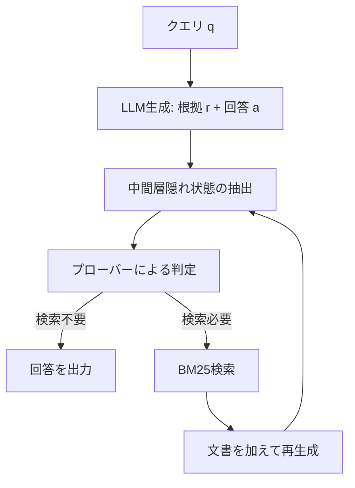

本記事は [Probing-RAG: Self-Probing to Guide Language Models in Selective Document Retrieval](https://arxiv.org/abs/2410.13339) の解説記事です。

## 論文概要（Abstract）

Probing-RAGは、LLMの中間層における隠れ状態表現を用いて、クエリに対する追加検索の必要性を動的に判定する手法である。従来の適応的検索手法では、外部分類器の学習や出力トークンの確率に依存していたが、Probing-RAGではLLM内部の表現を直接読み取る小規模なプローバーを事前学習することで、検索の要否を判定する。著者らは5つのオープンドメインQAデータセットで評価を行い、従来手法を上回る精度と検索回数の削減を報告している。

この記事は [Zenn記事: Doctor-RAGの失敗修復ループで社内FAQ検索の回答精度を改善する](https://zenn.dev/0h_n0/articles/1fc1d60c5f09e2) の深掘りです。

## 情報源

- **会議名**: NAACL 2025 Findings
- **URL**: [https://arxiv.org/abs/2410.13339](https://arxiv.org/abs/2410.13339)
- **著者**: Ingeol Baek, Hwan Chang, Byeongjeong Kim, Jimin Lee, Hwanhee Lee
- **分野**: cs.CL（計算言語学）

## カンファレンス情報

**NACCLについて**: NAACL（North American Chapter of the Association for Computational Linguistics）は自然言語処理分野の主要国際会議の1つであり、ACL、EMNLPと並ぶトップ会議である。Findingsは本会議と同等の査読プロセスを経るが、発表形式が異なるカテゴリである。

## 背景と動機（Background & Motivation）

RAG（Retrieval-Augmented Generation）は、LLMに外部知識を補完する標準的手法として広く利用されている。しかし、すべてのクエリに対して一律に検索を行うことには2つの問題がある。

第一に、LLMが既に正しい知識を持っている場合、不要な検索がノイズを導入し、かえって回答精度を低下させる。著者らの実験（論文Table 4）によると、Single-step RAGでは本来正解だった回答の17-30%が検索後に不正解に変わっている。

第二に、過剰な検索はレイテンシとコストの増大を招く。DRAGINのような手法は1クエリあたり平均5.43回の検索を行い（論文Table 2より）、計算コストが膨大になる。

従来の適応的検索手法には、T5-largeのような外部分類器を学習するAdaptive-RAG、LLM自身に検索の要否を判断させるLLM-based手法、トークン生成確率に基づくFLAREやDRAGINなどがある。しかし、外部分類器は大きなモデルサイズを必要とし、出力確率に基づく手法はLLMの内部知識の信頼度を間接的にしか反映できないという制約がある。

## 主要な貢献（Key Contributions）

- **貢献1**: LLMの中間層隠れ状態を直接プロービングすることで検索の必要性を判定する新しいフレームワークの提案。約5MBの小規模プローバーで実現し、Adaptive-RAGの外部分類器（T5-large、約770M parameters）の約2000分の1のサイズである
- **貢献2**: 5つのオープンドメインQAデータセット（うち2つはドメイン外）において、Gemma-2BとMistral-7Bの両方で従来手法を上回る精度を達成。平均ACC 35.8%（Gemma-2B、論文Table 1より）
- **貢献3**: 検索回数を従来手法の約1/7〜1/3に削減しつつ、回答一貫性（正解を維持する割合）で全データセットにおいて90%以上を達成（論文Table 4より）

## 技術的詳細（Technical Details）

### 全体アーキテクチャ

Probing-RAGは以下の3つのコンポーネントで構成される。



### 隠れ状態の抽出とプーリング

LLMが根拠 $r$ と回答 $\hat{a}$ を生成した後、中間層 $l$ における隠れ状態から検索の必要性を判定する。まず、生成されたトークン列の末尾 $u$ トークン分のhidden stateを抽出する。

$$
T_{lk} = H_{lk}[-u:, d_{\text{model}}] \in \mathbb{R}^{u \times d_{\text{model}}}
$$

ここで、
- $H_{lk}$: 第 $l$ 層、第 $k$ イテレーションにおける隠れ状態行列
- $u$: 抽出対象のトークン数（根拠 $r$ と回答 $\hat{a}$ を結合した長さ）
- $d_{\text{model}}$: モデルの隠れ次元数

次に、トークン方向に平均プーリングし、正規化することで固定長ベクトルを得る。

$$
T'_{lk} = \text{Norm}(\text{Mean}(T_{lk}, \text{dim}=0)) \in \mathbb{R}^{d_{\text{model}}}
$$

### プローバーアーキテクチャ

各層に配置されるプローバーは、1層の隠層を持つフィードフォワードネットワークである。

$$
\text{logit}_{lk} = \text{Prober}_{lk}(T'_{lk})
$$

プローバーの構成:
- 入力層: $d_{\text{model}}$ 次元
- 隠れ層: SiLU活性化関数 + Dropout(0.1) + LayerNorm
- 出力層: 2クラス分類（検索必要/不要）

複数の層（偶数番号の層）にプローバーを配置し、それらのlogitを合算して最終判定を行う。具体的には、Gemma-2B（全18層）の場合、第6層から第14層までの偶数層（6, 8, 10, 12, 14）にプローバーを配置する。第6層は全体の1/3の位置に相当し、この位置から意味的に有用な表現が形成され始めると著者らは説明している。

### 学習手順

プローバーの学習ラベルは以下のように構成される。各質問に対して、検索あり/なしの両方で回答を生成し、正解かどうかで二値ラベルを付与する。

- $y = 1$: 回答が正解（追加検索は不要）
- $y = 0$: 回答が不正解（追加検索が必要）

損失関数は標準的な二値交差エントロピーである。

$$
\mathcal{L} = -\frac{1}{N} \sum_{i=1}^{N} \left[ y_i \log p_i + (1 - y_i) \log(1 - p_i) \right]
$$

ここで、$N$ はサンプル数、$p_i$ はプローバーの出力確率、$y_i$ は正解ラベルである。

学習データはHotpotQA、NaturalQA、TriviaQAから構成され、訓練データ26,060件、検証データ500件である（論文Section 4.1より）。

### アルゴリズム

```python
import torch
import torch.nn as nn
from dataclasses import dataclass


@dataclass
class ProbingResult:
    """プロービング結果を格納するデータクラス"""
    needs_retrieval: bool
    answer: str
    rationale: str
    total_retrieval_calls: int


class Prober(nn.Module):
    """隠れ状態から検索必要性を判定するプローバー

    Args:
        d_model: LLMの隠れ次元数
        dropout: ドロップアウト率
    """
    def __init__(self, d_model: int, dropout: float = 0.1):
        super().__init__()
        self.net = nn.Sequential(
            nn.Linear(d_model, d_model),
            nn.SiLU(),
            nn.Dropout(dropout),
            nn.LayerNorm(d_model),
            nn.Linear(d_model, 2),  # [no_retrieval, retrieval]
        )

    def forward(self, hidden_state: torch.Tensor) -> torch.Tensor:
        """プーリング済み隠れ状態からlogitを計算

        Args:
            hidden_state: 正規化済みベクトル (d_model,)

        Returns:
            logit: 2クラスlogit (2,)
        """
        return self.net(hidden_state)


def extract_and_pool(
    hidden_states: dict[int, torch.Tensor],
    probe_layers: list[int],
    num_generated_tokens: int,
) -> dict[int, torch.Tensor]:
    """各プローブ対象層から生成トークンの隠れ状態を抽出・プーリング

    Args:
        hidden_states: 層番号 -> (seq_len, d_model)のテンソル
        probe_layers: プロービング対象の層番号リスト
        num_generated_tokens: 生成されたトークン数 u

    Returns:
        層番号 -> プーリング済みベクトル (d_model,) の辞書
    """
    pooled = {}
    for layer_idx in probe_layers:
        h = hidden_states[layer_idx]
        # 末尾 u トークンを抽出
        t = h[-num_generated_tokens:]  # (u, d_model)
        # トークン方向に平均プーリング + L2正規化
        mean_vec = t.mean(dim=0)
        pooled[layer_idx] = nn.functional.normalize(mean_vec, dim=0)
    return pooled


def probing_rag(
    llm,
    retriever,
    probers: dict[int, Prober],
    query: str,
    probe_layers: list[int],
    threshold: float = -1.0,
    max_iterations: int = 5,
) -> ProbingResult:
    """Probing-RAGのメインループ

    Args:
        llm: LLMモデル（hidden_statesを返せるもの）
        retriever: BM25等のリトリーバー
        probers: 層番号 -> Proberの辞書
        query: 入力クエリ
        probe_layers: プロービング対象層のリスト
        threshold: 検索判定閾値 theta
        max_iterations: 最大反復回数

    Returns:
        ProbingResult: 最終回答と検索統計
    """
    documents: list[str] = []
    retrieval_calls = 0

    for iteration in range(max_iterations):
        # Step 1: LLMで根拠と回答を生成
        if iteration == 0:
            rationale, answer, hidden_states = llm.generate(
                query, return_hidden_states=True
            )
        else:
            rationale, answer, hidden_states = llm.generate(
                query, documents=documents, return_hidden_states=True
            )

        num_tokens = len(rationale.split()) + len(answer.split())

        # Step 2: 隠れ状態の抽出・プーリング
        pooled = extract_and_pool(hidden_states, probe_layers, num_tokens)

        # Step 3: 各層のプローバーでlogitを計算し合算
        total_logit = torch.zeros(2)
        for layer_idx in probe_layers:
            with torch.no_grad():
                logit = probers[layer_idx](pooled[layer_idx])
            total_logit += logit

        # Step 4: 検索の要否を判定
        # total_logit[0] = no_retrieval, total_logit[1] = retrieval
        needs_retrieval = (
            total_logit[1] - total_logit[0] > threshold
        )

        if not needs_retrieval:
            return ProbingResult(
                needs_retrieval=False,
                answer=answer,
                rationale=rationale,
                total_retrieval_calls=retrieval_calls,
            )

        # Step 5: 検索を実行
        search_query = f"{query} {rationale} {answer}"
        new_docs = retriever.search(search_query, top_k=5)
        documents.extend(new_docs)
        retrieval_calls += 1

    return ProbingResult(
        needs_retrieval=False,
        answer=answer,
        rationale=rationale,
        total_retrieval_calls=retrieval_calls,
    )
```

## 実装のポイント（Implementation）

**プロービング位置の選択**: 著者らはresidual post位置（残差接続後）が最も分類精度が高いと報告している。Attention出力やMLP出力を直接使う場合と比較して、残差接続後の表現がより豊かな意味情報を含んでいる。

**層の選択**: 全層をプロービングする必要はない。著者らの実験（論文Table 9）では、第6層単体でもACC 38.12%を達成するが、第6〜14層の偶数層を使うことで平均約2ポイント改善している。初期層（1〜5層）は主に構文的情報を保持しており、意味的判定には有効でないとされる。

**学習データの効率性**: 論文Table 3によると、わずか1,000サンプルでの学習（ACC 34.49%）でも、フルデータ（26,060件）で学習したFLARE（21.28%）やDRAGIN（25.07%）を上回る。これはプローバーが小規模であるため過学習しにくく、少量データでも安定して学習できることを示唆している。

**ハイパーパラメータ**: 論文Table 6より、学習率1e-3、バッチサイズ12、エポック数2、AdamWオプティマイザ、ExponentialLRスケジューラ（gamma=0.995）が推奨されている。学習はH100 1枚で実施されている。

**閾値の調整**: 閾値 $\theta$ は精度と検索回数のトレードオフを制御する。論文Table 8より、$\theta = -1$ が全体的なバランスとして良好な結果を示している。

## Production Deployment Guide

### AWS実装パターン（コスト最適化重視）

Probing-RAGをAWS上で運用する場合のトラフィック量別推奨構成を示す。プローバーは約5MBと軽量であるため、推論コストの中心はLLM側にある。以下のコスト試算は2026年10月時点のAWS ap-northeast-1（東京）リージョン料金に基づく概算値であり、実際のコストはトラフィックパターンやバースト使用量により変動する。最新料金はAWS料金計算ツールで確認を推奨する。

| 構成 | トラフィック | サービス構成 | 月額概算 |
|------|------------|-------------|---------|
| Small | ~100 req/日 | Lambda + Bedrock + DynamoDB | $50-150 |
| Medium | ~1,000 req/日 | ECS Fargate + Bedrock + ElastiCache | $300-800 |
| Large | 10,000+ req/日 | EKS + Karpenter + Spot + vLLM自前ホスト | $2,000-5,000 |

**Small構成の内訳**: Lambda（プローバー推論、128MB、$5/月）、Bedrock Claude/Haiku（LLM推論、$30-100/月）、DynamoDB On-Demand（検索キャッシュ、$5-10/月）、S3（文書ストア、$5/月）。

**Medium構成の内訳**: ECS Fargate（プローバー常駐、0.5vCPU/1GB、$30/月）、Bedrock（$200-600/月）、ElastiCache（検索結果キャッシュ、cache.t3.micro、$15/月）、OpenSearch Serverless（BM25検索、$50/月）。

**Large構成の内訳**: EKS（コントロールプレーン、$75/月）、Spot Instances（g5.xlarge、vLLMでLLM自前ホスト、$500-1,500/月）、Karpenter（自動スケーリング）、OpenSearch（$200/月）。

**コスト削減テクニック**:
- Spot Instances活用: g5.xlargeでオンデマンド比最大70%削減
- Bedrock Batch API: 非リアルタイム処理で50%削減
- Prompt Caching: 同一プレフィックスのクエリで30-90%削減
- プローバー結果キャッシュ: 類似クエリの隠れ状態をDynamoDBにキャッシュし検索判定をスキップ

### Terraformインフラコード

**Small構成（Serverless）: Lambda + Bedrock + DynamoDB**

```hcl
# --- Small構成: Probing-RAG Serverless ---
terraform {
  required_version = ">= 1.9"
  required_providers {
    aws = { source = "hashicorp/aws", version = "~> 5.70" }
  }
}

provider "aws" {
  region = "ap-northeast-1"
  default_tags { tags = { Project = "probing-rag", Env = "prod" } }
}

# IAMロール（最小権限）
resource "aws_iam_role" "lambda_role" {
  name = "probing-rag-lambda"
  assume_role_policy = jsonencode({
    Version = "2012-10-17"
    Statement = [{
      Action = "sts:AssumeRole"
      Effect = "Allow"
      Principal = { Service = "lambda.amazonaws.com" }
    }]
  })
}

resource "aws_iam_role_policy" "lambda_policy" {
  name = "probing-rag-lambda-policy"
  role = aws_iam_role.lambda_role.id
  policy = jsonencode({
    Version = "2012-10-17"
    Statement = [
      {
        Effect   = "Allow"
        Action   = ["bedrock:InvokeModel"]
        Resource = "arn:aws:bedrock:ap-northeast-1::foundation-model/*"
      },
      {
        Effect   = "Allow"
        Action   = ["dynamodb:GetItem", "dynamodb:PutItem", "dynamodb:Query"]
        Resource = aws_dynamodb_table.cache.arn
      },
      {
        Effect   = "Allow"
        Action   = ["logs:CreateLogGroup", "logs:CreateLogStream", "logs:PutLogEvents"]
        Resource = "arn:aws:logs:*:*:*"
      }
    ]
  })
}

# DynamoDB（検索キャッシュ + プローバー結果キャッシュ）
resource "aws_dynamodb_table" "cache" {
  name         = "probing-rag-cache"
  billing_mode = "PAY_PER_REQUEST"  # コスト最適化: On-Demand
  hash_key     = "query_hash"

  attribute {
    name = "query_hash"
    type = "S"
  }

  ttl {
    attribute_name = "expires_at"
    enabled        = true
  }

  server_side_encryption { enabled = true }  # KMS暗号化
}

# Lambda関数
resource "aws_lambda_function" "probing_rag" {
  function_name = "probing-rag-inference"
  role          = aws_iam_role.lambda_role.arn
  handler       = "handler.lambda_handler"
  runtime       = "python3.12"
  timeout       = 120
  memory_size   = 512  # プローバー5MB + PyTorch推論

  filename         = "lambda_package.zip"
  source_code_hash = filebase64sha256("lambda_package.zip")

  environment {
    variables = {
      CACHE_TABLE    = aws_dynamodb_table.cache.name
      PROBE_THRESHOLD = "-1.0"
      MAX_ITERATIONS  = "5"
      BEDROCK_MODEL   = "anthropic.claude-3-haiku-20240307-v1:0"
    }
  }

  tracing_config { mode = "Active" }  # X-Ray有効化
}

# CloudWatchアラーム（コスト監視）
resource "aws_cloudwatch_metric_alarm" "lambda_duration" {
  alarm_name          = "probing-rag-high-duration"
  comparison_operator = "GreaterThanThreshold"
  evaluation_periods  = 3
  metric_name         = "Duration"
  namespace           = "AWS/Lambda"
  period              = 300
  statistic           = "p95"
  threshold           = 100000  # 100秒
  dimensions          = { FunctionName = aws_lambda_function.probing_rag.function_name }
}
```

**Large構成（Container）: EKS + Karpenter + Spot Instances**

```hcl
# --- Large構成: Probing-RAG Container ---
module "eks" {
  source  = "terraform-aws-modules/eks/aws"
  version = "~> 20.24"

  cluster_name    = "probing-rag-cluster"
  cluster_version = "1.31"

  vpc_id     = module.vpc.vpc_id
  subnet_ids = module.vpc.private_subnets

  cluster_endpoint_public_access = false  # セキュリティ: プライベートのみ

  eks_managed_node_groups = {
    system = {
      instance_types = ["m6i.large"]
      min_size       = 1
      max_size       = 3
      desired_size   = 2
    }
  }
}

# Karpenter Provisioner（Spot優先、GPU対応）
resource "kubectl_manifest" "karpenter_provisioner" {
  yaml_body = yamlencode({
    apiVersion = "karpenter.sh/v1"
    kind       = "NodePool"
    metadata   = { name = "gpu-spot" }
    spec = {
      template = {
        spec = {
          requirements = [
            { key = "karpenter.sh/capacity-type", operator = "In", values = ["spot", "on-demand"] },
            { key = "node.kubernetes.io/instance-type", operator = "In",
              values = ["g5.xlarge", "g5.2xlarge", "g6.xlarge"] },
          ]
          nodeClassRef = { name = "default" }
        }
      }
      limits   = { cpu = "64", memory = "256Gi" }
      disruption = {
        consolidationPolicy = "WhenEmptyOrUnderutilized"
        consolidateAfter    = "30s"
      }
    }
  })
}

# AWS Budgets（月次予算アラート）
resource "aws_budgets_budget" "monthly" {
  name         = "probing-rag-monthly"
  budget_type  = "COST"
  limit_amount = "5000"
  limit_unit   = "USD"
  time_unit    = "MONTHLY"

  notification {
    comparison_operator       = "GREATER_THAN"
    threshold                 = 80
    threshold_type            = "PERCENTAGE"
    notification_type         = "ACTUAL"
    subscriber_email_addresses = ["alerts@example.com"]
  }
}
```

### 運用・監視設定

**CloudWatch Logs Insights クエリ**:

```
# コスト異常検知: 1時間あたりのBedrock呼び出し回数
fields @timestamp, @message
| filter @message like /bedrock_invoke/
| stats count() as invocations by bin(1h) as hour
| sort hour desc

# レイテンシ分析: プローバー推論 + LLM生成の内訳
fields @timestamp, probe_latency_ms, llm_latency_ms, total_latency_ms
| stats avg(probe_latency_ms) as avg_probe,
        avg(llm_latency_ms) as avg_llm,
        pct(total_latency_ms, 95) as p95_total,
        pct(total_latency_ms, 99) as p99_total
  by bin(5m)
```

**X-Ray トレーシング設定**:

```python
from aws_xray_sdk.core import xray_recorder, patch_all
import boto3

# boto3自動計装
patch_all()

@xray_recorder.capture("probing_rag_inference")
def handle_query(query: str) -> dict:
    """X-Rayトレース付きの推論ハンドラ"""
    segment = xray_recorder.current_subsegment()
    segment.put_annotation("query_length", len(query))

    # プローバー推論
    with xray_recorder.in_subsegment("prober_inference"):
        needs_retrieval = run_prober(query)
        segment.put_metadata("needs_retrieval", needs_retrieval)

    # 検索（必要な場合のみ）
    if needs_retrieval:
        with xray_recorder.in_subsegment("bm25_retrieval"):
            documents = retriever.search(query)

    # LLM生成
    with xray_recorder.in_subsegment("llm_generation"):
        answer = generate_answer(query, documents)

    return {"answer": answer, "retrieval_calls": int(needs_retrieval)}
```

**Cost Explorer自動レポート**:

```python
import boto3
from datetime import datetime, timedelta

def daily_cost_report() -> None:
    """日次コストレポートを取得しSNS通知"""
    ce = boto3.client("ce")
    sns = boto3.client("sns")
    today = datetime.utcnow().strftime("%Y-%m-%d")
    yesterday = (datetime.utcnow() - timedelta(days=1)).strftime("%Y-%m-%d")

    response = ce.get_cost_and_usage(
        TimePeriod={"Start": yesterday, "End": today},
        Granularity="DAILY",
        Metrics=["UnblendedCost"],
        Filter={"Tags": {"Key": "Project", "Values": ["probing-rag"]}},
        GroupBy=[{"Type": "DIMENSION", "Key": "SERVICE"}],
    )

    total = sum(
        float(g["Metrics"]["UnblendedCost"]["Amount"])
        for r in response["ResultsByTime"]
        for g in r["Groups"]
    )

    if total > 100:
        sns.publish(
            TopicArn="arn:aws:sns:ap-northeast-1:ACCOUNT:cost-alert",
            Subject=f"Probing-RAG Cost Alert: ${total:.2f}/day",
            Message=f"日次コストが$100を超過: ${total:.2f}",
        )
```

### コスト最適化チェックリスト

**アーキテクチャ選択**:
- [ ] トラフィック量に応じた構成選択（~100 req/日→Serverless、~1000→Hybrid、10000+→Container）
- [ ] プローバー推論とLLM推論の分離配置を検討

**リソース最適化**:
- [ ] EC2/EKS: Spot Instances優先（g5.xlarge等のGPUインスタンス）
- [ ] Reserved Instances: 1年コミットで最大72%削減
- [ ] Savings Plans: Compute Savings Plansの検討
- [ ] Lambda: メモリサイズ最適化（プローバーは512MBで十分）
- [ ] ECS/EKS: Karpenterでアイドル時自動スケールダウン

**LLMコスト削減**:
- [ ] Bedrock Batch API: 非リアルタイム処理で50%削減
- [ ] Prompt Caching有効化: 同一プレフィックスで30-90%削減
- [ ] モデル選択ロジック: プローバーが「検索不要」と判定した場合はHaikuで回答
- [ ] トークン数制限: 根拠+回答の最大トークン数を設定
- [ ] プローバーキャッシュ: 類似クエリのプローバー判定結果をDynamoDBにキャッシュ

**監視・アラート**:
- [ ] AWS Budgets: 月次予算の80%/100%でアラート
- [ ] CloudWatch アラーム: Lambda実行時間、Bedrockトークン使用量
- [ ] Cost Anomaly Detection: 異常なコストスパイクの自動検知
- [ ] 日次コストレポート: SNS通知で$100/日超過を検知

**リソース管理**:
- [ ] 未使用リソース削除: 使われていないエンドポイント・モデルの定期チェック
- [ ] タグ戦略: Project/Env/Ownerタグの一貫した付与
- [ ] DynamoDBキャッシュTTL: 適切な有効期限設定（24-72時間）
- [ ] 開発環境夜間停止: EKSノードの自動スケールダウン
- [ ] ログ保持期間: CloudWatch Logsの保持期間を30日に設定

## 実験結果（Results）

### 主要結果

著者らはGemma-2BとMistral-7Bの2つのモデルで、5つのオープンドメインQAデータセットにおいて評価を実施している（論文Table 1より）。評価指標はExact Match（EM）とAccuracy（ACC）である。

**Gemma-2Bでの結果（ACC %、論文Table 1より）**:

| 手法 | HotpotQA | NQ | TriviaQA | MuSiQue | 2Wiki | 平均 |
|------|---------|-----|---------|---------|-------|------|
| No Retrieval | 28.0 | 24.6 | 45.4 | 4.8 | 43.0 | 29.2 |
| Single-step | 28.2 | 26.0 | 38.8 | 5.8 | 38.4 | 27.4 |
| FLARE | 21.0 | 21.8 | 31.0 | 5.0 | 27.8 | 21.3 |
| DRAGIN | 22.6 | 22.2 | 47.0 | 4.8 | 28.8 | 25.1 |
| Adaptive-RAG | 23.6 | 26.2 | 40.8 | 3.0 | 40.6 | 26.8 |
| **Probing-RAG** | **39.4** | **35.0** | **52.2** | **8.8** | **43.6** | **35.8** |

Probing-RAGはNo Retrievalと比較して平均+6.6ポイント、Single-stepと比較して+8.4ポイントの改善を示している。

### 検索回数の効率性

論文Table 2より、Probing-RAGの総検索回数は1,988回であり、DRAGINの13,570回の約1/7、Adaptive-RAGの3,068回の約2/3である。Probing-RAGは57.46%のクエリで検索を行わず、20.19%が1回、22.35%が複数回の検索であった。

| 手法 | 総検索回数 | 検索なし | 1回 | 複数回 |
|------|----------|---------|-----|-------|
| DRAGIN | 13,570 | 0.00% | 1.20% | 98.80% |
| FLARE | 5,317 | 12.41% | 29.35% | 58.24% |
| Adaptive-RAG | 3,068 | 7.79% | 61.96% | 30.25% |
| LLM-based | 2,345 | 6.20% | 93.80% | 0.00% |
| **Probing-RAG** | **1,988** | **57.46%** | **20.19%** | **22.35%** |

### 回答一貫性

論文Table 4は、検索なしで正解できた質問が検索後も正解を維持する割合（回答一貫性）を示している。Probing-RAGは全データセットで90%以上を達成しており、不要な検索によるパフォーマンス低下を効果的に抑制している。

| 手法 | HotpotQA | NQ | TriviaQA | MuSiQue | 2Wiki |
|------|---------|-----|---------|---------|-------|
| Single-step | 73.8% | 76.0% | 82.0% | 70.4% | 85.0% |
| DRAGIN | 75.2% | 75.0% | 81.8% | 77.8% | 69.8% |
| Adaptive-RAG | 83.0% | 76.6% | 86.0% | 74.6% | 93.2% |
| **Probing-RAG** | **90.6%** | **92.6%** | **91.0%** | **96.4%** | **96.6%** |

### アブレーション: 学習データ量

論文Table 3より、Probing-RAGは学習データを1,000サンプルに削減しても平均ACC 34.49%を達成し、フルデータのAdaptive-RAG（26.79%）を上回る。プローバーの軽量さがデータ効率の高さに寄与している。

## 実運用への応用（Practical Applications）

### Zenn記事との関連

本論文はDoctor-RAGやSkill-RAGの基盤技術として位置づけられる。Zenn記事で紹介されているDoctor-RAGの「失敗検知」メカニズムは、Probing-RAGの隠れ状態プロービングの発展形と考えることができる。Probing-RAGが「検索が必要か」を二値判定するのに対し、Doctor-RAGは「どのような失敗が起きているか」をより細かく分類する点が異なる。

### プロダクション適用時の考慮事項

**隠れ状態アクセスの制約**: Probing-RAGはLLMの中間層にアクセスする必要があるため、APIベースのクローズドモデル（GPT-4、Claude等）では直接適用できない。オープンソースモデル（Llama、Gemma、Mistral等）をセルフホストする環境が前提となる。

**レイテンシへの影響**: プローバー自体の推論は5MB程度のモデルであり、数ミリ秒で完了する。検索不要と判定された場合は検索ステップを完全にスキップできるため、平均レイテンシは大幅に削減される。論文の結果では約57%のクエリで検索が不要と判定されている。

**ドメイン適応**: 論文のout-of-domainデータセット（MuSiQue、2WikiMultihopQA）での結果は、プローバーが学習時と異なるドメインでも一定の汎化性能を持つことを示唆している。ただし、専門ドメイン（医療、法律等）への適用時にはドメイン固有データでのプローバー再学習を検討すべきである。

**スケーリング戦略**: 著者らは2Bと7Bモデルでのみ評価しており、より大規模なモデル（70B+）での有効性は未検証である。大規模モデルでは内部表現がより豊かになるため、プロービング精度の向上が期待されるが、層数・隠れ次元の増加に伴いプローバーの設計見直しが必要になる可能性がある。

## 関連研究（Related Work）

- **Adaptive-RAG** (Jeong et al., 2024): T5-largeをクエリ複雑度分類器として使い、検索なし/single-step/multi-stepを選択する。Probing-RAGはこれを約2000分の1のサイズで実現している
- **FLARE** (Jiang et al., 2023): 生成中のトークン確率が閾値を下回った時点で検索を実行する。出力確率のみに依存するため内部知識の信頼度を十分に反映できないと著者らは指摘している
- **DRAGIN** (Su et al., 2024): トークン確率とAttention重みを組み合わせて検索タイミングと検索クエリを決定する。高い精度を達成するが、検索回数が極めて多い（平均5.43回/クエリ）
- **Lookback Lens** (Chuang et al., 2024) / **DoLa** (Li et al., 2024): LLMの中間層信号を活用する手法。Lookback Lensはhallucination検知に、DoLaは対照的復号にそれぞれ中間層表現を使用する。Probing-RAGはこれらの知見を検索判定に応用したものと位置づけられる

## まとめと今後の展望

Probing-RAGは、LLMの中間層隠れ状態をプロービングすることで、検索の必要性を効率的に判定するフレームワークである。約5MBの軽量プローバーにより、従来手法と比較して高い精度（平均ACC 35.8%）と低い検索回数（従来の約1/7〜1/3）を両立している。

著者らが述べている制約として、(1) オープンソースLLMに限定される点、(2) 2B/7Bモデルでの検証に留まっている点、(3) BM25のみを使用しDense Retrieverは未検証である点が挙げられる。今後の研究方向としては、大規模モデルへの拡張、Dense Retrieverとの組み合わせ、そしてDoctor-RAGやSkill-RAGのように失敗モードの細分化が考えられる。

## 参考文献

- **Conference URL**: [https://arxiv.org/abs/2410.13339](https://arxiv.org/abs/2410.13339)
- **Related Zenn article**: [https://zenn.dev/0h_n0/articles/1fc1d60c5f09e2](https://zenn.dev/0h_n0/articles/1fc1d60c5f09e2)
