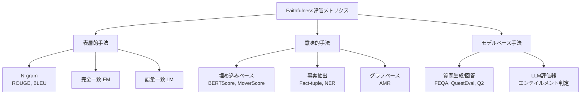
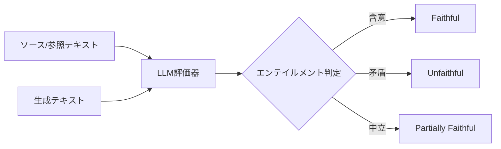
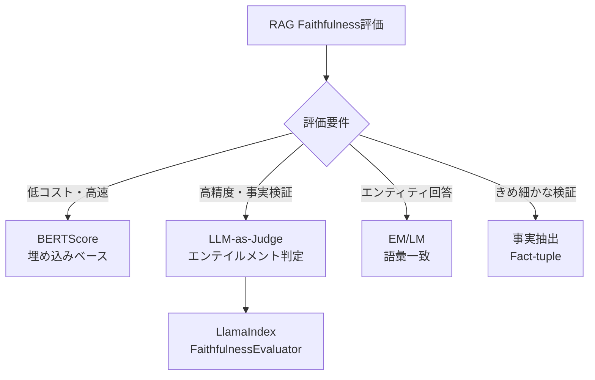

## 論文概要（Abstract）

本記事は、Malinらが2024年12月にarXivに投稿し、IEEE Journal of Selected Topics in Signal Processingに採録された論文 "A review of faithfulness metrics for hallucination assessment in Large Language Models"（arXiv:2501.00269）の解説記事である。本論文は、要約・質問応答・機械翻訳の3ドメインにおけるfaithfulness評価メトリクスを包括的にレビューしたサーベイである。著者らは、LLMをfaithfulness評価器として使用するアプローチ（LLM-as-Judge）が人間判定との相関において最も高い性能を示す傾向があると報告している。

この記事は [Zenn記事: LlamaIndex v0.14のIngestionPipelineと評価ループで本番RAGの精度劣化を継続監視する](https://zenn.dev/0h_n0/articles/8fed5e798afc5f) の深掘りである。RAGシステムにおけるfaithfulness評価は、回答がコンテキストに忠実であるかどうかの自動判定を必要とし、本論文のメトリクス分類体系はその技術選定の基盤となる。

## 情報源

- **arXiv ID**: 2501.00269
- **URL**: [https://arxiv.org/abs/2501.00269](https://arxiv.org/abs/2501.00269)
- **著者**: Ben Malin, Tatiana Kalganova, Nikolaos Boulgouris（Brunel University London）
- **発表年**: 2024年（IEEE JSTSP採録: DOI 10.1109/JSTSP.2025.3579203）
- **分野**: cs.CL（計算言語学）
- **論文長**: 13ページ、6テーブル

## 背景と動機（Background & Motivation）

LLMはテキスト生成、質問応答、翻訳など多くのタスクで実用化されているが、事実と異なる内容を生成する「ハルシネーション」の問題が依然として存在する。著者らは、ハルシネーションを「LLMが誤った主張を導入するインスタンスであり、事実の誤帰属や完全な捏造によって生じる」と定義している（論文Section II-A）。

Faithfulness（忠実性）はハルシネーションの反対概念であり、「生成された出力が正確で信頼性があり、基礎となるソース資料と整合している度合い」を指す。しかし、faithfulnessの定義はドメインによって異なる。要約タスクではソース文書との整合性、質問応答タスクでは正解（ground truth）との一致、機械翻訳タスクでは原文の意味の保持がそれぞれ求められる。

このドメイン間の差異にもかかわらず、統一的な視点でメトリクスを比較した体系的レビューは限られていた。本論文はこのギャップを埋め、各ドメインで使用されてきたメトリクスの長所・短所を横断的に分析し、今後の研究方向を示すことを目的としている。

## 主要な貢献（Key Contributions）

著者らが主張する本論文の貢献は以下の通りである。

- **貢献1: メトリクスの体系的分類**: 要約・質問応答・機械翻訳の3ドメインにおけるfaithfulness評価メトリクスを、N-gram、完全一致、語彙一致、質問生成、埋め込みベース、事実抽出、グラフベース、LLM評価器の8カテゴリに分類した
- **貢献2: ドメイン横断的なメトリクス比較**: 6つのテーブル（Table I〜VI）を用いて、各ドメインのデータセットとメトリクス性能を人間判定との相関に基づいて比較した
- **貢献3: ハルシネーション軽減手法の整理**: RAGや再プロンプティングなど、faithfulness向上に寄与するアプローチを体系的に整理し、今後の研究方向を提示した

## 技術的詳細（Technical Details）

### メトリクス分類体系の全体像

論文で提示されたメトリクス分類体系を以下のフローチャートで示す。

### 1. N-gramメトリクス

N-gramメトリクスは、生成テキストと参照テキストの間でn-gram（連続するn個のトークン列）の重複度を計算する手法である。代表例としてROUGE（Recall-Oriented Understudy for Gisting Evaluation）とBLEU（Bilingual Evaluation Understudy）がある。

ROUGEのスコアは以下のように定義される。

$$
\text{ROUGE-N} = \frac{\sum_{s \in \text{Ref}} \sum_{\text{gram}_n \in s} \text{Count}_{\text{match}}(\text{gram}_n)}{\sum_{s \in \text{Ref}} \sum_{\text{gram}_n \in s} \text{Count}(\text{gram}_n)}
$$

ここで、
- $\text{gram}_n$: 長さ$n$のn-gram
- $\text{Count}_{\text{match}}$: 生成テキストと参照テキストの両方に出現するn-gramの数
- $\text{Ref}$: 参照テキスト集合

著者らは、複数の先行研究を引用し、N-gramメトリクスには以下の制約があると報告している（論文Section III-B）。
- 同義語や意味的理解を考慮しないため、テキスト類似度の測定が過度に厳格になる
- 接続詞などの機能語も実質的な情報を持つn-gramと同等に重み付けされる
- 要約の事実的正確性の測定には不十分であり、人間の事実性判定との相関が低い

### 2. 完全一致（Exact Match）と語彙一致（Lexical Match）

完全一致（EM）は参照テキストと生成テキストが完全に一致するかを判定する二値メトリクスである。エンティティベースの短い回答を要するQAタスクでは有用だが、要約のような自由形式生成では適用が困難である。

語彙一致（LM）はEMよりも緩い基準で、正解がLLM出力の中に含まれていれば忠実と判定する。著者らは、EMは忠実性を過小評価する傾向があり、LLM評価器は過大評価する傾向があると報告している（論文Section V-B、Wang et al. [7]を引用）。

### 3. 質問生成ベースのメトリクス

質問生成（Question Generation）ベースのアプローチは、主に要約の忠実性評価で使われる手法である。生成された要約とソース文書の両方から質問を自動生成し、それぞれの回答を比較して事実的一貫性を評価する。

$$
\text{QA\_Score} = \frac{|\{q : a_{\text{summary}}(q) = a_{\text{source}}(q)\}|}{|Q|}
$$

ここで、
- $Q$: 生成された質問の集合
- $a_{\text{summary}}(q)$: 要約から得られた質問$q$への回答
- $a_{\text{source}}(q)$: ソース文書から得られた質問$q$への回答

代表的なメトリクスとして、FEQA、QAGS、Q$^2$、QuestEvalがある（論文の参考文献[8,15,16,17]）。

**制約**: 著者らは、これらの手法が質問生成モデルと質問応答モデルの両方の品質に依存する点を指摘している。生成された質問の品質が低い場合（曖昧、不十分など）、忠実性評価の信頼性が低下する。また、抽出的な情報に焦点を当てているため、より抽象的な推論を必要とするタスクには適さないと報告されている。

### 4. 埋め込みベースのメトリクス

埋め込みベースのメトリクスは、事前学習済み言語モデルによる分散表現空間で生成テキストと参照テキストの類似度を評価する。

**BERTScore** は最も広く使用されている埋め込みベースのメトリクスであり、BERTの文脈的埋め込みを用いてトークン間のコサイン類似度を計算する。

$$
\text{BERTScore} = F_1 = 2 \cdot \frac{P_{\text{BERT}} \cdot R_{\text{BERT}}}{P_{\text{BERT}} + R_{\text{BERT}}}
$$

ここで、

$$
P_{\text{BERT}} = \frac{1}{|\hat{x}|} \sum_{\hat{x}_j \in \hat{x}} \max_{x_i \in x} \cos(\mathbf{h}_{\hat{x}_j}, \mathbf{h}_{x_i})
$$

$$
R_{\text{BERT}} = \frac{1}{|x|} \sum_{x_i \in x} \max_{\hat{x}_j \in \hat{x}} \cos(\mathbf{h}_{x_i}, \mathbf{h}_{\hat{x}_j})
$$

- $x$: 参照テキストのトークン列
- $\hat{x}$: 生成テキストのトークン列
- $\mathbf{h}_{x_i}$: トークン$x_i$のBERT埋め込みベクトル
- $\cos(\cdot, \cdot)$: コサイン類似度

**MoverScore** はWord Mover's Distance（WMD）に基づき、一方の文書の埋め込みが他方の文書の埋め込み空間を占めるために必要な最小移動距離を計算する。論文Section III-Bで引用されたZhaoら[18]の研究では、MoverScoreが多くのタスクでBERTScoreを上回ると報告されている。ただし、実際にはBERTScoreの方が広く使用されている。

**制約**: 著者らは、意味的に類似したトークンが異なる事実を伝える場合に問題が生じると指摘している。同じ主題に関する完全に異なる文でも、埋め込みが高い類似度を示す可能性がある。

### 5. 事実抽出ベースのメトリクス

事実抽出は、テキストから核となる事実要素を抽出し、ソースと出力の事実的整合性を評価する手法である。

**Fact-tuple** は（主語, 述語, 目的語）の三つ組として事実を表現し、ソースと出力の両方からタプルを抽出して比較する。

$$
F_1^{\text{fact}} = 2 \cdot \frac{P_{\text{fact}} \cdot R_{\text{fact}}}{P_{\text{fact}} + R_{\text{fact}}}
$$

ここで、

$$
P_{\text{fact}} = \frac{|\text{Tuples}_{\text{output}} \cap \text{Tuples}_{\text{source}}|}{|\text{Tuples}_{\text{output}}|}
$$

$$
R_{\text{fact}} = \frac{|\text{Tuples}_{\text{output}} \cap \text{Tuples}_{\text{source}}|}{|\text{Tuples}_{\text{source}}|}
$$

著者らは、Goodrichら[11]の研究を引用し、LLMベースの事実抽出評価が他のメトリクスと比較して高い人間判定との相関を示したと報告している。また、近年のUniRelやREBELなどのより現代的な抽出モデルの利用により、さらなる性能向上が期待できると述べている（論文Section VI-C）。

**Named Entity Recognition（NER）** も事実抽出の一形態であり、ソースと生成テキストからキーエンティティを抽出し、不一致を検出する。N-gramアプローチよりも高い性能が報告されている（Nanら[23]、Akaniら[24]）。

### 6. グラフベースのメトリクス

グラフベースのメトリクスは、Abstract Meaning Representation（AMR）を用いてテキストをグラフ構造に変換し、概念（ノード）と関係（エッジ）の整合性で忠実性を評価する。

Ribeiroら[52]のFACTGRAPHは、CNN/DMデータセットにおいてN-gram、QA、LLM、埋め込みベースのメトリクスと比較して最も高い人間判定との相関を示したと報告されている（論文Table IV）。ただし、XSumデータセットでは同じ結果が得られていない。

**制約**: グラフの構築と比較に高い計算コストがかかること、また曖昧または複雑な言語表現でAMRの構文解析が誤る可能性があることが指摘されている。

### 7. LLM評価器（LLM-as-Judge）

LLM評価器は、Transformerベースの言語モデル自体にfaithfulness判定を行わせるアプローチである。著者らは、この方法を「エンテイルメントアプローチ」として特徴付けている。生成テキストがソースまたは参照テキストを含意（entail）するかどうかをLLMが判定し、通常は「含意」「矛盾」「中立」の3クラス、またはリッカート尺度（1〜5）で出力する。

**主要な知見**: 著者らは、複数の先行研究を横断的に分析した結果、LLM評価器が人間判定との相関において最も高い性能を示す傾向があると結論付けている。具体的には以下の通りである。

- **要約ドメイン**: Kamalooら[49]はSQuADデータセットにおいてLLM評価器が最良と報告。Pagnoniら[32]はCNN/DM（FRANK）でLLM Evalが最良と報告。ただし、XSumでは埋め込みベースが最良であった
- **QAドメイン**: YaoとBarbosa[14]はEVOUNAデータセット（NQ、TriviaQA）でLLM評価器が最良と報告。Adlakhaら[12]はGPT-4を用いた場合に人間判定との強い相関を報告
- **機械翻訳ドメイン**: 全てのレビュー対象研究でLLMベースのメトリクス（COMET、SEScore等）が最良と報告

**制約と課題**: 著者らは以下の制約を明示している。
- LLM評価器は忠実なテキストに対して高いスコアを、非忠実なテキストに対して低いスコアを付ける傾向があり、偽陰性（忠実なのに非忠実と判定）よりも偽陽性（非忠実なのに忠実と判定）が多い（Wang et al. [7]）
- プロンプトの設計がスコアの範囲と結果に大きな影響を与え、再現性に課題がある（Chu et al. [72]）
- 計算コストが他のメトリクスと比較して高い
- Fuら[26]はCNN/DM及びXSum（FRANK）でLLM評価器の人間判定との相関が最小であったと報告しており、全ての設定でLLM評価器が優位とは限らない

## メトリクス比較（各ドメインの実験結果）

### 要約ドメインのメトリクス比較

論文Table IVの内容を基に、各研究における最良メトリクスを以下に整理する。

| 著者・年 | データセット | 評価対象メトリクス | 最良メトリクス |
|----------|-------------|-------------------|--------------|
| Kamalooら, 2023 [49] | SQuAD | N-gram, 埋め込み, LLM | LLM |
| Ribeiroら, 2022 [52] | CNN/DM | N-gram, QA, LLM, グラフ, 埋め込み | グラフ |
| Ribeiroら, 2022 [52] | XSum | N-gram, QA, LLM, グラフ, 埋め込み | グラフ |
| Zhongら, 2022 [50] | SummEval | N-gram, 埋め込み, LLM | LLM Eval |
| Pagnoniら, 2021 [32] | CNN/DM (FRANK) | N-gram, Fact-tuple, 埋め込み, EM, QA, LLM | LLM Eval |
| Pagnoniら, 2021 [32] | XSum (FRANK) | N-gram, QA, LLM, Fact-tuple, 埋め込み, EM | 埋め込み |
| Durmusら, 2020 [16] | CNN/DM | N-gram, 埋め込み, QA, LLM | QA |
| Durmusら, 2020 [16] | XSum | N-gram, 埋め込み, QA, LLM | QA |
| Maynezら, 2020 [29] | XSum | N-gram, 埋め込み, QA, LLM | LLM |
| Goodrichら, 2019 [11] | WikiFact | N-gram, 事実ベース, LLM事実ベース | LLM事実ベース |

この表から読み取れる傾向として、LLM評価器またはLLMベースの手法が最良メトリクスとして選ばれる頻度が高いが、データセットや実験条件によってQA、グラフ、埋め込みベースが優位となるケースも存在する。著者らは「単一ドメイン内でも明確に最適なメトリクスは存在せず、異なる著者が異なるメトリクスを最も高い相関を持つと報告している」と述べている（論文Section III-D）。

### QAドメインのメトリクス比較

論文Table Vに基づく比較を以下に示す。

| 著者・年 | データセット | 最良メトリクス | 評価指標 |
|----------|-------------|--------------|---------|
| Yao & Barbosa, 2024 [14] | EVOUNA NQ | LLM | Accuracy/F1 |
| Yao & Barbosa, 2024 [14] | EVOUNA TriviaQA | LLM | Accuracy/F1 |
| Adlakhaら, 2023 [12] | NQ-open, HotpotQA, TopiOCQA | LLM | 人間判定相関 |
| Wangら, 2023 [7] | EVOUNA NQ | 語彙一致 + LLM | Accuracy/F1 |
| Wangら, 2023 [7] | EVOUNA TriviaQA | 語彙一致 + LLM | Accuracy/F1 |

QAドメインでは、LLM評価器と語彙一致の組み合わせが有効であるという知見が示されている。Wangら[7]は、EMが忠実性を過小評価し、LLM評価器が過大評価する傾向を報告しており、両者の組み合わせによる相互補完の可能性を示唆している。

### 機械翻訳ドメインのメトリクス比較

論文Table VIに基づく比較を以下に示す。

| 著者・年 | データセット | 言語 | 最良メトリクス |
|----------|-------------|------|--------------|
| Bererd & Julien, 2023 [67] | WMT20 | 不明 | LLMベース（QE） |
| Leeら, 2023 [62] | STS-B | En→En | LLMベース |
| Xuら, 2022 [61] | WMT20/WMT21 | En→De, Zh→En | LLMベース |
| Kocmiら, 2021 [74] | ToShipOrNotToShip | 101言語 | COMET（LLM） |

機械翻訳ドメインでは、レビュー対象の全研究でLLMベースのメトリクス（COMET、SEScore、BLEURT等）がN-gramや埋め込みベースを上回ると報告されている。ただし著者らは、これらのメトリクスが英語データの偏りにより低資源言語で性能が低下する可能性を指摘している（論文Section V-C）。

## 実装のポイント（LlamaIndex FaithfulnessEvaluatorとの対応付け）

本論文の知見は、RAGシステムにおけるfaithfulness評価の技術選定に直接的に関連する。LlamaIndexのFaithfulnessEvaluatorは本論文で分類されたLLM-as-Judge方式を採用しており、コンテキスト（検索結果）と生成された回答の間のエンテイルメント関係をLLMが判定する。

### メトリクス選定の指針

本論文の知見を基に、RAGシステムの忠実性評価における各手法の適性を以下に整理する。

| メトリクスカテゴリ | RAGでの適性 | 主な利点 | 主な制約 |
|-------------------|-----------|---------|---------|
| N-gram (ROUGE, BLEU) | 低 | 高速、計算コスト低 | 意味的類似性を捕捉不可 |
| 完全一致 (EM) | エンティティQAのみ | 明確な判定 | 自由形式回答に不適 |
| 埋め込み (BERTScore) | 中 | 意味的類似性を考慮 | 事実の矛盾を検出困難 |
| 事実抽出 (Fact-tuple) | 中〜高 | きめ細かな事実検証 | 抽出モデルの品質に依存 |
| QA生成ベース | 中 | 個別事実の検証可能 | 計算コスト高、QAモデルに依存 |
| LLM-as-Judge | 高 | 人間判定との相関が高い | コスト高、偽陽性傾向、再現性課題 |

### LLM-as-Judgeの制約への対策

本論文で指摘された制約に対して、実運用では以下の対策が考えられる（筆者の解釈を含む）。

1. **偽陽性への対策**: 著者らはEMとLLM評価器が対照的な限界（それぞれ高い偽陰性率と偽陽性率）を持つと報告しており（論文Section VI-C）、両者を重み付きで組み合わせた融合メトリクスの可能性を提案している
2. **プロンプト依存性への対策**: プロンプト設計の標準化と、評価結果の分散をモニタリングする仕組みが重要となる
3. **コスト**: より小型のモデルをfine-tuningしてfaithfulness評価専用に使用することで、精度と計算コストのトレードオフを調整できる

## ハルシネーション軽減手法

著者らは論文Section VI-Aにおいて、faithfulness評価と連携したハルシネーション軽減手法を以下のように整理している。

### 外部知識ソースの利用（RAG）

RAGベースのアプローチは、外部の知識ベースからコンテキストを検索してLLMへの入力を補強する手法であり、著者らはこのアプローチが「ユビキタスかつ成功している」と評価している（論文Section VIII）。Alinejadら[58]の研究では、LLMにゴールドコンテキストまたは検索コンテキストを提供した上で質問に回答させ、LLM評価器で整合性を判定するアプローチが報告されている。

著者らは、RAGがQAドメインにおけるground truth品質の問題を軽減する可能性があると述べている。ただし、人間判定との比較によるさらなる検証が必要であるとも付記している。

### プロンプティングフレームワーク

再プロンプティング（self-correction）パイプラインは、LLMが非忠実な生成を自己修正する手法であり、複数の研究でテキスト生成の忠実性が向上すると報告されている（Madaanら[70]、Safaら[71]）。著者らは、正確なfaithfulness評価と組み合わせることで、ハルシネーション軽減に効果的に機能すると述べている。

### モデルアーキテクチャの進化

著者らは、より新しく、より大規模なLLMはハルシネーションが少ない傾向があるとする複数の研究を引用している（Rasoolら[13]、Wangら[73]）。Subbiahら[51]は、後続のLLMアーキテクチャ間でfaithfulness評価の54%の改善を報告している。

## 実運用への応用（Practical Applications）

本論文の知見は、本番RAGシステムのfaithfulness監視に以下の形で応用できる。

**評価パイプラインの設計**: 本論文のメトリクス分類体系に基づくと、RAGシステムの忠実性評価は段階的なアプローチが考えられる。まず低コストな埋め込みベースメトリクス（BERTScore）でスクリーニングし、閾値以下のケースにLLM-as-Judgeを適用するハイブリッド戦略が実用的である（筆者の解釈）。

**データ構造化の活用**: 著者らは、要約ドメインで事実抽出によるデータ構造化が忠実性評価を改善したと報告しており、この手法はQAドメインにも拡張可能であると述べている（論文Section VI-C）。RAGの回答を事実タプルに分解して個別に評価するアプローチは、全体的なスコアよりもきめ細かなフィードバックを提供しうる。

**制約の認識**: 本論文は要約・QA・機械翻訳に焦点を当てており、コード生成、構造化データ出力、マルチモーダル生成などのタスクにおけるfaithfulness評価は対象外である。また、全てのメトリクス比較は英語中心であり、日本語を含む低資源言語における性能については追加の検証が必要である。

## 関連研究（Related Work）

- **Ji et al., "Survey of Hallucination in Natural Language Generation" (2022)**: LLMにおけるハルシネーションの原因を訓練データの不整合と理論付けた包括的サーベイ。本論文はこの研究をハルシネーションの定義の基盤として引用している
- **Gu et al., "A Survey on LLM-as-a-Judge" (2024, arXiv:2411.15594)**: LLM-as-Judgeの包括的サーベイ。本論文が報告するLLM評価器の優位性と関連し、より広範なLLM判定のユースケースをカバーしている
- **Min et al., "FACTSCORE" (2023)**: 長文テキスト生成の事実的精度を細粒度のアトミック事実レベルで評価する手法。本論文が議論する事実抽出ベースのアプローチの具体的実装として位置付けられる
- **Laban et al., "SummaC" (2021)**: NLIベースのモデルを要約の一貫性検出に再検討した研究。エンテイルメント判定の枠組みを要約忠実性評価に適用した代表例

## まとめと今後の展望

本論文は、LLMのfaithfulness評価メトリクスを要約・質問応答・機械翻訳の3ドメインにわたって体系的にレビューした包括的なサーベイである。著者らの主要な知見は以下の通りである。

1. **LLM-as-Judgeの優位性**: 多くの研究でLLM評価器が人間判定との相関において最も高い性能を示す。ただし、偽陽性傾向やプロンプト依存性などの制約が存在する
2. **ドメイン固有の最適解**: 単一の万能メトリクスは存在せず、ドメインやデータセットに応じた選択が必要である
3. **融合メトリクスの可能性**: EMの偽陰性傾向とLLM評価器の偽陽性傾向は相互補完的であり、重み付き組み合わせによる改善が期待できる
4. **事実抽出技術の転用**: 要約ドメインで有効性が示された事実抽出ベースの手法は、QAドメインへの拡張が未検証であり、今後の研究機会がある

本サーベイはfaithfulness評価の全体像を提示しているが、対象が主に英語テキストであること、また評価対象がテキスト生成タスクに限定されている点に留意が必要である。

## 参考文献

- **arXiv**: [https://arxiv.org/abs/2501.00269](https://arxiv.org/abs/2501.00269)
- **DOI**: [10.1109/JSTSP.2025.3579203](https://doi.org/10.1109/JSTSP.2025.3579203)
- **BERTScore**: [https://github.com/Tiiiger/bert_score](https://github.com/Tiiiger/bert_score)
- **QuestEval**: [https://github.com/ThomasScialom/QuestEval](https://github.com/ThomasScialom/QuestEval)
- **UniEval**: [https://github.com/maszhongming/UniEval](https://github.com/maszhongming/UniEval)
- **Related Zenn article**: [https://zenn.dev/0h_n0/articles/8fed5e798afc5f](https://zenn.dev/0h_n0/articles/8fed5e798afc5f)
