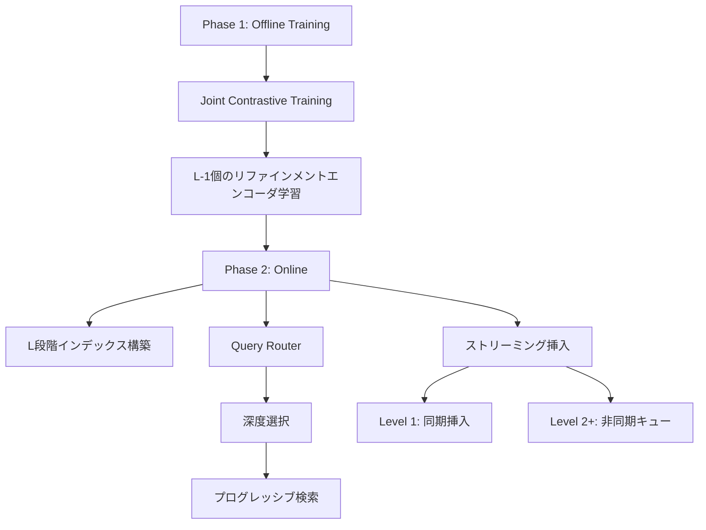
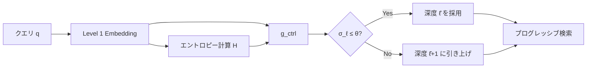

## 論文概要（Abstract）

SPI（Semantic Pyramid Indexing）は、ストリーミングRAGパイプライン向けに設計されたクエリ適応型のベクトルDBインデクシング手法である。ベクトルデータベースの上にL段階の解像度レベルを構築し、クエリごとに不確実性認識コントローラが適切な検索深度を自動選択する。著者らは、FAISS・Qdrantバックエンドとの互換性を維持しつつ、既存手法に対してレイテンシを最大70%削減し、Recall@10で最大5ポイントの改善を達成したと報告している（Table 3）。

この記事は [Zenn記事: LlamaIndex v0.14のIngestionPipelineと評価ループで本番RAGの精度劣化を継続監視する](https://zenn.dev/0h_n0/articles/8fed5e798afc5f) の深掘りです。

## 情報源

- **arXiv ID**: 2511.16681
- **URL**: [https://arxiv.org/abs/2511.16681](https://arxiv.org/abs/2511.16681)
- **著者**: Dong Liu, Yanxuan Yu
- **投稿日**: 2025年11月12日（v3: 2026年6月14日）
- **分野**: cs.CL, cs.AI

## 背景と動機（Background & Motivation）

本番RAGシステムでは、ドキュメントが継続的に追加・更新される「ストリーミング」環境が一般的である。従来のベクトル検索手法では、すべてのクエリに対して同一の検索戦略を適用するため、単純なクエリでも複雑なクエリと同等の計算コストが発生していた。

また、ストリーミング環境ではインデックスの再構築コストが問題となる。ドキュメントが追加されるたびにインデックス全体を再構築すると、検索サービスの可用性が低下する。HNSW（Hierarchical Navigable Small World）のような近似最近傍探索アルゴリズムはインクリメンタル挿入に対応しているが、クエリの難易度に応じた適応的な検索深度の制御は提供していない。

SPIは、これら2つの課題――クエリ適応型の検索深度制御とストリーミング挿入への対応――を統一的に解決することを目指している。

## 主要な貢献（Key Contributions）

- **Multi-Depth Embedding**: L段階の解像度レベルを持つ埋め込みピラミッドを構築し、粗い検索から精密な検索へ段階的に候補を絞り込むアーキテクチャ
- **不確実性認識Query Router**: クエリの埋め込みとエントロピー信号から最適な検索深度を自動選択するコントローラ（ドメイン内精度87.5%、OOD精度82.1%）
- **インクリメンタル挿入**: Level 1は同期挿入（8ms/passage）、Level 2以降は非同期バックグラウンドキューによる可視性保証付きの段階的更新

## 技術的詳細（Technical Details）

### 全体アーキテクチャ

SPIの処理フローは、オフラインの学習フェーズとオンラインの検索・挿入フェーズに分かれる。



### Multi-Depth Embedding

SPIの中核は、L段階の解像度レベルを持つ埋め込みピラミッドである。Level 1ではFrozenのContriever（$D_1 = 768$次元）、Level $\ell \geq 2$ではPatch-Transformer $f_\ell$で次元削減と精度向上を行う。各レベルの埋め込みは残差リファインメントで計算される:

$$
\mathbf{e}_d^{(\ell)} = f_\ell(\mathbf{e}_d^{(\ell-1)}) + \mathbf{W}_\ell\,\mathbf{e}_d^{(1)}
$$

ここで、
- $\mathbf{e}_d^{(\ell)}$: ドキュメント$d$のLevel $\ell$における埋め込みベクトル
- $f_\ell$: Patch-Transformer（$K$個のパッチ、2層Transformerブロック、$H=4$ヘッド、GELU活性化）
- $\mathbf{W}_\ell$: Level 1埋め込みからの射影行列（スキップ接続）
- $\mathbf{e}_d^{(1)}$: ベースレベル（Contriever）の埋め込み

デフォルト設定（$L=3$）では$(D_1, D_2, D_3) = (768, 512, 256)$、各$f_\ell$は約5Mパラメータである。スキップ接続$\mathbf{W}_\ell\,\mathbf{e}_d^{(1)}$により、上位レベルでの情報損失を防ぎベースレベルの意味情報を伝搬させている。

### 候補プールと精度スケジュール

各レベルにおける候補プールサイズは以下の式で決定される:

$$
N_\ell = \lfloor N_1 \prod_{k=1}^{\ell-1} r_k \rfloor
$$

ここで、
- $N_1 = 1000$: Level 1での初期候補数
- $r_k$: Level $k$から$k+1$への絞り込み率
- $(r_1, r_2) = (0.20, 0.05)$

この設定により、$N_1 = 1000 \rightarrow N_2 = 200 \rightarrow N_3 = 10$と段階的に候補が絞り込まれる。

また、精度スケジュール$b_\ell = \min(b_{max}, b_1 \cdot 2^{\ell-1})$（$b_1 = 8$, $b_{max} = 32$）により、$(b_1, b_2, b_3) = (\text{INT8}, \text{FP16}, \text{FP32})$が適用される。候補数の多いLevel 1では低精度で高速計算し、候補数の少ないLevel 3では高精度でスコアリングする設計である。

### Query Router（不確実性認識コントローラ）

Query Routerは、クエリごとに最適な検索深度を選択する機構である。まず、クエリのLevel 1埋め込み$\mathbf{q}^{(1)}$からエントロピー信号を計算する:

$$
H(\mathbf{q}^{(1)}) = -\sum_k p_k \log p_k
$$

ここで$p_k$は上位$K$件候補との類似度のsoftmax正規化確率である。エントロピーが高いほどクエリが曖昧であることを示す。コントローラ$g_{ctrl}$（2層Transformer、128隠れ次元、4ヘッド）は推奨深度$\hat{\ell}$と不確実性$\sigma_\ell$を出力する:

$$
\hat{\ell}, \sigma_\ell = g_{ctrl}(\mathbf{q}^{(1)}, H(\mathbf{q}^{(1)}))
$$

深度選択は閾値$\theta = 0.35$で制御される:

- $\sigma_\ell \leq \theta$の場合: 推奨深度$\hat{\ell}$を採用
- $\sigma_\ell > \theta$の場合: $\min(\hat{\ell} + 1, L)$に深度を1段引き上げ

著者らは、コントローラの深度選択精度をドメイン内で87.5%、OOD（Out-of-Distribution）で82.1%と報告している。オーバーヘッドは0.8ms/queryであり、検索レイテンシへの影響は軽微である。



### インクリメンタル挿入

ストリーミング環境でのインデックス更新は、Level 1が同期挿入（8ms/passage）、Level 2以降が非同期バックグラウンドキューで処理される。可視性保証として以下の包含関係が常に維持される:

$$
D^{(1)}(t) \supseteq D^{(2)}(t) \supseteq \cdots \supseteq D^{(L)}(t)
$$

$D^{(\ell)}(t)$は時刻$t$でLevel $\ell$に含まれるドキュメント集合である。新規ドキュメントはLevel 1で即座に検索可能になり、上位レベルは非同期で追従する。周期的なre-anchoringでインデックスのドリフトを防止する。

### 学習目的関数

SPIの学習は以下の複合損失関数で行われる:

$$
\mathcal{L}_{total} = \sum_{\ell=1}^{L} \alpha_\ell \mathcal{L}_{retrieval}^{(\ell)} + \beta \mathcal{L}_{consistency} + \gamma \mathcal{L}_{reg}
$$

ここで、
- $\alpha_\ell = 1/L$: 各レベルの検索損失の重み（均等配分）
- $\beta = 0.5$: 一貫性損失の重み
- $\gamma = 0.01$: 正則化の重み

$\mathcal{L}_{retrieval}^{(\ell)}$はin-batch InfoNCEロス、$\mathcal{L}_{consistency}$はレベル間の埋め込み一貫性を保証する:

$$
\mathcal{L}_{consistency} = \sum_{\ell=1}^{L-1} \|\mathbf{e}_d^{(\ell)} - \mathrm{proj}_\ell(\mathbf{e}_d^{(\ell+1)})\|_2^2
$$

$\mathrm{proj}_\ell$はLevel $\ell+1$からLevel $\ell$への射影であり、上位レベルの埋め込みが下位レベルの情報を保持しつつ精錬されることを保証する。

### Top-K安定性定理

著者らは、検索結果の安定性に関する以下の理論的保証を提示している:

> レベル$\ell$と$\ell'$の間のギャップ$\gamma(q, \ell')$が$2\delta_\ell$を超える場合、Top-K検索結果$G_K(q, \ell)$は$G_K(q, \ell')$と一致する。

ここで$\delta_\ell < 0.18$であり、十分なスコアギャップがある場合には、深いレベルまで検索しなくても浅いレベルで同等の結果が得られることを意味する。この定理がQuery Routerの理論的根拠となっている。

## 実装のポイント（Implementation）

SPIを実装する際の主要な考慮点を以下に整理する。

**FAISS/Qdrantバックエンド**: Level 1ではINT8量子化インデックス（FAISS: IndexIVFScalarQuantizer、Qdrant: scalar quantization）、Level 3ではFP32 Flat（FAISS: IndexFlatIP）を使用する。

**非同期挿入キュー**: Level 2以降はメッセージキュー（SQS等）でプロデューサー・コンシューマーパターンを構成する。可視性保証のため、Level $\ell$の更新はLevel $\ell-1$の完了後に開始する順序制約が必要である。

```python
import faiss


def build_spi_indices(dim_levels: list[int], nlist: int = 256) -> list[faiss.Index]:
    """SPIのL段階FAISSインデックスを構築する"""
    indices: list[faiss.Index] = []
    for level, dim in enumerate(dim_levels):
        if level == 0:  # Level 1: INT8量子化 + IVF
            quantizer = faiss.IndexFlatIP(dim)
            index = faiss.IndexIVFScalarQuantizer(
                quantizer, dim, nlist, faiss.ScalarQuantizer.QT_8bit)
        elif level == len(dim_levels) - 1:  # 最終Level: FP32 Flat
            index = faiss.IndexFlatIP(dim)
        else:  # 中間Level: FP16
            index = faiss.IndexScalarQuantizer(dim, faiss.ScalarQuantizer.QT_fp16)
        indices.append(index)
    return indices
```

## Production Deployment Guide

SPIをストリーミングRAGのインデクシング基盤としてAWS上にデプロイするための構成を示す。FAISS/Qdrantバックエンドの選択に応じた構成パターンを整理する。

### AWS実装パターン（コスト最適化重視）

以下はストリーミングRAGインデクシング向けの構成である。コスト試算は2026年10月時点のAWS ap-northeast-1（東京）リージョン料金に基づく概算値であり、実際のコストはトラフィックパターン、リージョン、バースト使用量により変動する。最新料金はAWS料金計算ツールで確認されたい。

| 構成 | トラフィック | 主要サービス | 月額概算 |
|------|------------|-------------|---------|
| Small | ~100 req/日 | Lambda + Qdrant Cloud + SQS | $80-180 |
| Medium | ~1,000 req/日 | ECS Fargate + Qdrant on EBS + SQS | $400-900 |
| Large | 10,000+ req/日 | EKS + FAISS分散 + Karpenter Spot | $2,500-5,500 |

**Small**: Lambda（512MB）+ Qdrant Cloud + SQS + DynamoDB。月額内訳: Lambda $5 + Qdrant $30-80 + SQS $1 + DynamoDB $5 + その他 $39-89。

**Medium**: ECS Fargate（1vCPU, 4GB x 2タスク）+ Qdrant on EC2（r6g.large）+ SQS FIFO + ElastiCache Redis。

**Large**: EKS + Karpenter Spot（r6g.xlarge/2xlarge）+ FAISS Sharded Index（8ノード6.2xスループット）+ Step Functions + S3/EFS。

**コスト削減テクニック**: Spot Instances（最大90%削減）、Reserved Instances 1年コミット（最大72%削減）、INT8量子化によるメモリ42%削減（Table 3: 7.2GB→4.2GB）、Query Routerによる平均検索深度低減。

### Terraformインフラコード

**Small構成（Serverless）** の主要リソース:

```hcl
# spi-indexing/main.tf — Small構成（Lambda + Qdrant Cloud + SQS）
# terraform >= 1.9, aws provider ~> 5.70

# --- SQS（Level 2+非同期挿入キュー） ---
resource "aws_sqs_queue" "spi_async_insert" {
  name                       = "spi-async-insert-queue"
  visibility_timeout_seconds = 300
  message_retention_seconds  = 86400
}

# --- DynamoDB（挿入状態管理、On-Demandでコスト最適化） ---
resource "aws_dynamodb_table" "spi_state" {
  name         = "spi-index-state"
  billing_mode = "PAY_PER_REQUEST"
  hash_key     = "doc_id"
  attribute { name = "doc_id"; type = "S" }
  server_side_encryption { enabled = true }
}

# --- Lambda関数（Query Router推論 + 検索） ---
resource "aws_lambda_function" "spi_query" {
  function_name = "spi-query-handler"
  role          = aws_iam_role.spi_lambda.arn
  handler       = "handler.query"
  runtime       = "python3.12"
  memory_size   = 512   # Query Router推論の最小要件
  timeout       = 30
  filename      = "lambda_package.zip"
  environment {
    variables = {
      SPI_LEVELS        = "3"
      QDRANT_SECRET_ARN = aws_secretsmanager_secret.qdrant_api_key.arn
      ASYNC_QUEUE_URL   = aws_sqs_queue.spi_async_insert.url
      STATE_TABLE       = aws_dynamodb_table.spi_state.name
    }
  }
  tracing_config { mode = "Active" }
}
```

IAMロールはLambda実行、SQS送受信、DynamoDB読み書き、Secrets Manager読み取りの最小権限で構成する。

**Large構成（Container）** の主要リソース:

```hcl
# spi-indexing/large/main.tf — EKS + FAISS分散 + Karpenter Spot
module "eks" {
  source          = "terraform-aws-modules/eks/aws"
  version         = "~> 20.24"
  cluster_name    = "spi-rag-cluster"
  cluster_version = "1.31"
  vpc_id          = module.vpc.vpc_id
  subnet_ids      = module.vpc.private_subnets
  cluster_endpoint_public_access = false
}

# Karpenter NodePool（Spot優先、r6g/r7gメモリ最適化インスタンス）
resource "kubectl_manifest" "spi_nodepool" {
  yaml_body = yamlencode({
    apiVersion = "karpenter.sh/v1"
    kind       = "NodePool"
    metadata   = { name = "spi-faiss-nodes" }
    spec = {
      template.spec.requirements = [
        { key = "karpenter.sh/capacity-type", operator = "In", values = ["spot", "on-demand"] },
        { key = "node.kubernetes.io/instance-type", operator = "In",
          values = ["r6g.xlarge", "r6g.2xlarge", "r7g.xlarge"] },
      ]
      limits     = { cpu = "128", memory = "512Gi" }
      disruption = { consolidationPolicy = "WhenEmptyOrUnderutilized", consolidateAfter = "30s" }
    }
  })
}

# AWS Budgets: 月額$5,500超で80%閾値アラート
resource "aws_budgets_budget" "spi_monthly" {
  name = "spi-rag-monthly-budget"
  budget_type = "COST"; limit_amount = "5500"; limit_unit = "USD"; time_unit = "MONTHLY"
  notification {
    comparison_operator = "GREATER_THAN"; threshold = 80; threshold_type = "PERCENTAGE"
    notification_type = "ACTUAL"; subscriber_email_addresses = ["ops-team@example.com"]
  }
}
```

### 運用・監視設定

**CloudWatch Logs Insightsクエリ**: 深度レベル別のレイテンシ分析（`stats pct(latency_ms, 95) by search_depth`）と非同期挿入遅延監視（`stats max(insert_lag_ms) by level`）を定期実行する。

**CloudWatch アラーム + X-Ray設定（Python）**:

```python
import boto3
from aws_xray_sdk.core import xray_recorder, patch_all

patch_all()  # boto3, requests等の自動計装
cloudwatch = boto3.client("cloudwatch", region_name="ap-northeast-1")


def create_spi_alarms(sns_topic_arn: str) -> None:
    """SPI検索サービスの主要アラームを設定する"""
    # 検索レイテンシP95（35ms基準の3倍 = 105ms超でアラート）
    cloudwatch.put_metric_alarm(
        AlarmName="spi-search-latency-p95",
        MetricName="SearchLatencyMs", Namespace="SPI/RAG",
        Statistic="p95", Period=300, EvaluationPeriods=3,
        Threshold=105.0, ComparisonOperator="GreaterThanThreshold",
        AlarmActions=[sns_topic_arn],
    )
    # 非同期挿入キュー滞留（1000件超でアラート）
    cloudwatch.put_metric_alarm(
        AlarmName="spi-insert-queue-depth",
        MetricName="ApproximateNumberOfMessagesVisible",
        Namespace="AWS/SQS", Statistic="Average",
        Period=300, EvaluationPeriods=2, Threshold=1000.0,
        ComparisonOperator="GreaterThanThreshold",
        AlarmActions=[sns_topic_arn],
    )


@xray_recorder.capture("spi_progressive_search")
def progressive_search(query_embedding: list[float], depth: int) -> list[dict]:
    """SPIプログレッシブ検索（X-Rayトレース付き）"""
    subsegment = xray_recorder.current_subsegment()
    subsegment.put_annotation("search_depth", depth)
    subsegment.put_metadata("embedding_dim", len(query_embedding))
    # ... 検索処理 ...
    return []
```

**Cost Explorer日次レポート**: Cost Explorer API（`get_cost_and_usage`）で`Project=spi-rag`タグのサービス別日次コストを集計し、$100/日超過時にSNS通知する。Lambda + EventBridgeスケジュールで日次実行する構成が推奨される。

### コスト最適化チェックリスト

**アーキテクチャ選択**: トラフィック量で構成判断（Serverless/Hybrid/Container）、INT8量子化メモリ42%削減活用、Query Router不要深層検索回避

**リソース最適化**: EC2 Spot優先（r6g/r7g）、Reserved 1年コミット72%削減、Savings Plans検討、Lambda 512MB最適化、Karpenter consolidation、EBS gp3（IOPS個別設定）

**ベクトルDB固有**: FAISS IVF-PQ（Level 1）メモリ削減、Qdrant scalar quantization、S3スナップショット保存、re-anchoringオフピークスケジュール

**監視・アラート**: AWS Budgets月額上限、CloudWatch P95レイテンシ監視、Cost Anomaly Detection、日次コストレポートSNS通知

**リソース管理**: 未使用インデックスTTL削除、タグ戦略（`Project=spi-rag`）、S3ライフサイクル、開発環境夜間停止、CloudTrail/Config有効化

## 実験結果（Results）

### メインベンチマーク

著者らは、MS MARCOとNatural Questions（NQ）のマクロ平均で以下の結果を報告している（Table 3）。

| Method | R@10 | NDCG@10 | Latency (ms) | Memory (GB) | QPS |
|--------|------|---------|--------------|-------------|-----|
| Contriever | 85.2 | 76.4 | 120 | 7.2 | 8.1 |
| ColBERTv2 | 89.3 | 80.1 | 108 | 5.8 | 9.3 |
| SPLADE-v2 | 87.5 | 78.3 | 92 | 5.4 | 10.8 |
| **SPI (L=3)** | **90.1** | **81.2** | **35** | **4.2** | **28.6** |

SPIはR@10で90.1、NDCG@10で81.2を達成し、ColBERTv2比でR@10 +0.8pt、レイテンシ67%削減（108ms→35ms）と報告されている。QPS 28.6は他手法の約3倍である。

**ピラミッド深度（Table 4）**: $L=3$がR@10=90.1・レイテンシ35msで精度とレイテンシのバランスに優れ、$L=2$ではR@10低下、$L=4$では改善微小でレイテンシ増加と報告されている。

**アブレーション（Table 6）**: Full SPIはMS MARCO R@10=90.8、NQ R@10=89.3。Query Router・一貫性損失・残差接続の各除去で性能低下が確認されている。

**ストリーミング性能**: 100 QPS挿入負荷下でR@10低下は最大0.6ポイント。**分散実行**: 8ノードで6.2倍スループット、効率約73%。

### 論文内の不整合（読者への注意）

本論文には以下の数値的な不整合が存在し、読者は注意が必要である:

1. **SPANN比較のレイテンシ**: 35ms vs 115msから計算すると約3.3倍の改善だが、本文中では2.8倍と記載されている
2. **加重レイテンシ**: 個別コンポーネントの計算を積み上げると約21msとなるが、報告値は35msであり、未計上のオーバーヘッドが存在する可能性がある
3. **スケーリング効率**: Abstractでは73%と記載されているが、Introductionでは79%と記載されており、箇所によって数値が異なる

## 実運用への応用（Practical Applications）

SPIの設計は、LlamaIndexのIngestionPipelineと組み合わせたストリーミングRAGシステムに直接応用できる。

**継続的インデクシング**: IngestionPipelineの変換ステップ後にSPIのインクリメンタル挿入を接続することで、サービス停止なしにドキュメント追加が可能である。Level 1の同期挿入（8ms/passage）はリアルタイム性が求められるシステムに適している。

**コスト効率**: Query Routerにより単純なクエリはLevel 1のみで解決され、計算リソース消費を抑制できる。平均レイテンシ35msはContriever（120ms）の約3分の1であり（Table 3）、少ないインスタンス数で同等のQPSを処理できる。

**精度劣化の監視**: 非同期挿入によるLevel間遅延は精度劣化の一因となりうる。各レベルのRecall@Kを定期計測し、re-anchoring頻度を調整する運用が推奨される。

**制約**: L段階のインデックス維持によりストレージコストが増加する。Patch-Transformerの学習にはドメイン固有コーパスが必要であり、汎用pre-trainedモデルのみでは最適な性能が得られない可能性がある。

## 関連研究（Related Work）

- **ColBERTv2** (Santhanam et al., 2022): late interactionによる密検索。精度はSPIと同等だがレイテンシ・メモリではSPIが優位（Table 3）
- **SPLADE-v2** (Formal et al., 2022): 学習スパース表現。転置インデックスとの互換性が高いが多段階適応検索は行わない
- **HNSW** (Malkov & Yashunin, 2020): グラフベース近似最近傍探索。インクリメンタル挿入対応だがクエリ適応的深度制御は備えていない。SPIとは相補的な関係

## まとめと今後の展望

SPIは、ストリーミングRAGパイプラインにおけるクエリ適応型インデクシングの枠組みを提示している。Multi-Depth Embeddingによる段階的な候補絞り込みと、不確実性認識Query Routerによる検索深度の自動選択が主要な技術的貢献である。

著者らはRecall@10で90.1、レイテンシ35msを達成したと報告しているが（Table 3）、前述の数値的不整合については追加の検証が望まれる。実務においては、FAISS/Qdrantバックエンドとの互換性とインクリメンタル挿入の仕組みが、本番RAGシステムへの導入障壁を低減する要因となる。

今後の研究方向としては、Query Routerのドメイン適応（OOD精度82.1%の改善）、より多くのレベル（$L > 3$）でのスケーリング特性の検証、および他のベクトルDBバックエンド（Milvus、Weaviate等）との統合が考えられる。

## 参考文献

- **arXiv**: [https://arxiv.org/abs/2511.16681](https://arxiv.org/abs/2511.16681)
- **Related Zenn article**: [LlamaIndex v0.14のIngestionPipelineと評価ループで本番RAGの精度劣化を継続監視する](https://zenn.dev/0h_n0/articles/8fed5e798afc5f)
