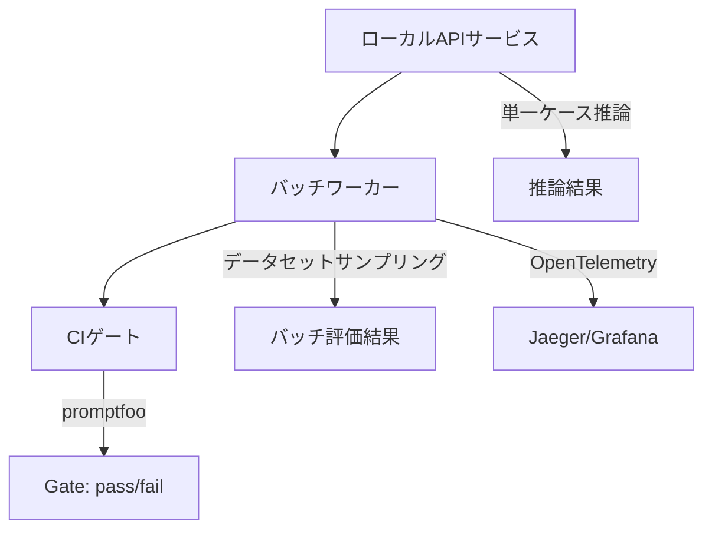

## 論文概要（Abstract）

LLM Readiness Harnessは、LLM/RAGアプリケーションの評価をデプロイメント判定ワークフローとして体系化するフレームワークである。著者はローカルAPIサービス、OpenTelemetryベースのオブザーバビリティ、promptfooを用いたCIクオリティゲートの3層を統合し、「レディネススコア」という単一指標でデプロイ可否を判断する手法を提案している。BEIRベンチマーク上での実験では、シナリオ別の重み付けにより品質・コスト・SLAを多面的に評価できることが示されている。

この記事は [Zenn記事: LlamaIndex v0.14のIngestionPipelineと評価ループで本番RAGの精度劣化を継続監視する](https://zenn.dev/0h_n0/articles/8fed5e798afc5f) の深掘りです。

## 情報源

- **arXiv ID**: 2603.27355
- **URL**: [https://arxiv.org/abs/2603.27355](https://arxiv.org/abs/2603.27355)
- **著者**: Alexandre Cristovão Maiorano
- **投稿年**: 2026年（v1: 3月28日、v2: 5月21日）
- **分野**: cs.AI, cs.CL, cs.SE

## 背景と動機（Background & Motivation）

LLM/RAGアプリケーションのプロダクション運用では、応答品質・検索精度・コスト・レイテンシを継続的に評価する必要がある。しかし従来の評価手法はオフラインバッチ評価に限定され、CI/CDパイプラインへの統合やリアルタイム監視との連携が不十分だった。

著者は、既存フレームワーク（RAGAS、promptfoo等）が個別の側面に焦点を当てており、「デプロイして良いかどうか」という意思決定を直接支援していないと指摘している。本論文はレディネススコアという重み付き集約指標を導入し、評価・監視・デプロイ判定を一貫したパイプラインとして提供する。

## 主要な貢献（Key Contributions）

- **貢献1**: レディネススコア公式の定義。複数メトリクスをシナリオ別の重みで集約し、デプロイ可否を単一スカラーで判定
- **貢献2**: OpenTelemetryスパン設計。推論・検索・生成・ポリシー検証の各ステップに構造化スパンを定義し、継続的監視を実現
- **貢献3**: promptfooベースのCIゲート。スキーマ違反・ポリシー違反・品質回帰を自動検知しデプロイをブロック

## 技術的詳細（Technical Details）

### アーキテクチャ

本フレームワークは3層で構成される。



**ローカルAPIサービス**は単一ケース推論とバッチ実行を担う。**バッチワーカー**はデータセットのサンプリング・評価実行・アーティファクト保存を行う。**CIゲート**はpromptfooで実装され、3種類の品質検知を行う。

### レディネススコア

著者はデプロイ判定の中核として、レディネススコア$R$を以下の式で定義している（論文Section 3より）。

$$
R = \frac{\sum_{i \in \mathcal{P}} w_i m_i}{\sum_{i \in \mathcal{P}} w_i}
$$

ここで、
- $\mathcal{P}$: 利用可能なメトリクスの集合
- $w_i$: メトリクス$i$に対するシナリオ別の重み
- $m_i$: メトリクス$i$の正規化スコア（0-1）

この式は重み付き平均であり、利用不可能なメトリクスは$\mathcal{P}$から除外した上で残りで再正規化される。部分的なメトリクス欠損に対してロバストな設計である。

### シナリオ別の重み設計

著者は3つのシナリオを定義し、各メトリクスへの重み配分を変えている（論文Table 2より）。

| シナリオ | Workflow | Policy | Faithfulness | Retrieval | Cost | SLA |
|---|---|---|---|---|---|---|
| cost-first | 0.20 | 0.20 | 0.15 | 0.15 | 0.20 | 0.10 |
| risk-first | 0.15 | 0.25 | 0.20 | 0.15 | 0.10 | 0.15 |
| SLA-first | 0.20 | 0.15 | 0.15 | 0.10 | 0.10 | 0.30 |

**risk-first**はPolicyとFaithfulnessの重みを高くし、金融・医療等のハルシネーション非許容ドメインを想定している。**SLA-first**はp95レイテンシに最大重み0.30を配分し、リアルタイム応答要件に対応する。

### OpenTelemetryスパン設計

著者はRAGパイプラインの各ステップに対応するスパンを定義している（論文Table 4より）。

| スパン名 | 目的 | 主要属性 |
|---|---|---|
| `infer` | ルートスパン | `run_id`, `pipeline_version`, `scenario`, `latency_ms`, `cost_usd_est` |
| `route.classify` | ルート予測 | `predicted_label`, `confidence` |
| `rag.retrieve` | 検索 | `top_k`, `index_id`, `retrieved_doc_ids` |
| `rag.generate` | LLM生成 | `model_id`, `provider`, `cache_hit` |
| `validate.policy` | ポリシー検証 | `pass`, `violation_types` |

このスパン設計により、パイプライン全体のレイテンシ内訳・トークン使用量・コスト推定をJaegerやGrafanaで可視化できる。Zenn記事で述べたLlamaIndex v0.14のIngestionPipelineと組み合わせることで、インデックス更新時の品質変化もトレースレベルで追跡可能となる。

### CIゲートの実装

CIゲートはpromptfooの設定ファイルベースで実装される。ベースラインとの差分を算出し、閾値を下回った場合にパイプラインを失敗させる。

```python
from dataclasses import dataclass


@dataclass
class GateResult:
    """CIゲートの判定結果"""
    delta_workflow: float
    delta_policy: float
    gate: str  # "pass" or "fail"


def evaluate_gate(
    baseline: dict[str, float],
    candidate: dict[str, float],
    thresholds: dict[str, float],
) -> GateResult:
    """ベースラインとの差分でゲート判定を行う（論文の記述を基に再構成）

    Args:
        baseline: ベースラインの各メトリクス値
        candidate: 候補版の各メトリクス値
        thresholds: 許容閾値（負の差分がこの値を超えたらfail）
    """
    dw = candidate["workflow"] - baseline["workflow"]
    dp = candidate["policy"] - baseline["policy"]

    if dp < thresholds.get("policy", -0.01):
        return GateResult(dw, dp, "fail")
    if dw < thresholds.get("workflow", -0.05):
        return GateResult(dw, dp, "fail")
    return GateResult(dw, dp, "pass")
```

## 実装のポイント（Implementation）

**メトリクス欠損への対処**: レディネススコアの式は$\mathcal{P}$で正規化するため、answer relevanceのように算出困難なメトリクスが空になっても計算が破綻しない。ただし著者自身もanswer relevanceが全て空で除外されたことを限界として報告している。

**OpenTelemetryの計装粒度**: `rag.retrieve`スパンでは`retrieved_doc_ids`を記録するが、大量のドキュメントIDはスパンサイズを増大させるため上位k件に限定する設計が推奨される。

**promptfooとの統合**: CIゲートはpromptfooのYAML設定で定義し、GitHub Actions等から呼び出す。プロンプトバリアントごとにベースライン差分を算出し、閾値超過でパイプラインを失敗させる。

## Production Deployment Guide

本論文はOpenTelemetryスパン設計とCIゲート実装を含むため、AWSでのプロダクションデプロイ構成を示す。

### AWS実装パターン（コスト最適化重視）

| 構成 | トラフィック | サービス構成 | 月額概算 |
|---|---|---|---|
| Small | ~100 req/日 | Lambda + Bedrock + DynamoDB + ADOT | $50-150 |
| Medium | ~1,000 req/日 | ECS Fargate + Bedrock + OpenSearch Serverless | $300-800 |
| Large | 10,000+ req/日 | EKS + Karpenter + Spot + OpenSearch + Grafana | $2,000-5,000 |

**Small構成の内訳**: Lambda推論API ~$5/月、Bedrock ~$30-80/月（トークン量依存）、DynamoDB On-Demand ~$5/月、ADOT Collector ~$0（Lambda同居）、CloudWatch Logs ~$5-10/月。

**Large構成の内訳**: EKSコントロールプレーン ~$72/月、Spot Instances（m5.xlarge x3）~$150/月（オンデマンド比70%削減）、OpenSearch Serverless ~$700-1,500/月、Grafana ~$100/月、Bedrock ~$800-2,000/月。

**コスト試算の注意事項**: 上記はAWS ap-northeast-1（東京）リージョンの2026年10月時点の概算値。実際のコストはトラフィックパターン・Bedrockモデル選択により変動する。最新料金は[AWS料金計算ツール](https://calculator.aws/)で確認を推奨する。

**コスト削減テクニック**: Spot Instances活用で最大90%削減（バッチワーカー）、Reserved Instances購入で最大72%削減（APIサーバ）、Bedrock Batch API使用で50%削減（評価バッチ）、Prompt Caching有効化で30-90%削減。

### Terraformインフラコード

#### Small構成（Serverless）

```hcl
# small_readiness_harness/main.tf - AWS ap-northeast-1 / 2026-10
terraform {
  required_version = ">= 1.9"
  required_providers {
    aws = { source = "hashicorp/aws", version = "~> 5.70" }
  }
}

provider "aws" { region = "ap-northeast-1" }

resource "aws_iam_role" "lambda" {
  name = "readiness-harness-lambda"
  assume_role_policy = jsonencode({
    Version = "2012-10-17"
    Statement = [{ Action = "sts:AssumeRole", Effect = "Allow",
      Principal = { Service = "lambda.amazonaws.com" } }]
  })
}

resource "aws_iam_role_policy" "lambda" {
  role = aws_iam_role.lambda.id
  policy = jsonencode({
    Version = "2012-10-17"
    Statement = [
      { Effect = "Allow", Action = ["bedrock:InvokeModel"],
        Resource = "arn:aws:bedrock:ap-northeast-1::foundation-model/*" },
      { Effect = "Allow", Action = ["dynamodb:PutItem","dynamodb:GetItem","dynamodb:Query"],
        Resource = aws_dynamodb_table.eval.arn },
      { Effect = "Allow", Action = ["logs:CreateLogGroup","logs:CreateLogStream","logs:PutLogEvents"],
        Resource = "arn:aws:logs:ap-northeast-1:*:*" },
      { Effect = "Allow", Action = ["xray:PutTraceSegments","xray:PutTelemetryRecords"],
        Resource = "*" }
    ]
  })
}

resource "aws_dynamodb_table" "eval" {
  name = "readiness-eval-results"
  billing_mode = "PAY_PER_REQUEST"  # On-Demand: コスト最適化
  hash_key = "run_id"; range_key = "metric_name"
  attribute { name = "run_id"; type = "S" }
  attribute { name = "metric_name"; type = "S" }
  server_side_encryption { enabled = true }  # KMS暗号化
  point_in_time_recovery { enabled = true }
}

resource "aws_lambda_function" "api" {
  function_name = "readiness-harness-api"
  role = aws_iam_role.lambda.arn
  handler = "handler.lambda_handler"
  runtime = "python3.12"; timeout = 60; memory_size = 256
  # ADOT Layer: OpenTelemetry自動計装
  layers = ["arn:aws:lambda:ap-northeast-1:901920570463:layer:aws-otel-python-amd64-ver-1-25-0:1"]
  environment {
    variables = {
      EVAL_TABLE = aws_dynamodb_table.eval.name
      OTEL_SERVICE_NAME = "readiness-harness"
      AWS_LAMBDA_EXEC_WRAPPER = "/opt/otel-instrument"
    }
  }
  tracing_config { mode = "Active" }  # X-Ray有効化
}
```

#### Large構成（Container）

```hcl
# large_readiness_harness/eks.tf - AWS ap-northeast-1 / 2026-10
module "eks" {
  source  = "terraform-aws-modules/eks/aws"
  version = "~> 20.24"
  cluster_name = "readiness-harness"; cluster_version = "1.31"
  vpc_id = module.vpc.vpc_id; subnet_ids = module.vpc.private_subnets
  cluster_endpoint_public_access = false  # パブリックアクセス無効
  eks_managed_node_groups = {
    system = { instance_types = ["m5.large"], min_size = 1, max_size = 2, desired_size = 1 }
  }
}

# Karpenter: Spot優先オートスケーリング
resource "kubectl_manifest" "karpenter_nodepool" {
  yaml_body = <<-YAML
    apiVersion: karpenter.sh/v1
    kind: NodePool
    metadata: { name: readiness-workers }
    spec:
      template:
        spec:
          requirements:
            - { key: karpenter.sh/capacity-type, operator: In, values: ["spot","on-demand"] }
            - { key: node.kubernetes.io/instance-type, operator: In, values: ["m5.xlarge","m6i.xlarge"] }
      limits: { cpu: "64", memory: "256Gi" }
      disruption: { consolidationPolicy: WhenEmptyOrUnderutilized, consolidateAfter: 60s }
  YAML
}

resource "aws_budgets_budget" "monthly" {
  name = "readiness-harness-monthly"; budget_type = "COST"
  limit_amount = "5000"; limit_unit = "USD"; time_unit = "MONTHLY"
  notification {
    comparison_operator = "GREATER_THAN"; threshold = 80
    threshold_type = "PERCENTAGE"; notification_type = "ACTUAL"
    subscriber_email_addresses = ["ops@example.com"]
  }
}
```

### 運用・監視設定

#### CloudWatch Logs Insights クエリ

```
# コスト異常検知
fields @timestamp, tokens_in, tokens_out, cost_usd_est
| stats sum(cost_usd_est) as total_cost by bin(1h) as hour
| filter total_cost > 10 | sort hour desc

# レイテンシ分析
fields @timestamp, latency_ms, model_id
| stats percentile(latency_ms, 95) as p95, percentile(latency_ms, 99) as p99 by model_id
```

#### X-Ray トレーシング + Cost Explorer（Python）

```python
import datetime

import boto3
from aws_xray_sdk.core import xray_recorder, patch_all

patch_all()  # boto3自動計装


def trace_readiness_eval(run_id: str, scenario: str) -> None:
    """レディネス評価のトレーシングを開始する"""
    subsegment = xray_recorder.begin_subsegment("readiness_eval")
    subsegment.put_annotation("run_id", run_id)
    subsegment.put_annotation("scenario", scenario)


def check_daily_cost(sns_topic_arn: str, threshold: float = 100.0) -> None:
    """日次コストを取得し閾値超過でSNS通知する"""
    ce = boto3.client("ce", region_name="us-east-1")
    today = datetime.date.today()
    resp = ce.get_cost_and_usage(
        TimePeriod={"Start": (today - datetime.timedelta(days=1)).isoformat(), "End": today.isoformat()},
        Granularity="DAILY", Metrics=["UnblendedCost"],
        Filter={"Tags": {"Key": "Project", "Values": ["readiness-harness"]}},
    )
    total = sum(float(g["Metrics"]["UnblendedCost"]["Amount"])
                for r in resp["ResultsByTime"] for g in r["Groups"])
    if total > threshold:
        boto3.client("sns", region_name="ap-northeast-1").publish(
            TopicArn=sns_topic_arn,
            Subject=f"Cost alert: ${total:.2f}/day",
            Message=f"Daily cost ${total:.2f} exceeds ${threshold}",
        )
```

### コスト最適化チェックリスト

**アーキテクチャ選択**:
- [ ] トラフィック量に応じた構成選択（Serverless / Hybrid / Container）
- [ ] バッチ評価ワーカーはSpot Instances / Lambdaで実行
- [ ] CIゲートはGitHub Actions / CodeBuildのオンデマンド実行

**リソース最適化**:
- [ ] EC2: Spot Instances優先（バッチワーカー）
- [ ] Reserved Instances: APIサーバの1年コミット
- [ ] Savings Plans: 安定使用量部分
- [ ] Lambda: メモリサイズ最適化（Power Tuningで検証）
- [ ] EKS: Karpenterによるアイドル時スケールダウン

**LLMコスト削減**:
- [ ] Bedrock Batch API使用（50%削減）
- [ ] Prompt Caching有効化（30-90%削減）
- [ ] モデル選択ロジック（コスト重視時はgpt-4.1-mini相当を使用）
- [ ] トークン数制限（max_tokens設定）
- [ ] 評価サンプリング（統計的に有意なサンプル数に限定）

**監視・アラート**:
- [ ] AWS Budgets設定（月額80%/100%で通知）
- [ ] CloudWatch アラーム（トークンスパイク、レイテンシ劣化）
- [ ] Cost Anomaly Detection有効化
- [ ] 日次コストレポート（SNS通知）

**リソース管理**:
- [ ] 未使用リソース定期削除
- [ ] タグ戦略（Project / Env / Owner）
- [ ] S3ライフサイクルポリシー（評価ログ90日でGlacier移行）
- [ ] 開発環境の夜間停止
- [ ] OpenSearch ServerlessのOCU最小値設定

## 実験結果（Results）

### CIゲートの検証結果

著者はCS（カスタマーサービス）とIT（ヘルプデスク）の2データセットで、bias・policyの2バリアントをテストしている（論文Table 7より）。

| Dataset | Variant | ΔWorkflow | ΔPolicy | Gate |
|---|---|---|---|---|
| CS | bias | 0.03 | -0.08 | fail |
| CS | policy | -0.27 | -0.97 | fail |
| IT | bias | -0.03 | -0.02 | fail |
| IT | policy | -0.33 | -0.93 | fail |

全バリアントでゲートがfailとなり、CIゲートが品質劣化・ポリシー違反を検知できることが報告されている。特にpolicyバリアントではΔPolicyが-0.93〜-0.97と著しく低下しており、意図的な違反注入が確実に検出されている。

### BEIRベンチマーク結果

著者はBEIRデータセットを用いてSLA-firstシナリオ（k=5）でのレディネススコアを報告している（論文BEIRセクションより）。

| Dataset | Model | Readiness | Faithfulness | p95 latency |
|---|---|---|---|---|
| FiQA | gpt-4.1-mini | 0.808±0.022 | 0.777±0.069 | ~3.6-4.0s |
| FiQA | gpt-5.2 | 0.710±0.014 | 0.387±0.016 | ~9.0s |
| SciFact | gpt-4.1-mini | 0.811±0.017 | — | — |

gpt-5.2はgpt-4.1-miniよりレディネススコアが低い。著者はp95レイテンシ約9.0秒がSLA-firstの高いSLA重み（0.30）によりスコアを押し下げていると分析している。またgpt-5.2のFaithfulnessが0.387±0.016と低く、大規模モデルが必ずしも忠実性で優れないことを示唆している。

## 実運用への応用（Practical Applications）

本論文のアプローチは、Zenn記事で述べたLlamaIndex v0.14のIngestionPipelineによるRAG継続監視と親和性が高い。

**IngestionPipeline + Readiness Harness統合**: IngestionPipelineがインデックスを更新するたびにReadiness Harnessのバッチ評価を自動トリガーし、レディネススコアが閾値を下回った場合にロールバックする。データソースの品質劣化によるRAG精度低下を即座に検知できる。

**シナリオ別運用**: 社内ナレッジベースRAGではrisk-first（Faithfulness重視）、カスタマーサポートではSLA-first（レイテンシ重視）と使い分けることで、単一フレームワークで異なるSLAを管理できる。

**CI/CDパイプライン統合**: GitHub ActionsでプロンプトやモデルのPRに対してCIゲートを実行し品質回帰を防止する。Table 7の結果から検知感度は十分と報告されている。

ただし著者が指摘する通り、実験は単一クラウドプロバイダー・単一リージョンでの実施であり、マルチリージョン構成やオンプレミス環境での適用性は未検証である。

## 関連研究（Related Work）

- **RAGAS** (Shahul et al.): RAG評価フレームワーク。Faithfulness等の個別メトリクスを提供するが、デプロイ判定のための統合スコアリングやCIゲートは含まない。Readiness HarnessはRAGASのメトリクスを構成要素として取り込みつつシナリオ別の重み付け集約を追加
- **promptfoo**: LLMテスト・評価ツール。Readiness HarnessはCIゲート層にpromptfooを採用。本論文の貢献はpromptfoo上にレディネススコアとオブザーバビリティ層を積み重ねた点
- **OpenTelemetry for LLM**: OpenLLMetryやLangSmith等が登場しているが、評価パイプラインとCIゲートの体系的統合は少ない。本論文はスパン設計を評価ワークフローに特化させた点が特徴的

## 制約と限界

著者は以下の限界を明記している。

- **answer relevanceの欠損**: 評価時にanswer relevanceが空となりメトリクスセットから除外。レディネススコアの構成要素が不完全
- **単一クラウドプロバイダー・リージョン**: 実験はAWSの単一リージョンで実施。マルチクラウドやマルチリージョンでの再現性は未検証
- **英語中心のBEIRデータ**: 多言語環境（特に日本語RAG）での適用性は不明
- **人間検証なし**: レディネススコアの妥当性を人間の判断と比較する検証は未実施

## まとめと今後の展望

LLM Readiness Harnessは、RAGアプリケーションの評価を「デプロイして良いかどうか」という意思決定に直結させる点が特徴的である。レディネススコアによるシナリオ別評価、OpenTelemetryスパンによる継続監視、promptfooベースのCIゲートの3層が統合されている。

今後の方向性として、著者はanswer relevanceメトリクスの改善、マルチプロバイダー対応、多言語データセットでの検証を課題に挙げている。LlamaIndex v0.14のIngestionPipelineと組み合わせることで、インデックス更新 → 自動評価 → CIゲート → デプロイという一連のワークフローを構築できる可能性がある。

## 参考文献

- **arXiv**: [https://arxiv.org/abs/2603.27355](https://arxiv.org/abs/2603.27355)
- **Code**: [github.com/alemaiorano/llm-readiness-harness-reproducibility](https://github.com/alemaiorano/llm-readiness-harness-reproducibility)
- **Related Zenn article**: [https://zenn.dev/0h_n0/articles/8fed5e798afc5f](https://zenn.dev/0h_n0/articles/8fed5e798afc5f)
