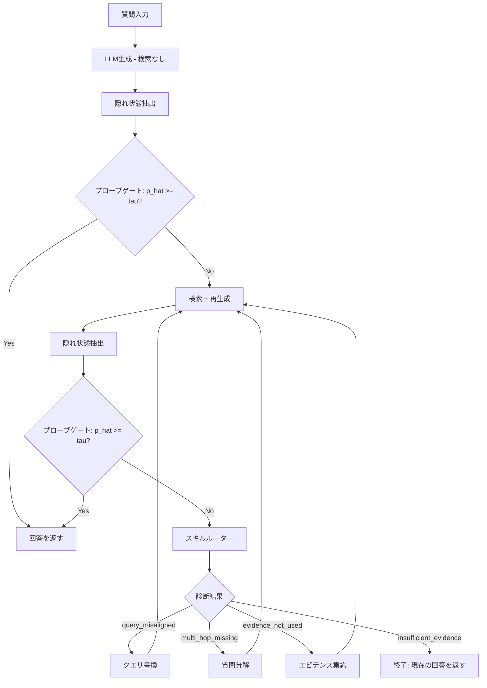

本記事は [Skill-RAG: Failure-State-Aware Retrieval Augmentation via Hidden-State Probing and Skill Routing](https://arxiv.org/abs/2604.15771) の解説記事です。

## 論文概要（Abstract）

Skill-RAGは、LLMの隠れ状態（hidden states）を軽量なプローブ分類器で監視し、検索拡張生成（RAG）パイプラインの2段階（検索前・検索後）で失敗状態を検知する手法である。失敗が検知された場合、プロンプトベースのスキルルーターが失敗原因を診断し、クエリ書換（query rewriting）、質問分解（question decomposition）、エビデンス集約（evidence focusing）、終了（exit）の4種のスキルから適切なものを選択して修復を試みる。著者らは、特に分布外（OOD）データセットにおいて従来手法を上回る精度向上を報告している。

この記事は [Zenn記事: Doctor-RAGの失敗修復ループで社内FAQ検索の回答精度を改善する](https://zenn.dev/0h_n0/articles/1fc1d60c5f09e2) の深掘りです。

## 情報源

- **arXiv ID**: 2604.15771
- **URL**: [https://arxiv.org/abs/2604.15771](https://arxiv.org/abs/2604.15771)
- **著者**: Kai Wei, Raymond Li, Xi Zhu, et al.
- **発表年**: 2026年（v4: 2026年8月改訂）
- **分野**: cs.CL（計算言語学）

## 背景と動機（Background & Motivation）

RAGパイプラインでは「いつ検索すべきか」「検索後に失敗した場合どう修復するか」という2つの課題が存在する。従来手法であるFLAREやDRAGINはトークンレベルの不確実性に基づいて検索タイミングを決定するが、失敗の原因を区別せず一律に再検索を行うため、クエリとコーパスの語彙不一致やマルチホップ推論の欠落といった構造的な失敗には対処できない。

Probing-RAG（Baek et al., 2025）はLLMの隠れ状態を使って検索の要否を判定する手法を提案したが、失敗後の修復戦略は持たない。Skill-RAGはこのプロービング機構を継承しつつ、失敗原因の診断と原因別のスキル選択という修復ループを追加することで、特にOODデータセットでの精度向上を実現している。

## 主要な貢献（Key Contributions）

- **貢献1**: 検索前・検索後の2段階で隠れ状態プローブによるゲーティングを行い、追加のLLM呼び出しなしに失敗を検知する軽量な機構を提案
- **貢献2**: 失敗原因を4カテゴリ（クエリ不一致・マルチホップ欠落・エビデンス未活用・情報不足）に分類し、原因別のスキルにルーティングするプロンプトベースのルーターを設計
- **貢献3**: OODデータセット（MuSiQue, 2WikiMultiHopQA）で、Probing-RAGに対してQwen3-8Bで最大+9.5 AC, +6.4 EMの改善を報告（論文Table 1より）

## 技術的詳細（Technical Details）

### 隠れ状態プロービング

Skill-RAGのプロービング機構は、LLMの中間層から抽出した隠れ状態ベクトルに対してフィードフォワード分類器を適用し、現在の生成が正解に到達しているかを推定する。

**層の選択**: モデルの全$L$層のうち、後半2/3の偶数インデックス層を使用する。

$$
\mathcal{S} = \{ l \mid l \geq \lfloor L/3 \rfloor, \; l \bmod 2 = 0 \}
$$

**層ごとの表現**: 各選択層$l$について、生成されたトークン列の隠れ状態を平均プーリングする。

$$
\mathbf{h}_l = \frac{1}{n} \sum_{i=1}^{n} \mathbf{H}_l^{(i)}
$$

ここで、
- $\mathbf{H}_l^{(i)} \in \mathbb{R}^d$: 層$l$における$i$番目のトークンの隠れ状態ベクトル
- $n$: 生成トークン数
- $d$: 隠れ次元数

**プローブ分類器**: 各層ごとに独立した1隠れ層のフィードフォワードネットワークを訓練する。

$$
p_l = \sigma(\mathbf{W}_2 \cdot \text{ReLU}(\mathbf{W}_1 \mathbf{h}_l + \mathbf{b}_1) + \mathbf{b}_2)
$$

ここで、$\sigma$はシグモイド関数、$\mathbf{W}_1, \mathbf{W}_2, \mathbf{b}_1, \mathbf{b}_2$は学習パラメータである。なお、論文本文ではReLUと記載されているが、Table 4のハイパーパラメータ一覧ではSiLUが使用されており、記述に不整合がある点に注意が必要である。

**集約スコア**: 全選択層のプローブ出力を平均して最終的なゲーティングスコアを得る。

$$
\hat{p} = \frac{1}{|\mathcal{S}|} \sum_{l \in \mathcal{S}} p_l
$$

閾値$\tau$に対して$\hat{p} \geq \tau$であれば現在の回答をそのまま返し、$\hat{p} < \tau$であれば検索・修復ループに進む。なお、$\tau$の具体的な値は論文中に明記されていない。

### スキルルーティング

プローブが失敗を検知した場合、プロンプトベースのスキルルーターが起動する。ルーターは質問、失敗した推論・回答、検索済みエビデンスを入力として受け取り、まず1文の診断文を生成した後、以下の4ラベルのいずれかを出力する。

| ラベル | スキル | 動作 |
|--------|--------|------|
| `query_misaligned` | クエリ書換 | コーパスの語彙に合わせた検索クエリを1つ再生成 |
| `multi_hop_missing` | 質問分解 | 2-3個のサブクエリに分解し、統合クエリを生成 |
| `evidence_not_used` | エビデンス集約 | 不足しているエビデンスのスロットを列挙し、そのギャップを埋めるクエリを生成 |
| `insufficient_evidence` | 終了 | 検索を停止し、現在の回答を返す |

各スキルは2つの作業例（few-shot examples）を含むプロンプトで実装されている。

### パイプライン全体像



### アルゴリズム

```python
from dataclasses import dataclass
from enum import Enum
from typing import Protocol

import torch
import torch.nn as nn


class FailureType(Enum):
    """スキルルーターが診断する失敗タイプ"""
    QUERY_MISALIGNED = "query_misaligned"
    MULTI_HOP_MISSING = "multi_hop_missing"
    EVIDENCE_NOT_USED = "evidence_not_used"
    INSUFFICIENT_EVIDENCE = "insufficient_evidence"


@dataclass
class ProbeResult:
    """プローブの判定結果"""
    score: float
    needs_retrieval: bool


class HiddenStateProbe(nn.Module):
    """隠れ状態プローブ分類器

    各層の隠れ状態を入力とし、正解到達確率を出力する。

    Args:
        hidden_dim: LLMの隠れ次元数
        probe_hidden: プローブの隠れ層次元数
    """
    def __init__(self, hidden_dim: int, probe_hidden: int = 256):
        super().__init__()
        self.fc1 = nn.Linear(hidden_dim, probe_hidden)
        self.fc2 = nn.Linear(probe_hidden, 1)
        self.activation = nn.SiLU()  # Table 4準拠
        self.norm = nn.LayerNorm(probe_hidden)
        self.dropout = nn.Dropout(0.1)

    def forward(self, h: torch.Tensor) -> torch.Tensor:
        """層ごとの隠れ状態から正解確率を推定

        Args:
            h: 平均プーリング済み隠れ状態 (hidden_dim,)

        Returns:
            正解確率スカラー (1,)
        """
        x = self.activation(self.fc1(h))
        x = self.norm(x)
        x = self.dropout(x)
        return torch.sigmoid(self.fc2(x))


class LLM(Protocol):
    """LLMインターフェース"""
    def generate(self, prompt: str) -> tuple[str, dict[int, torch.Tensor]]:
        """テキスト生成と隠れ状態の取得"""
        ...


class Retriever(Protocol):
    """検索インターフェース"""
    def retrieve(self, query: str) -> list[str]:
        ...


def select_probe_layers(total_layers: int) -> list[int]:
    """プローブ対象層を選択: 後半2/3の偶数インデックス

    Args:
        total_layers: モデルの総層数

    Returns:
        対象層インデックスのリスト
    """
    start = total_layers // 3
    return [l for l in range(start, total_layers) if l % 2 == 0]


def compute_gate_score(
    hidden_states: dict[int, torch.Tensor],
    probes: dict[int, HiddenStateProbe],
    probe_layers: list[int],
) -> float:
    """全対象層のプローブ出力を平均してゲートスコアを計算

    Args:
        hidden_states: 層インデックス -> 平均プーリング済み隠れ状態
        probes: 層インデックス -> 訓練済みプローブ
        probe_layers: 対象層リスト

    Returns:
        集約ゲートスコア (0.0-1.0)
    """
    scores: list[float] = []
    for layer_idx in probe_layers:
        h = hidden_states[layer_idx]
        with torch.no_grad():
            p = probes[layer_idx](h).item()
        scores.append(p)
    return sum(scores) / len(scores)


def skill_rag_pipeline(
    question: str,
    llm: LLM,
    retriever: Retriever,
    probes: dict[int, HiddenStateProbe],
    probe_layers: list[int],
    skill_router: "SkillRouter",
    threshold: float = 0.5,
    max_rounds: int = 3,
) -> str:
    """Skill-RAGパイプライン

    Args:
        question: 入力質問
        llm: LLMインスタンス
        retriever: 検索インスタンス
        probes: 層別の訓練済みプローブ
        probe_layers: プローブ対象層
        skill_router: スキルルーター
        threshold: ゲーティング閾値 tau
        max_rounds: 最大検索ラウンド数

    Returns:
        最終回答テキスト
    """
    # Stage 1: 検索前ゲーティング
    answer, hidden_states = llm.generate(question)
    gate_score = compute_gate_score(hidden_states, probes, probe_layers)

    if gate_score >= threshold:
        return answer  # 検索不要と判定

    # Stage 2: 検索後ゲーティング + スキルルーティング
    query = question
    for _ in range(max_rounds):
        evidence = retriever.retrieve(query)
        prompt = f"Evidence: {evidence}\nQuestion: {question}"
        answer, hidden_states = llm.generate(prompt)
        gate_score = compute_gate_score(hidden_states, probes, probe_layers)

        if gate_score >= threshold:
            return answer  # 十分なエビデンスで正解到達

        # スキルルーターによる失敗診断
        failure_type, new_query = skill_router.route(
            question=question,
            answer=answer,
            evidence=evidence,
        )

        if failure_type == FailureType.INSUFFICIENT_EVIDENCE:
            return answer  # 修復不能 -> 現在の回答を返す

        query = new_query  # 修復されたクエリで再検索

    return answer
```

## 実装のポイント（Implementation）

**プローブの訓練データ**: HotpotQA、NQ、TriviaQAの訓練分割から各3,000例をサンプリングし、検索なし条件と単一ステップ検索条件の両方で生成した回答のゴールドとの一致をバイナリラベルとして使用する（論文Table 4より）。

**ハイパーパラメータ**: 学習率1e-3、バッチサイズ12、エポック数2、ドロップアウト0.1、AdamWオプティマイザ、ExponentialLRスケジューラ（$\gamma = 0.995$）。訓練はH100 1枚で完了する（論文Table 4より）。

**プローブのコスト**: 隠れ状態の抽出はLLMの推論時に既に計算済みの中間表現を利用するため、追加のLLM呼び出しは不要である。プローブ自体は小規模なフィードフォワードネットワークであり、推論コストは無視できる程度に小さい。

**スキルルーターの実装**: 各スキルは2つのfew-shot examplesを含むプロンプトテンプレートとして実装されており、追加の訓練は不要である。ただし、ルーター自体はLLM呼び出しを1回必要とするため、プローブと異なり推論コストが発生する。

**注意点**: 論文中で閾値$\tau$と損失関数の具体的な定義が明記されていない。実装時には開発セット（500例）での性能を見ながら$\tau$をチューニングする必要がある。

## Production Deployment Guide

### AWS実装パターン（コスト最適化重視）

Skill-RAGの本番環境構築では、隠れ状態プローブの低レイテンシ推論と、スキルルーターのLLM呼び出しコストのバランスが設計上の要点となる。

**コスト試算の注意事項**: 以下は2026年10月時点のAWS ap-northeast-1（東京）リージョン料金に基づく概算値である。実際のコストはトラフィックパターン、リージョン、バースト使用量により変動する。最新料金はAWS料金計算ツールで確認を推奨する。

| 構成 | トラフィック | アーキテクチャ | 月額概算 |
|------|-------------|---------------|---------|
| Small | ~100 req/日 | Lambda + Bedrock + DynamoDB | $50-150 |
| Medium | ~1,000 req/日 | ECS Fargate + Bedrock + ElastiCache | $300-800 |
| Large | 10,000+ req/日 | EKS + Spot + SageMaker Endpoint | $2,000-5,000 |

**Small構成の内訳**: Lambda（プローブ推論 + オーケストレーション）$5-10、Bedrock Claude Haiku（スキルルーター）$20-60、DynamoDB（プローブキャッシュ）$5-10、S3（プローブモデル保存）$1、CloudWatch $5。プローブモデルはLambda Layerに同梱し、コールドスタートを最小化する。

**Medium構成の内訳**: ECS Fargate（常駐プローブサーバー）$80-150、Bedrock Claude Sonnet（スキルルーター）$100-400、ElastiCache（プローブ結果キャッシュ）$50-100、OpenSearch Serverless（検索エンジン）$50-100、CloudWatch + X-Ray $20。

**Large構成の内訳**: EKS（コントロールプレーン）$75、Spot Instances m5.xlarge x 3（プローブ推論）$100-200、SageMaker Endpoint（LLMホスティング）$1,000-3,000、OpenSearch（検索クラスタ）$300-500、その他監視・ネットワーク $200-300。Spot Instancesの活用で通常のオンデマンド比最大90%削減が可能である。

**コスト削減テクニック**:
- Spot Instances活用でプローブ推論ノードのコストを最大90%削減
- Reserved Instances（1年コミット）でEKSワーカーノードを最大72%削減
- Bedrock Batch APIでバッチ処理可能なスキルルーター呼び出しを50%削減
- Prompt Caching有効化でfew-shotテンプレート部分のトークンコストを30-90%削減

### Terraformインフラコード

**Small構成（Serverless）**:

```hcl
# Skill-RAG Small構成: Lambda + Bedrock + DynamoDB
# 2026-10時点のap-northeast-1料金に基づく

terraform {
  required_version = ">= 1.9"
  required_providers {
    aws = { source = "hashicorp/aws", version = "~> 5.70" }
  }
}

provider "aws" {
  region = "ap-northeast-1"
  default_tags {
    tags = {
      Project     = "skill-rag"
      Environment = "production"
      ManagedBy   = "terraform"
    }
  }
}

# IAMロール（最小権限）
resource "aws_iam_role" "skill_rag_lambda" {
  name = "skill-rag-lambda-role"
  assume_role_policy = jsonencode({
    Version = "2012-10-17"
    Statement = [{
      Action = "sts:AssumeRole"
      Effect = "Allow"
      Principal = { Service = "lambda.amazonaws.com" }
    }]
  })
}

resource "aws_iam_role_policy" "skill_rag_policy" {
  name = "skill-rag-policy"
  role = aws_iam_role.skill_rag_lambda.id
  policy = jsonencode({
    Version = "2012-10-17"
    Statement = [
      {
        Effect   = "Allow"
        Action   = ["bedrock:InvokeModel"]
        Resource = "arn:aws:bedrock:ap-northeast-1::foundation-model/anthropic.claude-3-5-haiku-*"
      },
      {
        Effect   = "Allow"
        Action   = ["dynamodb:GetItem", "dynamodb:PutItem", "dynamodb:Query"]
        Resource = aws_dynamodb_table.probe_cache.arn
      },
      {
        Effect   = "Allow"
        Action   = ["logs:CreateLogGroup", "logs:CreateLogStream", "logs:PutLogEvents"]
        Resource = "arn:aws:logs:ap-northeast-1:*:*"
      },
      {
        Effect   = "Allow"
        Action   = ["s3:GetObject"]
        Resource = "${aws_s3_bucket.models.arn}/*"
      }
    ]
  })
}

# プローブモデル保存用S3（KMS暗号化）
resource "aws_s3_bucket" "models" {
  bucket = "skill-rag-probe-models"
}

resource "aws_s3_bucket_server_side_encryption_configuration" "models" {
  bucket = aws_s3_bucket.models.id
  rule {
    apply_server_side_encryption_by_default {
      sse_algorithm = "aws:kms"
    }
  }
}

# プローブ結果キャッシュ（DynamoDB On-Demand）
resource "aws_dynamodb_table" "probe_cache" {
  name         = "skill-rag-probe-cache"
  billing_mode = "PAY_PER_REQUEST"  # コスト最適化: On-Demand
  hash_key     = "query_hash"

  attribute {
    name = "query_hash"
    type = "S"
  }

  ttl {
    attribute_name = "expires_at"
    enabled        = true
  }

  server_side_encryption {
    enabled = true
  }
}

# Lambda関数
resource "aws_lambda_function" "skill_rag" {
  function_name = "skill-rag-pipeline"
  runtime       = "python3.12"
  handler       = "handler.lambda_handler"
  role          = aws_iam_role.skill_rag_lambda.arn
  timeout       = 120
  memory_size   = 1024  # プローブ推論にはメモリが必要

  environment {
    variables = {
      PROBE_MODEL_BUCKET = aws_s3_bucket.models.id
      CACHE_TABLE        = aws_dynamodb_table.probe_cache.name
      GATE_THRESHOLD     = "0.5"
      MAX_ROUNDS         = "3"
    }
  }

  tracing_config {
    mode = "Active"  # X-Ray有効化
  }
}

# CloudWatchアラーム（コスト監視）
resource "aws_cloudwatch_metric_alarm" "bedrock_cost" {
  alarm_name          = "skill-rag-bedrock-token-spike"
  comparison_operator = "GreaterThanThreshold"
  evaluation_periods  = 1
  metric_name         = "InputTokenCount"
  namespace           = "AWS/Bedrock"
  period              = 3600
  statistic           = "Sum"
  threshold           = 100000
  alarm_description   = "Bedrockトークン使用量スパイク検知"
  alarm_actions       = []  # SNS ARNを設定
}
```

**Large構成（Container）**:

```hcl
# Skill-RAG Large構成: EKS + Karpenter + Spot Instances

module "eks" {
  source          = "terraform-aws-modules/eks/aws"
  version         = "~> 20.24"
  cluster_name    = "skill-rag-cluster"
  cluster_version = "1.31"

  vpc_id     = module.vpc.vpc_id
  subnet_ids = module.vpc.private_subnets

  # コスト最適化: パブリックアクセス制限
  cluster_endpoint_public_access = false
}

# Karpenter: Spot優先の自動スケーリング
resource "kubectl_manifest" "karpenter_nodepool" {
  yaml_body = yamlencode({
    apiVersion = "karpenter.sh/v1"
    kind       = "NodePool"
    metadata   = { name = "skill-rag-pool" }
    spec = {
      template = {
        spec = {
          requirements = [
            { key = "karpenter.sh/capacity-type", operator = "In", values = ["spot", "on-demand"] },
            { key = "node.kubernetes.io/instance-type", operator = "In",
              values = ["m5.xlarge", "m5a.xlarge", "m6i.xlarge"] }
          ]
        }
      }
      limits   = { cpu = "32", memory = "128Gi" }
      disruption = {
        consolidationPolicy = "WhenEmptyOrUnderutilized"
        consolidateAfter    = "30s"  # コスト最適化: 空きノード即回収
      }
    }
  })
}

# Secrets Manager（Bedrock設定）
resource "aws_secretsmanager_secret" "bedrock_config" {
  name       = "skill-rag/bedrock-config"
  kms_key_id = aws_kms_key.skill_rag.arn
}

# AWS Budgets（予算アラート）
resource "aws_budgets_budget" "skill_rag" {
  name         = "skill-rag-monthly"
  budget_type  = "COST"
  limit_amount = "5000"
  limit_unit   = "USD"
  time_unit    = "MONTHLY"

  notification {
    comparison_operator       = "GREATER_THAN"
    threshold                 = 80
    threshold_type            = "PERCENTAGE"
    notification_type         = "ACTUAL"
    subscriber_email_addresses = ["alert@example.com"]
  }
}
```

### 運用・監視設定

**CloudWatch Logs Insights クエリ**:

```
# コスト異常検知: 1時間あたりのスキルルーター呼び出し回数
fields @timestamp, skill_type, @message
| filter event = "skill_router_invoked"
| stats count(*) as invocations by bin(1h), skill_type
| sort invocations desc

# レイテンシ分析: プローブ推論 P95, P99
fields @timestamp, probe_latency_ms
| filter event = "probe_inference"
| stats percentile(probe_latency_ms, 95) as p95,
        percentile(probe_latency_ms, 99) as p99
  by bin(5m)
```

**CloudWatchアラーム設定**:

```python
import boto3

cloudwatch = boto3.client("cloudwatch", region_name="ap-northeast-1")

# Bedrockトークン使用量スパイク検知
cloudwatch.put_metric_alarm(
    AlarmName="skill-rag-token-spike",
    MetricName="InputTokenCount",
    Namespace="AWS/Bedrock",
    Statistic="Sum",
    Period=3600,
    EvaluationPeriods=1,
    Threshold=100_000,
    ComparisonOperator="GreaterThanThreshold",
    AlarmActions=["arn:aws:sns:ap-northeast-1:ACCOUNT:skill-rag-alerts"],
)
```

**X-Rayトレーシング設定**:

```python
from aws_xray_sdk.core import xray_recorder, patch_all

patch_all()  # boto3自動計装

@xray_recorder.capture("skill_rag_pipeline")
def handle_query(question: str) -> str:
    """X-Rayアノテーション付きパイプライン"""
    subsegment = xray_recorder.current_subsegment()
    subsegment.put_annotation("skill_type", "none")

    gate_score = run_probe(question)
    subsegment.put_metadata("gate_score", gate_score)

    if gate_score < THRESHOLD:
        skill = run_router(question)
        subsegment.put_annotation("skill_type", skill)
    return answer
```

**Cost Explorer自動レポート**:

```python
import boto3
from datetime import date, timedelta

ce = boto3.client("ce", region_name="us-east-1")
sns = boto3.client("sns", region_name="ap-northeast-1")

def daily_cost_report() -> None:
    """日次コストレポート: Bedrock/Lambda/EKSコスト抽出"""
    today = date.today()
    response = ce.get_cost_and_usage(
        TimePeriod={"Start": str(today - timedelta(days=1)), "End": str(today)},
        Granularity="DAILY",
        Metrics=["UnblendedCost"],
        Filter={"Tags": {"Key": "Project", "Values": ["skill-rag"]}},
        GroupBy=[{"Type": "DIMENSION", "Key": "SERVICE"}],
    )
    total = sum(
        float(g["Metrics"]["UnblendedCost"]["Amount"])
        for r in response["ResultsByTime"]
        for g in r["Groups"]
    )
    if total > 100:
        sns.publish(
            TopicArn="arn:aws:sns:ap-northeast-1:ACCOUNT:cost-alert",
            Message=f"Skill-RAG daily cost: ${total:.2f} (threshold: $100)",
        )
```

### コスト最適化チェックリスト

**アーキテクチャ選択**:
- [ ] トラフィック量に応じた構成選択（~100 req/日: Serverless、~1,000: Hybrid、10,000+: Container）
- [ ] プローブ推論とスキルルーターの分離デプロイ検討

**リソース最適化**:
- [ ] EC2/EKSワーカー: Spot Instances優先（最大90%削減）
- [ ] Reserved Instances: 1年コミットで最大72%削減
- [ ] Savings Plans: Compute Savings Plansの検討
- [ ] Lambda: メモリサイズ最適化（1024MB基準でプロファイリング）
- [ ] ECS/EKS: Karpenterでアイドル時スケールダウン（consolidateAfter: 30s）

**LLMコスト削減**:
- [ ] Bedrock Batch API: バッチ処理可能なリクエストを集約（50%削減）
- [ ] Prompt Caching: スキルルーターのfew-shotテンプレートをキャッシュ（30-90%削減）
- [ ] モデル選択: 検索前ゲートでは軽量モデル、スキルルーターのみ高性能モデル
- [ ] トークン数制限: 診断文を1文に制限、スキル出力のmax_tokensを設定
- [ ] 終了スキル活用: 修復不能ケースを早期打ち切りし不要なLLM呼び出しを回避

**監視・アラート**:
- [ ] AWS Budgets: 月額予算アラート設定（80%/100%閾値）
- [ ] CloudWatch アラーム: トークン使用量スパイク検知
- [ ] Cost Anomaly Detection: サービス別異常検知有効化
- [ ] 日次コストレポート: Cost Explorer API + SNS通知
- [ ] X-Ray: スキル別レイテンシ追跡

**リソース管理**:
- [ ] 未使用リソース削除: 定期的なリソース棚卸し
- [ ] タグ戦略: Project/Environment/ManagedByタグ必須化
- [ ] ライフサイクルポリシー: DynamoDB TTL、S3ライフサイクル設定
- [ ] 開発環境夜間停止: 非本番EKSクラスタのスケールダウンスケジュール

## 実験結果（Results）

### メインの結果

著者らはNQ、TriviaQA、HotpotQA（分布内: ID）とMuSiQue、2WikiMultiHopQA（分布外: OOD）の5データセットで評価を行っている。評価指標はExact Match（EM）とAccuracy（AC）である（論文Table 1より）。

**Qwen3-8Bでの主要結果**（論文Table 1より抜粋）:

| データセット | Probing-RAG (EM/AC) | Skill-RAG (EM/AC) | 差分 (EM/AC) |
|-------------|---------------------|-------------------|-------------|
| HotpotQA (ID) | 33.8 / 54.6 | 34.5 / 55.8 | +0.7 / +1.2 |
| NQ (ID) | 34.2 / 59.3 | 35.1 / 60.1 | +0.9 / +0.8 |
| TriviaQA (ID) | 52.4 / 65.7 | 53.2 / 65.9 | +0.8 / +0.2 |
| MuSiQue (OOD) | 10.3 / 18.9 | 15.6 / 25.3 | **+5.3 / +6.4** |
| 2Wiki (OOD) | 27.8 / 45.3 | 34.2 / 54.8 | **+6.4 / +9.5** |

IDデータセットでの改善は+0.2〜+1.2 ACと小幅だが、OODデータセットではMuSiQueで+6.4 AC、2WikiMultiHopQAで+9.5 ACと顕著な改善が報告されている。Gemma2-9Bでは2WikiMultiHopQAで+13.6 ACという最大のOOD改善が見られる（論文Table 1より）。

### 効率性分析

著者らは検索ラウンド数の削減も報告している（論文Figure 3より）。

- IDデータセット: NQ 1.38→1.30、TriviaQA 1.30→1.24、HotpotQA 1.62→1.55ラウンド
- OODデータセット: MuSiQue 2.05→1.78、2Wiki 1.85→1.58ラウンド（各0.27ラウンド削減）

スキル呼び出しの分布は、MuSiQueで質問分解48%・終了22%、2Wikiで質問分解45%、NQでクエリ書換40%・エビデンス集約35%と、データセットの特性に応じて異なるスキルが選択されている（論文Figure 3より）。

### 終了スキルの分析

終了スキルの効果について、Probing-RAGが検索予算を使い切っても不正解だった2,660ケースを対象に分析が行われている（論文Table 2より）。全体の終了率は21.4%で、MuSiQueでは28.0%と最も高い。終了によるACの低下は全体で-0.6ポイントにとどまり、1ケースあたり平均1.42ラウンドの検索を削減している。つまり、修復不能なケースを早期に打ち切ることで、精度をほぼ維持しつつ計算コストを削減できることが示されている。

### 失敗状態空間の可視化

論文Figure 2では、持続的に不正解となるケースの隠れ状態をt-SNEで可視化している。4スキル構成では失敗状態が構造化された分離可能な領域を形成するのに対し、6スキル以上に拡張すると構造が崩壊することが報告されている。著者らはこれを、4スキルが失敗状態空間の自然な分割に対応していることの証拠としている。

## 実運用への応用（Practical Applications）

Skill-RAGの手法は、社内FAQ検索やカスタマーサポートボットなど、検索精度と応答速度の両立が求められるRAGシステムに適用可能である。Zenn記事で解説されているDoctor-RAGがプロンプトベースの診断のみで失敗修復を行うのに対し、Skill-RAGは隠れ状態プロービングによるゲーティングを追加することで、不要な検索ラウンドを削減しつつ失敗原因に特化した修復を行う。

**レイテンシの観点**: プローブ推論は追加のLLM呼び出しを必要としないため、ゲーティング判定のオーバーヘッドは小さい。一方、スキルルーターはLLM呼び出しを1回必要とするため、失敗検知後の修復ステップではDoctor-RAGと同程度のレイテンシが発生する。

**コストの観点**: 検索前ゲーティングにより、プローブが「検索不要」と判定したケースでは検索・LLM再生成のコストを完全に削減できる。終了スキルによる早期打ち切りも、修復不能なケースでの無駄なLLM呼び出しを削減する。

**制約**: 隠れ状態へのアクセスが必要なため、API経由でのみ利用可能なLLM（GPTシリーズ等）には直接適用できない。自社でホスティングするオープンソースLLM（Llama、Qwen、Gemma等）が前提となる。また、プローブの訓練にはドメインごとにラベル付きデータ（3,000例程度）が必要である。

## 関連研究（Related Work）

- **Probing-RAG**（Baek et al., 2025）: Skill-RAGの直接の基盤。隠れ状態プローブによる検索要否判定を提案したが、失敗後の修復戦略を持たない。Skill-RAGはこのプローブ機構を継承しつつスキルルーティングを追加
- **FLARE / DRAGIN**: トークンレベルの不確実性に基づく適応的検索。失敗原因の区別なく一律に再検索を行うため、OODデータセットではSkill-RAGに劣る結果が報告されている（論文Table 1より）
- **Adaptive-RAG**: クエリの複雑度に応じて検索戦略を切り替える手法。Skill-RAGは失敗状態に基づくルーティングという異なるアプローチを採用
- **Corrective RAG**（Yan et al., 2024）: エビデンスの品質評価に基づく修正。Skill-RAGのエビデンス集約スキルと関連するが、Skill-RAGはより広範な失敗タイプに対応

## まとめと今後の展望

Skill-RAGは、LLMの隠れ状態プロービングによる軽量な失敗検知と、4種のスキルによる原因別修復を組み合わせたRAGパイプラインである。特にOODデータセットで顕著な精度向上が報告されており、未知のドメインへの適応力が強みとなっている。

一方で、著者ら自身が認めているように、終了スキルの効果はデータ分布に依存し、すべての設定で一般化するものではない。また、スキル数の拡張（6以上）では失敗状態空間の構造が崩壊することが確認されており、スキル設計には慎重な検討が必要である。今後の研究方向として、曖昧な質問や矛盾するエビデンスへの対応、ドメイン固有のスキル設計が挙げられている。

## 参考文献

- **arXiv**: [https://arxiv.org/abs/2604.15771](https://arxiv.org/abs/2604.15771)
- **Related Zenn article**: [Doctor-RAGの失敗修復ループで社内FAQ検索の回答精度を改善する](https://zenn.dev/0h_n0/articles/1fc1d60c5f09e2)
- Baek et al. (2025). Probing-RAG: Self-Probing to Guide Language Models in Selective Document Retrieval
- Yan et al. (2024). Corrective Retrieval Augmented Generation
