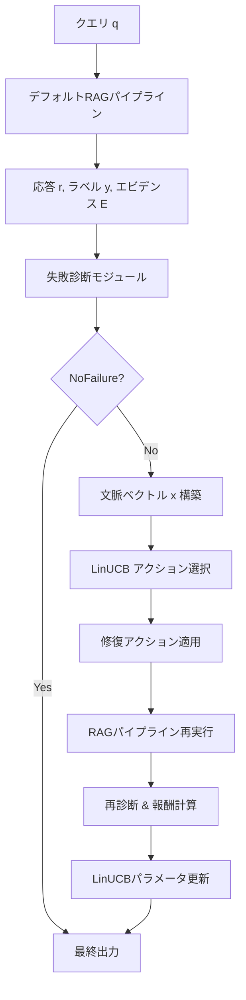

## 論文概要（Abstract）

本記事は [Diagnosing and Repairing Factual Errors in RAG under Budget Constraints](https://arxiv.org/abs/2606.29377) の解説記事です。

D2R-RAG（Diagnose-to-Repair RAG）は、ブラックボックスRAGシステムに対してモデル非依存かつリソース制約を考慮した事後修復フレームワークである。クエリ・検索結果・生成応答から観測可能なシグナル（NLIエンタイルメント、知識グラフ整合性）を用いて解釈可能な失敗署名（failure signature）を構築し、レイテンシとVRAMの予算制約のもとで最適な修復アクションを文脈付きバンディット（LinUCB）で選択する。著者らはFEVERおよびHotpotQAで評価を行い、予算制約を満たしながら精度改善を達成したと報告している。

この記事は [Zenn記事: Doctor-RAGの失敗修復ループで社内FAQ検索の回答精度を改善する](https://zenn.dev/0h_n0/articles/1fc1d60c5f09e2) の深掘りです。

## 情報源

- **arXiv ID**: 2606.29377
- **URL**: [https://arxiv.org/abs/2606.29377](https://arxiv.org/abs/2606.29377)
- **著者**: Soroush Hashemifar, Havva Alizadeh Noughabi, Fattane Zarrinkalam, et al.
- **発表年**: 2026年6月（PMLR 318）
- **分野**: cs.AI
- **コード**: [github.com/CyberScienceLab/D2R-RAG](https://github.com/CyberScienceLab/D2R-RAG)

## 背景と動機（Background & Motivation）

RAG（Retrieval-Augmented Generation）は外部知識を検索して生成に活用する手法として広く普及しているが、検索結果の品質不足や生成モデルの幻覚により事実誤りが発生する。既存の修復手法（Self-RAG、DRAGIN等）はモデルの内部ロジットへのアクセスやファインチューニングを要求するものが多く、ブラックボックスAPIとして提供されるLLMには適用が困難である。

さらに、実運用環境ではレイテンシやVRAMに制約がある。修復アクションのコストを無視してリランカーや検索深度拡大を無条件に適用すると、SLAを超過する。著者らは、修復アクションの選択を「どの修復が最も効果的か」だけでなく「予算内で最も効果的な修復はどれか」という資源配分問題として定式化する必要があると主張している。

## 主要な貢献（Key Contributions）

- **解釈可能な失敗診断**: NLIとKG整合性チェックの組み合わせによる4種類の失敗署名分類。ロジットアクセスやファインチューニング不要
- **予算制約付き修復選択**: レイテンシ・VRAM制約をハードゲートとソフトコスト重み付けで報酬関数に組み込んだLinUCBバンディット方策
- **モデル非依存設計**: 生成モデルのAPIを変更せず、事後的に診断・修復を適用可能なブラックボックス対応アーキテクチャ

## 技術的詳細（Technical Details）

### 失敗診断モジュール

D2R-RAGの診断モジュールは、RAGパイプラインの出力から3種類の観測可能シグナルを抽出する。

**クエリエンタイルメント $e^q$**: 検索された各パッセージを前提、クエリを仮説としてNLI（自然言語推論）を実行し、パッセージレベルの予測を集約する。使用モデルはDeBERTa-v3-large-nliである。

**応答エンタイルメント $e^r$**: 検索パッセージを前提、生成応答を仮説としてNLIを実行する。応答が検索結果に裏付けられているかを判定する。

**KG整合性ステータス $\kappa$**: 生成応答から関係トリプル（主語・述語・目的語）をREBEL（`Babelscape/rebel-large`）で抽出し、知識ソースとのエンティティ・述語の整合性を検査する。ステータスはConsistent、Conflict、Missing、No Tripletの4値をとる。

これらのシグナルに基づき、以下の失敗署名を判定する（論文Algorithm 1）。

| 失敗タイプ | 定義 | 判定条件 |
|-----------|------|---------|
| **WP**（Wrong Predicate） | KGとの述語矛盾 | $\kappa = \text{Conflict}$ |
| **IE**（Insufficient Evidence） | 検索結果がクエリを支持しない | $e^q = \text{Neutral}$ |
| **WR**（Wrong Response） | 応答が検索結果に裏付けられない | $e^r \in \{\text{Neutral}, \text{Contradict}\}$ |
| **LEM**（Label-Evidence Mismatch） | 予測ラベルとエンタイルメントの矛盾（FEVER専用） | $y$ と $e^q$ が非整合 |
| **NoFailure** | 上記のいずれにも該当しない | デフォルト |

判定は上記の順序で実行され、最初に該当した署名が返される。FEVER固有のIEおよびLEMケースでは、誤った根拠に基づく正解を防ぐため、棄権ラベル（Unverified）を出力する「証拠ゲート付きラベル予測」が採用されている。

### LinUCBバンディットによる修復アクション選択

修復アクションの選択を文脈付きバンディット問題として定式化する。各クエリに対して文脈ベクトル $\mathbf{x} \in \mathbb{R}^d$ を観測し、アクション集合 $\mathcal{A}$ から1つのアクション $a$ を選択して報酬 $r(a)$ を受け取る。

**文脈ベクトル $\mathbf{x}$** は以下を連結して構成する（論文Appendix B）。

1. クエリの意味表現
2. 診断された失敗タイプ
3. エンタイルメントおよびトリプル整合性ステータス
4. 正規化された残りレイテンシ・VRAM予算

**アクション選択**（論文Eq. 1）はLinUCBの上側信頼限界（UCB）に基づく。

$$
a^* = \arg\max_{a \in \mathcal{A}} \left( \mathbf{x}^\top \boldsymbol{\theta}_a + \alpha \sqrt{\mathbf{x}^\top \mathbf{A}_a^{-1} \mathbf{x}} \right)
$$

ここで、
- $\boldsymbol{\theta}_a$: アクション $a$ の線形報酬パラメータ
- $\mathbf{A}_a$: アクション $a$ の共分散行列
- $\alpha$: 探索パラメータ（実験では $\alpha = 2$）
- 第2項 $\alpha \sqrt{\mathbf{x}^\top \mathbf{A}_a^{-1} \mathbf{x}}$ は不確実性ボーナスであり、データが少ないアクションの探索を促進する

**報酬関数**（論文Eq. 2）は品質指標と予算制約の積で構成される。

$$
r(a) = \frac{1}{4} \left( \mathbb{1}_{\text{NF}} + \mathbb{1}_{\text{KG}} + 2 \cdot \mathbb{1}_{\text{NLI}} \right) \cdot \prod_{x \in \{L, V\}} \mathbb{1}[x_a \le B_x] \cdot \left(1 - \frac{x_a}{B_x}\right)
$$

ここで、
- $\mathbb{1}_{\text{NF}}$: 修復後の診断がNoFailureなら1
- $\mathbb{1}_{\text{KG}}$: トリプルレベルの整合性が保持されれば1
- $\mathbb{1}_{\text{NLI}}$: エンタイルメントが支持されれば1（重み2で最重視）
- $L_a, V_a$: アクション $a$ のレイテンシとVRAM使用量
- $B_L, B_V$: レイテンシとVRAMの予算上限（実験では3秒、6MB）
- $\mathbb{1}[x_a \le B_x]$: **ハードゲート** — 予算超過時に報酬を0にする
- $(1 - x_a / B_x)$: **ソフトコスト重み** — 予算内でもコストが低いほど高報酬

この設計により、予算を超過するアクションは完全に排除（ハードゲート）され、予算内のアクション間ではコスト効率の良いものが選好（ソフト重み）される。

**パラメータ更新**（論文Eq. 3）は選択されたアクションに対してのみ実行される。

$$
\mathbf{A}_a \leftarrow \mathbf{A}_a + \mathbf{x}\mathbf{x}^\top, \quad \mathbf{b}_a \leftarrow \mathbf{b}_a + r(a) \mathbf{x}, \quad \boldsymbol{\theta}_a \leftarrow \mathbf{A}_a^{-1} \mathbf{b}_a
$$

初期化は $\mathbf{A}_a = \mathbf{I}$, $\mathbf{b}_a = \mathbf{0}$ であり、方策は2エポックのオンライン学習で訓練される。

### 修復アクション集合

論文で報告されている修復アクションは以下の通りである。

1. **プロンプトレベル書き換え**: クエリのパラフレーズ・簡略化によるクエリ曖昧性の低減
2. **リランカー起動**: クロスエンコーダによる検索結果の精度向上
3. **検索レベル介入**: 検索深度 $k$ の調整、BM25と密ベクトル検索の切り替え、インデックスのリフレッシュ

### パイプライン全体のフロー



ベースセットアップはGPT-4o-miniを生成モデル、128トークンチャンク（16トークンオーバーラップ）、LlamaIndexをRAGフレームワークとして使用している。

### アルゴリズム

```python
from dataclasses import dataclass
from enum import Enum
import numpy as np


class FailureType(Enum):
    """D2R-RAGの失敗署名タイプ"""
    WP = "wrong_predicate"
    IE = "insufficient_evidence"
    WR = "wrong_response"
    LEM = "label_evidence_mismatch"
    NO_FAILURE = "no_failure"


@dataclass
class DiagnosticSignals:
    """診断用の観測可能シグナル"""
    kg_status: str       # "consistent" | "conflict" | "missing" | "no_triplet"
    query_entail: str    # "entail" | "contradict" | "neutral"
    response_entail: str # "entail" | "contradict" | "neutral"
    predicted_label: str | None = None  # FEVER用


def diagnose_failure(signals: DiagnosticSignals) -> FailureType:
    """Algorithm 1: 失敗診断

    NLI・KG整合性シグナルから失敗タイプを判定する。
    判定は優先順位順で、最初に該当した署名を返す。

    Args:
        signals: 診断用シグナル

    Returns:
        判定された失敗タイプ
    """
    if signals.kg_status == "conflict":
        return FailureType.WP
    if signals.query_entail == "neutral":
        return FailureType.IE
    if signals.response_entail in ("neutral", "contradict"):
        return FailureType.WR
    if signals.predicted_label is not None:
        if not _label_compatible(signals.predicted_label, signals.query_entail):
            return FailureType.LEM
    return FailureType.NO_FAILURE


class LinUCBPolicy:
    """LinUCBバンディット方策（予算制約付き）

    Args:
        n_actions: アクション数
        d: 文脈ベクトルの次元
        alpha: 探索パラメータ（UCBボーナスの係数）
        budget_latency: レイテンシ予算上限（秒）
        budget_vram: VRAM予算上限（MB）
    """

    def __init__(
        self,
        n_actions: int,
        d: int,
        alpha: float = 2.0,
        budget_latency: float = 3.0,
        budget_vram: float = 6.0,
    ) -> None:
        self.n_actions = n_actions
        self.d = d
        self.alpha = alpha
        self.budget_latency = budget_latency
        self.budget_vram = budget_vram
        # 各アクションの共分散行列と報酬ベクトル
        self.A = [np.eye(d) for _ in range(n_actions)]
        self.b = [np.zeros(d) for _ in range(n_actions)]

    def select_action(self, x: np.ndarray) -> int:
        """UCBスコア最大のアクションを選択

        Args:
            x: 文脈ベクトル (d,)

        Returns:
            選択されたアクションのインデックス
        """
        best_action = 0
        best_score = -float("inf")
        for a in range(self.n_actions):
            A_inv = np.linalg.inv(self.A[a])
            theta = A_inv @ self.b[a]
            # UCBスコア = 期待報酬 + 探索ボーナス
            score = x @ theta + self.alpha * np.sqrt(x @ A_inv @ x)
            if score > best_score:
                best_score = score
                best_action = a
        return best_action

    def compute_reward(
        self,
        is_no_failure: bool,
        is_kg_consistent: bool,
        is_nli_supported: bool,
        latency: float,
        vram: float,
    ) -> float:
        """Eq.2: 品質×予算制約の報酬を計算

        Args:
            is_no_failure: 修復後にNoFailureと診断されたか
            is_kg_consistent: KG整合性が保持されたか
            is_nli_supported: NLIエンタイルメントが支持されたか
            latency: アクションのレイテンシ（秒）
            vram: アクションのVRAM使用量（MB）

        Returns:
            報酬値 [0, 1]
        """
        quality = (
            float(is_no_failure)
            + float(is_kg_consistent)
            + 2.0 * float(is_nli_supported)
        ) / 4.0

        # ハードゲート: 予算超過なら報酬0
        if latency > self.budget_latency or vram > self.budget_vram:
            return 0.0

        # ソフトコスト重み: コストが低いほど高報酬
        cost_weight = (
            (1 - latency / self.budget_latency)
            * (1 - vram / self.budget_vram)
        )
        return quality * cost_weight

    def update(self, a: int, x: np.ndarray, reward: float) -> None:
        """Eq.3: 選択したアクションのパラメータを更新

        Args:
            a: 選択されたアクションのインデックス
            x: 文脈ベクトル (d,)
            reward: 受け取った報酬
        """
        self.A[a] += np.outer(x, x)
        self.b[a] += reward * x
```

## 実装のポイント（Implementation）

**NLIモデルの選択**: 論文ではDeBERTa-v3-large-nli（約400Mパラメータ）を使用している。推論速度がボトルネックになる場合、DeBERTa-v3-base-nliへの縮小や、ONNX Runtimeによる高速化が有効である。

**トリプル抽出の精度**: REBEL（`Babelscape/rebel-large`）はWikipedia上で学習されたモデルであり、ドメイン固有の述語（例: API仕様の関係）では抽出精度が低下する可能性がある。著者らも診断ノイズを制限事項として認めている。

**LinUCBの次元数と初期化**: 文脈ベクトルの次元 $d$ は論文中で明示されていない。クエリの意味表現にSentence-BERTを使う場合は384〜768次元、失敗タイプやステータスの離散特徴量を加えて設計する。$\mathbf{A}_a$ の逆行列計算は $O(d^3)$ であるため、$d$ が大きい場合はSherman-Morrison更新の利用を検討すべきである。

**予算パラメータの設定**: 論文では $B_L = 3$ 秒、$B_V = 6$ MBとしている。これらの値はアプリケーションのSLAに応じて調整が必要であり、著者らは0.7倍（Stringent）と1.5倍（Relaxed）の感度分析も報告している。

**修復は1回のみ**: D2R-RAGは修復を1ショットで実行し、反復的な修復ループは行わない。これはレイテンシ予算を守るための設計判断である。

## Production Deployment Guide

### AWS実装パターン（コスト最適化重視）

D2R-RAGの診断モジュール（NLI + トリプル抽出）と修復アクション選択（LinUCB）をAWS上にデプロイする構成を示す。

| 構成 | トラフィック | サービス構成 | 月額概算 |
|------|------------|-------------|---------|
| **Small** | ~100 req/日 | Lambda + Bedrock + DynamoDB | $50-150 |
| **Medium** | ~1000 req/日 | ECS Fargate + ElastiCache + RDS | $400-900 |
| **Large** | 10000+ req/日 | EKS + Spot + Karpenter + OpenSearch | $2,500-5,000 |

**Small構成の内訳**: Lambda（NLI推論: 1024MB, 30秒タイムアウト）$15/月、Bedrock（Claude 3.5 Haiku、修復用生成）$20-80/月、DynamoDB（LinUCBパラメータ保存、On-Demand）$5/月、S3（検索インデックス）$2/月。

**Medium構成の内訳**: ECS Fargate（NLIモデル常駐、2vCPU/4GB）$120/月、ElastiCache（文脈ベクトルキャッシュ、cache.t3.micro）$15/月、RDS PostgreSQL（LinUCB状態、db.t3.micro）$15/月、Bedrock $100-500/月。

**Large構成の内訳**: EKS（コントロールプレーン）$73/月、Spot Instances（NLI推論、g5.xlarge相当）$400-800/月、OpenSearch（検索インデックス）$200/月、Bedrock $1,000-3,000/月。

**コスト削減テクニック**: Spot Instances活用で推論ノードを最大90%削減、Reserved InstancesでEKSワーカーノードを最大72%削減、Bedrock Batch APIで非リアルタイム修復を50%削減、Prompt Caching有効化で類似クエリの生成コストを30-90%削減。

**注意**: 上記は2026年10月時点のAWS ap-northeast-1（東京）リージョン料金に基づく概算値。実際のコストはトラフィックパターン、バースト使用量、リージョンにより変動する。最新料金はAWS料金計算ツールで確認を推奨。

### Terraformインフラコード

**Small構成（Serverless）**:

```hcl
# D2R-RAG Small構成: Lambda + Bedrock + DynamoDB
terraform {
  required_version = ">= 1.9"
  required_providers {
    aws = { source = "hashicorp/aws", version = "~> 5.70" }
  }
}

provider "aws" { region = "ap-northeast-1" }

# --- IAMロール（最小権限） ---
resource "aws_iam_role" "d2r_lambda" {
  name               = "d2r-rag-lambda-role"
  assume_role_policy = jsonencode({
    Version = "2012-10-17"
    Statement = [{
      Action    = "sts:AssumeRole"
      Effect    = "Allow"
      Principal = { Service = "lambda.amazonaws.com" }
    }]
  })
}

resource "aws_iam_role_policy" "d2r_lambda_policy" {
  name = "d2r-rag-lambda-policy"
  role = aws_iam_role.d2r_lambda.id
  policy = jsonencode({
    Version = "2012-10-17"
    Statement = [
      {
        Effect   = "Allow"
        Action   = ["dynamodb:GetItem", "dynamodb:PutItem", "dynamodb:UpdateItem"]
        Resource = aws_dynamodb_table.linucb_state.arn
      },
      {
        Effect   = "Allow"
        Action   = ["bedrock:InvokeModel"]
        Resource = "arn:aws:bedrock:ap-northeast-1::foundation-model/*"
      },
      {
        Effect   = "Allow"
        Action   = ["logs:CreateLogGroup", "logs:CreateLogStream", "logs:PutLogEvents"]
        Resource = "arn:aws:logs:*:*:*"
      },
      {
        Effect   = "Allow"
        Action   = ["xray:PutTraceSegments", "xray:PutTelemetryRecords"]
        Resource = "*"
      }
    ]
  })
}

# --- DynamoDB（LinUCBパラメータ保存） ---
resource "aws_dynamodb_table" "linucb_state" {
  name         = "d2r-rag-linucb-state"
  billing_mode = "PAY_PER_REQUEST"  # コスト最適化: On-Demand
  hash_key     = "action_id"

  attribute { name = "action_id"; type = "S" }

  server_side_encryption { enabled = true }  # KMS暗号化
  point_in_time_recovery { enabled = true }

  tags = { Project = "d2r-rag", Environment = "production" }
}

# --- Lambda関数（診断 + 修復選択） ---
resource "aws_lambda_function" "d2r_diagnose" {
  function_name = "d2r-rag-diagnose-repair"
  role          = aws_iam_role.d2r_lambda.arn
  handler       = "handler.lambda_handler"
  runtime       = "python3.12"
  timeout       = 30
  memory_size   = 1024  # NLIモデル推論に必要

  tracing_config { mode = "Active" }  # X-Ray有効化

  environment {
    variables = {
      LINUCB_TABLE   = aws_dynamodb_table.linucb_state.name
      ALPHA          = "2.0"
      BUDGET_LATENCY = "3.0"
      BUDGET_VRAM    = "6.0"
    }
  }

  tags = { Project = "d2r-rag" }
}

# --- CloudWatchアラーム（コスト監視） ---
resource "aws_cloudwatch_metric_alarm" "lambda_duration" {
  alarm_name          = "d2r-rag-lambda-duration-high"
  comparison_operator = "GreaterThanThreshold"
  evaluation_periods  = 3
  metric_name         = "Duration"
  namespace           = "AWS/Lambda"
  period              = 300
  statistic           = "p95"
  threshold           = 25000  # 25秒（タイムアウト30秒の83%）
  alarm_description   = "D2R-RAG Lambda P95 latency approaching timeout"

  dimensions = { FunctionName = aws_lambda_function.d2r_diagnose.function_name }
}
```

**Large構成（Container）**:

```hcl
# D2R-RAG Large構成: EKS + Karpenter + Spot
module "eks" {
  source          = "terraform-aws-modules/eks/aws"
  version         = "~> 20.24"
  cluster_name    = "d2r-rag-cluster"
  cluster_version = "1.31"

  vpc_id     = module.vpc.vpc_id
  subnet_ids = module.vpc.private_subnets

  cluster_endpoint_public_access = false  # セキュリティ: プライベートのみ

  tags = { Project = "d2r-rag", Environment = "production" }
}

# --- Karpenter Provisioner（Spot優先） ---
resource "kubectl_manifest" "karpenter_nodepool" {
  yaml_body = yamlencode({
    apiVersion = "karpenter.sh/v1"
    kind       = "NodePool"
    metadata   = { name = "d2r-rag-inference" }
    spec = {
      template = {
        spec = {
          requirements = [
            { key = "karpenter.sh/capacity-type", operator = "In", values = ["spot", "on-demand"] },
            { key = "node.kubernetes.io/instance-type", operator = "In",
              values = ["g5.xlarge", "g5.2xlarge", "g6.xlarge"] }
          ]
        }
      }
      disruption = { consolidationPolicy = "WhenEmptyOrUnderutilized" }
      limits     = { cpu = "64", memory = "256Gi" }
    }
  })
}

# --- AWS Budgets（予算アラート） ---
resource "aws_budgets_budget" "d2r_monthly" {
  name         = "d2r-rag-monthly-budget"
  budget_type  = "COST"
  limit_amount = "5000"
  limit_unit   = "USD"
  time_unit    = "MONTHLY"

  notification {
    comparison_operator       = "GREATER_THAN"
    threshold                 = 80
    threshold_type            = "PERCENTAGE"
    notification_type         = "ACTUAL"
    subscriber_email_addresses = ["alerts@example.com"]
  }
}
```

### 運用・監視設定

**CloudWatch Logs Insights クエリ**（コスト異常検知）:

```
fields @timestamp, action_selected, latency_ms, vram_mb, reward
| filter event = "d2r_repair_completed"
| stats count() as repairs, avg(latency_ms) as avg_latency, avg(reward) as avg_reward by bin(1h)
| filter repairs > 100
| sort @timestamp desc
```

**CloudWatch アラーム設定（Python）**:

```python
import boto3

cloudwatch = boto3.client("cloudwatch")

def create_d2r_alarms() -> None:
    """D2R-RAG用のCloudWatchアラームを作成"""
    # Bedrockトークン使用量スパイク検知
    cloudwatch.put_metric_alarm(
        AlarmName="d2r-rag-bedrock-token-spike",
        Namespace="D2R-RAG/Custom",
        MetricName="BedrockTokensUsed",
        Statistic="Sum",
        Period=3600,
        EvaluationPeriods=1,
        Threshold=500000,
        ComparisonOperator="GreaterThanThreshold",
        AlarmActions=["arn:aws:sns:ap-northeast-1:ACCOUNT:d2r-alerts"],
    )
```

**X-Ray トレーシング設定（Python）**:

```python
from aws_xray_sdk.core import xray_recorder, patch_all

patch_all()  # boto3自動計装

@xray_recorder.capture("diagnose_failure")
def diagnose_with_tracing(query: str, evidence: list[str], response: str) -> str:
    """X-Rayトレース付きの失敗診断"""
    subsegment = xray_recorder.current_subsegment()
    subsegment.put_annotation("query_length", len(query))
    subsegment.put_annotation("evidence_count", len(evidence))

    failure_type = diagnose_failure(build_signals(query, evidence, response))

    subsegment.put_metadata("failure_type", failure_type.value)
    return failure_type
```

**Cost Explorer自動レポート（Python）**:

```python
import boto3
from datetime import date, timedelta

def get_daily_cost_report() -> dict:
    """日次コストレポートを取得しSNS通知"""
    ce = boto3.client("ce")
    today = date.today()
    response = ce.get_cost_and_usage(
        TimePeriod={"Start": str(today - timedelta(days=1)), "End": str(today)},
        Granularity="DAILY",
        Metrics=["UnblendedCost"],
        Filter={"Tags": {"Key": "Project", "Values": ["d2r-rag"]}},
        GroupBy=[{"Type": "DIMENSION", "Key": "SERVICE"}],
    )
    total = sum(
        float(g["Metrics"]["UnblendedCost"]["Amount"])
        for r in response["ResultsByTime"] for g in r["Groups"]
    )
    if total > 100:
        sns = boto3.client("sns")
        sns.publish(
            TopicArn="arn:aws:sns:ap-northeast-1:ACCOUNT:d2r-alerts",
            Subject="D2R-RAG Daily Cost Alert",
            Message=f"Yesterday cost: ${total:.2f} (threshold: $100)",
        )
    return {"total": total, "details": response["ResultsByTime"]}
```

### コスト最適化チェックリスト

**アーキテクチャ選択**:
- [ ] トラフィック量に応じた構成選択（~100 req/日: Serverless、~1000: Hybrid、10000+: Container）
- [ ] 診断モジュールとLinUCBの分離デプロイ検討（診断のみGPU、LinUCBはCPU）

**リソース最適化**:
- [ ] EC2/EKS推論ノード: Spot Instances優先（最大90%削減）
- [ ] Reserved Instances: NLIモデル常駐ノードに1年コミット（最大72%削減）
- [ ] Savings Plans: Fargate/Lambda使用量に適用
- [ ] Lambda: メモリサイズ最適化（Power Tuningで検証）
- [ ] EKS: Karpenterで未使用ノード自動統合・停止

**LLMコスト削減**:
- [ ] Bedrock Batch API: 非リアルタイム修復に使用（50%削減）
- [ ] Prompt Caching: 類似クエリの生成キャッシュ有効化（30-90%削減）
- [ ] モデル選択ロジック: 診断結果に応じて軽量モデルを優先使用
- [ ] トークン数制限: 検索結果の最大トークン数を制限

**監視・アラート**:
- [ ] AWS Budgets: 月次予算アラート（80%/100%閾値）
- [ ] CloudWatch アラーム: Lambda実行時間・Bedrockトークン使用量
- [ ] Cost Anomaly Detection: 日次異常検知有効化
- [ ] 日次コストレポート: SNS通知で$100/日超過を検知

**リソース管理**:
- [ ] 未使用リソース削除: 定期的なリソース棚卸し
- [ ] タグ戦略: Project/Environment/Ownerタグ必須化
- [ ] S3ライフサイクルポリシー: 古いインデックスの自動削除
- [ ] 開発環境: 夜間・週末のEKSノード自動停止
- [ ] CloudTrail/Config: セキュリティ監査ログ有効化

## 実験結果（Results）

### メイン比較（論文Table 1）

著者らはFEVER（2,000件のclaim verification）とHotpotQA（1,000件のmulti-hop QA）で評価を行っている。

| データセット | 手法 | Latency (s) | VRAM (MB) | Relevance | Faithfulness | ACC/EM |
|------------|------|-------------|-----------|-----------|-------------|--------|
| FEVER | Naive-RAG | 1.16 | 0.20 | 50.16 | 91.67 | 56.3 |
| FEVER | Query Paraphrase | 1.32 | 0.20 | 50.09 | 92.69 | 56.7 |
| FEVER | Context Expansion | 1.35 | 0.20 | 50.24 | 92.82 | 61.8 |
| FEVER | D2R-RAG (LinUCB) | 1.47 | 0.36 | 50.80 | 92.34 | 60.8 |
| FEVER | D2R-RAG (Thompson) | 1.14 | 0.17 | 50.00 | 92.37 | 61.5 |
| HotpotQA | Naive-RAG | 1.52 | 0.36 | 28.39 | 68.58 | 36.2 |
| HotpotQA | Query Paraphrase | 1.60 | 0.36 | 27.90 | 74.65 | 39.8 |
| HotpotQA | Context Expansion | 1.52 | 0.36 | 32.14 | 70.70 | 40.6 |
| HotpotQA | D2R-RAG (LinUCB) | 3.41 | 1.04 | 31.66 | 69.89 | 39.8 |
| HotpotQA | D2R-RAG (Thompson) | 2.37 | 1.23 | 30.69 | 71.52 | 40.4 |

**分析**: FEVERではContext Expansion（ACC 61.8）がD2R-RAG LinUCB（ACC 60.8）を上回っている。HotpotQAでもContext Expansion（EM 40.6）が最高値である。D2R-RAGの強みは単一指標の最大化ではなく、予算制約を明示的に管理しながら複数の修復戦略を適応的に選択する点にある。ただし、HotpotQAではLinUCBのレイテンシが3.41秒と予算上限の3秒を超過しており、論文中でもこの点が議論されている。

### 報酬アブレーション（論文Table 2）

| データセット | 変種 | Latency (s) | VRAM (MB) | ACC/EM |
|------------|------|-------------|-----------|--------|
| FEVER | 制約なし（ハードゲート除去） | 1.40 | 0.27 | 61.3 |
| FEVER | 重みなし（ソフト項除去） | 1.46 | 0.19 | 61.4 |
| FEVER | Full D2R-RAG | 1.47 | 0.36 | 60.8 |
| HotpotQA | 制約なし | 2.03 | 0.84 | 39.0 |
| HotpotQA | 重みなし | 2.79 | 0.68 | 39.4 |
| HotpotQA | Full D2R-RAG | 3.41 | 1.04 | 39.8 |

ハードゲートとソフト重みの両方を除去した「制約なし」変種はHotpotQA EMが39.0に低下しており、予算制約の組み込みが性能にも寄与していることが示唆される。著者らはこれを、予算制約がコスト効率の高い修復アクションへの集中を促すことで間接的に精度を向上させると解釈している。

### 予算感度分析（論文Table 3）

| データセット | 予算設定 | Latency (s) | VRAM (MB) | ACC/EM |
|------------|---------|-------------|-----------|--------|
| FEVER | Stringent (0.7x) | 2.22 | 0.24 | 60.6 |
| FEVER | Relaxed (1.5x) | 1.42 | 0.32 | 60.6 |
| HotpotQA | Stringent (0.7x) | 2.23 | 0.66 | 39.2 |
| HotpotQA | Relaxed (1.5x) | 2.31 | 0.72 | 39.4 |

著者らは、厳しい予算下ではLinUCBが低コストの検索調整（BM25/密検索の切り替え等）に集中する傾向があると報告している。

## 実運用への応用（Practical Applications）

D2R-RAGのアーキテクチャは、ブラックボックスAPIとして提供されるLLMを利用する社内RAGシステムに対して、事後的な品質改善レイヤーとして適用可能である。

**社内FAQ検索への適用**: Zenn記事で扱ったDoctor-RAGと同様に、社内FAQ検索で回答精度が低い場合の修復ループに組み込める。D2R-RAGの利点は、修復コストの予算管理が明示的に行われるため、SLA違反を防ぎながら精度改善を図れる点である。

**段階的導入**: まず診断モジュールのみをデプロイし、失敗タイプの分布を把握する。WPが多ければKGの品質改善、IEが多ければ検索インデックスの拡充、WRが多ければプロンプト改善という、診断結果に基づくボトルネック特定に活用できる。修復アクション選択はその後に導入する。

**レイテンシとコストのトレードオフ**: 実験結果が示す通り、D2R-RAGはレイテンシの増加を伴う（Naive-RAGの1.52秒に対しLinUCBで3.41秒、HotpotQA）。リアルタイム性が求められるチャットボットよりも、バッチ処理やレイテンシに余裕のある検索支援システムに適している。

## 関連研究（Related Work）

- **Self-RAG**（Asai et al.）: 反省トークンを用いて検索の必要性と応答の妥当性を自己判断する手法。ファインチューニングが必要であり、D2R-RAGのブラックボックス対応とは対照的。ただし反復的な自己修正が可能であり、D2R-RAGの1ショット修復とはトレードオフが異なる
- **DRAGIN**（Su et al.）: トークンレベルの不確実性を活用して動的に検索を行う手法。ロジットアクセスが必要であり、API経由のLLMには適用困難。D2R-RAGはNLI・KGシグナルで代替する設計を採用している
- **MBA-RAG**: バンディットベースの手法であるが、外部のクエリ複雑度予測器を必要とする点でD2R-RAGと異なる。D2R-RAGは診断シグナルを直接文脈ベクトルに組み込む
- **Doctor-RAG**（Zenn記事で扱った手法）: RAGの失敗を診断して修復する点で問題設定は類似するが、D2R-RAGはレイテンシ・VRAMの予算制約を報酬関数に明示的に組み込んでいる点が差別化ポイントである。実運用では修復コストの管理が不可欠であり、D2R-RAGはこの課題に対する体系的なアプローチを提供している
- **CRAG**（Corrective RAG, Yan et al.）: 検索結果の信頼性を評価し、低信頼時にWebサーチにフォールバックする手法。D2R-RAGの失敗診断はNLI+KGによるより体系的な分類を提供しており、修復アクションの選択も適応的である

## まとめと今後の展望

D2R-RAGは、RAGシステムの事実誤りを診断し、予算制約下で適応的に修復する初めてのフレームワークとして位置づけられる。NLI・KG整合性による解釈可能な失敗署名と、LinUCBバンディットによるコスト考慮型アクション選択が主要な技術的貢献である。

一方で、制限事項も明確に存在する。NLIモデルとトリプル抽出モデルの診断ノイズが修復精度に直接影響する点、修復アクションが事前定義された集合に限定される点、そして実験結果ではContext Expansionのような単純なベースラインを常に上回るわけではない点は、実用化にあたって考慮すべき事項である。

今後の研究方向として、著者らは診断シグナルのノイズ耐性向上と、より多様な修復アクションの統合を示唆している。

## 参考文献

- **arXiv**: [https://arxiv.org/abs/2606.29377](https://arxiv.org/abs/2606.29377)
- **Code**: [https://github.com/CyberScienceLab/D2R-RAG](https://github.com/CyberScienceLab/D2R-RAG)
- **Related Zenn article**: [https://zenn.dev/0h_n0/articles/1fc1d60c5f09e2](https://zenn.dev/0h_n0/articles/1fc1d60c5f09e2)
