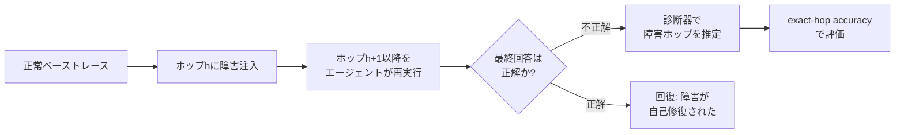

## 論文概要（Abstract）

本記事は [When Failures Propagate: Causal Failure Attribution in Agentic Retrieval-Augmented Generation](https://arxiv.org/abs/2608.20627) の解説記事です。

Agentic RAGでは複数ホップにわたる検索と推論を繰り返すが、初期ホップの検索失敗が下流のクエリやエビデンスに伝播し、最終回答の誤りの原因特定を困難にする。著者はAgenticRAG-FPと呼ぶ介入的ベンチマークを提案し、指定したホップに既知の障害を注入した上でエージェントの後続トラジェクトリを再実行し、診断器（diagnoser）が注入ホップを正しく特定できるかを評価している。Claude Haiku 4.5を用いた3ホップMuSiQue 80問のスイープでは、カバレッジベース診断（Doctor-RAGが採用する方式）のexact-hop accuracyがホップ1で0.91であるのに対しホップ2・3では0.00に低下すると報告されている。一方、frozen-hop反事実プローブはコンテンツ破損深度2で0.67のスコアを示し、後追い（post-hoc）トレースでは失われる信号を部分的に回復できる可能性が示されている。

この記事は [Zenn記事: Doctor-RAGの失敗修復ループで社内FAQ検索の回答精度を改善する](https://zenn.dev/0h_n0/articles/1fc1d60c5f09e2) の深掘りです。

## 情報源

- **arXiv ID**: 2608.20627
- **URL**: [https://arxiv.org/abs/2608.20627](https://arxiv.org/abs/2608.20627)
- **著者**: Lauren Pothuru
- **発表年**: 2026年8月
- **分野**: cs.CL, cs.AI
- **キーワード**: agentic RAG, failure attribution, causal analysis, multi-hop reasoning, interventional benchmark

## 背景と動機（Background & Motivation）

RAG（Retrieval-Augmented Generation）は外部知識を検索してLLMの生成を条件付けるパラダイムとして広く普及している。Agentic RAGはこれを複数ホップに拡張し、各ホップで検索・推論・サブクエリ生成を繰り返す。このマルチホップ構造には本質的な問題がある。初期ホップの検索失敗がサブクエリのドリフトを引き起こし、後続ホップのエビデンスを汚染する一方で、後のホップが正しいエビデンスを取得して障害を自己修復する場合もある。

従来の評価指標（accuracy、recall、answer correctness）は最終回答の正誤を測定するが、障害の発生ホップ、伝播経路、回復の有無を区別できない。Doctor-RAG（Jiao et al., 2026）はカバレッジベースのローカライゼーションで障害ホップを特定しようとするが、著者はこの手法が伝播によって可視性が失われる深いホップでは機能しないことを実証的に示している。

著者は「（1）伝播後に診断器は既知の介入ホップを回復できるか」「（2）反事実修復プローブが最終トレースにない情報を提供するのはいつか」という2つの問いを立てている。

## 主要な貢献（Key Contributions）

- **AgenticRAG-FPベンチマーク**: 構造的障害（空検索、無関係文書、クエリドリフト、偽前提、古い情報）とコンテンツ障害（認証済みファクトスパンの破損）を指定ホップに注入し、エージェントの後続トラジェクトリをlive再実行する介入的評価基盤
- **深度条件付きpost-hoc信号損失分析**: カバレッジベース診断がホップ1で有効だがホップ2以降で識別不能になることの定量的実証
- **反事実プローブの限定的比較**: frozen-hopプローブとsuffix-regenerationプローブがコンテンツ障害においてカバレッジでは得られない信号を部分的に回復できることの探索的検証

## 技術的詳細（Technical Details）

### トレースモデルと障害分類

著者はAgentic RAGの実行トレースを以下のように形式化している。トレース $\tau$ は質問 $q$、各ホップ $h$ でのサブクエリ $q_h$ と検索文書集合 $D_h$、最終回答 $a$、参照回答 $a^*$、トークンコストからなる。

各ホップで発生しうる障害は3つのステージに分類される。

- **Retrieval障害**: 空検索、無関係文書、クエリドリフト、偽前提、古い情報、事実誤り
- **Tool障害**: 必要なアクションの欠落、早期終了
- **Answer障害**: 空回答、不正回答、根拠なし回答

診断の出力は予測ステージ、予測ホップ、伝播フラグ、重大度、根本原因記述の5つ組である。

### 介入的ベンチマーク設計

AgenticRAG-FPの核心は**live介入**にある。静的なトレースの編集ではなく、障害を注入したホップ以降をエージェントに再実行させ、実際のエージェント応答を得る。これにより、障害がどのように後続ホップに伝播し、あるいは自己修復されるかを観測できる。



**介入タイプ（論文Table 1より）**:

| 介入タイプ | 説明 | カテゴリ |
|-----------|------|---------|
| Empty retrieval | エビデンスを空に置換 | 構造的 |
| Irrelevant documents | 無関係な文書に置換 | 構造的 |
| Query drift | ドリフトしたサブクエリに置換し再検索 | 構造的 |
| False premise | 自信を持った誤情報を付加 | 構造的 |
| Stale evidence | 古い時間的エビデンスを追加 | 構造的 |
| Content corruption | 認証済みファクトスパンを破損 | コンテンツ |
| Early termination | 不完全なエビデンスから回答を強制 | 構造的 |

### コンテンツ破損のスパン選択

コンテンツ障害では、検索エビデンス中の特定スパンを破損する。著者は以下の優先順位で破損対象を選択する。

1. **Answer fact**: 正解がエビデンス中に出現する場合、認証済みの誤った値に置換
2. **Bridge entity**: ホップ間をつなぐエンティティ（後続サブクエリに出現するが質問文には出現しない）を置換
3. **Salient entity/number**: 上記が該当しない場合のフォールバック

数値スパンには決定論的な摂動（deterministic perturbation）、エンティティスパンにはトークン重複のないドメイン内ディストラクタを使用する。破損はトレースとホップごとにシード固定される。

### 診断器の比較

著者は4種の診断器と1種のルールベース制御を評価している。

**Doctor-RAG（カバレッジベース）**: 正解トークンのカバレッジが不十分な最初のホップを障害箇所として報告する。Jiao et al.（2026）の手法に基づく。

**LLM-Judge**: トレース全体を読み、ステージとホップを予測する。コンテンツ研究ではself-recognitionバイアスを回避するため、別モデルファミリが判定する（cross-family）。

**Propagation-Aware（frozen-hop反事実プローブ）**: 候補ホップを修復し、後続ホップのエビデンスを凍結（元のまま保持）した上で回答が正解になるかを検証する。因果的順序で候補をテストし、最初に回答が正解になるホップを返す。

**Suf-Regen（suffix regeneration）**: 候補ホップを修復した後、後続トラジェクトリ全体を再生成する。bridge entity破損に強いが、deep answer-fact破損では再検索がクリーンなエビデンスを取得し障害を消去してしまう問題がある。

### アルゴリズム

以下にfrozen-hop反事実プローブの手続きを擬似コードで示す。

```python
def frozen_hop_probe(
    trace: Trace,
    injected_hop: int,  # 実際は未知
    repair_fn: Callable[[Trace, int], Trace],
    answer_check: Callable[[str, str], bool],
) -> int | None:
    """因果的順序で候補ホップを修復し、最初に正解を回復するホップを返す。

    Args:
        trace: 障害注入後のエージェントトレース
        repair_fn: 指定ホップのエビデンスを正常に修復する関数
        answer_check: 回答の正誤を判定する関数

    Returns:
        障害ホップの推定値、または特定不能の場合None
    """
    for candidate_hop in range(1, trace.num_hops + 1):
        # 候補ホップのみ修復、他ホップは凍結
        repaired_trace = repair_fn(trace, candidate_hop)
        # 凍結された後続エビデンスで回答を再生成
        new_answer = regenerate_answer_only(repaired_trace)
        if answer_check(new_answer, trace.reference_answer):
            return candidate_hop
    return None


def suffix_regen_probe(
    trace: Trace,
    repair_fn: Callable[[Trace, int], Trace],
    agent: Agent,
    answer_check: Callable[[str, str], bool],
) -> int | None:
    """候補ホップ修復後に後続トラジェクトリ全体を再生成する。

    frozen_hop_probeとの違いは、後続ホップのエビデンスも
    再検索される点。bridge entity破損に強いが、
    answer-fact破損では再検索が障害を消去する可能性がある。
    """
    for candidate_hop in range(1, trace.num_hops + 1):
        repaired_trace = repair_fn(trace, candidate_hop)
        # 修復ホップ以降を完全に再実行
        new_trace = agent.rerun_from(repaired_trace, candidate_hop + 1)
        if answer_check(new_trace.answer, trace.reference_answer):
            return candidate_hop
    return None
```

### 形式的な評価指標

**Exact-hop accuracy**: 診断器 $d$ の深度 $h$ でのexact-hop accuracyは、障害注入後に失敗したトレースのうち、予測ホップが注入ホップと一致する割合として定義される。

$$
\text{Acc}_d(h) = \frac{|\{\tau \in \mathcal{F}_h : d(\tau) = h\}|}{|\mathcal{F}_h|}
$$

ここで $\mathcal{F}_h$ は深度 $h$ に障害を注入し、再実行後も不正解のままのトレース集合である。

**Recovery rate**: 深度 $h$ での回復率は、障害注入にもかかわらず正解が得られる確率を測定する。

$$
\text{Recovery}(h) = \Pr[\text{correct answer} \mid \text{do}(\text{fault}, h)]
$$

**コンテンツ破損の決定論的結果**: 破損後の回答は3カテゴリに分類される。

- **Absorbed**: 回答に破損スパンのトークンが含まれる（障害が出力に伝播）
- **Resisted**: 回答が正解（エージェントが障害に抵抗）
- **Derailed**: 上記いずれでもない（障害が間接的に影響）

統計的検定にはB = 1,000のブートストラップリサンプリングで95%信頼区間を算出している。失敗トレースが10件未満のセルは記述的報告のみとしている。

## 実装のポイント（Implementation）

AgenticRAG-FPの実装において、著者が採用した重要な設計判断を整理する。

**live介入の実装**: 静的トレース編集ではなく、障害注入後にエージェントを再実行する。これにより障害の自然な伝播と回復を観測できるが、計算コストが大幅に増加する。著者は4プローブ予算（各診断器が最大4回のプローブを実行可能）という制約を設定している。

**cross-family判定**: コンテンツ研究ではGPT-4o-miniとClaude Haiku 4.5を使用し、各モデルのトレースを他方のモデルファミリが判定することでself-recognitionバイアスを回避している。

**破損のシード固定**: トレースとホップごとにシードを固定し、数値には決定論的摂動、エンティティにはドメイン内ディストラクタを使用する。認証可能なスパンが存在しないサンプルはスキップされ、カウントされる。

**ベーストレースのフィルタリング**: 構造的介入では正常なベーストレース（正解が得られるトレース）のみを対象とし、注入ホップが要求深度と一致することを適格条件とする。

## Production Deployment Guide

マルチホップRAGの失敗検知・帰属をプロダクション環境で実装する際の構成を示す。本論文の知見（カバレッジベース診断の深度限界、反事実プローブの追加コスト）を踏まえ、監視・可観測性を重視した構成とする。

### AWS実装パターン（コスト最適化重視）

**トラフィック量別の推奨構成**:

| 構成 | トラフィック | AWS構成 | 月額概算 |
|------|------------|---------|---------|
| Small | ~100 req/日 | Lambda + Bedrock + DynamoDB | $80-200 |
| Medium | ~1,000 req/日 | ECS Fargate + Bedrock + ElastiCache | $400-1,000 |
| Large | 10,000+ req/日 | EKS + Karpenter (Spot) + Bedrock Batch | $2,500-6,000 |

**Small構成の詳細**:
- Lambda（1024MB, 300s timeout）: ホップごとの検索・推論を逐次実行
- Bedrock（Claude Haiku）: 各ホップの推論。Prompt Caching有効化で30-90%削減
- DynamoDB（On-Demand）: トレース・ホップ別メトリクスの保存
- S3: 障害診断ログの長期保管
- 月額内訳: Lambda $5-15、Bedrock $50-150、DynamoDB $5-15、S3 $1-5

**Medium構成の追加要素**:
- ElastiCache（Redis）: ホップ間コンテキストのキャッシュ、検索結果キャッシュ
- ECS Fargate（0.5 vCPU, 1GB RAM x 2タスク）: 常駐プロセスでコールドスタート回避

**Large構成の追加要素**:
- EKS + Karpenter: Spot Instances優先（最大90%コスト削減）
- Bedrock Batch API: 非同期診断で50%削減
- OpenSearch: トレース全文検索、障害パターン分析

**コスト削減テクニック**:
- Spot Instances活用で最大90%削減（EKSノード）
- Reserved Instances（1年コミット）で最大72%削減
- Bedrock Batch APIで50%削減（非リアルタイム診断）
- Prompt Caching有効化で30-90%削減（ホップ間の共通コンテキスト）

注: コスト試算は2026年10月時点のAWS ap-northeast-1（東京）リージョン料金に基づく概算値。実際のコストはトラフィックパターン、バースト使用量により変動する。最新料金はAWS料金計算ツールで確認を推奨。

### Terraformインフラコード

**Small構成（Serverless）**:

```hcl
# --- マルチホップRAG障害検知基盤 (Small) ---

# DynamoDB: ホップ別メトリクス・障害トレース保存
resource "aws_dynamodb_table" "hop_traces" {
  name         = "multihop-rag-traces"
  billing_mode = "PAY_PER_REQUEST"
  hash_key     = "trace_id"
  range_key    = "hop_index"

  attribute {
    name = "trace_id"
    type = "S"
  }
  attribute {
    name = "hop_index"
    type = "N"
  }

  server_side_encryption {
    enabled = true  # KMS暗号化
  }

  tags = {
    Service = "multihop-rag-diagnosis"
    Cost    = "on-demand"
  }
}

# IAMロール: Lambda用（最小権限）
resource "aws_iam_role" "diagnosis_lambda" {
  name = "multihop-rag-diagnosis-lambda"
  assume_role_policy = jsonencode({
    Version = "2012-10-17"
    Statement = [{
      Action = "sts:AssumeRole"
      Effect = "Allow"
      Principal = { Service = "lambda.amazonaws.com" }
    }]
  })
}

resource "aws_iam_role_policy" "diagnosis_lambda_policy" {
  name = "diagnosis-policy"
  role = aws_iam_role.diagnosis_lambda.id
  policy = jsonencode({
    Version = "2012-10-17"
    Statement = [
      {
        Effect   = "Allow"
        Action   = ["bedrock:InvokeModel"]
        Resource = "arn:aws:bedrock:ap-northeast-1::foundation-model/anthropic.claude-*"
      },
      {
        Effect   = "Allow"
        Action   = ["dynamodb:PutItem", "dynamodb:GetItem", "dynamodb:Query"]
        Resource = aws_dynamodb_table.hop_traces.arn
      },
      {
        Effect   = "Allow"
        Action   = ["logs:CreateLogGroup", "logs:CreateLogStream", "logs:PutLogEvents"]
        Resource = "arn:aws:logs:*:*:*"
      }
    ]
  })
}

# Lambda: ホップ別障害診断
resource "aws_lambda_function" "hop_diagnoser" {
  function_name = "multihop-rag-diagnoser"
  runtime       = "python3.12"
  handler       = "diagnoser.handler"
  role          = aws_iam_role.diagnosis_lambda.arn
  timeout       = 300
  memory_size   = 1024

  environment {
    variables = {
      TRACE_TABLE      = aws_dynamodb_table.hop_traces.name
      DIAGNOSIS_METHOD = "coverage_plus_counterfactual"
      MAX_PROBE_BUDGET = "4"
    }
  }

  tracing_config {
    mode = "Active"  # X-Ray有効化
  }
}

# CloudWatchアラーム: 障害検知率の監視
resource "aws_cloudwatch_metric_alarm" "diagnosis_failure_rate" {
  alarm_name          = "multihop-rag-diagnosis-failure-rate"
  comparison_operator = "GreaterThanThreshold"
  evaluation_periods  = 3
  metric_name         = "DiagnosisFailureRate"
  namespace           = "MultihopRAG"
  period              = 300
  statistic           = "Average"
  threshold           = 0.5
  alarm_description   = "障害診断の失敗率が50%を超過"
  alarm_actions       = [var.sns_alert_topic_arn]
}
```

**Large構成（Container）**:

```hcl
# --- マルチホップRAG障害検知基盤 (Large) ---

# EKSクラスタ
module "eks" {
  source  = "terraform-aws-modules/eks/aws"
  version = "~> 20.31"

  cluster_name    = "multihop-rag-diagnosis"
  cluster_version = "1.31"

  vpc_id     = var.vpc_id
  subnet_ids = var.private_subnet_ids

  cluster_endpoint_public_access = false  # プライベートアクセスのみ
}

# Karpenter: Spot優先の自動スケーリング
resource "kubectl_manifest" "karpenter_nodepool" {
  yaml_body = yamlencode({
    apiVersion = "karpenter.sh/v1"
    kind       = "NodePool"
    metadata   = { name = "diagnosis-pool" }
    spec = {
      template = {
        spec = {
          requirements = [
            { key = "karpenter.sh/capacity-type", operator = "In", values = ["spot", "on-demand"] },
            { key = "node.kubernetes.io/instance-type", operator = "In",
              values = ["m7i.xlarge", "m6i.xlarge", "m5.xlarge"] }
          ]
        }
      }
      limits   = { cpu = "64", memory = "256Gi" }
      disruption = { consolidationPolicy = "WhenEmptyOrUnderutilized" }
    }
  })
}

# AWS Budgets: 月額予算アラート
resource "aws_budgets_budget" "rag_diagnosis" {
  name         = "multihop-rag-monthly"
  budget_type  = "COST"
  limit_amount = "6000"
  limit_unit   = "USD"
  time_unit    = "MONTHLY"

  notification {
    comparison_operator       = "GREATER_THAN"
    threshold                 = 80
    threshold_type            = "PERCENTAGE"
    notification_type         = "ACTUAL"
    subscriber_email_addresses = [var.alert_email]
  }
}
```

### 運用・監視設定

**CloudWatch Logs Insights: ホップ別障害検知**:

```
# ホップ深度別の障害率（1時間集計）
fields @timestamp, hop_index, diagnosis_result, diagnoser_type
| filter event = "hop_diagnosis"
| stats count(*) as total,
        sum(case when diagnosis_result = "fault_detected" then 1 else 0 end) as detected,
        avg(diagnosis_latency_ms) as avg_latency
  by bin(1h) as period, hop_index, diagnoser_type
| sort period desc, hop_index asc
```

**CloudWatchアラーム設定（Python）**:

```python
import boto3

cloudwatch = boto3.client("cloudwatch", region_name="ap-northeast-1")

def create_hop_depth_alarm(hop_index: int, threshold: float = 0.3) -> None:
    """ホップ深度別の診断精度低下アラームを作成する。

    カバレッジベース診断はhop >= 2で精度が低下するため、
    深いホップほど閾値を緩和する。
    """
    adjusted_threshold = threshold * (1.0 - 0.2 * (hop_index - 1))
    cloudwatch.put_metric_alarm(
        AlarmName=f"rag-diagnosis-accuracy-hop{hop_index}",
        MetricName="DiagnosisAccuracy",
        Namespace="MultihopRAG",
        Dimensions=[{"Name": "HopIndex", "Value": str(hop_index)}],
        Statistic="Average",
        Period=3600,
        EvaluationPeriods=3,
        Threshold=adjusted_threshold,
        ComparisonOperator="LessThanThreshold",
        AlarmActions=["arn:aws:sns:ap-northeast-1:ACCOUNT:rag-alerts"],
    )
```

**X-Rayトレーシング設定（Python）**:

```python
from aws_xray_sdk.core import xray_recorder, patch_all

patch_all()  # boto3自動計装

@xray_recorder.capture("diagnose_hop")
def diagnose_hop(trace_id: str, hop_index: int, method: str) -> dict:
    """ホップ別障害診断をX-Rayでトレースする。"""
    subsegment = xray_recorder.current_subsegment()
    subsegment.put_annotation("hop_index", hop_index)
    subsegment.put_annotation("diagnoser", method)

    result = run_diagnosis(trace_id, hop_index, method)

    subsegment.put_metadata("diagnosis_result", result)
    subsegment.put_metadata("propagation_detected", result.get("propagation_flag", False))
    return result
```

**Cost Explorer日次レポート（Python）**:

```python
import boto3
from datetime import date, timedelta

ce = boto3.client("ce", region_name="ap-northeast-1")
sns = boto3.client("sns", region_name="ap-northeast-1")

def daily_cost_report() -> None:
    """日次コストレポートを取得し、閾値超過時にSNS通知する。"""
    today = date.today()
    response = ce.get_cost_and_usage(
        TimePeriod={"Start": str(today - timedelta(days=1)), "End": str(today)},
        Granularity="DAILY",
        Metrics=["UnblendedCost"],
        Filter={"Tags": {"Key": "Service", "Values": ["multihop-rag-diagnosis"]}},
        GroupBy=[{"Type": "DIMENSION", "Key": "SERVICE"}],
    )
    total = sum(
        float(g["Metrics"]["UnblendedCost"]["Amount"])
        for r in response["ResultsByTime"]
        for g in r["Groups"]
    )
    if total > 100.0:
        sns.publish(
            TopicArn="arn:aws:sns:ap-northeast-1:ACCOUNT:cost-alerts",
            Subject="MultihopRAG日次コスト超過",
            Message=f"日次コスト: ${total:.2f} (閾値: $100)",
        )
```

### コスト最適化チェックリスト

**アーキテクチャ選択**:
- [ ] トラフィック量に応じた構成を選択（~100 req/日: Serverless、~1,000: Hybrid、10,000+: Container）
- [ ] 非リアルタイム診断はBedrock Batch APIで非同期化

**リソース最適化**:
- [ ] EC2/EKSノード: Spot Instances優先（最大90%削減）
- [ ] Reserved Instances: 1年コミットで最大72%削減
- [ ] Savings Plans: Compute Savings Plans検討
- [ ] Lambda: メモリサイズをPower Tuningで最適化
- [ ] ECS/EKS: アイドル時Karpenterでスケールダウン

**LLMコスト削減**:
- [ ] Bedrock Batch API: 非同期診断で50%削減
- [ ] Prompt Caching: ホップ間共通コンテキストをキャッシュ（30-90%削減）
- [ ] モデル選択: 浅いホップはHaikuで十分、深いホップのみSonnetに切り替え
- [ ] トークン制限: 検索結果の要約で入力トークンを削減
- [ ] プローブ予算制限: 論文の知見に基づき最大4プローブに制限

**監視・アラート**:
- [ ] AWS Budgets: 月額予算アラート（80%/100%通知）
- [ ] CloudWatch: ホップ深度別診断精度アラーム
- [ ] Cost Anomaly Detection: 異常コスト検知有効化
- [ ] 日次コストレポート: SNS通知連携

**リソース管理**:
- [ ] 未使用リソース: 定期スキャン・削除（Trusted Advisor連携）
- [ ] タグ戦略: Service/Environment/Costタグ必須
- [ ] ライフサイクルポリシー: S3障害ログの30日自動アーカイブ
- [ ] 開発環境: 夜間・週末の自動停止スケジュール
- [ ] DynamoDB: TTLでトレースデータの自動削除（90日）

## 実験結果（Results）

### 構造的障害の帰属（論文Table 2）

Claude Haiku 4.5 + dense retrieval、3ホップMuSiQue 80問での構造的障害介入の結果を以下に示す。数値は論文Table 2よりexact-hop accuracy（bootstrap 95% CI）。

| 深度 | Doctor-RAG（カバレッジ） | LLM-Judge | Propagation-Aware | 失敗トレース数 $n$ |
|------|------------------------|-----------|-------------------|-------------------|
| Hop 1 | 0.91 [0.81, 0.98] | 0.26 [0.12, 0.40] | 0.51 [0.37, 0.67] | 43 |
| Hop 2 | 0.00 [0.00, 0.00] | 0.25 [0.11, 0.42] | 0.25 [0.11, 0.39] | 36 |
| Hop 3 | 0.00 [0.00, 0.00] | 0.43 [0.24, 0.67] | 0.48 [0.29, 0.67] | 21 |

著者らは以下の点を報告している。

- カバレッジベース診断はホップ1で0.91と高精度だが、ホップ2・3では完全に失敗する（0.00）。これはカバレッジが「可視的な」障害のみを捕捉し、伝播によって下流に隠蔽された障害を検出できないことを意味する
- LLM-JudgeとPropagation-Awareプローブはホップ2・3で部分的な信号を保持するが、信頼区間が重複しており、一般的なランキングは主張されていない
- 著者はこの結果を「カバレッジ信号の識別可能性限界」と呼んでいるが、不可能定理ではないと注記している

### コンテンツ障害の帰属（論文Table 3）

GPT-4o-miniとClaude Haiku 4.5、BM25検索、HotpotQAとMuSiQueをプールした結果。

| 診断器 | Hop 1 ($n$ = 44) | Hop 2 ($n$ = 18) |
|--------|-----------------|-----------------|
| Doctor-RAG（カバレッジ） | 1.00 [1.00, 1.00] | 0.00 [0.00, 0.00] |
| LLM-Judge（cross-family） | 0.59 [0.43, 0.73] | 0.89 [0.72, 1.00] |
| Propagation-Aware | 0.89 [0.80, 0.98] | 0.67 [0.44, 0.89] |
| Suf-Regen | 0.91 [0.82, 0.98] | 0.11 [0.00, 0.28] |

著者らの分析:

- カバレッジベース診断は構造的障害と同様にホップ2で0.00に低下する
- LLM-Judgeのホップ2での高スコア（0.89）はトレース中のposition priorを反映している可能性があり、著者は信頼性の高い単独指標とはみなしていない
- Suf-Regenのホップ2での低スコア（0.11）は再生成時にクリーンなエビデンスが取得され障害が消去されるためと報告されている
- Bridge entity部分集合（$n$ = 11）ではSuf-Regenが1.00、Propagation-Awareが0.73だが、記述的報告のみ
- 深度3の結果（$n$ = 3）はAppendix Bに記載: カバレッジ0.00、Judge 0.33、Propagation-Aware 0.00、Suf-Regen 0.00。比較は行われていない

### コンテンツ破損の決定論的結果（論文Table 4）

| 深度 | Absorbed | Resisted | Derailed | $n$ |
|------|----------|----------|----------|-----|
| Hop 1 | 0.15 | 0.58 | 0.26 | 106 |
| Hop 2 | 0.09 | 0.74 | 0.18 | 68 |
| Hop 3 | 0.00 | 0.85 | 0.15 | 20 |

著者らは、Absorbed 22件中20件がanswer-fact破損であり、salient-entity破損では吸収が0件（40件中0件）であったと報告している。クエリ汚染は129件中3件でしか発生せず、クエリテキストの監視だけでは伝播の大半を見逃すことが示されている。

## 実運用への応用（Practical Applications）

本論文の知見は、マルチホップRAGを運用する際の障害検知戦略に直接的な示唆を与える。

**カバレッジベース診断の限界認識**: Doctor-RAGのカバレッジベース診断は単一ホップ障害の検出には有効だが、Zenn記事で紹介したようなマルチホップ構成では深いホップの障害を検出できない。プロダクション環境では、カバレッジ診断を第一段階のスクリーニングとして使いつつ、ホップ2以降の障害には反事実プローブを併用する階層的な診断パイプラインが求められる。

**プローブ予算とコストのトレードオフ**: 反事実プローブは各候補ホップでLLMを再実行するため、コストが線形に増加する。著者が設定した4プローブ予算は、3ホップ構成での実用的な上限を示している。リアルタイム応答が必要な場面ではカバレッジ診断のみに留め、バッチ処理で反事実プローブを追加実行する二段階設計が現実的である。

**監視すべきメトリクス**: 論文のTable 4が示すように、深いホップほどResisted率が上昇する（ホップ1: 0.58、ホップ3: 0.85）。これはエージェントの自己修復能力を示すが、同時にAbsorbed率のホップ1での0.15という値は、浅いホップの障害が最終回答に直接伝播するリスクを定量化している。ホップ別のAbsorbed/Derailed率を継続的に監視することで、障害の影響範囲を推定できる。

## 関連研究（Related Work）

- **Doctor-RAG** (Jiao et al., 2026): カバレッジゲート付きローカライゼーションで障害ホップを特定する手法。本論文ではpost-hocベースラインとして使用され、ホップ1では有効だがホップ2以降で識別不能になることが実証されている。Zenn記事で紹介した失敗修復ループの基盤技術
- **ReAct** (Yao et al., 2023): Reasoning + Acting のパラダイムでエージェントが段階的に推論と行動を繰り返す。Agentic RAGのホップ間依存関係が障害伝播の原因となる構造的基盤
- **MuSiQue** (Trivedi et al., 2022): 制御された構成による多段推論ベンチマーク。本論文の主要実験で80問の3ホップ問題が使用されている
- **CRAG** (Yang et al., 2024): 包括的RAGベンチマーク。本論文ではシングルターン扱いのため主要結果からは除外されている

## まとめと今後の展望

本論文の主要な知見は、カバレッジベースの障害帰属がマルチホップRAGにおいて深度依存的に識別不能になるという実証的結果である。ホップ1で0.91のexact-hop accuracyがホップ2・3で0.00に低下するという結果は、Doctor-RAGのような単一信号に依存する診断器の根本的限界を示している。

実務への示唆として、マルチホップRAGの障害検知には階層的アプローチ（カバレッジ + 反事実プローブの組み合わせ）が必要であり、各プローブ手法には情報フローに応じた得手不得手がある（frozen-hopはanswer-fact破損に、suffix-regenはbridge entity破損に適する）。

著者は今後の方向として、障害タイプに応じてプローブを選択するpath-awareまたはcascaded診断や、ホップ間の因果的もつれ（causal entanglement）がある場合に不確実性を報告する仕組みの開発を挙げている。また、現在の実験はコーパス側のクリーンな状態を前提としており、永続的なコーパス破損への対応は未解決の課題である。

## 参考文献

- **arXiv**: [https://arxiv.org/abs/2608.20627](https://arxiv.org/abs/2608.20627)
- **Related Zenn article**: [Doctor-RAGの失敗修復ループで社内FAQ検索の回答精度を改善する](https://zenn.dev/0h_n0/articles/1fc1d60c5f09e2)
- Lewis, P. et al. (2020). Retrieval-Augmented Generation for Knowledge-Intensive NLP Tasks. NeurIPS 2020.
- Jiao, W. et al. (2026). Doctor-RAG: Diagnosing and Repairing Failures in RAG Systems.
- Yao, S. et al. (2023). ReAct: Synergizing Reasoning and Acting in Language Models. ICLR 2023.
- Trivedi, H. et al. (2022). MuSiQue: Multihop Questions via Single Hop Question Composition. TACL 2022.
