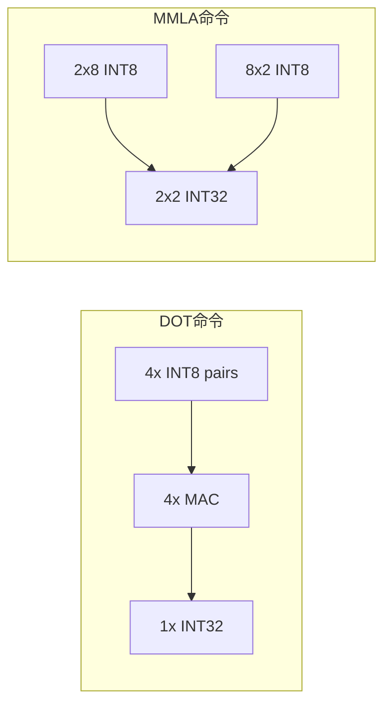
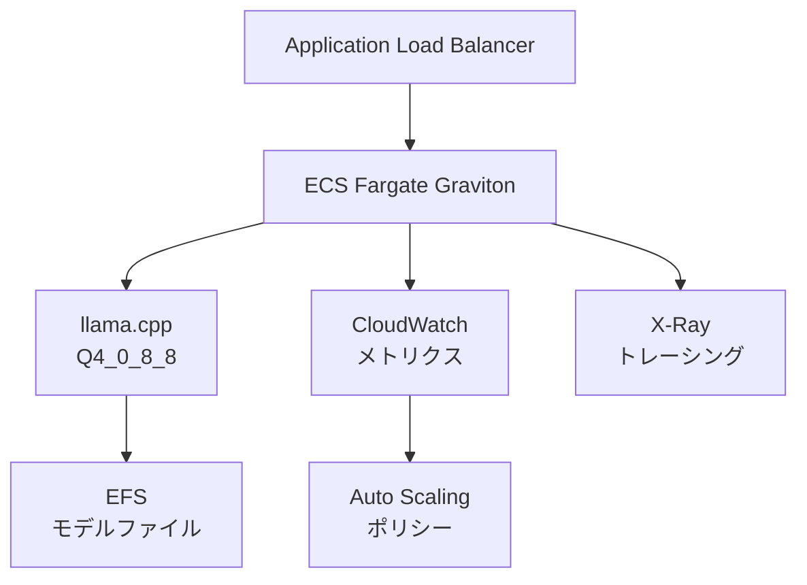

## 論文概要（Abstract）

本記事は [Highly Optimized Kernels and Fine-Grained Codebooks for LLM Inference on Arm CPUs](https://arxiv.org/abs/2501.00032) の解説記事である。

大規模言語モデル（LLM）をコモディティCPU上で実行する際、グループ量子化フォーマットにおける重みのアンパック・スケーリング処理が多くの命令サイクルを消費し、推論レイテンシのボトルネックとなっている。著者らはARM CPU向けに、複数出力行にわたるオペランドロードと重みアンパックの償却、インターリーブグループデータレイアウト、デコンプレッションパスの最適化、およびグループ単位の非一様コードブック量子化を提案している。これらの最適化によりllama.cppの4ビットLLM推論において、プロンプト処理で3〜3.2倍、自己回帰デコードで2倍の高速化を達成したと報告されている。カーネルはllama.cppリポジトリに統合済みである。

この記事は [Zenn記事: Fargate 32vCPUとllama.cppで実現するサーバーレスLLM推論基盤の構築](https://zenn.dev/0h_n0/articles/ca14512eb46121) の深掘りである。

## 情報源

- **arXiv ID**: 2501.00032
- **URL**: [https://arxiv.org/abs/2501.00032](https://arxiv.org/abs/2501.00032)
- **著者**: Dibakar Gope, David Mansell, Danny Loh, Ian Bratt（Arm Ltd.）
- **提出日**: 2024年12月23日
- **分野**: cs.LG（Machine Learning）, cs.AI, cs.AR, cs.CL
- **コード**: [github.com/ggerganov/llama.cpp](https://github.com/ggerganov/llama.cpp)（最適化カーネル統合済み）

## 背景と動機（Background & Motivation）

LLMの推論は従来GPU上で行われることが多いが、コスト効率・可用性・デプロイの柔軟性の観点からCPU推論への需要が高まっている。特にAWS GravitonのようなARM64ベースのプロセッサは、vCPUあたりの単価がx86比で約20%安価であり、llama.cppがARM NEONベクトル命令を活用できるため、サーバーレスLLM推論基盤の有力な選択肢となっている。

しかし、CPU上でのLLM推論にはメモリ帯域幅と計算効率の制約がある。4ビットグループ量子化フォーマット（Q4_0等）では、重みの格納効率は高いものの、推論時にサブバイト値のアンパック、ゼロポイント補正、FP16スケールの適用といったデ量子化処理が必要となる。著者らの分析によると、既存のllama.cppカーネルでは多くの命令が乗算以外の作業（アンパック、スケーリング、ゼロポイント減算）に費やされており、MACユニットの利用効率が低いことが明らかになった。

本論文では、ARM CPU上のLLM推論を高速化するための4つの最適化手法と、超低精度量子化向けの非一様コードブック手法を提案している。

## 主要な貢献（Key Contributions）

- **償却オペランドロードと重みアンパック**: 複数の出力行にわたってオペランドのロードとアンパック処理のコストを償却し、命令パイプラインにおけるMAC命令の比率を向上させる手法
- **インターリーブグループデータレイアウト**: メモリアクセスパターンをSIMD命令の計算順序に一致させる重み再配置により、ロード回数の削減とキャッシュ効率の改善を実現
- **デコンプレッションパス最適化**: ゼロポイント減算の除去とスケーリングの統合により、デ量子化のオーバーヘッドを削減。`SMMLA`（Signed Matrix Multiply-Accumulate）命令を活用してMAC効率を倍増
- **グループ単位非一様コードブック量子化**: k-meansクラスタリングに基づく非一様コードブックにより、重みの分布に適合した超低精度（2〜4ビット）量子化を実現し、一様量子化よりも低いperplexityを達成

## 技術的詳細（Technical Details）

### グループ量子化の基礎

llama.cppの標準的な4ビットグループ量子化（Q4_0）では、32個の重みを1グループとし、各グループに1つのFP16スケール値を割り当てる。量子化・デ量子化は以下のように定式化される。

量子化時、グループ内の各重み $w_i$ を以下で符号付き4ビット整数 $q_i$ に変換する:

$$
q_i = \text{round}\left(\frac{w_i}{s}\right), \quad s = \frac{\max(|w_j|)}{7}
$$

デ量子化時は逆変換を行う:

$$
\hat{w}_i = s \cdot q_i
$$

ここで、$s$ はFP16のグループスケール、$q_i \in [-8, 7]$ は4ビット符号付き整数値である。1グループ32重みの場合、格納に必要なバイト数は $32 \times 0.5 + 2 = 18$ バイト（重み16バイト + スケール2バイト）で、1重みあたり平均4.5ビットとなる。

### ARM NEONベクトル命令とMAC効率

ARM NEONは128ビットSIMDレジスタを提供し、以下の命令でINT8/INT4の積和演算を高速化する。

**DOT命令** (`vdotq_laneq_s32`): 4つのINT8要素ペアの内積を計算し、INT32アキュムレータに加算する。128ビットレジスタあたり4つのMAC演算に相当する。

**MMLA命令**: 2x8のINT8行列と8x2のINT8行列を乗算し、2x2のINT32結果行列を生成する。DOT命令と比較してMAC効率が2倍になる。



既存のllama.cppカーネルでは、DOT命令1回あたりに複数のアンパック命令（AND、シフト、減算）が必要であり、MAC命令の比率が低い。著者らの最適化では、この比率を大幅に改善することを目指している。

### 償却オペランドロードの設計

最適化の核心は、複数の出力チャネルの重みを同時に処理することで、アクティベーションのロードとアンパック処理を償却する点にある。

**GEMV（自己回帰デコード）の場合**: バッチサイズ1では行列-ベクトル積となる。複数の連続する重み列を同時に処理し、量子化アクティベーションベクトルとそのスケール値のロードを再利用する。

**GEMM（プロンプト処理）の場合**: Output-stationary dataflowを採用する。アクティベーションをMMLAレイアウトに合わせて事前に再配置し、この再配置を先行する動的アクティベーション量子化にフュージョンさせる。タイルサイズはレジスタファイルのサイズにより制約される。

具体的なカーネル構成は以下の通りである:

| カーネル名 | 出力チャネル数 | ブロックサイズ | 対象命令 |
|-----------|-------------|-------------|---------|
| Q4_0_4_4 | 4 | 4バイトチャンク | DOT |
| Q4_0_4_8 | 4 | 8バイトチャンク | DOT/MMLA |
| Q4_0_8_8 | 8 | 8バイトチャンク | MMLA |

Q4_0_8_8カーネルでは、8チャネル分の重みをインターリーブし、1回のMMLAタイルで8出力を同時に計算する。これにより、アクティベーションのロード回数が1/8に削減される。

### インターリーブグループデータレイアウト

従来のQ4_0フォーマットでは、18バイト構造体（スケール2バイト + 重み16バイト）がメモリ上に連続配置される。これは16バイトアライメントに合わず、SIMDロード時に非効率なアクセスパターンとなる。

著者らのインターリーブレイアウトでは、グループ内の32個の重み $w_0, w_1, \ldots, w_{31}$ を以下のように再配置する:

$$
w_0, w_{16}, w_1, w_{17}, \ldots, w_{15}, w_{31}
$$

さらに、複数チャネルの重みを計算順序に沿ってインターリーブし、スケール値を先頭にまとめて配置する。

```python
def interleave_weights(
    weights: list[list[int]],
    n_channels: int = 8,
    group_size: int = 32,
) -> bytes:
    """重みをインターリーブレイアウトに変換する.

    Args:
        weights: 各チャネルの量子化重みリスト
        n_channels: インターリーブするチャネル数
        group_size: グループサイズ

    Returns:
        インターリーブされたバイト列
    """
    result = bytearray()

    # スケール値を先頭にまとめて配置
    for ch in range(n_channels):
        scale = compute_group_scale(weights[ch])
        result.extend(scale.to_bytes(2, "little"))

    # 重みをSIMD計算順序でインターリーブ
    for i in range(group_size // 2):
        for ch in range(n_channels):
            w_low = weights[ch][i] & 0x0F
            w_high = weights[ch][i + group_size // 2] & 0x0F
            result.append((w_high << 4) | w_low)

    return bytes(result)
```

この再配置はオフラインで実行されるため、推論時のオーバーヘッドはゼロである。メモリ使用量も変わらない。

### デコンプレッションパス最適化

既存のデ量子化パスでは、4ビット符号付き整数を復元するために以下の手順が必要だった:

1. バイトからニブルを抽出（ANDマスク + シフト）
2. ゼロポイント8を減算して符号付きに変換
3. FP16スケールを適用

著者らはゼロポイント減算を除去する手法を提案している。具体的には、各ニブルのMSBをトグルし、8のバイアスを加えた状態で格納する。これにより、2つのニブルは符号付き値の上位4ビット（16倍スケール）を表現する。

ランタイムのアンパックは以下の2操作のみとなる:

- **上位ニブル**: `0xF0` マスクで抽出
- **下位ニブル**: 4ビット左シフト

16倍のスケール因子は、整数からFP変換時の暗黙的なシフトまたは指数部の明示的な調整で除去される。この最適化により、グループあたり8つの減算命令が不要となる。

### グループ単位非一様コードブック量子化

超低精度（2〜3ビット）では一様量子化のperplexity劣化が顕著になる。著者らは、重み分布に適合した非一様コードブックを提案している。

**コードブック生成（Algorithm 1）**:

1. 各グループの重みを $s$（FP16スケール）で正規化する
2. 正規化された各グループのヒストグラム分布を構築する
3. **Phase 1**: 分布ヒストグラムに対してk-meansクラスタリングを実行し、$C$ 個のクラスタに分類する
4. **Phase 2**: 各クラスタ内でk-meansを実行し、コードブック（セントロイド集合）を生成する

2ビット構成の場合、各コードブックは4つの8ビット符号付きセントロイドを持つ。グループサイズは256で、16個のサブグループ（各16要素）に分割される。各サブグループは2ビットのコードブックインデックスとローカルスケールを持ち、256幅のスーパーブロックにFP16スケールが割り当てられる。

**デ量子化（Algorithm 2）**:

$$
\hat{w}_i = s_{\text{super}} \cdot s_{\text{local}} \cdot \text{codebook}[c_{\text{idx}}][q_i]
$$

ここで:
- $s_{\text{super}}$: スーパーブロック（256要素）のFP16スケール
- $s_{\text{local}}$: サブグループ（16要素）のローカルスケール
- $c_{\text{idx}}$: サブグループに割り当てられたコードブックインデックス
- $q_i$: 各要素の2ビットセントロイドインデックス

コードブックはベクトルレジスタに格納可能なサイズに設計されており、`vtbl`（テーブルルックアップ）命令で高速にデ量子化を実行できる。重要な点として、あるモデル（LLaMA-2 7B）で学習されたコードブックが別のモデル（LLaMA-3 8B）にも転用可能であることが報告されている。

平均ビット幅は約3.2ビット/重み（3.15〜3.2）と報告されている。

## 実装のポイント（Implementation Notes）

### llama.cppでのARM最適化の活用

llama.cppリポジトリには、本論文のカーネルがQ4_0_4_4、Q4_0_4_8、Q4_0_8_8フォーマットとして統合されている。Graviton上でこれらのカーネルを活用するには、以下の手順を踏む。

```bash
# llama.cppのビルド（ARM NEON + MMLA有効化）
git clone https://github.com/ggerganov/llama.cpp
cd llama.cpp

# Graviton3/4向けビルド（MMLA命令対応）
cmake -B build \
  -DCMAKE_C_FLAGS="-march=armv8.4-a+dotprod+i8mm" \
  -DCMAKE_CXX_FLAGS="-march=armv8.4-a+dotprod+i8mm" \
  -DGGML_CPU_AARCH64=ON
cmake --build build --config Release -j $(nproc)

# モデルの量子化（Q4_0_8_8推奨）
./build/bin/llama-quantize \
  model-f16.gguf \
  model-q4_0_8_8.gguf \
  Q4_0_8_8
```

**フォーマット選択の指針**:
- **Q4_0_8_8**: Graviton3/4（MMLA命令対応）で最高性能。プロンプト処理で最大3.2倍高速化
- **Q4_0_4_8**: MMLA非対応だがDOT命令対応のARMv8.2以降向け
- **Q4_0_4_4**: 汎用ARMv8向け。最も広い互換性

IQ4_NL（非一様4ビット）フォーマットも最適化されており、16エントリのコードブックがベクトルレジスタ1本に収まるため、`vtbl`命令で高速なルックアップが可能である。

### スレッド数とバッチサイズの調整

論文のベンチマーク結果から、スレッド数とバッチサイズの組み合わせが性能に大きく影響することがわかる。

```python
from dataclasses import dataclass


@dataclass(frozen=True)
class LlamaCppConfig:
    """llama.cppの実行設定.

    Attributes:
        n_threads: 推論に使用するスレッド数
        n_batch: プロンプト処理のバッチサイズ
        quant_format: 量子化フォーマット名
    """

    n_threads: int
    n_batch: int
    quant_format: str

    def validate(self) -> None:
        """設定の妥当性を検証する.

        Raises:
            ValueError: 不正な設定値の場合
        """
        if self.n_threads < 1:
            raise ValueError(f"n_threads must be >= 1, got {self.n_threads}")
        if self.n_batch < 1:
            raise ValueError(f"n_batch must be >= 1, got {self.n_batch}")

        valid_formats = {"Q4_0", "Q4_0_4_4", "Q4_0_4_8", "Q4_0_8_8", "IQ4_NL"}
        if self.quant_format not in valid_formats:
            raise ValueError(
                f"Unknown format: {self.quant_format}. "
                f"Valid: {valid_formats}"
            )


def recommend_config(
    vcpu_count: int,
    is_graviton3_or_later: bool = True,
) -> LlamaCppConfig:
    """Graviton環境に適した推奨設定を返す.

    Args:
        vcpu_count: 利用可能なvCPU数
        is_graviton3_or_later: Graviton3以降かどうか

    Returns:
        推奨されるllama.cpp設定
    """
    quant = "Q4_0_8_8" if is_graviton3_or_later else "Q4_0_4_8"
    # 物理コア数を推論スレッドに割り当て
    n_threads = vcpu_count
    # バッチサイズはスレッド数に応じて調整
    n_batch = min(32, vcpu_count)

    config = LlamaCppConfig(
        n_threads=n_threads,
        n_batch=n_batch,
        quant_format=quant,
    )
    config.validate()
    return config
```

バッチサイズ1（逐次デコード）では64コア全使用時にメモリ帯域がボトルネックとなり、トークン生成速度の改善は限定的である（論文Table 1より、Q4_0: 46.0 tok/s vs Q4_0_8_8: 46.8 tok/s）。一方、バッチサイズ32では2.1倍の高速化（166.8 → 342.9 tok/s）が得られる。

## Production Deployment Guide

### AWS Graviton上でのLLM推論アーキテクチャ

本論文の最適化カーネルは、AWS Graviton3/4プロセッサ上で直接的な恩恵をもたらす。Graviton3はARMv8.4-Aアーキテクチャを採用し、MMLA命令をサポートしているため、Q4_0_8_8フォーマットの最大性能を引き出せる。



### AWS実装パターン（コスト最適化重視）

2026年10月時点のAWS ap-northeast-1（東京）リージョン料金に基づく概算値である。実際のコストはトラフィックパターン、リージョン、バースト使用量により変動する。最新料金はAWS料金計算ツールで確認を推奨する。

**トラフィック量別の推奨構成**:

| 構成 | トラフィック | サービス | 月額コスト |
|------|-----------|---------|-----------|
| Small | ~100 req/日 | Fargate Graviton (4vCPU) + EFS | $80-150 |
| Medium | ~1,000 req/日 | Fargate Graviton (16vCPU) x2 + EFS | $400-800 |
| Large | 10,000+ req/日 | ECS on EC2 Graviton Spot + EFS | $1,500-3,500 |

**Small構成（~100 req/日）**:
- Fargate Graviton: 4vCPU / 16GB RAM、月額約$70（スポット価格適用時）
- EFS: モデルファイル格納（~5GB）、月額約$1.5
- ALB: 月額約$20
- CloudWatch: 月額約$5
- 合計: 月額$80-150

**Medium構成（~1,000 req/日）**:
- Fargate Graviton: 16vCPU / 32GB RAM x2タスク、月額約$560
- EFS: Bursting Throughput Mode、月額約$1.5
- ALB + Auto Scaling: 月額約$40
- 合計: 月額$400-800

**Large構成（10,000+ req/日）**:
- EC2 Graviton3 Spot (c7g.8xlarge): 32vCPU / 64GB RAM x4、月額約$1,200（Spot 70%割引）
- ECS Capacity Provider（Spot優先）: 自動フォールバック
- EFS Provisioned Throughput: 月額約$60
- ALB + CloudFront: 月額約$100
- 合計: 月額$1,500-3,500

**コスト削減テクニック**:
- Graviton採用でx86比20%コスト削減
- Fargate Spot活用で最大70%削減
- EC2 Spot Instances活用で最大90%削減
- Savings Plans（1年コミット）で最大35%削減
- EFSのInfrequent Accessストレージクラスで92%削減

### Terraformインフラコード

**Small構成（Fargate Graviton）**:

```hcl
# ECS Fargate Graviton + llama.cpp 構成
# 2026-10-15時点のAWS料金に基づく

resource "aws_ecs_cluster" "llm" {
  name = "llm-inference"

  setting {
    name  = "containerInsights"
    value = "enabled"
  }
}

resource "aws_ecs_cluster_capacity_providers" "llm" {
  cluster_name       = aws_ecs_cluster.llm.name
  capacity_providers = ["FARGATE", "FARGATE_SPOT"]

  default_capacity_provider_strategy {
    capacity_provider = "FARGATE_SPOT"
    weight            = 1
  }
}

resource "aws_ecs_task_definition" "llama_cpp" {
  family                   = "llama-cpp-inference"
  requires_compatibilities = ["FARGATE"]
  network_mode             = "awsvpc"
  cpu                      = 4096  # 4 vCPU
  memory                   = 16384 # 16 GB

  runtime_platform {
    operating_system_family = "LINUX"
    cpu_architecture        = "ARM64" # Graviton
  }

  container_definitions = jsonencode([{
    name  = "llama-cpp"
    image = "${aws_ecr_repository.llm.repository_url}:latest"
    portMappings = [{
      containerPort = 8080
      protocol      = "tcp"
    }]
    environment = [
      { name = "MODEL_PATH", value = "/models/model-q4_0_8_8.gguf" },
      { name = "N_THREADS", value = "4" },
      { name = "N_BATCH", value = "4" },
      { name = "CTX_SIZE", value = "4096" },
    ]
    mountPoints = [{
      sourceVolume  = "models"
      containerPath = "/models"
      readOnly      = true
    }]
    logConfiguration = {
      logDriver = "awslogs"
      options = {
        "awslogs-group"         = aws_cloudwatch_log_group.llm.name
        "awslogs-region"        = var.region
        "awslogs-stream-prefix" = "llama-cpp"
      }
    }
    healthCheck = {
      command     = ["CMD-SHELL", "curl -f http://localhost:8080/health || exit 1"]
      interval    = 30
      timeout     = 5
      retries     = 3
      startPeriod = 120
    }
  }])

  volume {
    name = "models"
    efs_volume_configuration {
      file_system_id     = aws_efs_file_system.models.id
      transit_encryption = "ENABLED"
      authorization_config {
        access_point_id = aws_efs_access_point.models.id
        iam             = "ENABLED"
      }
    }
  }
}

# EFS for model storage
resource "aws_efs_file_system" "models" {
  encrypted        = true
  performance_mode = "generalPurpose"
  throughput_mode  = "bursting"

  lifecycle_policy {
    transition_to_ia = "AFTER_30_DAYS"
  }

  tags = { Name = "llm-models" }
}

# CloudWatch alarm for high latency
resource "aws_cloudwatch_metric_alarm" "high_latency" {
  alarm_name          = "llm-inference-high-latency"
  comparison_operator = "GreaterThanThreshold"
  evaluation_periods  = 3
  metric_name         = "TargetResponseTime"
  namespace           = "AWS/ApplicationELB"
  period              = 60
  statistic           = "p95"
  threshold           = 30 # 30秒
  alarm_description   = "LLM inference P95 latency exceeds 30s"
  alarm_actions       = [aws_sns_topic.alerts.arn]
}
```

**Large構成（EC2 Graviton Spot + ECS）**:

```hcl
# EC2 Graviton3 Spot + ECS 構成

resource "aws_ecs_capacity_provider" "graviton_spot" {
  name = "graviton-spot"

  auto_scaling_group_provider {
    auto_scaling_group_arn         = aws_autoscaling_group.graviton.arn
    managed_termination_protection = "ENABLED"

    managed_scaling {
      maximum_scaling_step_size = 4
      minimum_scaling_step_size = 1
      status                    = "ENABLED"
      target_capacity           = 80
    }
  }
}

resource "aws_launch_template" "graviton" {
  name_prefix   = "llm-graviton-"
  image_id      = data.aws_ami.ecs_graviton.id
  instance_type = "c7g.8xlarge" # 32 vCPU, 64 GB

  instance_market_options {
    market_type = "spot"
    spot_options {
      max_price                      = "0.40" # On-Demand $1.30の約30%
      spot_instance_type             = "persistent"
      instance_interruption_behavior = "stop"
    }
  }

  block_device_mappings {
    device_name = "/dev/xvda"
    ebs {
      volume_size = 100
      volume_type = "gp3"
      encrypted   = true
    }
  }

  user_data = base64encode(<<-EOF
    #!/bin/bash
    echo ECS_CLUSTER=${aws_ecs_cluster.llm.name} >> /etc/ecs/ecs.config
    echo ECS_ENABLE_SPOT_INSTANCE_DRAINING=true >> /etc/ecs/ecs.config
  EOF
  )
}

# AWS Budgets alert
resource "aws_budgets_budget" "llm_monthly" {
  name         = "llm-inference-monthly"
  budget_type  = "COST"
  limit_amount = "3500"
  limit_unit   = "USD"
  time_unit    = "MONTHLY"

  notification {
    comparison_operator       = "GREATER_THAN"
    threshold                 = 80
    threshold_type            = "PERCENTAGE"
    notification_type         = "ACTUAL"
    subscriber_sns_topic_arns = [aws_sns_topic.alerts.arn]
  }

  notification {
    comparison_operator       = "GREATER_THAN"
    threshold                 = 100
    threshold_type            = "PERCENTAGE"
    notification_type         = "FORECASTED"
    subscriber_sns_topic_arns = [aws_sns_topic.alerts.arn]
  }
}
```

### 運用・監視設定

**CloudWatch Logs Insights クエリ**: 推論レイテンシとスループットの分析

```
# P95/P99 レイテンシ分析
fields @timestamp, @message
| filter @message like /inference_latency/
| stats
    avg(latency_ms) as avg_latency,
    pct(latency_ms, 95) as p95_latency,
    pct(latency_ms, 99) as p99_latency,
    count(*) as request_count
  by bin(1h) as time_bucket
| sort time_bucket desc

# トークンスループット監視
fields @timestamp, @message
| filter @message like /tokens_generated/
| stats
    sum(prompt_tokens) as total_prompt_tokens,
    sum(generated_tokens) as total_gen_tokens,
    avg(tokens_per_second) as avg_throughput
  by bin(1h)
```

**CloudWatch アラーム（Python boto3設定）**:

```python
import boto3


def create_inference_alarms(
    cloudwatch: boto3.client,
    cluster_name: str,
    sns_topic_arn: str,
) -> list[str]:
    """推論サービスのCloudWatchアラームを作成する.

    Args:
        cloudwatch: CloudWatch boto3クライアント
        cluster_name: ECSクラスタ名
        sns_topic_arn: 通知先SNSトピックARN

    Returns:
        作成したアラーム名のリスト
    """
    alarms = []

    # CPU使用率アラーム
    cloudwatch.put_metric_alarm(
        AlarmName=f"{cluster_name}-cpu-high",
        MetricName="CPUUtilization",
        Namespace="AWS/ECS",
        Statistic="Average",
        Period=300,
        EvaluationPeriods=3,
        Threshold=85.0,
        ComparisonOperator="GreaterThanThreshold",
        Dimensions=[
            {"Name": "ClusterName", "Value": cluster_name},
        ],
        AlarmActions=[sns_topic_arn],
    )
    alarms.append(f"{cluster_name}-cpu-high")

    # メモリ使用率アラーム
    cloudwatch.put_metric_alarm(
        AlarmName=f"{cluster_name}-memory-high",
        MetricName="MemoryUtilization",
        Namespace="AWS/ECS",
        Statistic="Average",
        Period=300,
        EvaluationPeriods=3,
        Threshold=90.0,
        ComparisonOperator="GreaterThanThreshold",
        Dimensions=[
            {"Name": "ClusterName", "Value": cluster_name},
        ],
        AlarmActions=[sns_topic_arn],
    )
    alarms.append(f"{cluster_name}-memory-high")

    return alarms
```

**Cost Explorer日次レポート（Python）**:

```python
import datetime

import boto3


def get_daily_cost_report(
    ce_client: boto3.client,
    sns_client: boto3.client,
    sns_topic_arn: str,
    threshold_usd: float = 100.0,
) -> dict:
    """日次コストレポートを取得し、閾値超過時にSNS通知する.

    Args:
        ce_client: Cost Explorer boto3クライアント
        sns_client: SNS boto3クライアント
        sns_topic_arn: 通知先SNSトピックARN
        threshold_usd: アラート閾値（USD/日）

    Returns:
        サービス別コスト辞書
    """
    today = datetime.date.today()
    yesterday = today - datetime.timedelta(days=1)

    response = ce_client.get_cost_and_usage(
        TimePeriod={
            "Start": yesterday.isoformat(),
            "End": today.isoformat(),
        },
        Granularity="DAILY",
        Metrics=["UnblendedCost"],
        GroupBy=[{"Type": "DIMENSION", "Key": "SERVICE"}],
    )

    costs: dict[str, float] = {}
    total = 0.0
    for group in response["ResultsByTime"][0]["Groups"]:
        service = group["Keys"][0]
        amount = float(group["Metrics"]["UnblendedCost"]["Amount"])
        if amount > 0:
            costs[service] = amount
            total += amount

    if total > threshold_usd:
        sns_client.publish(
            TopicArn=sns_topic_arn,
            Subject=f"LLM Inference Cost Alert: ${total:.2f}/day",
            Message=(
                f"Daily cost ${total:.2f} exceeds "
                f"threshold ${threshold_usd:.2f}\n\n"
                + "\n".join(
                    f"  {svc}: ${amt:.2f}"
                    for svc, amt in sorted(
                        costs.items(), key=lambda x: -x[1]
                    )[:10]
                )
            ),
        )

    return costs
```

### コスト最適化チェックリスト

**アーキテクチャ選択**:
- [ ] トラフィックパターンに応じた構成選択（Small/Medium/Large）
- [ ] Graviton（ARM64）の採用でvCPUあたり20%コスト削減
- [ ] Q4_0_8_8フォーマットでGraviton3/4のMMLAを最大活用

**リソース最適化**:
- [ ] EC2: Graviton Spot Instances優先（最大90%削減）
- [ ] Fargate: FARGATE_SPOT Capacity Provider設定
- [ ] Savings Plans: 1年コミットで最大35%削減
- [ ] EFS: Infrequent Accessライフサイクルポリシー設定
- [ ] Auto Scaling: CPU/メモリベースの適切な閾値設定
- [ ] 不要な時間帯のスケールダウン（夜間・週末）

**LLM推論コスト削減**:
- [ ] Q4_0_8_8量子化でモデルサイズ75%削減（FP16比）
- [ ] バッチサイズ調整でスループット向上（16-32推奨）
- [ ] KVキャッシュサイズの適切な設定（不要に大きくしない）
- [ ] プロンプトテンプレートの最適化（入力トークン数削減）
- [ ] コンテキスト長の制限（必要最小限に設定）

**監視・アラート**:
- [ ] AWS Budgets設定（月額・予測の両方）
- [ ] CloudWatch アラーム（CPU、メモリ、レイテンシ）
- [ ] Cost Anomaly Detection有効化
- [ ] 日次コストレポート（SNS通知）
- [ ] Container Insights有効化

**リソース管理**:
- [ ] 未使用ECSタスク定義のderegister
- [ ] 古いECRイメージの自動削除（ライフサイクルポリシー）
- [ ] EFSの不要ファイル定期削除
- [ ] タグ戦略の統一（Environment, Service, CostCenter）
- [ ] 開発環境の夜間停止（EventBridge Scheduler）

## 実験結果（Results）

### プロンプト処理の高速化

著者らはGraviton3（64コア）上でLLaMA-3 8BおよびLLaMA-3.2 3Bモデルを用いてベンチマークを実施している（論文Table 1より）。

| モデル | バッチ | Q4_0 (tok/s) | Q4_0_8_8 (tok/s) | 高速化率 |
|-------|-------|-------------|-----------------|---------|
| LLaMA-3 8B | 1 | 190.4 | 570.9 | 3.0x |
| LLaMA-3 8B | 4 | 204.2 | 650.2 | 3.2x |
| LLaMA-3 8B | 8 | 223.8 | 683.2 | 3.1x |
| LLaMA-3 8B | 32 | 222.2 | 665.0 | 3.0x |
| LLaMA-3.2 3B | 1 | 409.8 | 1137.2 | 2.8x |
| LLaMA-3.2 3B | 32 | 533.7 | 1550.0 | 2.9x |

プロンプト処理ではバッチサイズ4で最大3.2倍の高速化を達成している。これは計算バウンドな処理においてMMLAカーネルのMAC効率が最も発揮される領域である。

### 自己回帰デコードの高速化

| モデル | バッチ | Q4_0 (tok/s) | Q4_0_8_8 (tok/s) | 高速化率 |
|-------|-------|-------------|-----------------|---------|
| LLaMA-3 8B | 1 | 46.0 | 46.8 | 1.0x |
| LLaMA-3 8B | 16 | 157.5 | 315.8 | 2.0x |
| LLaMA-3 8B | 32 | 166.8 | 342.9 | 2.1x |
| LLaMA-3.2 3B | 1 | 84.3 | 87.7 | 1.0x |
| LLaMA-3.2 3B | 32 | 339.0 | 585.0 | 1.7x |

バッチサイズ1では64コア使用時にメモリ帯域がボトルネックとなり、高速化は限定的である。しかしバッチサイズ16以上では2倍以上の高速化が得られる。著者らは、スレッド数を制限した場合（16スレッド以下）にはバッチサイズ1でも約2倍の高速化が見られると報告している。これは計算帯域がボトルネックとなる領域でカーネル最適化の効果が顕著に現れることを示している。

### IQ4_NL最適化の効果

非一様4ビット量子化（IQ4_NL）でも同等の高速化が得られている（論文Table 3より）。

| モデル | バッチ | 既存 (tok/s) | 最適化 (tok/s) | 高速化率 |
|-------|-------|------------|-------------|---------|
| LLaMA-3 8B | 1 | 132.6 / 45.5 | 470.1 / 45.5 | 3.5x / 1.0x |
| LLaMA-3 8B | 32 | 145.0 / 118.5 | 522.8 / 304.9 | 3.6x / 2.6x |

値は「プロンプト処理 / トークン生成」のスループットを示している。

### コードブック量子化のperplexity評価

著者らはWikiText-2（系列長512）でperplexityを評価している（論文Table 4より）。

| 手法 | 平均ビット幅 | LLaMA-2 7B | LLaMA-3 8B |
|------|-----------|-----------|-----------|
| FP16 | 16.0 | 5.79 | 6.23 |
| Q4_0 | 4.65 | 5.96 | 6.70 |
| IQ4_NL | 4.65 | 5.87 | 6.45 |
| Q2_K | 3.15 | 6.68 | 8.65 |
| IQ2_S | 2.74 | 7.01 | 9.65 |
| Group-wise codebook | 3.20 | 6.39 | 7.77 |

グループ単位コードブック量子化（3.2ビット）は、Q2_K（3.15ビット）よりも低いperplexityを達成している。LLaMA-2 7Bでは6.39 vs 6.68、LLaMA-3 8Bでは7.77 vs 8.65と、同等のビット幅でありながら品質面で明確な優位性を示している。

## 実運用への応用（Practical Applications）

### Fargate Graviton上でのllama.cpp推論への示唆

Zenn記事「Fargate 32vCPUとllama.cppで実現するサーバーレスLLM推論基盤の構築」ではFargate Graviton（ARM64）を推奨しており、vCPUあたり約20%安価でllama.cppがARM NEONを活用できると述べている。本論文の成果はこの構成に直接的な性能向上をもたらす。

**定量的な効果の予測**:
- Fargate 32vCPUでQ4_0_8_8を使用した場合、プロンプト処理が既存Q4_0比で約3倍に高速化される
- バッチ処理（複数リクエストの同時処理）を導入すれば、自己回帰デコードも2倍に改善される
- LLaMA-3 8Bの場合、32vCPUでバッチサイズ32のプロンプト処理が約665 tok/sに達する（論文Table 1、64コアの値。32コアではスケーリング効率を考慮して約400-500 tok/sと推定される）

**Dockerイメージの最適化**:
- ビルド時に `-march=armv8.4-a+dotprod+i8mm` を指定し、Graviton3のMMLAとDOT命令を有効化する
- モデルファイルはEFSからマウントし、Dockerイメージサイズを最小化する
- Q4_0_8_8への事前量子化をCI/CDパイプラインに組み込む

**スケーリング戦略**:
- 短いプロンプトの大量処理にはバッチサイズ16-32を設定し、スループットを最大化する
- 対話的な用途（低レイテンシ要求）ではスレッド数を16以下に制限し、バッチサイズ1でも高速化の恩恵を得る
- Fargate Spotとの組み合わせで、Gravitonのコスト優位性をさらに拡大できる

## 関連研究（Related Work）

- **GPTQ** (Frantar et al., 2022): レイヤ単位の最適量子化手法。GPUでのINT4推論を対象とし、Hessian情報に基づく量子化誤差最小化を行う。本論文のコードブック量子化は、GPTQとは異なりCPUカーネルとの共同最適化を行っている点が特徴的である
- **SqueezeLLM** (Kim et al., 2024): 非一様量子化と疎行列の組み合わせによるLLM圧縮手法。論文Table 4では、SqueezeLLMの4.04ビット/重みに対して、著者らのコードブック量子化は3.20ビットでより低いperplexityを達成している（LLaMA-2 7B: 5.97 vs 6.39。ただしビット幅が異なるため単純比較はできない）
- **AWQ** (Lin et al., 2024): Activation-aware Weight Quantizationにより、重要な重みチャネルを高精度に保つ手法。GPU推論を前提とした設計であり、本論文のようなCPUカーネル最適化とは相補的なアプローチである
- **llama.cpp IQ系フォーマット**: llama.cppに既存の非一様量子化（IQ4_NL, IQ2_S等）。本論文は、これらのフォーマット向けにもARM最適化カーネルを提供し、IQ4_NLで3.5倍の高速化を報告している

## まとめと今後の展望

本論文は、ARM CPU上でのLLM推論における計算効率の根本的な改善を達成している。償却オペランドロード、インターリーブレイアウト、デコンプレッションパス最適化の3つの手法により、llama.cppの4ビット推論でプロンプト処理3〜3.2倍、自己回帰デコード2倍の高速化が実現されている。さらに、グループ単位非一様コードブック量子化により、3.2ビット/重みの超低精度でも実用的なperplexityを維持できることが示された。

AWS Graviton3/4上でのllama.cpp推論にとって、Q4_0_8_8フォーマットへの移行は即座に性能向上をもたらす実用的な改善である。Fargate Gravitonとの組み合わせにより、GPU不要のサーバーレスLLM推論基盤を、従来よりも高いスループットで運用できる可能性が開かれている。

今後の研究方向としては、Graviton4のSVE2（Scalable Vector Extension 2）命令への対応、動的量子化との組み合わせによるさらなる精度向上、およびマルチノード分散推論でのカーネル最適化が考えられる。

## 参考文献

- **arXiv**: [https://arxiv.org/abs/2501.00032](https://arxiv.org/abs/2501.00032)
- **Code**: [https://github.com/ggerganov/llama.cpp](https://github.com/ggerganov/llama.cpp)（最適化カーネル統合済み）
- **Related Zenn article**: [https://zenn.dev/0h_n0/articles/ca14512eb46121](https://zenn.dev/0h_n0/articles/ca14512eb46121)
