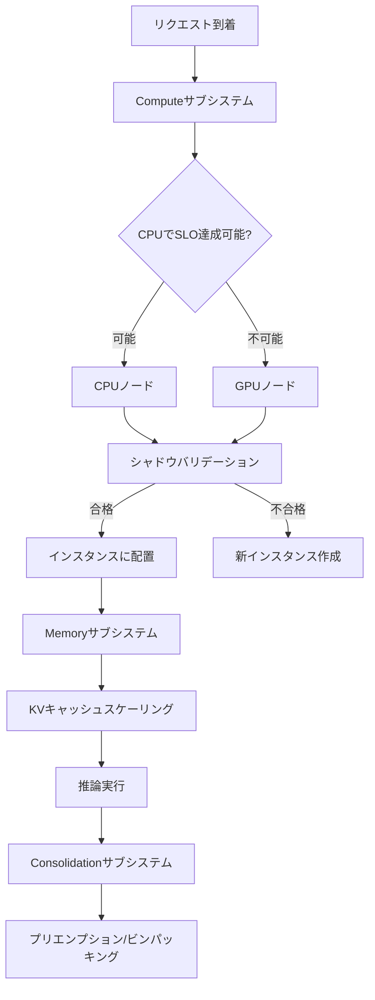
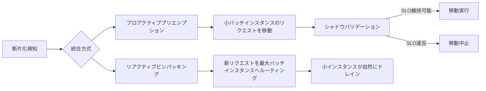

## 論文概要（Abstract）

本記事は [Towards Resource-Efficient Serverless LLM Inference with SLINFER](https://arxiv.org/abs/2507.00507) の解説記事です。

SLINFERは、プライベートなサーバーレスLLMデプロイメントにおいて、CPU/GPUヘテロジニアスリソースの弾力的共有を実現するシステムである。既存のサーバーレスLLM推論システムは各モデルにGPUを専有割り当てするため、GPU使用率が平均23%に留まる一方でSLO違反が33%に達するという非効率が生じていた。著者らは、Intel AMX搭載CPUが7B/13Bクラスのモデルの推論SLOを達成可能であることに着目し、トークン粒度のスケジューリング、ウォーターマークベースのKVキャッシュスケーリング、プロアクティブなインスタンス統合の3つのサブシステムでこの問題に対処している。4台のXeon CPUノードと4台のA100 GPUノードの環境で、SLO達成リクエスト数をベースライン比86-154%改善したと報告されている。

この記事は [Zenn記事: Fargate 32vCPUとllama.cppで実現するサーバーレスLLM推論基盤の構築](https://zenn.dev/0h_n0/articles/ca14512eb46121) の深掘りです。

## 情報源

- **arXiv ID**: 2507.00507
- **URL**: [https://arxiv.org/abs/2507.00507](https://arxiv.org/abs/2507.00507)
- **著者**: Chuhao Xu, Zijun Li, Quan Chen, et al.（上海交通大学）
- **投稿日**: 2025年7月1日（v2: 2025年12月15日）
- **採択**: HPCA 2026
- **分野**: cs.DC（分散・並列・クラスタコンピューティング）

## 背景と動機（Background & Motivation）

HuggingFaceのダウンロード統計によると、8Bパラメータ以下のモデルが全ダウンロードの87%を占めている。企業内部のプライベートLLMデプロイメントでは、複数の中小規模モデルを低頻度で利用するパターンが一般的である。

既存のサーバーレスLLM推論システム（ServerlessLLM等）は、各モデルインスタンスにGPUを専有割り当てする設計を採用している。しかし、この設計には2つの問題がある。第一に、リクエスト頻度が低いモデルに対してもGPUが占有されるため、平均GPUメモリ使用率が23%に留まる。第二に、GPU数が物理的な上限となるため、モデル数の増加に伴いSLO違反率が33%に達する。

一方、Intel AMX（Advanced Matrix Extensions）を搭載した第4世代Xeon CPUは、7B/13Bクラスのモデルに対して実用的な推論性能を発揮する。著者らの計測によると、第4世代XeonのTTFT（Time to First Token）は第3世代比で約6.7倍高速である（論文Table Iより）。この未活用のCPUリソースをGPUと組み合わせ、ヘテロジニアスな環境でリソースを弾力的に共有することが、SLINFERの動機である。

## 主要な貢献（Key Contributions）

- **CPU/GPUヘテロジニアスリソース共有**: AMX搭載CPUとGPUの間でLLM推論リクエストを動的にルーティングし、CPUで対応可能なリクエストはCPUに、SLOを満たせないリクエストのみGPUにフォールバックさせる仕組みを実現
- **3層サブシステムアーキテクチャ**: Compute（トークン粒度スケジューリング）、Memory（ウォーターマークKVキャッシュスケーリング）、Consolidation（プロアクティブプリエンプション＋ビンパッキング）の3つのサブシステムを協調動作させ、リソース効率を最大化
- **包括的な実験評価**: 128モデル環境でのSLO達成率86-154%改善、GPU使用率の大幅な向上、プリフィル-デコード分離との比較など、多角的なベンチマーク結果を提示

## 技術的詳細（Technical Details）

### システムアーキテクチャ

SLINFERは、3つのサブシステムが協調してヘテロジニアスリソースを管理する。



### Computeサブシステム：ヘッドルーム駆動スケジューリング

Computeサブシステムの中核は「ヘッドルーム」に基づくスケジューリングである。ヘッドルームは、SLO違反が発生するまでの残り時間として定義される。

$$
H = ST + \text{TTFT\_SLO} + \text{TPOT\_SLO} \times O - CT
$$

ここで、
- $H$: ヘッドルーム（SLO違反までの残り時間）
- $ST$: リクエストの開始時刻
- $\text{TTFT\_SLO}$: Time to First TokenのSLO上限
- $\text{TPOT\_SLO}$: Time per Output TokenのSLO上限
- $O$: これまでに生成されたトークン数
- $CT$: 現在時刻

スケジューラは各イテレーションで、ノード上の全インスタンスのうちヘッドルームが最小のインスタンスのリクエストを優先的に処理する。ヘッドルームが負になったリクエストはSLO違反として扱われる。

#### 推論時間の推定

CPU/GPUそれぞれの推論時間を事前プロファイリングで推定する。

- **プリフィル（TTFT）**: 入力長に対する1次元線形補間。サンプリングは2の冪乗で行うため、$O(\log L_{\max})$個のプロファイルで済む
- **デコード（TPOT）**: バッチサイズと平均トークン長に対する2次元線形補間。最近傍4点から推定し、$O(\log L_{\max} \cdot \log B_{\max})$個のプロファイルで済む

著者らの計測では、TTFTの推定誤差は平均5.9%、TPOTの推定誤差は平均3.9%であると報告されている。

#### シャドウバリデーション

新しいリクエストを受け入れる前に、SLINFERは「シャドウバリデーション」を実行する。これは、新リクエストを追加した場合の将来のスケジュールをシミュレーションし、既存リクエストのSLOが破壊されないか事前検証する仕組みである。

以下の3つのケースのいずれかが発生する場合、配置を拒否する。

1. **TTFT違反**: 新リクエストのプリフィル処理が完了する時点でTTFT SLOを超過する
2. **既存リクエストへの影響**: 新リクエストのプリフィル処理によって既存リクエストのTPOT SLOが違反する
3. **デコード過負荷**: 追加のデコード処理により1イテレーションの所要時間がTPOT SLOを超過する

各イテレーションの所要時間は10%のセーフティマージンを加えて過大推定することで、実行時のばらつきやデコード長の増加を吸収している。バリデーションが失敗した場合、他のインスタンスを試み、すべて失敗した場合は新しいインスタンスを作成する。

### Memoryサブシステム：ウォーターマークKVキャッシュスケーリング

KVキャッシュのメモリ管理は、OOM（Out of Memory）回避とスケーリングオーバーヘッド削減の両立が求められる。

必要メモリ量は以下で計算される。

$$
M_{\text{require}} = C \cdot \max\left(\sum_{r=1}^{R} (I_r + \max(O_r, \bar{O})),\ L_{\min}\right)
$$

ここで、
- $C$: 1トークンあたりのKVキャッシュバイト数
- $R$: アクティブなリクエスト数
- $I_r$: リクエスト$r$の入力長
- $O_r$: リクエスト$r$の生成済みトークン数
- $\bar{O}$: 履歴ログから算出した平均出力長
- $L_{\min}$: 下限値（最大コンテキスト長）

推奨メモリサイズは、ウォーターマーク$w$（デフォルト25%）を加えた値として定義される。

$$
M_{\text{recommend}} = M_{\text{require}} \times (1 + w)
$$

**スケールアップ**: 現在のキャッシュが$M_{\text{require}}$を下回った時点で即座に$M_{\text{recommend}}$まで拡張する。
**スケールダウン**: 推奨サイズがウォーターマークを十分に下回るまで遅延させる（ピンポン防止）。

著者らの計測では、32GBから16GBへのスケールダウンに0.3秒、64GBへのスケールアップに1.9秒を要すると報告されている。ウォーターマーク25%の設定で、スケーリングオーバーヘッドはインスタンス寿命の約1.4%に抑えられている。

#### リザベーションステーションによるOOM回避

複数インスタンスが同時にスケールアップを要求した場合のOOMリスクに対処するため、楽観的予算と悲観的追跡の2層管理を採用している。

- **楽観的予算**: スケールダウンは即座にノードのメモリ予算を減算し、解放操作を発行する
- **悲観的追跡**: スケールダウン中のインスタンスは、解放が実際に完了するまで旧サイズで計上する
- **リザベーションステーション**: 悲観的追跡でOOMリスクありと判定されたスケールアップ要求を待機させ、スケールダウン完了通知を受けて再評価する

### Consolidationサブシステム：インスタンス統合

リクエストの到着・終了に伴い、インスタンス間でバッチサイズの偏りが生じる。Consolidationサブシステムは、断片化したインスタンスを統合してリソースを回収する。



**プロアクティブプリエンプション**: バッチサイズの大きいインスタンスが、隣接する小バッチインスタンスのリクエストを引き取る。引き取り対象は最小バッチのインスタンスから選択し、移動先でのSLO維持をシャドウバリデーションで確認してから実行する。

**リアクティブビンパッキング**: 新規リクエストを、同一モデルの中でバッチサイズが最大のインスタンスにルーティングする。これにより大インスタンスがさらに成長し、小インスタンスは自然にドレインしてリソースが回収される。

### CPU/GPU切り替えの判断基準

SLINFERのルーティングは以下の優先順位で動作する。

1. 既存インスタンスを優先し、CPUノードを先に試す
2. AMX非搭載のCPUは候補から除外する
3. 事前プロファイリングでSLOを満たせないと判定された場合、GPUにフォールバックする
4. 13Bを超えるモデル（例: CodeLlama-34B）はGPU専有割り当てにフォールバックする
5. プリフィルとデコードは同一インスタンスで実行する（分離しない）

プリフィル-デコード分離を採用しない理由について、著者らは128モデル環境での比較実験で、分離方式のSLO達成率が69%に対しSLINFERの統合方式が86%であり、プリフィルインスタンスが寿命の約93%をコールドスタートまたはアイドルで費やすことを報告している（論文Table IIIより）。

## 実装のポイント（Implementation Notes）

### ヘッドルーム計算の実装

```python
from dataclasses import dataclass
from typing import Protocol


class TimeProvider(Protocol):
    """現在時刻を提供するインターフェース."""

    def now(self) -> float: ...


@dataclass(frozen=True)
class SLOConfig:
    """SLO設定パラメータ.

    Attributes:
        ttft_slo: Time to First Tokenの上限（秒）
        tpot_slo: Time per Output Tokenの上限（秒）
    """

    ttft_slo: float
    tpot_slo: float


@dataclass
class RequestState:
    """リクエストの状態.

    Attributes:
        start_time: リクエスト開始時刻
        tokens_generated: 生成済みトークン数
        slo: SLO設定
    """

    start_time: float
    tokens_generated: int
    slo: SLOConfig

    def headroom(self, current_time: float) -> float:
        """SLO違反までの残り時間を計算する.

        Returns:
            ヘッドルーム（秒）。負の値はSLO違反を示す。
        """
        deadline = (
            self.start_time
            + self.slo.ttft_slo
            + self.slo.tpot_slo * self.tokens_generated
        )
        return deadline - current_time


def select_next_request(
    requests: list[RequestState],
    current_time: float,
) -> RequestState | None:
    """ヘッドルームが最小のリクエストを選択する.

    Args:
        requests: アクティブなリクエストのリスト
        current_time: 現在時刻

    Returns:
        最も緊急度の高いリクエスト。空リストの場合はNone。
    """
    if not requests:
        return None
    return min(requests, key=lambda r: r.headroom(current_time))
```

### シャドウバリデーションの判定ロジック

```python
SAFETY_MARGIN: float = 0.10  # 10%のセーフティマージン


@dataclass(frozen=True)
class InstanceProfile:
    """インスタンスの推論時間プロファイル.

    Attributes:
        prefill_time: プリフィル推定時間（秒）
        decode_iteration_time: デコード1イテレーション推定時間（秒）
    """

    prefill_time: float
    decode_iteration_time: float


def shadow_validate(
    new_request: RequestState,
    existing_requests: list[RequestState],
    profile: InstanceProfile,
    current_time: float,
) -> bool:
    """新リクエスト追加時のSLO維持可能性を検証する.

    Args:
        new_request: 追加候補のリクエスト
        existing_requests: 既存のアクティブリクエスト
        profile: インスタンスの推論時間プロファイル
        current_time: 現在時刻

    Returns:
        True: 全リクエストのSLOが維持される
        False: いずれかのSLOが違反する
    """
    prefill_with_margin = profile.prefill_time * (1 + SAFETY_MARGIN)
    decode_with_margin = profile.decode_iteration_time * (1 + SAFETY_MARGIN)

    # 条件1: 新リクエストのTTFT SLO確認
    if prefill_with_margin > new_request.slo.ttft_slo:
        return False

    # 条件2: プリフィル中の既存リクエストへの影響確認
    for req in existing_requests:
        remaining_headroom = req.headroom(current_time)
        if remaining_headroom < prefill_with_margin:
            return False

    # 条件3: デコード過負荷確認
    if decode_with_margin > new_request.slo.tpot_slo:
        return False

    return True
```

## Production Deployment Guide

SLINFERの知見をAWS環境に適用し、CPU/GPUヘテロジニアスなLLM推論基盤を構築するパターンを示す。SLINFERが示した「7B-13BモデルはCPUで実用的」という結果は、Fargate（CPU）とGPUインスタンスの使い分け戦略に直結する。以下のコスト試算は2026年10月時点のap-northeast-1（東京）リージョン料金に基づく概算値であり、実際のコストはトラフィックパターンやバースト使用量により変動する。最新料金はAWS料金計算ツールで確認を推奨する。

### AWS実装パターン（コスト最適化重視）

| 構成 | トラフィック | サービス構成 | 月額概算 |
|------|------------|------------|---------|
| Small | ~100 req/日 | ECS Fargate（8vCPU/64GiB） + ALB | $180-250 |
| Medium | ~1,000 req/日 | ECS Fargate 32vCPU/244GiB（CPU推論） + SageMaker Endpoint（GPU） | $800-1,500 |
| Large | 10,000+ req/日 | EKS + Karpenter（Spot GPU） + Fargate CPU推論プール | $3,000-6,000 |

**Small構成（~100 req/日）**: Fargate 8vCPU/64GiBでllama.cpp + Q4_K_M量子化の7Bモデルを稼働させる。Fargate Spot併用で最大70%割引が適用され、Graviton（ARM64）選択でvCPUあたり約20%安価になる。推論頻度が低いためスケールイン/アウトで未使用時のコストを抑制する。内訳: Fargate Spot $80-120、ALB $30-50、CloudWatch $10-20、S3モデル保管 $5-10。

**Medium構成（~1,000 req/日）**: SLINFERの知見を応用し、CPUで対応可能なリクエスト（短入力・7Bモデル）はFargate 32vCPU/244GiBに、長入力や大モデルはSageMaker GPUエンドポイントにルーティングする。ALBのリスナールールでContent-Typeやカスタムヘッダに基づいて振り分ける。内訳: Fargate $300-500、SageMaker ml.g5.xlarge $400-700、ALB $50-80、監視 $30-50。

**Large構成（10,000+ req/日）**: EKS上にKarpenterでSpot GPU（g5/g6）ノードを自動プロビジョニングし、CPUワークロードはFargateプロファイルで実行する。Spotインスタンスで最大90%削減、Reserved Instancesの1年コミットで最大72%削減が可能。内訳: EKS コントロールプレーン $75、Spot GPU $1,500-3,000、Fargate CPUプール $500-800、ALB/NLB $100-200、監視・ログ $100-200。

**コスト削減テクニック**:
- Fargate Spot: 最大70%割引（中断許容ワークロード向け）
- Graviton（ARM64）: vCPUあたり約20%安価
- SageMaker Savings Plans: 1年コミットで最大64%割引
- ECS Service Auto Scaling: 20秒解像度メトリクスでスケールイン

### Terraformインフラコード

**Small構成（Fargate CPU推論）**:

```hcl
# ECS Fargate LLM推論 - Small構成
# 2026-10時点のap-northeast-1料金に基づく

resource "aws_ecs_cluster" "llm" {
  name = "llm-inference"

  setting {
    name  = "containerInsights"
    value = "enabled"
  }
}

resource "aws_ecs_cluster_capacity_providers" "llm" {
  cluster_name       = aws_ecs_cluster.llm.name
  capacity_providers = ["FARGATE", "FARGATE_SPOT"]

  default_capacity_provider_strategy {
    capacity_provider = "FARGATE_SPOT"
    weight            = 3  # Spot優先
  }

  default_capacity_provider_strategy {
    capacity_provider = "FARGATE"
    weight            = 1  # Spotが取れない場合のフォールバック
  }
}

resource "aws_ecs_task_definition" "llm_inference" {
  family                   = "llm-inference"
  requires_compatibilities = ["FARGATE"]
  network_mode             = "awsvpc"
  cpu                      = 8192   # 8 vCPU
  memory                   = 65536  # 64 GiB
  runtime_platform {
    operating_system_family = "LINUX"
    cpu_architecture        = "ARM64"  # Gravitonで約20%安価
  }
  execution_role_arn = aws_iam_role.ecs_exec.arn
  task_role_arn      = aws_iam_role.ecs_task.arn

  container_definitions = jsonencode([{
    name  = "llama-cpp"
    image = "public.ecr.aws/deeplearning/llama-cpp:latest"
    portMappings = [{
      containerPort = 8080
      protocol      = "tcp"
    }]
    environment = [
      { name = "MODEL_PATH", value = "/models/llama-7b-q4_k_m.gguf" },
      { name = "N_THREADS", value = "8" },
      { name = "CTX_SIZE", value = "4096" },
    ]
    logConfiguration = {
      logDriver = "awslogs"
      options = {
        "awslogs-group"  = aws_cloudwatch_log_group.llm.name
        "awslogs-region" = "ap-northeast-1"
      }
    }
    healthCheck = {
      command     = ["CMD-SHELL", "curl -f http://localhost:8080/health || exit 1"]
      interval    = 30
      timeout     = 5
      retries     = 3
      startPeriod = 120
    }
  }])
}

# IAMロール（最小権限）
resource "aws_iam_role" "ecs_task" {
  name = "llm-inference-task"
  assume_role_policy = jsonencode({
    Version = "2012-10-17"
    Statement = [{
      Action = "sts:AssumeRole"
      Effect = "Allow"
      Principal = { Service = "ecs-tasks.amazonaws.com" }
    }]
  })
}

resource "aws_iam_role_policy" "s3_model_read" {
  name = "s3-model-read"
  role = aws_iam_role.ecs_task.id
  policy = jsonencode({
    Version = "2012-10-17"
    Statement = [{
      Effect   = "Allow"
      Action   = ["s3:GetObject"]
      Resource = "arn:aws:s3:::${var.model_bucket}/*"
    }]
  })
}

# CloudWatch コスト監視アラーム
resource "aws_cloudwatch_metric_alarm" "high_cpu" {
  alarm_name          = "llm-high-cpu"
  comparison_operator = "GreaterThanThreshold"
  evaluation_periods  = 3
  metric_name         = "CPUUtilization"
  namespace           = "AWS/ECS"
  period              = 60
  statistic           = "Average"
  threshold           = 85
  alarm_actions       = [var.sns_topic_arn]
  dimensions = {
    ClusterName = aws_ecs_cluster.llm.name
    ServiceName = aws_ecs_service.llm.name
  }
}
```

**Large構成（EKS + Karpenter + Spot GPU）**:

```hcl
# EKS + Karpenter - Large構成
module "eks" {
  source  = "terraform-aws-modules/eks/aws"
  version = "~> 20.0"

  cluster_name    = "llm-inference-prod"
  cluster_version = "1.31"

  vpc_id     = var.vpc_id
  subnet_ids = var.private_subnet_ids

  # Fargateプロファイル（CPUワークロード用）
  fargate_profiles = {
    cpu_inference = {
      name = "cpu-inference"
      selectors = [{ namespace = "llm-cpu" }]
    }
  }

  cluster_endpoint_public_access = false  # セキュリティ
  enable_irsa                    = true

  tags = {
    Environment = "production"
    CostCenter  = "llm-inference"
  }
}

# Karpenter Provisioner（Spot GPU優先）
resource "kubectl_manifest" "karpenter_provisioner" {
  yaml_body = yamlencode({
    apiVersion = "karpenter.sh/v1"
    kind       = "NodePool"
    metadata   = { name = "gpu-spot" }
    spec = {
      template = {
        spec = {
          requirements = [
            { key = "karpenter.sh/capacity-type", operator = "In", values = ["spot", "on-demand"] },
            { key = "node.kubernetes.io/instance-type", operator = "In",
              values = ["g5.xlarge", "g5.2xlarge", "g6.xlarge", "g6.2xlarge"] },
          ]
          nodeClassRef = { name = "default" }
        }
      }
      limits   = { cpu = "128", memory = "512Gi" }
      disruption = {
        consolidationPolicy = "WhenEmptyOrUnderutilized"
        consolidateAfter    = "60s"
      }
    }
  })
}

# AWS Budgets（月額アラート）
resource "aws_budgets_budget" "llm_monthly" {
  name         = "llm-inference-monthly"
  budget_type  = "COST"
  limit_amount = "6000"
  limit_unit   = "USD"
  time_unit    = "MONTHLY"

  cost_filter {
    name   = "TagKeyValue"
    values = ["user:CostCenter$llm-inference"]
  }

  notification {
    comparison_operator       = "GREATER_THAN"
    threshold                 = 80
    threshold_type            = "PERCENTAGE"
    notification_type         = "ACTUAL"
    subscriber_sns_topic_arns = [var.sns_topic_arn]
  }
}
```

### 運用・監視設定

**CloudWatch Logs Insights クエリ**（推論レイテンシ分析）:

```
# P95/P99レイテンシ分析（1時間ごと）
fields @timestamp, @message
| filter @message like /inference_latency/
| stats percentile(latency_ms, 95) as p95,
        percentile(latency_ms, 99) as p99,
        avg(latency_ms) as avg_latency,
        count() as request_count
  by bin(1h)
| sort @timestamp desc
```

**CloudWatch アラーム設定（Python）**:

```python
import boto3


def create_inference_alarms(
    cluster_name: str,
    service_name: str,
    sns_topic_arn: str,
) -> None:
    """推論サービスの監視アラームを作成する.

    Args:
        cluster_name: ECSクラスタ名
        service_name: ECSサービス名
        sns_topic_arn: 通知先SNSトピックARN
    """
    cw = boto3.client("cloudwatch", region_name="ap-northeast-1")

    # CPU使用率スパイク検知
    cw.put_metric_alarm(
        AlarmName=f"{service_name}-cpu-spike",
        MetricName="CPUUtilization",
        Namespace="AWS/ECS",
        Statistic="Average",
        Period=60,
        EvaluationPeriods=3,
        Threshold=90.0,
        ComparisonOperator="GreaterThanThreshold",
        Dimensions=[
            {"Name": "ClusterName", "Value": cluster_name},
            {"Name": "ServiceName", "Value": service_name},
        ],
        AlarmActions=[sns_topic_arn],
    )

    # メモリ使用率アラーム（KVキャッシュ枯渇の兆候）
    cw.put_metric_alarm(
        AlarmName=f"{service_name}-memory-high",
        MetricName="MemoryUtilization",
        Namespace="AWS/ECS",
        Statistic="Average",
        Period=60,
        EvaluationPeriods=2,
        Threshold=85.0,
        ComparisonOperator="GreaterThanThreshold",
        Dimensions=[
            {"Name": "ClusterName", "Value": cluster_name},
            {"Name": "ServiceName", "Value": service_name},
        ],
        AlarmActions=[sns_topic_arn],
    )
```

**X-Ray トレーシング設定（Python）**:

```python
from aws_xray_sdk.core import xray_recorder, patch_all


def configure_xray(service_name: str = "llm-inference") -> None:
    """X-Rayトレーシングを初期化する.

    Args:
        service_name: X-Rayに表示されるサービス名
    """
    xray_recorder.configure(service=service_name)
    patch_all()  # boto3等を自動計装


@xray_recorder.capture("route_request")
def route_request(
    model_size_b: float,
    input_length: int,
    tpot_slo_ms: float,
) -> str:
    """SLINFERの知見に基づきCPU/GPUを選択する.

    Args:
        model_size_b: モデルサイズ（十億パラメータ単位）
        input_length: 入力トークン数
        tpot_slo_ms: TPOTのSLO（ミリ秒）

    Returns:
        ルーティング先（"fargate-cpu" or "sagemaker-gpu"）
    """
    subsegment = xray_recorder.current_subsegment()
    subsegment.put_annotation("model_size_b", model_size_b)
    subsegment.put_annotation("input_length", input_length)

    # SLINFERの知見: 7B-13B + 短入力 + 緩いSLOはCPUで対応可能
    if model_size_b <= 13 and input_length <= 512 and tpot_slo_ms >= 250:
        subsegment.put_metadata("routing", "cpu", "decision")
        return "fargate-cpu"

    subsegment.put_metadata("routing", "gpu", "decision")
    return "sagemaker-gpu"
```

**Cost Explorer 日次レポート（Python）**:

```python
from datetime import date, timedelta

import boto3


def get_daily_cost_report(
    sns_topic_arn: str,
    threshold_usd: float = 100.0,
) -> dict:
    """日次コストレポートを取得し、閾値超過時にSNS通知する.

    Args:
        sns_topic_arn: 通知先SNSトピックARN
        threshold_usd: 通知閾値（USD/日）

    Returns:
        サービス別コスト辞書
    """
    ce = boto3.client("ce", region_name="us-east-1")
    today = date.today()
    yesterday = today - timedelta(days=1)

    response = ce.get_cost_and_usage(
        TimePeriod={
            "Start": yesterday.isoformat(),
            "End": today.isoformat(),
        },
        Granularity="DAILY",
        Metrics=["UnblendedCost"],
        GroupBy=[{"Type": "DIMENSION", "Key": "SERVICE"}],
        Filter={
            "Tags": {
                "Key": "CostCenter",
                "Values": ["llm-inference"],
            }
        },
    )

    costs: dict[str, float] = {}
    total = 0.0
    for group in response["ResultsByTime"][0]["Groups"]:
        service = group["Keys"][0]
        amount = float(group["Metrics"]["UnblendedCost"]["Amount"])
        costs[service] = amount
        total += amount

    if total > threshold_usd:
        sns = boto3.client("sns", region_name="ap-northeast-1")
        sns.publish(
            TopicArn=sns_topic_arn,
            Subject=f"LLM推論コスト警告: ${total:.2f}/日",
            Message=f"日次コスト${total:.2f}が閾値${threshold_usd}を超過。\n{costs}",
        )

    return costs
```

### コスト最適化チェックリスト

**アーキテクチャ選択**:
- [ ] トラフィック量に応じた構成を選択（Small: Fargate / Medium: Fargate+SageMaker / Large: EKS+Spot）
- [ ] SLINFERの知見を適用: 7B-13B+短入力はCPUルーティング優先
- [ ] プリフィル-デコード分離は採用しない（SLINFERの実験で統合方式が優位）

**リソース最適化**:
- [ ] Fargate Spot活用で最大70%削減
- [ ] Graviton（ARM64）選択でvCPUあたり約20%削減
- [ ] EC2 Spot Instances（GPUノード）で最大90%削減
- [ ] SageMaker Savings Plans: 1年コミットで最大64%削減
- [ ] ECS Service Auto Scaling: 20秒解像度メトリクスでスケールイン/アウト
- [ ] 推論不要時間帯のタスク数ゼロスケーリング

**LLMコスト削減**:
- [ ] Q4_K_M量子化でモデルサイズ削減（GPU使用量3.8→2.6: 論文Section IX-G）
- [ ] バッチ処理統合でスループット向上（SLINFERで平均バッチサイズ74%増加）
- [ ] モデルサイズに応じたCPU/GPU自動ルーティング
- [ ] 入力長に応じたSLO緩和でCPU利用率向上

**監視・アラート**:
- [ ] AWS Budgets: 月額上限設定（80%/100%通知）
- [ ] CloudWatch: CPU/メモリ使用率アラーム
- [ ] Cost Anomaly Detection: 日次コストの異常検知
- [ ] 日次コストレポート: Cost Explorer APIで自動取得・SNS通知
- [ ] X-Ray: 推論リクエストのエンドツーエンドトレーシング

**リソース管理**:
- [ ] 未使用のECSタスク定義リビジョンを定期削除
- [ ] CostCenterタグの一貫した付与
- [ ] S3モデルファイルのライフサイクルポリシー（旧バージョン削除）
- [ ] 開発環境の夜間・週末スケールダウン
- [ ] ECRイメージのライフサイクルポリシー（未使用イメージの自動削除）

## 実験結果（Results）

### ベンチマーク環境

著者らは、4台の32コアXeon 6462C CPUノード（AMX搭載）と4台のA100-80GB GPUノードで評価を実施している。ワークロードはAzure Conversationデータセット（会話長分布）とAzure Serverless Trace（リクエスト到着パターン）を使用している。

### 主要結果

| ベースライン | 比較対象 | SLO達成リクエスト改善率 |
|------------|---------|---------------------|
| sllm（GPU専有） | SLINFER | +86% ~ +154% |
| sllm+c（CPU追加） | SLINFER | +47% ~ +62% |
| sllm+c+s（時間共有） | SLINFER | +18% ~ +70% |

GPU共有のみでsllm比47-62%の改善が得られ、CPUを追加投入することで86-154%まで改善が拡大すると報告されている。

### リソース効率

| 構成 | モデル数 | SLINFER | sllm |
|------|---------|---------|------|
| 3Bモデル | 32 | CPU 3.0台 + GPU 0台 | GPU 3.2台 |
| 7Bモデル | 32 | GPU 0.9台 | GPU 1.5台（sllm+c） |

3Bモデル32個の場合、SLINFERはGPUを一切使用せずCPU 3.0台のみで処理している。平均バッチサイズはsllm比74%増加しており、ビンパッキングとプリエンプションによるインスタンス統合が効果を発揮している。

### 制約とトレードオフ

- 厳しいSLO（TPOT 50ms等）や長入力ではCPUの処理速度が不足し、GPUへのフォールバックが必要になる
- LongBenchベンチマーク（長入力）では、sllm+c+sのSLO違反率が63.4%に達する一方、SLINFERはヘッドルームスケジューリングで対応している
- INT4量子化を適用した22Bモデル32個では、GPU使用台数が3.8台から2.6台に削減されると報告されている（論文Section IX-Gより）

## 実運用への応用（Practical Applications）

### Fargate/SageMakerの使い分けへの示唆

SLINFERの実験結果は、Zenn記事で議論されているFargate（CPU推論）とSageMaker/Bedrock（GPU推論）の使い分け判断に具体的な根拠を提供する。

**CPUが実用的な領域**: 7B-13Bクラスの量子化モデル、入力長が短い（256トークン以下）ケース、TPOT SLOが250ms以上のバッチ処理やチャットボット用途。SLINFERの実験では、3Bモデル32個をCPUのみで処理できており、Fargate 32vCPU構成での運用が合理的なユースケースである。

**GPUが必要な領域**: 13Bを超えるモデル、長入力（512トークン以上）の処理、厳しいレイテンシ要件（TPOT 50ms以下）のリアルタイム対話。この場合はSageMakerエンドポイントやEC2バックのECSが適切である。

**ヘテロジニアス構成の利点**: Medium/Large構成でCPU推論プールとGPU推論プールを併用し、リクエスト特性に応じてルーティングすることで、GPUコストを大幅に削減できる。SLINFERの実験では、CPU追加によりGPU使用台数を約60%削減している。

## 関連研究（Related Work）

- **ServerlessLLM**: GPU専有割り当て方式のサーバーレスLLM推論。高速なモデルロードを実現するが、GPU使用率が低くなる問題がある。SLINFERはこれをベースラインとして採用している
- **vLLM**: ページドアテンションによるKVキャッシュ管理の効率化。SLINFERのMemoryサブシステムはvLLMのメモリ管理を拡張し、ウォーターマークベースの動的スケーリングを追加している
- **Llumnix**: クロスインスタンスのリクエストマイグレーション。SLINFERのConsolidationサブシステムはLlumnixのマイグレーション概念を発展させ、プロアクティブプリエンプションを追加している
- **PowerInfer / NEO / FlexInfer**: CPU-GPU協調推論の先行研究。パラメータやKVキャッシュのCPUオフロードを扱うが、SLINFERはリクエスト単位のルーティングという異なるアプローチを採用している

## まとめと今後の展望

SLINFERは、サーバーレスLLM推論においてCPU/GPUヘテロジニアスリソースの弾力的共有を実現し、SLO達成リクエスト数を86-154%改善することを示した。ヘッドルーム駆動スケジューリング、ウォーターマークKVキャッシュスケーリング、プロアクティブインスタンス統合の3つのサブシステムが協調動作することで、GPU使用率の向上とCPUリソースの有効活用を両立している。

AWS環境への応用としては、Fargate 32vCPU（CPU推論）とSageMaker/EKS（GPU推論）のヘテロジニアス構成が有望である。今後の研究方向としては、異なるSLO要件を持つリクエストの動的な優先度制御、エッジ環境への展開、さらに大規模なモデル（70B以上）を含むヘテロジニアス環境での最適化が挙げられる。

## 参考文献

- **arXiv**: [https://arxiv.org/abs/2507.00507](https://arxiv.org/abs/2507.00507)
- **採択会議**: HPCA 2026
- **Related Zenn article**: [Fargate 32vCPUとllama.cppで実現するサーバーレスLLM推論基盤の構築](https://zenn.dev/0h_n0/articles/ca14512eb46121)
