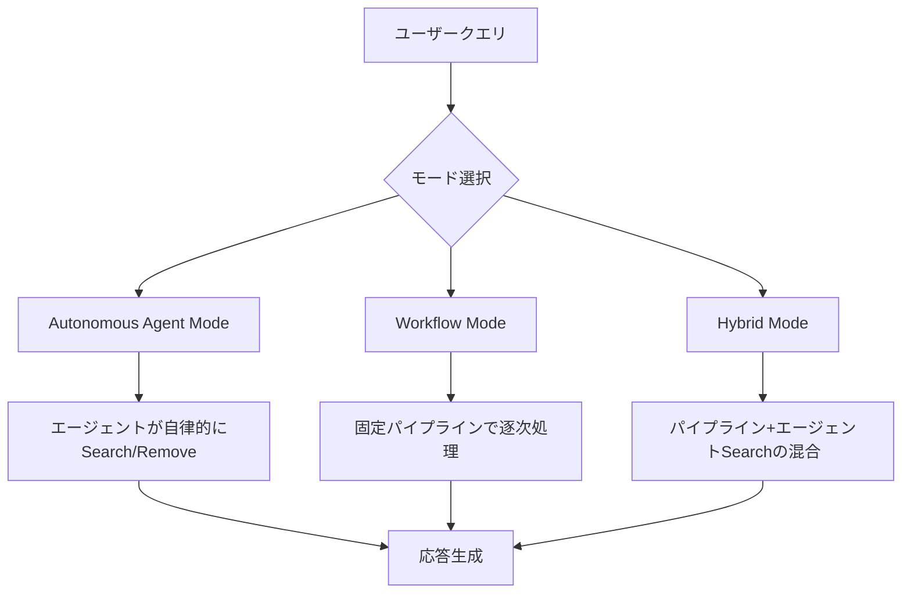
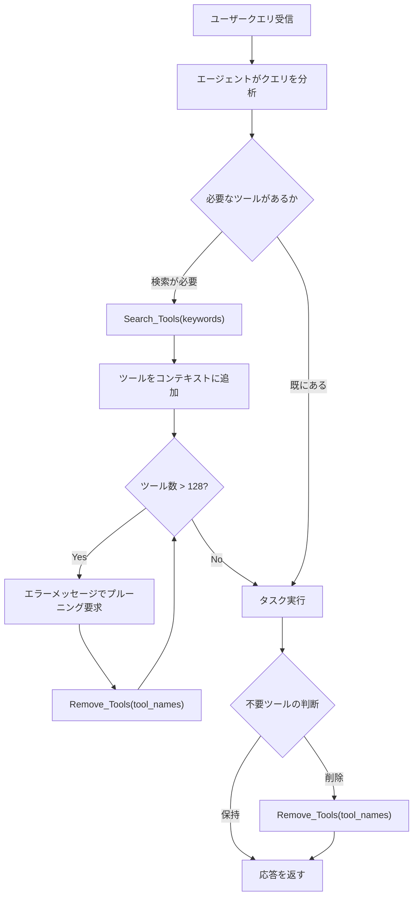
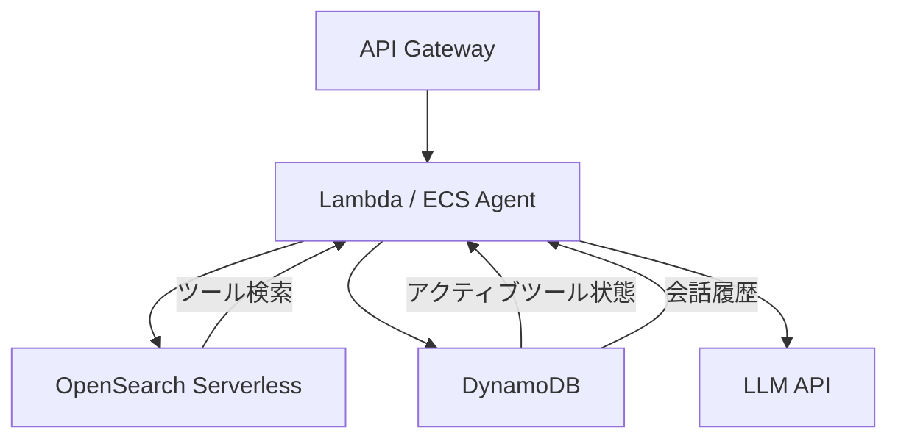

## 論文概要（Abstract）

MemToolは、LLMエージェントがマルチターン会話においてツールやMCPサーバーのコンテキストを動的に管理するための短期メモリフレームワークである。著者らは、Autonomous Agent Mode、Workflow Mode、Hybrid Modeの3つのアーキテクチャを提案し、5000のMCPサーバーを含むScaleMCPベンチマーク上で100連続インタラクションにわたる評価を行っている。最も高い性能を示したAutonomous ModeのGPT-o3構成では、Task Completionが0.90、3ターン平均Removal Ratioが0.941に達したと報告されている（論文Table 1より）。

この記事は [Zenn記事: Assistants API Thread廃止後のConversations API移行と会話状態設計](https://zenn.dev/0h_n0/articles/a90bff04f7e110) の深掘りです。

本記事は [https://arxiv.org/abs/2507.21428](https://arxiv.org/abs/2507.21428) の解説記事です。

## 情報源

- **arXiv ID**: 2507.21428
- **URL**: [https://arxiv.org/abs/2507.21428](https://arxiv.org/abs/2507.21428)
- **著者**: Elias Lumer, Anmol Gulati, Vamse Kumar Subbiah, Pradeep Honaganahalli Basavaraju, James A. Burke
- **投稿日**: 2025年7月29日
- **分野**: cs.CL（計算言語学）

## 背景と動機（Background & Motivation）

LLMエージェントの実用化が進む中、ツール呼び出し（Function Calling / Tool Use）は中核的な機能となっている。OpenAIのAssistants APIやAnthropicのMCP（Model Context Protocol）に代表されるように、エージェントが外部サービスと連携する仕組みは急速に標準化されつつある。

しかし、実運用環境ではエージェントが利用可能なツールの数が数百から数千に達することがある。すべてのツール定義をコンテキストウィンドウに収めると、トークン消費が増大し、モデルの性能低下やコスト増加を引き起こす。また、マルチターン会話では、直前のタスクで必要だったツールが次のタスクでは不要になるケースが頻繁に発生する。不要なツール定義がコンテキストに残り続けると、モデルが誤ったツールを選択するリスクも高まる。

MemToolは、こうした「コンテキストウィンドウにおけるツール管理」という課題に対して、短期メモリの概念を導入することで解決を試みている。人間の作業記憶が関連情報を保持し不要な情報を忘却するのと同様に、LLMエージェントもタスクに応じてツールのロードとアンロードを動的に制御すべきだという着想に基づいている。

## 主要な貢献（Key Contributions）

- **3つのアーキテクチャパターン**: ツール管理の自律性と制御性のトレードオフに応じて、Autonomous Agent Mode、Workflow Mode、Hybrid Modeの3構成を提案
- **ScaleMCPベンチマーク**: 5000のMCPサーバーを含む大規模評価環境を構築し、100連続インタラクションでの長期的なツール蓄積挙動を定量評価
- **定量的メトリクス体系**: Removal Ratio、Avg Removal Ratio 3T、Avg Residual +3、Task Completion、Tool Correctnessの5指標を定義し、ツール管理の質を多面的に評価
- **推論能力との関連性の発見**: Autonomous Modeにおいて、推論モデル（GPT-o3）とそうでないモデル（LLaMA 3 70B）の間でツール削除行動に顕著な差異が生じることを実証

## 技術的詳細（Technical Details）

### 全体アーキテクチャ

MemToolは、ツール管理の方式に応じて3つのモードを提供する。各モードは、ツールの検索・追加・削除の制御主体が異なる。



### モード1: Autonomous Agent Mode

Autonomous Agent Modeでは、LLMエージェント自身が`Search_Tools(keywords)`と`Remove_Tools(tool_names)`の2つのメタツールを使い、コンテキスト内のツールを自律的に管理する。

```python
from typing import Any

def search_tools(keywords: list[str], knowledge_base: Any) -> list[dict]:
    """ベクトル検索でツール定義を取得する。

    Args:
        keywords: 検索キーワードのリスト
        knowledge_base: ツール定義のベクトルDB

    Returns:
        上位k件のツール定義（デフォルトk=5）
    """
    results: list[dict] = []
    for kw in keywords:
        hits = knowledge_base.similarity_search(kw, top_k=5)
        results.extend(hits)
    # 重複除去
    seen: set[str] = set()
    unique: list[dict] = []
    for tool in results:
        if tool["name"] not in seen:
            seen.add(tool["name"])
            unique.append(tool)
    return unique


def remove_tools(
    tool_names: list[str],
    active_tools: dict[str, dict],
) -> dict[str, dict]:
    """指定されたツールをアクティブツールセットから削除する。

    Args:
        tool_names: 削除対象のツール名リスト
        active_tools: 現在アクティブなツール定義の辞書

    Returns:
        削除後のアクティブツール辞書
    """
    for name in tool_names:
        active_tools.pop(name, None)
    return active_tools
```

このモードでは、ツール数に128という上限が設定されている。上限に達した場合、エラーベースのプルーニングが発動し、エージェントに対して不要なツールの削除を促す。著者らは、システムプロンプトに現在のツール数を含めることで、エージェントの削除行動が改善されたと報告している。

このモードの処理フローは以下のとおりである。



### モード2: Workflow Mode

Workflow Modeは、ツール管理を固定パイプラインとして構造化する。エージェント自身にはツール管理の権限を与えず、各ステップを独立したLLM呼び出しで処理する。

```python
from dataclasses import dataclass

@dataclass(frozen=True)
class WorkflowConfig:
    """Workflow Modeの設定パラメータ。"""
    top_k: int = 5
    tool_limit: int = 128
    prune_threshold: float = 0.3


def workflow_pipeline(
    user_query: str,
    conversation_history: list[dict],
    active_tools: dict[str, dict],
    knowledge_base: object,
    config: WorkflowConfig,
) -> tuple[str, dict[str, dict]]:
    """Workflow Modeのパイプライン実行。

    各ステップは独立したLLM呼び出し（fresh context）で処理される。

    Args:
        user_query: ユーザーの入力
        conversation_history: 会話履歴
        active_tools: 現在のアクティブツール
        knowledge_base: ツール定義のベクトルDB
        config: パイプライン設定

    Returns:
        エージェントの応答とアクティブツールの更新後辞書
    """
    # Step 1: Fresh LLMでプルーニング判定
    tools_to_remove = llm_prune_decision(
        query=user_query,
        history=conversation_history,
        tools=active_tools,
    )
    for name in tools_to_remove:
        active_tools.pop(name, None)

    # Step 2: Fresh LLMで検索キーワード生成
    keywords = llm_generate_keywords(
        query=user_query,
        history=conversation_history,
    )

    # Step 3: ベクトル検索（top-k=5）
    new_tools = knowledge_base.similarity_search(
        keywords, top_k=config.top_k,
    )
    for tool in new_tools:
        active_tools[tool["name"]] = tool

    # Step 4: プルーニングループ（上限超過時）
    while len(active_tools) > config.tool_limit:
        to_remove = llm_prune_decision(
            query=user_query,
            history=conversation_history,
            tools=active_tools,
        )
        if not to_remove:
            break
        for name in to_remove:
            active_tools.pop(name, None)

    # Step 5: エージェントが応答生成
    response = agent_respond(
        query=user_query,
        tools=active_tools,
        history=conversation_history,
    )
    return response, active_tools
```

Workflow Modeの特徴は、各ステップで「fresh（新規）」なLLMコンテキストを使用する点にある。これにより、プルーニング判定やキーワード生成がエージェントの過去の判断バイアスに影響されない。一方で、パイプラインが一方向であるため、検索結果が不十分でも再検索に戻ることができないという制約がある。

### モード3: Hybrid Mode

Hybrid Modeは、Autonomous ModeとWorkflow Modeの利点を組み合わせる。最初にWorkflow方式でプルーニングを実行し、その後エージェントには`Search_Tools`のみを付与する（`Remove_Tools`は与えない）。

```python
def hybrid_pipeline(
    user_query: str,
    conversation_history: list[dict],
    active_tools: dict[str, dict],
    knowledge_base: object,
) -> tuple[str, dict[str, dict]]:
    """Hybrid Modeのパイプライン実行。

    Step 1はWorkflow方式、Step 2以降はエージェント主導。

    Args:
        user_query: ユーザーの入力
        conversation_history: 会話履歴
        active_tools: 現在のアクティブツール
        knowledge_base: ツール定義のベクトルDB

    Returns:
        エージェントの応答とアクティブツールの更新後辞書
    """
    # Step 1: Fresh LLMによるプルーニング（Workflow方式）
    tools_to_remove = llm_prune_decision(
        query=user_query,
        history=conversation_history,
        tools=active_tools,
    )
    for name in tools_to_remove:
        active_tools.pop(name, None)

    # Step 2: エージェントにSearch_Toolsのみ付与
    # Remove_Toolsは付与しない（プルーニングはStep 1で完了）
    response = agent_respond_with_search(
        query=user_query,
        tools=active_tools,
        history=conversation_history,
        knowledge_base=knowledge_base,  # 再検索可能
    )
    return response, active_tools
```

Hybrid Modeでは、エージェントが必要に応じてナレッジベースに再クエリできるため、Workflow Modeの「一方向性」の制約を克服している。ただし、エージェントが`Remove_Tools`を持たないため、不要ツールの蓄積が進行するとツール上限を突破するリスクがある。

### メッセージ履歴の管理

3つのモードすべてにおいて、会話履歴のコンテキスト圧縮手法として以下の2方式が利用可能である。

- **TruncateHistory**: 古いメッセージを先頭から単純に切り捨てる。計算コストが低いが、長期的な文脈情報が失われる
- **SummarizeHistory**: LLMを用いて過去の会話を要約し、圧縮された形で保持する。文脈保持に優れるが、要約のためのLLM呼び出しコストが追加で発生する

### 評価メトリクス

著者らは、ツール管理の質を定量化するために5つのメトリクスを定義している。

#### Removal Ratio

各ターン$t$において、追加されたツール数$A_t$に対する削除されたツール数$R_t$の比率を評価する:

$$
\text{Removal Ratio} = \frac{\sum_{t} R_t}{\sum_{t} A_t} \leq 1
$$

ここで、
- $R_t$: ターン$t$で削除されたツール数
- $A_t$: ターン$t$で追加されたツール数

この値が1に近いほど、追加されたツールが適切に削除されていることを意味する。値が低い場合、不要なツールがコンテキストに蓄積されていることを示す。

#### Avg Removal Ratio 3T

直近3ターンの移動平均としてRemoval Ratioを算出する:

$$
\text{Avg Removal Ratio 3T}_t = \frac{1}{3}\sum_{i=t-2}^{t} \frac{R_i}{A_i}
$$

短期的なツール管理の応答性を評価するための指標であり、突発的な大量削除ではなく継続的な管理が行われているかを判定する。

#### Avg Residual +3

ツール数がピークに達した後、3ターン以内にどの程度削減できたかを測定する:

$$
\text{Avg Residual +3} = \frac{1}{|P|}\sum_{p \in P} \text{ToolCount}(p+3)
$$

ここで$P$はツール数がピークに達したターンの集合である。この値が低いほど、ピーク後の回復が速いことを示す。

#### Task Completion / Tool Correctness

- **Task Completion**: LLMによるジャッジで、エージェントの応答がタスク要件にどの程度合致しているかを0-1スケールで評価
- **Tool Correctness**: 正しいツール呼び出し数を総ツール呼び出し数で除した比率

## 実装のポイント

### システムプロンプトへのツール数注入

Autonomous Modeにおいて、著者らはシステムプロンプトに現在のアクティブツール数を含めることで、エージェントの削除行動が改善されたと報告している。以下はその実装パターンである。

```python
def build_system_prompt(
    base_prompt: str,
    active_tools: dict[str, dict],
    tool_limit: int = 128,
) -> str:
    """アクティブツール数を含むシステムプロンプトを構築する。

    Args:
        base_prompt: ベースのシステムプロンプト
        active_tools: 現在のアクティブツール辞書
        tool_limit: ツール数上限

    Returns:
        ツール数情報を付加したシステムプロンプト
    """
    current_count = len(active_tools)
    utilization = current_count / tool_limit
    tool_status = (
        f"\n\n[Tool Status] "
        f"Active: {current_count}/{tool_limit} "
        f"({utilization:.0%} capacity). "
    )
    if utilization > 0.8:
        tool_status += (
            "WARNING: Approaching tool limit. "
            "Consider removing unused tools with Remove_Tools."
        )
    return base_prompt + tool_status
```

### ベクトル検索によるツール定義の取得

各モードで共通して使用されるツール検索は、ツール定義のテキスト（名前、説明、パラメータスキーマ）を埋め込みベクトル化し、コサイン類似度で検索する方式である。

```python
from dataclasses import dataclass, field
import numpy as np


@dataclass
class ToolKnowledgeBase:
    """ツール定義のベクトル検索用ナレッジベース。"""
    embeddings: np.ndarray  # shape: (N, D)
    tool_definitions: list[dict] = field(default_factory=list)
    tool_names: list[str] = field(default_factory=list)

    def similarity_search(
        self,
        query_embedding: np.ndarray,
        top_k: int = 5,
    ) -> list[dict]:
        """コサイン類似度によるツール検索。

        Args:
            query_embedding: クエリの埋め込みベクトル (D,)
            top_k: 返却する上位件数

        Returns:
            上位k件のツール定義
        """
        # コサイン類似度を一括計算
        norms = np.linalg.norm(self.embeddings, axis=1)
        query_norm = np.linalg.norm(query_embedding)
        similarities = (
            self.embeddings @ query_embedding
        ) / (norms * query_norm + 1e-8)

        # 上位k件のインデックスを取得
        top_indices = np.argsort(similarities)[-top_k:][::-1]
        return [self.tool_definitions[i] for i in top_indices]
```

## Production Deployment Guide

### AWSアーキテクチャ

MemToolを本番環境にデプロイする場合、ツール定義のベクトルDBとエージェントの状態管理が主要な設計要素となる。



- **Amazon OpenSearch Serverless**: ツール定義の埋め込みベクトルを格納するベクトルDB。5000件規模のツール定義に対して、k-NN検索でミリ秒オーダーの応答を実現する
- **DynamoDB**: セッションごとのアクティブツール状態と会話履歴を保持する。TTL機能で古いセッションを自動削除
- **Lambda / ECS**: モード選択とパイプライン実行。Workflow ModeやHybrid Modeの各ステップを逐次実行する

### Terraform構成例

```hcl
# OpenSearch Serverless Collection（ツール定義ベクトルDB）
resource "aws_opensearchserverless_collection" "tool_vectors" {
  name = "memtool-vectors"
  type = "VECTORSEARCH"

  tags = {
    Environment = "production"
    Service     = "memtool"
  }
}

# DynamoDB テーブル（セッション状態管理）
resource "aws_dynamodb_table" "session_state" {
  name         = "memtool-sessions"
  billing_mode = "PAY_PER_REQUEST"
  hash_key     = "session_id"
  range_key    = "turn_number"

  attribute {
    name = "session_id"
    type = "S"
  }

  attribute {
    name = "turn_number"
    type = "N"
  }

  ttl {
    attribute_name = "expires_at"
    enabled        = true
  }

  tags = {
    Environment = "production"
    Service     = "memtool"
  }
}

# Lambda関数（エージェントランタイム）
resource "aws_lambda_function" "memtool_agent" {
  function_name = "memtool-agent"
  runtime       = "python3.12"
  handler       = "handler.lambda_handler"
  timeout       = 300
  memory_size   = 1024

  environment {
    variables = {
      OPENSEARCH_ENDPOINT = aws_opensearchserverless_collection.tool_vectors.collection_endpoint
      DYNAMODB_TABLE      = aws_dynamodb_table.session_state.name
      TOOL_LIMIT          = "128"
      MODE                = "hybrid"
    }
  }

  tags = {
    Environment = "production"
    Service     = "memtool"
  }
}
```

### 運用・監視

MemToolの運用では、以下のメトリクスをCloudWatch Metricsで監視することが重要である。

```python
import json
import time
from typing import Any


def emit_memtool_metrics(
    session_id: str,
    turn: int,
    active_tool_count: int,
    tools_added: int,
    tools_removed: int,
    tool_limit: int = 128,
) -> dict[str, Any]:
    """MemToolの運用メトリクスを構造化ログとして出力する。

    Args:
        session_id: セッションID
        turn: 現在のターン番号
        active_tool_count: アクティブツール数
        tools_added: 今回追加されたツール数
        tools_removed: 今回削除されたツール数
        tool_limit: ツール数上限

    Returns:
        出力されたメトリクス辞書
    """
    removal_ratio = tools_removed / tools_added if tools_added > 0 else 0.0
    utilization = active_tool_count / tool_limit

    metric = {
        "event": "memtool_turn_complete",
        "level": "info",
        "ts": time.time(),
        "request_id": session_id,
        "turn": turn,
        "active_tool_count": active_tool_count,
        "tools_added": tools_added,
        "tools_removed": tools_removed,
        "removal_ratio": round(removal_ratio, 3),
        "utilization": round(utilization, 3),
        "duration_ms": 0,  # 実際の処理時間を挿入
    }

    if utilization > 0.9:
        metric["level"] = "warn"
        metric["event"] = "memtool_high_utilization"

    # 構造化JSONログ出力
    print(json.dumps(metric, ensure_ascii=False))
    return metric
```

### コスト最適化チェックリスト

- [ ] **Workflow Mode の LLM 呼び出し回数**: 各ターンで最大3回のLLM呼び出し（プルーニング、キーワード生成、応答生成）が発生する。低コストモデル（GPT-4.1-mini等）をプルーニングとキーワード生成に使用し、高性能モデルを応答生成にのみ使用する
- [ ] **ベクトル検索の top-k チューニング**: デフォルトのtop-k=5を超える値は、ツール蓄積速度を加速させる。ドメインに応じてtop-k=3に下げることでコンテキストトークン消費を削減
- [ ] **TruncateHistory vs SummarizeHistory**: SummarizeHistoryは追加のLLM呼び出しを要する。ターン数が20未満の短い会話ではTruncateHistoryで十分なケースが多い
- [ ] **DynamoDB TTL の適切な設定**: 不要なセッション状態を自動削除し、ストレージコストを抑制

## 実験結果（Experimental Results）

### ScaleMCPベンチマーク

著者らは、5000のMCPサーバーを含むScaleMCPベンチマークを構築し、100連続インタラクションにわたる評価を実施している。各MCPサーバーは固有のツールセットを持ち、連続するタスクが異なるドメインのツールを要求する設計となっている。

### モード別・モデル別の性能比較

以下は論文Table 1からの主要な結果である。著者らは各構成のAvg Removal Ratio 3TとTask Completionを報告している。

| モード | LLM | Avg Removal 3T | Task Completion |
|---|---|---|---|
| Autonomous | GPT-o3 | 0.941 | 0.90 |
| Autonomous | Gemini 2.5 Pro | 0.924 | 0.80 |
| Autonomous | Claude Opus 4 | 0.878 | 0.84 |
| Autonomous | GPT-4.1 | 0.834 | 0.88 |
| Autonomous | LLaMA 3 70B | 0.244 | 0.72 |
| Workflow | GPT-4.1 | 0.934 | 0.83 |
| Workflow | GPT-o3 | 0.925 | 0.84 |
| Hybrid | GPT-o3 | 0.932 | 0.87 |
| Hybrid | Claude 3.5 Sonnet | 0.935 | 0.83 |

### 主要な知見

著者らの報告に基づく主要な知見は以下のとおりである。

**Autonomous Modeはモデル間の性能差を鮮明にする**。推論能力の高いモデル（GPT-o3、Gemini 2.5 Pro）はAvg Removal Ratio 3Tが0.90を超え、不要なツールを継続的に削除できている。一方、LLaMA 3 70BではRemoval Ratioが0.244にとどまり、ツールが蓄積し続けて128の上限に頻繁に到達する挙動が観察されたと報告されている。

**Workflow Modeはモデル依存性を低減する**。固定パイプラインによる外部制御のため、すべてのモデルでRemoval Ratioが0.90以上を維持している。ただし、Task CompletionはAutonomous ModeのGPT-o3構成（0.90）と比較して、GPT-o3でも0.84に低下している。パイプラインの一方向性により、検索結果の不足を補完できないことが一因と著者らは分析している。

**Hybrid Modeは高いTask Completionと安定したRemoval Ratioを両立する**。GPT-o3構成ではTask Completionが0.87、Removal Ratioが0.932を達成しており、推論能力の高いモデルに対してはAutonomous Modeに次ぐ性能を示している。Claude 3.5 SonnetでもRemoval Ratioが0.935と高水準を維持しつつ、Task Completionは0.83を確保している。

**システムプロンプトへのツール数注入の効果**。著者らは、Autonomous Modeにおいてシステムプロンプトに現在のアクティブツール数を含めることで、エージェントの削除行動が改善されたと報告している。モデルがコンテキスト内のツール数を明示的に認識することで、プルーニングの判断精度が向上する。

### 各モードの制約

著者らは以下の制約も報告している。

- **Autonomous Mode**: 推論能力の低いモデルでは信頼性が低い。LLaMA 3 70Bでは削除行動がほとんど発生せず、ツール蓄積が制御不能となるケースがある
- **Workflow Mode**: パイプラインが一方向であるため、検索結果が不十分でもループバックして再検索できない
- **Hybrid Mode**: エージェントが`Remove_Tools`を持たないため、長期会話ではツール上限を突破するリスクがある

## 実運用への応用

### Conversations API移行との関連

OpenAIがAssistants APIのThread機能を廃止しConversations APIへ移行する中で、会話状態の管理はアプリケーション側の責務となりつつある。MemToolのツール管理アーキテクチャは、この文脈で直接的に応用可能である。

**Workflow Modeの採用が安全な第一歩となる**。Conversations APIでは、開発者が会話の各ターンでどのツールをモデルに渡すかを明示的に制御する必要がある。Workflow Modeのパイプラインをミドルウェアとして組み込むことで、ツール定義の動的なフィルタリングを自動化できる。

### MCPサーバー管理への適用

MCPプロトコルに基づくツール連携では、接続するMCPサーバーの数が増加するとコンテキストウィンドウの圧迫が課題となる。MemToolの短期メモリフレームワークは、MCPサーバーの動的なマウント・アンマウントに直接適用できる。

```python
from dataclasses import dataclass


@dataclass(frozen=True)
class MCPServerConfig:
    """MCPサーバーの設定。"""
    name: str
    endpoint: str
    tools: list[str]
    description: str


def manage_mcp_servers(
    active_servers: dict[str, MCPServerConfig],
    required_tools: list[str],
    all_servers: list[MCPServerConfig],
    max_servers: int = 20,
) -> dict[str, MCPServerConfig]:
    """タスクに応じてMCPサーバーを動的にマウント/アンマウントする。

    Args:
        active_servers: 現在マウント中のサーバー
        required_tools: タスクに必要なツール名リスト
        all_servers: 利用可能な全MCPサーバー
        max_servers: 同時マウント上限

    Returns:
        更新後のアクティブサーバー辞書
    """
    # 不要なサーバーをアンマウント
    servers_to_remove: list[str] = []
    for name, server in active_servers.items():
        if not any(tool in required_tools for tool in server.tools):
            servers_to_remove.append(name)
    for name in servers_to_remove:
        del active_servers[name]

    # 必要なサーバーをマウント
    for server in all_servers:
        if len(active_servers) >= max_servers:
            break
        if any(tool in required_tools for tool in server.tools):
            if server.name not in active_servers:
                active_servers[server.name] = server

    return active_servers
```

### モード選択のガイドライン

実運用でのモード選択は、使用するLLMの推論能力とタスクの性質に依存する。

| 条件 | 推奨モード | 理由 |
|---|---|---|
| 推論モデル（GPT-o3等）を使用 | Autonomous | 最高のTask Completion。自律的な管理が可能 |
| コスト重視・非推論モデル | Workflow | モデル依存性が低く安定。LLM呼び出しにはminiモデルを活用可能 |
| 推論モデル + 再検索が必要 | Hybrid | Autonomousに近い性能で、ツール検索の柔軟性も確保 |
| ツール数が少ない（50未満） | 不要 | 全ツールをコンテキストに含めても問題ない規模 |

## 関連研究（Related Work）

### Toolformer（Schick et al., 2023）

LLMに対してAPIツールの使い方を自己教師あり学習で習得させる手法。MemToolとは異なり、ツールの動的な追加・削除ではなく、固定されたツールセットの効率的な利用に焦点を当てている。MemToolは、Toolformerが前提とする「ツールが事前に定義されている」という制約を、動的なツール管理によって緩和している。

### ToolLLM（Qin et al., 2024）

16000以上のREST APIを対象とし、LLMがAPIドキュメントから適切なツールを選択・呼び出す能力を評価するベンチマーク。MemToolのScaleMCPベンチマークとは評価の焦点が異なり、ToolLLMは単一ターンでの正しいAPI選択を評価するのに対し、ScaleMCPはマルチターン会話におけるツールの蓄積・削除の動態を評価する。

### Gorilla（Patil et al., 2023）

APIドキュメントを検索拡張（RAG）で参照しながらAPI呼び出しコードを生成するフレームワーク。MemToolとの共通点は、ベクトル検索によるツール定義の取得にある。MemToolは、Gorillaの検索拡張アプローチにプルーニング（不要ツールの削除）を加えた拡張と位置づけられる。

### ReAct（Yao et al., 2023）

LLMが推論（Reasoning）と行動（Action）を交互に行うエージェントフレームワーク。MemToolのAutonomous Agent Modeは、ReActパターンのAction空間にツール管理メタアクション（Search/Remove）を追加した構成と解釈できる。

## まとめと今後の展望

MemToolは、LLMエージェントのマルチターン会話におけるツール管理という実用上重要な課題に対して、3つのアーキテクチャパターンを体系的に整理したフレームワークである。

著者らの実験結果から、以下の実装指針が導かれる。

1. **推論モデルを使用できる場合はAutonomous Modeが最適解**。GPT-o3ではTask Completion 0.90、Removal Ratio 0.941という高い性能を達成している
2. **モデル非依存の安定性を求める場合はWorkflow Mode**。固定パイプラインにより、すべてのモデルでRemoval Ratio 0.90以上を保証する
3. **バランスを求める場合はHybrid Mode**。Workflow Modeの安定性とAutonomous Modeの柔軟性を兼ね備えている

今後の課題として、著者らはAutonomous Modeにおける非推論モデルの性能改善、Workflow Modeへのループバック機構の追加、Hybrid Modeでのツール上限管理の改善を挙げている。また、ScaleMCPベンチマークの規模拡大や、実際のMCPサーバーエコシステムとの統合評価も期待される。

会話API移行やMCPサーバー管理の文脈において、MemToolの提案する短期メモリフレームワークは、ツール管理をアプリケーション層で体系的に設計するための実践的な指針を提供していると言える。

## 参考文献

1. Lumer, E., Gulati, A., Subbiah, V. K., Basavaraju, P. H., & Burke, J. A. (2025). MemTool: Optimizing Short-Term Memory Management for Dynamic Tool Calling in LLM Agent Multi-Turn Conversations. *arXiv preprint arXiv:2507.21428*.
2. Schick, T., Dwivedi-Yu, J., Dessì, R., Raileanu, R., Lomeli, M., Hambro, E., ... & Scialom, T. (2023). Toolformer: Language Models Can Teach Themselves to Use Tools. *NeurIPS 2023*.
3. Qin, Y., Liang, S., Ye, Y., Zhu, K., Yan, L., Lu, Y., ... & Sun, M. (2024). ToolLLM: Facilitating Large Language Models to Master 16000+ Real-world APIs. *ICLR 2024*.
4. Patil, S. G., Zhang, T., Wang, X., & Gonzalez, J. E. (2023). Gorilla: Large Language Model Connected with Massive APIs. *arXiv preprint arXiv:2305.15334*.
5. Yao, S., Zhao, J., Yu, D., Du, N., Shafran, I., Narasimhan, K., & Cao, Y. (2023). ReAct: Synergizing Reasoning and Acting in Language Models. *ICLR 2023*.
