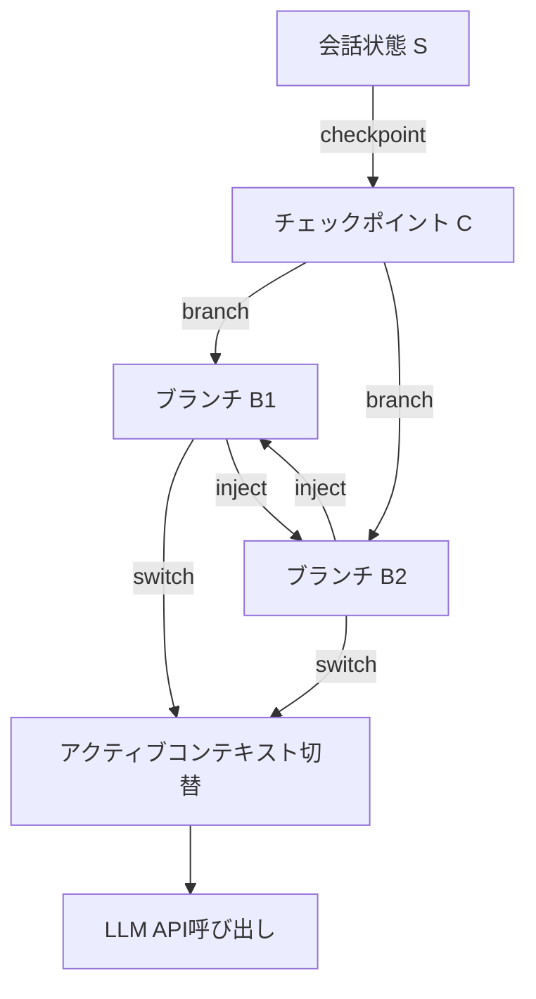
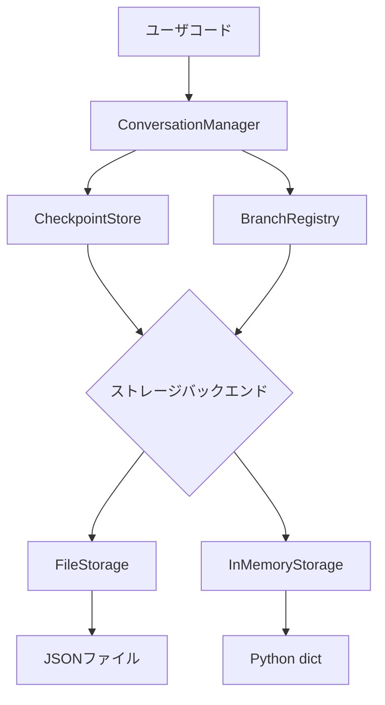
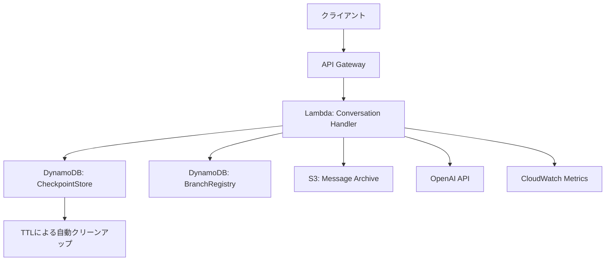
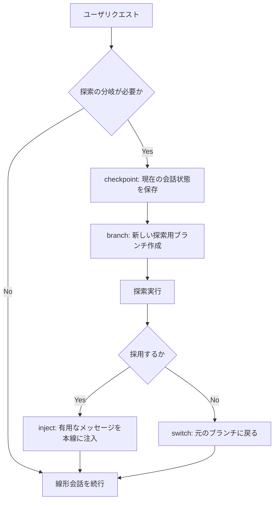

## 論文概要

LLMとのマルチターン会話では、会話が長くなるにつれて無関係なコンテキストが蓄積し、応答品質が低下する問題が知られている。本論文は、ソフトウェア開発におけるバージョン管理（Git）の概念をLLM会話管理に適用する**ContextBranch**フレームワークを提案している。**checkpoint**・**branch**・**switch**・**inject**の4つのプリミティブによって会話状態を管理し、30のソフトウェアエンジニアリングシナリオで評価した結果、ブランチ型会話は線形会話と比較してコンテキストサイズを58.1%削減しつつ、品質スコアが2.5%向上したと著者らは報告している。

この記事は [Zenn記事: Assistants API Thread廃止後のConversations API移行と会話状態設計](https://zenn.dev/0h_n0/articles/a90bff04f7e110) の深掘りです。

## 情報源

- **arXiv ID**: 2512.13914
- **URL**: [arXiv:2512.13914](https://arxiv.org/abs/2512.13914)
- **著者**: Bhargav Chickmagalur Nanjundappa, Spandan Maaheshwari
- **投稿日**: 2025年12月15日
- **分野**: Software Engineering (cs.SE), Artificial Intelligence (cs.AI), Human-Computer Interaction (cs.HC)

## 背景と動機

### マルチターン会話のコンテキスト汚染問題

LLMを用いた探索的プログラミングでは、複数の設計アプローチを試行錯誤することが一般的である。しかし、現行のLLM APIは会話履歴を単一の線形リストとして管理するため、以下の問題が生じる。

1. **コンテキスト汚染**: あるアプローチの探索中に生成されたメッセージが、別のアプローチに切り替えた後もコンテキストに残り続ける
2. **トークン消費の増大**: 不要なメッセージが蓄積し、APIコールごとのトークン数が増加する
3. **焦点の喪失**: 無関係な情報がプロンプトに含まれることで、LLMの応答が散漫になる

例えば、Webアプリケーション開発でReactコンポーネントの設計を議論した後にバックエンドAPIの設計に話題を移すと、フロントエンドに関するメッセージがコンテキストに残ったまま、バックエンド設計の品質が低下するという状況である。

### Gitとの類推

この問題構造は、ソフトウェア開発におけるバージョン管理が解決してきた課題と類似している。

| 概念 | Git | ContextBranch |
|---|---|---|
| 状態の保存 | コミット | チェックポイント |
| 分岐した作業 | ブランチ | ブランチ |
| 作業の切り替え | チェックアウト | スイッチ |
| 選択的マージ | チェリーピック | インジェクト |

Gitがソースコードの並行開発を可能にしたのと同様に、ContextBranchはLLM会話の並行探索を可能にする。ただし、Gitのマージに相当する操作は意図的に除外されており、代わりにより制御されたinject操作が採用されている点が特徴的である。

### OpenAI Conversations APIとの関連

Zenn記事で解説したOpenAIのConversations API移行は、まさにこの会話状態管理の課題に直面する場面である。Assistants API ThreadからConversations APIへ移行する際、会話状態をどう設計するかが大きな設計判断となる。ContextBranchが提案するプリミティブは、Conversations API上での会話状態管理パターンの一つの理論的基盤を提供する。

## 主要な貢献

著者らは以下の3つの貢献を主張している。

1. **形式モデルの定義**: 会話状態をメッセージの順序列として形式化し、ブランチ操作の意味論を数学的に定義
2. **4つのプリミティブの設計**: checkpoint、branch、switch、injectという最小限のプリミティブセットで会話の並行探索を実現
3. **実験的評価**: 30のソフトウェアエンジニアリングシナリオで、線形会話と分岐型会話を比較し、品質向上とコンテキスト削減を確認

## 技術的詳細

### 形式モデル

著者らは会話状態を以下のように形式化している。

会話状態 $$S$$ はメッセージの順序列として定義される。

$$S = [m_1, m_2, \ldots, m_n]$$

ここで各メッセージ $$m_i$$ は3つ組で表現される。

$$m_i = (\text{role}_i, \text{content}_i, \text{metadata}_i)$$

- $$\text{role}_i \in \{\text{system}, \text{user}, \text{assistant}\}$$: メッセージの送信者
- $$\text{content}_i$$: メッセージ本文（文字列）
- $$\text{metadata}_i$$: タイムスタンプやトークン数などの付随情報

チェックポイント $$C$$ は、ある時点の会話状態のイミュータブルなスナップショットであり、SHA-256ハッシュで一意に識別される。

$$C = (h, S_{\text{frozen}})$$

$$h = \text{SHA-256}(\text{serialize}(S_{\text{frozen}}))$$

ブランチ $$B$$ は、チェックポイントから派生した独立した会話コンテキストである。

$$B = (id, C_{\text{parent}}, S_{\text{branch}})$$

$$S_{\text{branch}} = S_{\text{frozen}} \oplus [m_{n+1}, m_{n+2}, \ldots]$$

ここで $$\oplus$$ はリストの連結を表す。$$S_{\text{frozen}}$$ はチェックポイント時点のメッセージ列であり、$$[m_{n+1}, \ldots]$$ はブランチ作成後に追加されたメッセージである。

### 4つのプリミティブ



#### 1. Checkpoint（チェックポイント）

現在の会話状態をイミュータブルなスナップショットとして保存する操作である。

```python
from hashlib import sha256
from dataclasses import dataclass, field
from typing import Literal
import json
import uuid


@dataclass(frozen=True)
class Message:
    """会話メッセージを表す不変データクラス"""
    role: Literal["system", "user", "assistant"]
    content: str
    metadata: dict = field(default_factory=dict)


@dataclass(frozen=True)
class Checkpoint:
    """会話状態のイミュータブルなスナップショット"""
    hash_id: str
    messages: tuple[Message, ...]

    @classmethod
    def create(cls, messages: list[Message]) -> "Checkpoint":
        """メッセージ列からチェックポイントを生成する。

        同一内容のメッセージ列は同一のhash_idを持つ（冪等性）。

        Args:
            messages: 保存するメッセージ列

        Returns:
            SHA-256ハッシュで識別されるチェックポイント
        """
        frozen = tuple(messages)
        serialized = json.dumps(
            [{"role": m.role, "content": m.content} for m in frozen],
            sort_keys=True,
        )
        hash_id = sha256(serialized.encode()).hexdigest()
        return cls(hash_id=hash_id, messages=frozen)
```

SHA-256ハッシュにより、同一の会話状態からは常に同一のチェックポイントIDが生成される。これはGitのコミットハッシュと同じ原理であり、重複するチェックポイントの検出と排除を可能にする。

#### 2. Branch（ブランチ）

チェックポイントからディープコピーによって独立した会話コンテキストを作成する操作である。

```python
import copy

@dataclass
class Branch:
    """独立した会話コンテキスト"""
    branch_id: str
    parent_checkpoint: Checkpoint
    messages: list[Message]

    @classmethod
    def create(cls, checkpoint: Checkpoint) -> "Branch":
        """チェックポイントから新しいブランチを作成する。

        ディープコピーにより、元のチェックポイントとの
        完全な分離を保証する。

        Args:
            checkpoint: 分岐元のチェックポイント

        Returns:
            UUIDで識別される新しいブランチ
        """
        return cls(
            branch_id=str(uuid.uuid4()),
            parent_checkpoint=checkpoint,
            messages=list(copy.deepcopy(checkpoint.messages)),
        )
```

ディープコピーにより、ブランチ間の完全な分離（isolation）が保証される。あるブランチにメッセージを追加しても、他のブランチには一切影響しない。

#### 3. Switch（スイッチ）

アクティブなブランチを切り替える操作である。

```python
@dataclass
class ConversationManager:
    """会話の分岐管理を行うマネージャ"""
    branches: dict[str, Branch] = field(default_factory=dict)
    active_branch_id: str | None = None

    def switch(self, branch_id: str) -> list[Message]:
        """アクティブブランチを切り替える。

        切り替え時に、前のブランチのメッセージは
        一切引き継がれない（キャリーオーバーなし）。

        Args:
            branch_id: 切り替え先のブランチID

        Returns:
            切り替え先ブランチの完全なメッセージ履歴

        Raises:
            KeyError: 存在しないブランチIDが指定された場合
        """
        if branch_id not in self.branches:
            raise KeyError(f"Branch {branch_id} not found")
        self.active_branch_id = branch_id
        return list(self.branches[branch_id].messages)
```

Gitの`git checkout`に相当し、切り替え先ブランチのメッセージ履歴がLLM APIに送信されるコンテキストとなる。前のブランチのメッセージは一切引き継がれないことが重要であり、これがコンテキスト汚染を防ぐ中核メカニズムである。

#### 4. Inject（インジェクト）

あるブランチから別のブランチへ、選択したメッセージを複製する操作である。

```python
def inject(
    self,
    source_branch_id: str,
    target_branch_id: str,
    message_indices: list[int],
) -> None:
    """ソースブランチから選択メッセージをターゲットに注入する。

    assistantメッセージについては、ターゲットブランチの
    コンテキストとの整合性チェックを行う。

    Args:
        source_branch_id: コピー元ブランチID
        target_branch_id: コピー先ブランチID
        message_indices: コピーするメッセージのインデックス列

    Raises:
        KeyError: 存在しないブランチIDが指定された場合
        IndexError: 無効なメッセージインデックスが指定された場合
    """
    source = self.branches[source_branch_id]
    target = self.branches[target_branch_id]

    for idx in message_indices:
        msg = copy.deepcopy(source.messages[idx])
        if msg.role == "assistant":
            self._check_coherence(target.messages, msg)
        target.messages.append(msg)

def _check_coherence(
    self,
    existing: list[Message],
    candidate: Message,
) -> None:
    """assistantメッセージのコンテキスト整合性を検証する。

    注入先の会話履歴と矛盾するメッセージを検出する。
    本論文ではproof sketchのみ提示されている。

    Args:
        existing: 注入先の既存メッセージ列
        candidate: 注入候補のメッセージ
    """
    # 論文ではcoherence checkの具体的実装は
    # proof sketchのみで詳細は示されていない
    pass
```

Gitの`git cherry-pick`に相当するが、merge操作は意図的に提供されていない。これは、2つの会話コンテキストを自動的に統合すると意味的な矛盾が生じるリスクが高いためである。inject操作では、開発者が明示的にどのメッセージを移動するかを選択し、assistantメッセージについては整合性チェックが行われる。

### 形式的性質

著者らは以下の3つの性質を主張し、proof sketchを示している（完全な証明ではない点に注意が必要である）。

**ブランチ分離（Branch Isolation）**: ブランチ $$B_i$$ へのメッセージ追加操作は、他のブランチ $$B_j$$ $$(i \neq j)$$ の状態に影響しない。

$$\text{append}(B_i, m) \implies B_j.\text{messages} = B_j.\text{messages}$$

**チェックポイント決定性（Checkpoint Determinism）**: 同一のメッセージ列からは常に同一のチェックポイントが生成される。

$$S_1 = S_2 \implies \text{Checkpoint.create}(S_1).\text{hash\_id} = \text{Checkpoint.create}(S_2).\text{hash\_id}$$

**インジェクション安全性（Injection Safety）**: inject操作はターゲットブランチにメッセージを追加するのみで、既存メッセージを変更しない。

### 実装アーキテクチャ

著者らのPython SDK（約900行）は、以下の構成で実装されている。



- **FileStorage**: チェックポイントをJSONファイルとして永続化。各チェックポイントは`{hash_id}.json`として保存される
- **InMemoryStorage**: テスト用途や一時的な利用のためのインメモリ実装

## 実装のポイント

### SHA-256による冪等性設計

チェックポイントのハッシュ生成にSHA-256を使用することで、以下の利点が得られる。

1. **重複排除**: 同一会話状態のチェックポイントは自動的に重複排除される
2. **整合性検証**: チェックポイントの内容が改竄されていないことを検証可能
3. **アドレッサビリティ**: ハッシュ値のみでチェックポイントを一意に参照可能

ただし、メタデータ（タイムスタンプなど）をハッシュ計算に含めるかどうかは設計判断であり、含めない場合は同一内容の会話が異なるタイミングで作成されても同一チェックポイントとなる。

### ディープコピーのコスト

ブランチ作成時のディープコピーは、メッセージ数に比例する計算量 $$O(n)$$ を要する。著者らの実装ではPython標準ライブラリの`copy.deepcopy`を使用しているが、大規模な会話履歴ではコピー・オン・ライト（CoW）戦略の採用が検討に値する。

### API呼び出し時のコンテキスト構築

switch操作後にLLM APIを呼び出す際、アクティブブランチのメッセージ履歴のみがAPIリクエストに含まれる。これにより、不要なメッセージがコンテキストを占有することを防ぐ。

```python
def build_api_request(manager: ConversationManager) -> list[dict[str, str]]:
    """アクティブブランチからAPI用メッセージ列を構築する。

    Args:
        manager: 会話マネージャ

    Returns:
        OpenAI API形式のメッセージ辞書リスト

    Raises:
        ValueError: アクティブブランチが未設定の場合
    """
    if manager.active_branch_id is None:
        raise ValueError("No active branch")

    branch = manager.branches[manager.active_branch_id]
    return [
        {"role": m.role, "content": m.content}
        for m in branch.messages
    ]
```

## Production Deployment Guide

本論文のPython SDK（約900行）をプロダクション環境に展開する際のアーキテクチャパターンを示す。

### AWS実装パターン



#### DynamoDBテーブル設計

チェックポイントとブランチの永続化にDynamoDBを使用する場合のテーブル設計例を示す。

```python
from dataclasses import dataclass
from typing import Any


@dataclass
class DynamoDBCheckpointStore:
    """DynamoDBベースのチェックポイントストア"""
    table_name: str
    ttl_days: int = 30

    def put_checkpoint(
        self, checkpoint: Checkpoint, conversation_id: str
    ) -> None:
        """チェックポイントをDynamoDBに保存する。

        パーティションキー: conversation_id
        ソートキー: checkpoint_hash

        Args:
            checkpoint: 保存するチェックポイント
            conversation_id: 会話識別子
        """
        # DynamoDB put_item の構造例
        item: dict[str, Any] = {
            "conversation_id": conversation_id,
            "checkpoint_hash": checkpoint.hash_id,
            "messages": [
                {"role": m.role, "content": m.content}
                for m in checkpoint.messages
            ],
            "ttl": self._calculate_ttl(self.ttl_days),
        }
        # boto3.resource("dynamodb").Table(self.table_name).put_item(Item=item)

    def _calculate_ttl(self, days: int) -> int:
        """TTL用のUnixタイムスタンプを計算する。

        Args:
            days: TTLまでの日数

        Returns:
            Unixタイムスタンプ（秒）
        """
        import time
        return int(time.time()) + (days * 86400)
```

#### Terraformリソース定義

```hcl
resource "aws_dynamodb_table" "checkpoints" {
  name         = "context-branch-checkpoints"
  billing_mode = "PAY_PER_REQUEST"
  hash_key     = "conversation_id"
  range_key    = "checkpoint_hash"

  attribute {
    name = "conversation_id"
    type = "S"
  }

  attribute {
    name = "checkpoint_hash"
    type = "S"
  }

  ttl {
    attribute_name = "ttl"
    enabled        = true
  }

  point_in_time_recovery {
    enabled = true
  }

  tags = {
    Service     = "context-branch"
    Environment = "production"
  }
}

resource "aws_dynamodb_table" "branches" {
  name         = "context-branch-branches"
  billing_mode = "PAY_PER_REQUEST"
  hash_key     = "conversation_id"
  range_key    = "branch_id"

  attribute {
    name = "conversation_id"
    type = "S"
  }

  attribute {
    name = "branch_id"
    type = "S"
  }

  ttl {
    attribute_name = "ttl"
    enabled        = true
  }

  tags = {
    Service     = "context-branch"
    Environment = "production"
  }
}
```

### 運用・監視

#### メトリクス設計

```python
from dataclasses import dataclass
import time


@dataclass
class BranchMetrics:
    """ブランチ操作のメトリクス収集"""
    namespace: str = "ContextBranch"

    def record_checkpoint(
        self, conversation_id: str, message_count: int
    ) -> dict[str, Any]:
        """チェックポイント作成メトリクスを記録する。

        Args:
            conversation_id: 会話ID
            message_count: チェックポイント時のメッセージ数

        Returns:
            CloudWatch PutMetricData形式の辞書
        """
        return {
            "Namespace": self.namespace,
            "MetricData": [
                {
                    "MetricName": "CheckpointMessageCount",
                    "Value": message_count,
                    "Unit": "Count",
                    "Dimensions": [
                        {
                            "Name": "ConversationId",
                            "Value": conversation_id,
                        }
                    ],
                    "Timestamp": time.time(),
                }
            ],
        }

    def record_branch_switch(
        self, from_size: int, to_size: int
    ) -> dict[str, Any]:
        """ブランチ切替時のコンテキストサイズ変化を記録する。

        Args:
            from_size: 切替前のメッセージ数
            to_size: 切替後のメッセージ数

        Returns:
            CloudWatch PutMetricData形式の辞書
        """
        reduction = (from_size - to_size) / from_size if from_size > 0 else 0
        return {
            "Namespace": self.namespace,
            "MetricData": [
                {
                    "MetricName": "ContextSizeReduction",
                    "Value": reduction * 100,
                    "Unit": "Percent",
                }
            ],
        }
```

### コスト最適化チェックリスト

| 項目 | 対策 | 期待効果 |
|---|---|---|
| トークンコスト | ブランチ分離によるコンテキスト削減 | 著者らの報告では58.1%削減 |
| DynamoDBコスト | TTLによる自動削除 | 古いチェックポイントの自動クリーンアップ |
| ストレージコスト | SHA-256による重複排除 | 同一状態の重複保存を防止 |
| Lambda実行時間 | InMemoryStorageをキャッシュに併用 | DynamoDB読み取り回数の削減 |
| API呼び出し回数 | ブランチ戦略による無駄な再試行の回避 | 探索的タスクでのAPI呼び出し最適化 |

## 実験結果

### 実験設定

著者らは30のソフトウェアエンジニアリングシナリオ（Webアプリ開発、データパイプライン構築、API設計など）を用いて評価を実施している。各シナリオでGPT-4を使用し、線形会話（従来型）と分岐型会話（ContextBranch使用）の2条件を比較している。

評価はLLM-as-judge方式で行われており、GPT-4がシナリオの生成と品質評価の両方を担当している。この点は後述する制約事項で重要となる。

### 定量的結果

著者らが報告している主要な結果を以下の表に示す。

| メトリクス | 線形会話 | 分岐型会話 | 変化 | 効果量（Cohen's d） |
|---|---|---|---|---|
| 総合スコア | 8.46 | 8.67 | +2.5% | 0.73（中〜大） |
| 焦点（Focus） | 8.70 | 9.10 | +4.6% | 0.80（大） |
| コンテキスト認識 | 7.37 | 7.87 | +6.8% | 0.87（大） |
| コンテキストサイズ（メッセージ数） | 31.0 | 13.0 | -58.1% | ― |

統計的検定では $$p = 0.010$$ であり、帰無仮説（差がない）は棄却されている。Cohen's $$d = 0.73$$ は中程度から大きい効果量を示す。

### シナリオ別の傾向

30シナリオの内訳は以下の通りである。

- **20シナリオ**: 分岐型が改善
- **9シナリオ**: 差なし
- **1シナリオ**: 分岐型が低下

著者らによれば、概念的に距離のある探索（例：フロントエンド設計とバックエンド設計を並行して議論する場合）ほど、ブランチの効果が大きいと報告されている。逆に、単一のトピックを深掘りする線形的な会話では、ブランチの利点は限定的であった。

### 制約事項

この実験結果を解釈する際には、以下の制約を考慮する必要がある。

1. **LLM-as-judge問題**: GPT-4がシナリオの生成と品質評価の両方を担当しており、自己評価バイアスの可能性がある
2. **合成シナリオ**: 実際のユーザによるシナリオではなく、GPT-4が生成した合成シナリオを使用
3. **単一モデル**: GPT-4のみでの評価であり、他のモデルへの一般化は未検証
4. **ユーザスタディの欠如**: 実際の開発者による使用感や生産性への影響は測定されていない
5. **絶対的改善幅の小ささ**: 総合スコアの改善は+2.5%（8.46から8.67）と絶対値では小さい

## 実運用への応用

### Conversations APIにおける会話状態パターン

OpenAIのConversations APIへの移行において、ContextBranchの概念を以下のように活用できる。



### 適用が有効なユースケース

1. **コード生成**: フロントエンドとバックエンドの設計を並行して探索し、最終的に統合する
2. **デバッグ**: 複数の仮説を並行して検証し、有効だった仮説のコンテキストのみを保持する
3. **文書作成**: 異なる構成案を並行して試し、最適なものを選択する

### 適用が限定的なユースケース

1. **単純なQ&A**: 分岐の必要性が低く、オーバーヘッドのみが増加する
2. **短い会話**: コンテキスト汚染が問題にならない短いセッション
3. **順序依存タスク**: 前のステップの結果に依存する線形的なタスク

## 関連研究

### MemGPT（2023年）

Packer et al. による MemGPT は、オペレーティングシステムのメモリ階層をLLMのコンテキスト管理に適用した研究である。メインコンテキスト（作業メモリ）と外部ストレージ（長期記憶）を分離し、LLM自身がメモリ管理操作を行う。ContextBranchが「並行探索」に焦点を当てるのに対し、MemGPTは「コンテキスト長の制約を超える」ことを主目的とする。

### LangGraph（2024年）

LangChainチームによるLangGraphは、LLMアプリケーションの状態管理をグラフ構造で表現するフレームワークである。チェックポイントとブランチの概念を持ち、ContextBranchと類似した設計思想を共有している。ただし、LangGraphはより広範なエージェントワークフローの管理を対象としており、ContextBranchのように会話コンテキストの品質改善に特化した評価は行っていない。

### Prompt Compression（2023年-2025年）

LLMLingua（Jiang et al., 2023）やSelective Context（Li et al., 2023）などのプロンプト圧縮手法は、コンテキストサイズの削減という同じ目標を持つ。しかし、これらはメッセージ内の情報を圧縮するアプローチであり、ContextBranchはメッセージの構造的分離によってコンテキストを管理するアプローチである。両者は補完的に使用可能であり、ブランチ内のメッセージにさらにプロンプト圧縮を適用することで、より大きなコンテキスト削減効果が期待できる。

## まとめと今後の展望

ContextBranchは、バージョン管理の確立された概念をLLM会話管理に適用するというシンプルながら実用的なアプローチを提示している。4つのプリミティブ（checkpoint、branch、switch、inject）による会話状態の構造化は、OpenAI Conversations APIへの移行において会話状態設計の一つの理論的基盤となり得る。

ただし、以下の課題が残されている。

1. **実ユーザでの検証**: 合成シナリオではなく、実際の開発者による評価が必要である
2. **マルチモデル評価**: GPT-4以外のモデルでの効果検証が求められる
3. **自動ブランチ戦略**: 現状では開発者が手動でブランチタイミングを判断する必要があり、自動化の余地がある
4. **スケーラビリティ**: 大規模な会話履歴でのディープコピーのコストや、ブランチ数の増加に対するパフォーマンスの評価が不足している
5. **merge操作の導入**: inject操作はcherry-pickに相当するが、より汎用的なmerge操作の設計と安全性保証は今後の課題である

コンテキストウィンドウの管理は、LLMアプリケーション開発における本質的な設計課題であり、ContextBranchのようなシステマティックなアプローチは実務上の参考になる。特に、Conversations API移行後の会話状態設計において、checkout/branch/switch/injectの概念フレームワークは設計判断の指針として有用である。

## 参考文献

1. Chickmagalur Nanjundappa, B., & Maaheshwari, S. (2025). Context Branching for LLM Conversations: A Version Control Approach to Exploratory Programming. arXiv:2512.13914. [https://arxiv.org/abs/2512.13914](https://arxiv.org/abs/2512.13914)
2. Packer, C., Wooders, S., Lin, K., Fang, V., Patil, S. G., Stoica, I., & Gonzalez, J. E. (2023). MemGPT: Towards LLMs as Operating Systems. arXiv:2310.08560.
3. Jiang, H., Wu, Q., Lin, C.-Y., Yang, Y., & Qiu, L. (2023). LLMLingua: Compressing Prompts for Accelerated Inference of Large Language Models. arXiv:2310.05736.
4. Li, Y., Bubeck, S., Eldan, R., Del Giorno, A., Gunasekar, S., & Lee, Y. T. (2023). Textbooks Are All You Need II: phi-1.5 technical report. arXiv:2309.05463.
5. LangGraph Documentation. LangChain. [https://langchain-ai.github.io/langgraph/](https://langchain-ai.github.io/langgraph/)
