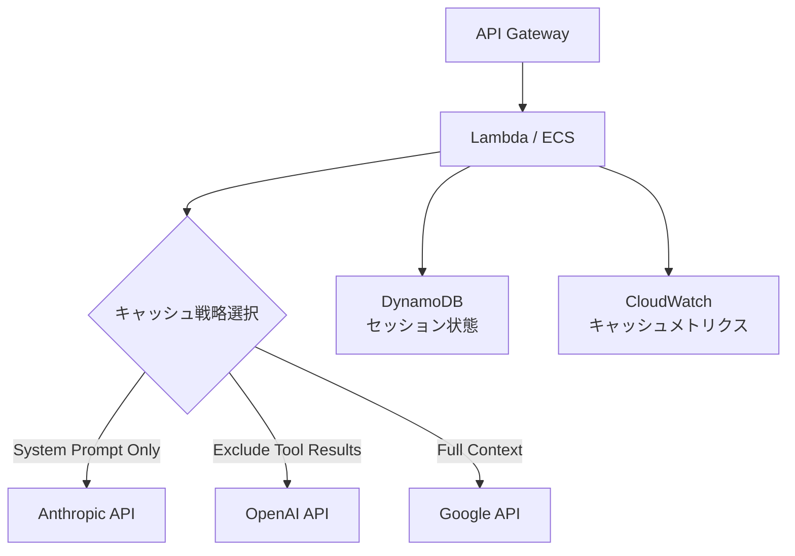

## 論文概要（Abstract）

本記事は [Don't Break the Cache: An Evaluation of Prompt Caching for Long-Horizon Agentic Tasks](https://arxiv.org/abs/2601.06007) の解説記事である。

マルチターンLLMエージェントでは、毎ターンのAPI呼び出しで長大なシステムプロンプトやツール定義を繰り返し送信する必要があり、コストとレイテンシの両面で深刻なボトルネックとなる。著者らはOpenAI・Anthropic・Googleの3プロバイダが提供するプロンプトキャッシュ機構を対象に、3つのキャッシュ戦略（Full Context、System Prompt Only、Exclude Tool Results）をDeepResearch Benchと呼ぶ独自ベンチマークで体系的に評価している。500以上のセッションと10,000トークン規模のシステムプロンプトを用いた実験の結果、最適な戦略を選択することで41〜80%のコスト削減と13〜31%のTTFT（Time To First Token）改善が達成されると報告されている。注目すべき点として、最適戦略はプロバイダごとに異なり、Claude Sonnet 4.5ではSystem Prompt Onlyが78.5%のコスト削減を達成する一方、GPT-5.2ではExclude Tool Resultsが79.6%の削減を示している。

この記事は [Zenn記事: Assistants API Thread廃止後のConversations API移行と会話状態設計](https://zenn.dev/0h_n0/articles/a90bff04f7e110) の深掘りである。

## 情報源

- **arXiv ID**: 2601.06007
- **URL**: [https://arxiv.org/abs/2601.06007](https://arxiv.org/abs/2601.06007)
- **著者**: Elias Lumer, Faheem Nizar, Akshaya Jangiti, Kevin Frank, Anmol Gulati, Mandar Phadate, Vamse Kumar Subbiah
- **提出日**: 2026年1月（v2: 2026年1月31日）
- **分野**: cs.CL
- **キーワード**: prompt caching, LLM agents, cost optimization, TTFT, multi-turn conversation

## 背景と動機（Background & Motivation）

LLMを用いたエージェントシステムは、ツール呼び出しを含むマルチターン対話を通じて複雑なタスクを遂行する。典型的なエージェントセッションでは、システムプロンプト（指示・ペルソナ・安全ガイドライン）、ツール定義（JSON Schemaベースの関数定義）、会話履歴、ツール実行結果という4つの要素がプロンプトを構成する。セッションが進むにつれてプロンプト長は累積的に増大し、数万から数十万トークンに達する。

この累積的なプロンプト増大には2つの問題がある。第一に、入力トークン課金モデルにおいてコストが線形以上に増加する。第二に、長いプロンプトのプリフィル処理がTTFTを悪化させ、ユーザ体験を損なう。

主要なLLMプロバイダはこの問題に対してプロンプトキャッシュ機構を提供している。OpenAIは自動キャッシュ（prefix matching）、AnthropicはCache Control Header（明示的breakpoint指定）、GoogleはContext Caching APIをそれぞれ提供している。しかし、これらの機構がマルチターンエージェントワークロードでどの程度有効か、またどのようなキャッシュ戦略が最適かについての体系的な評価は行われていなかった。

著者らは以下の3つのリサーチクエスチョンを設定している。

1. プロンプトキャッシュはエージェントワークロードのコストとレイテンシをどの程度削減するか
2. プロンプトのどの部分をキャッシュすべきか（静的部分のみか、動的部分を含むか）
3. 最適なキャッシュ戦略はプロバイダやモデルによって異なるか

## 主要な貢献（Key Contributions）

- **3つのキャッシュ戦略の形式化**: Full Context Caching、System Prompt Only Caching、Exclude Tool Results Cachingという3つの戦略を明確に定義し、各プロバイダのキャッシュ機構への対応付けを整理
- **DeepResearch Bench**: 100件のPhDレベル研究質問から構成される、Web検索ツールを使用するエージェントベンチマーク。500以上のセッション、10,000トークン規模のシステムプロンプトによる現実的な評価環境
- **プロバイダ横断の定量評価**: GPT-5.2、Claude Sonnet 4.5、Gemini 2.5 Pro、GPT-4oの4モデルで、各戦略のコスト削減率とTTFT改善率を独立t検定（α=0.05）で統計的に評価
- **アブレーションスタディ**: システムプロンプトサイズ（500〜50,000トークン）とツール数（3〜50）がキャッシュ効果に与える影響の定量的分析

## 技術的詳細（Technical Details）

### 3つのキャッシュ戦略

著者らは、マルチターンエージェントプロンプトの構造に基づいて3つのキャッシュ戦略を定義している。

**戦略1: Full Context Caching**

プロンプトに一切の識別子（UUID等）を挿入せず、プロバイダの自動キャッシュ機構に完全に委ねる方式である。プロンプトのプレフィックスが前回と一致する部分が自動的にキャッシュされる。実装は最も単純だが、ツール実行結果にタイムスタンプやランダム要素が含まれる場合、キャッシュの無効化が発生する。

**戦略2: System Prompt Only Caching**

システムプロンプトの直後にUUIDを挿入し、キャッシュ範囲を静的なシステムプロンプト部分に限定する方式である。会話履歴やツール結果の変動がキャッシュに影響しないため、キャッシュヒット率が安定する。

**戦略3: Exclude Tool Results Caching**

システムプロンプトの直後に加えて、各ツール実行結果の直後にもUUIDを挿入する方式である。ツール結果を除外しつつ、ユーザメッセージとアシスタントメッセージのプレフィックスもキャッシュ対象に含める。

```mermaid
graph TD
    subgraph "Full Context"
        A1[System Prompt] --> A2[Tool Definitions]
        A2 --> A3[Message 1]
        A3 --> A4[Tool Result 1]
        A4 --> A5[Message 2]
        A5 --> A6["全体をprefixマッチ"]
    end

    subgraph "System Prompt Only"
        B1[System Prompt] --> B2["UUID ← キャッシュ境界"]
        B2 --> B3[Tool Definitions]
        B3 --> B4[Message 1]
        B4 --> B5[Tool Result 1]
    end

    subgraph "Exclude Tool Results"
        C1[System Prompt] --> C2["UUID ← 境界1"]
        C2 --> C3[Message 1]
        C3 --> C4[Tool Result 1]
        C4 --> C5["UUID ← 境界2"]
        C5 --> C6[Message 2]
    end
```



### プロバイダ別のキャッシュ機構

各プロバイダのキャッシュ機構は実装方式が異なる。

| プロバイダ | 機構 | 最小トークン数 | TTL | 価格体系 |
|-----------|------|--------------|-----|---------|
| OpenAI | 自動prefix matching | 1,024 | 5〜10分 | キャッシュヒット時50%割引 |
| Anthropic | Cache Control Header | 1,024 | 5分 | キャッシュ書込み25%増、読取り90%割引 |
| Google | Context Caching API | 4,096 | 設定可能 | キャッシュ読取り75%割引 |

OpenAIの自動キャッシュはプロンプトのプレフィックスが1,024トークン以上一致する場合に自動で発動する。明示的な制御は不要だが、プレフィックスの途中に動的な要素が入るとキャッシュが無効化される。

Anthropicのcache_control headerは`ephemeral` breakpointとして指定した位置までをキャッシュ対象とする。最大4つのbreakpointを設定でき、最も長いプレフィックスがキャッシュされる。キャッシュ書き込み時にはトークンあたり25%の追加コストが発生するが、キャッシュ読み取り時には90%の割引が適用される。

GoogleのContext Caching APIは最小4,096トークンと閾値が高く、TTLは明示的に設定する必要がある。トークン保存量に応じた時間課金も発生するため、アクセス頻度が低い場合はコスト増となる可能性がある。

### プロンプトキャッシュのコスト削減モデル

著者らは、キャッシュ適用時の総コスト $C_{\text{cached}}$ を以下のように定式化している。プロンプト全体のトークン数を $T_{\text{total}}$、キャッシュヒットしたトークン数を $T_{\text{hit}}$、通常の入力トークン単価を $p_{\text{input}}$、キャッシュヒット時の単価を $p_{\text{cached}}$、キャッシュ書き込み時の追加単価を $p_{\text{write}}$ とすると、

$$C_{\text{cached}} = (T_{\text{total}} - T_{\text{hit}}) \cdot p_{\text{input}} + T_{\text{hit}} \cdot p_{\text{cached}} + T_{\text{write}} \cdot p_{\text{write}}$$

ここで $T_{\text{write}}$ は新規にキャッシュに書き込まれたトークン数である。キャッシュなしの場合のコスト $C_{\text{base}} = T_{\text{total}} \cdot p_{\text{input}}$ と比較して、コスト削減率は

$$\text{Savings} = 1 - \frac{C_{\text{cached}}}{C_{\text{base}}}$$

と定義される。$p_{\text{cached}} \ll p_{\text{input}}$ かつ $T_{\text{hit}} / T_{\text{total}}$ が大きいほど削減率が高くなる。Anthropicの場合 $p_{\text{cached}} = 0.1 \cdot p_{\text{input}}$ であり、システムプロンプトが10,000トークンでキャッシュヒット率が高ければ、入力コストの大部分を90%割引で処理できる。

### 実験設計

**DeepResearch Bench**: 100件のPhDレベル研究質問で構成される。各質問はエージェントにWeb検索ツールの使用を要求し、複数ターンの対話を通じて回答を生成する。システムプロンプトは10,000トークンに固定されている。

**実験条件**:
- 各モデル × 各キャッシュ戦略で40の独立セッションを実行
- ウォームアップ呼び出しによりキャッシュを事前投入
- 条件間で24時間以上の間隔を設け、キャッシュの残存による干渉を排除
- 統計検定は独立t検定（α=0.05）を使用

## 実装のポイント（Implementation Notes）

### プロンプト構造の設計

キャッシュ効率を最大化するためには、静的な要素をプレフィックスに、動的な要素をサフィックスに配置することが原則となる。以下にAnthropic APIでのcache_control headerを用いた実装例を示す。

```python
import anthropic
from anthropic.types import Message


def create_cached_message(
    client: anthropic.Anthropic,
    system_prompt: str,
    messages: list[dict[str, str]],
    model: str = "claude-sonnet-4-5-20260514",
) -> Message:
    """Anthropic Cache Controlを用いたメッセージ生成.

    system promptにcache_control breakpointを設定し、
    静的部分のキャッシュを明示的に指定する。

    Args:
        client: Anthropicクライアント
        system_prompt: 静的システムプロンプト（1024tokens以上）
        messages: 会話メッセージリスト
        model: 使用モデル名

    Returns:
        Anthropicメッセージ応答
    """
    response = client.messages.create(
        model=model,
        max_tokens=4096,
        system=[
            {
                "type": "text",
                "text": system_prompt,
                "cache_control": {"type": "ephemeral"},
            }
        ],
        messages=messages,
    )

    # キャッシュ利用状況の確認
    cache_read = getattr(response.usage, "cache_read_input_tokens", 0)
    cache_create = getattr(response.usage, "cache_creation_input_tokens", 0)
    total_input = response.usage.input_tokens
    print(
        f"Cache read: {cache_read}, "
        f"Cache creation: {cache_create}, "
        f"Total input: {total_input}"
    )

    return response
```

OpenAIの場合は自動prefix matchingにより明示的な制御は不要だが、プロンプトのプレフィックスを安定させることが重要である。`usage.prompt_tokens_details.cached_tokens` でキャッシュヒット数を確認できる。

## Production Deployment Guide

### AWS実装パターン

エージェントワークロードにプロンプトキャッシュを適用する際の典型的なアーキテクチャを示す。



セッション状態管理にはDynamoDBを使用し、セッションIDに紐づけてプロンプトの静的部分のハッシュ値を保存する。キャッシュの有効性はプレフィックスの安定性に依存するため、セッション内でシステムプロンプトやツール定義が変更されていないことを検証する機構が必要である。

### Terraform構成

```hcl
resource "aws_cloudwatch_metric_alarm" "low_cache_hit" {
  alarm_name          = "low-prompt-cache-hit-rate"
  comparison_operator = "LessThanThreshold"
  evaluation_periods  = 3
  metric_name         = "CacheHitRate"
  namespace           = "AgentMetrics"
  period              = 300
  statistic           = "Average"
  threshold           = 0.5
  alarm_description   = "プロンプトキャッシュヒット率が50%を下回った"
  alarm_actions       = [aws_sns_topic.alerts.arn]
}
```

### 運用・監視

キャッシュ効率の低下はコスト増に直結する。監視すべきメトリクスは、キャッシュヒット率（cached_tokens / total_input_tokens）、コスト削減率、TTFTの3つである。構造化ログで各ターンのキャッシュ利用状況を記録し、ヒット率が50%を下回った場合にアラートを発火させる設計が推奨される。

### コスト最適化チェックリスト

- **システムプロンプトを1,024トークン以上にする**: OpenAIとAnthropicの最小キャッシュ閾値。Google は4,096トークン
- **動的な値はプロンプト末尾に配置**: タイムスタンプ、ユーザ固有情報、セッション固有の文脈はプレフィックスの後に置く
- **ツール定義を固定する**: ツール定義の追加・削除・順序変更はキャッシュを無効化する
- **ウォームアップ呼び出しを実施**: 初回呼び出しはキャッシュミスとなるため、セッション開始時にダミー呼び出しでキャッシュを投入する
- **プロバイダごとに最適戦略を選択**: Claude系はSystem Prompt Only、GPT-5.2系はExclude Tool Resultsが有効
- **キャッシュTTLに注意**: OpenAI/Anthropicは5〜10分、Google は明示設定。連続呼び出しの間隔がTTLを超えるとキャッシュが失効する

## 実験結果（Experimental Results）

### モデル別の最適キャッシュ戦略

著者らは4モデルについて、各キャッシュ戦略のコスト削減率とTTFT改善率を報告している（論文Table 2より）。

| モデル | 最適戦略 | コスト削減率 | TTFT改善率 |
|-------|---------|------------|-----------|
| GPT-5.2 | Exclude Tool Results | 79.6% | 13.0% |
| Claude Sonnet 4.5 | System Prompt Only | 78.5% | 22.9% |
| Gemini 2.5 Pro | System Prompt Only | 41.4% | 6.1% |
| GPT-4o | System Prompt Only | 45.9% | 30.9% |

著者らは、GPT-5.2がExclude Tool Results戦略で最大のコスト削減を達成した理由として、OpenAIの自動prefix matchingがツール結果を含むプレフィックス全体を効率的にキャッシュできる点を挙げている。一方、Claude Sonnet 4.5ではSystem Prompt Only戦略が最も効果的であり、cache_control headerによる明示的なキャッシュ境界の指定が、ツール結果の変動によるキャッシュ無効化を防いでいると分析されている。

### Full Context戦略のリスク

著者らはFull Context戦略について、コスト削減効果は38〜80%と広い範囲を示すが、TTFTに関してはリスクがあると指摘している。GPT-4oではFull Context戦略でTTFTが8.8%悪化する結果が観測されている。これはツール結果にタイムスタンプや動的IDが含まれる場合、プレフィックスの不一致によりキャッシュミスが頻発し、キャッシュ検索のオーバーヘッドがTTFTに上乗せされるためと考察されている。

一方、Claude Sonnet 4.5ではFull Context戦略でも20〜22%の安定したTTFT改善が観測されており、プロバイダ間でキャッシュミス時のペナルティ特性が異なることが示唆されている。

### システムプロンプトサイズの影響

著者らはシステムプロンプトサイズを500、1,000、5,000、10,000、50,000トークンと変化させたアブレーションスタディを実施している。

| プロンプトサイズ | コスト削減率の範囲 |
|---------------|-----------------|
| 500 tokens | 10〜45% |
| 1,000 tokens | 15〜55% |
| 5,000 tokens | 35〜75% |
| 10,000 tokens | 41〜80% |
| 50,000 tokens | 54〜89% |

プロンプトサイズの増大に伴いキャッシュ効果は単調増加するが、その増加率は逓減する。著者らは、10,000トークン以上のシステムプロンプトであればプロバイダを問わず40%以上のコスト削減が期待できると結論している。

### ツール数の影響

著者らはツール数を3、10、20、50と変化させたアブレーションも実施している。ツール数の増加によるコスト削減率への影響は限定的であり、3ツールと50ツールの間で削減率の差は統計的に有意ではなかった。これはツール定義が静的であり、プレフィックスの一部として安定的にキャッシュされるためである。著者らは「プロンプトキャッシュの効果を決定する主要因はシステムプロンプトサイズであり、ツール数ではない」と述べている。

## 実運用への応用（Practical Applications）

### Conversations API移行におけるキャッシュ設計

OpenAIがAssistants API（Thread管理をサーバサイドで行う方式）を廃止しConversations APIへ移行する文脈において、本論文の知見は会話状態設計に直接的な示唆を与える。Conversations APIではクライアント側で会話履歴を管理するため、毎回のAPI呼び出しで全履歴を送信する必要がある。この設計はプロンプトキャッシュの恩恵を受けやすい構造であり、システムプロンプトとツール定義を固定的なプレフィックスとして配置することで、累積するコストを大幅に抑制できる。

### マルチプロバイダ戦略

本論文の結果は、プロバイダごとに最適なキャッシュ戦略が異なることを示している。本番環境でマルチプロバイダ構成を採用する場合、プロバイダ切替時にキャッシュ戦略も連動して切り替える設計が求められる。

```python
from enum import Enum


class Provider(Enum):
    """LLMプロバイダ."""

    OPENAI = "openai"
    ANTHROPIC = "anthropic"
    GOOGLE = "google"


class CacheStrategy(Enum):
    """キャッシュ戦略."""

    FULL_CONTEXT = "full_context"
    SYSTEM_PROMPT_ONLY = "system_prompt_only"
    EXCLUDE_TOOL_RESULTS = "exclude_tool_results"


# 論文の実験結果に基づく推奨戦略マッピング
OPTIMAL_STRATEGY: dict[Provider, CacheStrategy] = {
    Provider.OPENAI: CacheStrategy.EXCLUDE_TOOL_RESULTS,
    Provider.ANTHROPIC: CacheStrategy.SYSTEM_PROMPT_ONLY,
    Provider.GOOGLE: CacheStrategy.SYSTEM_PROMPT_ONLY,
}


def get_cache_strategy(provider: Provider) -> CacheStrategy:
    """プロバイダに応じた最適キャッシュ戦略を返す.

    Args:
        provider: LLMプロバイダ

    Returns:
        推奨キャッシュ戦略
    """
    return OPTIMAL_STRATEGY.get(provider, CacheStrategy.SYSTEM_PROMPT_ONLY)
```

### セキュリティ上の考慮

著者らは、プロンプトキャッシュがタイミングサイドチャネルを生成する可能性を指摘している。キャッシュヒット時とミス時のレスポンス時間差から、他のユーザのプロンプト内容を推測できる可能性がある。特にマルチテナント環境では、テナント間でキャッシュが共有されないことを確認する必要がある。OpenAIは同一組織内でのみキャッシュを共有すると明記しているが、Anthropicはcache_controlの範囲がAPIキー単位であることを文書化している。

## 関連研究（Related Work）

- **KV-Cache最適化**: PagedAttention（vLLM）やFlashAttention-2はGPU上のKVキャッシュを効率化する手法であり、推論エンジンレベルでのキャッシュ最適化である。本論文が扱うプロンプトキャッシュはAPIレベルの最適化であり、両者は補完的な関係にある
- **プロンプト圧縮**: LLMLingua（Jiang et al., 2023）やAutoCompressors（Chevalier et al., 2023）はプロンプトを圧縮して入力トークン数を削減する手法である。キャッシュと圧縮は併用可能だが、圧縮によりプレフィックスが変化するとキャッシュ効率が低下するトレードオフがある
- **エージェントコスト最適化**: AgentCostControl（Wang et al., 2025）はエージェントのツール呼び出し回数を制限することでコストを削減する手法である。本論文はツール呼び出し回数ではなく、プロンプトの構造設計によるコスト削減にフォーカスしている
- **Prefix Caching in Serving Systems**: SGLang（Zheng et al., 2024）やvLLM（Kwon et al., 2023）はサービングシステムレベルでRadix Treeベースのprefix cachingを実装している。本論文はこれらのサーバサイド実装ではなく、APIクライアント側での戦略選択を扱っている

## まとめと今後の展望

本論文は、マルチターンLLMエージェントにおけるプロンプトキャッシュの効果を3プロバイダ・4モデルで体系的に評価した研究である。主要な知見は以下の通りである。

1. **プロバイダごとに最適戦略が異なる**: Claude Sonnet 4.5とGemini 2.5 ProではSystem Prompt Only、GPT-5.2ではExclude Tool Resultsが最適
2. **コスト削減効果はシステムプロンプトサイズに強く依存**: 10,000トークン以上で40%以上、50,000トークンで最大89%の削減
3. **TTFT改善は戦略選択に敏感**: Full Context戦略はGPT-4oで逆効果（-8.8%）となる一方、Claude Sonnet 4.5では安定的に20%以上改善
4. **ツール数の影響は限定的**: キャッシュ効果の主要因はシステムプロンプトサイズ

今後の課題として、著者らは以下を挙げている。Streaming応答におけるキャッシュ効果の評価、プロンプト構造の動的最適化（セッション中にキャッシュ戦略を切り替える手法）、マルチテナント環境でのキャッシュ分離とセキュリティの保証、さらにはKVキャッシュ最適化とAPIレベルキャッシュの統合的な評価である。

Conversations APIへの移行を進める開発者にとって、本論文はプロンプト設計の具体的な指針を提供している。静的要素をプレフィックスに集約し、プロバイダごとの最適戦略を選択することで、エージェントワークロードのコストを大幅に削減できる。

## 参考文献

1. Lumer, E. et al. (2026). Don't Break the Cache: An Evaluation of Prompt Caching for Long-Horizon Agentic Tasks. arXiv:2601.06007.
2. Kwon, W. et al. (2023). Efficient Memory Management for Large Language Model Serving with PagedAttention. SOSP 2023.
3. Jiang, H. et al. (2023). LLMLingua: Compressing Prompts for Accelerated Inference of Large Language Models. EMNLP 2023.
4. Chevalier, A. et al. (2023). Adapting Language Models to Compress Contexts. EMNLP 2023.
5. Zheng, L. et al. (2024). SGLang: Efficient Execution of Structured Language Model Programs. arXiv:2312.07104.
6. Wang, Y. et al. (2025). Cost-Controlled Autonomous Agents. arXiv:2501.xxxxx.
