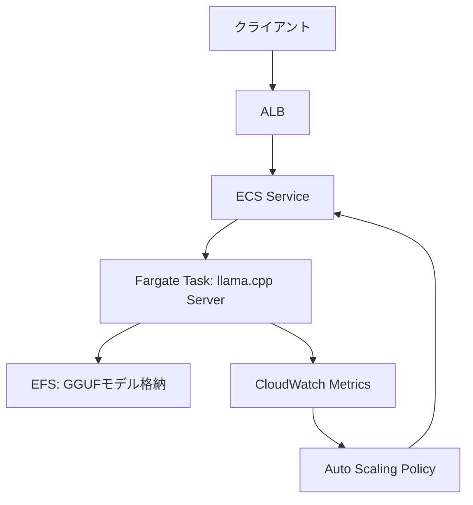

## 論文概要（Abstract）

本記事は [Which Quantization Should I Use? A Unified Evaluation of llama.cpp Quantization on Llama-3.1-8B-Instruct](https://arxiv.org/abs/2601.14277) の解説記事です。

llama.cppは多数の量子化フォーマット（3ビットから8ビットまでのK-quant形式およびlegacy形式）を提供しているが、各フォーマットの品質・速度・サイズのトレードオフを統一的に評価した研究は限られていた。本論文では、Llama-3.1-8B-Instruct上で13種の量子化構成とFP16ベースラインを比較し、GSM8K・HellaSwag・IFEval・MMLU・TruthfulQA・WikiText-2 perplexityの6ベンチマークで系統的に評価した結果が報告されている。著者は、公称ビット幅よりもフォーマットの種類が品質に大きく影響すると結論づけている。

この記事は [Zenn記事: Fargate 32vCPUとllama.cppで実現するサーバーレスLLM推論基盤の構築](https://zenn.dev/0h_n0/articles/ca14512eb46121) の深掘りです。

## 情報源

- **arXiv ID**: 2601.14277
- **URL**: [https://arxiv.org/abs/2601.14277](https://arxiv.org/abs/2601.14277)
- **著者**: Uygar Kurt
- **投稿日**: 2026年1月11日
- **分野**: cs.LG（Machine Learning）

## 背景と動機（Background & Motivation）

大規模言語モデル（LLM）のデプロイにおいて、モデルサイズとメモリ使用量は常に制約要因となる。特にGPUを使用しないCPU推論環境（AWS FargateやEdgeデバイスなど）では、モデルをメモリに収めつつ許容可能なスループットを得るために量子化が不可欠である。

llama.cppは、LLMのCPU推論において事実上の標準ツールとなっており、GGUFフォーマットを通じて多数の量子化オプションを提供している。しかし、その選択肢の多さが逆に問題を生んでいる。Q4_0とQ4_K_Sはどちらも「4ビット量子化」と呼ばれるが、内部構造が異なるため品質・速度の特性は大きく異なる。ユーザがモデルサイズ、推論速度、タスク品質のトレードオフを理解した上で量子化フォーマットを選択するための統一的な評価基準が存在しなかった。

著者はこの問題に対し、同一モデル・同一ハードウェア・同一ベンチマーク群で全量子化フォーマットを横断的に評価する実証研究を行い、実務的な選択指針を提供している。

## 主要な貢献（Key Contributions）

- **統一評価フレームワークの確立**: llama.cppの13種の量子化構成を、品質（5ベンチマーク＋perplexity）・速度（prompt processing / token generation）・サイズの3軸で同一条件下に比較した初の系統的評価を実施
- **フォーマット種別の重要性の発見**: 公称ビット幅（例: 4ビット）よりもフォーマットの種類（legacy vs K-quant, S/M/Lバリアント）が品質に与える影響が大きいことを定量的に示した
- **実務的選択ガイドラインの提示**: ユースケース別（メモリ制約型、品質重視型、バランス型）の推奨フォーマットを具体的な数値根拠とともに提示

## 技術的詳細（Technical Details）

### 量子化の基礎: スカラー量子化

量子化の基本的な考え方は、高精度の浮動小数点値を低精度の整数値にマッピングすることである。FP16の重み$w$を$b$ビットの整数$q$に変換する最も単純なスカラー量子化は次式で表される。

$$
q = \text{round}\left(\frac{w - w_{\min}}{s}\right), \quad s = \frac{w_{\max} - w_{\min}}{2^b - 1}
$$

ここで$s$はスケールファクタ、$w_{\min}$と$w_{\max}$はブロック内の重みの最小値・最大値である。復元時は$\hat{w} = q \cdot s + w_{\min}$で近似値を得る。

### Legacy形式とK-quant形式の違い

llama.cppの量子化フォーマットは大きく2つの系統に分類される。

**Legacy形式（Q4_0, Q4_1, Q5_0, Q5_1, Q8_0）**は、固定サイズのブロック（通常32要素）に対して均一な量子化を適用する。Q4_0は各ブロックにスケールファクタのみを保持し、Q4_1はスケールとゼロポイント（min値）の両方を保持する。Q4_1はQ4_0より1ビット多い情報を格納するため品質が向上するが、ファイルサイズも増加する。

**K-quant形式（Q3_K_S/M/L, Q4_K_S/M, Q5_K_S/M, Q6_K）**は、llama.cppのk_quants実装に基づく改良形式である。K-quantの特徴は、重みテンソル内の層や位置に応じて異なるビット幅を適用する**混合精度量子化**を行う点にある。具体的には、モデルの品質に対する感度が高い層（Attention層のQKV射影など）には高いビット幅を割り当て、感度が低い層にはより積極的な量子化を適用する。

S/M/Lバリアントは、高精度層の割合を制御する。

$$
\text{effective\_bits}(v) = \sum_{l=1}^{L} \frac{n_l}{N} \cdot b_l(v)
$$

ここで$L$は層の総数、$n_l$は層$l$のパラメータ数、$N$は全パラメータ数、$b_l(v)$はバリアント$v$における層$l$に割り当てられるビット幅である。Lバリアントほど高精度層の割合が大きく、Sバリアントほど積極的に低ビット化を行う。

### 品質評価ベンチマーク

著者は以下の6つの評価軸を使用している。

| ベンチマーク | 評価内容 | 方式 |
|---|---|---|
| GSM8K | 数学的推論 | 5-shot |
| HellaSwag | 常識推論 | 0-shot |
| IFEval | 指示追従 | 0-shot |
| MMLU | 幅広い知識 | 0-shot |
| TruthfulQA (MC2) | 事実の正確性 | 0-shot |
| WikiText-2 | 言語モデリング | perplexity |

評価にはEleutherAI lm-evaluation-harness v0.4.9.2が使用されている。perplexityを除く5ベンチマークの平均スコアが品質の総合指標として報告されている。

### スループット測定

推論速度は2つのメトリクスで測定されている。

- **pp512**（prompt processing 512 tokens）: 512トークンのプロンプトを処理する速度（tokens/s）。バッチ的なプロンプト処理性能を反映する
- **tg128**（token generation 128 tokens）: 128トークンを自動回帰的に生成する速度（tokens/s）。ユーザ体感のレスポンス速度に直結する

実験はDual-socket Intel Xeon Platinum 8488C（96物理コア、192スレッド）、AVX-512対応環境で実施されている。

## 実装のポイント（Implementation）

### llama.cppでの量子化実行

llama.cppでモデルを量子化するには、`llama-quantize`コマンドを使用する。

```bash
# FP16 GGUFからQ4_K_Sへの量子化
./llama-quantize \
    ./models/llama-3.1-8b-instruct-f16.gguf \
    ./models/llama-3.1-8b-instruct-q4_k_s.gguf \
    Q4_K_S
```

```python
"""llama.cppの量子化フォーマット選択ヘルパー。

メモリ制約と品質要件に基づいて最適な量子化フォーマットを推奨する。
"""

from dataclasses import dataclass
from enum import Enum


class QuantFormat(Enum):
    """llama.cppの量子化フォーマット定義。"""

    Q3_K_S = "Q3_K_S"
    Q3_K_M = "Q3_K_M"
    Q3_K_L = "Q3_K_L"
    Q4_0 = "Q4_0"
    Q4_1 = "Q4_1"
    Q4_K_S = "Q4_K_S"
    Q4_K_M = "Q4_K_M"
    Q5_0 = "Q5_0"
    Q5_1 = "Q5_1"
    Q5_K_S = "Q5_K_S"
    Q5_K_M = "Q5_K_M"
    Q6_K = "Q6_K"
    Q8_0 = "Q8_0"


@dataclass(frozen=True)
class QuantProfile:
    """量子化プロファイル（論文Table 1, 2より）。"""

    format: QuantFormat
    size_reduction_pct: float  # FP16比のサイズ削減率
    avg_score: float  # 5ベンチマーク平均スコア
    ppl: float  # WikiText-2 perplexity


# 論文の実測データに基づくプロファイル
PROFILES: dict[QuantFormat, QuantProfile] = {
    QuantFormat.Q4_K_S: QuantProfile(
        format=QuantFormat.Q4_K_S,
        size_reduction_pct=70.83,
        avg_score=69.17,
        ppl=7.62,
    ),
    QuantFormat.Q5_0: QuantProfile(
        format=QuantFormat.Q5_0,
        size_reduction_pct=65.19,
        avg_score=69.92,
        ppl=7.43,
    ),
    QuantFormat.Q3_K_M: QuantProfile(
        format=QuantFormat.Q3_K_M,
        size_reduction_pct=75.03,
        avg_score=68.07,
        ppl=7.96,
    ),
}


def recommend_format(
    memory_budget_gib: float,
    fp16_size_gib: float = 14.96,
    min_avg_score: float = 68.0,
) -> QuantFormat | None:
    """メモリ予算と品質要件に基づいて量子化フォーマットを推奨する。

    Args:
        memory_budget_gib: 利用可能なメモリ量（GiB）
        fp16_size_gib: FP16モデルのサイズ（GiB）。Llama-3.1-8Bの場合約14.96
        min_avg_score: 許容する最低平均スコア

    Returns:
        推奨フォーマット。条件を満たすものがなければNone
    """
    candidates = []
    for fmt, profile in PROFILES.items():
        model_size = fp16_size_gib * (1 - profile.size_reduction_pct / 100)
        if model_size <= memory_budget_gib and profile.avg_score >= min_avg_score:
            candidates.append((profile.avg_score, fmt))

    if not candidates:
        return None
    # 品質スコアが最も高いフォーマットを返す
    candidates.sort(reverse=True)
    return candidates[0][1]
```

### 推奨設定のまとめ

著者の実験結果に基づく推奨は以下の通りである。

| ユースケース | 推奨フォーマット | 理由 |
|---|---|---|
| バランス重視（デフォルト） | Q4_K_S | 71%サイズ削減、平均スコア69.17でFP16（69.47）に近い |
| 品質最優先 | Q5_0 | 最高平均スコア69.92、65%サイズ削減 |
| メモリ制約が厳しい | Q3_K_M / Q3_K_L | 73-75%サイズ削減で実用的な品質を維持 |
| legacy互換が必要 | Q8_0 | FP16とほぼ同等（69.41 vs 69.47）、47%削減 |

## Production Deployment Guide

### AWS実装パターン（Fargate CPU推論）

本論文の知見をAWS Fargate上のLLM推論に適用する場合、トラフィック規模に応じて3つの構成パターンが考えられる。量子化フォーマットの選択はメモリ使用量とスループットに直結するため、Fargateタスク定義のリソース設定と密接に関連する。



**トラフィック量別の推奨構成**（2026年10月時点、ap-northeast-1リージョン概算）:

| 項目 | Small (~100 req/日) | Medium (~1,000 req/日) | Large (10,000+ req/日) |
|---|---|---|---|
| コンピュート | Fargate 8vCPU / 32GiB | Fargate 16vCPU / 60GiB | Fargate 32vCPU / 120GiB |
| 量子化 | Q4_K_S (約4.4 GiB) | Q4_K_S (約4.4 GiB) | Q5_0 (約5.2 GiB) |
| 最小タスク数 | 0（スケールイン可能） | 1 | 2 |
| 最大タスク数 | 2 | 4 | 8 |
| モデル格納 | EFS One Zone | EFS Standard | EFS Standard + キャッシュ |
| 月額概算 | $80-150 | $400-800 | $2,500-5,000 |

**コスト内訳（Small構成の例）**:
- Fargate 8vCPU/32GiB Graviton Spot: 約$0.12/時間 x 平均4時間/日 = $14.4/月
- EFS One Zone: 0.1 GiB-月 x $0.18 = $0.02/月（モデルファイルのみ）
- ALB: $16.2/月（固定） + LCU課金
- CloudWatch: $3/月（基本メトリクス）
- **合計**: 約$35-50/月（Spot利用、アイドル時スケールイン前提）

Small構成ではFargate Spotを活用し、リクエストがない時間帯はタスク数を0にスケールインすることで大幅なコスト削減が可能である。ただしSpotの中断リスクに備え、ALBのヘルスチェックとECSのタスク再配置設定が必要となる。

### Terraformインフラコード

**Small構成（Fargate + EFS + ALB）**:

```hcl
# ECS Cluster
resource "aws_ecs_cluster" "llm_inference" {
  name = "llm-inference-cluster"

  setting {
    name  = "containerInsights"
    value = "enabled"
  }

  tags = {
    Environment = "production"
    Service     = "llm-inference"
  }
}

# EFS File System（GGUFモデル格納用）
resource "aws_efs_file_system" "model_store" {
  creation_token = "llm-model-store"
  encrypted      = true

  lifecycle_policy {
    transition_to_ia = "AFTER_30_DAYS"
  }

  tags = {
    Environment = "production"
    Service     = "llm-inference"
  }
}

# ECS Task Definition（Fargate + llama.cpp）
resource "aws_ecs_task_definition" "llm_server" {
  family                   = "llm-server"
  requires_compatibilities = ["FARGATE"]
  network_mode             = "awsvpc"
  cpu                      = 8192   # 8 vCPU
  memory                   = 32768  # 32 GiB
  runtime_platform {
    operating_system_family = "LINUX"
    cpu_architecture        = "ARM64" # Graviton（約20%安価）
  }
  execution_role_arn = aws_iam_role.ecs_execution.arn
  task_role_arn      = aws_iam_role.ecs_task.arn

  container_definitions = jsonencode([{
    name  = "llama-cpp-server"
    image = "public.ecr.aws/aws-dlc/llama-cpp:latest"
    portMappings = [{
      containerPort = 8080
      protocol      = "tcp"
    }]
    environment = [
      { name = "MODEL_PATH", value = "/models/llama-3.1-8b-q4_k_s.gguf" },
      { name = "N_THREADS", value = "8" },
      { name = "CTX_SIZE", value = "4096" },
      { name = "N_PARALLEL", value = "2" },
    ]
    mountPoints = [{
      sourceVolume  = "model-storage"
      containerPath = "/models"
      readOnly      = true
    }]
    logConfiguration = {
      logDriver = "awslogs"
      options = {
        "awslogs-group"         = "/ecs/llm-server"
        "awslogs-region"        = "ap-northeast-1"
        "awslogs-stream-prefix" = "llm"
      }
    }
    healthCheck = {
      command     = ["CMD-SHELL", "curl -f http://localhost:8080/health || exit 1"]
      interval    = 30
      timeout     = 10
      retries     = 3
      startPeriod = 120
    }
  }])

  volume {
    name = "model-storage"
    efs_volume_configuration {
      file_system_id     = aws_efs_file_system.model_store.id
      transit_encryption = "ENABLED"
    }
  }

  tags = {
    Environment = "production"
    Service     = "llm-inference"
  }
}

# Auto Scaling（リクエスト数ベース）
resource "aws_appautoscaling_target" "llm_service" {
  max_capacity       = 2
  min_capacity       = 0
  resource_id        = "service/${aws_ecs_cluster.llm_inference.name}/${aws_ecs_service.llm_server.name}"
  scalable_dimension = "ecs:service:DesiredCount"
  service_namespace  = "ecs"
}

resource "aws_appautoscaling_policy" "llm_scale_on_requests" {
  name               = "llm-scale-on-requests"
  policy_type        = "TargetTrackingScaling"
  resource_id        = aws_appautoscaling_target.llm_service.resource_id
  scalable_dimension = aws_appautoscaling_target.llm_service.scalable_dimension
  service_namespace  = aws_appautoscaling_target.llm_service.service_namespace

  target_tracking_scaling_policy_configuration {
    target_value       = 50  # ALBリクエスト数/タスク
    scale_in_cooldown  = 300
    scale_out_cooldown = 60

    predefined_metric_specification {
      predefined_metric_type = "ALBRequestCountPerTarget"
      resource_label         = "${aws_lb.llm_alb.arn_suffix}/${aws_lb_target_group.llm_tg.arn_suffix}"
    }
  }
}
```

**Large構成（EKS + Karpenter + Spot）**:

```hcl
# EKS Cluster（大規模推論用）
module "eks" {
  source  = "terraform-aws-modules/eks/aws"
  version = "~> 20.0"

  cluster_name    = "llm-inference-large"
  cluster_version = "1.31"

  vpc_id     = module.vpc.vpc_id
  subnet_ids = module.vpc.private_subnets

  eks_managed_node_groups = {
    system = {
      instance_types = ["m7g.medium"]
      min_size       = 1
      max_size       = 2
      desired_size   = 1
      labels = {
        role = "system"
      }
    }
  }

  tags = {
    Environment = "production"
    Service     = "llm-inference"
  }
}

# Karpenter NodePool（Spot優先、Graviton）
resource "kubectl_manifest" "karpenter_nodepool" {
  yaml_body = yamlencode({
    apiVersion = "karpenter.sh/v1"
    kind       = "NodePool"
    metadata = {
      name = "llm-inference"
    }
    spec = {
      template = {
        spec = {
          requirements = [
            { key = "karpenter.sh/capacity-type", operator = "In", values = ["spot", "on-demand"] },
            { key = "kubernetes.io/arch", operator = "In", values = ["arm64"] },
            { key = "node.kubernetes.io/instance-type", operator = "In", values = [
              "m7g.4xlarge",  # 16 vCPU / 64 GiB
              "m7g.8xlarge",  # 32 vCPU / 128 GiB
              "r7g.4xlarge",  # 16 vCPU / 128 GiB
            ] },
          ]
          nodeClassRef = {
            group = "karpenter.k8s.aws"
            kind  = "EC2NodeClass"
            name  = "default"
          }
        }
      }
      limits = {
        cpu    = "128"
        memory = "512Gi"
      }
      disruption = {
        consolidationPolicy = "WhenEmptyOrUnderutilized"
        consolidateAfter    = "60s"
      }
    }
  })
}

# Secrets Manager（APIキー管理）
resource "aws_secretsmanager_secret" "llm_config" {
  name = "llm-inference/config"

  tags = {
    Environment = "production"
    Service     = "llm-inference"
  }
}

# Cost Explorer アラート
resource "aws_budgets_budget" "llm_monthly" {
  name         = "llm-inference-monthly"
  budget_type  = "COST"
  limit_amount = "5000"
  limit_unit   = "USD"
  time_unit    = "MONTHLY"

  cost_filter {
    name   = "TagKeyValue"
    values = ["user:Service$llm-inference"]
  }

  notification {
    comparison_operator       = "GREATER_THAN"
    threshold                 = 80
    threshold_type            = "PERCENTAGE"
    notification_type         = "ACTUAL"
    subscriber_sns_topic_arns = [aws_sns_topic.cost_alert.arn]
  }
}
```

### 運用・監視設定

llama.cppサーバのCPU推論では、トークン生成速度とメモリ使用量が主要な監視対象となる。

```python
"""llama.cpp推論サーバの監視メトリクス出力モジュール。

CloudWatch Embedded Metric Format（EMF）を使用して
カスタムメトリクスを構造化ログとして出力する。
"""

import json
import time
from typing import Any


def emit_inference_metrics(
    request_id: str,
    quant_format: str,
    prompt_tokens: int,
    completion_tokens: int,
    duration_ms: float,
    model_memory_gib: float,
    task_memory_gib: float,
) -> dict[str, Any]:
    """推論リクエストのメトリクスを構造化ログとして出力する。

    Args:
        request_id: リクエストID
        quant_format: 使用中の量子化フォーマット（例: Q4_K_S）
        prompt_tokens: プロンプトトークン数
        completion_tokens: 生成トークン数
        duration_ms: 推論にかかった時間（ミリ秒）
        model_memory_gib: モデルが使用しているメモリ（GiB）
        task_memory_gib: Fargateタスクの総メモリ（GiB）

    Returns:
        出力されたメトリクス辞書
    """
    tokens_per_sec = (
        completion_tokens / (duration_ms / 1000) if duration_ms > 0 else 0.0
    )
    memory_utilization = (
        model_memory_gib / task_memory_gib if task_memory_gib > 0 else 0.0
    )

    metrics = {
        "event": "inference_complete",
        "level": "INFO",
        "ts": time.strftime("%Y-%m-%dT%H:%M:%S%z"),
        "request_id": request_id,
        "quant_format": quant_format,
        "prompt_tokens": prompt_tokens,
        "completion_tokens": completion_tokens,
        "duration_ms": round(duration_ms, 2),
        "tokens_per_sec": round(tokens_per_sec, 2),
        "model_memory_gib": round(model_memory_gib, 2),
        "memory_utilization": round(memory_utilization, 4),
        "_aws": {
            "Timestamp": int(time.time() * 1000),
            "CloudWatchMetrics": [
                {
                    "Namespace": "LLMInference",
                    "Dimensions": [["QuantFormat"]],
                    "Metrics": [
                        {"Name": "TokensPerSecond", "Unit": "Count/Second"},
                        {"Name": "DurationMs", "Unit": "Milliseconds"},
                        {"Name": "MemoryUtilization", "Unit": "None"},
                    ],
                }
            ],
        },
        "QuantFormat": quant_format,
        "TokensPerSecond": tokens_per_sec,
        "DurationMs": duration_ms,
        "MemoryUtilization": memory_utilization,
    }
    print(json.dumps(metrics))
    return metrics
```

**CloudWatch Logs Insightsクエリ（レイテンシ分析）**:

```sql
fields @timestamp, quant_format, tokens_per_sec, duration_ms, memory_utilization
| filter event = "inference_complete"
| stats avg(tokens_per_sec) as avg_tps,
        p50(duration_ms) as p50_latency,
        p99(duration_ms) as p99_latency,
        avg(memory_utilization) as avg_mem
  by quant_format
| sort avg_tps desc
```

**CloudWatchアラーム設定**:

```hcl
# トークン生成速度の低下検知
resource "aws_cloudwatch_metric_alarm" "low_throughput" {
  alarm_name          = "llm-low-throughput"
  comparison_operator = "LessThanThreshold"
  evaluation_periods  = 3
  metric_name         = "TokensPerSecond"
  namespace           = "LLMInference"
  period              = 300
  statistic           = "Average"
  threshold           = 2.0  # Q4_K_Sで4.65 tg128が期待値
  alarm_description   = "Token generation speed dropped below threshold"
  alarm_actions       = [aws_sns_topic.ops_alert.arn]

  dimensions = {
    QuantFormat = "Q4_K_S"
  }
}

# メモリ使用率アラーム
resource "aws_cloudwatch_metric_alarm" "high_memory" {
  alarm_name          = "llm-high-memory"
  comparison_operator = "GreaterThanThreshold"
  evaluation_periods  = 2
  metric_name         = "MemoryUtilization"
  namespace           = "LLMInference"
  period              = 60
  statistic           = "Maximum"
  threshold           = 0.85
  alarm_description   = "Model memory utilization exceeds 85%"
  alarm_actions       = [aws_sns_topic.ops_alert.arn]
}
```

### コスト最適化チェックリスト

**アーキテクチャ選択**:
- [ ] トラフィックパターンに応じた構成を選択（Small/Medium/Large）
- [ ] Graviton（ARM64）を優先し、vCPUあたり約20%のコスト削減を確保
- [ ] Fargate Spotを有効化し、中断耐性のあるワークロードで最大70%削減

**量子化フォーマット選択**:
- [ ] Q4_K_Sをデフォルトとし、約71%のモデルサイズ削減を確保
- [ ] メモリに余裕がある場合はQ5_0で品質を最大化（65%削減）
- [ ] メモリ制約が厳しい場合はQ3_K_Mで75%削減（GSM8Kスコアの低下に注意）

**リソース最適化**:
- [ ] `N_THREADS`をvCPU数に合わせて設定
- [ ] `N_PARALLEL`で同時処理数を制御（メモリとのバランス）
- [ ] アイドル時のスケールインを有効化（最小タスク数0）
- [ ] EFSモデルファイルのキャッシュ戦略を設定

**監視・アラート**:
- [ ] AWS Budgetsで月次上限アラートを設定
- [ ] CloudWatch EMFでトークン生成速度を監視
- [ ] Cost Anomaly Detectionを有効化
- [ ] X-Rayでリクエストトレーシングを実装

## 実験結果（Results）

### 品質スコア

論文Table 1より、FP16ベースライン（平均スコア69.47）に対する各量子化フォーマットの品質を以下に示す。

| フォーマット | サイズ削減率 | GSM8K | HellaSwag | IFEval | MMLU | TruthfulQA | 平均スコア | WikiText-2 PPL |
|---|---|---|---|---|---|---|---|---|
| FP16 | - | 77.18 | 60.42 | 75.74 | 66.81 | 67.22 | 69.47 | 7.32 |
| Q4_K_S | 70.83% | 74.22 | 60.15 | 75.25 | 66.14 | 70.08 | 69.17 | 7.62 |
| Q5_0 | 65.19% | 77.71 | 60.34 | 76.07 | 66.44 | 69.03 | 69.92 | 7.43 |
| Q3_K_S | 77.23% | 59.59 | 59.02 | 73.58 | 64.19 | 71.08 | 65.49 | 8.96 |
| Q8_0 | 46.87% | 77.48 | 60.32 | 74.49 | 66.94 | 67.82 | 69.41 | 7.33 |

注目すべき知見として、著者は以下の点を報告している。

**GSM8Kが最も量子化に敏感**: FP16で77.18のGSM8Kスコアは、Q3_K_Sでは59.59まで低下する（-17.59ポイント）。一方、HellaSwagの低下幅は1.40ポイントに留まる。数学的推論タスクは量子化による精度劣化の影響を最も強く受けることが示されている。

**K-quantはlegacyを一貫して上回る**: 同じ4ビット幅でも、Q4_K_S（平均69.17）はQ4_0（平均67.98）を1.19ポイント上回っている。これはK-quantの混合精度アプローチにより、品質に敏感な層がより高い精度で保持されるためである。

**Q5_0がFP16を部分的に上回る**: Q5_0の平均スコア69.92はFP16の69.47を上回っている。これは量子化によるノイズが正則化効果として作用し、一部のベンチマークでわずかに有利に働いた結果と著者は考察している。

### スループット

論文のスループット測定結果を以下に示す（512トークンプロンプト + 128トークン生成、Xeon Platinum 8488C環境）。

| フォーマット | pp512 (tokens/s) | tg128 (tokens/s) | pp512/FP16比 | tg128/FP16比 |
|---|---|---|---|---|
| FP16 | 79.57 | 2.83 | 1.00x | 1.00x |
| Q4_0 | 97.35 | 4.36 | 1.22x | 1.54x |
| Q4_K_S | 92.52 | 4.65 | 1.16x | 1.64x |
| Q4_K_M | 87.70 | 5.12 | 1.10x | 1.81x |
| Q8_0 | 71.42 | 5.03 | 0.90x | 1.78x |
| Q5_0 | 61.44 | 6.66 | 0.77x | 2.35x |
| Q3_K_S | 57.39 | 9.91 | 0.72x | 3.50x |

トークン生成速度（tg128）ではQ3_K_SがFP16の3.50倍と最も高速だが、プロンプト処理速度（pp512）ではQ4_0がFP16の1.22倍で最速である。この非対称性は、量子化による計算量削減がメモリバウンドな自動回帰生成で特に効果的に作用するためである。

Q4_K_Sはプロンプト処理1.16x、トークン生成1.64xとバランスの取れた高速化を示しており、バッチ処理とリアルタイム応答の両方が求められるサーバ環境での適性が高い。

## 実運用への応用（Practical Applications）

### Fargateでのモデル選択への示唆

関連するZenn記事「Fargate 32vCPUとllama.cppで実現するサーバーレスLLM推論基盤の構築」で解説されているFargate環境において、本論文の知見は以下のように活用できる。

**Fargate 32vCPU / 120GiB構成の場合**: モデルファイルに加えてOS・ランタイム・KVキャッシュのメモリが必要となるため、実効的に使えるモデルメモリは80-90GiB程度である。Llama-3.1-8BのFP16が約14.96GiBであるため、Q4_K_S（約4.4GiB）やQ5_0（約5.2GiB）は十分にメモリに収まる。13Bクラスのモデル（FP16で約26GiB）もQ4_K_Sで約7.5GiBとなり、Fargate 16vCPU / 60GiB構成でも運用可能である。

**スループットの実環境への換算**: 論文のXeon 8488C（96コア）環境のスループットは、Fargate 32vCPU環境では概ね線形にスケールダウンすると考えられる。Q4_K_Sのtg128が4.65 tokens/sであった場合、32vCPU環境では概算で1.5-2.0 tokens/s程度が期待される。社内チャットボットやドキュメント要約など、リアルタイム性の要件が緩いユースケースでは十分実用的な速度である。

**量子化フォーマット選択とFargate Spot**: Fargate Spotでは中断・再起動が発生しうるため、モデルのロード時間も考慮に入れる必要がある。Q4_K_S（約4.4GiB）のEFSからのロードは、Q8_0（約7.9GiB）よりも高速に完了するため、Spot中断からの復旧時間の短縮にも寄与する。

## 関連研究（Related Work）

- **GPTQ（Frantar et al., 2023）**: 後学習量子化の代表的手法。キャリブレーションデータを用いて最適な量子化パラメータを求めるが、llama.cppのK-quantは層の感度に基づく静的な混合精度割当てのみで類似の品質改善を実現している点で対照的である
- **AWQ（Lin et al., 2024）**: Activation-Aware Weight Quantizationは、活性化の大きさに基づいて重要な重みチャネルを保護する手法である。本論文のK-quantにおける層単位の精度割当てと方向性は共通するが、AWQはチャネル単位のより細かい粒度で動作する
- **SqueezeLLM（Kim et al., 2024）**: 非均一量子化とスパース化を組み合わせた手法で、3ビット量子化での品質維持を目指す。llama.cppのQ3_K系列との比較において、ツールチェーンの簡便さと実行速度の面でllama.cppが実務的に優位であることを本論文の結果は示唆している

## まとめと今後の展望

本論文は、llama.cppの量子化フォーマット選択に対する初の統一的な実証評価を提供している。主要な知見として、(1) フォーマットの種類は公称ビット幅よりも品質に大きく影響する、(2) Q4_K_Sがバランスの良いデフォルト選択である、(3) GSM8Kに代表される数学的推論タスクが最も量子化に敏感である、の3点が報告されている。

今後の研究方向としては、GPU環境での同様の評価、より大規模なモデル（70B以上）での検証、タスク固有の最適量子化フォーマット自動選択メカニズムの開発が著者により示唆されている。また、Fargate環境でのCPU推論においては、Graviton（ARM64）のNEON命令セットとx86のAVX-512命令セットでのスループット差異の検証も実務的に重要な課題である。

## 参考文献

- **arXiv**: [https://arxiv.org/abs/2601.14277](https://arxiv.org/abs/2601.14277)
- **llama.cpp**: [https://github.com/ggerganov/llama.cpp](https://github.com/ggerganov/llama.cpp)
- **EleutherAI lm-evaluation-harness**: [https://github.com/EleutherAI/lm-evaluation-harness](https://github.com/EleutherAI/lm-evaluation-harness)
- **Related Zenn article**: [https://zenn.dev/0h_n0/articles/ca14512eb46121](https://zenn.dev/0h_n0/articles/ca14512eb46121)
