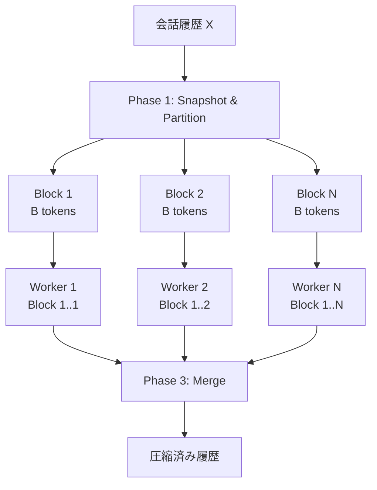
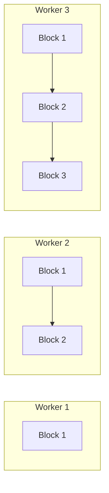
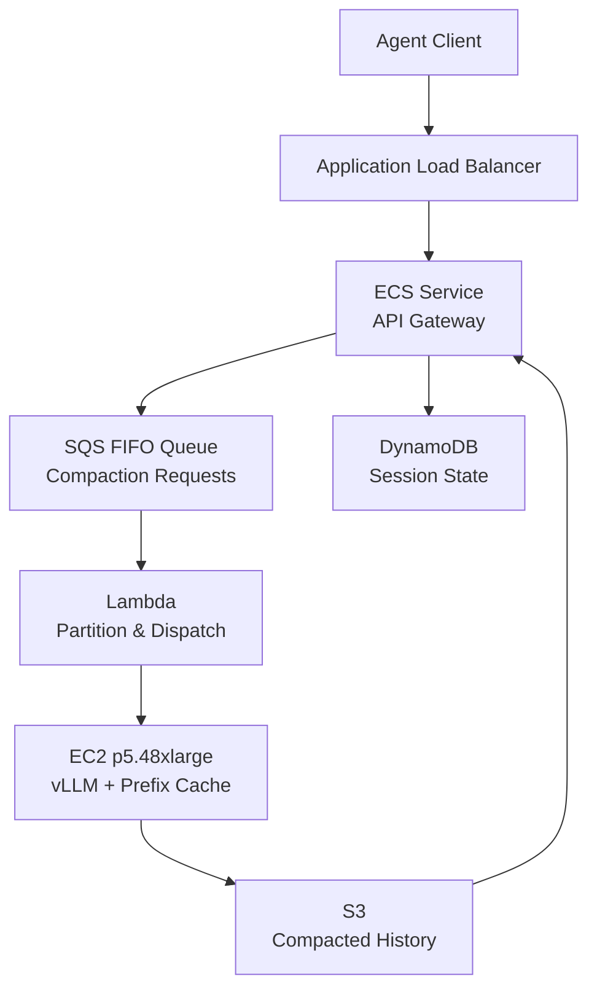

本記事は [Parallel Context Compaction for Long-Horizon LLM Agent Serving](https://arxiv.org/abs/2605.23296) の解説記事です。

## 論文概要

長時間稼働するLLMエージェントは、会話履歴がコンテキストウィンドウを超過する問題を抱えている。従来の要約ベースのコンパクション（圧縮）は非可逆であり、推論を数十秒ブロッキングする。Cim, Topcu, Das, Kandemirらは、会話履歴をN個の連続ブロックに分割し、vLLMの接頭辞キャッシュを活用して全Nブロックを同時にコンパクトする**並列コンパクション**を提案している。8B--120Bの4モデル（Dense/MoE）でHotpotQA・LoCoMoを用いた評価により、スループット1.37倍--2.13倍の改善と、ブロックサイズ縮小による精度の単調改善を報告している。

この記事は [Zenn記事: Assistants API Thread廃止後のConversations API移行と会話状態設計](https://zenn.dev/0h_n0/articles/a90bff04f7e110) の深掘りです。

## 情報源

- **arXiv ID**: 2605.23296
- **URL**: [https://arxiv.org/abs/2605.23296](https://arxiv.org/abs/2605.23296)
- **著者**: Musa Cim, Burak Topcu, Chita Das, Mahmut Taylan Kandemir
- **提出日**: 2026年5月22日
- **分野**: cs.AI

## 背景と動機

OpenAI Assistants API（現Conversations API）のようなプラットフォームでは、LLMエージェントが長時間のセッションを維持し、ツール呼び出しや多段推論を繰り返す。その結果、会話履歴は容易にコンテキストウィンドウの上限（128kトークン程度）に達する。

従来のアプローチでは、履歴が閾値$\tau$を超えた時点で要約（コンパクション）を1回のLLM呼び出しで実行する。しかし、著者らはこの逐次コンパクションに2つの問題を指摘している。第一に、長い入力に対する要約はLLMの推論時間の51.3%--62.4%を占め、エンドツーエンドのレイテンシを大幅に悪化させる。第二に、要約品質は実行ごとに不安定であり、96kトークンの入力ではコサイン類似度が0.47--0.62、変動係数（CV）が42.9%--171.6%に達する。

この論文は、コンパクションの「ブロッキング時間の長さ」と「出力の不安定性」という2つの課題を、並列分割処理によって同時に緩和することを目指している。

## 主要な貢献

- **並列コンパクション**: 会話履歴をN個のブロックに分割し、vLLMへの同時リクエストで並列処理する手法の提案
- **接頭辞キャッシュ活用レイアウト**: 各ワーカーのプロンプトが前のワーカーを包含する設計により、KVキャッシュの再利用率を向上させるレイアウト
- **出力が入力に対して不変的**: 入力が48倍（2k→96k）に増加しても出力は約3倍（981→3015トークン）に留まる性質の実証
- **2軸のボリューム制御**: 閾値$\tau$とブロックサイズ$B$の組み合わせにより、出力量を入力の0.8%--51%の範囲で制御可能であることの実証
- **4モデル（Dense/MoE、8B--120B）にわたる体系的評価**: HotpotQAとLoCoMoベンチマークでの広範な実験

## 技術的詳細

### 逐次コンパクション（ベースライン）

従来の逐次コンパクションは、会話履歴$\mathcal{H}_t$が閾値$\tau$を超えた時点で、1回のLLM呼び出しで要約を生成する。

$$
\hat{\mathcal{H}}_t = \text{LLM\_compact}(\mathcal{H}_t \oplus p_c)
$$

ここで、
- $\mathcal{H}_t$: 時刻$t$における会話履歴
- $p_c$: コンパクション用プロンプト（要約指示）
- $\oplus$: 連結演算子
- $\hat{\mathcal{H}}_t$: 圧縮後の会話履歴

この方式では、履歴全体を1つのLLM呼び出しで処理するため、入力長に比例してレイテンシが増大する。

### 並列コンパクション（提案手法）

提案手法は3つのフェーズで構成される。



#### Phase 1: Snapshot & Partition

会話履歴$\mathcal{X}$のスナップショットを取り、$B$トークンずつのブロックに分割する。ブロック数$N$は以下で決定される。

$$
N = \left\lceil \frac{|\mathcal{X}|}{B} \right\rceil
$$

ここで、$B$はブロックサイズ（トークン数）であり、$N$が並列ワーカー数となる。

#### Phase 2: Dispatch（接頭辞キャッシュ活用レイアウト）

各ワーカー$k$（$k = 1, \ldots, N$）のプロンプトは、ブロック1からブロック$k$までの全ブロックを含み、ブロック$k$をXMLマーカー `TARGET_BLOCK` で囲む。

$$
\text{Prompt}_k = [\text{Block}_1, \ldots, \text{Block}_{k-1}, \langle \text{TARGET\_BLOCK} \rangle \text{Block}_k \langle /\text{TARGET\_BLOCK} \rangle]
$$

この設計の重要な点は、ワーカー$k$のプロンプトがワーカー$k-1$のプロンプトの接頭辞拡張になっていることである。つまり、vLLMの接頭辞キャッシュにより、共通部分のKV計算を再利用できる。

```python
from dataclasses import dataclass


@dataclass
class CompactionBlock:
    """並列コンパクションの1ブロックを表す"""
    index: int
    tokens: list[int]
    is_target: bool = False


def partition_history(
    history_tokens: list[int],
    block_size: int,
) -> list[CompactionBlock]:
    """会話履歴をブロックに分割する

    Args:
        history_tokens: 会話履歴のトークン列
        block_size: 1ブロックあたりのトークン数

    Returns:
        分割されたブロックのリスト
    """
    blocks: list[CompactionBlock] = []
    for i in range(0, len(history_tokens), block_size):
        chunk = history_tokens[i : i + block_size]
        blocks.append(CompactionBlock(index=len(blocks), tokens=chunk))
    return blocks


def build_worker_prompt(
    blocks: list[CompactionBlock],
    target_index: int,
    compaction_instruction: str,
) -> str:
    """ワーカーk用のプロンプトを構築する

    接頭辞キャッシュを活用するため、ワーカーkのプロンプトは
    ブロック1..kを順に含み、ブロックkをTARGET_BLOCKで囲む。

    Args:
        blocks: 全ブロックのリスト
        target_index: このワーカーが要約対象とするブロックのインデックス
        compaction_instruction: コンパクション指示プロンプト

    Returns:
        ワーカー用の完全なプロンプト文字列
    """
    parts: list[str] = [compaction_instruction]
    for block in blocks[: target_index + 1]:
        text = _decode_tokens(block.tokens)
        if block.index == target_index:
            parts.append(f"<TARGET_BLOCK>{text}</TARGET_BLOCK>")
        else:
            parts.append(text)
    return "\n".join(parts)


def _decode_tokens(tokens: list[int]) -> str:
    """トークンIDをテキストに変換する（簡略化）"""
    raise NotImplementedError("実際にはトークナイザーを使用")
```

#### Phase 3: Merge

全$N$ワーカーの出力（各ブロックの要約）を、ブロック順に連結して圧縮済み履歴を構成する。

$$
\hat{\mathcal{H}}_t = \bigoplus_{k=1}^{N} \text{Summary}_k
$$

### 接頭辞キャッシュの効果

vLLMの接頭辞キャッシュ（prefix caching）は、異なるリクエスト間で共通するプロンプト接頭辞のKVキャッシュを再利用する機能である。提案手法のレイアウトでは、ワーカー$k$のプロンプトはワーカー$k-1$のプロンプトを接頭辞として含むため、KVキャッシュのヒット率が高くなる。



上図のように、Worker 2はWorker 1と「Block 1」部分を共有し、Worker 3はWorker 2と「Block 1 + Block 2」部分を共有する。vLLMはこの共通接頭辞のKV計算をキャッシュから読み出すため、追加の計算はターゲットブロック部分のみで済む。

### オペレータ制御パラメータ

著者らは2つのパラメータによるボリューム制御を提案している。

| パラメータ | 意味 | 効果 |
|---|---|---|
| 閾値 $\tau$ | コンパクション発動トークン数 | 小さいほど頻繁にコンパクション実行 |
| ブロックサイズ $B$ | 各ワーカーが要約する範囲 | 小さいほどワーカー数N増加、圧縮率向上 |

出力ボリュームは入力の0.8%（$\tau$=4k, $B$=2k）から51%（$\tau$=16k, $B$=16k）まで制御可能であると著者らは報告している。

## 実装のポイント

並列コンパクションをvLLMで実装する際の要点は、接頭辞キャッシュの有効化とプロンプト構造の設計にある。vLLMは `--enable-prefix-caching` フラグで接頭辞キャッシュを有効化でき、共通接頭辞を持つ複数リクエストを同時に送信すると自動的にKVキャッシュが再利用される。

プロンプト構造では、ターゲットブロックを末尾に配置する「target-at-end」レイアウトが重要である。各ワーカーが自身のターゲットブロックより前の全履歴を文脈として保持するため、局所的な情報だけでなく全体の文脈を踏まえた要約が可能になる。ただし、XMLマーカー（`TARGET_BLOCK`）に対する特別な訓練は行われておらず、既存モデルのinstruction-followingに依存している点に注意が必要である。

ブロックサイズ$B$の選択は精度とスループットのトレードオフとなる。著者らの実験では、ブロックサイズを16kから2kに縮小するにつれて精度が単調に改善することが報告されているが、ワーカー数の増加に伴うGPUメモリ消費とスケジューリングオーバーヘッドも考慮する必要がある。

## Production Deployment Guide

### AWS実装パターン

並列コンパクションを本番環境でデプロイする際、vLLMをバックエンドとしたサービングインフラの設計が必要になる。以下にAWS上での構成パターンを示す。



コンパクションリクエストはSQS FIFOキューで順序保証しつつ、Lambda関数が履歴をブロックに分割してvLLMに並列ディスパッチする。vLLMはEC2のGPUインスタンス（p5.48xlarge: 8x H100）上で稼働し、`--enable-prefix-caching` を有効にしてブロック間のKVキャッシュ再利用を実現する。

セッション状態はDynamoDBで管理し、圧縮済み履歴はS3に永続化する。これにより、エージェントのステートレス化とスケールアウトが容易になる。

vLLMのスケーリングポリシーとしては、GPU利用率が70%を超えた場合にスケールアウトし、30%を下回った場合にスケールインする設定が妥当である。コンパクションの発動閾値$\tau$は、モデルのコンテキスト長の50%程度（128kモデルなら64k）に設定し、コンパクション頻度とレイテンシのバランスを取る。

```python
import asyncio
from dataclasses import dataclass

import aiobotocore.session


@dataclass
class CompactionRequest:
    """コンパクションリクエスト"""
    session_id: str
    history_tokens: list[int]
    block_size: int
    threshold: int


async def dispatch_parallel_compaction(
    request: CompactionRequest,
    vllm_endpoint: str,
) -> list[str]:
    """vLLMに並列コンパクションリクエストを送信する

    Args:
        request: コンパクションリクエスト
        vllm_endpoint: vLLMのエンドポイントURL

    Returns:
        各ブロックの要約テキストのリスト
    """
    blocks = partition_history(request.history_tokens, request.block_size)
    n_workers = len(blocks)

    tasks = []
    for k in range(n_workers):
        prompt = build_worker_prompt(
            blocks=blocks,
            target_index=k,
            compaction_instruction=COMPACTION_PROMPT,
        )
        tasks.append(_call_vllm(vllm_endpoint, prompt))

    summaries = await asyncio.gather(*tasks)
    return list(summaries)


async def _call_vllm(endpoint: str, prompt: str) -> str:
    """vLLMへの非同期リクエスト（簡略化）"""
    raise NotImplementedError("実際にはaiohttp等でOpenAI互換APIを呼び出す")


COMPACTION_PROMPT = (
    "Summarize the content within <TARGET_BLOCK> tags. "
    "Use the preceding context for understanding but only summarize the target block."
)
```

### Terraformコード

以下にvLLMサービングインフラのTerraformコードを示す。

```hcl
# vLLM用EC2インスタンス（GPU）
resource "aws_instance" "vllm_server" {
  ami           = "ami-0abcdef1234567890" # Deep Learning AMI (Ubuntu)
  instance_type = "p5.48xlarge"            # 8x H100 80GB

  root_block_device {
    volume_size = 500
    volume_type = "gp3"
  }

  user_data = <<-EOF
    #!/bin/bash
    set -euo pipefail

    # vLLMインストールと起動
    pip install vllm==0.8.5

    # 接頭辞キャッシュ有効化で起動
    python -m vllm.entrypoints.openai.api_server \
      --model meta-llama/Llama-3.3-70B-Instruct \
      --tensor-parallel-size 2 \
      --enable-prefix-caching \
      --max-model-len 131072 \
      --gpu-memory-utilization 0.90 \
      --port 8000 &
  EOF

  tags = {
    Name = "vllm-compaction-server"
  }
}

# コンパクションリクエスト用SQS FIFOキュー
resource "aws_sqs_queue" "compaction_queue" {
  name                        = "compaction-requests.fifo"
  fifo_queue                  = true
  content_based_deduplication = true
  visibility_timeout_seconds  = 120
  message_retention_seconds   = 3600

  tags = {
    Service = "parallel-compaction"
  }
}

# セッション状態管理用DynamoDB
resource "aws_dynamodb_table" "session_state" {
  name         = "agent-session-state"
  billing_mode = "PAY_PER_REQUEST"
  hash_key     = "session_id"
  range_key    = "timestamp"

  attribute {
    name = "session_id"
    type = "S"
  }

  attribute {
    name = "timestamp"
    type = "N"
  }

  ttl {
    attribute_name = "expires_at"
    enabled        = true
  }

  tags = {
    Service = "parallel-compaction"
  }
}

# 圧縮済み履歴保存用S3バケット
resource "aws_s3_bucket" "compacted_history" {
  bucket = "agent-compacted-history"

  tags = {
    Service = "parallel-compaction"
  }
}

resource "aws_s3_bucket_lifecycle_configuration" "compacted_history_lifecycle" {
  bucket = aws_s3_bucket.compacted_history.id

  rule {
    id     = "expire-old-histories"
    status = "Enabled"

    expiration {
      days = 30
    }

    transition {
      days          = 7
      storage_class = "INTELLIGENT_TIERING"
    }
  }
}

# CloudWatchアラーム: GPU利用率監視
resource "aws_cloudwatch_metric_alarm" "gpu_utilization_high" {
  alarm_name          = "vllm-gpu-utilization-high"
  comparison_operator = "GreaterThanThreshold"
  evaluation_periods  = 3
  metric_name         = "GPUUtilization"
  namespace           = "Custom/VLLM"
  period              = 60
  statistic           = "Average"
  threshold           = 70
  alarm_description   = "GPU utilization exceeds 70% for 3 minutes"

  alarm_actions = [aws_sns_topic.alerts.arn]
}

resource "aws_sns_topic" "alerts" {
  name = "compaction-alerts"
}

# ALB: APIエンドポイント
resource "aws_lb" "compaction_alb" {
  name               = "compaction-api-alb"
  internal           = true
  load_balancer_type = "application"
  security_groups    = [aws_security_group.alb_sg.id]
  subnets            = var.private_subnet_ids

  tags = {
    Service = "parallel-compaction"
  }
}

resource "aws_security_group" "alb_sg" {
  name_prefix = "compaction-alb-"
  vpc_id      = var.vpc_id

  ingress {
    from_port   = 443
    to_port     = 443
    protocol    = "tcp"
    cidr_blocks = [var.vpc_cidr]
  }

  egress {
    from_port   = 0
    to_port     = 0
    protocol    = "-1"
    cidr_blocks = ["0.0.0.0/0"]
  }
}
```

### 運用・監視

並列コンパクションの運用では、以下のメトリクスを監視する必要がある。

**レイテンシ監視**: コンパクション全体の所要時間（Phase 1--3の合計）、各ワーカーの個別所要時間、接頭辞キャッシュのヒット率を計測する。著者らの実験では、コンパクションがE2E時間の51.3%--62.4%を占めると報告されているため、この比率の変化を継続的にトラッキングする。

**品質監視**: 要約出力のコサイン類似度とCVを定期的に計測する。著者らは96kトークン入力でCVが42.9%--171.6%に達すると報告しており、品質のばらつきに対するアラート閾値を設定する。ブロックサイズ$B$=2kでの運用が精度面では望ましいが、ワーカー数の増加によるリソース消費とのバランスを取る。

**スループット監視**: matched-volume（同量の出力を生成する条件下）でのスループット比較を定期実行し、並列化の効果が維持されているか確認する。設定変更やモデル更新の前後で回帰テストとして実施する。

**異常検知**: ワーカー間の出力長の極端な偏りや、特定ブロックの要約失敗を検知するアラートを設定する。SQS Dead Letter Queueによるリトライ制御と組み合わせ、部分障害時にもサービス継続可能な設計とする。

### コスト最適化チェックリスト

- [ ] **インスタンス選択**: Llama-3.1-8Bなど小型モデルには`g5.xlarge`（1x A10G）で十分。70Bモデルには`p5.48xlarge`のテンソル並列を検討
- [ ] **Spot Instanceの活用**: コンパクションは非同期処理可能なため、Spot Instance（最大90%割引）を活用。中断時はSQSキューからリトライ
- [ ] **接頭辞キャッシュの効果測定**: キャッシュヒット率が低い場合（<50%）、ブロックサイズ$B$の調整やプロンプト構造の見直しを検討
- [ ] **S3ライフサイクル**: 圧縮済み履歴のTTLを適切に設定し、不要なストレージコストを削減（上記Terraform例では30日で削除）
- [ ] **閾値$\tau$の最適化**: $\tau$が小さすぎると不要なコンパクションが頻発し、大きすぎるとブロッキング時間が増大。ワークロードに応じてチューニング
- [ ] **オフピーク時のバッチ処理**: セッション終了後の履歴コンパクションはオフピーク時間帯にバッチ化し、Reserved Instanceの稼働率を向上

## 実験結果

### 出力の入力不変性

著者らは、コンパクションの出力長が入力長の増加に対して緩やかにしか増加しない性質を「input-invariant output」と呼んでいる。論文の実験結果より、入力が2kから96kへ48倍に増加した場合でも、出力は981トークンから3,015トークンへ約3倍の増加に留まることが報告されている。出力/入力比は47.9%から3.1%へ低下する。

| 入力長 | 出力長 | 出力/入力比 |
|--------|--------|------------|
| 2k     | 981    | 47.9%      |
| 96k    | 3,015  | 3.1%       |

この性質は、並列コンパクションの有効性を支える根拠となっている。各ワーカーが処理するブロックの出力長が入力長に比べて小さいため、マージ後の総出力量も制御可能な範囲に収まる。

### コンパクション時間の支配性

閾値$\tau$=16kでの実験において、コンパクションがエンドツーエンド時間に占める割合は51.3%--62.4%であると著者らは報告している。これは、エージェントの総実行時間の半分以上がコンパクションに費やされていることを意味し、並列化による改善余地が大きいことを示している。

### 実行間の不安定性

著者らは、逐次コンパクションの出力が実行ごとに大きくばらつくことを報告している。96kトークン入力での分析結果は以下のとおりである。

| メトリクス | 範囲 |
|---|---|
| 変動係数（CV） | 42.9%--171.6% |
| コサイン類似度 | 0.47--0.62 |

CVが100%を超えるケースが存在することは、同一入力に対する要約の品質が極めて不安定であることを示している。

### ブロックサイズと精度の関係

著者らは、ブロックサイズを16kから2kに縮小するにつれて精度が単調に改善することを報告している。これは、小さなブロックほど要約タスクが単純になり、LLMが正確な要約を生成しやすくなるためと考えられる。

### スループット改善

matched-volume条件（同量の出力を生成する設定）でのスループット改善率は以下のとおりである。

| モデル | パラメータ | 種別 | GPU | スループット改善 |
|---|---|---|---|---|
| Llama-3.1-8B | 8B | Dense | 1x H100 | 1.37x--2.13x |
| Llama-3.3-70B | 70B | Dense | 2x H100 | 報告あり |
| gpt-oss-20B | 20B | MoE | 1x H100 | 報告あり |
| gpt-oss-120B | 120B | MoE | 1x H100 | 報告あり |

全構成で1.37倍から2.13倍のスループット改善が確認されている。ただし、著者らは壁時間（wall-time）での改善は構成間で一貫していないことも報告しており、実環境での効果はワークロードパターンとハードウェア構成に依存する。

### ボリューム制御

$\tau$と$B$の2つのパラメータにより、圧縮後の出力量を入力の0.8%--51%の範囲で制御可能であることが報告されている。これにより、精度を優先する場合は緩い圧縮（$B$=16k）、レイテンシを優先する場合は強い圧縮（$B$=2k）といった運用上の調整が可能になる。

## 実運用への応用

この論文の知見は、OpenAI Conversations API（旧Assistants API Thread）のような長時間会話管理において直接的に応用可能である。特に、セッション単位で会話履歴を管理し、コンテキストウィンドウの上限に達した際にコンパクションを実行するアーキテクチャでは、並列コンパクションへの移行によりレイテンシを改善できる。

vLLMの接頭辞キャッシュは、OpenAI互換APIとして提供されるため、既存のクライアントコードを大きく変更せずに導入可能である。ブロックサイズ$B$と閾値$\tau$のチューニングは、実際のワークロードでの精度とレイテンシの計測に基づいて行う必要がある。

ただし、著者らが指摘する制約も考慮すべきである。ブロックサイズとプロンプトは実行ごとに固定であり、会話の内容に応じた適応的な分割は未実装である。また、XMLマーカーに対するモデルの訓練が行われていないため、マーカー指示の遵守率はモデルのinstruction-followingに依存する。非同期コンパクション（推論と並行してバックグラウンドでコンパクション実行）は提案のみで未実装である。

## 関連研究

### コンテキスト圧縮

**LLMLingua**（Jiang et al.）は、プロンプト圧縮の手法として、不要なトークンを除去することでコンテキスト長を削減する。本論文の要約ベースのコンパクションとは異なり、トークンレベルの選択に基づくアプローチである。

### Attention機構によるコンテキスト拡張

**Infini-Attention**（Munkhdalai et al., 2024）は、圧縮メモリとローカルアテンションを組み合わせることで、有限のメモリリソースで無限長のコンテキストを処理する手法を提案している。本論文のような事後的な圧縮ではなく、アーキテクチャレベルでの拡張アプローチである。

### LLMサービング最適化

**vLLM**（Kwon et al.）のPagedAttentionは、KVキャッシュの効率的なメモリ管理により推論スループットを改善する。本論文はvLLMの接頭辞キャッシュ機能を活用しており、サービングインフラとの親和性が高い。

### エージェントのメモリ管理

**MemGPT**（Packer et al.）は、仮想メモリの概念をLLMに適用し、メインコンテキストと外部ストレージ間でのページングによって長期記憶を実現する。本論文のコンパクションは要約による圧縮であり、MemGPTのページング方式とは異なるアプローチで同様の問題に対処している。

## まとめと今後の展望

本論文は、長時間LLMエージェントにおけるコンテキスト圧縮の課題に対し、会話履歴を並列ブロック分割して同時にコンパクトする手法を提案している。vLLMの接頭辞キャッシュを活用したプロンプトレイアウトにより、KV計算の重複を排除し、1.37倍--2.13倍のスループット改善を実現している。

今後の研究方向として、著者らは以下を挙げている。第一に、会話内容に応じてブロックサイズを適応的に変更する機構の導入である。現状ではブロックサイズ$B$は実行ごとに固定であるが、トピック境界を検出して自然な区切りでブロックを分割することで、要約品質の向上が期待される。第二に、推論と並行してバックグラウンドでコンパクションを実行する非同期コンパクションの実装である。これにより、コンパクションによるブロッキング時間をゼロに近づけられる可能性がある。

OpenAI Conversations APIへの移行を進めるにあたり、会話状態の長期管理は避けて通れない課題である。本論文の並列コンパクション手法は、その課題に対する実践的なアプローチとして参考になる。

## 参考文献

1. Cim, M., Topcu, B., Das, C., & Kandemir, M. T. (2026). Parallel Context Compaction for Long-Horizon LLM Agent Serving. arXiv:2605.23296.
2. Kwon, W., Li, Z., Zhuang, S., et al. (2023). Efficient Memory Management for Large Language Model Serving with PagedAttention. SOSP 2023.
3. Jiang, H., Wu, Q., Lin, C.-Y., Yang, Y., & Qiu, L. (2023). LLMLingua: Compressing Prompts for Accelerated Inference of Large Language Models. EMNLP 2023.
4. Munkhdalai, T., Pham, T., Yu, Y., Liu, H., Faruqui, M., & Hadsell, R. (2024). Leave No Context Behind: Efficient Infinite Context Transformers with Infini-attention. arXiv:2404.07143.
5. Packer, C., Wooders, S., Lin, K., Fang, V., Patil, S. G., Stoica, I., & Gonzalez, J. E. (2023). MemGPT: Towards LLMs as Operating Systems. arXiv:2310.08560.
