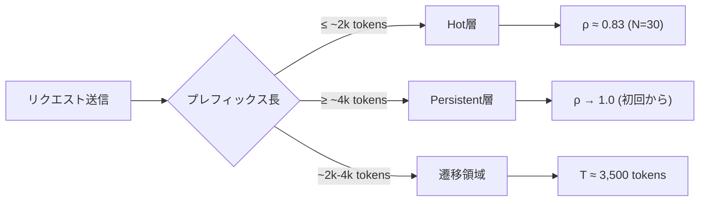
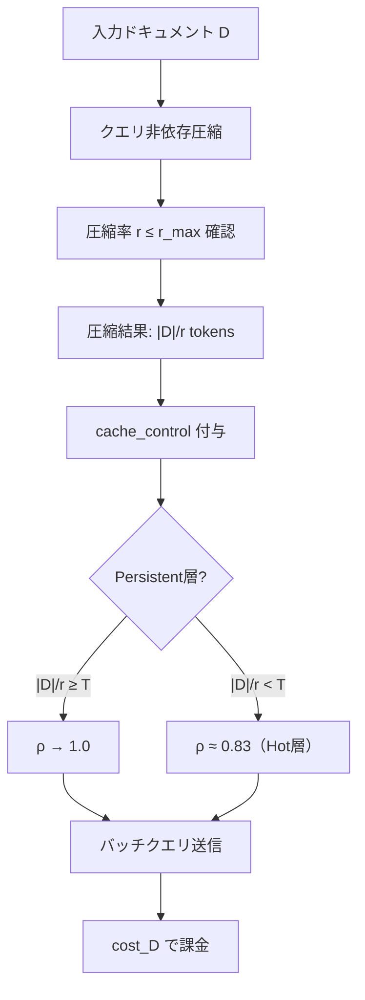
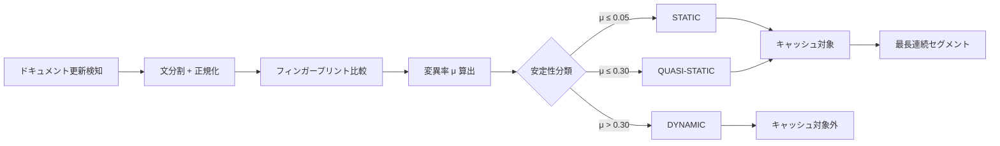
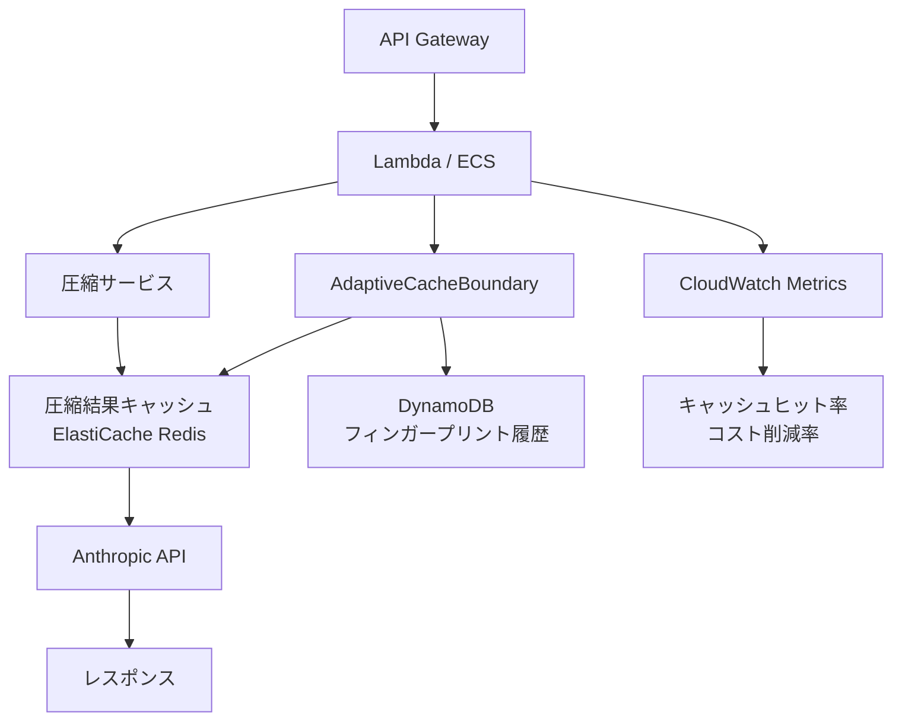

## 論文概要（Abstract）

Cache-Aware Prompt Compression（CAPC）は、LLM APIのプロンプトキャッシュとプロンプト圧縮の相互作用を定量的にモデル化し、両者を統合的に最適化するフレームワークである。著者らは、Anthropic Sonnet 4.6のキャッシュ挙動を計測し、閾値約3,500トークンを境とする2層キャッシュモデル（Hot層とPersistent層）を発見している。CAPCは、クエリ非依存の圧縮とキャッシュ制御の明示的指定、層境界を保存する圧縮率上限を組み合わせることで、LongBench-v2において16/16の設定で最安コストを達成し、バニラ方式に対して平均90%のコスト削減を実現したと報告している（Table 2）。全実験の総コストは$98.96である。

この記事は [Zenn記事: Assistants API Thread廃止後のConversations API移行と会話状態設計](https://zenn.dev/0h_n0/articles/a90bff04f7e110) の深掘りです。

## 情報源

- **arXiv ID**: 2607.15516
- **URL**: [https://arxiv.org/abs/2607.15516](https://arxiv.org/abs/2607.15516)
- **著者**: Yan Song
- **投稿日**: 2026年7月17日
- **分野**: cs.LG（主分野）, cs.AI

## 背景と動機（Background & Motivation）

LLM APIを本番環境で運用する際、コスト管理は中心的な課題である。特にRAGやマルチターン会話システムでは、各リクエストに大量のコンテキスト文書やシステムプロンプトを付与するため、入力トークン数が支配的なコスト要因となる。

この問題に対して、2つのアプローチが独立に発展してきた。第一がプロンプトキャッシュであり、Anthropicの`cache_control`やOpenAIのAutomatic Cachingに代表される。繰り返し送信されるプレフィックスをサーバ側でキャッシュし、キャッシュヒット時には入力トークン単価を大幅に引き下げる仕組みである。第二がプロンプト圧縮であり、LLMLinguaやLongLLMLinguaなどが知られる。LLMに送信するプロンプトのトークン数自体を削減するアプローチである。

しかし、著者らはこの2つのアプローチが本質的に相互干渉する関係にあることを指摘している。クエリ依存の圧縮を行うと、リクエストごとに圧縮結果が異なるためキャッシュヒット率が低下する。一方、キャッシュのみに依存する場合、ドキュメントが大きくなるほど書き込みコスト（キャッシュミス時の単価増）が支配的になる。この相互作用を定量的にモデル化し、最適な戦略を選択する枠組みがこれまで存在しなかった。

## 主要な貢献（Key Contributions）

- **2層キャッシュモデルの実測**: Anthropic Sonnet 4.6のプロンプトキャッシュ挙動を体系的に計測し、Hot層（約2kトークン以下）とPersistent層（約4kトークン以上）の2層構造、閾値T≈3,500トークン、TTL 5分、トークン厳密一致の無効化条件を定量的に明らかにした
- **4戦略コストモデル**: バニラ・キャッシュ専用・クエリ依存圧縮・CAPC（クエリ非依存圧縮＋キャッシュ）の4戦略のコストを定式化し、クロスオーバーヒット率$\rho_{\text{cross}}$による戦略選択基準を導出
- **CAPCアルゴリズム**: クエリ非依存圧縮と`cache_control`の明示的指定、層境界保存の圧縮率上限$r_{\max}$を組み合わせた統合フレームワーク
- **AdaptiveCacheBoundary**: 文書が時間経過で変化するケースに対応し、文単位のフィンガープリントと変異率$\mu$に基づいてキャッシュ可能プレフィックスを動的に決定するアルゴリズム

## 技術的詳細（Technical Details）

### 2層キャッシュモデル

著者らは、Anthropic Sonnet 4.6に対して異なるトークン数のプロンプトを繰り返し送信し、キャッシュヒット率$\rho$を計測している。結果として、以下の2層構造が観測された。



**Hot層**（プレフィックス長が約2kトークン以下）では、$N=30$回の繰り返し送信に対してヒット率$\rho \approx 0.83$が観測された。TTLは約5分であり、時間経過でエビクションが発生する。

**Persistent層**（プレフィックス長が約4kトークン以上）では、初回呼び出しからヒット率$\rho \to 1.0$が観測された。十分なトークン数を持つプレフィックスは、サーバ側で確実にキャッシュされる。

閾値は$T \approx 3{,}500$トークンであり、この前後で挙動が不連続に変化する。キャッシュの無効化条件はトークン厳密一致であり、意味的に同等でもトークン列が異なれば無効化される。一方、空白文字の正規化は行われるため、空白の追加・削除ではキャッシュは無効化されない。

### コストモデル：4つの戦略

著者らは、ドキュメント長$\|D\|$トークンのプレフィックスに対して$N$回のクエリを発行するバッチ処理を想定し、4つの戦略のコストを定式化している。

| 記号 | 意味 | Sonnet 4.6での値 |
|------|------|-----------------|
| $c_w$ | キャッシュ書き込み単価（$/token） | $3.75 \times 10^{-6}$ |
| $c_r$ | キャッシュ読み込み単価（$/token） | $0.30 \times 10^{-6}$ |
| $p_{\text{in}}$ | 通常入力単価（$/token） | $3.00 \times 10^{-6}$ |
| $p_{\text{out}}$ | 出力単価（$/token） | $15.00 \times 10^{-6}$ |
| $\rho$ | キャッシュヒット率 | — |
| $r$ | 圧縮率 | — |
| $D_q$ | クエリトークン数 | — |
| $O$ | 出力トークン数 | — |

**戦略A（バニラ）**: キャッシュも圧縮も使わない。

$$
\text{cost}_A = N[\|D\| \cdot p_{\text{in}} + D_q \cdot p_{\text{in}} + O \cdot p_{\text{out}}]
$$

**戦略B（キャッシュ専用）**: `cache_control`を付与してプレフィックスをキャッシュする。

$$
\text{cost}_B = N[(1-\rho)\|D\| \cdot c_w + \rho\|D\| \cdot c_r + D_q \cdot p_{\text{in}} + O \cdot p_{\text{out}}]
$$

**戦略C（クエリ依存圧縮）**: クエリごとに圧縮を行い、$\|D\|/r$トークンに削減する。クエリごとに圧縮結果が変わるためキャッシュは不可能。

$$
\text{cost}_C = N[(\|D\|/r) \cdot p_{\text{in}} + D_q \cdot p_{\text{in}} + O \cdot p_{\text{out}}]
$$

**戦略D（CAPC）**: クエリ非依存で圧縮し、結果をキャッシュする。

$$
\text{cost}_D = N[(1-\rho)(\|D\|/r) \cdot c_w + \rho(\|D\|/r) \cdot c_r + D_q \cdot p_{\text{in}} + O \cdot p_{\text{out}}]
$$

### クロスオーバー分析

戦略Bと戦略Cが等コストとなるヒット率$\rho_{\text{cross}}$は、以下の式で導出される。

$$
\rho_{\text{cross}}(r) = \frac{\alpha - 1/r}{\alpha - \beta}
$$

ここで、$\alpha = c_w / p_{\text{in}} = 1.25$、$\beta = c_r / p_{\text{in}} = 0.10$である。

著者らは、圧縮率$r$ごとのクロスオーバーヒット率を以下のように算出している。

| 圧縮率 $r$ | $\rho_{\text{cross}}$ | 解釈 |
|---|---|---|
| 2 | 0.652 | ヒット率65%以上ならキャッシュ専用が有利 |
| 3 | 0.797 | ヒット率80%以上ならキャッシュ専用が有利 |
| 6 | 0.942 | ヒット率94%以上が必要 |
| 8 | 0.978 | 事実上キャッシュ専用が不利 |

この結果から、圧縮率が高い（$r \geq 6$）場合はクエリ依存圧縮がキャッシュ専用を上回るが、$r \leq 3$程度ではキャッシュの方が有利であることが分かる。CAPCは両者を組み合わせることで、どの設定でも最安コストを実現する。

### 層境界保存の圧縮率上限

CAPCの重要な制約が、圧縮後のトークン数がPersistent層の閾値$T$を下回らないようにする上限$r_{\max}$である。

$$
r_{\max} = \left\lfloor \frac{\|D\|}{T} \right\rfloor = \left\lfloor \frac{\|D\|}{3{,}500} \right\rfloor
$$

例えば$\|D\| = 10{,}000$トークンのドキュメントでは$r_{\max} = 2$であり、これ以上圧縮するとPersistent層から脱落してヒット率が低下する。$\|D\| = 94{,}000$トークンの企業アシスタント（後述のEA実験）では$r_{\max} = 26$となり、大きなドキュメントほど圧縮の自由度が高くなる。

### CAPCアルゴリズム全体フロー



### AdaptiveCacheBoundary：変化するドキュメントへの対応

本番環境では、ドキュメントが時間経過で更新されるケースが一般的である。キャッシュはトークン厳密一致で無効化されるため、ドキュメントの一部が変更されるとキャッシュ全体が失われる。

著者らは、この問題に対してAdaptiveCacheBoundaryアルゴリズムを提案している。手順は以下の通りである。

1. **文単位の正規化**: ドキュメントを文に分割し、空白や改行を正規化する
2. **フィンガープリント計算**: 各文のハッシュを計算し、前回のバージョンと比較する
3. **変異率$\mu$の算出**: 変更された文の割合を算出する
4. **安定性分類**: 各文を変異率に基づいて分類する
   - STATIC（$\mu \leq 0.05$）: ほぼ変化しない
   - QUASI-STATIC（$\mu \leq 0.30$）: まれに変化する
   - DYNAMIC（$\mu > 0.30$）: 頻繁に変化する
5. **キャッシュ可能プレフィックス決定**: ドキュメント先頭からの最長連続STATIC/QUASIセグメントをキャッシュ対象とする



この設計により、ドキュメントの安定した先頭部分のみをキャッシュし、変化しやすい末尾部分はキャッシュ対象外とすることで、キャッシュ無効化を最小限に抑える。

## 実装のポイント（Implementation Notes）

### CAPC統合の最小実装

CAPCの中核ロジックは、圧縮率の決定とキャッシュ制御の付与に集約される。

```python
from dataclasses import dataclass
import math

import anthropic


@dataclass(frozen=True)
class CAPCConfig:
    """CAPC設定パラメータ."""

    threshold_t: int = 3_500  # Persistent層閾値(トークン)
    target_ratio: float = 3.0  # 目標圧縮率
    ttl_seconds: int = 300  # キャッシュTTL(5分)


def compute_max_ratio(doc_tokens: int, threshold: int = 3_500) -> int:
    """層境界を保存する最大圧縮率を計算する.

    Args:
        doc_tokens: ドキュメントのトークン数
        threshold: Persistent層の閾値T

    Returns:
        圧縮後もPersistent層に留まる最大圧縮率
    """
    if doc_tokens < threshold:
        return 1  # 圧縮不可（既にHot層）
    return math.floor(doc_tokens / threshold)


def build_capc_messages(
    compressed_prefix: str,
    query: str,
    config: CAPCConfig | None = None,
) -> list[dict]:
    """CAPC用のメッセージ構造を構築する.

    cache_controlブレークポイントを明示的に付与し、
    圧縮済みプレフィックスをキャッシュ対象とする。

    Args:
        compressed_prefix: クエリ非依存で圧縮済みのプレフィックス
        query: ユーザクエリ
        config: CAPC設定（省略時はデフォルト）

    Returns:
        Anthropic API用のメッセージリスト
    """
    if config is None:
        config = CAPCConfig()

    return [
        {
            "role": "user",
            "content": [
                {
                    "type": "text",
                    "text": compressed_prefix,
                    "cache_control": {"type": "ephemeral"},
                },
                {
                    "type": "text",
                    "text": query,
                },
            ],
        },
    ]
```

### AdaptiveCacheBoundaryの実装

```python
import hashlib
from dataclasses import dataclass, field
from enum import Enum


class Stability(Enum):
    """文の安定性分類."""

    STATIC = "static"          # μ ≤ 0.05
    QUASI_STATIC = "quasi"     # μ ≤ 0.30
    DYNAMIC = "dynamic"        # μ > 0.30


@dataclass
class SentenceFingerprint:
    """文単位のフィンガープリントと変異履歴."""

    text: str
    fingerprint: str
    history: list[str] = field(default_factory=list)

    @staticmethod
    def compute(text: str) -> str:
        """正規化したテキストのSHA-256ハッシュを返す."""
        normalized = " ".join(text.split())
        return hashlib.sha256(normalized.encode()).hexdigest()

    def update(self, new_text: str) -> bool:
        """テキストを更新し、変更があればTrueを返す."""
        new_fp = self.compute(new_text)
        self.history.append(self.fingerprint)
        changed = new_fp != self.fingerprint
        self.fingerprint = new_fp
        self.text = new_text
        return changed

    @property
    def mutation_rate(self) -> float:
        """変異率μ: 過去の更新で変化した割合."""
        if not self.history:
            return 0.0
        changes = sum(
            1
            for i in range(1, len(self.history))
            if self.history[i] != self.history[i - 1]
        )
        return changes / len(self.history)

    @property
    def stability(self) -> Stability:
        """変異率に基づく安定性分類."""
        mu = self.mutation_rate
        if mu <= 0.05:
            return Stability.STATIC
        if mu <= 0.30:
            return Stability.QUASI_STATIC
        return Stability.DYNAMIC


def find_cacheable_prefix(sentences: list[SentenceFingerprint]) -> int:
    """キャッシュ可能な最長連続プレフィックスのインデックスを返す.

    先頭からSTATICまたはQUASI_STATICが連続する最長区間を返す。
    DYNAMICな文が出現した時点で打ち切る。

    Args:
        sentences: 文単位のフィンガープリントリスト

    Returns:
        キャッシュ対象とする文の数（0始まりのインデックス上限）
    """
    for i, sent in enumerate(sentences):
        if sent.stability == Stability.DYNAMIC:
            return i
    return len(sentences)
```

## Production Deployment Guide

### AWS実装パターン

CAPCを本番環境にデプロイする際の典型的なアーキテクチャを示す。



#### Terraformリソース定義

```hcl
# ElastiCache for compressed prefix caching
resource "aws_elasticache_cluster" "capc_cache" {
  cluster_id           = "capc-prefix-cache"
  engine               = "redis"
  node_type            = "cache.r7g.large"
  num_cache_nodes      = 1
  parameter_group_name = "default.redis7"
  port                 = 6379

  tags = {
    Purpose = "CAPC compressed prefix cache"
  }
}

# DynamoDB for fingerprint history
resource "aws_dynamodb_table" "fingerprint_history" {
  name         = "capc-fingerprint-history"
  billing_mode = "PAY_PER_REQUEST"
  hash_key     = "doc_id"
  range_key    = "sentence_idx"

  attribute {
    name = "doc_id"
    type = "S"
  }

  attribute {
    name = "sentence_idx"
    type = "N"
  }

  ttl {
    attribute_name = "expires_at"
    enabled        = true
  }
}
```

### 運用・監視

CAPCの効果を継続的に監視するために、以下のメトリクスを追跡する。

```python
import time
from dataclasses import dataclass


@dataclass
class CAPCMetrics:
    """CAPC運用メトリクス."""

    cache_hits: int = 0
    cache_misses: int = 0
    total_input_tokens: int = 0
    cached_input_tokens: int = 0
    total_cost_usd: float = 0.0
    baseline_cost_usd: float = 0.0  # バニラ方式の想定コスト

    @property
    def hit_rate(self) -> float:
        """キャッシュヒット率."""
        total = self.cache_hits + self.cache_misses
        return self.cache_hits / total if total > 0 else 0.0

    @property
    def cost_reduction_pct(self) -> float:
        """コスト削減率（%）."""
        if self.baseline_cost_usd == 0.0:
            return 0.0
        return (1 - self.total_cost_usd / self.baseline_cost_usd) * 100


def track_response(
    metrics: CAPCMetrics,
    response: dict,
    doc_tokens: int,
    p_in: float = 3.0e-6,
) -> None:
    """APIレスポンスからメトリクスを更新する.

    Args:
        metrics: 更新対象のメトリクスオブジェクト
        response: Anthropic APIレスポンス
        doc_tokens: 元ドキュメントのトークン数（バニラコスト計算用）
        p_in: 通常入力単価
    """
    usage = response.get("usage", {})
    input_tokens = usage.get("input_tokens", 0)
    cached_tokens = usage.get("cache_read_input_tokens", 0)

    if cached_tokens > 0:
        metrics.cache_hits += 1
        metrics.cached_input_tokens += cached_tokens
    else:
        metrics.cache_misses += 1

    metrics.total_input_tokens += input_tokens
    metrics.baseline_cost_usd += doc_tokens * p_in
```

### コスト最適化チェックリスト

CAPC導入時に確認すべき項目をまとめる。

1. **ドキュメント長の確認**: $\|D\| \geq 7{,}000$トークン（$r=2$でもPersistent層を維持可能）であることを確認する。これ未満の場合、キャッシュ専用（戦略B）で十分な場合が多い
2. **バッチサイズ$N$の確認**: 同一プレフィックスに対するクエリ数が$N \geq 5$程度あることを確認する。$N$が小さいとキャッシュの初回書き込みコストが償却されにくい
3. **圧縮率$r$の選択**: $r \leq r_{\max} = \lfloor \|D\| / 3{,}500 \rfloor$の範囲で設定する。著者らは$r=3$を推奨している（品質劣化が$0.05$以内）
4. **TTL内のリクエスト集中**: キャッシュTTLは約5分のため、バッチ処理はこの時間窓内にリクエストを集中させる設計が望ましい
5. **品質クリフの回避**: $r \geq 6$では品質劣化が急激に増加する（著者らの指摘による制限事項）。高圧縮率が必要な場合は品質評価を必ず実施する
6. **変化するドキュメントへの対応**: ドキュメントが頻繁に更新される場合はAdaptiveCacheBoundaryを導入し、安定部分のみをキャッシュ対象とする

## 実験結果（Experimental Results）

### LongBench-v2

著者らは、LongBench-v2ベンチマークにおいて4つの戦略（A: バニラ、B: キャッシュ専用、C: クエリ依存圧縮、D: CAPC）を比較している。16個のすべての設定（圧縮率×ドキュメント長の組み合わせ）においてCAPCが最安コストを達成した。

| 戦略 | CAPCとの比較 | 品質差（平均） |
|------|-------------|--------------|
| A（バニラ） | CAPCが90%安価 | — |
| B（キャッシュ専用） | CAPCが49%安価 | — |
| C（クエリ依存圧縮） | CAPCが64%安価 | — |
| D（CAPC） | 基準 | ベースラインとの差 ≤ 0.05 |

品質面では、CAPCの回答精度はベースライン（バニラ）に対して平均0.05以内の差にとどまっている。

### Enterprise Assistant（EA）

94kトークンのシステムプレフィックスを持つ企業向けアシスタントにおいて、著者らは$r=3$でCAPCを適用し、51.7%のコスト削減を達成したと報告している。このケースでは$r_{\max} = \lfloor 94{,}000 / 3{,}500 \rfloor = 26$であり、圧縮の自由度が高いが、品質維持のために$r=3$が選択されている。

### graphify RAG

FastAPIベースのRAGパイプラインにCAPCを適用した結果、キャッシュ全適用方式と比較して9.3倍のコスト効率を達成した。httpxクライアントでの比較では2.4倍である。著者らは、この差異はFastAPIのリクエスト処理パターンがキャッシュヒットに有利な時間的局所性を持つためと分析している。

| 構成 | キャッシュ全適用比 |
|------|-----------------|
| FastAPI + CAPC | 9.3×安価 |
| httpx + CAPC | 2.4×安価 |

### τ-bench Retail

著者らは、τ-bench retailタスクでCAPCとバニラ方式の品質を比較している。CAPCはバニラと同等の報酬（36/50）を達成しつつ、コストを削減した。一方、クエリ依存圧縮（戦略C）はバニラよりも40.1%コストが増加するという結果が報告されている。著者らは、これはクエリ依存圧縮がマルチターン会話でキャッシュを無効化し、再圧縮のオーバーヘッドが累積するためと説明している。

| 戦略 | 報酬（/50） | コスト比（vs バニラ） |
|------|-----------|---------------------|
| A（バニラ） | 36 | 1.00× |
| C（クエリ依存圧縮） | — | 1.401×（40.1%増） |
| D（CAPC） | 36 | < 1.00× |

### 総実験コスト

著者らは、すべての実験にかかった総コストが$98.96であったと報告している。再現性の観点から実験コストを明示する姿勢は評価に値する。

## 実運用への応用（Practical Applications）

### 会話APIへの適用

Zenn記事「Assistants API Thread廃止後のConversations API移行と会話状態設計」で議論されているように、OpenAIのConversations APIへの移行において、会話履歴の管理とコスト最適化は密接に関連する。CAPCのフレームワークは、会話状態のプレフィックス部分（システムプロンプト＋会話履歴の固定部分）に対してクエリ非依存圧縮を適用し、ターンごとのコストを削減する手法として応用できる。

### RAGパイプラインでの活用

RAGシステムでは、検索結果ドキュメントをコンテキストとしてLLMに送信する。ドキュメントが同一クエリセッション内で繰り返し参照される場合、CAPCによるキャッシュ活用が効果的である。特に、graphify RAGの実験結果が示すように、FastAPIのようなリクエストが時間的に集中するアーキテクチャではキャッシュヒット率が高くなり、コスト削減効果が大きい。

### マルチテナント環境での戦略選択

複数のテナントが異なるシステムプロンプトを持つSaaS環境では、テナントごとにCAPCの適用戦略を変える必要がある。クロスオーバーヒット率$\rho_{\text{cross}}$の計算式を用いて、テナントのリクエスト頻度とプロンプト長から最適な戦略を自動選択するロジックを実装できる。

## 関連研究（Related Work）

### LLMLingua / LongLLMLingua

Jiang et al. (2023) のLLMLinguaおよびその後継LongLLMLinguaは、クエリ依存のプロンプト圧縮手法である。小規模言語モデル（GPT-2等）を用いてトークンの重要度を推定し、不要なトークンを削除する。CAPCとの違いは、LLMLinguaがクエリ依存であるためキャッシュと相性が悪い点にある。著者らは、CAPCがクエリ非依存圧縮を採用することでこの問題を回避していると述べている。

### Anthropic Prompt Caching

Anthropicのプロンプトキャッシュ機能は、`cache_control`ブレークポイントをメッセージに付与することで、指定したプレフィックスをサーバ側でキャッシュする仕組みである。本論文は、この機能の内部挙動（2層構造、閾値、TTL、無効化条件）を実測によって明らかにした点で、公式ドキュメントを超えた知見を提供している。

### Semantic Caching

GPTCacheなどのセマンティックキャッシュは、クエリの意味的類似性に基づいてキャッシュヒットを判定する。LLM APIのプロンプトキャッシュがトークン厳密一致で動作するのに対し、セマンティックキャッシュは意味的な近さで判定するため、ヒット率を向上させる可能性がある。ただし、セマンティックキャッシュはクライアント側の実装であり、APIプロバイダ側のキャッシュとは独立に動作する。CAPCはAPIプロバイダ側のキャッシュ挙動を前提としたフレームワークであり、セマンティックキャッシュと併用可能である。

### Prompt Tuning / Prefix Tuning

Li & Liang (2021) のPrefix Tuningは、タスク固有のソフトプレフィックスを学習する手法である。CAPCが扱うプロンプト圧縮はハードプロンプト（自然言語テキスト）の削減であり、Prefix Tuningとはアプローチが異なる。ただし、両者とも入力トークン数の削減を目指す点では共通しており、将来的にはソフトプレフィックス＋ハード圧縮の組み合わせが研究テーマとなる可能性がある。

## まとめと今後の展望（Conclusion & Future Work）

本論文は、LLM APIのプロンプトキャッシュとプロンプト圧縮の相互作用を定量的にモデル化し、両者を統合的に最適化するCAPCフレームワークを提案した。2層キャッシュモデルの実測、クロスオーバーヒット率による戦略選択基準の導出、層境界保存の圧縮率上限など、実務的に有用な知見を多数含んでいる。

著者らが挙げている制限事項は以下の通りである。

- **単一モデル依存**: 実験はAnthropic Sonnet 4.6のみで実施されており、他のモデル（OpenAI GPT系、Google Gemini系）でのキャッシュ挙動は未検証
- **暗黙的なツールキャッシュ**: Anthropicのtool use機能が内部的にキャッシュを行う可能性があり、その影響は分離できていない
- **LLM-as-Judge**: 品質評価にLLMを用いているため、評価自体のバイアスが存在する
- **品質クリフ**: $r \geq 6$で品質劣化が急激に発生し、高圧縮率での安全な運用には追加の品質保証が必要
- **サンプルサイズ**: 一部の実験でサンプルサイズが小さく、統計的な頑健性に限界がある

今後の展望としては、マルチモデル環境での2層キャッシュモデルの汎用性検証、AdaptiveCacheBoundaryの長期運用における安定性評価、圧縮品質のオンライン評価機構の統合が考えられる。また、OpenAIやGoogle Cloud Vertex AIなど、異なるAPIプロバイダのキャッシュ挙動を同様に実測し、プロバイダ横断的なコスト最適化フレームワークへの拡張も重要な研究方向である。

## 参考文献

- Song, Y. (2026). Cache-Aware Prompt Compression: A Two-Tier Cost Model for LLM API Caching. arXiv:2607.15516. [https://arxiv.org/abs/2607.15516](https://arxiv.org/abs/2607.15516)
- Jiang, H., Wu, Q., Lin, C.-Y., Yang, Y., & Qiu, L. (2023). LLMLingua: Compressing Prompts for Accelerated Inference of Large Language Models. arXiv:2310.05736.
- Li, X. L., & Liang, P. (2021). Prefix-Tuning: Optimizing Continuous Prompts for Generation. ACL 2021.
- Anthropic. (2025). Prompt Caching Documentation. [https://docs.anthropic.com/en/docs/build-with-claude/prompt-caching](https://docs.anthropic.com/en/docs/build-with-claude/prompt-caching)
- Zhu, B., et al. (2024). GPTCache: An Open-Source Semantic Cache for LLM Applications. arXiv:2308.07138.
