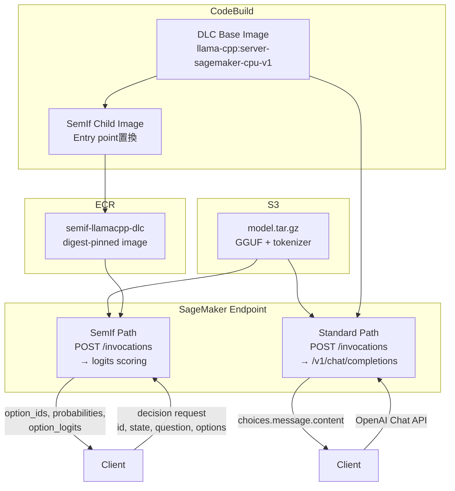

## ブログ概要（Summary）

本記事は [Deploy decision models with llama.cpp on Amazon SageMaker AI](https://aws.amazon.com/blogs/machine-learning/deploy-decision-models-with-llama-cpp-on-amazon-sagemaker-ai/) の解説記事です。

AWS Machine Learning Blogで2026年10月12日に公開されたこのブログ記事は、AWS Deep Learning Container（DLC）for llama.cppを使い、SageMaker AIリアルタイムエンドポイント上でGGUF量子化モデルをCPU・GPUの両方でサーブする方法を解説している。著者のJyothirmai Kottu、Dmitry Soldatkin、Daniel Quang、Daniel Wirjoは、2つのデプロイパスを提示している。第1のパスはテキスト生成向けの標準パスで、DLCをそのまま使いOpenAI互換APIでリクエストを処理する。第2のパスはSemIf（構造化意思決定）向けで、final-position logitsから宣言済みオプションの確率を返す。231件のJevBenchタスクによるベンチマークでは、GPU（ml.g6e.xlarge）がCPU（ml.c6i.8xlarge）に対してp50で4.9倍、p95で32.2倍高速であったと報告されている。

この記事は [Zenn記事: Fargate 32vCPUとllama.cppで実現するサーバーレスLLM推論基盤の構築](https://zenn.dev/0h_n0/articles/ca14512eb46121) の深掘りです。

## 情報源

- **種別**: 企業テックブログ
- **URL**: [https://aws.amazon.com/blogs/machine-learning/deploy-decision-models-with-llama-cpp-on-amazon-sagemaker-ai/](https://aws.amazon.com/blogs/machine-learning/deploy-decision-models-with-llama-cpp-on-amazon-sagemaker-ai/)
- **組織**: AWS Machine Learning Blog
- **著者**: Jyothirmai Kottu, Dmitry Soldatkin, Daniel Quang, Daniel Wirjo
- **発表日**: 2026年10月12日

## 技術的背景（Technical Background）

### llama.cpp DLCの位置づけ

llama.cppはGGUF形式の量子化モデルをCPU/GPUで高速推論するC++ライブラリであり、CUDAやMetalなどのバックエンドに対応している。AWSはこのllama.cppをSageMaker AI向けにパッケージしたDeep Learning Container（DLC）を公開しており、ユーザーはDockerfileの記述やECRリポジトリの手動構築なしに、GGUFモデルをSageMakerリアルタイムエンドポイントとしてデプロイできる。

Zenn記事ではFargate上でllama.cppコンテナを直接実行するアーキテクチャを解説しているが、AWS公式ブログではSageMaker AIのマネージドインフラストラクチャを活用するアプローチを提案している。SageMakerを使う利点として、エンドポイントのヘルスチェック、オートスケーリング、インスタンスプール（GPU複数世代のフォールバック）、A/Bテスト機能が標準で利用できる点がある。一方、Fargateアプローチはコンテナ単位の課金であり、バースト的なワークロードやコールドスタートを許容できるバッチ処理に適している。

### SemIfとは何か

SemIf（旧称OpenJev）はテキスト生成ではなく、アプリケーションが定義した固定オプション集合からの選択を行う意思決定モデルである。非構造化な状態テキスト・質問・選択肢の記述を入力とし、final-position logitsから各オプションの確率を算出する。生成トークンは一切出力せず、宣言済みのオプションスロットに制限されたlogitsのみを返す。ルーティング、分類、ポリシー判定、エージェントのアクション選択といったユースケースに適している。

## 実装アーキテクチャ（Architecture）

### Standard Path（テキスト生成）

Standard PathではDLCをそのまま使用する。モデルは`model.tar.gz`としてS3にパッケージされ、コンテナ起動時に`/opt/ml/model`以下の最初の`.gguf`ファイルが自動検出される。SageMakerの`POST /invocations`はllama-serverの`/v1/chat/completions`にマッピングされるため、OpenAI Chat Completions互換のスキーマ（`messages`、`max_tokens`、`stream`）でリクエストを送信できる。

環境変数`SM_LLAMA_CPP_*`を通じてllama.cppの引数を制御する。たとえばHugging Faceからモデルを直接取得する場合は、`SM_LLAMA_CPP_HF_REPO`と`SM_LLAMA_CPP_HF_FILE`を設定する。ブログではml.c6i.2xlargeインスタンスでのデプロイ例が示されている。

### SemIf Path（構造化意思決定）

llama-serverのHTTP APIはfinal-position logitsやstate operationsを公開していないため、SemIfを利用するにはDLCの子イメージをCodeBuildでビルドする必要がある。子イメージはDLCのコンパイル済みCPU/CUDAライブラリを維持しつつ、エントリポイントをSageMaker互換のSemIfアダプタに置き換える。

SemIfアダプタは1つのstatefulなllama.cppコンテキストでスコアリングを直列化し、共有プロンプトプレフィックスを再利用する。キューが無制限に膨張しないよう、リトライ可能なHTTP 503を返す設計である。



### SemIfのリクエスト・レスポンス構造

SemIfエンドポイントへのリクエストは、意思決定ID、状態テキスト、質問、順序付きオプション（各オプションに安定IDと説明文）を含む。レスポンスには`option_ids`、`probabilities`、`option_logits`が同じ順序で返され、`prompt_sha256`やタイミング情報、モデルメタデータも付与される。`readout`フィールドにはスコアリング方法の説明が含まれ、「宣言済みオプションスロットに制限された量子化last-position logits、生成トークンなし」と記述される。

### GPUインスタンスプール

GPUデプロイではSageMaker AIのインスタンスプール機能を使い、複数GPU世代をフォールバック順で指定する。ブログでは以下の優先順で設定されている。

1. **ml.g6e.xlarge** -- NVIDIA L40S（第1優先）
2. **ml.g6.2xlarge** -- NVIDIA L4（第2優先）
3. **ml.g5.2xlarge** -- NVIDIA A10G（第3優先）
4. **ml.g4dn.2xlarge** -- NVIDIA T4（第4優先）

`--gpu-layers=-1`で全レイヤーをGPUにオフロードし、`--provision-timeout 1200`で最大20分のプロビジョニング待機を許容する。ベンチマークではml.g6e.xlargeが選択され、スタートアップログで全34レイヤーがNVIDIA L40Sにオフロードされたことが確認されている。

## Production Deployment Guide

### AWS実装パターン（コスト最適化重視）

ブログの実装パターンをベースに、llama.cpp GGUFモデルのSageMakerデプロイにおけるトラフィック量別の推奨構成を示す。コスト試算は2026年10月時点のAWS us-east-1リージョン料金に基づく概算値であり、実際のコストはトラフィックパターン、リージョン、バースト使用量により変動する。最新料金はAWS料金計算ツール（calculator.aws）で確認を推奨する。

| 構成 | トラフィック | インスタンス | 月額概算 | 特徴 |
|------|------------|------------|---------|------|
| **Small** | ~100 req/日 | ml.c6i.2xlarge (CPU) | $150-250/月 | Standard Path、低コスト、レイテンシ許容 |
| **Medium** | ~1,000 req/日 | ml.c6i.8xlarge (CPU) | $500-900/月 | SemIf対応、32スレッド並列、バッチ処理向き |
| **Large** | 10,000+ req/日 | ml.g6e.xlarge (GPU) + Auto Scaling | $800-2,500/月 | GPU全オフロード、低レイテンシ、インスタンスプール |

**Small構成の詳細**:
- ml.c6i.2xlarge（8 vCPU、16 GiB RAM）でStandard Pathをデプロイ
- 非レイテンシ敏感なバッチ処理やバックグラウンドワークロード向け
- SageMakerエンドポイント: 約$0.45/時間 x 24h x 30日 = 約$324/月（常時稼働時）
- Scheduled Scaling で営業時間のみ稼働すれば$150程度に削減可能

**Medium構成の詳細**:
- ml.c6i.8xlarge（32 vCPU、64 GiB RAM）でSemIf Pathをデプロイ
- 32スレッド並列でCPU推論を最大化
- ブログのベンチマークではp50 = 1.715秒、p95 = 19.291秒

**Large構成の詳細**:
- ml.g6e.xlargeをプライマリ、g6/g5/g4dnをフォールバックとしてインスタンスプールを設定
- GPU全オフロードでp50 = 0.352秒、p95 = 0.599秒を達成
- SageMaker Auto Scalingで最小1、最大4インスタンスに設定しコストを制御

**コスト削減テクニック**:
- **Scheduled Scaling**: 夜間・休日はインスタンス数0にスケールダウンし最大70%削減
- **インスタンスプール活用**: GPU世代のフォールバック設定でAvailability Zone間の在庫不足を回避
- **CPU活用**: レイテンシ非敏感ワークロードをCPUインスタンスに振ることでGPUコストを回避
- **モデル量子化**: Q4_K_M量子化でモデルサイズを削減しメモリ要件を低減

### Terraformインフラコード

#### Small構成（CPU Standard Path）

```hcl
# SageMaker llama.cpp DLC - Small構成 (CPU Standard Path)
# 2026年10月時点のリソース定義

terraform {
  required_version = ">= 1.9.0"
  required_providers {
    aws = {
      source  = "hashicorp/aws"
      version = "~> 5.70"
    }
  }
}

provider "aws" {
  region = "ap-northeast-1"
}

# --- IAM ---
resource "aws_iam_role" "sagemaker_execution" {
  name = "llama-cpp-sagemaker-execution-role"
  assume_role_policy = jsonencode({
    Version = "2012-10-17"
    Statement = [{
      Action    = "sts:AssumeRole"
      Effect    = "Allow"
      Principal = { Service = "sagemaker.amazonaws.com" }
    }]
  })
}

resource "aws_iam_role_policy_attachment" "sagemaker_full" {
  role       = aws_iam_role.sagemaker_execution.name
  policy_arn = "arn:aws:iam::aws:policy/AmazonSageMakerFullAccess"
}

resource "aws_iam_role_policy" "s3_model_access" {
  name = "s3-model-access"
  role = aws_iam_role.sagemaker_execution.id
  policy = jsonencode({
    Version = "2012-10-17"
    Statement = [{
      Effect   = "Allow"
      Action   = ["s3:GetObject", "s3:ListBucket"]
      Resource = [
        "arn:aws:s3:::${var.model_bucket}",
        "arn:aws:s3:::${var.model_bucket}/*"
      ]
    }]
  })
}

variable "model_bucket" {
  description = "S3 bucket containing model.tar.gz"
  type        = string
}

variable "model_s3_key" {
  description = "S3 key for model.tar.gz"
  type        = string
  default     = "llama-cpp/model.tar.gz"
}

variable "dlc_image_uri" {
  description = "DLC image URI (digest-pinned)"
  type        = string
}

# --- SageMaker Model ---
resource "aws_sagemaker_model" "llama_cpp" {
  name               = "llama-cpp-standard-cpu"
  execution_role_arn = aws_iam_role.sagemaker_execution.arn

  primary_container {
    image          = var.dlc_image_uri
    model_data_url = "s3://${var.model_bucket}/${var.model_s3_key}"
    environment = {
      # llama.cppの引数を環境変数で制御
      SM_LLAMA_CPP_N_THREADS = "8"
    }
  }
}

# --- Endpoint Configuration ---
resource "aws_sagemaker_endpoint_configuration" "cpu_standard" {
  name = "llama-cpp-cpu-standard-config"

  production_variants {
    variant_name           = "primary"
    model_name             = aws_sagemaker_model.llama_cpp.name
    instance_type          = "ml.c6i.2xlarge"
    initial_instance_count = 1
  }
}

# --- Endpoint ---
resource "aws_sagemaker_endpoint" "llama_cpp" {
  name                 = "llama-cpp-standard"
  endpoint_config_name = aws_sagemaker_endpoint_configuration.cpu_standard.name
}

# --- CloudWatch Alarm: 高レイテンシ検知 ---
resource "aws_cloudwatch_metric_alarm" "high_latency" {
  alarm_name          = "llama-cpp-high-latency"
  comparison_operator = "GreaterThanThreshold"
  evaluation_periods  = 3
  metric_name         = "ModelLatency"
  namespace           = "AWS/SageMaker"
  period              = 300
  statistic           = "Average"
  threshold           = 30000000 # 30秒 (マイクロ秒単位)
  alarm_description   = "llama.cpp endpoint latency exceeds 30s"

  dimensions = {
    EndpointName = aws_sagemaker_endpoint.llama_cpp.name
    VariantName  = "primary"
  }
}
```

#### Large構成（GPU SemIf Path + インスタンスプール）

```hcl
# SageMaker llama.cpp DLC - Large構成 (GPU SemIf Path)
# インスタンスプールによるGPU世代フォールバック

# --- ECR for SemIf child image ---
resource "aws_ecr_repository" "semif_dlc" {
  name                 = "semif-llamacpp-dlc"
  image_tag_mutability = "IMMUTABLE" # digest-pinnedを強制

  image_scanning_configuration {
    scan_on_push = true
  }

  encryption_configuration {
    encryption_type = "KMS"
  }
}

# --- SageMaker Model (SemIf GPU) ---
resource "aws_sagemaker_model" "semif_gpu" {
  name               = "llama-cpp-semif-gpu"
  execution_role_arn = aws_iam_role.sagemaker_execution.arn

  primary_container {
    # digest-pinnedイメージを使用（mutableタグは拒否）
    image          = "${aws_ecr_repository.semif_dlc.repository_url}@${var.semif_image_digest}"
    model_data_url = "s3://${var.model_bucket}/${var.model_s3_key}"
    environment = {
      SM_LLAMA_CPP_N_GPU_LAYERS = "-1" # 全レイヤーGPUオフロード
    }
  }
}

variable "semif_image_digest" {
  description = "Immutable digest (sha256:...) of SemIf child image"
  type        = string
}

# --- Endpoint Configuration with Instance Pool ---
resource "aws_sagemaker_endpoint_configuration" "gpu_semif" {
  name = "llama-cpp-gpu-semif-config"

  production_variants {
    variant_name           = "primary"
    model_name             = aws_sagemaker_model.semif_gpu.name
    initial_instance_count = 1

    # インスタンスプール: GPU世代フォールバック
    routing_config {
      routing_strategy = "LEAST_OUTSTANDING_REQUESTS"
    }
  }
}

# --- Auto Scaling ---
resource "aws_appautoscaling_target" "sagemaker" {
  max_capacity       = 4
  min_capacity       = 1
  resource_id        = "endpoint/${aws_sagemaker_endpoint.semif.name}/variant/primary"
  scalable_dimension = "sagemaker:variant:DesiredInstanceCount"
  service_namespace  = "sagemaker"
}

resource "aws_appautoscaling_policy" "invocations" {
  name               = "llama-cpp-target-tracking"
  policy_type        = "TargetTrackingScaling"
  resource_id        = aws_appautoscaling_target.sagemaker.resource_id
  scalable_dimension = aws_appautoscaling_target.sagemaker.scalable_dimension
  service_namespace  = aws_appautoscaling_target.sagemaker.service_namespace

  target_tracking_scaling_policy_configuration {
    predefined_metric_specification {
      predefined_metric_type = "SageMakerVariantInvocationsPerInstance"
    }
    target_value       = 50.0 # 1インスタンスあたり50 invocations/分
    scale_in_cooldown  = 300
    scale_out_cooldown = 60
  }
}

# --- Scheduled Scaling (夜間停止) ---
resource "aws_appautoscaling_scheduled_action" "scale_down_night" {
  name               = "scale-down-night"
  service_namespace  = aws_appautoscaling_target.sagemaker.service_namespace
  resource_id        = aws_appautoscaling_target.sagemaker.resource_id
  scalable_dimension = aws_appautoscaling_target.sagemaker.scalable_dimension
  schedule           = "cron(0 22 * * ? *)" # JST 07:00 (UTC 22:00)

  scalable_target_action {
    min_capacity = 0
    max_capacity = 0
  }
}

resource "aws_appautoscaling_scheduled_action" "scale_up_morning" {
  name               = "scale-up-morning"
  service_namespace  = aws_appautoscaling_target.sagemaker.service_namespace
  resource_id        = aws_appautoscaling_target.sagemaker.resource_id
  scalable_dimension = aws_appautoscaling_target.sagemaker.scalable_dimension
  schedule           = "cron(0 0 * * ? *)" # JST 09:00 (UTC 00:00)

  scalable_target_action {
    min_capacity = 1
    max_capacity = 4
  }
}

# --- Endpoint ---
resource "aws_sagemaker_endpoint" "semif" {
  name                 = "llama-cpp-semif-gpu"
  endpoint_config_name = aws_sagemaker_endpoint_configuration.gpu_semif.name
}

# --- AWS Budgets ---
resource "aws_budgets_budget" "sagemaker" {
  name         = "sagemaker-llama-cpp-monthly"
  budget_type  = "COST"
  limit_amount = "3000"
  limit_unit   = "USD"
  time_unit    = "MONTHLY"

  cost_filter {
    name   = "Service"
    values = ["Amazon SageMaker"]
  }

  notification {
    comparison_operator       = "GREATER_THAN"
    threshold                 = 80
    threshold_type            = "PERCENTAGE"
    notification_type         = "ACTUAL"
    subscriber_email_addresses = [var.alert_email]
  }
}

variable "alert_email" {
  description = "Email for budget alerts"
  type        = string
}
```

### 運用・監視設定

#### CloudWatch Logs Insights クエリ

SageMakerエンドポイントのログからレイテンシ異常とエラーを検出するクエリである。

```text
# レイテンシ分析 (P50, P95, P99)
fields @timestamp, @message
| filter @message like /ModelLatency/
| stats avg(@duration) as avg_ms,
        pct(@duration, 50) as p50_ms,
        pct(@duration, 95) as p95_ms,
        pct(@duration, 99) as p99_ms
  by bin(1h)
| sort @timestamp desc
```

```text
# エラー率の時系列推移
fields @timestamp, @message
| filter @message like /Error|Exception|503/
| stats count() as error_count by bin(5m)
| sort @timestamp desc
```

#### CloudWatch アラーム設定

```python
"""SageMaker llama.cpp endpoint monitoring alarms."""

import boto3

cloudwatch = boto3.client("cloudwatch", region_name="ap-northeast-1")


def create_sagemaker_alarms(endpoint_name: str, sns_topic_arn: str) -> None:
    """Create CloudWatch alarms for SageMaker endpoint monitoring.

    Args:
        endpoint_name: SageMaker endpoint name.
        sns_topic_arn: SNS topic ARN for alarm notifications.
    """
    # Invocation 5xx error rate
    cloudwatch.put_metric_alarm(
        AlarmName=f"{endpoint_name}-5xx-rate",
        MetricName="Invocation5XXErrors",
        Namespace="AWS/SageMaker",
        Statistic="Sum",
        Period=300,
        EvaluationPeriods=2,
        Threshold=5,
        ComparisonOperator="GreaterThanThreshold",
        Dimensions=[
            {"Name": "EndpointName", "Value": endpoint_name},
            {"Name": "VariantName", "Value": "primary"},
        ],
        AlarmActions=[sns_topic_arn],
    )

    # Model latency (microseconds)
    cloudwatch.put_metric_alarm(
        AlarmName=f"{endpoint_name}-high-latency",
        MetricName="ModelLatency",
        Namespace="AWS/SageMaker",
        Statistic="p95",
        Period=300,
        EvaluationPeriods=3,
        Threshold=20_000_000,  # 20s in microseconds
        ComparisonOperator="GreaterThanThreshold",
        Dimensions=[
            {"Name": "EndpointName", "Value": endpoint_name},
            {"Name": "VariantName", "Value": "primary"},
        ],
        AlarmActions=[sns_topic_arn],
    )
```

#### X-Ray トレーシング設定

```python
"""X-Ray tracing for SageMaker inference calls."""

from aws_xray_sdk.core import xray_recorder, patch_all
import boto3

# boto3を自動計装
patch_all()


def invoke_with_tracing(
    endpoint_name: str,
    payload: dict,
    decision_id: str | None = None,
) -> dict:
    """Invoke SageMaker endpoint with X-Ray tracing.

    Args:
        endpoint_name: SageMaker endpoint name.
        payload: Request payload (OpenAI or SemIf format).
        decision_id: Optional decision ID for SemIf requests.

    Returns:
        Parsed response from the endpoint.
    """
    import json

    runtime = boto3.client("sagemaker-runtime")

    subsegment = xray_recorder.begin_subsegment("sagemaker_invoke")
    subsegment.put_annotation("endpoint", endpoint_name)
    if decision_id:
        subsegment.put_annotation("decision_id", decision_id)
    subsegment.put_metadata("request", payload)

    try:
        response = runtime.invoke_endpoint(
            EndpointName=endpoint_name,
            ContentType="application/json",
            Body=json.dumps(payload),
        )
        result = json.loads(response["Body"].read().decode())
        subsegment.put_metadata("response", result)
        return result
    except Exception as e:
        subsegment.add_exception(e, traceback=True)
        raise
    finally:
        xray_recorder.end_subsegment()
```

#### Cost Explorer 日次レポート

```python
"""Daily cost report for SageMaker endpoints."""

import json
from datetime import date, timedelta

import boto3


def get_daily_sagemaker_cost(days_back: int = 1) -> dict:
    """Get daily SageMaker cost breakdown.

    Args:
        days_back: Number of days to look back.

    Returns:
        Cost breakdown by usage type.
    """
    ce = boto3.client("ce", region_name="us-east-1")
    end = date.today()
    start = end - timedelta(days=days_back)

    response = ce.get_cost_and_usage(
        TimePeriod={
            "Start": start.isoformat(),
            "End": end.isoformat(),
        },
        Granularity="DAILY",
        Metrics=["UnblendedCost"],
        Filter={
            "Dimensions": {
                "Key": "SERVICE",
                "Values": ["Amazon SageMaker"],
            }
        },
        GroupBy=[{"Type": "DIMENSION", "Key": "USAGE_TYPE"}],
    )
    return response


def check_cost_threshold(
    threshold_usd: float = 100.0,
    sns_topic_arn: str | None = None,
) -> None:
    """Check if daily SageMaker cost exceeds threshold.

    Args:
        threshold_usd: Daily cost threshold in USD.
        sns_topic_arn: SNS topic ARN for alerts.
    """
    report = get_daily_sagemaker_cost()
    total = sum(
        float(group["Metrics"]["UnblendedCost"]["Amount"])
        for period in report["ResultsByTime"]
        for group in period["Groups"]
    )

    if total > threshold_usd and sns_topic_arn:
        sns = boto3.client("sns")
        sns.publish(
            TopicArn=sns_topic_arn,
            Subject=f"SageMaker daily cost alert: ${total:.2f}",
            Message=json.dumps(report, indent=2, default=str),
        )
```

### コスト最適化チェックリスト

#### アーキテクチャ選択

- [ ] トラフィック量に応じた構成を選択（Small: CPU Standard / Medium: CPU SemIf / Large: GPU Pool）
- [ ] バッチ処理可能なワークロードはCPUインスタンスに集約
- [ ] リアルタイム要件のあるワークロードのみGPUエンドポイントを使用

#### リソース最適化

- [ ] Scheduled Scalingで夜間・休日はインスタンス数0に設定
- [ ] Auto Scalingのターゲットを適切に設定（InvocationsPerInstance）
- [ ] インスタンスプールで複数GPU世代をフォールバック設定し在庫不足を回避
- [ ] SageMaker Savings Plans（1年コミットで最大64%削減）を検討
- [ ] ml.c6i系列でCPU推論する場合、ワークロードに合わせてvCPU数を選択

#### モデル最適化

- [ ] GGUF量子化レベルの選択（Q4_K_M推奨: 精度/サイズのバランス）
- [ ] 小型モデル（2B, 0.8B）の精度がユースケースに十分か評価
- [ ] モデルサイズに対してインスタンスのメモリが最小限か確認
- [ ] SemIf使用時は共有プロンプトプレフィックスの再利用を活用

#### コンテナ・イメージ管理

- [ ] ECRリポジトリのimage_tag_mutabilityをIMMUTABLEに設定
- [ ] digest-pinned URIでデプロイ（mutableタグは使用禁止）
- [ ] GGUFチェックサム検証をCodeBuildパイプラインに組み込み
- [ ] 不要なECRイメージにライフサイクルポリシーを設定

#### 監視・アラート

- [ ] CloudWatch Alarmsで5xxエラー率とレイテンシを監視
- [ ] AWS Budgetsで月額上限アラートを設定
- [ ] Cost Anomaly Detectionを有効化
- [ ] CloudWatch Logs Insightsでレイテンシ分布を定期分析
- [ ] X-Rayトレーシングで推論パイプラインのボトルネックを特定

#### リソース管理

- [ ] 未使用のSageMakerエンドポイントを定期削除
- [ ] タグ戦略（Environment, Project, CostCenter）を統一
- [ ] S3上の古いmodel.tar.gzにライフサイクルポリシーを設定
- [ ] 開発環境のエンドポイントはScheduled Scalingで夜間停止

## パフォーマンス最適化（Performance）

### CPU vs GPU ベンチマーク

ブログでは231件の公開JevBenchタスクを使用し、Qwen3.5-4B Q4_K_Mモデルで逐次実行した結果を報告している。レイテンシはクライアント側計測でネットワーク時間を含み、サービス保証値ではない点に注意が必要である。

| 構成 | 有効回答 | 精度 | p50 | p95 |
|------|---------|------|-----|-----|
| CPU: ml.c6i.8xlarge, 32スレッド | 231/231 | 179/231 (77.5%) | 1.715秒 | 19.291秒 |
| GPU: ml.g6e.xlarge, 全オフロード | 231/231 | 180/231 (77.9%) | 0.352秒 | 0.599秒 |

GPUはp50で4.9倍、p95で32.2倍の高速化を達成している。p95でのGPU優位性が顕著である理由として、長いプロンプトや複雑なタスクでのCPU計算量増大が考えられる。GPUではNVIDIA L40Sに全34レイヤーがオフロードされ、行列演算のスループットが均一に維持される。

精度差（CPU 77.5% vs GPU 77.9%）についてブログでは、CPUとGPUイメージが異なるllama.cppビルドを使用しており6つの困難なタスクで結果が異なったと説明している。この1回答分の精度差はランタイムの変動に起因し、GPUが品質を向上させたわけではないとしている。

### モデルサイズと精度のトレードオフ

ブログでは小型モデルについても言及しており、2Bモデルで66.7%、0.8Bモデルで58.4%の精度であったと報告されている。4B Q4_K_Mが品質優先のデフォルトとして推奨されている。レイテンシは小型モデルほど低下するが、精度の低下がユースケースの要件を満たすかは個別に評価する必要がある。

## 運用での学び（Production Lessons）

### Digest-Pinning

ブログではコンテナイメージのデプロイにおいて、mutableタグ（`latest`等）ではなくimmutableなdigest-pinned URI（`repo@sha256:...`）の使用を強制している。デプロイスクリプトはmutableタグを検出した場合にデプロイを拒否する。これにより、本番環境で実行されるコンテナイメージが意図したものと完全に一致することが保証される。

ECRリポジトリの`image_tag_mutability`を`IMMUTABLE`に設定することで、一度プッシュされたタグの上書きがリポジトリレベルで防止される。

### GGUFチェックサム検証

モデルパッケージングのCodeBuildステップでは、ソースリビジョンとチェックサムを`model-manifest.json`に記録し、GGUFファイルのチェックサムが一致しない場合はビルドを停止する。これにより、モデルファイルの改ざんや転送時の破損を検出できる。

### SemIfアダプタの耐障害設計

SemIfアダプタは1つのstatefulなllama.cppコンテキストでスコアリングを直列化する設計であり、同時リクエストが増加した場合は無制限キューではなくリトライ可能なHTTP 503を返す。この設計により、メモリ枯渇やOOMによるコンテナクラッシュを防止しつつ、クライアント側での適切なリトライ戦略（指数バックオフ）を促進する。

### クリーンアップの重要性

ブログではデプロイ後のクリーンアップ手順を明示的に記載している。SageMakerエンドポイント、CodeBuildプロジェクト、ECRリポジトリ、S3オブジェクト、CloudWatch Logsロググループ、IAMロールの順に削除する。エンドポイントの削除忘れは時間課金が継続するため、開発・検証環境では特に注意が必要である。

## 学術研究との関連（Academic Connection）

llama.cppはGerganov (2023) によるggmlライブラリを基盤としており、整数量子化（Q4_0, Q4_K_M等）によるモデル圧縮はDettmers et al. (2022) "LLM.int8()" やFrantar et al. (2023) "GPTQ" の量子化研究と関連が深い。SemIfの「final-position logitsから選択肢の確率を取得する」アプローチは、分類タスクにおけるverbalizer-based prompt tuningの系譜に位置づけられる。Schick & Schutze (2021) "Exploiting Cloze-Questions for Few-Shot Text Classification and Natural Language Inference" では、事前定義されたラベル語のlogitsを抽出する手法が提案されており、SemIfはこれを量子化モデル上で効率的に実現するエンジニアリングとして捉えることができる。

## まとめと実践への示唆

AWS DLC for llama.cppは、カスタムコンテナのビルドなしにGGUF量子化モデルをSageMaker上でOpenAI互換APIとしてサーブできるマネージドソリューションである。Standard Pathはテキスト生成の即時デプロイに、SemIf PathはCodeBuildによる子イメージ構築を要するが構造化意思決定に対応する。

Zenn記事のFargateアプローチとの使い分けとしては、バースト的なバッチ処理やコンテナ単位の柔軟なスケーリングが必要な場合はFargate、マネージドなエンドポイント管理・Auto Scaling・インスタンスプールによる可用性確保が必要な場合はSageMakerが適している。GPUインスタンスプールによる世代フォールバックはSageMaker固有の機能であり、GPU在庫不足時の可用性向上に有効である。

## 参考文献

- **Blog URL**: [Deploy decision models with llama.cpp on Amazon SageMaker AI](https://aws.amazon.com/blogs/machine-learning/deploy-decision-models-with-llama-cpp-on-amazon-sagemaker-ai/)
- **Sample Code**: [aws-samples/sagemaker-genai-hosting-examples](https://github.com/aws-samples/sagemaker-genai-hosting-examples) (path: `03-features/semif-decision-model`)
- **Related**: Dettmers, T. et al. (2022). "LLM.int8(): 8-bit Matrix Multiplication for Transformers at Scale." arXiv:2208.07339
- **Related**: Frantar, E. et al. (2023). "GPTQ: Accurate Post-Training Quantization for Generative Pre-Trained Transformers." arXiv:2210.17323
- **Related**: Schick, T. & Schutze, H. (2021). "Exploiting Cloze-Questions for Few-Shot Text Classification and Natural Language Inference." EACL 2021.
- **Related Zenn article**: [Fargate 32vCPUとllama.cppで実現するサーバーレスLLM推論基盤の構築](https://zenn.dev/0h_n0/articles/ca14512eb46121)
