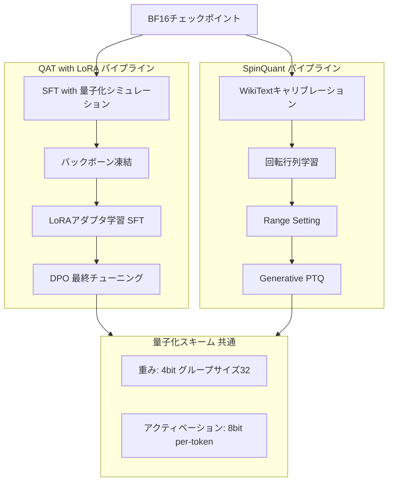

## ブログ概要（Summary）

本記事は [Introducing quantized Llama models with increased speed and a reduced memory footprint](https://ai.meta.com/blog/meta-llama-quantized-lightweight-models/) の解説記事です。

Meta AIは2024年10月、Llama 3.2 1Bおよび3Bモデルの公式量子化版を発表した。量子化手法としてQAT with LoRA（精度重視）とSpinQuant（ポータビリティ重視）の2種を提供し、4ビットグループワイズ重み量子化と8ビット動的アクティベーション量子化を組み合わせている。ARM CPU上でExecuTorchフレームワークを用いた実行では、BF16ベースラインと比較してモデルサイズ約56%削減、メモリ使用量約41%削減、推論速度2-4倍の高速化をMeta AIは報告している。Arm、Hugging Face、MediaTek、Ollama、Qualcommとのパートナーシップにより、エッジデバイスからサーバーサイドまでのARM CPU推論エコシステムが形成されている。

この記事は [Zenn記事: Fargate 32vCPUとllama.cppで実現するサーバーレスLLM推論基盤の構築](https://zenn.dev/0h_n0/articles/ca14512eb46121) の深掘りです。

## 情報源

- **種別**: 企業テックブログ
- **URL**: [https://ai.meta.com/blog/meta-llama-quantized-lightweight-models/](https://ai.meta.com/blog/meta-llama-quantized-lightweight-models/)
- **組織**: Meta AI（パートナー: Arm, Hugging Face, MediaTek, Ollama, Qualcomm）
- **発表日**: 2024年10月24日

## 技術的背景（Technical Background）

### エッジ・サーバーサイドにおける量子化LLMの需要

LLMの推論コストはモデルサイズに比例して増大する。BF16精度のLlama 3.2 3Bモデルは約6GBのメモリを消費し、モバイルデバイスやCPUのみの環境では実行が困難である。一方、エッジ推論やサーバーサイドCPU推論の需要は以下の背景から拡大している。

1. **プライバシー要件**: データをクラウドに送信せずオンデバイスで処理する必要性
2. **レイテンシ要件**: ネットワーク往復を排除しミリ秒単位の応答を実現する要件
3. **コスト要件**: GPU確保が困難な状況でのCPU推論によるコスト最適化

Zenn記事で解説されているFargate 32vCPU + Graviton（ARM64）構成は、まさにGPU不要のCPU推論基盤である。Meta AIの量子化Llamaモデルは、このようなARM CPU環境での推論を公式にサポートする取り組みとして位置づけられる。量子化によりモデルサイズとメモリ使用量を大幅に削減し、CPU推論の実用性を飛躍的に向上させることが目的である。

## 実装アーキテクチャ（Architecture）

### 量子化手法の全体像

Meta AIは3つの量子化手法を比較評価している。QAT with LoRAは精度を最優先する場合に、SpinQuantは学習データなしで既存のファインチューンモデルを量子化する場合に適している。Vanilla PTQはベースライン比較のために提示されている。



### QAT with LoRA（精度重視）

QAT with LoRA（Quantization-Aware Training with Low-Rank Adaptation）は、学習中に量子化の影響をシミュレーションすることで精度劣化を最小化する手法である。Meta AIはtorchao APIを用いてこのパイプラインを構築したと報告している。

**パイプラインの各ステップ**:

1. **SFTラウンド with 量子化シミュレーション**: BF16チェックポイントに対し、フォワードパスで量子化をシミュレーションしながらSFT（Supervised Fine-Tuning）を実行する。重みは実際には量子化せず、量子化誤差をバックプロパゲーションで学習する
2. **バックボーン凍結 + LoRAアダプタ学習**: SFT完了後、バックボーンの重みを凍結し、全Transformerブロック層にLoRAアダプタを追加する。LoRAの重みとアクティベーションはBF16精度を維持する
3. **DPO（Direct Preference Optimization）**: 最終段階でDPOを適用し、生成品質を最適化する

QATの損失関数は、量子化シミュレーション下でのクロスエントロピー損失として定式化できる。

$$
\mathcal{L}_{\text{QAT}} = -\frac{1}{N} \sum_{i=1}^{N} \log p(y_i \mid x_i; Q(\theta))
$$

ここで、
- $N$: 学習サンプル数
- $x_i$: $i$番目の入力シーケンス
- $y_i$: $i$番目の正解トークン
- $\theta$: モデルパラメータ
- $Q(\theta)$: 量子化関数を適用した（シミュレーションされた）パラメータ
- $p(y \mid x; Q(\theta))$: 量子化パラメータによる予測確率

量子化関数 $Q(\theta)$ はフォワードパスでは量子化・逆量子化（fake quantization）を行い、バックワードパスではストレートスルー推定器（STE: Straight-Through Estimator）により勾配を通過させる。

### SpinQuant（ポータビリティ重視）

SpinQuantはポストトレーニング量子化（PTQ）手法であり、学習データを必要としない点が特徴である。WikiTextキャリブレーションセットを用いて回転行列を学習し、重みの外れ値を平滑化する。

SpinQuantの基本的なアイデアは、線形層の重み行列 $\mathbf{W}$ に対して直交回転行列 $\mathbf{R}$ を適用することで、量子化に適した分布に変換することである。

$$
\mathbf{y} = \mathbf{W}\mathbf{x} = (\mathbf{W}\mathbf{R}^T)(\mathbf{R}\mathbf{x})
$$

ここで、
- $\mathbf{W}$: 元の重み行列
- $\mathbf{R}$: 直交回転行列（$\mathbf{R}\mathbf{R}^T = \mathbf{I}$）
- $\mathbf{x}$: 入力ベクトル
- $\mathbf{y}$: 出力ベクトル

回転行列 $\mathbf{R}$ の学習は、WikiTextキャリブレーションセット上で量子化後の出力と元の出力の差を最小化する最適化問題として定式化される。

$$
\mathbf{R}^* = \arg\min_{\mathbf{R} \in \mathcal{O}(d)} \mathbb{E}_{x \sim \mathcal{D}_{\text{cal}}} \left[ \| \mathbf{W}\mathbf{x} - Q(\mathbf{W}\mathbf{R}^T)\mathbf{R}\mathbf{x} \|_2^2 \right]
$$

ここで、
- $\mathcal{O}(d)$: $d$次元の直交群
- $\mathcal{D}_{\text{cal}}$: WikiTextキャリブレーションデータセット
- $Q(\cdot)$: 量子化関数

直交行列の制約下での最適化は、Cayleyパラメタライゼーションやリーマン最適化で解くことが一般的である。回転により重みの外れ値が分散されるため、均一な量子化でも精度を維持しやすくなる。

### 量子化スキームの詳細

ブログで報告されている量子化スキームは、モデルの各コンポーネントに異なるビット幅を適用するハイブリッド方式である。

| コンポーネント | 重みの量子化 | アクティベーションの量子化 |
|-------------|------------|----------------------|
| Transformerブロック線形層 | 4ビット グループワイズ（グループサイズ32） | 8ビット per-token 動的量子化 |
| 分類層（出力層） | 8ビット per-channel | 8ビット per-token |
| Embedding | 8ビット per-channel | -- |

**4ビットグループワイズ量子化**では、重みベクトルを32要素ずつのグループに分割し、各グループ内で独立にスケールとゼロポイントを計算する。グループサイズを小さくすると量子化誤差は減少するが、スケール/ゼロポイントの保存コストが増加する。グループサイズ32はこのトレードオフのバランスが取れた設定である。

**8ビットper-token動的アクティベーション量子化**では、推論時にトークンごとのアクティベーション範囲を動的に計算し、量子化パラメータを決定する。静的量子化と異なりキャリブレーションデータ不要で、入力分布の変動に対してロバストである。

## Production Deployment Guide

Meta AIの量子化Llamaモデルは、llama.cppやExecuTorchを介してARM CPU上で高速に動作する。Zenn記事で解説されたFargate Graviton構成は、これらの量子化モデルを本番環境でデプロイする最適な基盤の一つである。以下では、量子化Llamaモデルのサーバーサイドデプロイに焦点を当てたAWS構成パターンを示す。

### AWS実装パターン（コスト最適化重視）

量子化LlamaモデルのCPU推論は、GPU推論と比較して初期コストが低く、Fargate + Gravitonの組み合わせでさらにコスト効率が向上する。

**トラフィック量別の推奨構成**:

| 構成 | 想定トラフィック | 主要サービス | 月額概算 |
|------|----------------|-------------|---------|
| Small | ~100 req/日 | Fargate Spot (4vCPU) + ALB + S3 (GGUF) | $30-80 |
| Medium | ~1,000 req/日 | Fargate Graviton (32vCPU) + ALB + Auto Scaling | $300-600 |
| Large | 10,000+ req/日 | EKS + Karpenter (Graviton Spot) + NLB | $1,500-4,000 |

**Small構成の内訳** (ap-northeast-1、2026年10月時点の概算):
- Fargate Spot (ARM64, 4vCPU/16GiB): Llama 3.2 1B Q4量子化モデル -- 月額$15-30
- ALB: リクエストルーティング -- 月額$10-20
- S3: GGUFモデル保存（~1GB） -- 月額$1未満
- CloudWatch Logs: ログ保存 -- 月額$5-10

**Medium構成の内訳** (ap-northeast-1、2026年10月時点の概算):
- Fargate Graviton (ARM64, 32vCPU/120GiB): Llama 3.2 3B Q4量子化モデル -- 月額$200-400
- ALB + Auto Scaling: 負荷分散・自動スケーリング -- 月額$30-60
- S3 + ECR: モデル・イメージ保存 -- 月額$5-10
- CloudWatch: ログ・メトリクス・アラーム -- 月額$10-30

**コスト削減テクニック**:
- Fargate Spot利用で最大70%削減（Zenn記事で推奨されている構成）
- Graviton（ARM64）選択でvCPUあたり約20%削減
- Q4_K_M量子化によりメモリ要件を約56%削減し、小さいタスクサイズで運用可能
- ECS Service Auto Scalingでアイドル時にタスク数を0まで削減

**コスト試算の注意事項**: 上記は2026年10月時点のAWS ap-northeast-1（東京）リージョン料金に基づく概算値である。実際のコストはトラフィックパターン、リージョン、バースト使用量により変動する。最新料金はAWS料金計算ツールで確認を推奨する。

### Terraformインフラコード

**Small構成 (Serverless): Fargate Spot + llama.cpp DLC**

```hcl
# --- VPC基盤 ---
module "vpc" {
  source  = "terraform-aws-modules/vpc/aws"
  version = "~> 5.0"

  name = "quantized-llama-vpc"
  cidr = "10.0.0.0/16"

  azs             = ["ap-northeast-1a", "ap-northeast-1c"]
  private_subnets = ["10.0.1.0/24", "10.0.2.0/24"]
  public_subnets  = ["10.0.101.0/24", "10.0.102.0/24"]

  enable_nat_gateway = true
  single_nat_gateway = true  # コスト削減: 単一NAT Gateway

  enable_dns_hostnames = true
  enable_dns_support   = true
}

# --- IAMロール（最小権限） ---
resource "aws_iam_role" "ecs_task_execution" {
  name = "quantized-llama-task-execution"

  assume_role_policy = jsonencode({
    Version = "2012-10-17"
    Statement = [{
      Action = "sts:AssumeRole"
      Effect = "Allow"
      Principal = { Service = "ecs-tasks.amazonaws.com" }
    }]
  })
}

resource "aws_iam_role_policy_attachment" "ecs_task_execution" {
  role       = aws_iam_role.ecs_task_execution.name
  policy_arn = "arn:aws:iam::aws:policy/service-role/AmazonECSTaskExecutionRolePolicy"
}

resource "aws_iam_role" "ecs_task" {
  name = "quantized-llama-task-role"

  assume_role_policy = jsonencode({
    Version = "2012-10-17"
    Statement = [{
      Action = "sts:AssumeRole"
      Effect = "Allow"
      Principal = { Service = "ecs-tasks.amazonaws.com" }
    }]
  })
}

resource "aws_iam_role_policy" "s3_model_read" {
  name = "s3-model-read"
  role = aws_iam_role.ecs_task.id

  policy = jsonencode({
    Version = "2012-10-17"
    Statement = [{
      Sid      = "ReadGGUFModels"
      Effect   = "Allow"
      Action   = ["s3:GetObject"]
      Resource = "${aws_s3_bucket.models.arn}/*"
    }]
  })
}

# --- S3（GGUFモデル保存） ---
resource "aws_s3_bucket" "models" {
  bucket = "quantized-llama-models-${data.aws_caller_identity.current.account_id}"
}

resource "aws_s3_bucket_server_side_encryption_configuration" "models" {
  bucket = aws_s3_bucket.models.id
  rule {
    apply_server_side_encryption_by_default {
      sse_algorithm = "aws:kms"
    }
  }
}

# --- ECSクラスタ + Fargateタスク定義 ---
resource "aws_ecs_cluster" "llama" {
  name = "quantized-llama-cluster"
}

resource "aws_ecs_task_definition" "llama_1b" {
  family                   = "quantized-llama-1b"
  network_mode             = "awsvpc"
  requires_compatibilities = ["FARGATE"]
  cpu                      = "4096"   # 4 vCPU
  memory                   = "16384"  # 16 GiB（1B Q4モデルに十分）
  execution_role_arn       = aws_iam_role.ecs_task_execution.arn
  task_role_arn            = aws_iam_role.ecs_task.arn

  runtime_platform {
    cpu_architecture        = "ARM64"  # Graviton: vCPUあたり約20%安価
    operating_system_family = "LINUX"
  }

  container_definitions = jsonencode([{
    name  = "llama-cpp-server"
    image = "public.ecr.aws/deep-learning-containers/llama-cpp-arm64:server-cpu-v1"
    portMappings = [{ containerPort = 8080, protocol = "tcp" }]
    environment = [
      { name = "HF_MODEL_ID", value = "meta-llama/Llama-3.2-1B-Instruct-GGUF" },
      { name = "HF_MODEL_FILE", value = "Llama-3.2-1B-Instruct-Q4_K_M.gguf" },
      { name = "LLAMA_ARG_CTX_SIZE", value = "4096" },
      { name = "LLAMA_ARG_THREADS", value = "3" },
      { name = "LLAMA_ARG_N_GPU_LAYERS", value = "0" },
    ]
    healthCheck = {
      command     = ["CMD-SHELL", "curl -f http://localhost:8080/health || exit 1"]
      interval    = 30
      timeout     = 10
      retries     = 5
      startPeriod = 180  # モデルダウンロード・読み込み待機
    }
    logConfiguration = {
      logDriver = "awslogs"
      options = {
        "awslogs-group"         = "/ecs/quantized-llama"
        "awslogs-region"        = "ap-northeast-1"
        "awslogs-stream-prefix" = "llama-1b"
      }
    }
  }])
}

# --- CloudWatchアラーム（コスト監視） ---
resource "aws_cloudwatch_metric_alarm" "ecs_cpu_high" {
  alarm_name          = "quantized-llama-cpu-high"
  comparison_operator = "GreaterThanThreshold"
  evaluation_periods  = 3
  metric_name         = "CPUUtilization"
  namespace           = "AWS/ECS"
  period              = 300
  statistic           = "Average"
  threshold           = 80
  alarm_description   = "ECS CPU utilization exceeds 80%"

  dimensions = {
    ClusterName = aws_ecs_cluster.llama.name
    ServiceName = "quantized-llama-service"
  }
}

data "aws_caller_identity" "current" {}
```

**Large構成 (Container): EKS + Karpenter + Graviton Spot**

```hcl
# --- EKSクラスタ ---
module "eks" {
  source  = "terraform-aws-modules/eks/aws"
  version = "~> 20.0"

  cluster_name    = "quantized-llama-cluster"
  cluster_version = "1.31"

  vpc_id     = module.vpc.vpc_id
  subnet_ids = module.vpc.private_subnets

  cluster_endpoint_public_access = false

  eks_managed_node_groups = {
    system = {
      instance_types = ["t4g.medium"]  # Gravitonシステムノード
      ami_type       = "AL2_ARM_64"
      min_size       = 1
      max_size       = 2
      desired_size   = 1
    }
  }
}

# --- Karpenter Provisioner（Graviton Spot優先） ---
resource "kubectl_manifest" "karpenter_node_pool" {
  yaml_body = yamlencode({
    apiVersion = "karpenter.sh/v1"
    kind       = "NodePool"
    metadata   = { name = "llama-inference-workers" }
    spec = {
      template = {
        spec = {
          requirements = [
            { key = "karpenter.sh/capacity-type", operator = "In",
              values = ["spot", "on-demand"] },
            { key = "kubernetes.io/arch", operator = "In",
              values = ["arm64"] },  # Graviton限定
            { key = "node.kubernetes.io/instance-type", operator = "In",
              values = ["m7g.4xlarge", "m7g.8xlarge", "c7g.4xlarge", "c7g.8xlarge"] }
          ]
        }
      }
      limits     = { cpu = "256", memory = "1024Gi" }
      disruption = { consolidationPolicy = "WhenEmptyOrUnderutilized" }
    }
  })
}

# --- Secrets Manager（モデル設定） ---
resource "aws_secretsmanager_secret" "model_config" {
  name = "quantized-llama-model-config"
}

# --- AWS Budgets（予算アラート） ---
resource "aws_budgets_budget" "monthly" {
  name         = "quantized-llama-monthly-budget"
  budget_type  = "COST"
  limit_amount = "4000"
  limit_unit   = "USD"
  time_unit    = "MONTHLY"

  notification {
    comparison_operator        = "GREATER_THAN"
    threshold                  = 80
    threshold_type             = "PERCENTAGE"
    notification_type          = "ACTUAL"
    subscriber_email_addresses = [var.alert_email]
  }
}
```

### 運用・監視設定

**CloudWatch Logs Insights -- llama.cpp推論レイテンシ分析クエリ**:

```
fields @timestamp, @message
| filter @message like /slot/
| parse @message "prompt eval time = * ms" as prefill_ms
| parse @message "eval time = * ms" as decode_ms
| stats avg(prefill_ms) as avg_prefill, pct(prefill_ms, 95) as p95_prefill,
        avg(decode_ms) as avg_decode, pct(decode_ms, 95) as p95_decode
  by bin(1h)
| sort @timestamp desc
```

**CloudWatchアラーム -- 推論レイテンシ異常検知（Python boto3）**:

```python
import boto3


def create_inference_latency_alarm(
    cluster_name: str, service_name: str, sns_topic_arn: str
) -> dict:
    """ECS上のllama.cpp推論タスクのレイテンシ異常を検知するアラームを作成する。

    Args:
        cluster_name: ECSクラスタ名
        service_name: ECSサービス名
        sns_topic_arn: 通知先のSNSトピックARN

    Returns:
        CloudWatch put_metric_alarm のレスポンス
    """
    cw = boto3.client("cloudwatch", region_name="ap-northeast-1")
    return cw.put_metric_alarm(
        AlarmName=f"{service_name}-latency-spike",
        MetricName="TargetResponseTime",
        Namespace="AWS/ApplicationELB",
        Statistic="p95",
        Period=300,
        EvaluationPeriods=2,
        Threshold=30.0,  # 30秒: CPU推論の閾値
        ComparisonOperator="GreaterThanThreshold",
        AlarmActions=[sns_topic_arn],
        Dimensions=[
            {"Name": "LoadBalancer", "Value": f"app/{cluster_name}-alb/*"},
        ],
    )
```

**X-Rayトレーシング -- 推論リクエストの追跡（Python boto3）**:

```python
from aws_xray_sdk.core import xray_recorder, patch_all
import requests

patch_all()  # boto3・requestsの自動計装


@xray_recorder.capture("llama_inference")
def invoke_llama_inference(
    endpoint: str, prompt: str, max_tokens: int = 512
) -> dict:
    """量子化Llamaモデルへの推論リクエストを送信する。

    Args:
        endpoint: llama.cppサーバーのエンドポイントURL
        prompt: 推論プロンプト
        max_tokens: 最大生成トークン数

    Returns:
        推論結果の辞書
    """
    subsegment = xray_recorder.current_subsegment()
    subsegment.put_annotation("model", "llama-3.2-3b-q4")
    subsegment.put_annotation("max_tokens", max_tokens)

    response = requests.post(
        f"{endpoint}/v1/chat/completions",
        json={
            "model": "llama-3.2-3b-instruct",
            "messages": [{"role": "user", "content": prompt}],
            "max_tokens": max_tokens,
        },
        timeout=60,
    )
    result = response.json()

    subsegment.put_metadata("usage", result.get("usage", {}), "inference")
    return result
```

**Cost Explorer日次レポート（Python boto3）**:

```python
import boto3
from datetime import datetime, timedelta


def get_daily_inference_cost() -> dict:
    """Fargate推論関連の日次コストを取得する。

    Returns:
        サービス別コストの辞書
    """
    ce = boto3.client("ce", region_name="us-east-1")
    end = datetime.utcnow().strftime("%Y-%m-%d")
    start = (datetime.utcnow() - timedelta(days=1)).strftime("%Y-%m-%d")

    response = ce.get_cost_and_usage(
        TimePeriod={"Start": start, "End": end},
        Granularity="DAILY",
        Metrics=["UnblendedCost"],
        Filter={
            "Or": [
                {"Dimensions": {"Key": "SERVICE", "Values": ["Amazon Elastic Container Service"]}},
                {"Dimensions": {"Key": "SERVICE", "Values": ["Amazon EC2 Container Service"]}},
                {"Dimensions": {"Key": "SERVICE", "Values": ["Amazon Elastic Kubernetes Service"]}},
                {"Dimensions": {"Key": "SERVICE", "Values": ["Amazon Simple Storage Service"]}},
            ]
        },
        GroupBy=[{"Type": "DIMENSION", "Key": "SERVICE"}],
    )
    costs: dict[str, float] = {}
    for group in response["ResultsByTime"][0]["Groups"]:
        service = group["Keys"][0]
        amount = float(group["Metrics"]["UnblendedCost"]["Amount"])
        costs[service] = amount
    total = sum(costs.values())

    # $100/日超過でアラート
    if total > 100:
        sns = boto3.client("sns", region_name="ap-northeast-1")
        sns.publish(
            TopicArn="arn:aws:sns:ap-northeast-1:ACCOUNT_ID:cost-alerts",
            Subject="Daily inference cost alert",
            Message=f"Daily cost: ${total:.2f}\n{costs}",
        )
    return costs
```

### コスト最適化チェックリスト

**アーキテクチャ選択**:
- [ ] トラフィック量に応じた構成を選択（~100 req/日: Fargate Spot Small、~1,000: Fargate Graviton Medium、10,000+: EKS Graviton Spot Large）
- [ ] モデルサイズに応じたタスクリソースを選択（1B: 4vCPU/16GiB、3B: 32vCPU/120GiB）

**リソース最適化**:
- [ ] Fargate Spot利用で最大70%削減
- [ ] Graviton（ARM64）選択でvCPUあたり約20%削減
- [ ] EKS: Karpenter + Spot Instances優先（自動フォールバック設定）
- [ ] Reserved Instances: 安定ワークロードに1年コミットで最大72%削減
- [ ] Savings Plans: Compute Savings Plansの検討
- [ ] ECS Service Auto Scalingでアイドル時スケールダウン（最小タスク数0設定）

**モデル最適化（量子化レベル選択）**:
- [ ] Q4_K_M量子化で約56%のサイズ削減（精度とのトレードオフ確認済み）
- [ ] コンテキスト長を用途に応じて制限（4096以下で省メモリ）
- [ ] llama.cppスレッド数をvCPU数の85-90%に設定（コンテキストスイッチ回避）
- [ ] 1Bモデルで十分な用途では3Bモデルを使わない（コスト半減）

**監視・アラート**:
- [ ] AWS Budgets設定（月次予算の80%で通知）
- [ ] CloudWatchアラーム（CPU使用率、ALBレイテンシ）
- [ ] Cost Anomaly Detection有効化
- [ ] 日次コストレポートの自動化
- [ ] llama.cppヘルスチェックによる異常検知

**リソース管理**:
- [ ] 未使用のECSサービス・タスク定義の削除
- [ ] リソースタグ戦略（`env`, `project`, `model-version`）
- [ ] S3ライフサイクルポリシーで古いモデルバージョンを自動削除
- [ ] CloudWatch Logsの保持期間設定（30日推奨）
- [ ] 開発環境の夜間・週末自動停止（Application Auto Scaling scheduled action）

## パフォーマンス最適化（Performance）

### 2-4倍高速化の要因分析

Meta AIが報告する2-4倍の高速化は、主に以下の3要素による。

**1. メモリ帯域幅の削減**: CPU推論のボトルネックはメモリ帯域幅である。4ビット量子化により重みのメモリフットプリントが約1/4になり、メモリからのロード量が大幅に削減される。ARM CPUのメモリ帯域幅がボトルネックとなるデコード処理では、この効果が直接的に速度向上に寄与する。

**2. プリフィル処理の高速化**: ブログではプリフィルレイテンシが平均約4.2倍高速化したと報告されている（TTFT、prompt=64トークンでの計測）。プリフィル処理は計算バウンドであり、4ビット重みに対する効率的なカーネル（Kleidi AI）が演算量削減に貢献している。

**3. デコード処理の高速化**: デコードレイテンシは平均約2.5倍の高速化が報告されている。デコード処理はメモリバウンドであるため、重みの量子化によるメモリ帯域幅削減の効果がプリフィルほどは顕著でないが、依然として大幅な高速化が達成されている。

**計測環境**: OnePlus 12（主計測デバイス）、Samsung S24+、Samsung S22上のARM CPUでExecuTorchフレームワークを使用。これらはモバイルデバイスでの計測であるが、ARM CPUアーキテクチャの特性はGravitonプロセッサと共通する部分が多い。

## 運用での学び（Production Lessons）

### QAT with LoRA vs SpinQuantの使い分け

Meta AIは2つの量子化手法を目的別に推奨している。

**QAT with LoRAを選択すべきケース**:
- 精度を最優先する場合（BF16に近い品質が求められる用途）
- SFTデータおよびDPOデータが利用可能な場合
- Meta公式のLlamaモデルをそのまま量子化して使用する場合

**SpinQuantを選択すべきケース**:
- 自前でファインチューンしたモデルを量子化する場合
- 学習データの準備が困難な場合（WikiTextキャリブレーションのみで動作）
- 量子化の手軽さとポータビリティを優先する場合

**Vanilla PTQ**は精度面で両手法に劣るとブログで報告されており、本番利用は推奨されていない。

### Fargate Graviton構成での実践的考慮事項

Zenn記事で解説されているFargate Graviton構成にMeta公式量子化モデルを適用する際の注意点として、以下が挙げられる。

- **GGUFフォーマットとの互換性**: Meta公式の量子化モデルはExecuTorch形式で提供されている。llama.cppで使用するにはGGUFフォーマットのモデルが必要であり、Hugging Face上でコミュニティが変換したGGUF版を使用するか、自前で変換する必要がある
- **コンテキスト長**: ブログでは8Kトークンまでの最適化を報告している。Zenn記事のタスク定義では`LLAMA_ARG_CTX_SIZE: 4096`を推奨しており、省メモリの観点からもこの設定が合理的である
- **ARM NEON活用**: Zenn記事で触れられている「llama.cppはARM NEONを活用するためGraviton上でも実用的な推論速度を実現する」という記述は、Meta AIがKleidi AIカーネルでARM CPUを最適化している取り組みと整合する

## 学術研究との関連（Academic Connection）

### 他の量子化手法との比較

Meta AIのQAT with LoRAおよびSpinQuantは、以下の既存研究の流れに位置づけられる。

- **GPTQ**（Frantar et al., 2023）: 重みのみのPTQ手法。ヘッセ行列の逆行列を用いて層単位で量子化誤差を最小化する。SpinQuantは回転行列による平滑化というアプローチで差別化されている
- **AWQ**（Lin et al., 2024）: アクティベーション分布に基づいて重要な重みチャネルを保護するPTQ手法。量子化スキームの設計思想（重要な部分を高精度に保つ）はMeta AIのハイブリッド量子化スキームと共通する
- **SmoothQuant**（Xiao et al., 2023）: アクティベーションの外れ値を重み側に移すことで、重み・アクティベーション両方の量子化を容易にする手法。SpinQuantの回転行列による平滑化は、SmoothQuantのスケーリングアプローチを発展させたものと解釈できる

Meta AIのアプローチの特徴は、QATとPTQの両方を公式にサポートし、ユーザーの要件に応じて選択肢を提供している点にある。

## まとめと実践への示唆

Meta AIの量子化Llamaモデルは、ARM CPU上でのLLM推論を2-4倍高速化し、モデルサイズを約56%、メモリ使用量を約41%削減するとブログで報告されている。QAT with LoRA（精度重視）とSpinQuant（ポータビリティ重視）の2手法が提供されており、用途に応じた選択が可能である。

Zenn記事で解説されたFargate 32vCPU + Graviton構成との関連では、Meta公式の量子化技術がARM CPU推論の性能向上に直結する。4ビットグループワイズ量子化によりメモリ要件が半減することで、Fargateの小さいタスクサイズでの運用が可能になり、コスト効率がさらに改善される。llama.cppのGGUFフォーマットでこれらの量子化手法を活用するには、Hugging Face上のコミュニティ変換モデルの利用が現時点では実用的な選択肢である。

## 参考文献

- **Blog URL**: [Introducing quantized Llama models with increased speed and a reduced memory footprint](https://ai.meta.com/blog/meta-llama-quantized-lightweight-models/)
- **torchao**: [pytorch/ao - PyTorch Architecture Optimization](https://github.com/pytorch/ao)
- **SpinQuant**: [facebookresearch/SpinQuant](https://github.com/facebookresearch/SpinQuant)
- **ExecuTorch**: [pytorch/executorch](https://github.com/pytorch/executorch)
- **Llama Stack**: [meta-llama/llama-stack](https://github.com/meta-llama/llama-stack)
- **Related Papers**:
  - Frantar et al., "GPTQ: Accurate Post-Training Quantization for Generative Pre-trained Transformers," ICLR 2023
  - Lin et al., "AWQ: Activation-aware Weight Quantization for LLM Compression and Acceleration," MLSys 2024
  - Xiao et al., "SmoothQuant: Accurate and Efficient Post-Training Quantization for Large Language Models," ICML 2023
- **Related Zenn article**: [Fargate 32vCPUとllama.cppで実現するサーバーレスLLM推論基盤の構築](https://zenn.dev/0h_n0/articles/ca14512eb46121)
