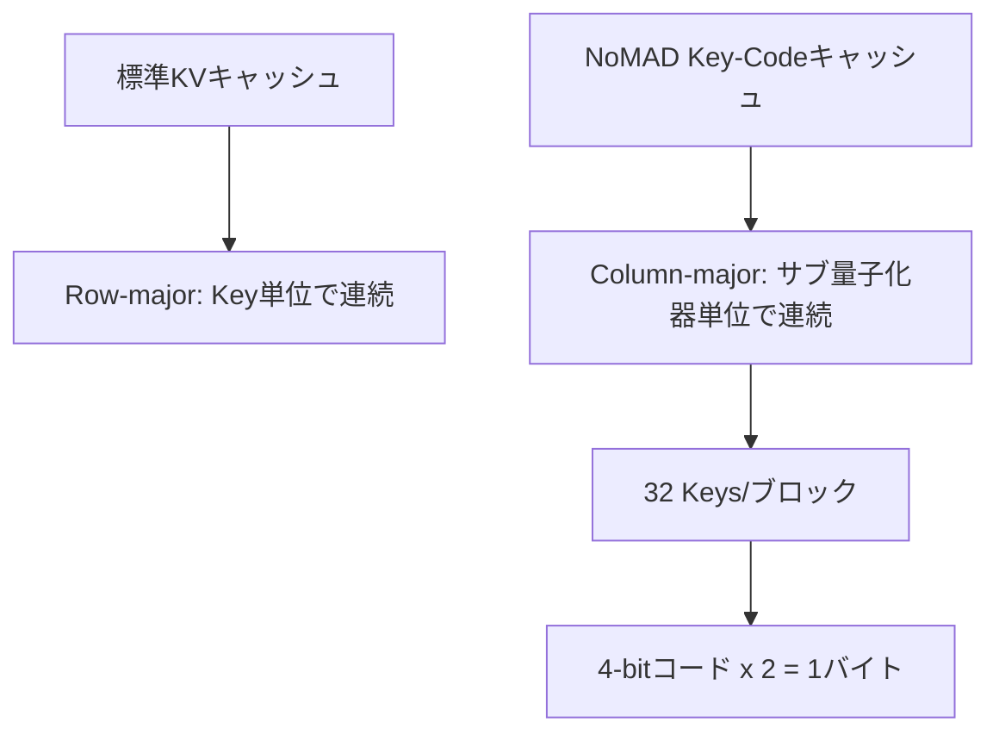

## 論文概要（Abstract）

本記事は [NoMAD-Attention](https://arxiv.org/abs/2403.01273)（NeurIPS 2024）の解説記事です。

この記事は [Zenn記事: Fargate 32vCPUとllama.cppで実現するサーバーレスLLM推論基盤の構築](https://zenn.dev/0h_n0/articles/ca14512eb46121) の深掘りです。

CPU上でのLLM推論において、Attentionスコア計算に必要な大量の乗算加算（MAD: Multiply-Add）演算がボトルネックとなる。NoMAD-Attentionは、MAD演算をCPUのSIMDレジスタ上でのin-registerルックアップに置き換えることで、この問題を解決する。Product Quantization（PQ）によりKey vectorを4ビットコードに圧縮し、Query-Key間の内積をルックアップテーブル参照で近似する。著者らは、事前学習済みモデルにファインチューニング不要で適用可能であり、4ビット量子化LLaMA-7Bで16kコンテキスト長において最大2倍の高速化を達成したと報告している。

## 情報源

- **会議名**: NeurIPS 2024（Advances in Neural Information Processing Systems 38）
- **arXiv ID**: 2403.01273
- **URL**: [https://arxiv.org/abs/2403.01273](https://arxiv.org/abs/2403.01273)
- **著者**: Tianyi Zhang, Jonah Wonkyu Yi, Bowen Yao, Zhaozhuo Xu, Anshumali Shrivastava（Rice University / Stevens Institute of Technology / ThirdAI）
- **コード**: [https://github.com/tonyzhang617/nomad-dist](https://github.com/tonyzhang617/nomad-dist)
- **発表形式**: Poster

## カンファレンス情報

NeurIPS（Neural Information Processing Systems）は機械学習・人工知能分野における最高峰の国際会議の1つである。NeurIPS 2024は第38回大会として2024年12月10日から15日にカナダ・バンクーバーで開催された。約15,671件の投稿に対し採択率は約25.8%であり、高い競争率のもとで選ばれた論文である。

## 背景と動機

LLMの推論をGPUなしのCPU環境で行う需要は、エッジデバイスやコスト制約のあるサーバー環境で高まっている。llama.cppに代表されるCPU推論フレームワークの登場により、量子化されたモデルをCPU上で動作させることは可能になったが、コンテキスト長が長くなるにつれてAttentionスコア計算のコストが支配的になる。

デコーディングステップ$t$において、Attention計算は$t$個のKey vectorとの内積を必要とし、計算量は$O(t \cdot d)$（$d$はヘッド次元）となる。一方、MLP層やスキップ接続は定数コスト$O(1)$で済むため、長いコンテキストではAttentionが全体のボトルネックとなる。

従来の効率的Attention手法（SparsityやLow-rank近似）は、多くの場合モデルの再学習が必要であり、既存の事前学習済みモデルにそのまま適用することが困難であった。NoMAD-Attentionは、CPUのSIMDレジスタという標準的なハードウェア機能を活用し、再学習なしで既存モデルのAttentionを高速化するアプローチを取る。

## 技術的詳細

### Product QuantizationによるAttentionのルックアップ化

NoMAD-Attentionの核心は、Query-Key間の内積計算をProduct Quantization（PQ）に基づくルックアップテーブル参照に変換する点にある。

$d$次元のKey vector $\mathbf{k}$を$S$個のサブベクトルに分割し、各サブベクトルを$C$個のセントロイドからなるコードブックで量子化する。サブベクトル$s$に対するコード割り当ては以下で定義される。

$$
c_s = \arg\min_{c \in \{1, \ldots, C\}} \| \pi_s(\mathbf{k}) - \mathbf{b}_{s,c} \|_2
$$

ここで、
- $\pi_s(\mathbf{k})$: ベクトル$\mathbf{k}$の$s$番目のサブベクトル（次元$d_{\text{sub}} = d / S$）
- $\mathbf{b}_{s,c}$: サブ量子化器$s$の$c$番目のセントロイド
- $c_s$: 割り当てられたコード（整数インデックス）

Asymmetric Distance Computation（ADC）により、Queryは量子化せずに元の精度を保持する。各サブ量子化器$s$に対してルックアップテーブル（LUT）を事前計算する。

$$
\text{LUT}_s[c] = \pi_s(\mathbf{q}) \cdot \mathbf{b}_{s,c}
$$

Query $\mathbf{q}$とKey $\mathbf{k}$の内積の近似値は、各サブベクトルのLUT参照結果を合算して得られる。

$$
\mathbf{q} \cdot \mathbf{k} \approx \sum_{s=1}^{S} \text{LUT}_s[c_s]
$$

### SIMDレジスタへのLUT圧縮

PQの素朴な実装ではLUTがキャッシュに収まらず高速化が制限される。著者らはこれを解決するため、2つの設計上の制約を導入している。

**制約1: コードブックサイズを16に制限（4ビットコード）。** 128ビットSIMDレジスタは16バイトを格納できるため、8ビットに量子化されたLUTエントリ16個がちょうど1レジスタに収まる。256セントロイドのPQでは8192ビット必要であるのに対し、16セントロイドなら128ビットで済む。

**制約2: LUTエントリを8ビットに動的量子化。** 各Query・各サブ量子化器ごとに、内積値の最小値$dp_{\min}$と最大値$dp_{\max}$を求め、8ビット整数に量子化する。

$$
\text{LUT}_s^{\text{q8}}[c] = \left\lfloor \frac{\pi_s(\mathbf{q}) \cdot \mathbf{b}_{s,c} - dp_{\min}}{(dp_{\max} - dp_{\min}) / 2^8} \right\rfloor
$$

ここで、
- $dp_{\min} = \min_c \, \pi_s(\mathbf{q}) \cdot \mathbf{b}_{s,c}$
- $dp_{\max} = \max_c \, \pi_s(\mathbf{q}) \cdot \mathbf{b}_{s,c}$

この動的量子化はQueryごとに再計算されるため、異なるQueryに対して量子化誤差が蓄積しない。

### Key-Codeキャッシュのメモリレイアウト

標準的なKVキャッシュは行優先（Row-major）でKey vectorを格納するが、NoMAD-Attentionは列優先（Column-major）かつブロック化されたレイアウトを採用する。32個のKeyを1ブロックとし、同一サブ量子化器のコードを連続配置する。4ビットコードは1バイトに2つのコードを格納するため、ブロック内のKeyを交互に配置し、ビットシフトとマスク操作で効率的にコードを抽出する。



## アルゴリズム

NoMAD-Attentionの中核であるAttentionスコア計算のアルゴリズムを以下に示す。

```python
import numpy as np
from typing import List, Tuple


def nomad_attention_score(
    query: np.ndarray,
    key_codes: np.ndarray,
    codebooks: np.ndarray,
    n_sub: int,
    n_centroids: int = 16,
) -> np.ndarray:
    """NoMAD-Attentionスコア計算の擬似実装。

    SIMDレジスタ上のルックアップによるMAD-free Attention。
    実際のC実装ではSIMD shuffle命令を使用する。

    Args:
        query: Queryベクトル, shape (d,)
        key_codes: 量子化済みKeyコード, shape (seq_len, n_sub)
        codebooks: コードブック, shape (n_sub, n_centroids, d_sub)
        n_sub: サブ量子化器の数
        n_centroids: セントロイド数（デフォルト16, 4ビット）

    Returns:
        Attentionスコア（softmax前）, shape (seq_len,)
    """
    seq_len = key_codes.shape[0]
    d_sub = query.shape[0] // n_sub

    # Step 1: 各サブ量子化器のLUTを構築し8ビット量子化
    luts_q8: List[np.ndarray] = []
    scales: List[Tuple[float, float]] = []

    for s in range(n_sub):
        q_sub = query[s * d_sub : (s + 1) * d_sub]
        # 全セントロイドとの内積を計算
        dot_products = codebooks[s] @ q_sub  # shape (n_centroids,)
        dp_min = dot_products.min()
        dp_max = dot_products.max()

        # 8ビット動的量子化
        scale = (dp_max - dp_min) / 256.0 if dp_max > dp_min else 1.0
        lut_q8 = np.floor((dot_products - dp_min) / scale).astype(np.uint8)
        luts_q8.append(lut_q8)
        scales.append((dp_min, scale))

    # Step 2: 32-Keyブロック単位でルックアップ累積
    # 実際のSIMD実装ではshuffle命令でバッチ処理
    scores = np.zeros(seq_len, dtype=np.float32)

    for i in range(seq_len):
        accum: int = 0
        for s in range(n_sub):
            code = key_codes[i, s]
            accum += int(luts_q8[s][code])  # SIMD shuffleに相当
        # 逆量子化: 累積値をfloat内積に復元
        dp_min_total = sum(sc[0] for sc in scales)
        scale_total = sum(sc[1] for sc in scales)
        scores[i] = dp_min_total + accum * (scale_total / n_sub)

    return scores


def learn_codebooks(
    key_embeddings: np.ndarray,
    n_sub: int,
    n_centroids: int = 16,
    n_iter: int = 20,
) -> np.ndarray:
    """K-meansによるコードブック学習。

    レイヤー・ヘッドごとに独立して学習する。

    Args:
        key_embeddings: Keyベクトル群, shape (n_samples, d)
        n_sub: サブ量子化器の数
        n_centroids: セントロイド数
        n_iter: K-meansイテレーション数

    Returns:
        コードブック, shape (n_sub, n_centroids, d_sub)
    """
    from sklearn.cluster import KMeans

    d = key_embeddings.shape[1]
    d_sub = d // n_sub
    codebooks = np.zeros((n_sub, n_centroids, d_sub), dtype=np.float32)

    for s in range(n_sub):
        sub_vectors = key_embeddings[:, s * d_sub : (s + 1) * d_sub]
        kmeans = KMeans(n_clusters=n_centroids, max_iter=n_iter, n_init=1)
        kmeans.fit(sub_vectors)
        codebooks[s] = kmeans.cluster_centers_

    return codebooks
```

SIMD shuffle命令を用いた実際のルックアップ累積ループ（Algorithm 3相当）の動作は以下の通りである。

1. 32個のKeyコード（各4ビット、16バイトに格納）をロード
2. 右4ビットシフトで先頭16 Keyのコードを抽出し、SIMD shuffleでLUT参照
3. 0x0Fマスクで後半16 Keyのコードを抽出し、同様にLUT参照
4. 結果を16ビットアキュムレータに加算（8ビットではオーバーフローするため）
5. 全サブ量子化器について繰り返し

## 実装のポイント

**コードブック学習**: Key vectorの分布はレイヤーとヘッドごとに大きく異なるため（論文Figure 2より）、コードブックはレイヤー・ヘッド単位で独立に学習する必要がある。学習には100サンプル程度の少量データで十分であると著者らは報告している。

**$d_{\text{sub}}$パラメータの選択**: $d_{\text{sub}} = 1$（サブベクトル次元が1）の場合、Key cacheの圧縮率は最大（8倍）だが近似精度は低下する。$d_{\text{sub}} = 2$は圧縮率4倍で品質劣化が小さい。論文の実験では$d_{\text{sub}} = 1$でもPerplexityの増加は4%以内に収まると報告されている。

**AVX2要件**: SIMD shuffle命令（`vpshufb`）を利用するため、実行環境にはAVX2対応CPUが必要である。ARM NEONの`vtbl`命令でも同等の操作が可能であり、Arm NEONを搭載するARM64環境（AWS Graviton等）でも動作する。

**llama.cppとの統合**: 実装はllama.cppのコードベースに統合されており、既存のGGUFモデルファイルに対して追加のファインチューニングなしで適用可能である。コードブック学習はオフラインで1回実行すれば再利用できる。

## Production Deployment Guide

本セクションでは、NoMAD-Attentionを組み込んだllama.cppベースのCPU推論基盤をAWS上にデプロイする構成を示す。Zenn記事で紹介されているFargate上のllama.cpp推論基盤に、NoMAD-Attentionによる高速化を適用するシナリオを想定する。

コスト試算は2026年10月時点のAWS ap-northeast-1（東京）リージョン料金に基づく概算値である。実際のコストはトラフィックパターン、バースト使用量により変動するため、最新料金は[AWS料金計算ツール](https://calculator.aws/)で確認を推奨する。

### AWS実装パターン（コスト最適化重視）

| 構成 | トラフィック | サービス | 月額概算 |
|------|------------|---------|---------|
| Small | ~100 req/日 | ECS Fargate (4 vCPU, 16GB) | $120-180 |
| Medium | ~1,000 req/日 | ECS Fargate (16 vCPU, 32GB) | $500-900 |
| Large | 10,000+ req/日 | EKS + Karpenter + c7i Spot | $2,500-5,000 |

**Small構成（~100 req/日）**: ECS Fargate上でllama.cpp + NoMAD-Attentionコンテナを実行する。4 vCPUでも NoMAD-Attentionにより従来の8 vCPU相当のスループットが期待できる。タスクはリクエスト到着時にスケールアウトし、アイドル時は0タスクにスケールインする。Application Load Balancer（ALB）経由でHTTPエンドポイントを公開する。

- Fargate (4 vCPU, 16GB, 平均4時間/日稼働): 約$25/月
- ALB: 約$20/月
- ECR / CloudWatch: 約$10/月
- S3（モデルファイル保存）: 約$5/月
- 合計: 約$60-120/月

**Medium構成（~1,000 req/日）**: Zenn記事と同等のFargate 32 vCPU構成にNoMAD-Attentionを適用する。16kコンテキスト長でのデコーディング速度が約2倍になるため、同一vCPU数でスループットが向上する。ECS Service Auto Scalingでリクエスト数に応じたタスク数制御を行う。

- Fargate (16 vCPU, 32GB, 2タスク常時): 約$450/月
- ALB + NAT Gateway: 約$65/月
- ElastiCache（レスポンスキャッシュ）: 約$50/月
- 合計: 約$565-900/月

**Large構成（10,000+ req/日）**: EKS上でKarpenterによるSpot Instance自動プロビジョニングを行う。c7i.4xlargeまたはGraviton c7g.4xlarge Spotインスタンスを優先使用し、コスト削減と高スループットを両立する。

- EKS コントロールプレーン: 約$75/月
- c7i.4xlarge Spot x 3-8台（動的）: 約$800-2,200/月
- ALB + NAT Gateway: 約$100/月
- 監視（CloudWatch, Prometheus）: 約$80/月
- 合計: 約$1,055-2,455/月（Spotで最大70%削減後）

### Terraformインフラコード

#### Small構成（ECS Fargate + NoMAD-Attention）

```hcl
# Small構成: ECS Fargate + llama.cpp NoMAD-Attention
# 対象: ~100 req/日、月額$60-120

terraform {
  required_version = ">= 1.9"
  required_providers {
    aws = {
      source  = "hashicorp/aws"
      version = "~> 5.70"
    }
  }
}

provider "aws" {
  region = "ap-northeast-1"
}

# --- VPC (NAT Gateway不使用でコスト削減) ---
module "vpc" {
  source  = "terraform-aws-modules/vpc/aws"
  version = "~> 5.13"

  name = "nomad-llm-vpc"
  cidr = "10.0.0.0/16"

  azs             = ["ap-northeast-1a", "ap-northeast-1c"]
  public_subnets  = ["10.0.1.0/24", "10.0.2.0/24"]
  private_subnets = ["10.0.11.0/24", "10.0.12.0/24"]

  # NAT Gateway不使用: VPCエンドポイントでコスト削減
  enable_nat_gateway = false
}

# ECR / S3 / CloudWatch Logs VPCエンドポイント
resource "aws_vpc_endpoint" "ecr_api" {
  vpc_id              = module.vpc.vpc_id
  service_name        = "com.amazonaws.ap-northeast-1.ecr.api"
  vpc_endpoint_type   = "Interface"
  subnet_ids          = module.vpc.private_subnets
  private_dns_enabled = true
}

resource "aws_vpc_endpoint" "s3" {
  vpc_id       = module.vpc.vpc_id
  service_name = "com.amazonaws.ap-northeast-1.s3"
}

# --- IAMロール (最小権限) ---
resource "aws_iam_role" "ecs_task_execution" {
  name = "nomad-llm-task-execution"
  assume_role_policy = jsonencode({
    Version = "2012-10-17"
    Statement = [{
      Action = "sts:AssumeRole"
      Effect = "Allow"
      Principal = { Service = "ecs-tasks.amazonaws.com" }
    }]
  })
}

resource "aws_iam_role_policy_attachment" "ecs_task_execution" {
  role       = aws_iam_role.ecs_task_execution.name
  policy_arn = "arn:aws:iam::aws:policy/service-role/AmazonECSTaskExecutionRolePolicy"
}

resource "aws_iam_role" "ecs_task" {
  name = "nomad-llm-task"
  assume_role_policy = jsonencode({
    Version = "2012-10-17"
    Statement = [{
      Action = "sts:AssumeRole"
      Effect = "Allow"
      Principal = { Service = "ecs-tasks.amazonaws.com" }
    }]
  })
}

# S3からモデルファイル読み取り権限のみ
resource "aws_iam_role_policy" "task_s3_read" {
  name = "s3-model-read"
  role = aws_iam_role.ecs_task.id
  policy = jsonencode({
    Version = "2012-10-17"
    Statement = [{
      Effect   = "Allow"
      Action   = ["s3:GetObject"]
      Resource = "${aws_s3_bucket.models.arn}/*"
    }]
  })
}

# --- S3 (モデルファイル保存、KMS暗号化) ---
resource "aws_s3_bucket" "models" {
  bucket = "nomad-llm-models-${data.aws_caller_identity.current.account_id}"
}

resource "aws_s3_bucket_server_side_encryption_configuration" "models" {
  bucket = aws_s3_bucket.models.id
  rule {
    apply_server_side_encryption_by_default {
      sse_algorithm = "aws:kms"
    }
  }
}

data "aws_caller_identity" "current" {}

# --- ECS Cluster & Service ---
resource "aws_ecs_cluster" "main" {
  name = "nomad-llm-cluster"

  setting {
    name  = "containerInsights"
    value = "enabled"  # コスト監視のため有効化
  }
}

resource "aws_ecs_task_definition" "nomad_llm" {
  family                   = "nomad-llm"
  requires_compatibilities = ["FARGATE"]
  network_mode             = "awsvpc"
  cpu                      = 4096   # 4 vCPU
  memory                   = 16384  # 16 GB
  execution_role_arn       = aws_iam_role.ecs_task_execution.arn
  task_role_arn            = aws_iam_role.ecs_task.arn

  container_definitions = jsonencode([{
    name  = "nomad-llm"
    image = "${data.aws_caller_identity.current.account_id}.dkr.ecr.ap-northeast-1.amazonaws.com/nomad-llm:latest"
    portMappings = [{ containerPort = 8080, protocol = "tcp" }]
    environment = [
      { name = "MODEL_PATH", value = "/models/codellama-7b-q4.gguf" },
      { name = "NOMAD_CODEBOOK_PATH", value = "/models/codebooks/" },
      { name = "NOMAD_D_SUB", value = "1" },
      { name = "CONTEXT_LENGTH", value = "16384" },
    ]
    logConfiguration = {
      logDriver = "awslogs"
      options = {
        "awslogs-group"         = "/ecs/nomad-llm"
        "awslogs-region"        = "ap-northeast-1"
        "awslogs-stream-prefix" = "nomad"
      }
    }
  }])
}

# --- CloudWatch アラーム (コスト監視) ---
resource "aws_cloudwatch_metric_alarm" "high_cpu" {
  alarm_name          = "nomad-llm-high-cpu"
  comparison_operator = "GreaterThanThreshold"
  evaluation_periods  = 3
  metric_name         = "CPUUtilization"
  namespace           = "AWS/ECS"
  period              = 300
  statistic           = "Average"
  threshold           = 85
  alarm_description   = "ECS CPU utilization exceeds 85%"

  dimensions = {
    ClusterName = aws_ecs_cluster.main.name
    ServiceName = "nomad-llm-service"
  }
}
```

#### Large構成（EKS + Karpenter + Spot）

```hcl
# Large構成: EKS + Karpenter + Spot Instances
# 対象: 10,000+ req/日、月額$1,000-2,500 (Spot適用後)

module "eks" {
  source  = "terraform-aws-modules/eks/aws"
  version = "~> 20.24"

  cluster_name    = "nomad-llm-prod"
  cluster_version = "1.31"
  vpc_id          = module.vpc.vpc_id
  subnet_ids      = module.vpc.private_subnets

  # パブリックアクセス最小化
  cluster_endpoint_public_access  = true
  cluster_endpoint_private_access = true

  # Karpenter用IAM
  enable_irsa = true
}

# Karpenter NodePool: Spot優先、CPU最適化インスタンス
resource "kubectl_manifest" "karpenter_nodepool" {
  yaml_body = yamlencode({
    apiVersion = "karpenter.sh/v1"
    kind       = "NodePool"
    metadata   = { name = "nomad-cpu-inference" }
    spec = {
      template = {
        spec = {
          requirements = [
            { key = "karpenter.sh/capacity-type", operator = "In", values = ["spot", "on-demand"] },
            { key = "node.kubernetes.io/instance-type", operator = "In",
              values = ["c7i.4xlarge", "c7i.8xlarge", "c7g.4xlarge", "c7g.8xlarge"] },
            { key = "kubernetes.io/arch", operator = "In", values = ["amd64", "arm64"] },
          ]
          nodeClassRef = { name = "default" }
        }
      }
      limits   = { cpu = "256" }  # 最大256 vCPU
      disruption = {
        consolidationPolicy = "WhenEmptyOrUnderutilized"
        consolidateAfter    = "30s"
      }
    }
  })
}

# AWS Budgets: 月額予算アラート
resource "aws_budgets_budget" "monthly" {
  name         = "nomad-llm-monthly"
  budget_type  = "COST"
  limit_amount = "3000"
  limit_unit   = "USD"
  time_unit    = "MONTHLY"

  notification {
    comparison_operator       = "GREATER_THAN"
    threshold                 = 80
    threshold_type            = "PERCENTAGE"
    notification_type         = "ACTUAL"
    subscriber_email_addresses = ["ops-team@example.com"]
  }
}
```

### 運用・監視設定

```python
"""NoMAD-Attention推論基盤の運用監視設定。

CloudWatch Logs Insights / アラーム / X-Ray / Cost Explorerの設定例。
"""

import boto3
from datetime import datetime, timedelta
from typing import Any


# --- CloudWatch Logs Insights: レイテンシ分析 ---
LATENCY_QUERY = """
fields @timestamp, @message
| filter @message like /decoding_time_ms/
| stats avg(decoding_time_ms) as avg_latency,
        pct(decoding_time_ms, 95) as p95_latency,
        pct(decoding_time_ms, 99) as p99_latency
  by bin(1h)
| sort @timestamp desc
"""

THROUGHPUT_ANOMALY_QUERY = """
fields @timestamp, tokens_per_second
| stats avg(tokens_per_second) as avg_tps,
        min(tokens_per_second) as min_tps
  by bin(1h)
| filter min_tps < 1.5
| sort @timestamp desc
"""


def setup_cloudwatch_alarm(
    cluster_name: str,
    sns_topic_arn: str,
) -> dict[str, Any]:
    """ECSタスクのCPU使用率異常検知アラームを設定する。

    Args:
        cluster_name: ECSクラスタ名
        sns_topic_arn: 通知先SNSトピックARN

    Returns:
        作成されたアラームの情報
    """
    client = boto3.client("cloudwatch", region_name="ap-northeast-1")
    return client.put_metric_alarm(
        AlarmName=f"{cluster_name}-cpu-spike",
        MetricName="CPUUtilization",
        Namespace="AWS/ECS",
        Statistic="Average",
        Period=300,
        EvaluationPeriods=3,
        Threshold=90.0,
        ComparisonOperator="GreaterThanThreshold",
        AlarmActions=[sns_topic_arn],
        Dimensions=[
            {"Name": "ClusterName", "Value": cluster_name},
        ],
    )


def get_daily_cost_report() -> dict[str, float]:
    """日次コストレポートを取得しサービス別に集計する。

    Returns:
        サービス名をキー、日次コスト(USD)を値とする辞書
    """
    client = boto3.client("ce", region_name="us-east-1")
    today = datetime.utcnow().date()
    yesterday = today - timedelta(days=1)

    response = client.get_cost_and_usage(
        TimePeriod={
            "Start": yesterday.isoformat(),
            "End": today.isoformat(),
        },
        Granularity="DAILY",
        Metrics=["UnblendedCost"],
        GroupBy=[{"Type": "DIMENSION", "Key": "SERVICE"}],
    )

    costs: dict[str, float] = {}
    for group in response["ResultsByTime"][0]["Groups"]:
        service = group["Keys"][0]
        amount = float(group["Metrics"]["UnblendedCost"]["Amount"])
        if amount > 0.01:
            costs[service] = round(amount, 2)

    return costs
```

### コスト最適化チェックリスト

**アーキテクチャ選択**
- [ ] トラフィック量に応じた構成選択（Small/Medium/Large）
- [ ] NoMAD-Attentionの$d_{\text{sub}}$パラメータを品質・速度トレードオフで決定
- [ ] コンテキスト長に応じてNoMAD適用有無を判断（短コンテキストではオーバーヘッドの方が大きい場合あり）

**リソース最適化**
- [ ] EC2/Fargate: Spot Instances優先（c7i/c7g系、最大70%削減）
- [ ] Reserved Instances: 常時稼働分は1年コミットで最大40%削減
- [ ] Savings Plans: Compute Savings Plansで柔軟に最大20%削減
- [ ] Fargate: vCPU/メモリの最適サイズ選定（過剰プロビジョニング回避）
- [ ] ECS/EKS: Target Tracking Auto Scalingでアイドル時スケールダウン
- [ ] ARM64（Graviton）活用: Fargate ARM64は約20%安価

**推論コスト削減**
- [ ] NoMAD-Attention適用: 同一vCPUで約2倍のスループット
- [ ] モデル量子化: 4ビット量子化でメモリ使用量75%削減
- [ ] レスポンスキャッシュ: ElastiCacheで同一プロンプト応答をキャッシュ
- [ ] バッチ推論: 複数リクエストをまとめてPrompt Processing高速化
- [ ] コンテキスト長制限: 不要に長いコンテキストを制限

**監視・アラート**
- [ ] AWS Budgets: 月額予算上限設定（80%/100%でアラート）
- [ ] CloudWatch アラーム: CPU使用率、メモリ使用率、推論レイテンシ
- [ ] Cost Anomaly Detection: 異常コスト自動検知
- [ ] 日次コストレポート: Cost Explorer APIで自動取得・SNS通知
- [ ] Container Insights: ECS/EKSのリソース使用状況可視化

**リソース管理**
- [ ] 未使用ECRイメージの定期削除（ライフサイクルポリシー）
- [ ] CloudWatch Logsの保持期間設定（30日推奨）
- [ ] コスト配分タグ戦略（Environment, Service, Owner）
- [ ] 開発環境の夜間・休日停止（Scheduled Scaling）
- [ ] S3モデルファイルのストレージクラス最適化（Intelligent-Tiering）

## 実験結果

### モデル品質（Perplexity）

著者らはWikiText-2およびPenn Treebankデータセットで品質評価を行っている（論文Figure 3より）。

| モデル | 量子化 | Attention | Key圧縮率 | WikiText-2 PPL変化 |
|--------|--------|-----------|-----------|-------------------|
| LLaMA-2-7B | FP16 | Original | 1x | baseline |
| LLaMA-2-7B | FP16 | NoMAD ($d_{\text{sub}}=1$) | 8x | +4%以内 |
| LLaMA-2-7B | Q4_0 | NoMAD ($d_{\text{sub}}=1$) | 8x | +4%以内 |
| LLaMA-2-7B | FP16 | PCA | 2x | 大幅劣化 |

NoMAD-Attentionは8倍のKey cache圧縮率でもPerplexityの増加を4%以内に抑えている。一方、PCA-Attentionは2倍の圧縮率でも品質が大幅に劣化しており、非対称距離計算の重要性が示されている。

### 推論速度

CodeLlama-7B（4ビット量子化）を用いた速度評価では、16kコンテキスト長において以下の結果が報告されている（論文Figure 4より）。

| 指標 | Original Attention | NoMAD ($d_{\text{sub}}=1$) | 高速化率 |
|------|-------------------|---------------------------|---------|
| デコーディング時間/トークン | 450-600 ms | 約220 ms | 約2倍 |
| Prompt処理時間 (16k) | 約2.8 x 10^6 ms | 約1.8 x 10^6 ms | 約1.5倍 |

Ablation study（論文Figure 5より）では、単一スレッド環境でのAttentionスコア計算において、NoMAD-AttentionはMADベースのAttentionに対して8.3倍の高速化を達成している。ただし、Key caching（コードブック割り当て）のオーバーヘッドがあるため、エンドツーエンドでは約2倍の高速化となる。

## 実運用への応用

NoMAD-Attentionの特性は、Zenn記事で紹介されているFargate上のllama.cpp推論基盤と直接的に組み合わせることができる。

**CPU vCPUの効率的活用**: Fargate 32 vCPU構成で16kコンテキスト長のデコーディングが約2倍高速化されるため、同一コスト構成でスループットが向上する。あるいは、NoMAD-Attention適用により16 vCPU構成で従来の32 vCPU構成と同等のスループットを得られる可能性がある。

**長いコンテキストへの対応**: CPU推論ではコンテキスト長が長くなるほどAttentionのコストが支配的になるため、NoMAD-Attentionの効果はコンテキスト長に比例して大きくなる。RAG（Retrieval-Augmented Generation）のように長い検索結果をコンテキストに含むユースケースで特に有効である。

**導入の容易さ**: ファインチューニング不要で事前学習済みモデルに適用できるため、既存のllama.cppベースの推論パイプラインに対して、コードブック学習（1回のみ）を行うだけで導入可能である。GGUFモデルファイルの変更も不要であり、運用中のシステムへの適用障壁が低い。

## 関連研究

- **FlashAttention**（Dao et al., 2022）: GPU上でのAttention高速化手法。HBMとSRAM間のデータ移動を最小化するタイリングアルゴリズムを提案。NoMAD-Attentionは同様のハードウェアアウェア設計哲学をCPUのSIMDレジスタに適用したものと位置づけられる。
- **Quick ADC**（Andre et al., 2017）: Product Quantizationの高速距離計算にSIMD命令を活用する手法。NoMAD-Attentionはこの手法をLLMのAttention計算に拡張し、動的8ビット量子化と4ビットコードという制約を追加してCPU推論に特化させている。
- **H2O: Heavy-Hitter Oracle**（Zhang et al., 2023）: 重要度の低いKey-Valueペアをキャッシュから除去するKV cache圧縮手法。NoMAD-Attentionとは直交するアプローチであり、両者を組み合わせることでさらなる高速化が期待できる。
- **SLIDE**（Chen et al., 2020）: LSHベースのスパースAttentionによるCPU高速化。ただしモデルの再学習が必要であり、NoMAD-Attentionとは適用条件が異なる。

## まとめと今後の展望

NoMAD-Attentionは、CPU上のLLM推論における乗算加算演算のボトルネックを、SIMDレジスタのin-registerルックアップで解決する手法である。事前学習済みモデルに再学習なしで適用でき、4ビット量子化LLaMA-7Bで最大2倍の高速化を達成している。16セントロイドの制約下でも品質劣化は4%以内に抑えられており、精度と速度のバランスが実用的である。

今後の展望として、KV cache圧縮手法（H2O等）との組み合わせ、Attention以外の演算（MLP層）へのルックアップ手法の拡張、そしてAVX-512やSVE（Scalable Vector Extension）など、より広いSIMDレジスタを持つ命令セットでの性能向上が考えられる。CPU上でのLLM推論需要の拡大に伴い、この種のハードウェアアウェアな最適化手法の重要性は今後も高まるだろう。

## 参考文献

- **Conference URL**: [NeurIPS 2024 Proceedings](https://proceedings.neurips.cc/paper_files/paper/2024/hash/ccda3c632cc8590ee60ca5ba226a4c30-Abstract.html)
- **arXiv**: [https://arxiv.org/abs/2403.01273](https://arxiv.org/abs/2403.01273)
- **Code**: [https://github.com/tonyzhang617/nomad-dist](https://github.com/tonyzhang617/nomad-dist)
- **Related Zenn article**: [Fargate 32vCPUとllama.cppで実現するサーバーレスLLM推論基盤の構築](https://zenn.dev/0h_n0/articles/ca14512eb46121)
- Dao, T., et al. (2022). "FlashAttention: Fast and Memory-Efficient Exact Attention with IO-Awareness." NeurIPS 2022.
- Andre, B., et al. (2017). "Cache locality is not enough: High-performance nearest neighbor search with product quantization fast scan." VLDB 2015.
- Zhang, Z., et al. (2023). "H2O: Heavy-Hitter Oracle for Efficient Generative Inference of Large Language Models." NeurIPS 2023.
- Chen, B., et al. (2020). "SLIDE: In Defense of Smart Algorithms over Hardware Acceleration for Large-Scale Deep Learning Systems." MLSys 2020.
