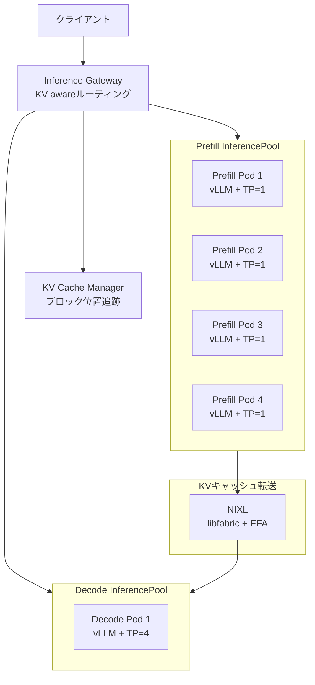

## ブログ概要（Summary）

本記事は [Introducing Disaggregated Inference on AWS powered by llm-d](https://aws.amazon.com/blogs/machine-learning/introducing-disaggregated-inference-on-aws-powered-by-llm-d/)（AWS Machine Learning Blog, 2026年3月16日）の解説記事です。

llm-dは、LLM推論のPrefillフェーズとDecodeフェーズを別々のGPUサーバーで実行する「Disaggregated Inference」をKubernetes上で実現するオープンソースフレームワークである。vLLMベースで、AWSとRed Hatが共同開発している。ブログでは、KV-awareルーティング、P/D分離、Wide Expert Parallelism、Tiered Prefix Cachingの4つの「well-lit paths」が紹介され、高同時実行時にトークン/秒が最大70%向上したと報告されている。

この記事は [Zenn記事: Fargate 32vCPUとllama.cppで実現するサーバーレスLLM推論基盤の構築](https://zenn.dev/0h_n0/articles/ca14512eb46121) の深掘りです。llm-dはFargateが不適な大規模モデル（70B以上）のGPU推論において、SageMaker HyperPodやEKS上で採用する最新アーキテクチャである。

## 情報源

- **種別**: 企業テックブログ（AWS Machine Learning Blog）
- **URL**: [https://aws.amazon.com/blogs/machine-learning/introducing-disaggregated-inference-on-aws-powered-by-llm-d/](https://aws.amazon.com/blogs/machine-learning/introducing-disaggregated-inference-on-aws-powered-by-llm-d/)
- **組織**: AWS（Vivek Gangasani, Andrew Smith, Goutham Annem）
- **発表日**: 2026年3月16日

## 技術的背景（Technical Background）

### LLM推論の2つのフェーズ

LLMの推論は、性質が大きく異なる2つのフェーズで構成される。

**Prefillフェーズ（計算律速）**: 入力プロンプト全体を並列に処理し、各トークンに対応するKV（Key-Value）キャッシュを生成する。入力トークン数に比例してGPU演算量が増加するため、計算バウンド（compute-bound）な処理である。

**Decodeフェーズ（メモリ帯域律速）**: KVキャッシュを参照しながら1トークンずつ出力を生成する。各ステップで全KVキャッシュへのアクセスが必要だが、演算量は少なく、GPU HBM（High Bandwidth Memory）のメモリ帯域がボトルネックとなる。

$$
\text{Prefill計算量} \propto n_{\text{input}} \times d_{\text{model}}^2
$$

$$
\text{Decode計算量} \propto 1 \times d_{\text{model}}^2 \quad (\text{per token})
$$

ここで、$n_{\text{input}}$は入力トークン数、$d_{\text{model}}$はモデル次元数である。

従来のLLM推論サーバーでは、PrefillとDecodeが同一GPUで実行されるため、Prefill処理がDecodeのレイテンシを悪化させる問題があった。この非対称性がDisaggregationの動機である。

### Fargateとの棲み分け

[Zenn記事](https://zenn.dev/0h_n0/articles/ca14512eb46121)の判断フローチャートの通り、GPU推論が必要なケースではSageMakerまたはEKSが選択肢となる。llm-dはGPU推論に特化しており、Fargateの32vCPU+llama.cppで対応可能な7B-13Bクラスの量子化モデルとは別の領域を担う。70B以上のモデルやMoEアーキテクチャで、高スループット・低レイテンシが要求される本番環境がllm-dの対象である。

## 実装アーキテクチャ（Architecture）

### llm-dフレームワーク全体像

ブログで紹介されているllm-dのアーキテクチャは、以下の主要コンポーネントで構成される。



### Inference Gateway（IGW）: KV-awareルーティング

Inference Gatewayは、Kubernetes Gateway API Inference Extensionの上に構築されたルーティング層である。IstioまたはkgatewayをGatewayプロバイダとして使用する。

従来のvLLMデプロイでは、複数レプリカ間でロードバランサが均等にリクエストを振り分けるため、あるレプリカのKVキャッシュが別のレプリカでは再利用できない。IGWはKV Cache Managerと連携して各ノードのKVキャッシュブロック位置を把握し、関連するKVエントリを保持するレプリカにリクエストをルーティングする。キューの深さも考慮してバランスをとる。マルチターンチャットやエージェント型ワークフローのようにプレフィックス再利用率が高いワークロードで効果が大きい。

### Prefill/Decode分離（P/D Disaggregation）

P/D分離の核心は、計算律速のPrefillとメモリ帯域律速のDecodeを独立したGPUプールで実行することにある。

ブログのベンチマーク構成では、以下のように分離されている。

| 役割 | Pod数 | Tensor Parallel度 | ハードウェア |
|------|------|------|------|
| Prefill | 4 | TP=1（各Pod） | p6-b200.48xlarge |
| Decode | 1 | TP=4 | p6-b200.48xlarge |

Prefill PodがKVキャッシュを生成した後、サイドカーコンテナの調整によりDecode Podにポイント・ツー・ポイントで転送する。出力が入力より長いワークロードではDecode側にGPUを多く割り当てるなど、リソース配分の最適化が可能である。

### NIXL通信スタック

KVキャッシュの転送にはNVIDIA Inference Xfer Library（NIXL）が使用される。NCCLが集合通信に最適化されているのに対し、NIXLはPrefillからDecodeへのポイント・ツー・ポイント転送に特化している。通信スタックは「vLLM NixlConnector → NIXL（メモリ抽象化） → libfabric/UCCL/GPUDirect Storage → AWS EFA / NVLink」の4層構成である。

NIXLのlibfabricプラグインは、OFIを通じてゼロコピー転送、GPUDirect、カーネルバイパスネットワーキングを実現する。AWS EFAはlibfabricをインターフェースとして使用し、RDMAによるGPU間メモリ転送がアプリケーション変更なしで可能である。

ブログのvLLM設定では、KV転送コネクタを以下のように構成する。

```json
{
  "kv_connector": "NixlConnector",
  "kv_role": "kv_both",
  "kv_connector_extra_config": { "backends": ["LIBFABRIC"] }
}
```

EFAインターフェースの割り当てはGPU数に基づく。p5.48xlargeでは8基のH100に対して32のEFAが利用可能で、GPU1基あたり4つを割り当てる。

### Wide Expert Parallelism

MoE（Mixture of Experts）アーキテクチャのモデル（DeepSeek-R1、Qwen3.5、Kimi K2.5など）向けの最適化パスである。データ並列とエキスパート並列を組み合わせ、エキスパートを複数ノードに水平分散する。

ブログではレイテンシ削減とスループット向上が報告されているが、具体的な数値は示されていない。並列度・通信・スケジューリングの慎重なチューニングが必要とも述べられている。

### Tiered Prefix Caching

vLLMのネイティブなPrefix CachingはGPUメモリに制約される。llm-dでは、KVキャッシュを以下の階層にオフロードする。

| 階層 | メディア | レイテンシ | 容量 |
|------|---------|----------|------|
| Tier 1 | GPU HBM | 最低 | 数十GB |
| Tier 2 | CPU メモリ | 中 | 数百GB |
| Tier 3 | ローカルディスク | 高 | 数TB |

長いシステムプロンプトを頻繁に再利用するワークロードでは、GPUメモリだけでは全プレフィックスを保持できないため、この階層化でキャッシュヒット率を向上させる。

## Production Deployment Guide

### AWS実装パターン（コスト最適化重視）

llm-dはGPU推論に特化しているため、Fargateによるサーバーレス構成は対象外となる。ここでは、GPU推論向けのEKS/SageMaker HyperPod構成をトラフィック量別に整理する。

**コスト試算の注意事項**: 以下の料金は2026年10月時点のAWS ap-northeast-1（東京）リージョンの概算値である。実際のコストはトラフィックパターン、リージョン、バースト使用量により変動する。最新料金は[AWS料金計算ツール](https://calculator.aws/)で確認を推奨する。

| 規模 | 構成 | インスタンス | 月額概算 | 用途 |
|------|------|------------|---------|------|
| Small (~1000 req/日) | EKS + 単一vLLM | g5.2xlarge x1 | $800-1,200 | 社内ツール、PoC |
| Medium (~10000 req/日) | EKS + llm-d IGW | g5.12xlarge x2 | $5,000-8,000 | プロダクションAPI |
| Large (100000+ req/日) | HyperPod + P/D分離 | p5.48xlarge x2+ | $40,000-80,000 | 大規模サービス |

**Small構成**: 単一vLLMインスタンスにIGWのKV-awareルーティングを適用。KarpenterによるSpot Instances活用で最大90%のコスト削減が可能。

**Medium構成**: 複数vLLMレプリカをInferencePoolとしてグループ化し、IGWでルーティング。Tiered Prefix Cachingを有効化し、Reserved Instances 1年コミットで最大72%の割引を適用。

**Large構成**: P/D分離を完全適用。SageMaker HyperPodの自動修復を活用し、EFAによる高速KVキャッシュ転送を実現。Savings Plansと併用。

### Terraformインフラコード

#### Small構成（EKS + 単一vLLM + IGW）

```hcl
# llm-d Small構成: EKS + vLLM + Inference Gateway
# 2026年10月時点のモジュールバージョン

module "eks" {
  source  = "terraform-aws-modules/eks/aws"
  version = "~> 20.28"

  cluster_name    = "llm-d-inference"
  cluster_version = "1.31"
  vpc_id          = module.vpc.vpc_id
  subnet_ids      = module.vpc.private_subnets

  cluster_endpoint_public_access = false  # コスト最適化

  eks_managed_node_groups = {
    gpu_inference = {
      instance_types = ["g5.2xlarge"]
      capacity_type  = "SPOT"  # Spotで最大90%削減
      min_size = 0; max_size = 3; desired_size = 1
      labels = { "node-role" = "inference" }
      taints = [{ key = "nvidia.com/gpu", value = "true", effect = "NO_SCHEDULE" }]
    }
    system = {
      instance_types = ["m7g.large"]  # Gravitonで約20%削減
      capacity_type  = "ON_DEMAND"
      min_size = 1; max_size = 3; desired_size = 2
    }
  }

  tags = { Project = "llm-d-inference", CostCenter = "ml-inference" }
}

resource "aws_budgets_budget" "llm_inference" {
  name         = "llm-d-monthly-budget"
  budget_type  = "COST"
  limit_amount = "2000"
  limit_unit   = "USD"
  time_unit    = "MONTHLY"

  notification {
    comparison_operator        = "GREATER_THAN"
    threshold                  = 80
    threshold_type             = "PERCENTAGE"
    notification_type          = "FORECASTED"
    subscriber_email_addresses = ["ml-ops@example.com"]
  }
}
```

#### Large構成（P/D分離 + EFA）のノードグループ抜粋

```hcl
# Prefill/Decode専用ノードをラベルとtaintで分離
resource "aws_eks_node_group" "prefill" {
  cluster_name    = module.eks.cluster_name
  node_group_name = "prefill-pool"
  node_role_arn   = aws_iam_role.node.arn
  subnet_ids      = module.vpc.private_subnets
  instance_types  = ["p5.48xlarge"]
  capacity_type   = "ON_DEMAND"  # P/D分離ではSpot非推奨（中断でKV転送が途切れる）

  scaling_config { min_size = 2; max_size = 8; desired_size = 4 }
  labels = { "llm-d/role" = "prefill" }
  taint  { key = "llm-d/role"; value = "prefill"; effect = "NO_SCHEDULE" }
}

resource "aws_eks_node_group" "decode" {
  cluster_name    = module.eks.cluster_name
  node_group_name = "decode-pool"
  node_role_arn   = aws_iam_role.node.arn
  subnet_ids      = module.vpc.private_subnets
  instance_types  = ["p5.48xlarge"]
  capacity_type   = "ON_DEMAND"

  scaling_config { min_size = 1; max_size = 4; desired_size = 1 }
  labels = { "llm-d/role" = "decode" }
  taint  { key = "llm-d/role"; value = "decode"; effect = "NO_SCHEDULE" }
}

# EFAセキュリティグループ（ノード間GPU直接通信用、self参照）
resource "aws_security_group" "efa" {
  name_prefix = "llm-d-efa-"
  vpc_id      = module.vpc.vpc_id
  ingress { from_port = 0; to_port = 0; protocol = "-1"; self = true }
  egress  { from_port = 0; to_port = 0; protocol = "-1"; self = true }
}
```

### 運用・監視設定

#### CloudWatch Logs Insights クエリ

```
# llm-d推論レイテンシ分析（P95, P99）
fields @timestamp, @message
| filter @message like /inference_latency/
| stats percentile(latency_ms, 95) as p95,
        percentile(latency_ms, 99) as p99,
        avg(latency_ms) as avg_latency
  by bin(1h) as time_bucket
| sort time_bucket desc
```

#### CloudWatch アラーム・Cost Explorer設定

```python
import datetime

import boto3


def create_inference_alarms(cluster_name: str, sns_topic_arn: str) -> None:
    """llm-d推論クラスタの監視アラームを作成する。

    Args:
        cluster_name: EKSクラスタ名
        sns_topic_arn: 通知先SNSトピックのARN
    """
    cw = boto3.client("cloudwatch", region_name="ap-northeast-1")

    # GPU使用率スパイク検知
    cw.put_metric_alarm(
        AlarmName=f"{cluster_name}-gpu-utilization-high",
        MetricName="GPUUtilization",
        Namespace="LLMDInference",
        Statistic="Average",
        Period=300,
        EvaluationPeriods=3,
        Threshold=95.0,
        ComparisonOperator="GreaterThanThreshold",
        Dimensions=[{"Name": "ClusterName", "Value": cluster_name}],
        AlarmActions=[sns_topic_arn],
    )

    # KV転送レイテンシ異常検知（P/D分離環境向け）
    cw.put_metric_alarm(
        AlarmName=f"{cluster_name}-kv-transfer-latency",
        MetricName="KVTransferLatencyMs",
        Namespace="LLMDInference",
        Statistic="p99",
        Period=60,
        EvaluationPeriods=5,
        Threshold=50.0,
        ComparisonOperator="GreaterThanThreshold",
        Dimensions=[{"Name": "ClusterName", "Value": cluster_name}],
        AlarmActions=[sns_topic_arn],
    )


def get_daily_inference_cost(days_back: int = 1) -> dict[str, float]:
    """直近のllm-d推論コストを取得し、閾値超過時にSNS通知する。

    Args:
        days_back: 遡る日数

    Returns:
        サービス別コストの辞書
    """
    ce = boto3.client("ce", region_name="us-east-1")
    end = datetime.date.today()
    start = end - datetime.timedelta(days=days_back)

    response = ce.get_cost_and_usage(
        TimePeriod={"Start": start.isoformat(), "End": end.isoformat()},
        Granularity="DAILY",
        Metrics=["UnblendedCost"],
        Filter={"Tags": {"Key": "Project", "Values": ["llm-d-inference"]}},
        GroupBy=[{"Type": "DIMENSION", "Key": "SERVICE"}],
    )

    costs: dict[str, float] = {}
    for result in response["ResultsByTime"]:
        for group in result["Groups"]:
            service = group["Keys"][0]
            amount = float(group["Metrics"]["UnblendedCost"]["Amount"])
            costs[service] = costs.get(service, 0.0) + amount

    total = sum(costs.values())
    if total > 500:  # $500/日超過でアラート
        sns = boto3.client("sns", region_name="ap-northeast-1")
        sns.publish(
            TopicArn="arn:aws:sns:ap-northeast-1:123456789012:llm-d-cost-alert",
            Subject=f"llm-d daily cost alert: ${total:.2f}",
            Message=f"Daily cost exceeded $500: ${total:.2f}\n{costs}",
        )
    return costs
```

### コスト最適化チェックリスト

**アーキテクチャ選択**:
- [ ] トラフィック量に応じた構成を選択（Small: 単一vLLM / Medium: IGW+複数レプリカ / Large: P/D分離）
- [ ] Prefill/Decode比率をワークロードに合わせて調整
- [ ] MoEモデル使用時はWide Expert Parallelismの適用を検討

**リソース最適化**:
- [ ] Small構成ではSpot Instances活用（最大90%削減）
- [ ] Medium以上ではReserved Instances 1年コミット（最大72%削減）
- [ ] Karpenterで未使用時のスケールダウン自動化
- [ ] システムノードにGraviton採用（約20%削減）
- [ ] Compute Savings Plans検討

**推論コスト削減**:
- [ ] Tiered Prefix CachingでGPUメモリ効率改善
- [ ] KV-awareルーティングでキャッシュヒット率最大化
- [ ] `--block-size 128`でKVブロックサイズ最適化
- [ ] `enable_cross_layers_blocks`で層間KV転送量削減
- [ ] バッチ推論のオフピーク集約

**監視・アラート**:
- [ ] AWS Budgetsで月次予算アラート設定
- [ ] Cost Anomaly Detectionで日次異常検知
- [ ] CloudWatchでGPU使用率・KV転送レイテンシ監視
- [ ] Cost Explorer日次レポート自動化

**リソース管理**:
- [ ] 未使用EKSノードグループの削除
- [ ] タグ戦略（Project, CostCenter）の全リソース適用
- [ ] 開発環境の夜間・週末スケールダウン
- [ ] CloudWatch Logs保持期間の適切な設定（90日推奨）

## パフォーマンス最適化（Performance）

### ベンチマーク結果

ブログでは、以下の条件でベンチマークが実施されたと報告されている。

| 項目 | 値 |
|------|-----|
| モデル | OpenAI GPT-OSS（vLLM上） |
| ベースライン | 単一vLLMデプロイ、TP=4、ml.p6-b200.48xlarge |
| P/D分離構成 | Prefill 4 Pod (TP=1) + Decode 1 Pod (TP=4)、NIXL over libfabric/EFA |
| ワークロード | 入力1024トークン、出力1024トークン、同時実行数 最大128 |
| **結果** | **高同時実行時にトークン/秒が最大70%向上** |

ブログでは、結果は構成により変動し、Prefill負荷が高いワークロード（長い入力、短い出力）で分離の効果が最も顕著になると述べられている。

### チューニングのポイント

- **Prefill/Decode Pod比率**: 入出力トークン比に応じて調整。ブログでは4:1（Prefill:Decode）を使用
- **EFAインターフェース割り当て**: GPU1基あたりのEFA数がKV転送スループットに直結
- **`--block-size 128`**: 大きいブロックサイズはキャッシュ効率を向上させるがメモリ断片化が増加
- **`--max-model-len 32000`**: 不必要に大きくするとGPUメモリを浪費する

## 運用での学び（Production Lessons）

ブログの記述から読み取れる本番運用上の留意点を整理する。

**ハードウェア障害への対応**: SageMaker HyperPodはプロアクティブな障害検知と自動修復機能を提供する。GPUやNVLinkの障害が推論品質に直結するため、この機能は本番運用で重要である。

**段階的な導入**: ブログではwell-lit pathsが「composable」（組み合わせ可能）と述べられている。まずIGWのKV-awareルーティングから始め、効果を確認してからP/D分離やTiered Prefix Cachingを追加するのが現実的である。

**ワークロード適性の判断**: Disaggregated Inferenceはすべてのワークロードに適しているわけではないとブログで明記されている。大規模モデル・長い入力・MoEアーキテクチャで効果が大きく、小規模モデルでは従来の単一デプロイが効率的な場合がある。

**Helmfileベースのデプロイ**: デプロイ手順は`helmfile apply`で各well-lit pathを個別にデプロイする構成である。IstioまたはkgatewayをGatewayプロバイダとして選択する。

## 学術研究との関連（Academic Connection）

Prefill/Decode分離の概念はLLM推論最適化の学術研究に起源を持つ。DistServe（OSDI 2024）はPrefillとDecodeのリソース非対称性を定量分析し、分離実行の有効性を示した。Splitwise（ISCA 2024）も同様のアプローチを提案している。llm-dは、これらの知見をKubernetes-nativeなプロダクションフレームワークとして実装したものである。学術論文が単一クラスタ内の最適化に焦点を当てていたのに対し、llm-dはクラスタ間KV-awareルーティングやクラウド環境でのGPU間通信最適化に取り組んでいる。

## まとめと実践への示唆

llm-dは、LLM推論のPrefill/Decode分離をKubernetes上で実現するフレームワークであり、高同時実行時に最大70%のスループット向上が報告されている。[Zenn記事](https://zenn.dev/0h_n0/articles/ca14512eb46121)で整理したFargate/SageMaker/Bedrockの使い分けにおいて、GPU推論が必要な大規模モデルの具体的な実装パターンを示すものである。まずIGWのKV-awareルーティングから始め、ワークロード特性に応じてP/D分離やWide Expert Parallelismを段階的に適用するのが実践的である。

## 参考文献

- **Blog URL**: [Introducing Disaggregated Inference on AWS powered by llm-d](https://aws.amazon.com/blogs/machine-learning/introducing-disaggregated-inference-on-aws-powered-by-llm-d/) (AWS Machine Learning Blog, 2026-03-16)
- **GitHub**: [llm-d/llm-d](https://github.com/llm-d/llm-d)
- **NIXL**: [NVIDIA Inference Xfer Library](https://github.com/ai-dynamo/nixl)
- **AWS Container Image**: `ghcr.io/llm-d/llm-d-aws` (v0.5.1)
- **Related Zenn article**: [Fargate 32vCPUとllama.cppで実現するサーバーレスLLM推論基盤の構築](https://zenn.dev/0h_n0/articles/ca14512eb46121)
- **DistServe**: Zhong et al., "DistServe: Disaggregating Prefill and Decoding for Goodput-optimized Large Language Model Serving", OSDI 2024
- **Splitwise**: Patel et al., "Splitwise: Efficient Generative LLM Inference Using Phase Splitting", ISCA 2024
