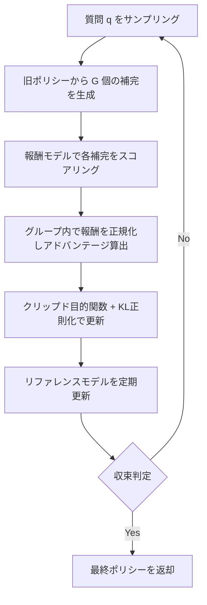

## 論文概要（Abstract）

本記事は [DeepSeekMath: Pushing the Limits of Mathematical Reasoning in Open Language Models](https://arxiv.org/abs/2402.03300) の解説記事です。

この記事は [Zenn記事: TRL GRPOのエントロピー崩壊を抑えてSQL生成モデルの正答率を高める](https://zenn.dev/0h_n0/articles/1354c10a7726d5) の深掘りです。

著者らはDeepSeekMath 7Bを提案している。DeepSeek-Coder-Base-v1.5 7Bを基盤とし、Common Crawlから独自のデータ選択パイプラインで抽出した120B（1,200億）トークンの数学関連データで継続事前学習を行ったモデルである。外部ツールや投票を用いない単一モデル推論で、MATHベンチマークにおいて51.7%の正答率を達成し、64サンプルのself-consistencyを適用すると60.9%に到達したと報告されている。この成果を支える手法の1つが、PPOの変種であるGRPO（Group Relative Policy Optimization）であり、criticモデルを不要にしつつ数学推論能力の向上を実現した。

## 情報源

- **arXiv ID**: 2402.03300
- **URL**: [https://arxiv.org/abs/2402.03300](https://arxiv.org/abs/2402.03300)
- **著者**: Zhihong Shao, Peiyi Wang, Qihao Zhu, Runxin Xu et al.（DeepSeek）
- **発表年**: 2024（v1: 2024年2月、v3: 2024年4月）
- **分野**: cs.CL, cs.AI, cs.LG

## 背景と動機（Background & Motivation）

大規模言語モデル（LLM）に対する強化学習（RL）の適用は、RLHFの成功以降広く研究されている。数学推論タスクは、解答の正誤を自動判定できる検証可能な報酬を設計しやすく、RLの適用に適した領域である。

しかし、従来のRL手法であるPPOには実用上の課題がある。PPOはactor-critic構造を採用しており、ポリシーモデル（actor）とほぼ同規模のバリューモデル（critic）を同時に学習させる必要がある。7BパラメータのLLMにPPOを適用する場合、ポリシーモデル・リファレンスモデル・報酬モデル・バリューモデルの計4モデルをGPUメモリに配置する必要があり、VRAMの消費量が大きい。加えて、criticの学習が不安定になるとポリシー更新の品質が低下するという問題も報告されている。

一方、DPOやRFTといったオフライン手法は計算コストが低いが、固定データセットからしか学習できず、ポリシーが改善するにつれてデータの品質との乖離が生じる。この課題に対し、GRPOはcriticモデルを排除しながらオンライン学習の利点を維持する手法として提案された。

## 主要な貢献（Key Contributions）

- **GRPOアルゴリズムの提案**: criticモデルを不要にしたPPO変種。グループサンプリングによる相対的なアドバンテージ推定で、PPOと同等以上の性能をより少ないリソースで実現
- **データ選択パイプラインの構築**: Common Crawlから4イテレーションのfastText分類器による反復的選択で、120Bトークンの高品質数学コーパスを抽出
- **RL手法の統一的比較フレームワーク**: RFT、DPO、PPO、GRPOを同一の数学的枠組みで比較し、各手法の勾配係数の差異を明示
- **DeepSeekMath 7Bの構築**: オープンソース7Bモデルとして、MATHベンチマークで51.7%を達成。一部のクローズドモデルに匹敵する性能

## 技術的詳細（Technical Details）

### GRPOアルゴリズムの概要

GRPOの核心は、PPOのcriticモデル（バリューネットワーク）を排除し、代わりにグループ内の報酬統計量をベースラインとして利用する点にある。以下にアルゴリズムの全体フローを示す。



### 目的関数の定式化

各質問$q$に対して、旧ポリシー$\pi_{\text{old}}$から$G$個の補完$\{o_1, o_2, \ldots, o_G\}$をサンプリングする。GRPOの目的関数は以下のように定義される。

$$
J_{\text{GRPO}}(\theta) = \mathbb{E}_{q \sim P(Q),\, \{o_i\} \sim \pi_{\text{old}}(\cdot|q)} \left[ \frac{1}{G} \sum_{i=1}^{G} \frac{1}{|o_i|} \sum_{t=1}^{|o_i|} \left\{ \min\left( r_{i,t} \hat{A}_{i,t},\; \text{clip}(r_{i,t}, 1-\varepsilon, 1+\varepsilon) \hat{A}_{i,t} \right) - \beta \, D_{\text{KL}}[\pi_\theta \| \pi_{\text{ref}}] \right\} \right]
$$

ここで、
- $r_{i,t} = \frac{\pi_\theta(o_{i,t} \mid q, o_{i,<t})}{\pi_{\text{old}}(o_{i,t} \mid q, o_{i,<t})}$: 重要度比（importance ratio）
- $\hat{A}_{i,t}$: グループ相対アドバンテージ
- $\varepsilon$: PPOから継承されたクリッピングパラメータ
- $\beta$: KLペナルティ係数
- $\pi_{\text{ref}}$: リファレンスポリシー（RL開始時のモデル）

### グループ相対アドバンテージの計算

GRPOでは、同一プロンプトから生成された$G$個の補完の報酬値をグループ内で正規化し、各補完のアドバンテージとする。

**成果監督（Outcome Supervision）** の場合、全トークンに同一のアドバンテージを割り当てる。

$$
\hat{A}_{i,t} = \tilde{r}_i = \frac{r_i - \text{mean}(\{r_1, \ldots, r_G\})}{\text{std}(\{r_1, \ldots, r_G\})}
$$

ここで、
- $r_i = r(q, o_i)$: 補完$o_i$に対する報酬値
- $\text{mean}(\cdot)$: グループ内報酬の平均
- $\text{std}(\cdot)$: グループ内報酬の標準偏差

**過程監督（Process Supervision）** の場合、ステップ単位で正規化した報酬の累積和を用いる。

$$
\hat{A}_{i,t} = \sum_{j: \text{index}(j) \geq t} \tilde{r}_i^{\text{index}(j)}
$$

この設計により、criticモデルを学習させることなく、グループ内の相対的な性能差をベースラインとして利用できる。報酬モデルがペアワイズ比較で学習されている場合、同一プロンプトからの出力同士を比較するGRPOのアドバンテージ推定と自然に適合する。

### KLダイバージェンスの推定

GRPOでは、KLダイバージェンスを報酬に加算するのではなく、損失関数に直接加算する。トークンレベルの不偏推定量として以下を用いる。

$$
D_{\text{KL}}[\pi_\theta \| \pi_{\text{ref}}] = \frac{\pi_{\text{ref}}(o_{i,t} \mid q, o_{i,<t})}{\pi_\theta(o_{i,t} \mid q, o_{i,<t})} - \log \frac{\pi_{\text{ref}}(o_{i,t} \mid q, o_{i,<t})}{\pi_\theta(o_{i,t} \mid q, o_{i,<t})} - 1
$$

この推定量は常に非負であることが保証されており、PPOにおけるKL報酬ペナルティ（報酬から$\beta \cdot \text{KL}$を引く方式）と異なる配置となっている。

### RFT・DPO・PPO・GRPOの統一的比較

論文では、各手法の勾配を統一的な形式で記述している。すべての手法は以下の共通構造を持つ。

$$
\nabla_\theta J = \mathbb{E}_{(q, o) \sim \mathcal{D}} \left[ \frac{1}{|o|} \sum_{t} \text{GC} \cdot \nabla_\theta \log \pi_\theta(o_t \mid q, o_{<t}) \right]
$$

ここで$\text{GC}$は勾配係数であり、手法ごとに異なる。

| 手法 | データソース | 報酬 | 勾配係数の特徴 |
|------|------------|------|--------------|
| SFT | 人手データ | なし | 定数1 |
| RFT | SFTモデルサンプル（オフライン） | ルールベース | 正解のみ強化、不正解は無視 |
| DPO | ペアデータ（オフライン） | ルールベース | ペア間の選好に基づく |
| Online RFT | ポリシーサンプル（オンライン） | ルールベース | RFTのオンライン版 |
| PPO | ポリシーサンプル（オンライン） | モデルベース | critic由来のGAEアドバンテージ |
| GRPO | ポリシーサンプル（オンライン） | モデルベース | グループ相対アドバンテージ |

著者らが強調するポイントは、GRPOの勾配係数が報酬モデルの値に比例してスケールする点である。正解を強く強化し、不正解を明示的にペナルティできる。一方、Online RFTは正解をすべて均等に強化し、不正解には勾配を与えない。

### 簡易実装例

以下に、GRPOのコアロジックを簡略化したPythonコードを示す。実際のTRL `GRPOTrainer`はvLLMとの統合やマルチGPU対応など多くの機能を含むが、ここではアルゴリズムの本質を理解するための最小実装を目的とする。

```python
import torch
from typing import Callable


def compute_grpo_advantages(
    rewards: torch.Tensor,
) -> torch.Tensor:
    """グループ相対アドバンテージを計算する。

    同一プロンプトから生成されたG個の補完の報酬を
    グループ内で正規化し、アドバンテージとして返す。

    Args:
        rewards: 各補完の報酬値, shape (G,)

    Returns:
        正規化されたアドバンテージ, shape (G,)
    """
    mean_r = rewards.mean()
    std_r = rewards.std()
    # std が 0 の場合（全補完が同一報酬）は全アドバンテージを 0 に
    if std_r < 1e-8:
        return torch.zeros_like(rewards)
    return (rewards - mean_r) / std_r


def grpo_loss(
    log_probs: torch.Tensor,
    old_log_probs: torch.Tensor,
    ref_log_probs: torch.Tensor,
    advantages: torch.Tensor,
    epsilon: float = 0.2,
    beta: float = 0.04,
) -> torch.Tensor:
    """GRPOのクリップド目的関数を計算する。

    Args:
        log_probs: 現在ポリシーの対数確率, shape (G, T)
        old_log_probs: 旧ポリシーの対数確率, shape (G, T)
        ref_log_probs: リファレンスポリシーの対数確率, shape (G, T)
        advantages: グループ相対アドバンテージ, shape (G,)
        epsilon: クリッピング範囲
        beta: KLペナルティ係数

    Returns:
        スカラー損失値（最小化対象）
    """
    # 重要度比の計算
    ratio = torch.exp(log_probs - old_log_probs)  # shape (G, T)

    # アドバンテージをトークン次元にブロードキャスト
    adv = advantages.unsqueeze(1)  # shape (G, 1)

    # クリップド目的関数
    surr1 = ratio * adv
    surr2 = torch.clamp(ratio, 1.0 - epsilon, 1.0 + epsilon) * adv
    policy_loss = torch.min(surr1, surr2)

    # KLダイバージェンス（不偏推定量）
    log_ratio_ref = ref_log_probs - log_probs  # log(pi_ref / pi_theta)
    kl = torch.exp(log_ratio_ref) - log_ratio_ref - 1.0

    # 損失 = -(ポリシー目的) + beta * KL
    loss = -(policy_loss - beta * kl).mean()
    return loss


def grpo_training_step(
    policy_model: torch.nn.Module,
    ref_model: torch.nn.Module,
    reward_fn: Callable[[str, str], float],
    prompts: list[str],
    generate_fn: Callable[..., tuple[list[str], torch.Tensor]],
    group_size: int = 64,
    epsilon: float = 0.2,
    beta: float = 0.04,
) -> torch.Tensor:
    """GRPO 1ステップの訓練を実行する。

    Args:
        policy_model: 学習対象のポリシーモデル
        ref_model: リファレンスモデル（固定）
        reward_fn: 報酬関数 (prompt, completion) -> float
        prompts: バッチ内のプロンプトリスト
        generate_fn: テキスト生成関数
        group_size: グループサイズ G
        epsilon: クリッピング範囲
        beta: KLペナルティ係数

    Returns:
        バッチの平均損失
    """
    total_loss = torch.tensor(0.0)

    for prompt in prompts:
        # 旧ポリシーから G 個の補完を生成
        completions, old_log_probs = generate_fn(
            policy_model, prompt, num_samples=group_size
        )

        # 報酬を計算
        rewards = torch.tensor(
            [reward_fn(prompt, c) for c in completions]
        )

        # グループ相対アドバンテージ
        advantages = compute_grpo_advantages(rewards)

        # 現在ポリシーとリファレンスの対数確率を取得
        # （実際にはforward passで計算）
        log_probs = old_log_probs  # 簡略化
        ref_log_probs = old_log_probs  # 簡略化

        # GRPO損失を計算
        loss = grpo_loss(
            log_probs=log_probs,
            old_log_probs=old_log_probs,
            ref_log_probs=ref_log_probs,
            advantages=advantages,
            epsilon=epsilon,
            beta=beta,
        )
        total_loss = total_loss + loss

    return total_loss / len(prompts)
```

## 実装のポイント

**vLLM統合**: TRL `GRPOTrainer`はvLLMとの統合をサポートしている。`GRPOConfig(use_vllm=True)`で有効化でき、colocateモード（トレーナーと同一プロセス）とserverモード（別プロセスで実行）の2つの動作モードがある。colocateモードはGPUメモリを訓練時と推論時で動的に共有するため、メモリ効率が良い。serverモードではtensor parallelやdata parallelを個別に設定できるため、大規模モデルの訓練に適する。

**主要ハイパーパラメータ**: 論文で報告されているGRPO段階の設定は、学習率$1 \times 10^{-6}$、KL係数$\beta = 0.04$、グループサイズ$G = 64$、最大系列長1024、訓練バッチサイズ1024である。グループサイズは大きいほどアドバンテージ推定が安定するが、生成に要するGPU時間が比例して増加する。

**メモリ最適化**: GRPOの最大の利点はcriticモデルが不要な点であり、PPOと比較して約30-50%のVRAM削減が見込める。7Bモデルの場合、ポリシー・リファレンス・報酬モデルの3モデル構成で訓練が可能である。さらに、LoRAやQLoRAを組み合わせることで、ポリシーモデルの学習パラメータを削減し、消費者向けGPU（A6000 48GBなど）でも訓練を実行できる可能性がある。

**報酬モデルの初期化**: 論文ではDeepSeekMath-Base 7Bから報酬モデルを初期化し、学習率$2 \times 10^{-5}$で訓練している。イテレーティブGRPOでは、報酬モデルも継続的に更新され、過去の履歴データの10%を再利用することで忘却を防いでいる。

## Production Deployment Guide

本セクションでは、GRPOで訓練したモデルをAWS上にデプロイし推論サービスとして運用する構成を示す。Zenn記事で紹介されているTRL `GRPOTrainer` + vLLMによるText-to-SQL訓練パイプラインの成果物（ファインチューニング済みモデル）を本番環境で提供するシナリオを想定する。

コスト試算は2026年10月時点のAWS ap-northeast-1（東京）リージョン料金に基づく概算値である。実際のコストはトラフィックパターン、リージョン、バースト使用量により変動するため、最新料金は[AWS料金計算ツール](https://calculator.aws/)で確認を推奨する。

### AWS実装パターン（コスト最適化重視）

| 構成 | トラフィック | サービス | 月額概算 |
|------|------------|---------|---------|
| Small | ~100 req/日 | Lambda + Bedrock Custom Model Import | $80-150 |
| Medium | ~1,000 req/日 | ECS Fargate + vLLM (GPU) | $400-900 |
| Large | 10,000+ req/日 | EKS + Karpenter + g5 Spot | $2,500-5,000 |

**Small構成（~100 req/日）**: GRPO訓練済み7Bモデルが十分小さい場合、Bedrock Custom Model Importを利用してサーバーレスに推論を実行する。API Gateway + Lambda経由でリクエストを受け付け、DynamoDBにクエリログを保存する。呼び出し頻度が低いためオンデマンド課金が最もコスト効率が良い。

- Lambda (512MB, 平均500ms/呼出, 100 req/日): 約$2/月
- Bedrock Custom Model Import (入出力トークン課金): 約$30-80/月
- DynamoDB On-Demand: 約$5/月
- API Gateway: 約$5/月
- 合計: 約$42-92/月

**Medium構成（~1,000 req/日）**: ECS Fargateもしくはg5インスタンス上でvLLMサーバーを稼働させる。continuous batchingにより複数リクエストを並列処理し、スループットを確保する。Auto Scalingでピーク時とアイドル時のリソースを調整する。

- ECS (g5.xlarge相当, GPU 1台常時): 約$350/月
- ALB + NAT Gateway: 約$65/月
- ElastiCache (レスポンスキャッシュ): 約$50/月
- CloudWatch + S3: 約$20/月
- 合計: 約$485-900/月

**Large構成（10,000+ req/日）**: EKS上でKarpenterによるg5 Spot Instance自動プロビジョニングを行う。vLLMのtensor parallelを活用して大きなモデルを複数GPUに分散配置する。Spotの中断に備えてdraining猶予を設定する。

- EKS コントロールプレーン: 約$75/月
- g5.xlarge Spot x 3-8台（動的）: 約$900-2,400/月（Spotで最大70%削減後）
- ALB + NAT Gateway: 約$100/月
- 監視（CloudWatch, Prometheus）: 約$80/月
- 合計: 約$1,155-2,655/月

**コスト削減テクニック**:
- Spot Instances活用: g5インスタンスのSpotは最大70%削減が期待できる
- Reserved Instances: 1年コミットで最大40%削減
- Bedrock Batch API: 非リアルタイム処理では50%削減
- Prompt Caching: SQL生成のシステムプロンプト部分のキャッシュで30-90%削減

### Terraformインフラコード

#### Small構成（Serverless: Lambda + Bedrock）

```hcl
# Small構成: Lambda + Bedrock Custom Model Import
# 対象: ~100 req/日、月額$42-92

terraform {
  required_version = ">= 1.9"
  required_providers {
    aws = {
      source  = "hashicorp/aws"
      version = "~> 5.70"
    }
  }
}

provider "aws" {
  region = "ap-northeast-1"
}

# --- VPC (NAT Gateway不使用でコスト削減) ---
module "vpc" {
  source  = "terraform-aws-modules/vpc/aws"
  version = "~> 5.13"

  name = "grpo-sql-vpc"
  cidr = "10.0.0.0/16"

  azs             = ["ap-northeast-1a", "ap-northeast-1c"]
  public_subnets  = ["10.0.1.0/24", "10.0.2.0/24"]
  private_subnets = ["10.0.11.0/24", "10.0.12.0/24"]

  enable_nat_gateway = false
}

# Bedrock VPCエンドポイント
resource "aws_vpc_endpoint" "bedrock" {
  vpc_id              = module.vpc.vpc_id
  service_name        = "com.amazonaws.ap-northeast-1.bedrock-runtime"
  vpc_endpoint_type   = "Interface"
  subnet_ids          = module.vpc.private_subnets
  private_dns_enabled = true
}

# --- IAMロール (最小権限) ---
resource "aws_iam_role" "lambda_exec" {
  name = "grpo-sql-lambda-exec"
  assume_role_policy = jsonencode({
    Version = "2012-10-17"
    Statement = [{
      Action    = "sts:AssumeRole"
      Effect    = "Allow"
      Principal = { Service = "lambda.amazonaws.com" }
    }]
  })
}

resource "aws_iam_role_policy" "lambda_bedrock" {
  name = "bedrock-invoke"
  role = aws_iam_role.lambda_exec.id
  policy = jsonencode({
    Version = "2012-10-17"
    Statement = [
      {
        Effect   = "Allow"
        Action   = ["bedrock:InvokeModel"]
        Resource = "arn:aws:bedrock:ap-northeast-1:*:custom-model/*"
      },
      {
        Effect   = "Allow"
        Action   = ["dynamodb:PutItem", "dynamodb:GetItem"]
        Resource = aws_dynamodb_table.query_log.arn
      }
    ]
  })
}

resource "aws_iam_role_policy_attachment" "lambda_basic" {
  role       = aws_iam_role.lambda_exec.name
  policy_arn = "arn:aws:iam::aws:policy/service-role/AWSLambdaBasicExecutionRole"
}

# --- DynamoDB (クエリログ、On-Demand) ---
resource "aws_dynamodb_table" "query_log" {
  name         = "grpo-sql-query-log"
  billing_mode = "PAY_PER_REQUEST"
  hash_key     = "request_id"
  range_key    = "timestamp"

  attribute {
    name = "request_id"
    type = "S"
  }
  attribute {
    name = "timestamp"
    type = "S"
  }

  server_side_encryption {
    enabled = true  # KMS暗号化
  }

  point_in_time_recovery {
    enabled = true
  }
}

# --- Lambda関数 ---
resource "aws_lambda_function" "sql_generator" {
  function_name = "grpo-sql-generator"
  role          = aws_iam_role.lambda_exec.arn
  handler       = "handler.lambda_handler"
  runtime       = "python3.12"
  timeout       = 60
  memory_size   = 512

  filename = "lambda_package.zip"

  environment {
    variables = {
      MODEL_ID     = "custom-model/grpo-sql-7b"
      TABLE_NAME   = aws_dynamodb_table.query_log.name
      MAX_TOKENS   = "1024"
    }
  }

  tracing_config {
    mode = "Active"  # X-Ray有効化
  }
}

# --- CloudWatchアラーム (コスト監視) ---
resource "aws_cloudwatch_metric_alarm" "lambda_errors" {
  alarm_name          = "grpo-sql-lambda-errors"
  comparison_operator = "GreaterThanThreshold"
  evaluation_periods  = 2
  metric_name         = "Errors"
  namespace           = "AWS/Lambda"
  period              = 300
  statistic           = "Sum"
  threshold           = 5
  alarm_description   = "Lambda error count exceeds 5 in 10 minutes"

  dimensions = {
    FunctionName = aws_lambda_function.sql_generator.function_name
  }
}
```

#### Large構成（EKS + Karpenter + Spot）

```hcl
# Large構成: EKS + Karpenter + g5 Spot Instances
# 対象: 10,000+ req/日、月額$1,155-2,655 (Spot適用後)

module "eks" {
  source  = "terraform-aws-modules/eks/aws"
  version = "~> 20.24"

  cluster_name    = "grpo-sql-prod"
  cluster_version = "1.31"
  vpc_id          = module.vpc.vpc_id
  subnet_ids      = module.vpc.private_subnets

  cluster_endpoint_public_access  = true
  cluster_endpoint_private_access = true

  enable_irsa = true
}

# Karpenter NodePool: Spot優先、GPU最適化インスタンス
resource "kubectl_manifest" "karpenter_nodepool" {
  yaml_body = yamlencode({
    apiVersion = "karpenter.sh/v1"
    kind       = "NodePool"
    metadata   = { name = "grpo-gpu-inference" }
    spec = {
      template = {
        spec = {
          requirements = [
            { key = "karpenter.sh/capacity-type", operator = "In", values = ["spot", "on-demand"] },
            { key = "node.kubernetes.io/instance-type", operator = "In",
              values = ["g5.xlarge", "g5.2xlarge", "g5.4xlarge"] },
          ]
          nodeClassRef = { name = "default" }
        }
      }
      limits = { "nvidia.com/gpu" = "16" }
      disruption = {
        consolidationPolicy = "WhenEmptyOrUnderutilized"
        consolidateAfter    = "60s"
      }
    }
  })
}

# Secrets Manager (モデル設定)
resource "aws_secretsmanager_secret" "model_config" {
  name        = "grpo-sql/model-config"
  description = "GRPO SQL model configuration"
}

resource "aws_secretsmanager_secret_version" "model_config" {
  secret_id = aws_secretsmanager_secret.model_config.id
  secret_string = jsonencode({
    model_path         = "s3://grpo-sql-models/grpo-sql-7b/"
    tensor_parallel    = 1
    max_model_len      = 2048
    gpu_memory_utilization = 0.9
  })
}

# AWS Budgets (予算アラート)
resource "aws_budgets_budget" "monthly" {
  name         = "grpo-sql-monthly"
  budget_type  = "COST"
  limit_amount = "3000"
  limit_unit   = "USD"
  time_unit    = "MONTHLY"

  notification {
    comparison_operator       = "GREATER_THAN"
    threshold                 = 80
    threshold_type            = "PERCENTAGE"
    notification_type         = "ACTUAL"
    subscriber_email_addresses = ["alerts@example.com"]
  }
}
```

### 運用・監視設定

**CloudWatch Logs Insights クエリ**:

```
# コスト異常検知: 1時間あたりのトークン使用量
fields @timestamp, @message
| filter @message like /token_usage/
| stats sum(input_tokens) as total_input, sum(output_tokens) as total_output by bin(1h)
| sort @timestamp desc

# レイテンシ分析（P95, P99）
fields @timestamp, duration_ms
| filter @message like /inference_complete/
| stats percentile(duration_ms, 95) as p95, percentile(duration_ms, 99) as p99 by bin(5m)
```

**CloudWatchアラーム設定（Python）**:

```python
import boto3
from typing import Any


def create_inference_alarms(
    function_name: str,
    sns_topic_arn: str,
) -> list[dict[str, Any]]:
    """推論サービスのCloudWatchアラームを作成する。

    Args:
        function_name: Lambda関数名またはECSサービス名
        sns_topic_arn: 通知先SNSトピックARN

    Returns:
        作成されたアラームの情報リスト
    """
    cw = boto3.client("cloudwatch", region_name="ap-northeast-1")
    alarms: list[dict[str, Any]] = []

    # トークン使用量スパイク検知
    cw.put_metric_alarm(
        AlarmName=f"{function_name}-token-spike",
        ComparisonOperator="GreaterThanThreshold",
        EvaluationPeriods=2,
        MetricName="TokenUsage",
        Namespace="GRPO/SQL",
        Period=3600,
        Statistic="Sum",
        Threshold=100000,
        AlarmActions=[sns_topic_arn],
        AlarmDescription="Hourly token usage exceeds 100K",
    )
    alarms.append({"name": f"{function_name}-token-spike", "type": "token"})

    # レイテンシ異常検知（P99 > 5秒）
    cw.put_metric_alarm(
        AlarmName=f"{function_name}-latency-p99",
        ComparisonOperator="GreaterThanThreshold",
        EvaluationPeriods=3,
        MetricName="InferenceLatency",
        Namespace="GRPO/SQL",
        Period=300,
        ExtendedStatistic="p99",
        Threshold=5000,
        AlarmActions=[sns_topic_arn],
        AlarmDescription="P99 latency exceeds 5 seconds",
    )
    alarms.append({"name": f"{function_name}-latency-p99", "type": "latency"})

    return alarms
```

**X-Rayトレーシング設定（Python）**:

```python
from aws_xray_sdk.core import xray_recorder, patch_all
from aws_xray_sdk.core.models.subsegment import Subsegment


def init_xray_tracing(service_name: str = "grpo-sql") -> None:
    """X-Rayトレーシングを初期化する。

    boto3およびrequestsライブラリを自動計装する。

    Args:
        service_name: X-Rayでのサービス名
    """
    xray_recorder.configure(service=service_name)
    patch_all()


def trace_inference(
    prompt: str,
    model_id: str,
    output_tokens: int,
    latency_ms: float,
) -> None:
    """推論リクエストをX-Rayにトレースする。

    Args:
        prompt: 入力プロンプト（先頭100文字のみ記録）
        model_id: 使用モデルID
        output_tokens: 出力トークン数
        latency_ms: 推論レイテンシ（ミリ秒）
    """
    subsegment: Subsegment = xray_recorder.begin_subsegment("sql_inference")
    subsegment.put_annotation("model_id", model_id)
    subsegment.put_annotation("output_tokens", output_tokens)
    subsegment.put_metadata("prompt_prefix", prompt[:100])
    subsegment.put_metadata("latency_ms", latency_ms)
    xray_recorder.end_subsegment()
```

**Cost Explorer自動レポート（Python）**:

```python
import boto3
import json
from datetime import datetime, timedelta
from typing import Any


def get_daily_cost_report(
    sns_topic_arn: str,
    cost_threshold: float = 100.0,
) -> dict[str, Any]:
    """日次コストレポートを取得し、閾値超過時にSNS通知する。

    Bedrock / Lambda / EKS のコスト内訳を取得し、
    日次コストが閾値を超えた場合にSNSで通知する。

    Args:
        sns_topic_arn: 通知先SNSトピックARN
        cost_threshold: アラート閾値（USD/日）

    Returns:
        コストレポート辞書
    """
    ce = boto3.client("ce", region_name="us-east-1")
    sns = boto3.client("sns", region_name="ap-northeast-1")

    end = datetime.utcnow().strftime("%Y-%m-%d")
    start = (datetime.utcnow() - timedelta(days=1)).strftime("%Y-%m-%d")

    response = ce.get_cost_and_usage(
        TimePeriod={"Start": start, "End": end},
        Granularity="DAILY",
        Metrics=["BlendedCost"],
        Filter={
            "Or": [
                {"Dimensions": {"Key": "SERVICE", "Values": ["Amazon Bedrock"]}},
                {"Dimensions": {"Key": "SERVICE", "Values": ["AWS Lambda"]}},
                {"Dimensions": {"Key": "SERVICE", "Values": ["Amazon Elastic Kubernetes Service"]}},
            ]
        },
        GroupBy=[{"Type": "DIMENSION", "Key": "SERVICE"}],
    )

    report: dict[str, Any] = {"date": start, "services": {}}
    total_cost = 0.0

    for group in response["ResultsByTime"][0]["Groups"]:
        service = group["Keys"][0]
        cost = float(group["Metrics"]["BlendedCost"]["Amount"])
        report["services"][service] = cost
        total_cost += cost

    report["total_cost"] = total_cost

    if total_cost > cost_threshold:
        sns.publish(
            TopicArn=sns_topic_arn,
            Subject=f"GRPO SQL Cost Alert: ${total_cost:.2f}/day",
            Message=json.dumps(report, indent=2, ensure_ascii=False),
        )

    return report
```

### コスト最適化チェックリスト

**アーキテクチャ選択**:
- [ ] トラフィック100 req/日以下ならServerless（Lambda + Bedrock）を選択
- [ ] 1,000 req/日前後ならECS Fargateまたは単一GPUインスタンスを選択
- [ ] 10,000+ req/日ならEKS + Karpenterでオートスケーリングを構成

**リソース最適化**:
- [ ] GPU: g5 Spot Instancesを優先使用（最大70%削減）
- [ ] Reserved Instances: 安定ワークロードには1年コミット（最大40%削減）
- [ ] Savings Plans: Compute Savings Plansで柔軟な割引
- [ ] Lambda: メモリサイズを512MB-1024MBに最適化（コスト/性能比）
- [ ] ECS/EKS: アイドル時のスケールダウンポリシーを設定

**LLMコスト削減**:
- [ ] Bedrock Batch API: 非リアルタイムSQL生成は50%削減
- [ ] Prompt Caching: システムプロンプト・スキーマ情報のキャッシュで30-90%削減
- [ ] モデル選択ロジック: 単純クエリは小モデル、複雑クエリは7Bモデルで処理分岐
- [ ] トークン数制限: 出力最大1024トークン、入力はスキーマ圧縮で削減
- [ ] 量子化: GPTQ/AWQ 4bit量子化で同一GPUでの処理能力を向上

**監視・アラート**:
- [ ] AWS Budgets: 月額上限を設定（例: $3,000）
- [ ] CloudWatch アラーム: トークン使用量スパイク、レイテンシP99を監視
- [ ] Cost Anomaly Detection: 自動異常検知を有効化
- [ ] 日次コストレポート: Cost Explorer APIで自動取得・SNS通知

**リソース管理**:
- [ ] 未使用エンドポイント・モデルの定期削除
- [ ] タグ戦略: `project:grpo-sql`, `env:prod/dev`で全リソースにタグ付け
- [ ] S3ライフサイクル: 古いモデルアーティファクトを90日後にGlacierへ移行
- [ ] 開発環境: 夜間・週末はGPUインスタンスを停止
- [ ] ログ保持: CloudWatch Logsの保持期間を30日に設定

## 実験結果（Results）

### 数学推論ベンチマーク

論文Table 5（Chain-of-Thought推論）より、DeepSeekMath 7BにGRPOを適用した結果は以下の通りである。

| モデル | GSM8K | MATH | MGSM-zh | CMATH |
|-------|-------|------|---------|-------|
| DeepSeekMath-Instruct 7B | 82.9% | 46.8% | 73.2% | 84.6% |
| DeepSeekMath-RL 7B (GRPO) | 88.2% | 51.7% | 79.6% | 88.8% |
| 改善幅 | +5.3pt | +4.9pt | +6.4pt | +4.2pt |

著者らは、GRPOがすべてのベンチマークで一貫した改善を達成したと報告している。特にMGSM-zh（中国語数学）での+6.4ptの改善は、英語数学データでの訓練が多言語の数学推論にも転移することを示唆する。

### Tool-Integrated Reasoning

論文Table 5（Tool-Integrated Reasoning）より、コード実行環境を利用した推論結果は以下の通りである。

| モデル | GSM8K | MATH | MGSM-zh | CMATH |
|-------|-------|------|---------|-------|
| DeepSeekMath-Instruct 7B | 83.7% | 57.4% | 72.0% | 84.3% |
| DeepSeekMath-RL 7B (GRPO) | 86.7% | 58.8% | 78.4% | 87.6% |

Tool-Integrated Reasoningでは、Chain-of-Thoughtと比較してMATHの絶対値が高いが、RL（GRPO）による改善幅は小さい。著者らはこれについて、ツール利用時には計算ミスが自動修正されるため、RLが主に推論戦略の改善に寄与するためと分析している。

### ベースモデルの性能

論文Table 2より、継続事前学習によるベースモデル自体の数学能力は以下の通りである。

| モデル | GSM8K | MATH | CMATH |
|-------|-------|------|-------|
| DeepSeekMath-Base 7B | 64.2% | 36.2% | 71.7% |

SFTを適用したInstruct版（MATH 46.8%）からGRPOで更に+4.9ptの改善が得られており、RLが教師あり学習の先にある能力を引き出していることがわかる。

## 実運用への応用（Practical Applications）

### Text-to-SQLへの適用

Zenn記事で紹介されているText-to-SQLタスクは、GRPOの適用先として適している。SQL文の実行結果を期待値と比較することで、二値報酬（正解: 1.0、不正解: 0.0）を容易に設計でき、報酬モデルの学習が不要になる。Zenn記事では、execution-match報酬に構文チェックやスキーマリンキング報酬を組み合わせた複合報酬関数を設計しており、これにより報酬のスパース性を緩和してエントロピー崩壊を抑制する工夫がなされている。

### コード生成への適用

GRPOはコード生成タスクにも応用可能である。ユニットテストの通過率やコンパイル成功率を報酬として利用し、同一プロンプトから複数のコード候補を生成してグループ内比較を行う。TRLの`GRPOTrainer`を使えば、カスタム報酬関数を差し替えるだけでSQL以外のコード生成タスクにも展開できる。

### スケーリング上の考慮

本番環境での運用では、GRPO訓練済みモデルの推論コストとレイテンシが重要である。7Bモデルであればvllmのcontinuous batchingにより、単一GPU（A10G 24GB相当）で数十req/sのスループットを達成可能である。ただし、GRPOの訓練自体はグループサイズ$G$に比例する生成コストが発生するため、訓練パイプラインのスケジュール管理（夜間バッチなど）が現実的である。

## 関連研究（Related Work）

- **PPO (Proximal Policy Optimization)** [Schulman et al., 2017]: actor-critic構造でクリップド目的関数を用いるRL手法。RLHF（InstructGPTなど）で広く採用されている。GRPOはPPOからcriticモデルを排除し、計算コストを削減した変種として位置づけられる
- **DPO (Direct Preference Optimization)** [Rafailov et al., 2023]: 報酬モデルの明示的な学習を回避し、選好データから直接ポリシーを最適化する手法。オフラインデータに依存するため、ポリシーの改善に伴いデータが陳腐化する課題がある。GRPOはオンラインサンプリングによりこの問題を回避する
- **RLHF (Reinforcement Learning from Human Feedback)** [Ouyang et al., 2022]: 人間のフィードバックから報酬モデルを学習し、PPOでポリシーを最適化するパイプライン。InstructGPTやChatGPTの基盤技術。GRPOはこのパイプラインのPPO部分を置き換える形で使用できる
- **DeepSeek-R1** [DeepSeek, 2025]: GRPOを大規模に適用し、推論特化モデルを構築した後続研究。GRPOがスケールすることを実証した

## まとめと今後の展望

DeepSeekMathは、GRPOアルゴリズムとデータ選択パイプラインの2つの貢献により、オープンソース7Bモデルの数学推論能力を大きく向上させた。GRPOはcriticモデルを不要にすることでPPOの計算コストを削減し、グループ内相対アドバンテージという直感的な手法でRL訓練を安定化させている。

後続のDeepSeek-R1ではGRPOが大規模モデルにも適用され、TRLの`GRPOTrainer`として広くオープンソース実装が利用可能になっている。Text-to-SQLやコード生成など、検証可能な報酬を設計できるタスクでは、GRPOは実用的なRL手法として有力な選択肢である。一方、Zenn記事で指摘されているエントロピー崩壊の問題など、訓練の安定性に関する課題は残っており、DAPOやadaptive entropy controlといった改良手法との組み合わせが今後の実用化の鍵となる。

## 参考文献

- **arXiv**: [https://arxiv.org/abs/2402.03300](https://arxiv.org/abs/2402.03300)
- **DeepSeek-R1**: [https://arxiv.org/abs/2501.12948](https://arxiv.org/abs/2501.12948)
- **TRL GRPOTrainer ドキュメント**: [https://huggingface.co/docs/trl/main/en/grpo_trainer](https://huggingface.co/docs/trl/main/en/grpo_trainer)
- **vLLM Integration**: [https://huggingface.co/docs/trl/main/en/vllm_integration](https://huggingface.co/docs/trl/main/en/vllm_integration)
- **Related Zenn article**: [https://zenn.dev/0h_n0/articles/1354c10a7726d5](https://zenn.dev/0h_n0/articles/1354c10a7726d5)
