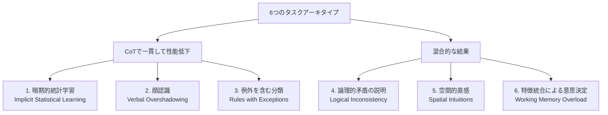

## 論文概要（Abstract）

Chain-of-Thought（CoT）プロンプティングは、LLMの推論能力を高める標準的な手法として広く利用されている。しかし、CoTが常にモデル性能を向上させるとは限らない。Liu et al.は認知心理学の知見を活用し、人間が「考えすぎる」ことでパフォーマンスが低下する6種類のタスクを選定してLLMでテストした。その結果、3つのタスクでCoTにより大幅な性能低下を確認し、o1-previewではGPT-4oのゼロショット性能と比較して最大36.3ポイントの精度低下が観測された。本論文は、CoTを適用すべきでないタスク類型を認知科学の枠組みから体系化した点で、プロンプト設計の実務に直接的な示唆を与える研究である。

本記事は [arXiv:2410.21333](https://arxiv.org/abs/2410.21333) の解説記事です。関連するZenn記事 [推論モデル時代のプロンプト設計転換：CoT不要化とeffort制御の実装パターン](https://zenn.dev/0h_n0/articles/467b9c2f35b4dc) も併せて参照されたい。

## 情報源

- **arXiv ID**: 2410.21333
- **URL**: [https://arxiv.org/abs/2410.21333](https://arxiv.org/abs/2410.21333)
- **著者**: Ryan Liu, Jiayi Geng, Addison J. Wu, Ilia Sucholutsky, Tania Lombrozo, Thomas L. Griffiths（Princeton University, New York University）
- **発表年**: 2024（v4: 2025年6月13日）
- **分野**: cs.LG, cs.AI, cs.CL, cs.CY
- **カンファレンス**: ICML 2025

## 背景と動機（Background & Motivation）

CoT（Chain-of-Thought）プロンプティングは、Wei et al.（2022）によって提案されて以降、LLMの推論性能を高める主要な手法として定着した。OpenAIのo1シリーズやClaudeのextended thinkingなど、推論時計算（inference-time compute）を増やすアプローチがフロンティアモデルの標準となりつつある。

しかし、Sprague et al.（2025）のメタ分析が示すように、CoTの効果は数学や記号推論タスクに偏っており、すべてのタスクで一様に有効とは言えない。それにもかかわらず、「CoTがいつ、なぜ性能を低下させるのか」を体系的に分析した研究はこれまで存在しなかった。

著者らは認知心理学の古典的知見に着目した。人間の認知においては、言語的な熟慮（verbal deliberation）がパフォーマンスを低下させるタスクが複数知られている。たとえば、顔認識における言語隠蔽効果（verbal overshadowing）や、暗黙的統計学習（implicit statistical learning）がその例である。著者らは「人間が考えすぎて性能が落ちるタスクでは、モデルもCoTで性能が落ちる可能性がある」というヒューリスティックを立て、これを体系的に検証した。

## 主要な貢献（Key Contributions）

- **CoT性能低下の体系的実証**: 認知心理学に基づく6種類のタスクアーキタイプを設計し、3つのタスクでCoTが大幅な性能低下を引き起こすことを複数のフロンティアモデルで確認した
- **認知科学ヒューリスティックの提案**: 人間の言語的熟慮が性能を低下させるタスク類型をLLM評価に転用する枠組みを提示した。ブートストラップ分析により、このヒューリスティックが無作為なタスク選定より統計的に有意にCoT低下ケースを検出できることを示した（$p < 0.00011$）
- **推論モデルへの波及**: o1-previewのような推論特化モデルでも、暗黙的統計学習タスクにおいてGPT-4oのゼロショットに対し36.3ポイントの精度低下が確認された
- **モデルと人間の差異の分析**: 6タスク中3タスクで混合的な結果が得られた原因を、モデルと人間の認知制約の差異（コンテキスト長 vs 作業記憶容量など）から説明した

## 技術的詳細（Technical Details）

### 実験に用いた6つのタスクアーキタイプ

著者らは認知心理学の文献から、言語的熟慮が人間のパフォーマンスを低下させる6つのタスク類型を選定し、LLM用にデータセットを構築した。



#### タスク1: 暗黙的統計学習（Artificial Grammar Learning）

有限状態文法（FSG）で生成された15個の訓練文字列を提示し、テスト文字列がその文法に適合するかを2値分類する。100個のFSGから各44個のテスト語（正例22、負例22）を生成し、計4,400問のデータセットを構築した。人間の認知研究では、文法規則を意識的に言語化しようとすると暗黙的に獲得したパターン認識が阻害されることが知られている。

#### タスク2: 顔認識（Verbal Overshadowing）

事前に提示された顔を5つの候補から識別する。Stable Image Ultraで生成した2,500の合成顔画像から500問を構築した。心理学では、目撃者が顔の特徴を言語的に記述しようとすると、その後の顔識別精度が低下する現象（verbal overshadowing）が報告されている。

#### タスク3: 例外を含む分類（Classification with Exceptions）

車両の2値分類で、1つの特徴（ナンバープレート）が正解を決定し、別の特徴が約80%の相関を持つ。フィードバック付きで最大15パス学習する。240リストの各10台、計2,400台のデータセットを使用した。CoTは一般化可能なルールに偏向しやすく、例外パターンの学習を阻害する。

#### タスク4-6: 混合的結果のタスク

タスク4（論理的矛盾）は3,216問の自然言語推論問題、タスク5（空間的直感）はカップの傾きと水位に関する100問の視覚推論、タスク6（特徴統合）は4つのアパートメントから最適な選択をする300問の意思決定タスクである。

### 実験設定

各タスクについて、ゼロショット（直接回答）とCoT（回答前に推論を記述）の2条件でモデル性能を比較した。

**評価対象モデル**:
- GPT-4o, o1-preview（OpenAI）
- Claude 3.5 Sonnet, Claude 3 Opus（Anthropic）
- Gemini 1.5 Pro（Google）
- Llama 3/3.1 8B/70B Instruct（Meta）
- InternVL2 26B/76B（視覚タスクのみ）

**プロンプティング条件**:
- ゼロショット: max tokens = 10（即座に回答）
- CoT: "reason about your answer before answering"、max tokens = 1,000
- 追加実験: Tree-of-Thought（ToT）、温度パラメータ変更、ステアリングプロンプト

o1-previewは内蔵の推論プロセスを無効化できないため、GPT-4oのゼロショット性能を比較対象とした。温度はClaude、GPT、Geminiで0.0、o1は当時のAPI制限により1.0を使用した。

### 精度評価

各タスクの精度（accuracy）を以下の式で算出している。

$$
\text{Accuracy} = \frac{\text{正しく分類された問題数}}{\text{総問題数}} \times 100
$$

タスク3（例外分類）では、全ラベルを正しく学習するまでのラウンド数を指標とした。

$$
\text{Rounds to Learn} = \min \{ r \mid \text{Accuracy}(r) = 100\% \}
$$

ここで $r$ はフィードバック付き学習のイテレーション番号（最大15）である。

統計的有意性の検証には、各タスクの特性に応じた適切な検定手法（ブートストラップ法など）が用いられ、$p$値が報告されている。

## 実験結果（Results）

### CoTが一貫して性能を低下させた3タスク

#### 暗黙的統計学習（論文 Table 1 より）

| モデル | ゼロショット | CoT | 低下幅 | $p$値 |
|:---|---:|---:|---:|:---|
| GPT-4o（サブセット） | 94.00% | -- | -- | -- |
| o1-preview（サブセット） | -- | 57.70% | 36.30 pt | $< 0.0001$ |
| GPT-4o | 87.50% | 64.40% | 23.10 pt | $< 0.0001$ |
| Claude 3 Opus | 70.70% | 62.70% | 8.00 pt | $< 0.0001$ |
| Claude 3.5 Sonnet | 65.90% | 67.70% | -1.80 pt | 0.969 |
| Gemini 1.5 Pro | 68.00% | 61.95% | 6.05 pt | $< 0.0001$ |
| Llama 3.1 70B | 65.90% | 57.10% | 8.80 pt | $< 0.0001$ |

GPT-4oはゼロショットで87.5%の精度を達成しているが、CoTを適用すると64.4%に低下した（23.1ポイント減）。o1-previewは推論プロセスを内蔵しているにもかかわらず57.7%にとどまり、GPT-4oのゼロショット（94.0%、同一サブセット）と比較して36.3ポイントの精度低下が確認された。Claude 3.5 Sonnetのみ有意な低下が見られなかった。

著者らはTree-of-Thought（ToT）も440問のサブセットで検証しているが、ゼロショット94.00%に対しToT 64.55%と、CoT（62.52%）と同程度の低下を示した（論文 Table 7 より）。

#### 顔認識（論文 Table 2 より）

| モデル | ゼロショット | CoT | 低下幅 | $p$値 |
|:---|---:|---:|---:|:---|
| GPT-4o | 64.00% | 51.20% | 12.80 pt | $< 0.01$ |
| Claude 3 Opus | 44.00% | 29.60% | 14.40 pt | $< 0.0001$ |
| Claude 3.5 Sonnet | 97.80% | 94.80% | 3.00 pt | $< 0.05$ |
| Gemini 1.5 Pro | 66.00% | 54.60% | 11.40 pt | $< 0.05$ |
| InternVL2 26B | 9.20% | 6.00% | 3.20 pt | $< 0.05$ |

テストした6つの視覚言語モデル全てでCoTによる精度低下が確認された。これは心理学で報告されている言語隠蔽効果（verbal overshadowing）と整合的である。顔の特徴を言語的に記述しようとする推論プロセスが、視覚的なパターンマッチングを阻害していると著者らは分析している。

#### 例外を含む分類（論文 Table 3 より）

| モデル | 直接回答 | CoT | ラウンド増加 | $p$値 |
|:---|---:|---:|---:|:---|
| GPT-4o | 2.9 | 12.5 | +9.6（331%増） | $< 0.0001$ |
| Claude 3.5 Sonnet | 2.3 | 6.4 | +4.1（178%増） | $< 0.0001$ |
| Claude 3 Opus | 2.4 | 5.5 | +3.1（129%増） | $< 0.05$ |

GPT-4oは直接回答では平均2.9ラウンドで全ラベルを学習したが、CoTでは12.5ラウンドを要した（331%増加）。著者らの分析によれば、CoTはモデルを一般化可能なルール（約80%の相関を持つ表面的特徴）に固執させ、例外パターン（ナンバープレートによる決定的特徴）の学習を妨げる。論文 Figure 2 では、CoT条件のGPT-4oが約80%の精度で停滞する様子が示されており、これは例外を除いた多数派の割合に一致する。

### 混合的な結果を示した3タスク

#### 論理的矛盾（論文 Table 4 より、MNLI subset）

| モデル | ゼロショット | CoT | 変化 |
|:---|---:|---:|---:|
| GPT-4o | 53.2% | 93.9% | +40.7 pt |
| Llama 3.1 70B | 55.6% | 81.6% | +26.0 pt |
| Claude 3 Opus | 62.7% | 58.8% | -3.9 pt |
| Gemini 1.5 Pro | 73.2% | 68.2% | -5.0 pt |

GPT-4oとLlama 3.1 70BではCoTにより40ポイント以上の大幅な改善が見られた一方、Claude 3 OpusとGemini 1.5 Proではやや低下した。著者らは、モデルの事前学習データに含まれる論理的推論の知識量の差異がこの結果を説明すると議論している。

#### 空間的直感と特徴統合

空間的直感タスクでは全モデルで統計的に有意な差は見られなかった（論文 Table 5 より）。特徴統合タスクではClaude 3.5 Sonnetが12ポイント改善する一方、Llama 3.1 70BはCoTで36ポイント低下した（論文 Table 6 より）。著者らは、モデルがコンテキストウィンドウ内で全情報を同時に保持できるため、人間の作業記憶制約に起因する性能低下がモデルでは再現されにくいと分析している。

### ヒューリスティック・ブートストラップ分析（Section 4.5）

著者らは、本研究のタスク選定が偶然ではなくヒューリスティックの有効性によるものかを検証するため、Sprague et al.（2025）のメタ分析から得た378件のゼロショット対CoT比較データを母集団としたブートストラップ分析を実施した。

100,000回のリサンプリングで50件をランダム抽出し、著者らの実験結果と比較した結果:

- **低下幅の大きさ**: ランダム抽出で著者らの実験と同等以上の平均低下幅を示したケースは0件（$p < 0.00001$）
- **低下の頻度**: 同等以上の低下頻度を示したケースは11件（$p < 0.00011$）

この結果は、認知心理学に基づくタスク選定ヒューリスティックが無作為なタスク選定よりも有意にCoT低下ケースを検出できることを示している。

## 実運用への応用（Practical Applications）

本論文の知見は、プロンプト設計の実務に直接的な示唆を与える。関連するZenn記事「推論モデル時代のプロンプト設計転換」で議論されているeffort制御への移行と密接に関連する。

**CoTを避けるべきタスク類型**:

1. **パターンマッチング主体のタスク**: 暗黙的統計学習のように、明示的なルールではなく統計的パターンで判断するタスク。異常検知やスタイル分類など
2. **視覚的特徴の識別**: 顔認識に代表される、言語化が困難な視覚的パターンの比較。画像の類似度判定など
3. **例外処理を含む分類**: 80/20のような多数派ルールに例外が存在するケース。ルールベースのフィルタリングなど

**推論effort制御との関係**:

OpenAIのo1やClaudeのextended thinkingは、推論にかける計算量を動的に調整する機能を提供している。本論文の知見は、こうしたeffort制御が不可欠であることの実証的根拠となる。タスクの性質に応じて推論量を増減させることで、不必要な推論による性能低下を回避できる。

```python
from openai import OpenAI

def select_reasoning_strategy(
    task_type: str,
    task_description: str,
) -> dict[str, str | int]:
    """タスク類型に基づいて推論戦略を選択する。

    Args:
        task_type: タスクの類型
            ("pattern_matching", "visual_comparison",
             "exception_classification", "logical_reasoning", "math")
        task_description: タスクの説明文

    Returns:
        推論戦略の設定辞書（model, reasoning_effort等）
    """
    # CoTが性能を低下させるタスク類型（Liu et al., 2024）
    cot_harmful_types = {
        "pattern_matching",
        "visual_comparison",
        "exception_classification",
    }

    if task_type in cot_harmful_types:
        return {
            "model": "gpt-4o",
            "reasoning_effort": "low",
            "prompt_strategy": "direct",
        }
    else:
        return {
            "model": "o1",
            "reasoning_effort": "high",
            "prompt_strategy": "cot",
        }
```

ただし、著者らも指摘しているように、このヒューリスティックは完全ではない。同一タスク類型でもモデルによって結果が異なる場合がある（例: 論理的矛盾タスクでのGPT-4o vs Claude 3 Opus）。実務では、対象タスクに対してゼロショットとCoTの両方をベンチマークした上で判断することが推奨される。

## 関連研究（Related Work）

- **Sprague et al.（2025）**: CoTの効果に関するメタ分析。数学と記号推論以外ではCoTの効果が限定的であることを報告しており、本論文はその知見をさらに深化させている
- **Wei et al.（2022）**: CoTプロンプティングの提案論文。LLMに中間推論ステップを生成させることで複雑な推論タスクの精度を大幅に向上させた
- **Yao et al.（2023）**: Tree-of-Thought（ToT）の提案。本論文ではToTもCoTと同程度の性能低下を示すことが確認された
- **Shaikh et al.（2023）**: CoTが有害な出力を増加させる可能性を報告。本論文とは異なる側面からCoTのリスクを指摘している
- **Kambhampati et al.（2024）**: LLMの計画能力の限界を分析。推論能力の過信に対する警鐘として本論文と問題意識を共有する

## まとめと今後の展望

Liu et al.は、認知心理学の知見を活用してCoTが性能を低下させるタスク類型を体系的に同定した。暗黙的統計学習、言語隠蔽効果、例外を含む分類という3つのアーキタイプでは、複数のフロンティアモデルで一貫したCoT性能低下が確認された。特にo1-previewのような推論特化モデルでも低下が顕著であった点は、推論時計算を増やすアプローチの限界を示唆している。

今後の研究としては、比較プロンプティングやアナロジープロンプティングなど他の推論手法への拡張、より精密なタスク分類体系の構築、そしてモデルが自律的にCoTの適用可否を判断するメタ認知的メカニズムの開発が期待される。実務的には、タスク類型に応じた推論effort制御の自動化が実装の方向性として有望である。

## 参考文献

- **arXiv**: [https://arxiv.org/abs/2410.21333](https://arxiv.org/abs/2410.21333)
- **Related Zenn article**: [推論モデル時代のプロンプト設計転換：CoT不要化とeffort制御の実装パターン](https://zenn.dev/0h_n0/articles/467b9c2f35b4dc)
- **Sprague et al. (2025)**: "To CoT or not to CoT? Chain-of-thought helps mainly on math and symbolic reasoning" (メタ分析)
- **Wei et al. (2022)**: "Chain-of-Thought Prompting Elicits Reasoning in Large Language Models" (CoT原論文)
- **Yao et al. (2023)**: "Tree of Thoughts: Deliberate Problem Solving with Large Language Models"
