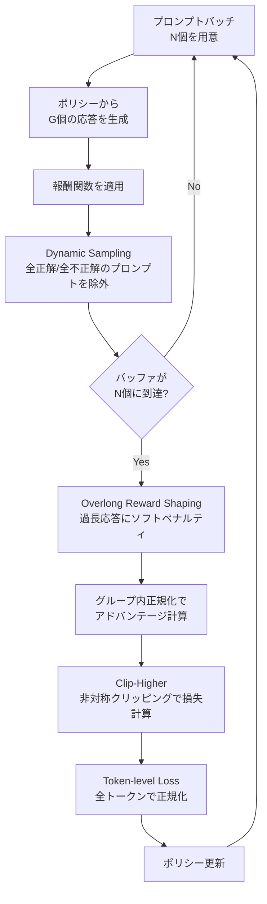

## 論文概要（Abstract）

本記事は [DAPO: An Open-Source LLM Reinforcement Learning System at Scale](https://arxiv.org/abs/2503.14476) の解説記事です。

この記事は [Zenn記事: TRL GRPOのエントロピー崩壊を抑えてSQL生成モデルの正答率を高める](https://zenn.dev/0h_n0/articles/1354c10a7726d5) の深掘りです。

DAPO（Decoupled Clip and Dynamic sAmpling Policy Optimization）は、GRPO（Group Relative Policy Optimization）の訓練不安定性、とりわけエントロピー崩壊を抑制するための4つの技法を提案した論文である。著者らは、Clip-Higher（非対称クリッピング）、Dynamic Sampling（動的サンプリング）、Token-level Policy Gradient Loss（トークンレベル損失）、Overlong Reward Shaping（過長応答ペナルティ）の4技法を組み合わせ、Qwen2.5-32Bベースモデルで AIME 2024 において avg@32 で 50 点を達成したと報告している。これは DeepSeek-R1-Zero-Qwen-32B の 47 点を上回り、かつ訓練ステップ数は 50% で済んだとされる。

## 情報源

- **arXiv ID**: 2503.14476（cs.LG; cs.CL）
- **URL**: [https://arxiv.org/abs/2503.14476](https://arxiv.org/abs/2503.14476)
- **著者**: Qiying Yu, Zheng Zhang, Ruofei Zhu 他 35 名（ByteDance Seed / Tsinghua AIR）
- **発表年**: 2025（v1: 2025年3月、v2: 2025年5月）
- **分野**: cs.LG, cs.CL
- **コード**: [https://github.com/volcengine/verl](https://github.com/volcengine/verl)（verl フレームワーク上に実装）
- **プロジェクトページ**: [https://dapo-sia.github.io/](https://dapo-sia.github.io/)

## 背景と動機（Background & Motivation）

OpenAI o1 や DeepSeek R1 に代表される推論特化型 LLM の成功により、RLHF / RLVR（Reinforcement Learning with Verifiable Rewards）による訓練パイプラインへの関心が高まっている。しかし、これらの先行研究は訓練の核心的な詳細を公開していない。特に GRPO を大規模に適用する際の訓練不安定性、すなわちエントロピー崩壊（entropy collapse）は深刻な問題であるにもかかわらず、その対処法は十分に共有されていなかった。

エントロピー崩壊とは、訓練中にポリシーの出力分布が特定のトークン列に急速に集中し、多様な応答を生成する能力が失われる現象である。標準的な GRPO では、クリッピング範囲の上限が低確率トークンの成長を過度に制約するため、ポリシーが一度特定のパターンに固着すると脱出が困難になる。また、グループ内の全応答が同一の報酬を受け取るプロンプト（全正解または全不正解）では勾配信号がゼロとなり、訓練リソースが浪費される。

DAPO はこれらの問題に対する4つの具体的な技法を提案し、訓練コードとデータセットをオープンソースで公開することで再現性を確保している。

## 主要な貢献（Key Contributions）

- **Clip-Higher**（非対称クリッピング）: 確率比のクリッピング上限を緩めることで、低確率トークンの勾配更新を許容し、エントロピー崩壊を防止する
- **Dynamic Sampling**（動的サンプリング）: 全応答が同一報酬のプロンプト（勾配信号ゼロ）をフィルタし、有効な学習信号のみでバッチを構成する
- **Token-level Policy Gradient Loss**（トークンレベル損失）: サンプル単位ではなく全トークンで正規化することで、応答長に依存しない均一な勾配配分を実現する
- **Overlong Reward Shaping**（過長応答ペナルティ）: 過度に長い応答にソフトペナルティを課し、応答長の爆発を抑制する

## 技術的詳細（Technical Details）

### DAPOパイプラインの全体像

DAPOの4つの技法がGRPO訓練ループのどの段階で作用するかを以下に示す。



### 技法1: Clip-Higher（非対称クリッピング）

標準的な GRPO では、確率比 $r_{i,t}(\theta) = \pi_\theta(o_t \mid q, o_{<t}) / \pi_{\text{old}}(o_t \mid q, o_{<t})$ に対して対称なクリッピングを適用する。

$$
\text{clip}(r_{i,t}(\theta),\ 1 - \varepsilon,\ 1 + \varepsilon)
$$

DAPO の Clip-Higher では、上側と下側のクリッピング閾値を分離する。

$$
\text{clip}(r_{i,t}(\theta),\ 1 - \varepsilon_{\text{low}},\ 1 + \varepsilon_{\text{high}})
$$

ここで、
- $r_{i,t}(\theta)$: ステップ $t$ におけるトークン $o_t$ の新旧ポリシーの確率比
- $\varepsilon_{\text{low}} = 0.2$: 下側クリッピング閾値（標準値を維持）
- $\varepsilon_{\text{high}} = 0.28$: 上側クリッピング閾値（標準の 0.2 より緩和）

**直感的説明**: 対称クリッピング（$\varepsilon = 0.2$）では、現在のポリシーで確率 0.01 のトークンは最大でも約 0.012 までしか上昇できない。Clip-Higher（$\varepsilon_{\text{high}} = 0.28$）ではこの上限が約 0.0128 に緩和され、低確率だが高報酬のトークン列（たとえば「レアだが正解のSQL」）をより強く強化できる。一方、下側クリッピングを $\varepsilon_{\text{low}} = 0.2$ のまま維持することで、高確率トークンがゼロに近づく速度は制限されない。これにより、エントロピーの崩壊を防ぎつつ、不要なパターンの抑制は通常通り機能する。

### 技法2: Dynamic Sampling（動的サンプリング）

GRPO では各プロンプトに対して $G$ 個の応答を生成し、グループ内で報酬を正規化してアドバンテージを計算する。しかし、全応答が正解（報酬全て 1）または全応答が不正解（報酬全て 0）のプロンプトでは、グループ内の標準偏差 $\sigma_r = 0$ となりアドバンテージが未定義（実装上はゼロ）になる。これらのプロンプトは計算リソースを消費するだけで学習信号を提供しない。

Dynamic Sampling では、以下のフィルタリング条件を適用する。

$$
0 < |\{o_i : \text{is\_equivalent}(a, o_i)\}| < G
$$

ここで、
- $o_i$: $i$ 番目の生成応答
- $a$: 正解
- $G$: グループサイズ（プロンプトあたりの生成数）

具体的なアルゴリズムは以下の通りである。

1. 通常より多くのプロンプトをサンプリングする（オーバーサンプリング）
2. 各プロンプトの $G$ 個の応答に報酬を付与し、報酬の標準偏差を計算する
3. $\sigma_r > 0$ のプロンプト群のみをバッファに追加する
4. バッファが目標サイズ $N$ に達するまでサンプリングを繰り返す
5. 目標に達したらそのバッチで訓練を実行する

```python
from dataclasses import dataclass
from typing import Protocol


class RewardFunction(Protocol):
    """報酬関数のプロトコル。"""

    def __call__(self, prompt: str, responses: list[str]) -> list[float]: ...


@dataclass
class FilteredBatch:
    """Dynamic Samplingでフィルタされたバッチ。"""

    prompts: list[str]
    responses: list[list[str]]
    rewards: list[list[float]]


def dynamic_sampling(
    prompt_pool: list[str],
    policy_generate: callable,
    reward_fn: RewardFunction,
    group_size: int,
    target_batch_size: int,
    max_rounds: int = 10,
) -> FilteredBatch:
    """Dynamic Samplingによるバッチ構成。

    報酬の分散がゼロのプロンプト（全正解/全不正解）を除外し、
    有効な学習信号を持つプロンプトのみでバッチを構成する。

    Args:
        prompt_pool: サンプリング元のプロンプトプール
        policy_generate: ポリシーからG個の応答を生成する関数
        reward_fn: 報酬関数
        group_size: プロンプトあたりの生成数（G）
        target_batch_size: 目標バッチサイズ（プロンプト数）
        max_rounds: 最大サンプリングラウンド数

    Returns:
        フィルタ済みバッチ

    Raises:
        RuntimeError: max_rounds以内に目標サイズに達しない場合
    """
    import random

    buffer_prompts: list[str] = []
    buffer_responses: list[list[str]] = []
    buffer_rewards: list[list[float]] = []

    for round_idx in range(max_rounds):
        # オーバーサンプリング: バッチサイズの2倍を候補として抽出
        candidates = random.sample(
            prompt_pool,
            min(target_batch_size * 2, len(prompt_pool)),
        )

        for prompt in candidates:
            responses = policy_generate(prompt, num_samples=group_size)
            rewards = reward_fn(prompt, responses)

            # フィルタ条件: 報酬の標準偏差 > 0
            reward_std = (
                sum((r - sum(rewards) / len(rewards)) ** 2 for r in rewards)
                / len(rewards)
            ) ** 0.5

            if reward_std > 0:
                buffer_prompts.append(prompt)
                buffer_responses.append(responses)
                buffer_rewards.append(rewards)

            if len(buffer_prompts) >= target_batch_size:
                return FilteredBatch(
                    prompts=buffer_prompts[:target_batch_size],
                    responses=buffer_responses[:target_batch_size],
                    rewards=buffer_rewards[:target_batch_size],
                )

    raise RuntimeError(
        f"Dynamic Sampling: {max_rounds}ラウンドで目標サイズ"
        f" {target_batch_size} に到達しなかった"
        f"（収集済み: {len(buffer_prompts)}）"
    )
```

NeMo RL のDAPO実装では、`batch_multiplier` パラメータでオーバーサンプリングの倍率を制御し、`dynamic_sampling_max_gen_batches` で最大サンプリングラウンド数を制限している。

### 技法3: Token-level Policy Gradient Loss

標準的な GRPO の損失関数では、まずサンプル内でトークンごとの損失を平均し、次にサンプル間で平均する（サンプルレベル正規化）。

$$
\mathcal{L}_{\text{GRPO}} = \frac{1}{G} \sum_{i=1}^{G} \frac{1}{|o_i|} \sum_{t=1}^{|o_i|} \ell_{i,t}
$$

DAPO の Token-level Loss では、全サンプルの全トークンをフラットに扱い、総トークン数で正規化する。

$$
\mathcal{L}_{\text{DAPO}} = \frac{1}{\sum_{i=1}^{G} |o_i|} \sum_{i=1}^{G} \sum_{t=1}^{|o_i|} \ell_{i,t}
$$

ここで、
- $G$: グループサイズ
- $|o_i|$: $i$ 番目の応答のトークン数
- $\ell_{i,t}$: $i$ 番目の応答の $t$ 番目トークンの損失項（クリッピングされたアドバンテージ付き方策勾配）

**効果の違い**: サンプルレベル正規化では、短い応答と長い応答が同じ重みを持つ。例えば、10 トークンの短い応答と 100 トークンの長い応答がある場合、短い応答の各トークンの勾配は長い応答の 10 倍になる。Token-level Loss では全トークンが均等に扱われるため、長い応答（推論チェーンが長い数学的推論など）の勾配が相対的に大きくなり、より豊富な推論過程に対して適切な学習信号を配分できる。

### 技法4: Overlong Reward Shaping（過長応答ペナルティ）

GRPO 訓練では、応答が際限なく長くなる問題が発生する場合がある。DAPO はこれに対してソフトペナルティを導入する。

$$
R_{\text{length}}(y) =
\begin{cases}
0 & \text{if } |y| \leq L_{\max} - L_{\text{cache}} \\
\dfrac{(L_{\max} - L_{\text{cache}}) - |y|}{L_{\text{cache}}} & \text{if } L_{\max} - L_{\text{cache}} < |y| \leq L_{\max} \\
-1 & \text{if } |y| > L_{\max}
\end{cases}
$$

ここで、
- $|y|$: 応答のトークン数
- $L_{\max} = 16{,}384$: 想定最大長
- $L_{\text{cache}} = 4{,}096$: ソフトペナルティバッファ
- 生成時のハードキャップ: $20{,}480$ トークン

$|y|$ が $L_{\max} - L_{\text{cache}} = 12{,}288$ トークン以下であればペナルティなし、$12{,}288$ から $16{,}384$ の間ではペナルティが 0 から $-1$ に線形に増加し、$16{,}384$ を超えると $-1$ の固定ペナルティとなる。これにより、ハード打ち切りではなくソフトな制約として機能し、モデルが自発的に簡潔な応答を学習する。

さらに、DAPOでは生成時に $L_{\max}$ を超えて打ち切られた応答については損失計算自体をマスクする **Overlong Filtering** も併用する。打ち切られた不完全な応答から学習すると、途中で切れたトークン列を「正しい終了」として強化してしまうリスクがあるためである。

## 実装のポイント（Implementation）

### TRL GRPOConfig での DAPO 設定

TRL（v1.8.0以降）では `loss_type="dapo"` がデフォルトとなっており、DAPOの損失関数が標準で有効である。Clip-Higher を明示的に有効にするには `epsilon_high` パラメータを設定する。

```python
from trl import GRPOConfig

config = GRPOConfig(
    output_dir="./grpo-dapo-output",
    # --- DAPO損失 ---
    loss_type="dapo",       # デフォルト値
    epsilon=0.2,            # epsilon_low（下側クリッピング）
    epsilon_high=0.28,      # epsilon_high（上側クリッピング、Clip-Higher）
    beta=0.0,               # KLペナルティ無効（DAPO論文の推奨）
    # --- 生成 ---
    num_generations=16,     # 論文では G=16
    max_completion_length=16384,
    temperature=1.0,
    # --- 訓練 ---
    learning_rate=1e-6,     # 論文値
    bf16=True,
)
```

ただし、TRL の `GRPOTrainer` は Dynamic Sampling を直接サポートしていない（2026年10月時点）。Dynamic Sampling を完全に再現するには、verl フレームワーク上での実装が必要である。TRL で近似的に対処するには、報酬の標準偏差がゼロのプロンプトでアドバンテージをゼロに設定する既存の挙動（デフォルト動作）を活用し、`num_generations` を大きめに設定してフィルタの効果を補うアプローチがある。

### verl フレームワークでの完全再現

論文のDAPOは [verl](https://github.com/volcengine/verl)（HybridFlow）フレームワーク上に実装されている。再現コードは `verl-recipe` リポジトリの `recipe/dapo` ディレクトリに格納されている。

論文の訓練ハイパーパラメータは以下の通りである。

| パラメータ | 値 |
|---|---|
| ベースモデル | Qwen2.5-32B |
| オプティマイザ | AdamW |
| 学習率 | $1 \times 10^{-6}$（定数、20ステップ線形ウォームアップ） |
| プロンプトバッチサイズ | 512 |
| 応答生成数 ($G$) | 16 |
| ミニバッチサイズ | 512 |
| 勾配更新回数/ロールアウト | 16 |
| 評価設定 | temperature 1.0, top-p 0.7, avg@32 |

### NeMo RL での設定例

NVIDIA NeMo RL でも DAPO がサポートされている。以下は設定ファイルの構成例である。

```yaml
# dapo-qwen2.5-7b.v2.yaml（NeMo RL形式）
grpo:
  use_dynamic_sampling: true
  num_prompts_per_step: 512
  num_generations_per_prompt: 16
  batch_multiplier: 3
  dynamic_sampling_max_gen_batches: 10
  reward_shaping:
    enabled: true
    overlong_buffer_length: 4096
    overlong_buffer_penalty: 1.0
    max_response_length: 20480
  reward_scaling:
    enabled: true
    source_min: 0.0
    source_max: 1.0
    target_min: -1.0
    target_max: 1.0
loss_fn:
  ratio_clip_max: 0.28        # Clip-Higher
  token_level_loss: true       # Token-level Loss
```

`batch_multiplier` はオーバーサンプリングの倍率であり、Dynamic Sampling でフィルタされるプロンプトを見越して余分にサンプリングするための設定である。値が小さすぎるとバッファの充填に多くのラウンドを要し、大きすぎるとメモリと計算コストが増加する。NeMo RL のドキュメントでは、`dynamic_sampling_num_gen_batches` メトリクスが常に高い場合は `batch_multiplier` の引き上げが推奨されている。

## Production Deployment Guide

DAPO に基づく GRPO 訓練パイプラインを AWS 上で構築する場合の構成パターンを示す。GRPO 訓練は推論（ロールアウト）と学習を交互に行うため、GPU リソースの効率的な利用が重要となる。

### AWS 実装パターン（コスト最適化重視）

**注意**: 以下のコスト試算は 2026 年 10 月時点の AWS ap-northeast-1（東京）リージョン料金に基づく概算値である。実際のコストはトラフィックパターン、リージョン、バースト使用量により変動する。最新料金は [AWS 料金計算ツール](https://calculator.aws/) で確認を推奨する。

**トラフィック量別の推奨構成**:

| 構成 | 用途 | GPU | 月額コスト概算 |
|---|---|---|---|
| Small | 実験・プロトタイプ（7Bモデル） | p4d.24xlarge x 1（A100 80GB x 8） | $8,000-12,000 |
| Medium | 本番訓練（7B-14Bモデル） | p4d.24xlarge x 2-4 | $16,000-48,000 |
| Large | 大規模訓練（32Bモデル、論文再現） | p5.48xlarge x 4-8（H100 x 32-64） | $80,000-200,000 |

GRPO 訓練は推論フェーズで大量の GPU メモリを消費するため、Bedrock などの API サービスではなくインスタンスベースの構成が必須となる。

**コスト削減テクニック**:
- **Spot Instances 活用**: p4d/p5 の Spot 価格は On-Demand 比で最大 60-70% 削減（ただし GRPO の長時間訓練ではチェックポイントからの再開機構が必要）
- **Reserved Instances**: 1 年コミットで最大 40% 削減（3 年で最大 60%）
- **SageMaker Training Jobs**: マネージドインフラでチェックポイント・再開を自動化し、Spot 中断時の再訓練コストを最小化
- **Mixed Precision（bf16）**: メモリ使用量を半減させ、より小さいインスタンスで訓練可能に

### Terraform インフラコード

**Small 構成（実験用: p4d.24xlarge x 1）**:

```hcl
# GRPO訓練用VPC・セキュリティ基盤
resource "aws_vpc" "grpo_training" {
  cidr_block           = "10.0.0.0/16"
  enable_dns_hostnames = true
  enable_dns_support   = true

  tags = {
    Name        = "grpo-training-vpc"
    Environment = "experiment"
    Project     = "dapo-grpo"
  }
}

resource "aws_subnet" "private" {
  vpc_id            = aws_vpc.grpo_training.id
  cidr_block        = "10.0.1.0/24"
  availability_zone = "ap-northeast-1a"

  tags = {
    Name = "grpo-training-private"
  }
}

# S3バケット（チェックポイント・データセット保存）
resource "aws_s3_bucket" "training_artifacts" {
  bucket = "dapo-grpo-training-artifacts"

  tags = {
    Project = "dapo-grpo"
  }
}

resource "aws_s3_bucket_server_side_encryption_configuration" "training_artifacts" {
  bucket = aws_s3_bucket.training_artifacts.id

  rule {
    apply_server_side_encryption_by_default {
      sse_algorithm = "aws:kms"
    }
  }
}

# IAMロール（最小権限）
resource "aws_iam_role" "sagemaker_training" {
  name = "dapo-grpo-sagemaker-role"

  assume_role_policy = jsonencode({
    Version = "2012-10-17"
    Statement = [{
      Action = "sts:AssumeRole"
      Effect = "Allow"
      Principal = {
        Service = "sagemaker.amazonaws.com"
      }
    }]
  })
}

resource "aws_iam_role_policy" "sagemaker_s3_access" {
  name = "s3-training-access"
  role = aws_iam_role.sagemaker_training.id

  policy = jsonencode({
    Version = "2012-10-17"
    Statement = [
      {
        Effect = "Allow"
        Action = [
          "s3:GetObject",
          "s3:PutObject",
          "s3:ListBucket"
        ]
        Resource = [
          aws_s3_bucket.training_artifacts.arn,
          "${aws_s3_bucket.training_artifacts.arn}/*"
        ]
      },
      {
        Effect = "Allow"
        Action = [
          "logs:CreateLogGroup",
          "logs:CreateLogStream",
          "logs:PutLogEvents"
        ]
        Resource = "arn:aws:logs:ap-northeast-1:*:*"
      }
    ]
  })
}

# SageMaker Training Job（Spot対応）
resource "aws_sagemaker_training_job" "grpo_dapo" {
  training_job_name = "dapo-grpo-7b-experiment"
  role_arn          = aws_iam_role.sagemaker_training.arn

  algorithm_specification {
    training_image = "763104351884.dkr.ecr.ap-northeast-1.amazonaws.com/pytorch-training:2.3.0-gpu-py311-cu121-ubuntu22.04-sagemaker"
    training_input_mode = "File"
  }

  resource_config {
    instance_count  = 1
    instance_type   = "ml.p4d.24xlarge"
    volume_size_in_gb = 500
  }

  # Spot Instance設定（最大60%コスト削減）
  enable_managed_spot_training = true
  stopping_condition {
    max_runtime_in_seconds      = 259200  # 72時間
    max_wait_time_in_seconds    = 345600  # Spot待機含む96時間
  }

  checkpoint_config {
    s3_uri = "s3://${aws_s3_bucket.training_artifacts.bucket}/checkpoints/"
  }

  output_data_config {
    s3_output_path = "s3://${aws_s3_bucket.training_artifacts.bucket}/output/"
    kms_key_id     = aws_kms_key.training.arn
  }

  input_data_config {
    channel_name = "training"
    data_source {
      s3_data_source {
        s3_data_type = "S3Prefix"
        s3_uri       = "s3://${aws_s3_bucket.training_artifacts.bucket}/dataset/"
      }
    }
  }
}

# KMS暗号化キー
resource "aws_kms_key" "training" {
  description             = "DAPO GRPO training data encryption"
  deletion_window_in_days = 7
  enable_key_rotation     = true
}

# CloudWatchアラーム（コスト監視）
resource "aws_cloudwatch_metric_alarm" "training_cost" {
  alarm_name          = "dapo-grpo-daily-cost-alert"
  comparison_operator = "GreaterThanThreshold"
  evaluation_periods  = 1
  metric_name         = "EstimatedCharges"
  namespace           = "AWS/Billing"
  period              = 86400
  statistic           = "Maximum"
  threshold           = 500
  alarm_description   = "Daily training cost exceeds $500"
  alarm_actions       = [aws_sns_topic.alerts.arn]

  dimensions = {
    Currency = "USD"
  }
}

resource "aws_sns_topic" "alerts" {
  name = "dapo-grpo-cost-alerts"
}
```

**Large 構成（32B 論文再現: EKS + Spot）**:

```hcl
# EKSクラスタ（マルチノードGRPO訓練）
module "eks" {
  source  = "terraform-aws-modules/eks/aws"
  version = "~> 20.0"

  cluster_name    = "dapo-grpo-training"
  cluster_version = "1.31"

  vpc_id     = aws_vpc.grpo_training.id
  subnet_ids = [aws_subnet.private.id]

  cluster_endpoint_public_access = false

  # KarpenterによるGPUノード自動スケーリング
  eks_managed_node_groups = {
    system = {
      instance_types = ["m6i.xlarge"]
      min_size       = 2
      max_size       = 3
      desired_size   = 2
    }
  }
}

# Karpenter NodePool（Spot GPU優先）
resource "kubectl_manifest" "gpu_nodepool" {
  yaml_body = yamlencode({
    apiVersion = "karpenter.sh/v1"
    kind       = "NodePool"
    metadata = {
      name = "gpu-training"
    }
    spec = {
      template = {
        spec = {
          requirements = [
            {
              key      = "node.kubernetes.io/instance-type"
              operator = "In"
              values   = ["p4d.24xlarge", "p5.48xlarge"]
            },
            {
              key      = "karpenter.sh/capacity-type"
              operator = "In"
              values   = ["spot", "on-demand"]  # Spot優先
            }
          ]
          nodeClassRef = {
            group = "karpenter.k8s.aws"
            kind  = "EC2NodeClass"
            name  = "gpu-training"
          }
        }
      }
      limits = {
        cpu    = "384"
        memory = "3072Gi"
      }
      disruption = {
        consolidationPolicy = "WhenEmpty"
        consolidateAfter    = "30s"
      }
    }
  })
}

# AWS Budgets（月次予算アラート）
resource "aws_budgets_budget" "training_monthly" {
  name         = "dapo-grpo-monthly"
  budget_type  = "COST"
  limit_amount = "100000"
  limit_unit   = "USD"
  time_unit    = "MONTHLY"

  notification {
    comparison_operator       = "GREATER_THAN"
    threshold                 = 80
    threshold_type            = "PERCENTAGE"
    notification_type         = "ACTUAL"
    subscriber_sns_topic_arns = [aws_sns_topic.alerts.arn]
  }
}
```

### 運用・監視設定

**CloudWatch Logs Insights クエリ**（訓練メトリクス分析）:

```
# GRPO訓練のエントロピー崩壊検知
fields @timestamp, @message
| filter @message like /entropy/
| parse @message '"entropy": *' as entropy_value
| stats avg(entropy_value) as avg_entropy,
        min(entropy_value) as min_entropy
  by bin(1h)
| filter min_entropy < 2.0
| sort @timestamp desc
```

**CloudWatch アラーム設定（Python）**:

```python
import boto3


def create_training_alarms(
    training_job_name: str,
    sns_topic_arn: str,
) -> list[str]:
    """GRPO訓練ジョブの監視アラームを作成する。

    Args:
        training_job_name: SageMaker訓練ジョブ名
        sns_topic_arn: 通知先SNSトピックARN

    Returns:
        作成されたアラーム名のリスト
    """
    cw = boto3.client("cloudwatch", region_name="ap-northeast-1")
    alarms: list[str] = []

    # GPU使用率低下アラーム（Spot中断の検知）
    alarm_name = f"{training_job_name}-gpu-utilization-drop"
    cw.put_metric_alarm(
        AlarmName=alarm_name,
        MetricName="GPUUtilization",
        Namespace="/aws/sagemaker/TrainingJobs",
        Statistic="Average",
        Period=300,
        EvaluationPeriods=3,
        Threshold=10.0,
        ComparisonOperator="LessThanThreshold",
        AlarmActions=[sns_topic_arn],
        Dimensions=[
            {"Name": "Host", "Value": training_job_name},
        ],
    )
    alarms.append(alarm_name)

    # GPU メモリ使用率スパイク（OOMリスク検知）
    alarm_name = f"{training_job_name}-gpu-memory-spike"
    cw.put_metric_alarm(
        AlarmName=alarm_name,
        MetricName="GPUMemoryUtilization",
        Namespace="/aws/sagemaker/TrainingJobs",
        Statistic="Maximum",
        Period=60,
        EvaluationPeriods=2,
        Threshold=95.0,
        ComparisonOperator="GreaterThanThreshold",
        AlarmActions=[sns_topic_arn],
        Dimensions=[
            {"Name": "Host", "Value": training_job_name},
        ],
    )
    alarms.append(alarm_name)

    return alarms
```

**X-Ray トレーシング設定（Python）**:

```python
from aws_xray_sdk.core import xray_recorder, patch_all


def configure_xray_tracing(service_name: str = "dapo-grpo-pipeline") -> None:
    """X-Rayトレーシングを設定する。

    Args:
        service_name: X-Rayサービス名
    """
    xray_recorder.configure(service=service_name)
    patch_all()  # boto3等の自動計装


@xray_recorder.capture("grpo_training_step")
def traced_training_step(
    step: int,
    metrics: dict[str, float],
) -> None:
    """訓練ステップをX-Rayでトレースし、メトリクスを記録する。

    Args:
        step: 現在のグローバルステップ
        metrics: 訓練メトリクス辞書
    """
    subsegment = xray_recorder.current_subsegment()
    if subsegment:
        subsegment.put_annotation("step", step)
        subsegment.put_metadata("entropy", metrics.get("entropy", 0.0))
        subsegment.put_metadata("reward_mean", metrics.get("reward_mean", 0.0))
        subsegment.put_metadata("reward_std", metrics.get("reward_std", 0.0))
```

**Cost Explorer 自動レポート（Python）**:

```python
import datetime

import boto3


def get_daily_training_cost(
    days_back: int = 1,
    cost_threshold: float = 100.0,
    sns_topic_arn: str | None = None,
) -> dict[str, float]:
    """日次の訓練コストを取得し、閾値超過時にSNS通知する。

    Args:
        days_back: 遡る日数
        cost_threshold: コスト閾値（USD/日）
        sns_topic_arn: 通知先SNSトピックARN

    Returns:
        サービス別コスト辞書
    """
    ce = boto3.client("ce", region_name="us-east-1")
    end = datetime.date.today()
    start = end - datetime.timedelta(days=days_back)

    response = ce.get_cost_and_usage(
        TimePeriod={
            "Start": start.isoformat(),
            "End": end.isoformat(),
        },
        Granularity="DAILY",
        Metrics=["UnblendedCost"],
        GroupBy=[
            {"Type": "DIMENSION", "Key": "SERVICE"},
        ],
        Filter={
            "Tags": {
                "Key": "Project",
                "Values": ["dapo-grpo"],
            }
        },
    )

    costs: dict[str, float] = {}
    total = 0.0
    for group in response["ResultsByTime"][0]["Groups"]:
        service = group["Keys"][0]
        amount = float(group["Metrics"]["UnblendedCost"]["Amount"])
        costs[service] = amount
        total += amount

    if total > cost_threshold and sns_topic_arn:
        sns = boto3.client("sns", region_name="ap-northeast-1")
        sns.publish(
            TopicArn=sns_topic_arn,
            Subject=f"DAPO GRPO Training Cost Alert: ${total:.2f}/day",
            Message=(
                f"日次訓練コストが閾値を超過しました。\n"
                f"合計: ${total:.2f}\n"
                f"閾値: ${cost_threshold:.2f}\n"
                f"内訳: {costs}"
            ),
        )

    return costs
```

### コスト最適化チェックリスト

**アーキテクチャ選択**:
- [ ] モデルサイズに対して適切なインスタンスタイプを選択（7B: p4d x1, 32B: p5 x4+）
- [ ] SageMaker Training Jobs で Spot 中断時の自動再開を設定
- [ ] チェックポイント頻度を適切に設定（50-100ステップごと）

**リソース最適化**:
- [ ] Spot Instances 優先（p4d Spot で約 60% 削減）
- [ ] Reserved Instances: 1 年コミットで最大 40% 削減
- [ ] Savings Plans 検討（Compute Savings Plans で柔軟性を確保）
- [ ] bf16 Mixed Precision で GPU メモリ半減
- [ ] vLLM の `gpu_memory_utilization` を適切に調整（0.25-0.4）
- [ ] 未使用時のインスタンス自動停止

**LLM 訓練コスト削減**:
- [ ] Dynamic Sampling で無駄な勾配計算を削減（全正解/全不正解プロンプトの除外）
- [ ] `num_generations` の適切な設定（16 が論文値だが、8 でも実用的）
- [ ] `max_completion_length` をタスクに合わせて最適化（SQL: 512, 数学: 16384）
- [ ] Gradient Checkpointing でメモリ削減（速度と引き換え）

**監視・アラート**:
- [ ] AWS Budgets 月次予算設定
- [ ] CloudWatch GPU 使用率アラーム
- [ ] CloudWatch GPU メモリアラーム（OOM 予防）
- [ ] Cost Anomaly Detection 有効化
- [ ] 日次コストレポート自動送信

**リソース管理**:
- [ ] 未使用 S3 チェックポイントの定期削除（ライフサイクルポリシー）
- [ ] プロジェクトタグ戦略（`Project: dapo-grpo`）
- [ ] 開発環境の夜間・週末自動停止
- [ ] EBS ボリュームのスナップショット管理
- [ ] CloudTrail 監査ログ有効化

## 実験結果（Results）

### Ablation Study（AIME 2024, avg@32）

著者らは Qwen2.5-32B ベースモデルを使用し、4 つの技法を段階的に追加した際の効果を報告している（論文 Table 1 より）。

| 構成 | AIME 2024 スコア（avg@32） | 前段階からの改善 |
|---|---|---|
| Naive GRPO（ベースライン） | 30 | -- |
| + Overlong Filtering | 36 | +6 |
| + Clip-Higher | 38 | +2 |
| + Soft Overlong Punishment | 41 | +3 |
| + Token-level Loss | 42 | +1 |
| + Dynamic Sampling（Full DAPO） | **50** | **+8** |

Naive GRPO から Full DAPO への改善幅は **+20 点**であり、特に Dynamic Sampling の寄与が **+8 点**と最も大きい。これは、勾配信号のないプロンプトの除外が訓練効率を大幅に改善することを示唆している。

### DeepSeek-R1-Zero との比較

Full DAPO は AIME 2024 で 50 点を達成し、DeepSeek-R1-Zero-Qwen-32B の 47 点を **+3 点**上回った。著者らは、この結果が DeepSeek-R1-Zero の 50% の訓練ステップ数で得られたと報告している。ただし、訓練データの構成が異なるため、純粋なアルゴリズムの優位性のみに帰属させることはできない点に留意が必要である。

### 再現性に関する注意

Skywork-R1V3（arXiv:2507.06167）の著者らは、Clip-Higher の再現実験において訓練が不安定化し、異常な勾配ノルムが観察されたと報告している。Dynamic Sampling については訓練の安定化には寄与したが、検証セットの性能改善には至らなかったとしている。このように、DAPO の各技法の効果はモデルやデータセットに依存する可能性があり、盲目的な適用ではなく各自の設定でのアブレーション検証が重要である。

## 実運用への応用（Practical Applications）

### Text-to-SQL でのエントロピー崩壊防止

Zenn 記事で解説した Text-to-SQL タスクは、DAPO の技法が直接適用可能な代表的なユースケースである。

**Clip-Higher の適用**: SQL 生成では、`SELECT ... JOIN ... WHERE ...` のような定型パターンにポリシーが固着しやすい。Clip-Higher により、低確率だが正解の SQL パス（例: 相関サブクエリや WINDOW 関数を使った解法）を強化する勾配を維持できる。TRL の `GRPOConfig(epsilon_high=0.28)` で設定可能である。

**Dynamic Sampling の近似**: Text-to-SQL の execution-match reward は 0/1 バイナリであるため、全応答が不正解（スコア 0）のプロンプトが頻出する。TRL のデフォルト動作（$\sigma_r = 0$ 時にアドバンテージをゼロに設定）は部分的に Dynamic Sampling の効果を再現するが、計算リソースの節約には至らない。カスタムコールバックでフィルタリングを実装するか、verl フレームワークへの移行を検討する価値がある。

**Overlong Reward Shaping の応用**: SQL は一般に短いため、$L_{\max}$ は 512-1024 程度に設定し、$L_{\text{cache}}$ はその 25% 程度（128-256）にする。過度に長い SQL（冗長なサブクエリの入れ子）をソフトにペナルティすることで、簡潔で可読性の高い SQL の生成を促進できる。

### スケーリング戦略

DAPO は 32B モデルで検証されているが、実運用では 7B-14B クラスのモデルが現実的な選択肢となる。Zenn 記事で紹介した Qwen2.5-Coder-7B に DAPO の技法を適用する場合、`num_generations=8`（論文の 16 から削減）、`epsilon_high=0.25-0.30` の範囲で試行し、エントロピー推移を監視しながらチューニングすることが推奨される。

## 関連研究（Related Work）

- **PPO（Proximal Policy Optimization）**: Schulman et al. (2017) が提案した方策勾配法。クリッピングによる信頼領域制約が GRPO/DAPO の基礎となっている。DAPO の Clip-Higher は PPO のクリッピング機構を非対称に拡張したものと位置づけられる
- **GRPO（Group Relative Policy Optimization）**: DeepSeekMath（arXiv:2402.03300）で提案。Critic モデルを使わずにグループ内正規化でアドバンテージを推定する。DAPO はこの GRPO の4つの弱点（対称クリッピング、無信号プロンプト、サンプルレベル損失、過長応答）を修正したものである
- **Skywork-OR1**: Skywork Open Reasoner（arXiv:2505.22312）で導入された適応的エントロピー制御。ポリシーのエントロピーが目標値を下回ると動的にボーナス係数を増加させる手法で、TRL v1.8.0 以降に `use_adaptive_entropy` として取り込まれている。DAPO の Clip-Higher とは異なるアプローチでエントロピー崩壊に対処する
- **Dr. GRPO**: DAPO, Dr. GRPO, GRPO の3手法がグループ標準偏差の扱いに関する1つの恒等式で統一的に理解できることを示した研究（arXiv:2607.00152）。Token-level Loss の理論的正当化にも貢献している

## まとめと今後の展望

DAPO は、GRPO の訓練不安定性に対する4つの具体的な処方箋を提供した。Clip-Higher による非対称クリッピング、Dynamic Sampling による無信号プロンプトの除外、Token-level Loss による均一な勾配配分、Overlong Reward Shaping による応答長制御の4技法は、それぞれ独立に適用可能であり、段階的な導入が可能である。

AIME 2024 での Naive GRPO 30 点から Full DAPO 50 点への改善は、これらの技法の累積的な効果を示している。特に Dynamic Sampling の +8 点の寄与は、「学習信号の質」が訓練効率に直結することを示唆しており、今後の RL 訓練設計においても重要な知見である。

今後の方向性として、Skywork-OR1 の適応的エントロピー制御との組み合わせ、難易度適応的なプロンプトサンプリング（Reinforce-Ada 等）、マルチターンツール使用 RL（MTIR-SQL 等）との統合が挙げられる。

## 参考文献

- **arXiv**: [https://arxiv.org/abs/2503.14476](https://arxiv.org/abs/2503.14476)
- **Code（verl framework）**: [https://github.com/volcengine/verl](https://github.com/volcengine/verl)
- **Project page**: [https://dapo-sia.github.io/](https://dapo-sia.github.io/)
- **NeMo RL DAPO Guide**: [https://docs.nvidia.com/nemo/rl/0.7.0/guides/dapo.html](https://docs.nvidia.com/nemo/rl/0.7.0/guides/dapo.html)
- **GRPO（DeepSeekMath）**: [https://arxiv.org/abs/2402.03300](https://arxiv.org/abs/2402.03300)
- **Skywork-OR1**: [https://arxiv.org/abs/2505.22312](https://arxiv.org/abs/2505.22312)
- **Related Zenn article**: [https://zenn.dev/0h_n0/articles/1354c10a7726d5](https://zenn.dev/0h_n0/articles/1354c10a7726d5)
