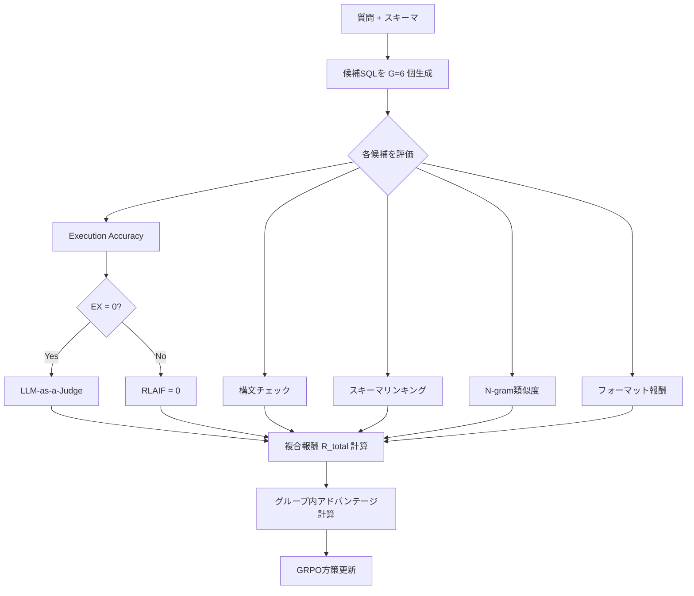

## 論文概要

本記事は [Reasoning-SQL: Reinforcement Learning with SQL Tailored Partial Rewards for Reasoning-Enhanced Text-to-SQL](https://arxiv.org/abs/2503.23157) の解説記事です。

Text-to-SQLは自然言語の質問をSQLクエリに変換するタスクであり、自然言語理解、データベーススキーマの把握、正確なSQL構文の生成という複数の推論ステップを要求する。著者らはこの問題に対し、強化学習（RL）における報酬のスパース性を解消するため、Text-to-SQLに特化した6つの部分報酬（partial rewards）を設計し、Group Relative Policy Optimization（GRPO）と組み合わせた訓練フレームワークReasoning-SQLを提案している。RLのみの訓練がSupervised Fine-Tuning（SFT）を精度と汎化性能の両面で上回ることを示し、14Bパラメータモデルがo3-miniを4%、Gemini-1.5-Pro-002を3%上回るBIRDベンチマーク結果を報告している。

この記事は [Zenn記事: TRL GRPOのエントロピー崩壊を抑えてSQL生成モデルの正答率を高める](https://zenn.dev/0h_n0/articles/1354c10a7726d5) の深掘りです。

## 情報源

- **arXiv ID**: 2503.23157
- **URL**: [https://arxiv.org/abs/2503.23157](https://arxiv.org/abs/2503.23157)
- **著者**: Mohammadreza Pourreza, Shayan Talaei, Ruoxi Sun et al.（Google Cloud, Stanford University, Google DeepMind）
- **発表年**: 2025（2025年3月29日投稿、4月1日改訂）
- **分野**: cs.LG, cs.AI, cs.DB
- **ライセンス**: CC BY-NC-ND 4.0

## 背景と動機

Text-to-SQLの強化学習では、生成されたSQLクエリの実行結果がゴールドクエリの実行結果と一致するかどうかを判定するexecution accuracy（EX）報酬が広く用いられている。しかし、この報酬は0（不正解）か1（正解）のバイナリ信号であり、学習初期段階のモデルが正解クエリを生成する確率は低いため、ほとんどの生成結果に対して報酬が0となる。この報酬スパース性（reward sparsity）は、RLの方策勾配推定におけるシグナルの不足を招き、学習の収束を遅延させるか、あるいは学習を失敗させる要因となる。

従来のText-to-SQLにおけるRL研究（Seq2SQL、SQLNet等）でも実行フィードバックを用いたRLは試みられてきたが、中間報酬を導入しても精度改善は限定的であったと著者らは指摘している。一方で、DeepSeek-R1やOpenAI o1のような推論特化モデルがGRPOベースのRLで成功を収めていることから、適切に設計された報酬信号があればText-to-SQLでもRLが有効に機能するという仮説のもと、本研究が進められている。

## 主要な貢献

- **Text-to-SQL特化の部分報酬設計**: execution accuracy、LLM-as-a-judge、構文チェック、スキーマリンキング、N-gram類似度、フォーマット報酬の6つのコンポーネントを組み合わせた複合報酬関数を提案。重み付けにより、不正解クエリが正解クエリの報酬を上回らない制約を保証している。
- **RL-onlyがSFTを上回る実証**: 全モデルサイズ（3B、7B、14B）において、RLのみの訓練がSFTを精度・汎化性能の両面で上回ることを示した。
- **小規模モデルでの高精度達成**: Qwen2.5-Coder-14Bでo3-miniを4%、Gemini-1.5-Pro-002を3%上回るBIRD実行精度を達成（Table 2より）。CHASE-SQLパイプラインに統合した場合、BIRD testで72.78%のEXを達成している（Table 3より）。

## 技術的詳細

### 6つの報酬コンポーネント

Reasoning-SQLの核心は、Text-to-SQLの各側面を捉える6つの部分報酬の設計にある。以下に各コンポーネントの詳細と重みを示す。

#### 1. Execution Accuracy報酬 $R_{\text{EX}}$（重み: 3）

生成されたSQLクエリを実行し、その結果がゴールドクエリの実行結果と完全一致する場合に1、それ以外は0を返すバイナリ報酬である。

$$
R_{\text{EX}}(q, q^*) = \begin{cases} 1 & \text{if } \text{exec}(q) = \text{exec}(q^*) \\ 0 & \text{otherwise} \end{cases}
$$

ここで、$q$ は生成クエリ、$q^*$ はゴールドクエリ、$\text{exec}(\cdot)$ はデータベース上での実行結果を表す。

#### 2. LLM-as-a-Judge報酬 $R_{\text{RLAIF}}$（重み: 2）

execution accuracyが0のクエリに対してのみ適用される。外部LLMが生成クエリの品質を $[0, 1]$ のスケールで評価する。これにより、実行結果は不正解であっても部分的に正しい推論を行ったクエリに対してフィードバックを与えることができる。

$$
R_{\text{RLAIF}}(q, q^*) = \begin{cases} \text{LLM\_Judge}(q, q^*) & \text{if } R_{\text{EX}}(q, q^*) = 0 \\ 0 & \text{otherwise} \end{cases}
$$

#### 3. 構文チェック報酬 $R_{\text{syn}}$（重み: 1）

生成されたSQLが構文的に有効で、データベース上でエラーなく実行できる場合に1を返す。

$$
R_{\text{syn}}(q) = \begin{cases} 1 & \text{if } q \text{ is syntactically valid and executable} \\ 0 & \text{otherwise} \end{cases}
$$

#### 4. スキーマリンキング報酬 $R_{\text{schema}}$（重み: 1）

生成クエリと正解クエリが参照するテーブル・カラムの集合についてJaccard類似度を計算する。

$$
R_{\text{schema}}(q, q^*) = \frac{|S(q) \cap S(q^*)|}{|S(q) \cup S(q^*)|}
$$

ここで、$S(q)$ はクエリ $q$ が参照するテーブル名・カラム名の集合である。

#### 5. N-gram類似度報酬 $R_{\text{ngram}}$（重み: 1）

生成クエリと正解クエリのbigramのJaccard類似度を計算する。SQLキーワードや構文構造の類似性を捉える。

$$
R_{\text{ngram}}(q, q^*) = \frac{|B(q) \cap B(q^*)|}{|B(q) \cup B(q^*)|}
$$

ここで、$B(q)$ はクエリ $q$ のbigram集合である。

#### 6. フォーマット報酬 $R_{\text{fmt}}$（重み: 1）

出力が `<reasoning>...</reasoning><answer>...</answer>` の形式に従っている場合に1を返す。

### 複合報酬と重み付け戦略

各報酬は重み付き線形結合として統合される。

$$
R_{\text{total}} = \sum_{i} w_i \cdot R_i = 3 \cdot R_{\text{EX}} + 2 \cdot R_{\text{RLAIF}} + 1 \cdot R_{\text{syn}} + 1 \cdot R_{\text{schema}} + 1 \cdot R_{\text{ngram}} + 1 \cdot R_{\text{fmt}}
$$

重み設計の核心は、正解クエリが常に不正解クエリの報酬を上回る制約にある。正解クエリ（$R_{\text{EX}} = 1$）の最大報酬は $3 + 0 + 1 + 1 + 1 + 1 = 7$ であり、最小でも $3 + 0 + 0 + 0 + 0 + 0 = 3$ となる。一方、不正解クエリ（$R_{\text{EX}} = 0$）の最大報酬は $0 + 2 + 1 + 1 + 1 + 1 = 6$ である。execution accuracyの重み3がこの制約を保証している。

### GRPOとの統合

GRPOの目的関数は以下のように定式化される。

$$
J_{\text{GRPO}}(\theta) = \mathbb{E}\left[\frac{1}{G}\sum_{i=1}^{G}\min\left(\frac{\pi_\theta(o_i|x)}{\pi_{\text{ref}}(o_i|x)} A_i, \; \text{clip}\left(\frac{\pi_\theta(o_i|x)}{\pi_{\text{ref}}(o_i|x)}, 1-\epsilon, 1+\epsilon\right) A_i\right)\right] - \beta \cdot D_{\text{KL}}(\pi_\theta \| \pi_{\text{ref}})
$$

ここで、
- $G$: 各質問に対して生成する候補クエリ数（本研究では6）
- $\pi_\theta$: 現在の方策
- $\pi_{\text{ref}}$: 参照方策（初期モデル）
- $A_i$: グループ内相対アドバンテージ（報酬からグループ平均を引いた値）
- $\epsilon$: クリッピングパラメータ
- $\beta$: KLペナルティの係数

各質問に対して $G$ 個の候補SQLクエリを生成し、それぞれに複合報酬 $R_{\text{total}}$ を計算する。アドバンテージはグループ内で相対的に計算されるため、全候補が不正解でも部分報酬の差異から学習信号を得ることができる。これが報酬スパース性を緩和する仕組みである。

### 訓練パイプラインの全体像

以下にReasoning-SQLの訓練パイプラインを示す。



### Python実装例

以下は部分報酬の計算ロジックの実装例である。

```python
from __future__ import annotations

import re
import sqlite3
from dataclasses import dataclass


@dataclass(frozen=True)
class RewardWeights:
    """Reasoning-SQL の報酬重み設定"""

    execution: float = 3.0
    rlaif: float = 2.0
    syntax: float = 1.0
    schema_linking: float = 1.0
    ngram: float = 1.0
    format: float = 1.0


def jaccard_similarity(set_a: set[str], set_b: set[str]) -> float:
    """Jaccard 類似度を計算する

    Args:
        set_a: 集合 A
        set_b: 集合 B

    Returns:
        Jaccard 類似度 (0.0 - 1.0)
    """
    if not set_a and not set_b:
        return 0.0
    intersection = set_a & set_b
    union = set_a | set_b
    return len(intersection) / len(union)


def extract_schema_items(sql: str) -> set[str]:
    """SQL クエリからテーブル名・カラム名を抽出する

    Args:
        sql: SQL クエリ文字列

    Returns:
        テーブル名・カラム名の集合（小文字正規化）
    """
    tokens = re.findall(r"[a-zA-Z_][a-zA-Z0-9_.]*", sql)
    sql_keywords = {
        "select", "from", "where", "join", "on", "and", "or",
        "group", "by", "order", "having", "limit", "as", "in",
        "not", "null", "is", "like", "between", "exists",
        "union", "all", "distinct", "count", "sum", "avg",
        "max", "min", "inner", "left", "right", "outer",
        "cross", "case", "when", "then", "else", "end",
        "asc", "desc", "insert", "update", "delete", "into",
        "values", "set", "create", "table", "drop", "alter",
    }
    return {t.lower() for t in tokens if t.lower() not in sql_keywords}


def bigram_set(sql: str) -> set[tuple[str, str]]:
    """SQL クエリの bigram 集合を生成する

    Args:
        sql: SQL クエリ文字列

    Returns:
        bigram のタプル集合
    """
    tokens = sql.lower().split()
    return {(tokens[i], tokens[i + 1]) for i in range(len(tokens) - 1)}


def check_syntax(sql: str, db_path: str) -> bool:
    """SQL の構文が有効かつ実行可能か検証する

    Args:
        sql: SQL クエリ文字列
        db_path: SQLite データベースのパス

    Returns:
        構文が有効で実行可能なら True
    """
    try:
        conn = sqlite3.connect(db_path)
        cursor = conn.cursor()
        cursor.execute(sql)
        conn.close()
        return True
    except (sqlite3.Error, Exception):
        return False


def check_format(output: str) -> bool:
    """出力が <reasoning>/<answer> 形式に従っているか検証する

    Args:
        output: モデルの生成テキスト

    Returns:
        正しい形式なら True
    """
    has_reasoning = bool(
        re.search(r"<reasoning>.*?</reasoning>", output, re.DOTALL)
    )
    has_answer = bool(
        re.search(r"<answer>.*?</answer>", output, re.DOTALL)
    )
    return has_reasoning and has_answer


def compute_partial_rewards(
    candidate_sql: str,
    gold_sql: str,
    candidate_output: str,
    db_path: str,
    llm_judge_score: float | None = None,
    weights: RewardWeights | None = None,
) -> dict[str, float]:
    """Reasoning-SQL の部分報酬を計算する

    Args:
        candidate_sql: 生成された SQL クエリ
        gold_sql: ゴールド SQL クエリ
        candidate_output: モデルの生成テキスト全体
        db_path: SQLite データベースのパス
        llm_judge_score: LLM judge のスコア (0.0-1.0)。None の場合は 0.0
        weights: 報酬重み設定

    Returns:
        各報酬コンポーネントと合計報酬の辞書
    """
    if weights is None:
        weights = RewardWeights()

    # Execution accuracy
    try:
        conn = sqlite3.connect(db_path)
        cursor = conn.cursor()
        cursor.execute(candidate_sql)
        candidate_result = cursor.fetchall()
        cursor.execute(gold_sql)
        gold_result = cursor.fetchall()
        conn.close()
        r_ex = 1.0 if candidate_result == gold_result else 0.0
    except (sqlite3.Error, Exception):
        r_ex = 0.0

    # LLM-as-a-judge（EX=0 の場合のみ）
    r_rlaif = 0.0
    if r_ex == 0.0 and llm_judge_score is not None:
        r_rlaif = max(0.0, min(1.0, llm_judge_score))

    # Syntax check
    r_syn = 1.0 if check_syntax(candidate_sql, db_path) else 0.0

    # Schema linking (Jaccard)
    candidate_schema = extract_schema_items(candidate_sql)
    gold_schema = extract_schema_items(gold_sql)
    r_schema = jaccard_similarity(candidate_schema, gold_schema)

    # N-gram similarity (bigram Jaccard)
    candidate_bigrams = bigram_set(candidate_sql)
    gold_bigrams = bigram_set(gold_sql)
    r_ngram = jaccard_similarity(candidate_bigrams, gold_bigrams)

    # Format check
    r_fmt = 1.0 if check_format(candidate_output) else 0.0

    # 複合報酬
    total = (
        weights.execution * r_ex
        + weights.rlaif * r_rlaif
        + weights.syntax * r_syn
        + weights.schema_linking * r_schema
        + weights.ngram * r_ngram
        + weights.format * r_fmt
    )

    return {
        "execution": r_ex,
        "rlaif": r_rlaif,
        "syntax": r_syn,
        "schema_linking": r_schema,
        "ngram": r_ngram,
        "format": r_fmt,
        "total": total,
    }
```

## 実装のポイント

### データフィルタリング

著者らはBIRD訓練データ9,428ペアから品質の低いサンプルを除外している。具体的には、Gemini-2.0-flashとGPT-4oの両方が不正解と判定したサンプルをフィルタリングし、8,026ペアに絞っている。2つの異なるモデルの合意を条件とすることで、偽陽性を抑制しつつ、誤ラベルデータによる学習の汚染を防いでいる。

### スキーマ前処理

小規模モデルのコンテキスト長の制約に対処するため、Gemini-1.5-Proを用いたスキーマリンキング（CHESSの手法に準拠）でスキーマを事前フィルタリングしている。訓練時にはフィルタリング結果とゴールドクエリが参照するスキーマ要素を結合して使用し、推論時にはフィルタリング結果のみを使用する。この差異により、訓練時はスキーマリンキングの報酬が正確に計算できる一方、推論時のスキーマ不足がボトルネックになり得る。

### フォーマット報酬の段階的導入

著者らは、まずフォーマット報酬のみで最適化を行い、モデルが正しい出力形式を習得した後にタスク固有の報酬を導入する2段階の戦略を採用している。これにより、初期段階での出力形式の不安定さがタスク報酬の計算を妨げることを防いでいる。

## Production Deployment Guide

### AWS実装パターン（コスト最適化重視）

Reasoning-SQLのText-to-SQLシステムをAWS上に展開する場合のトラフィック量別推奨構成を示す。

| 構成 | トラフィック | サービス構成 | 月額概算 |
|------|------------|-------------|---------|
| Small | ~100 req/日 | Lambda + Bedrock (Claude 3.5 Haiku) + DynamoDB | $50-150 |
| Medium | ~1,000 req/日 | ECS Fargate (vLLM 14B) + Aurora Serverless v2 + ElastiCache | $800-1,500 |
| Large | 10,000+ req/日 | EKS + Karpenter + Spot g5.2xlarge (vLLM 14B) + Aurora + ElastiCache | $3,000-6,000 |

**注意**: 上記は2026年10月時点のAWS ap-northeast-1（東京）リージョン料金に基づく概算値である。実際のコストはトラフィックパターン、リージョン、バースト使用量により変動する。最新料金はAWS料金計算ツールで確認を推奨する。

**Small構成の内訳**: Lambda (128MB, ~3秒/req): $5/月、Bedrock Claude 3.5 Haiku (入力$0.25/MTok, 出力$1.25/MTok): $30-80/月、DynamoDB On-Demand: $5-15/月、CloudWatch: $5-10/月。SQL生成はBedrock経由でマネージドLLMに委託し、自前モデルホスティングを不要にする。

**Medium構成の内訳**: ECS Fargate (4vCPU/16GB RAM, vLLM): $400-600/月、GPU不要の場合はCPU推論（GGUF量子化）で対応可能。Aurora Serverless v2: $100-200/月、ElastiCache (r7g.medium): $100-150/月。スキーマキャッシュにより同一DBへの繰り返しクエリを高速化する。

**Large構成の内訳**: EKS コントロールプレーン: $75/月、g5.2xlarge Spot (1xA10G 24GB): $600-900/月 x 3台、Aurora: $300-500/月、ElastiCache: $200-300/月。Spot Instancesで最大70%のコスト削減が可能。Karpenterによる自動スケーリングで夜間のアイドルコストを削減する。

**コスト削減テクニック**:
- Spot Instances活用（g5.2xlarge）で最大70%削減
- Reserved Instances（1年コミット）で最大40%削減
- Bedrock Batch API使用（非リアルタイム処理）で50%削減
- スキーマフィルタリング結果のキャッシュで推論コスト30%削減
- vLLMのPrefix Cachingで同一スキーマの推論を高速化

### Terraformインフラコード

**Small構成（Serverless）**:

```hcl
# Small構成: Lambda + Bedrock + DynamoDB
# Reasoning-SQL Text-to-SQL API

terraform {
  required_version = ">= 1.9"
  required_providers {
    aws = { source = "hashicorp/aws", version = "~> 5.70" }
  }
}

provider "aws" { region = "ap-northeast-1" }

# --- IAM ---
resource "aws_iam_role" "text2sql_lambda" {
  name = "text2sql-lambda-role"
  assume_role_policy = jsonencode({
    Version = "2012-10-17"
    Statement = [{
      Action = "sts:AssumeRole"
      Effect = "Allow"
      Principal = { Service = "lambda.amazonaws.com" }
    }]
  })
}

resource "aws_iam_role_policy" "text2sql_lambda" {
  name = "text2sql-lambda-policy"
  role = aws_iam_role.text2sql_lambda.id
  policy = jsonencode({
    Version = "2012-10-17"
    Statement = [
      {
        Effect   = "Allow"
        Action   = ["bedrock:InvokeModel"]
        Resource = "arn:aws:bedrock:ap-northeast-1::foundation-model/anthropic.claude-3-5-haiku-*"
      },
      {
        Effect   = "Allow"
        Action   = ["dynamodb:PutItem", "dynamodb:GetItem", "dynamodb:Query"]
        Resource = aws_dynamodb_table.schema_cache.arn
      },
      {
        Effect   = "Allow"
        Action   = ["logs:CreateLogGroup", "logs:CreateLogStream", "logs:PutLogEvents"]
        Resource = "arn:aws:logs:*:*:*"
      }
    ]
  })
}

# --- DynamoDB (スキーマキャッシュ / クエリログ) ---
resource "aws_dynamodb_table" "schema_cache" {
  name         = "text2sql-schema-cache"
  billing_mode = "PAY_PER_REQUEST"  # On-Demand でコスト最適化
  hash_key     = "db_id"

  attribute { name = "db_id"; type = "S" }

  server_side_encryption { enabled = true }  # KMS 暗号化

  tags = { Project = "text2sql", Environment = "production" }
}

# --- Lambda ---
resource "aws_lambda_function" "text2sql" {
  function_name = "text2sql-api"
  role          = aws_iam_role.text2sql_lambda.arn
  handler       = "handler.lambda_handler"
  runtime       = "python3.12"
  timeout       = 30
  memory_size   = 256
  filename      = "lambda.zip"

  environment {
    variables = {
      SCHEMA_CACHE_TABLE = aws_dynamodb_table.schema_cache.name
      BEDROCK_MODEL_ID   = "anthropic.claude-3-5-haiku-20241022-v1:0"
    }
  }

  tracing_config { mode = "Active" }  # X-Ray 有効化

  tags = { Project = "text2sql", Environment = "production" }
}

# --- CloudWatch アラーム (コスト監視) ---
resource "aws_cloudwatch_metric_alarm" "lambda_duration" {
  alarm_name          = "text2sql-lambda-high-duration"
  comparison_operator = "GreaterThanThreshold"
  evaluation_periods  = 3
  metric_name         = "Duration"
  namespace           = "AWS/Lambda"
  period              = 300
  statistic           = "p95"
  threshold           = 25000  # 25秒 (タイムアウト30秒の警告)
  alarm_actions       = []     # SNS トピック ARN を設定

  dimensions = { FunctionName = aws_lambda_function.text2sql.function_name }
}
```

**Large構成（Container）**:

```hcl
# Large構成: EKS + Karpenter + Spot (vLLM 14B)

module "eks" {
  source  = "terraform-aws-modules/eks/aws"
  version = "~> 20.24"

  cluster_name    = "text2sql-cluster"
  cluster_version = "1.31"

  vpc_id     = var.vpc_id
  subnet_ids = var.private_subnet_ids

  cluster_endpoint_public_access = false  # プライベートアクセスのみ

  eks_managed_node_groups = {
    system = {
      instance_types = ["m7i.large"]
      min_size       = 2
      max_size       = 3
      desired_size   = 2
    }
  }

  tags = { Project = "text2sql", Environment = "production" }
}

# Karpenter Provisioner (Spot 優先)
resource "kubectl_manifest" "karpenter_nodepool" {
  yaml_body = yamlencode({
    apiVersion = "karpenter.sh/v1"
    kind       = "NodePool"
    metadata   = { name = "gpu-spot" }
    spec = {
      template = {
        spec = {
          requirements = [
            { key = "karpenter.sh/capacity-type", operator = "In", values = ["spot", "on-demand"] },
            { key = "node.kubernetes.io/instance-type", operator = "In", values = ["g5.2xlarge", "g5.4xlarge"] },
          ]
          nodeClassRef = { group = "karpenter.k8s.aws", kind = "EC2NodeClass", name = "default" }
        }
      }
      limits   = { cpu = "64", "nvidia.com/gpu" = "6" }
      disruption = { consolidationPolicy = "WhenEmpty", consolidateAfter = "300s" }
    }
  })
}

# AWS Budgets (月額予算アラート)
resource "aws_budgets_budget" "text2sql" {
  name         = "text2sql-monthly"
  budget_type  = "COST"
  limit_amount = "6000"
  limit_unit   = "USD"
  time_unit    = "MONTHLY"

  notification {
    comparison_operator       = "GREATER_THAN"
    threshold                 = 80
    threshold_type            = "PERCENTAGE"
    notification_type         = "ACTUAL"
    subscriber_email_addresses = [var.alert_email]
  }
}
```

### 運用・監視設定

**CloudWatch Logs Insights クエリ**:

```
# コスト異常検知: 1時間あたりのトークン使用量
fields @timestamp, @message
| filter @message like /token_usage/
| stats sum(input_tokens) as total_input, sum(output_tokens) as total_output by bin(1h)
| filter total_input > 1000000
| sort @timestamp desc
```

```
# レイテンシ分析: P95, P99
fields @timestamp, duration_ms
| filter @message like /text2sql_inference/
| stats percentile(duration_ms, 95) as p95, percentile(duration_ms, 99) as p99 by bin(5m)
| sort @timestamp desc
```

**CloudWatch アラーム設定（Python）**:

```python
import boto3


def setup_text2sql_alarms(function_name: str, sns_topic_arn: str) -> None:
    """Text-to-SQL Lambda のアラームを設定する

    Args:
        function_name: Lambda 関数名
        sns_topic_arn: 通知先 SNS トピック ARN
    """
    cw = boto3.client("cloudwatch", region_name="ap-northeast-1")

    # Bedrock トークン使用量スパイク検知
    cw.put_metric_alarm(
        AlarmName=f"{function_name}-token-spike",
        MetricName="InputTokenCount",
        Namespace="AWS/Bedrock",
        Statistic="Sum",
        Period=3600,
        EvaluationPeriods=1,
        Threshold=500000,
        ComparisonOperator="GreaterThanThreshold",
        AlarmActions=[sns_topic_arn],
    )

    # Lambda 実行時間異常検知
    cw.put_metric_alarm(
        AlarmName=f"{function_name}-high-latency",
        MetricName="Duration",
        Namespace="AWS/Lambda",
        ExtendedStatistic="p99",
        Period=300,
        EvaluationPeriods=3,
        Threshold=25000,
        ComparisonOperator="GreaterThanThreshold",
        Dimensions=[{"Name": "FunctionName", "Value": function_name}],
        AlarmActions=[sns_topic_arn],
    )
```

**X-Ray トレーシング設定（Python）**:

```python
from aws_xray_sdk.core import xray_recorder, patch_all

# boto3 自動計装
patch_all()


def trace_text2sql_request(
    question: str,
    db_id: str,
    generated_sql: str,
    latency_ms: float,
) -> None:
    """Text-to-SQL リクエストのトレースを記録する

    Args:
        question: 自然言語の質問
        db_id: データベース ID
        generated_sql: 生成された SQL クエリ
        latency_ms: 推論レイテンシ (ミリ秒)
    """
    segment = xray_recorder.current_segment()
    segment.put_annotation("db_id", db_id)
    segment.put_annotation("latency_ms", int(latency_ms))
    segment.put_metadata("question", question, "text2sql")
    segment.put_metadata("generated_sql", generated_sql, "text2sql")
```

**Cost Explorer 自動レポート（Python）**:

```python
import datetime

import boto3


def daily_cost_report(sns_topic_arn: str, threshold_usd: float = 100.0) -> None:
    """日次コストレポートを取得し閾値超過時に通知する

    Args:
        sns_topic_arn: 通知先 SNS トピック ARN
        threshold_usd: 通知閾値 (USD/日)
    """
    ce = boto3.client("ce", region_name="us-east-1")
    sns = boto3.client("sns", region_name="ap-northeast-1")

    today = datetime.date.today()
    yesterday = today - datetime.timedelta(days=1)

    response = ce.get_cost_and_usage(
        TimePeriod={"Start": str(yesterday), "End": str(today)},
        Granularity="DAILY",
        Metrics=["UnblendedCost"],
        Filter={
            "Tags": {
                "Key": "Project",
                "Values": ["text2sql"],
            }
        },
        GroupBy=[{"Type": "DIMENSION", "Key": "SERVICE"}],
    )

    total = sum(
        float(g["Metrics"]["UnblendedCost"]["Amount"])
        for r in response["ResultsByTime"]
        for g in r["Groups"]
    )

    if total > threshold_usd:
        sns.publish(
            TopicArn=sns_topic_arn,
            Subject=f"Text2SQL Cost Alert: ${total:.2f}/day",
            Message=f"Daily cost ${total:.2f} exceeds threshold ${threshold_usd}.",
        )
```

### コスト最適化チェックリスト

**アーキテクチャ選択**:
- [ ] トラフィック ~100 req/日 → Serverless (Lambda + Bedrock)
- [ ] トラフィック ~1,000 req/日 → Hybrid (ECS Fargate + vLLM)
- [ ] トラフィック 10,000+ req/日 → Container (EKS + Spot GPU)

**リソース最適化**:
- [ ] GPU: g5.2xlarge Spot Instances優先（最大70%削減）
- [ ] Reserved Instances: 1年コミットで最大40%削減
- [ ] Savings Plans: Compute Savings Plans検討
- [ ] Lambda: メモリサイズ最適化（Power Tuning）
- [ ] EKS: Karpenter consolidationPolicy で夜間自動スケールダウン
- [ ] Aurora: Serverless v2 で最小 0.5 ACU に自動縮退

**LLMコスト削減**:
- [ ] Bedrock Batch API使用（非リアルタイム分析で50%削減）
- [ ] スキーマフィルタリング結果キャッシュ（DynamoDB / ElastiCache）
- [ ] vLLM Prefix Caching有効化（同一スキーマの推論高速化）
- [ ] 小規模モデル（3B/7B）でのトリアージ後に14Bへエスカレーション
- [ ] トークン数制限（max_tokens設定、不要な推論パスの打ち切り）

**監視・アラート**:
- [ ] AWS Budgets設定（月額上限 + 80%閾値アラート）
- [ ] CloudWatch アラーム（トークン使用量、レイテンシ）
- [ ] Cost Anomaly Detection有効化
- [ ] 日次コストレポート（SNS通知）

**リソース管理**:
- [ ] 未使用EBSボリューム・スナップショット削除
- [ ] タグ戦略（Project / Environment / Owner）
- [ ] ECRライフサイクルポリシー（古いイメージ自動削除）
- [ ] 開発環境の夜間・週末自動停止（EventBridge Scheduler）
- [ ] CloudWatch Logs保持期間設定（90日）

## 実験結果

### BIRD Dev ベンチマーク（Table 2より）

著者らが報告したBIRD開発セットにおけるexecution accuracy（EX）は以下の通りである。

| モデル | EX (%) | フィルタスキーマ EX (%) |
|--------|--------|----------------------|
| GPT-4o-mini | 60.82 | 66.29 |
| o3-mini | 61.34 | 69.88 |
| Gemini-2.0-flash | 66.49 | 71.90 |
| Gemini-1.5-Pro-002 | 62.25 | 67.47 |
| Qwen2.5-Coder-3B (RL) | 58.67 | 65.31 |
| Qwen2.5-Coder-7B (RL) | 64.01 | 70.66 |
| Qwen2.5-Coder-14B (RL) | 65.31 | 72.03 |

14Bモデルはフィルタスキーマ使用時にo3-mini（69.88%）を約2%、Gemini-1.5-Pro-002（67.47%）を約5%上回っている。

### RL vs SFT（Table 1より）

Qwen2.5-Coder-7Bにおけるフィルタスキーマ使用時の比較を以下に示す。

| 手法 | EX (%) |
|------|--------|
| SFT | 69.23 |
| STaR-SFT | 68.12 |
| RL (execution only) | 68.90 |
| RL (all rewards, w/o reasoning) | 68.12 |
| RL (all rewards, w/ reasoning) | 70.66 |

RLに全報酬と推論形式を組み合わせた場合がSFTを1.43ポイント上回っている。

### 報酬コンポーネントのアブレーション（7B、フィルタスキーマ）

| 報酬構成 | EX (%) |
|---------|--------|
| Execution only | 68.90 |
| + Syntax | 68.97 |
| + Schema linking | 69.23 |
| + N-gram | 69.94 |
| + RLAIF | 69.16 |
| All rewards | 70.66 |

全報酬を組み合わせた場合にexecution-onlyから1.76ポイントの改善が得られている。N-gram類似度の追加が最も大きな改善（+0.71ポイント）をもたらしている。

### 汎化性能（Table 5より）

| モデル | Spider | Spider-DK | Spider-Syn |
|--------|--------|-----------|------------|
| Qwen2.5-Coder-14B (RL) | 81.43 | 73.03 | 72.63 |
| Qwen2.5-Coder-7B (RL) | 78.72 | 73.27 | 69.34 |
| Gemini-2.0-flash | 81.23 | 74.15 | 73.59 |

BIRDで訓練されたモデルがSpider系ベンチマークでも高い汎化性能を示している。著者らはChu et al. (2025) の「SFT memorizes, RL generalizes」の知見と整合する結果であると述べている。

### CHASE-SQLパイプライン統合（Table 3より）

CHASE-SQLパイプラインに統合した場合、14BモデルはBIRD testで72.78%のEXを達成し、OpenSearch-SQL v2（GPT-4o, 72.28%）を上回っている。ただし、CHASE-SQL（Gemini-1.5-Pro, 74.79%）やXiYan-SQL（75.63%）には及ばない。

## 実運用への応用

### 社内Text-to-SQLシステムでの部分報酬設計

Reasoning-SQLの部分報酬設計は、社内のText-to-SQLシステムにおけるモデル微調整に直接応用可能である。特に以下の点が実務で有用と考えられる。

**スキーマリンキング報酬のカスタマイズ**: 社内データベースでは、テーブル名やカラム名が略語やドメイン固有の命名規則に従う場合が多い。スキーマリンキング報酬をカスタマイズし、エイリアスマッピングや命名規則の辞書を組み込むことで、ドメイン特化の精度向上が期待できる。

**LLM-as-a-Judgeの社内適用**: 実行結果が一致しない場合でもビジネスロジック上は許容可能なクエリが存在する（例: 集約の順序が異なるが結果は同等）。LLM-as-a-Judgeの評価プロンプトを社内のSQL規約に合わせてカスタマイズすることで、より適切なフィードバックを生成できる。

**コスト効率**: 14Bパラメータモデルでo3-miniを上回る精度を達成している点は、推論コストの観点で実用的である。vLLM等の推論エンジンと組み合わせることで、プロプライエタリAPIに依存せずにオンプレミスまたはクラウド上でのデプロイが可能となる。

## 関連研究

- **GRPO (DeepSeekMath, Shao et al., 2024)**: Group Relative Policy Optimizationの原論文。各グループ内の相対的なアドバンテージ計算によりベースラインモデルを不要にした手法であり、Reasoning-SQLの訓練アルゴリズムの基盤となっている。DeepSeek-R1やKimi-K1.5でも採用されている。
- **Arctic-Text2SQL-R1 (Snowflake, arXiv 2505.20315, 2025)**: execution correctnessと構文チェックのみのシンプルな報酬設計でGRPOを適用し、32BモデルがBIRD testで71.83%を達成した研究。Reasoning-SQLの複雑な部分報酬設計とは対照的に、報酬のシンプルさを重視するアプローチであり、報酬設計の複雑さと性能の関係を考える上で興味深い比較対象である。
- **PaVeRL-SQL (Samsung SDSA, arXiv 2509.07159, 2025)**: Partial-Match RewardsとVerbal Reinforcement Learningを組み合わせたフレームワーク。ICLベースのVerbal-RLパイプラインと、OmniSQL-7Bを用いたCoT RLパイプラインの2つを提案し、Spider 2.0-SQLiteでSOTA比+7.4%の改善を報告している。Reasoning-SQLとは独立に部分報酬の有効性を示しており、この方向性の研究の広がりを示している。

## まとめと今後の展望

Reasoning-SQLは、Text-to-SQLにおける強化学習の報酬スパース性問題に対し、6つの部分報酬コンポーネントの設計という実践的な解法を提示した。execution accuracy、LLM-as-a-judge、構文チェック、スキーマリンキング、N-gram類似度、フォーマット報酬を重み付き線形結合で統合し、正解クエリが常に不正解クエリを上回る制約を設けることで、安定したGRPO訓練を実現している。

今後の研究方向として、著者らのアプローチと Arctic-Text2SQL-R1のシンプルな報酬設計の間の最適なトレードオフの探索、Spider 2.0のような複数SQL方言への拡張、さらにはProcess Reward Model（PRM）を用いた推論ステップ単位のフィードバック設計が考えられる。実務的には、ドメイン固有のスキーマリンキング辞書やビジネスルール対応のLLM-as-a-Judge設計が、社内Text-to-SQLシステムの精度向上に直結する可能性がある。

## 参考文献

- **arXiv**: [https://arxiv.org/abs/2503.23157](https://arxiv.org/abs/2503.23157)
- **Arctic-Text2SQL-R1**: [https://arxiv.org/abs/2505.20315](https://arxiv.org/abs/2505.20315)
- **PaVeRL-SQL**: [https://arxiv.org/abs/2509.07159](https://arxiv.org/abs/2509.07159)
- **DeepSeekMath (GRPO)**: [https://arxiv.org/abs/2402.03300](https://arxiv.org/abs/2402.03300)
- **BIRD Benchmark**: [https://bird-bench.github.io/](https://bird-bench.github.io/)
- **Related Zenn article**: [https://zenn.dev/0h_n0/articles/1354c10a7726d5](https://zenn.dev/0h_n0/articles/1354c10a7726d5)
