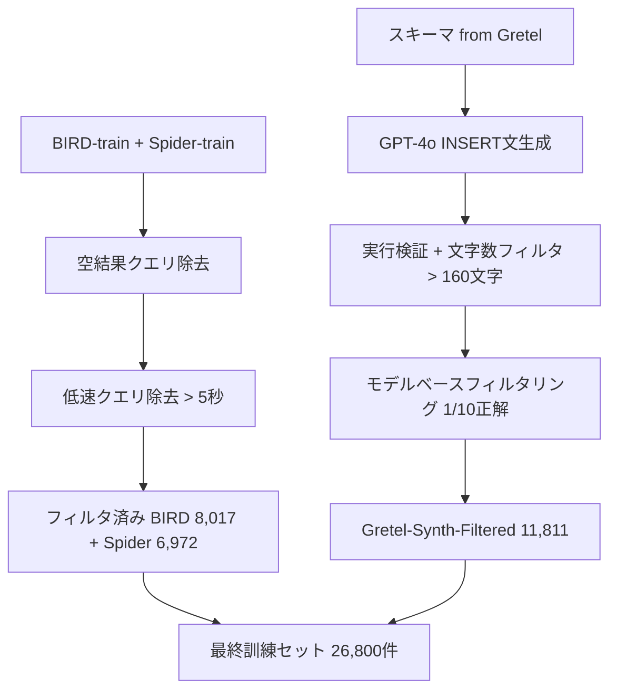

## 論文概要（Abstract）

本記事は [Arctic-Text2SQL-R1: Simple Rewards, Strong Reasoning in Text-to-SQL](https://arxiv.org/abs/2505.20315) の解説記事です。

この記事は [Zenn記事: TRL GRPOのエントロピー崩壊を抑えてSQL生成モデルの正答率を高める](https://zenn.dev/0h_n0/articles/1354c10a7726d5) の深掘りです。

Arctic-Text2SQL-R1は、Snowflake AI Researchが提案したText-to-SQL向けの強化学習フレームワークおよびモデルファミリーである。実行結果の一致のみに基づくシンプルな報酬信号と、慎重に設計されたデータフィルタリング戦略を組み合わせ、GRPOによるオンライン強化学習で訓練する。著者らは、32Bモデルが BIRDベンチマークのテストセットで71.83%の実行精度を達成し、投稿時点でのSOTAを報告している。さらに、7Bモデルが70Bクラスの先行モデル（ExCoT-70B）に匹敵する性能を示したと述べている。

## 情報源

- **arXiv ID**: 2505.20315
- **URL**: [https://arxiv.org/abs/2505.20315](https://arxiv.org/abs/2505.20315)
- **著者**: Zhewei Yao, Guoheng Sun, Lukasz Borchmann, Gaurav Nuti, Zheyu Shen, Minghang Deng, Bohan Zhai, Hao Zhang, Ang Li, Yuxiong He（Snowflake AI Research）
- **発表年**: 2025年（v1: 2025年5月、v2: 2026年1月）
- **分野**: cs.CL, cs.AI
- **採択**: ACL 2026 Findings
- **コード**: [https://github.com/snowflakedb/ArcticTraining/](https://github.com/snowflakedb/ArcticTraining/)
- **モデル**: [https://huggingface.co/Snowflake/Arctic-Text2SQL-R1-7B](https://huggingface.co/Snowflake/Arctic-Text2SQL-R1-7B)

## 背景と動機（Background & Motivation）

Text-to-SQL、すなわち自然言語からSQLクエリを自動生成するタスクは、データベースの民主化において重要な技術である。近年、大規模言語モデル（LLM）にGRPOやPPOなどの強化学習を適用してSQL生成の精度を高める試みが活発化している。

しかし、従来のアプローチでは報酬設計が複雑化する傾向があった。構文的正しさ、テーブル参照の正確性、カラム選択の適切性といった複数の部分報酬を組み合わせるfine-grained rewardが試みられてきたが、著者らはこうした複雑な報酬がモデルの「怠惰な振る舞い（lazy behavior）」を引き起こすと報告している。モデルが短期的な部分報酬を獲得する方向に最適化され、グローバルな正確性（実際に正しいSQLを生成する能力）が向上しないという問題である。

もう一つの課題はデータ品質である。強化学習の訓練データには、空結果を返すクエリ、実行に長時間かかるクエリ、多様性の低い合成データなど、学習を阻害する要素が含まれる。著者らは、報酬の複雑さよりもデータの質と初期モデルの選択が性能に直結すると主張している。

## 主要な貢献（Key Contributions）

- **シンプルな実行報酬によるSOTA達成**: 実行結果一致のみの3段階報酬（1.0 / 0.1 / 0.0）で、BIRDテストセット71.83%を達成。投稿時点で当時のSOTA（XiYan-32B）を2.8ポイント上回った（論文Section 5.1より）
- **原則的なデータフィルタリング戦略**: 空結果・低速クエリの除去、GPT-4o生成合成データ、モデルベースフィルタリングによるデータ品質管理パイプライン
- **モデルスケーリング分析**: 7B / 14B / 32Bの3サイズで一貫した性能向上を確認。7Bモデルが70Bクラスの先行手法に匹敵する効率性を実証
- **GRPO vs PPO / Online vs Batch RLの体系的比較**: GRPOがPPOを上回り、オンラインRLがバッチRLを上回ることを定量的に示した

## 技術的詳細（Technical Details）

### 報酬設計の哲学

Arctic-Text2SQL-R1の報酬設計は「シンプルさ」を最優先とする。著者らはfine-grained rewardの複数バリエーションを試した結果、より詳細な報酬が報酬ハッキング（reward hacking）を誘発し、安定した学習を阻害すると報告している。

報酬関数は以下の3段階で定義される。

$$
R(y, y^*) = \begin{cases}
1.0 & \text{if } \text{exec}(y) = \text{exec}(y^*) \\
0.1 & \text{if } y \text{ is syntactically valid and executable} \\
0.0 & \text{otherwise}
\end{cases}
$$

ここで、
- $y$: モデルが生成したSQLクエリ
- $y^*$: 正解SQLクエリ
- $\text{exec}(\cdot)$: SQLを実行した結果セット
- 「syntactically valid and executable」はSQLとして構文的に正しく、対象データベース上で例外なく実行可能であることを意味する

中間的な報酬（0.1）は、構文的に正しいが結果が一致しないSQLに対して与えられる。これにより、完全に無効なSQL（パースエラーやランタイムエラー）と「惜しい」SQLを区別する最小限のシグナルを提供する。著者らは、この0.1という値が安定的な信用割り当て（credit assignment）を実現すると述べている。

### GRPOアルゴリズムの適用

GRPOはGroup Relative Policy Optimizationの略であり、PPOのcritic（価値関数）を不要にすることでメモリ効率を高めたアルゴリズムである。各プロンプトに対してグループ内の報酬の相対的な大小で advantageを推定する。

GRPOの目的関数は以下の通りである。

$$
\mathcal{J}_{\text{GRPO}}(\theta) = \mathbb{E}_{q \sim \mathcal{D}, \{y_i\}_{i=1}^{G} \sim \pi_{\theta_{\text{old}}}(\cdot|q)} \left[ \frac{1}{G} \sum_{i=1}^{G} \min\left( r_i(\theta) \hat{A}_i, \text{clip}(r_i(\theta), 1-\epsilon, 1+\epsilon) \hat{A}_i \right) - \beta \, D_{\text{KL}}(\pi_\theta \| \pi_{\text{ref}}) \right]
$$

ここで、
- $q$: 入力プロンプト（自然言語クエリ + スキーマ情報）
- $G$: グループサイズ（ロールアウト数、本論文では$G=16$）
- $r_i(\theta) = \pi_\theta(y_i \mid q) / \pi_{\theta_{\text{old}}}(y_i \mid q)$: 重要度比
- $\hat{A}_i = (R_i - \mu_R) / \sigma_R$: グループ内正規化されたadvantage
- $\epsilon = 0.2$: クリッピング係数
- $\beta = 0.001$: KLペナルティ係数
- $\pi_{\text{ref}}$: 参照ポリシー（初期化時のモデル）

### 訓練ハイパーパラメータ

著者らが報告している主要な設定値は以下の通りである（論文Section 4より）。

| パラメータ | 値 |
|---|---|
| 生成温度 | 0.8 |
| 総バッチサイズ | 256 |
| プロンプトあたりロールアウト数 | 16 |
| GRPO更新バッチサイズ | 128 |
| KLペナルティ $\beta$ | 0.001 |
| クリッピング $\epsilon$ | 0.2 |
| 学習方式 | Online RL |
| 初期化モデル | OmniSQLの教師あり学習チェックポイント |

### データフィルタリングパイプライン

著者らは、訓練データの品質がモデル性能に直結すると強調し、以下の多段階フィルタリングパイプラインを構築している。



各ステップの詳細は以下の通りである。

**1. 空結果・低速クエリの除去**: 正解SQLの実行結果が空（0行）のクエリは、報酬信号が非情報的になるため除外する。実行時間が5秒を超えるクエリも除外する。この処理によりBIRDから約1,400件、Spiderから約1,700件が除去された（論文Table 3より）。

**2. Gretel-Synth合成データ生成**: データのないスキーマに対してGPT-4oでINSERT文（テーブルあたり5行）を生成し、正解SQLが非空結果を返すまでリサンプリングする。同一ドメインのディストラクタテーブルも追加する。クエリ長160文字以上かつ実行成功のもののみ保持する。

**3. モデルベースフィルタリング**: Qwen2.5-Coder-32B-InstructのRL訓練済みモデルで温度1.0にて10サンプル生成し、少なくとも1つ正解するクエリのみ保持する。フィルタなしの合成データを追加すると性能が低下したと報告されている（論文Table 4より）。

### GRPO vs PPO / Online vs Batch RL

著者らはアルゴリズムと学習方式の体系的な比較を行っている（論文Table 5より）。

**GRPO vs PPO**（Qwen2.5-Coder-32B-Instruct、バッチRL）:

| アルゴリズム | BIRD-dev | Spider-test |
|---|---|---|
| GRPO | 64.9 | 87.7 |
| PPO | 63.0 | 85.7 |

GRPOがBIRD-devで1.9ポイント、Spider-testで2.0ポイント上回った。GRPOはcriticが不要なためメモリ効率が高いという利点もある。ただし著者らは、PPOのハイパーパラメータは十分に探索していないと注記している。

**Online vs Batch RL**（Qwen2.5-Coder-32B-Instruct、GRPO）:

| 方式 | BIRD-dev |
|---|---|
| Batch RL | 64.9 |
| Online RL | 66.6 |

オンラインRLは、訓練中にポリシーから新しいロールアウトを随時生成するため、ポリシーの変化に追従した学習が可能となる。バッチRLに対して1.7ポイントの改善が得られた。

### 初期化とプロンプトの影響

OmniSQLの教師あり学習チェックポイントからの初期化と、修正版OmniSQLプロンプトの採用が大きな性能向上に寄与している。

| 設定 | BIRD-dev |
|---|---|
| Qwen2.5-Coder-32B-Instruct + Online GRPO | 66.6 |
| OmniSQL-32B + Online GRPO | 67.9 |
| OmniSQL-32B + Modified prompt + Online GRPO | 70.5 |

OmniSQLプロンプトは `<think>` タグ内にchain-of-thought推論を、`<answer>` タグ内に最終SQLを出力する形式を採用している（論文Appendix Cより）。

### 報酬関数の実装例

以下は論文の報酬設計に基づく実装例である。

```python
import sqlite3
from typing import Any


def execute_sql(db_path: str, sql: str, timeout: float = 5.0) -> tuple[bool, list[Any] | None]:
    """SQLクエリを実行し、結果を返す。

    Args:
        db_path: SQLiteデータベースファイルのパス
        sql: 実行するSQLクエリ
        timeout: タイムアウト秒数

    Returns:
        (実行成功フラグ, 結果セットまたはNone)
    """
    try:
        conn = sqlite3.connect(db_path, timeout=timeout)
        cursor = conn.cursor()
        cursor.execute(sql)
        results = cursor.fetchall()
        conn.close()
        return True, results
    except Exception:
        return False, None


def compute_reward(
    predicted_sql: str,
    gold_sql: str,
    db_path: str,
    timeout: float = 5.0,
) -> float:
    """Arctic-Text2SQL-R1の3段階報酬を計算する。

    Args:
        predicted_sql: モデルが生成したSQLクエリ
        gold_sql: 正解SQLクエリ
        db_path: データベースファイルのパス
        timeout: 実行タイムアウト秒数

    Returns:
        報酬値 (1.0, 0.1, 0.0 のいずれか)
    """
    pred_success, pred_results = execute_sql(db_path, predicted_sql, timeout)
    gold_success, gold_results = execute_sql(db_path, gold_sql, timeout)

    if not gold_success:
        return 0.0

    # Exact match: 実行結果が完全一致
    if pred_success and pred_results == gold_results:
        return 1.0

    # Valid + Executable: 構文的に正しく実行可能だが結果不一致
    if pred_success:
        return 0.1

    # Otherwise: 構文エラーまたは実行エラー
    return 0.0
```

### モデルベースデータフィルタリングの実装例

```python
from dataclasses import dataclass


@dataclass
class TrainingExample:
    """訓練データの1件を表す。"""
    question: str
    schema: str
    gold_sql: str
    db_path: str


def model_based_filter(
    examples: list[TrainingExample],
    generate_fn: callable,
    n_samples: int = 10,
    temperature: float = 1.0,
    min_correct: int = 1,
) -> list[TrainingExample]:
    """モデルベースフィルタリングを適用する。

    少なくともmin_correct個の正解サンプルを生成できる例のみ保持する。

    Args:
        examples: フィルタリング対象の訓練データ
        generate_fn: モデルのSQL生成関数 (prompt, n, temp) -> list[str]
        n_samples: プロンプトあたりの生成サンプル数
        temperature: 生成温度
        min_correct: 保持に必要な最小正解数

    Returns:
        フィルタ後の訓練データ
    """
    filtered: list[TrainingExample] = []

    for ex in examples:
        prompt = f"Schema:\n{ex.schema}\n\nQuestion: {ex.question}\n"
        predictions = generate_fn(prompt, n_samples, temperature)

        correct_count = sum(
            1 for pred in predictions
            if compute_reward(pred, ex.gold_sql, ex.db_path) == 1.0
        )

        if correct_count >= min_correct:
            filtered.append(ex)

    return filtered
```

## 実装のポイント（Implementation）

**OmniSQL初期化の重要性**: 著者らは、強化学習の初期モデルとしてQwen2.5-Coderの各バリエーション（Base、Instruct、QwQ推論特化）を比較している。QwQ-32BはBIRD-devで55.2%にとどまり、Base-32Bは64.4%であったのに対し、OmniSQLの教師あり学習チェックポイントが67.9%を達成した。強化学習の効果を最大化するには、SQL特化の教師あり事前学習による良好な初期化が不可欠である。

**プロンプト設計**: `<think>` タグでchain-of-thought推論を促し、`<answer>` タグに最終SQLを格納する形式を採用している。自作テンプレートでは性能向上が見られず、OmniSQLの修正版プロンプトがBIRD-devで67.9%から70.5%へ2.6ポイントの改善をもたらした。

**推論時のテクニック**: 著者らは、推論時に2つの手法を組み合わせている。(1) Value Retrieval（CHESSに基づく値検索）はクエリ内の文字列値をデータベースの実際の値にマッピングする。(2) Majority Voting（8サンプルからの多数決）は複数の候補から最頻の実行結果を持つSQLを選択する。32Bモデルでは、両手法の併用でBIRD-devが70.5%から71.5%に向上した（論文Section 5.4より）。

**応答長のU字型変化**: 訓練中の応答長は、初期は短くなり（不要な冗長さが除去される）、その後精度向上とともに再び長くなるU字型の挙動を示す。これはchain-of-thoughtの質が向上していることを示唆すると著者らは解釈している。

## Production Deployment Guide

### AWS実装パターン（コスト最適化重視）

Arctic-Text2SQL-R1を用いたText-to-SQLサービスをAWS上に構築する場合の、トラフィック量別推奨構成を示す。以下のコスト試算は2026年10月時点のAWS ap-northeast-1（東京）リージョン料金に基づく概算値であり、実際のコストはトラフィックパターン、リージョン、バースト使用量により変動する。最新料金はAWS料金計算ツールで確認を推奨する。

| 構成 | トラフィック | 主要サービス | 月額概算 |
|---|---|---|---|
| Small | ~100 req/日 | Lambda + SageMaker Serverless + DynamoDB | $150-300 |
| Medium | ~1,000 req/日 | ECS Fargate (GPU) + ElastiCache + RDS | $800-1,500 |
| Large | 10,000+ req/日 | EKS + Karpenter + Spot GPU Instances | $3,000-6,000 |

**Small構成の詳細**: Lambda関数がリクエストを受け、SageMaker Serverless Inference Endpointで7Bモデルを推論する。DynamoDBにクエリキャッシュを保持する。推論エンドポイントのコールドスタートに注意が必要だが、低頻度アクセスでは最もコスト効率が高い。

**Medium構成の詳細**: ECS Fargate上でvLLMサービングコンテナ（14Bモデル、NVIDIA T4 GPU x1）を常時稼働させる。ElastiCacheでスキーマ情報とSQLキャッシュを保持し、推論レイテンシを低減する。

**Large構成の詳細**: EKSクラスタにKarpenter Provisionerを設定し、Spot GPU Instances（g5.xlarge）を優先的に利用する。32Bモデルをvllmで配信し、Horizontal Pod Autoscalerで負荷に応じたスケーリングを行う。

**コスト削減テクニック**:
- Spot GPU Instancesの活用でオンデマンド比最大70-90%削減
- Reserved Instances（1年）購入で最大40%削減（常時稼働ノード向け）
- SQLキャッシュの導入で同一パターンクエリの推論回数を50-70%削減
- 7Bモデルの量子化（AWQ/GPTQ）による推論コスト削減

### Terraformインフラコード

**Small構成（Serverless）**:

```hcl
# VPC基盤（NAT Gateway不使用でコスト削減）
resource "aws_vpc" "text2sql" {
  cidr_block           = "10.0.0.0/16"
  enable_dns_hostnames = true
  tags = { Name = "text2sql-vpc", Environment = "production" }
}

resource "aws_subnet" "private" {
  count             = 2
  vpc_id            = aws_vpc.text2sql.id
  cidr_block        = "10.0.${count.index + 1}.0/24"
  availability_zone = data.aws_availability_zones.available.names[count.index]
  tags = { Name = "text2sql-private-${count.index}" }
}

# IAMロール（最小権限原則）
resource "aws_iam_role" "lambda_text2sql" {
  name = "text2sql-lambda-role"
  assume_role_policy = jsonencode({
    Version = "2012-10-17"
    Statement = [{
      Action = "sts:AssumeRole"
      Effect = "Allow"
      Principal = { Service = "lambda.amazonaws.com" }
    }]
  })
}

resource "aws_iam_role_policy" "lambda_sagemaker" {
  name = "sagemaker-invoke"
  role = aws_iam_role.lambda_text2sql.id
  policy = jsonencode({
    Version = "2012-10-17"
    Statement = [{
      Effect   = "Allow"
      Action   = ["sagemaker:InvokeEndpoint"]
      Resource = aws_sagemaker_endpoint.text2sql.arn
    }]
  })
}

# Lambda関数
resource "aws_lambda_function" "text2sql_api" {
  function_name = "text2sql-api"
  runtime       = "python3.12"
  handler       = "handler.lambda_handler"
  role          = aws_iam_role.lambda_text2sql.arn
  memory_size   = 512
  timeout       = 60

  environment {
    variables = {
      SAGEMAKER_ENDPOINT = aws_sagemaker_endpoint.text2sql.name
      CACHE_TABLE        = aws_dynamodb_table.query_cache.name
    }
  }

  tracing_config { mode = "Active" }
}

# DynamoDB（On-Demandモード、KMS暗号化）
resource "aws_dynamodb_table" "query_cache" {
  name         = "text2sql-query-cache"
  billing_mode = "PAY_PER_REQUEST"
  hash_key     = "query_hash"

  attribute {
    name = "query_hash"
    type = "S"
  }

  ttl {
    attribute_name = "expires_at"
    enabled        = true
  }

  server_side_encryption { enabled = true }
}

# CloudWatchアラーム（コスト監視）
resource "aws_cloudwatch_metric_alarm" "lambda_errors" {
  alarm_name          = "text2sql-lambda-errors"
  comparison_operator = "GreaterThanThreshold"
  evaluation_periods  = 2
  metric_name         = "Errors"
  namespace           = "AWS/Lambda"
  period              = 300
  statistic           = "Sum"
  threshold           = 10
  alarm_actions       = [aws_sns_topic.alerts.arn]

  dimensions = {
    FunctionName = aws_lambda_function.text2sql_api.function_name
  }
}
```

**Large構成（Container: EKS + Karpenter + Spot）**:

```hcl
# EKSクラスタ
module "eks" {
  source          = "terraform-aws-modules/eks/aws"
  version         = "~> 20.0"
  cluster_name    = "text2sql-cluster"
  cluster_version = "1.31"
  vpc_id          = aws_vpc.text2sql.id
  subnet_ids      = aws_subnet.private[*].id

  cluster_endpoint_public_access = false
  enable_irsa                    = true
}

# Karpenter Provisioner（Spot優先、GPU自動スケーリング）
resource "kubectl_manifest" "karpenter_nodepool" {
  yaml_body = yamlencode({
    apiVersion = "karpenter.sh/v1"
    kind       = "NodePool"
    metadata   = { name = "text2sql-gpu" }
    spec = {
      template = {
        spec = {
          requirements = [
            { key = "karpenter.sh/capacity-type", operator = "In", values = ["spot", "on-demand"] },
            { key = "node.kubernetes.io/instance-type", operator = "In", values = ["g5.xlarge", "g5.2xlarge"] }
          ]
          nodeClassRef = { name = "default" }
        }
      }
      limits   = { cpu = "64", memory = "256Gi", "nvidia.com/gpu" = "8" }
      disruption = { consolidationPolicy = "WhenEmptyOrUnderutilized" }
    }
  })
}

# Secrets Manager（モデル設定）
resource "aws_secretsmanager_secret" "model_config" {
  name       = "text2sql/model-config"
  kms_key_id = aws_kms_key.text2sql.arn
}

# AWS Budgets（予算アラート）
resource "aws_budgets_budget" "text2sql_monthly" {
  name         = "text2sql-monthly"
  budget_type  = "COST"
  limit_amount = "6000"
  limit_unit   = "USD"
  time_unit    = "MONTHLY"

  notification {
    comparison_operator       = "GREATER_THAN"
    threshold                 = 80
    threshold_type            = "PERCENTAGE"
    notification_type         = "ACTUAL"
    subscriber_sns_topic_arns = [aws_sns_topic.alerts.arn]
  }
}
```

### 運用・監視設定

**CloudWatch Logs Insightsクエリ**:

```
# 推論レイテンシ分析（P95, P99）
fields @timestamp, @message
| filter @message like /inference_latency/
| stats percentile(latency_ms, 95) as p95,
        percentile(latency_ms, 99) as p99,
        avg(latency_ms) as avg_ms
  by bin(1h) as hour

# コスト異常検知（1時間あたりの推論回数スパイク）
fields @timestamp, @message
| filter @message like /sql_generated/
| stats count(*) as req_count by bin(1h) as hour
| filter req_count > 500
```

**CloudWatchアラーム設定コード**:

```python
import boto3


def create_inference_alarms(function_name: str, sns_topic_arn: str) -> None:
    """Text-to-SQL推論サービスのCloudWatchアラームを作成する。

    Args:
        function_name: Lambda関数名またはECSサービス名
        sns_topic_arn: 通知先SNSトピックARN
    """
    cw = boto3.client("cloudwatch", region_name="ap-northeast-1")

    cw.put_metric_alarm(
        AlarmName="text2sql-latency-p99",
        MetricName="Duration",
        Namespace="AWS/Lambda",
        Statistic="p99",
        Period=300,
        EvaluationPeriods=3,
        Threshold=30000,  # 30秒
        ComparisonOperator="GreaterThanThreshold",
        AlarmActions=[sns_topic_arn],
        Dimensions=[{"Name": "FunctionName", "Value": function_name}],
    )
```

**X-Rayトレーシング設定**:

```python
from aws_xray_sdk.core import xray_recorder, patch_all


def setup_xray_tracing() -> None:
    """X-Rayトレーシングを初期化する。"""
    xray_recorder.configure(service="text2sql-api")
    patch_all()  # boto3, sqlite3等を自動計装


@xray_recorder.capture("generate_sql")
def generate_sql(question: str, schema: str) -> str:
    """SQLを生成し、X-Rayにメタデータを記録する。

    Args:
        question: 自然言語クエリ
        schema: データベーススキーマ

    Returns:
        生成されたSQLクエリ
    """
    subsegment = xray_recorder.current_subsegment()
    subsegment.put_annotation("model_size", "32B")
    subsegment.put_metadata("question_length", len(question))
    # ... 推論ロジック
    return generated_sql
```

**Cost Explorer自動レポート**:

```python
import boto3
from datetime import datetime, timedelta


def get_daily_cost_report(sns_topic_arn: str) -> dict:
    """日次コストレポートを取得し、閾値超過時にSNS通知する。

    Args:
        sns_topic_arn: 通知先SNSトピックARN

    Returns:
        サービス別コスト辞書
    """
    ce = boto3.client("ce", region_name="us-east-1")
    today = datetime.utcnow().strftime("%Y-%m-%d")
    yesterday = (datetime.utcnow() - timedelta(days=1)).strftime("%Y-%m-%d")

    response = ce.get_cost_and_usage(
        TimePeriod={"Start": yesterday, "End": today},
        Granularity="DAILY",
        Metrics=["UnblendedCost"],
        GroupBy=[{"Type": "DIMENSION", "Key": "SERVICE"}],
    )

    costs = {}
    total = 0.0
    for group in response["ResultsByTime"][0]["Groups"]:
        service = group["Keys"][0]
        amount = float(group["Metrics"]["UnblendedCost"]["Amount"])
        costs[service] = amount
        total += amount

    if total > 100.0:
        sns = boto3.client("sns", region_name="ap-northeast-1")
        sns.publish(
            TopicArn=sns_topic_arn,
            Subject="Text2SQL Cost Alert",
            Message=f"Daily cost: ${total:.2f} exceeds $100 threshold",
        )

    return costs
```

### コスト最適化チェックリスト

**アーキテクチャ選択**:
- [ ] トラフィック量に応じた構成選択（Small: ~100 req/日、Medium: ~1,000 req/日、Large: 10,000+ req/日）
- [ ] 7Bモデルで十分な精度が得られるか検証（14B/32B比で推論コスト1/2-1/4）

**リソース最適化**:
- [ ] GPU Instances: Spot優先（g5.xlarge Spot: オンデマンド比最大70%削減）
- [ ] Reserved Instances: 常時稼働ノードに1年コミット
- [ ] Savings Plans: コンピューティング全般に適用
- [ ] SageMaker: Serverless Inference Endpointで低頻度アクセス対応
- [ ] ECS/EKS: アイドル時のスケールダウン（最小レプリカ0または1）

**LLMコスト削減**:
- [ ] SQLキャッシュ導入（DynamoDB/ElastiCache）で同一パターン推論を削減
- [ ] 7Bモデルの量子化（AWQ/GPTQ 4bit）で推論スループット2倍
- [ ] モデル選択ロジック（簡単なクエリは7B、複雑なクエリは32Bにルーティング）
- [ ] 入力トークン数制限（スキーマ圧縮、不要カラムの除去）

**監視・アラート**:
- [ ] AWS Budgets: 月額上限設定 + 80%到達アラート
- [ ] CloudWatch: 推論レイテンシP99、エラー率、リクエスト数
- [ ] Cost Anomaly Detection: 日次コスト異常検知
- [ ] 日次コストレポート: SNS通知でチーム共有

**リソース管理**:
- [ ] 未使用エンドポイント・インスタンスの自動削除
- [ ] タグ戦略: Environment/Service/Ownerタグ必須
- [ ] S3ライフサイクルポリシー: ログ90日保持→Glacier
- [ ] 開発環境: 夜間・休日のGPUインスタンス停止

## 実験結果（Results）

### BIRDベンチマーク（メイン結果）

著者らの報告するBIRDベンチマーク上の結果は以下の通りである（論文Table 1、Section 5.1より。単一モデル、greedy decodingでの推論）。

| モデル | BIRD Dev | BIRD Test |
|---|---|---|
| Arctic-Text2SQL-R1-32B | 70.5 | 71.83 |
| Arctic-Text2SQL-R1-14B | 70.1 | 70.0 |
| Arctic-Text2SQL-R1-7B | 68.9 | 68.5 |
| XiYan-32B（当時2位） | --- | 69.03 |
| ExCoT-70B（先行手法） | --- | 68.0相当 |

32Bモデルは投稿時点でBIRDテストセットの単一モデル部門でSOTAを達成し、当時2位のXiYan-32Bを2.8ポイント上回ったと著者らは報告している。7Bモデルは95倍少ないパラメータ数でありながら、70Bクラスの先行手法に匹敵する性能を示した。

### 6ベンチマーク横断評価

著者らは6つのText-to-SQLベンチマークでの評価も報告している（論文Table 7より）。

| モデル | BIRD-dev | Spider-test | Spider2.0 | Spider-DK | EHRSQL | ScienceBench | 平均 |
|---|---|---|---|---|---|---|---|
| 7B | 68.9 | 88.8 | 15.6 | 81.5 | 36.7 | 51.8 | 57.2 |
| 14B | 70.1 | 89.4 | 16.3 | 79.4 | 40.7 | 58.2 | 59.0 |
| 32B | 70.5 | 88.7 | 16.3 | 80.6 | 40.1 | 60.9 | 59.5 |

Spider-testでは7Bモデルでも88.8%に達しており、BIRDと比較して飽和に近い状態である。一方、Spider2.0-SQLiteやEHRSQLでは全サイズで低い精度にとどまっており、ドメイン特化ベンチマークでの課題が残る。

### データフィルタリングのAblation

合成データのフィルタリング有無が性能に与える影響を示す（論文Table 4より、BIRD-dev / Spider-test）。

| 設定（14B-Instruct） | BIRD-dev | Spider-test |
|---|---|---|
| BIRD + Spider | 64.9 | 86.8 |
| + Gretel-Synth（フィルタなし） | 64.6 | 86.4 |
| + Gretel-Synth（フィルタ済み） | 66.5 | 88.3 |

フィルタなしの合成データ追加は性能を悪化させたが、モデルベースフィルタリング後の追加は1.6ポイントの改善をもたらした。データの量よりも質が重要であることを示す結果である。

### Reasoning-SQLとの比較

同一ベースモデル（Qwen2.5-Coder-14B-Instruct）、BIRD訓練データのみでの比較結果は以下の通りである（論文Table 8より）。

| 手法 | BIRD-dev | Spider-test | Spider-DK |
|---|---|---|---|
| Reasoning-SQL | 64.21 | 81.43 | 73.03 |
| Arctic-Text2SQL-R1 | 66.49 | 87.20 | 75.10 |

Arcticは全ベンチマークでReasoning-SQLを上回り、特にSpider-testで5.77ポイントの差を示した。著者らはシンプルな報酬と適切なデータフィルタリングの有効性を裏付ける結果と位置付けている。

## 実運用への応用（Practical Applications）

**SQL生成モデルの構築指針**: 本論文の知見は、実運用でのText-to-SQLシステム構築に直接応用可能である。(1) 報酬設計はシンプルに保ち、実行結果の一致のみを基準とする。(2) 訓練データの品質管理パイプラインを構築し、空結果・低速クエリの除去とモデルベースフィルタリングを適用する。(3) 教師あり学習による良好な初期化の後に強化学習を適用する。

**モデルサイズの選択**: 7Bモデルでも68.5%の精度を達成しており、レイテンシやコストの制約がある環境では7Bモデルの量子化版が実用的な選択肢となる。一方、精度が最優先の場合は32Bモデルに推論時のValue RetrievalとMajority Votingを組み合わせることで71.5%まで向上可能である。

**エントロピー崩壊への対策**: Zenn記事で扱われているGRPOのエントロピー崩壊問題に関して、本論文は直接的な対策を論じていないが、KL ペナルティ係数 $\beta = 0.001$ の設定とオンラインRLの採用がポリシーの多様性維持に寄与していると考えられる。応答長のU字型変化からも、モデルが推論の質を高めつつ多様な出力を維持していることが示唆される。

## 関連研究（Related Work）

- **Reasoning-SQL** (Jiang et al., 2025): Qwen2.5-Coder上でGRPOを適用したText-to-SQL手法。Arctic-Text2SQL-R1と同様のアプローチだが、データフィルタリングや報酬設計が異なる。同一条件での比較でArcticが全ベンチマークで上回った（論文Table 8）
- **MTIR-SQL** (Li et al., 2025): Multi-Turn Interactive Refinementを用いたText-to-SQL手法。反復的な修正プロセスにより精度を高めるアプローチであり、Arctic-Text2SQL-R1のシングルパス推論とは対照的な設計思想を持つ
- **OmniSQL** (Li et al., 2025): 多ベンチマーク対応の教師あり学習ベースText-to-SQLモデル。Arctic-Text2SQL-R1はOmniSQLのチェックポイントを初期化に利用しており、教師あり学習と強化学習の相補的な関係を示している
- **SQL-R1** (Ge et al., 2025): RL for Text-to-SQLの別実装。OmniSQL-7B上での比較でArctic-Text2SQL-R1がgreedy decodingで上回り、majority votingでは拮抗した結果が報告されている（論文Table 9）

## まとめと今後の展望

Arctic-Text2SQL-R1は、複雑な報酬設計よりもシンプルな実行報酬とデータ品質管理が重要であるという明確なメッセージを発している。3段階の報酬関数（1.0 / 0.1 / 0.0）とモデルベースデータフィルタリングの組み合わせにより、32BモデルがBIRDテストセットで71.83%を達成した。

今後の研究方向として、著者らはSynSQL-2.5Mなどの大規模合成データセットの効果的な活用を検討課題として挙げている。また、Spider2.0やEHRSQLなどのドメイン特化ベンチマークでの精度向上も課題として残る。実運用においては、本論文のデータフィルタリング戦略と報酬設計の知見を自社ドメインのSQL生成タスクに適用することで、効率的なモデル開発が期待できる。

## 参考文献

- **arXiv**: [https://arxiv.org/abs/2505.20315](https://arxiv.org/abs/2505.20315)
- **Code**: [https://github.com/snowflakedb/ArcticTraining/](https://github.com/snowflakedb/ArcticTraining/)
- **Model**: [https://huggingface.co/Snowflake/Arctic-Text2SQL-R1-7B](https://huggingface.co/Snowflake/Arctic-Text2SQL-R1-7B)
- **Snowflake Engineering Blog**: [https://www.snowflake.com/en/blog/engineering/arctic-text2sql-r1-sql-generation-benchmark/](https://www.snowflake.com/en/blog/engineering/arctic-text2sql-r1-sql-generation-benchmark/)
- **Related Zenn article**: [https://zenn.dev/0h_n0/articles/1354c10a7726d5](https://zenn.dev/0h_n0/articles/1354c10a7726d5)
