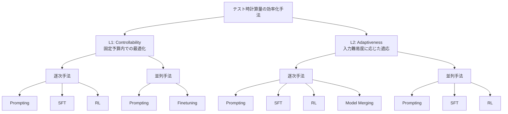

## 論文概要（Abstract）

本記事は [arXiv:2507.02076](https://arxiv.org/abs/2507.02076) の解説記事です。

Alomrani et al.は、LLMの推論時計算量（Test-Time Compute; TTC）を効率的に制御する手法を体系的にサーベイしている。現行の推論モデルはタスク難易度に関係なく固定量の計算リソースを消費し、「1+1=?」のような単純な問題に過大な計算量を費やす一方、複雑な問題には不十分な計算量しか割り当てないという非効率性を抱えている。著者らは2層の分類法を提案し、L1-controllability（固定予算内での制御）とL2-adaptiveness（入力難易度に応じた適応的スケーリング）の2軸で既存手法を整理している。

この記事は [Zenn記事: 推論モデル時代のプロンプト設計転換：CoT不要化とeffort制御の実装パターン](https://zenn.dev/0h_n0/articles/467b9c2f35b4dc) の深掘りです。

## 情報源

- **arXiv ID**: 2507.02076
- **URL**: [https://arxiv.org/abs/2507.02076](https://arxiv.org/abs/2507.02076)
- **著者**: Mohammad Ali Alomrani, Yingxue Zhang, Derek Li et al.
- **投稿日**: 2025年7月
- **分野**: cs.AI, cs.LG

## 背景と動機（Background & Motivation）

LLMの推論時計算量（TTC）は、単一のフォワードパスと比較して10倍以上のコストが発生し得ることが報告されている（Brown et al., 2024）。o1やDeepSeek-R1などの推論モデルは、強化学習によって内部的な探索プロセスを獲得しているが、その計算量はタスク複雑度に連動していない。

著者らは、この非効率性が実時間制約の厳しいアプリケーション（ロボティクス、自動運転、バーチャルアシスタント等）において大きな障壁になると指摘している。一方で、商用モデルにおいてはClaude 3.7 Sonnetのthinking token budget制御やOpenAI oシリーズのreasoning effort設定など、推論量をユーザが制御可能な機構が登場し始めている。

本サーベイは、このようなTTC効率化手法を統一的に整理し、研究コミュニティに体系的な見取り図を提供することを目的としている。

## 主要な貢献（Key Contributions）

- **2層分類法（L1/L2 taxonomy）の提案**: テスト時計算量の制御手法を、L1-controllability（与えられた計算予算内で最適化）とL2-adaptiveness（入力に応じて動的にスケーリング）の2軸で分類する枠組み
- **並列/逐次の分類軸**: 各レベル内でさらに並列手法（self-consistency、Best-of-N等）と逐次手法（CoT、self-refinement等）に分類
- **プロンプティング/SFT/RLの手法区分**: 各カテゴリ内で、追加学習不要のプロンプティング手法、教師あり微調整（SFT）、強化学習（RL）による手法を体系的に整理
- **独自ベンチマーク**: 主要な推論モデル（o1、Claude 3.7、DeepSeek-R1、Qwen3等）を対象に、精度とトークン消費量のトレードオフを実測で比較

## 技術的詳細（Technical Details）

### 分類法の全体構造

著者らが提案する2層分類法の全体像を以下に示す。

### L1: Controllability（制御可能性）

L1は、ユーザが明示的に計算予算$C$を指定し、その制約下で性能を最大化する枠組みである。著者らは以下の最適化問題として定式化している。

$$
\max_{r} \mathcal{P}(r, x) \quad \text{s.t.} \quad \mathcal{E}(r, x) \geq \frac{1}{C}
$$

ここで、
- $r$: モデルが生成する推論トレース
- $x$: 入力クエリ
- $\mathcal{P}(r, x)$: 推論結果の性能（正答率等）
- $\mathcal{E}(r, x)$: 効率指標（トークン数やFLOPsの逆数）
- $C$: ユーザ指定の計算予算

L1に分類される代表的な手法は以下の通りである。

**逐次手法（Sequential）**:
- **Budget Forcing（s1）**: Muennighoff et al.が提案。推論途中でthinkingを打ち切る（早期停止）か、「Wait」トークンを付加して推論を延長する手法。Qwen2.5-32Bをs1Kデータセットで微調整したs1-32Bは、AIME24で50%から57%への精度向上を達成したと報告されている
- **Chain of Draft（CoD）**: Xu et al.が提案。各推論ステップを最大5単語に制限し、CoTと同等の精度を維持しながら最大92.4%のトークン削減を達成したと報告されている
- **CoT-Valve**: LoRAのスケーリング係数でCoTの長さを連続的に制御するSFT手法
- **L1/LCPO**: Aggarwal and Welleckが提案したRL手法。L1-ExactとL1-Maxの2つの変種があり、予算制約を強化学習の目的関数に直接組み込む

**並列手法（Parallel）**:
- **Self-Consistency**: 同一プロンプトから複数の推論パスをサンプリングし、多数決で最終解を決定する手法
- **Best-of-N（BoN）**: N個の候補を生成し、報酬モデルで最高スコアの解を選択する手法。Chow et al.はBoN-SFTとBoN-RLによる推論効率の改善を報告している

### L2: Adaptiveness（適応性）

L2は、事前に予算を指定せず、入力の難易度やモデルの確信度に応じて計算量を動的に調整する枠組みである。

$$
\max_{r} \mathcal{P}(r, x) + \alpha \cdot \mathcal{E}(r, x)
$$

ここで、
- $\alpha$: 性能と効率のトレードオフを制御するハイパーパラメータ

著者らはL2がL1よりも実用的であると主張している。L1では適切な予算$C$の設定自体が困難であるのに対し、L2はモデルが入力に応じて自律的に計算量を配分するためである。

**逐次手法（Sequential）**:
- **Concise CoT**: Renze and Guvenが提案。簡潔な推論を促すプロンプティング手法
- **認知スタイルルーティング**: Aytes et al.が提案。ルーターモデルがクエリの複雑度を判定し、推論戦略を切り替える。元のトークン数の15--30%で同等の精度を達成したと報告されている
- **MetaReasoner**: コンテキストバンディットアルゴリズムで推論戦略を動的に選択する手法
- **潜在空間推論（Latent-Space Reasoning）**: Coconut（Hao et al.）に代表される、言語トークンではなく連続的な潜在表現で推論を行う手法。LightThinkerやITT（Internal Thinking Tokens）もこのカテゴリに含まれる
- **モデルマージ**: Wu et al.がactivationベースのマージ手法を提案。1.5Bおよび7Bモデルで50--55%のトークン削減を達成したが、14B以上のモデルでは削減率が10%未満にとどまったと報告されている

**RL手法の比較**: 著者らはTable 1でRL手法を詳細に比較している。O1-Pruner、Kimi k1.5、DAST、VAPO、Dr.GRPO、Concise Reasoningなどが含まれ、Arora and Zanetteの手法は22--77%のトークン削減を達成しつつ、性能の93%を維持したと報告されている。

**並列手法（Parallel）**:
- **適応的停止（Adaptive Stopping）**: Aggarwal et al.がself-consistencyの早期停止を提案。十分な合意が得られた時点でサンプリングを打ち切る
- **難易度ベースの予算配分**: Wang et al.が提案。問題の推定難易度に応じてサンプル数を動的に調整する
- **仮説検定による早期停止**: Li et al.が提案。統計的仮説検定の枠組みで停止条件を判定する

### 効率指標

著者らは複数の効率指標を導入している。

- **トークンコスト**: 生成トークン総数。最も直接的で測定が容易な指標であり、API課金と直結する
- **FLOPsベースコスト**: 実際のGPU演算量に基づく指標。モデルサイズやアーキテクチャの違いを考慮した比較に適している
- **成果効率（Outcome Efficiency）** $\mathcal{E}_O$: 正解に最初に到達するまでに必要なトークンの割合。推論トレース全体のうち、正解到達以降のトークンは「無駄」と見なす。この指標は「overthinking（過剰推論）」の定量化に有用である

成果効率$\mathcal{E}_O$は、推論モデルが正解に辿り着いた後も不必要な検証や再計算を続ける現象を捉える指標として重要である。例えば、DeepSeek-R1が$\sqrt{1234}$の計算に約12,000トークンを消費する事例（論文Figure 4）は、$\mathcal{E}_O$が極めて低い典型例と言える。

### RL手法の詳細比較

著者らはTable 1で、L2-adaptivenessのRL手法を横断的に比較している。以下に主要な手法の特徴を整理する。

| 手法 | アプローチ | トークン削減率 | 性能維持率 | 特記事項 |
|------|-----------|---------------|-----------|----------|
| O1-Pruner | 不要な推論ステップの刈り込み | -- | -- | 推論トレースの後処理 |
| Kimi k1.5 | 長さ報酬の導入 | -- | -- | 商用モデルでの適用 |
| DAST | 難易度適応的なステップ制御 | -- | -- | ステップ単位の制御 |
| Dr.GRPO | GRPOの長さ正則化変種 | -- | -- | GRPO目的関数の拡張 |
| Arora & Zanette | 効率報酬の統合 | 22--77% | 最大93% | トークン削減と性能のバランスが良い |

（論文Table 1より構成。一部の手法は論文中で具体的な数値が報告されていない）

Arora and Zanetteの手法は、22--77%のトークン削減を達成しながら性能の93%を維持したと報告されており、L2-RL手法の中で効率と性能のバランスに優れた結果を示している。

### モデルマージによるアプローチ

Wu et al.が提案したactivationベースのモデルマージは、L2カテゴリの中でも特異なアプローチである。推論の「速い」モデルと「遅い」モデルの重みをactivationに基づいてマージすることで、追加学習なしにトークン削減を実現する。

- **小規模モデル（1.5B, 7B）**: 50--55%のトークン削減を達成
- **大規模モデル（14B, 32B）**: 削減率が10%未満にとどまる

著者らはこの結果について、大規模モデルでは推論パターンがより複雑に絡み合っており、単純なマージでは分離が困難であることを示唆していると述べている。

## 実験結果（Results）

### モデル別のベンチマーク比較

著者らはAppendix A（Table 2）で、主要モデルの精度とトークン消費量を比較している。以下はAIME-24&25（数学競技）における結果の抜粋である。

| モデル | 設定 | 精度 | 平均トークン数 |
|--------|------|------|----------------|
| GPT-o1 | high | 83.33% | 14,067 |
| Qwen3-14B | thinking ON | 86.44% | 13,780 |
| Qwen3-8B | thinking ON | 80.00% | 16,007 |
| Gemini 2.5 Flash | thinking ON | 76.67% | 23,394 |
| DeepSeek-R1 (671B) | default | 63.33% | 6,378 |
| Claude 3.7 Sonnet | thinking ON | 47.17% | 16,403 |
| DeepSeek-V3 | -- | 48.33% | 3,661 |
| GPT-4o | -- | 15.00% | 1,222 |

（論文Table 2より抜粋。AIME-24&25における8回の独立評価の平均値）

この結果からいくつかの傾向が読み取れる。

- **推論モード有効化の効果**: Qwen3-14Bではthinking OFF（35.00%）からON（86.44%）へと51ポイント以上の精度向上が見られる一方、トークン数は3,428から13,780へと約4倍に増加している
- **モデルサイズと効率のトレードオフ**: DeepSeek-R1（671B）は63.33%を平均6,378トークンで達成しており、Claude 3.7 Sonnet（47.17%, 16,403トークン）と比較してトークン効率が高い
- **簡易タスクでの過剰推論**: GSM-8Kでは多くのモデルがthinking ON/OFFともに99%前後の精度を達成するが、thinking ONの場合のトークン数は数倍に膨れ上がる。これはまさに本サーベイが問題視する「簡単な問題への過剰計算」の実例である

### Claude 3.7 Sonnetの予算制御特性

著者らはFigure 2で、Claude 3.7 Sonnetのthinking token budget制御の挙動を分析している。MATH500（比較的容易）とAIME（高難度）では、モデルが消費するthinkingトークンの分布が大きく異なる。しかし、一部の問題では指定した予算を超過するロングテール分布が観察されており、現行の予算制御メカニズムが完全ではないことが示唆されている。

また、Figure 4ではDeepSeek-R1が「$\sqrt{1234}$を求めよ」という比較的単純な問題に約12,000トークンを消費する一方、Claude 3.7は低い予算設定で同等の回答に到達する例が示されている。

## 実運用への応用（Practical Applications）

### Zenn記事のeffort制御パターンとの対応

関連Zenn記事で解説されているeffort制御パターンは、本サーベイのL1-controllabilityに直接対応する。

| サーベイの分類 | 実装例 |
|----------------|--------|
| L1-controllability（逐次・プロンプティング） | Anthropic `thinking: {"type": "adaptive"}` + `output_config: {"effort": "low/medium/high"}` |
| L1-controllability（逐次・プロンプティング） | OpenAI `reasoning_effort: "low/medium/high"` |
| L2-adaptiveness（逐次・プロンプティング） | Anthropic adaptive thinking（モデルがクエリ複雑度に応じて自動調整） |

Anthropicのadaptive thinkingは特に注目に値する。Zenn記事で解説されているように、Claude 4.6以降ではモデルがクエリの複雑さに応じて動的に推論量を決定する。これはサーベイのL2-adaptiveness（入力に応じた適応的制御）の商用実装と見なすことができる。

一方、OpenAIのreasoning effort設定（low/medium/high）は、ユーザが明示的に計算予算を指示するL1-controllabilityのインターフェースである。Zenn記事で指摘されている「最初からeffort highで全リクエストを処理しようとするケース」は、本サーベイの文脈では「タスク複雑度に関係なく固定計算量を使用する」問題そのものであり、L2的なアプローチへの移行が望ましいことを示唆している。

### 実務での活用指針

本サーベイの知見を実務に適用する際の指針は以下の通りである。

1. **タスク難易度の推定を組み込む**: 全リクエストに一律のeffort設定を適用するのではなく、入力の複雑度に応じてeffortレベルを動的に切り替えるルーティング機構を設計する（サーベイのL2アプローチ）
2. **コスト監視指標の導入**: サーベイで提案されている成果効率$\mathcal{E}_O$のように、「正解到達までに消費したトークン量」をモニタリングすることで、過剰推論の検出が可能になる
3. **簡易タスクのショートカット**: GSM-8Kレベルの単純なタスクでは推論モードを無効化し、高難度タスクにのみ計算リソースを集中させる

## 議論: ハイブリッドfast-slowモデルとマルチモーダル展開

### プロンプティング vs ファインチューニングの使い分け

著者らはSection 6で、TTC効率化手法の選択基準について議論している。プロンプティング手法は追加の学習コストが不要であり、APIユーザのように計算リソースが限られたユーザに適している。一方、SFTやRL手法はモデル学習が必要だが、より本質的な効率改善が期待できる。

実務的には、まずプロンプティングベースの手法（Chain of Draft、budget forcing、effort制御等）で即時的なコスト削減を図り、その後必要に応じてSFT/RLベースの手法に移行するという段階的アプローチが有効であると考えられる。

### ハイブリッドfast-slowモデルの課題

著者らは、RL手法が検証可能な報酬（verifiable rewards）に依存している点を課題として指摘している。数学やコーディングタスクでは正誤判定が明確であるためRL手法が有効に機能するが、自由記述の質問応答や創作タスクでは報酬設計が困難であり、推論量の制御効果が限定的になる。

### マルチモーダルモデルへの展開

本サーベイはテキスト生成モデルに焦点を当てているが、著者らはVision-R1、LLaVA-CoT、FAST、Skywork R1V、VLM-R1など、マルチモーダルモデルへのTTC効率化の適用事例にも言及している。これらの取り組みは主に圧縮（compression）ベースであり、推論レベルでの制御はまだ十分に探索されていない領域であると指摘されている。

## 関連研究（Related Work）

- **TOPS（Thinking-Optimal Scaling）**: Yang et al.（[arXiv:2502.18080](https://arxiv.org/abs/2502.18080)）が提案。推論の長さとタスク難易度の関係を分析し、短・中・長の推論を使い分けるモデルを学習する手法。GSM8K、MATH500、AIME2024で、蒸留ベースのモデルよりも少ないトークンで高い精度を達成したと報告されている
- **s1（Budget Forcing）**: Muennighoff et al.（[arXiv:2501.19393](https://arxiv.org/abs/2501.19393)）が提案。1,000件のデータで微調整したs1-32Bが、AIME24でo1-previewを最大27%上回ったと報告されている。ICLR 2025 Workshop採択
- **When More Thinking Hurts**: Zhou et al.（[arXiv:2604.10739](https://arxiv.org/abs/2604.10739)）が、推論トークン数の増加が必ずしも精度向上に繋がらないことを実証。過剰な推論が正しい回答を「捨てる」現象（overthinking）を報告しており、ACL 2026 Findingsに採択されている
- **Mind Your Step (by Step)**: Liu et al.（[arXiv:2410.21333](https://arxiv.org/abs/2410.21333)）が、CoTの不適切な強制がタスクによっては精度を最大36.3ポイント低下させることを報告。ICML 2025採択

## まとめと今後の展望

本サーベイは、LLMのテスト時計算量の効率化手法をL1（制御可能性）とL2（適応性）の2層で体系化した点に意義がある。特に、L2-adaptivenessが予算の事前設定を不要にする点で実用的であるという著者らの主張は、Anthropicのadaptive thinkingやOpenAIのreasoning effort等の商用実装の方向性と一致している。

著者らは今後の方向性として、(1) 動的かつタスクアウェアな推論制御の高度化、(2) ハイブリッドなfast-slowモデルの発展、(3) マルチモーダルモデル（Vision-R1、LLaVA-CoT等）への拡張、(4) 自動運転やロボティクスなどのリアルタイムアプリケーションへの適用を挙げている。推論モデルの普及に伴い、「いつ、どれだけ考えるか」の最適化は、モデル性能そのものと同様に重要な研究課題となりつつある。

## 参考文献

- **arXiv**: [https://arxiv.org/abs/2507.02076](https://arxiv.org/abs/2507.02076)
- **Related Zenn article**: [https://zenn.dev/0h_n0/articles/467b9c2f35b4dc](https://zenn.dev/0h_n0/articles/467b9c2f35b4dc)
- **s1: Simple test-time scaling**: [https://arxiv.org/abs/2501.19393](https://arxiv.org/abs/2501.19393)
- **Chain of Draft**: [https://arxiv.org/abs/2502.18600](https://arxiv.org/abs/2502.18600)
- **TOPS**: [https://arxiv.org/abs/2502.18080](https://arxiv.org/abs/2502.18080)
- **When More Thinking Hurts**: [https://arxiv.org/abs/2604.10739](https://arxiv.org/abs/2604.10739)

---

この記事はAI（Claude Code）により自動生成されました。内容の正確性については複数の情報源で検証していますが、実際の利用時は論文原文もご確認ください。
