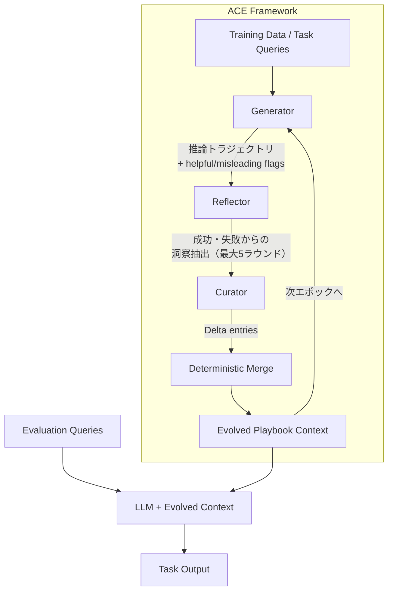

## 論文概要（Abstract）

本記事は [arXiv:2510.04618](https://arxiv.org/abs/2510.04618) の解説記事です。

ACE（Agentic Context Engineering）は、LLMのコンテキストを進化する「playbook」として扱い、generate・reflect・curateの3段階ループで文脈を自律的に洗練するフレームワークである。従来のプロンプト最適化手法が陥るbrevity bias（簡潔化による情報喪失）とcontext collapse（反復的書き換えによる文脈崩壊）に対処し、Zhang et al.はAppWorldエージェントベンチマークで+10.6%、金融タスクで+8.6%の改善を報告している。ICLR 2026に採択された本論文は、ラベルなし自然言語フィードバックのみで動作し、小規模オープンソースモデルでトップエージェントと同等の性能を達成した点が特筆される。

この記事は [Zenn記事: 推論モデル時代のプロンプト設計転換：CoT不要化とeffort制御の実装パターン](https://zenn.dev/0h_n0/articles/467b9c2f35b4dc) の深掘りです。

## 情報源

- **arXiv ID**: 2510.04618
- **URL**: [https://arxiv.org/abs/2510.04618](https://arxiv.org/abs/2510.04618)
- **著者**: Qizheng Zhang (Stanford), Changran Hu (Stanford/UC Berkeley), Shubhangi Upasani, Boyuan Ma, Fenglu Hong, Vamsidhar Kamanuru, Jay Rainton, Chen Wu, Mengmeng Ji (SambaNova Systems), Hanchen Li (UC Berkeley), Urmish Thakker (SambaNova Systems), James Zou, Kunle Olukotun (Stanford)
- **投稿日**: 2025年10月6日（v3: 2026年3月29日）
- **分野**: cs.LG, cs.AI, cs.CL
- **カンファレンス**: ICLR 2026 accepted
- **実装**: [github.com/ace-agent/ace](https://github.com/ace-agent/ace)

## カンファレンス情報

ICLR（International Conference on Learning Representations）は機械学習分野のトップカンファレンスの一つであり、2026年はシンガポールで開催された。表現学習を中心に、基盤モデル・エージェント・最適化手法など幅広いテーマを扱う。ACEは「コンテキスト適応」という、重みの更新を伴わない新しいパラダイムをエージェントタスクで実証した点が評価されたと考えられる。

## 背景と動機（Background & Motivation）

LLMの性能向上手法は大きく2つに分類される。重みを更新するファインチューニングと、入力コンテキストを最適化するコンテキスト適応である。後者はシステムプロンプト、エージェントメモリ、RAG検索結果などを通じてモデルの振る舞いを制御する手法であり、解釈可能性・実行時更新・モデル間共有の観点で利点がある。

従来のプロンプト最適化手法には2つの構造的問題がある。

**Brevity bias**: Gao et al.（2025）の報告によれば、反復的なプロンプト最適化はドメイン固有の洞察を削ぎ落とし、短く汎用的な指示に収束する傾向がある。最適化の各ステップで「簡潔さ」が優先され、タスク固有のノウハウが失われる。

**Context collapse**: モノリシックなLLM書き換えによるコンテキスト更新は、蓄積した知識を一度に崩壊させるリスクがある。Zhang et al.の報告では、AppWorldにおいてLLMによるコンテキスト全体の書き換えを行った結果、18,282トークンのコンテキストがわずか122トークンに圧縮され、精度が66.7%から57.1%に急落した。この値はコンテキスト適応なしのベースライン（63.7%）をも下回る。

ACEはこれらの問題に対し、コンテキストを「進化するplaybook」として扱い、局所的な差分更新（delta update）で知識を蓄積する設計を採用している。

## 主要な貢献（Key Contributions）

- **ACEフレームワーク**: Generator・Reflector・Curatorの3役割分離アーキテクチャ。コンテキストを構造化されたbulletの集合として管理し、差分更新で進化させる
- **Brevity bias対策**: 圧縮ではなく蓄積（grow-and-refine）戦略を採用。LLM自身が必要な情報を取捨選択できるため、包括的なplaybookが有効に機能する
- **Context collapse対策**: モノリシックな書き換えを排し、局所的なdelta entryの追加・更新による増分的な文脈進化を実現
- **ラベル不要**: 教師ラベルなしの自然言語実行フィードバックのみで動作。GT（Ground Truth）ラベルありの設定ではさらに性能が向上
- **効率性**: GEPA比でアダプテーション遅延82.3%削減、入力トークン80.8%削減、出力トークン83.6%削減

## 技術的詳細（Technical Details）

### ACEフレームワークの全体像

ACEは3つの役割を持つモジュールで構成される。著者らの実装ではDeepSeek-V3.1（non-thinkingモード）が3役割すべてを担う。



**Generator**: タスククエリに対して推論トラジェクトリを生成し、playbookの各bulletがhelpful（有用）かmisleading（誤誘導）かをフラグ付けする。

**Reflector**: Generatorの成功・失敗トラジェクトリを分析し、再利用可能な洞察（lessons）を抽出する。最大5ラウンドの反復的精緻化が可能であり、各ラウンドで洞察の質が向上する。Zhang et al.の報告では、反復回数5が最適であり、10ラウンドではやや性能が低下する（AppWorld test-normalで65.2% vs 67.6%）。

**Curator**: Reflectorの洞察をコンパクトなdelta entryに変換する。delta entryは決定論的ロジック（LLMを介さない）でplaybookにマージされる。

### コンテキスト表現

Playbookは構造化されたbulletの集合として表現される。各bulletは以下のメタデータを持つ。

| フィールド | 説明 |
|-----------|------|
| ID | 一意識別子 |
| helpful_count | 有用と判定された回数 |
| harmful_count | 有害と判定された回数 |
| content | 再利用可能な戦略、ドメイン概念、失敗モードなどの小単位 |

この構造により、bulletレベルの局所化（どのbulletが効果的か追跡可能）、埋め込みベースの類似検索、差分的な追加・更新が可能になる。

### Grow-and-Refine戦略

ACEのコンテキスト更新は「成長と精緻化」の2段階で行われる。

1. **成長（Grow）**: 新しいbulletをplaybookに追加し、既存bulletのカウンタを更新する
2. **精緻化（Refine）**: 意味的埋め込みに基づく重複排除を実施。コンテキストウィンドウの上限を超えた場合にのみ発動する（lazy方式）か、各delta適用後に実施する（proactive方式）

重複排除の閾値について、FiNERタスクでは90%閾値で78.6%、70%で73.9%、50%で77.0%と報告されており、高い閾値（類似度が高いもののみ統合）がやや有利である。

コンテキスト長の上限については、10K・50K・100Kトークンの設定でFiNER精度がそれぞれ78.6%・78.4%・78.3%と安定しており、長いコンテキストでも性能が劣化しないことが示されている。

### オフラインモードとオンラインモード

ACEは2つの動作モードを持つ。

**オフラインモード**: 訓練データに対して最大5エポックの反復適応を行う。各エポックでplaybook全体が精緻化される。GTラベルが利用可能な場合はフィードバックの質が向上する。

**オンラインモード**: 推論時にタスクを1件ずつ処理しながらplaybookを更新する。オフラインモードで事前にウォームアップしたplaybookを初期状態として使用すると性能が向上する（AppWorldで56.1% → 59.5%）。

### 差分更新の重要性

差分更新（incremental delta update）の効果はアブレーション実験で明確に示されている。AppWorld test-normalにおいて、差分更新ありの場合の平均精度は70.3%（TGC 76.2%, SGC 64.3%）であるのに対し、差分更新なし（モノリシック書き換え）では56.9%に低下する。TGCで-11.7%、SGCで-27.8%の劣化であり、特にSGC（シングルコール）タスクで差分更新の恩恵が大きい。

### アルゴリズム（Python擬似コード）

以下はACEの中核ループを簡略化した擬似コードである。

```python
from dataclasses import dataclass, field


@dataclass
class Bullet:
    """Playbookの1エントリ。再利用可能な戦略・知識の最小単位。"""
    id: str
    content: str
    helpful_count: int = 0
    harmful_count: int = 0
    embedding: list[float] = field(default_factory=list)


@dataclass
class Playbook:
    """進化するコンテキスト。bulletの集合として管理される。"""
    bullets: list[Bullet] = field(default_factory=list)
    max_tokens: int = 50_000

    def merge_delta(self, delta_entries: list[Bullet], dedup_threshold: float = 0.9) -> None:
        """Delta entriesを決定論的にマージする。

        Args:
            delta_entries: Curatorが生成した新規bullet群
            dedup_threshold: 埋め込み類似度の重複判定閾値
        """
        for entry in delta_entries:
            existing = self._find_similar(entry, threshold=dedup_threshold)
            if existing is not None:
                # 既存bulletのカウンタを更新
                existing.helpful_count += entry.helpful_count
                existing.harmful_count += entry.harmful_count
            else:
                # 新規bulletとして追加
                self.bullets.append(entry)
        self._refine_if_needed()

    def _find_similar(self, entry: Bullet, threshold: float) -> Bullet | None:
        """埋め込み類似度で既存bulletとの重複を検出する。"""
        for bullet in self.bullets:
            similarity = _cosine_similarity(bullet.embedding, entry.embedding)
            if similarity >= threshold:
                return bullet
        return None

    def _refine_if_needed(self) -> None:
        """コンテキスト上限を超えた場合にharmful bulletを除去する。"""
        total_tokens = sum(_estimate_tokens(b.content) for b in self.bullets)
        if total_tokens > self.max_tokens:
            # harmful_countが高いbulletを優先的に除去
            self.bullets.sort(
                key=lambda b: b.harmful_count - b.helpful_count
            )
            while (sum(_estimate_tokens(b.content) for b in self.bullets)
                   > self.max_tokens):
                self.bullets.pop()  # 最もharmfulなbulletを除去


def ace_offline_loop(
    train_queries: list[str],
    llm: object,
    max_epochs: int = 5,
    max_reflect_rounds: int = 5,
) -> Playbook:
    """ACEオフライン適応ループ。

    Args:
        train_queries: 訓練クエリ群
        llm: Generator/Reflector/Curatorとして使用するLLM
        max_epochs: 最大エポック数
        max_reflect_rounds: Reflectorの最大精緻化ラウンド数

    Returns:
        進化したPlaybook
    """
    playbook = Playbook()

    for epoch in range(max_epochs):
        for query in train_queries:
            # Step 1: Generate - 推論トラジェクトリの生成
            trajectory = llm.generate(query, context=playbook)
            bullet_flags = llm.flag_bullets(trajectory, playbook)

            # Step 2: Reflect - 洞察の抽出（反復的精緻化）
            insights = llm.reflect(trajectory, bullet_flags)
            for _ in range(max_reflect_rounds - 1):
                insights = llm.refine_insights(insights, trajectory)

            # Step 3: Curate - delta entryの生成とマージ
            delta_entries = llm.curate(insights)
            playbook.merge_delta(delta_entries)

    return playbook


def _cosine_similarity(a: list[float], b: list[float]) -> float:
    dot = sum(x * y for x, y in zip(a, b))
    norm_a = sum(x ** 2 for x in a) ** 0.5
    norm_b = sum(x ** 2 for x in b) ** 0.5
    return dot / (norm_a * norm_b) if norm_a * norm_b > 0 else 0.0


def _estimate_tokens(text: str) -> int:
    return len(text) // 4  # 簡易推定
```

## 実装のポイント（Implementation）

ACEの実装において注目すべき設計判断は以下の通りである。

**単一LLMの3役割兼任**: Generator・Reflector・Curatorの3つの役割を同一のLLM（DeepSeek-V3.1）が担う。専用の小型モデルや外部ツールを必要としないため、デプロイメントが簡素化される。Reflectorの品質に関するアブレーションでは、弱いReflector（GPT-OSS-120B）を使用してもFiNERで76.6%（+5.9%）の改善が得られ、強いReflector（GPT-5.1）では78.5%（+7.8%）とわずかな追加改善に留まる。このことはReflectorの品質に対するフレームワークのロバスト性を示している。

**バッチサイズ1**: 各サンプルに対して1つのdeltaコンテキストを生成する。大バッチでの並列処理ではなく、逐次的な蓄積を選択している。delta entryは局所化されているため、並列マージも可能である。

**決定論的マージ**: CuratorからのdeltaをLLMを介さず決定論的ロジックでマージする。これによりマージ時のLLM呼び出しコストを排除し、再現性を確保している。

**KVキャッシュの活用**: GPT-5.1のPrompt Cachingを利用した評価では、ACEの入力トークンの91.8%がキャッシュから提供され、課金対象の入力コストが82.6%削減されたと報告されている。Playbookが安定的なプレフィックスとして機能するため、KVキャッシュとの親和性が高い。

**有害Reflectorへの耐性**: Reflectorが毎回有害な洞察を注入する最悪ケースでも精度は66.7%（-4.0%）に留まり、5回に1回の頻度では76.1%（+5.4%）と依然として改善を維持する。これはdelta updateの局所性とhelpful/harmfulカウンタによるフィルタリングが機能していることを示す。

## Production Deployment Guide

本セクションでは、ACEフレームワークの知見をAWS環境でのLLMエージェント基盤に応用するパターンを示す。ACEの中核であるgenerate-reflect-curateループとplaybook管理を、スケーラブルなクラウドアーキテクチャで実装する。

> **注**: 以下のコスト試算は2026年10月時点のAWS ap-northeast-1（東京リージョン）料金に基づく概算値である。実際のコストはトラフィック・リージョン・利用パターンにより変動する。最新料金は[AWS料金計算ツール](https://calculator.aws/)で確認を推奨する。

### AWS実装パターン

ACEの設計原則（差分更新によるplaybook進化、3役割分離、KVキャッシュ活用）をAWS環境に適用する3つの構成を示す。

| 構成 | トラフィック | AWS構成 | 月額概算 | 特徴 |
|------|------------|---------|---------|------|
| Small | ~500 req/日 | Lambda + DynamoDB + Bedrock | $200-500 | サーバーレス、ゼロスケール対応 |
| Medium | ~5,000 req/日 | ECS Fargate + ElastiCache + Bedrock | $1,500-3,500 | Playbook常駐、低レイテンシ |
| Large | 50,000+ req/日 | EKS + GPU (g5) + S3 + Redis Cluster | $8,000-20,000 | セルフホストLLM、完全制御 |

**Small構成（サーバーレス）**: Lambda関数でACEの3段階ループを実装し、DynamoDBにplaybookのbulletを格納する。Bedrock（Claude/Nova）をLLMバックエンドとして使用する。ゼロリクエスト時のコストがほぼゼロになるため、PoC・開発環境に適する。

**Medium構成（Fargate常駐）**: ECS Fargateでエージェントプロセスを常駐させ、ElastiCache（Redis）にplaybookをキャッシュする。Playbookの読み込みレイテンシをサブミリ秒に抑え、オンラインモードでのリアルタイム適応に対応する。Bedrockのバッチ推論APIを活用してReflectorのコストを削減する。

**Large構成（セルフホストGPU）**: EKS上にDeepSeek-V3.1やLlama-3.3-70Bをデプロイし、vLLMのPrefix Cachingを活用してACEのKVキャッシュ効率（91.8%キャッシュヒット率）を再現する。S3にplaybookのスナップショットを保存し、Redis ClusterでオンラインPlaybookを管理する。

### Terraformインフラコード

#### Small構成（Lambda + DynamoDB + Bedrock）

```hcl
terraform {
  required_version = ">= 1.9"
  required_providers {
    aws = { source = "hashicorp/aws", version = "~> 5.70" }
  }
}

provider "aws" { region = "ap-northeast-1" }

# DynamoDB: Playbookストア（bullet単位で格納）
resource "aws_dynamodb_table" "playbook" {
  name         = "ace-playbook"
  billing_mode = "PAY_PER_REQUEST"
  hash_key     = "playbook_id"
  range_key    = "bullet_id"

  attribute {
    name = "playbook_id"
    type = "S"
  }
  attribute {
    name = "bullet_id"
    type = "S"
  }

  ttl {
    attribute_name = "expires_at"
    enabled        = true
  }

  point_in_time_recovery { enabled = true }

  tags = { Project = "ace-agent", Environment = "production" }
}

# Lambda: ACEループ実行（Generator -> Reflector -> Curator）
resource "aws_lambda_function" "ace_loop" {
  function_name = "ace-generate-reflect-curate"
  runtime       = "python3.12"
  handler       = "ace_handler.lambda_handler"
  timeout       = 900  # 15分（Reflector最大5ラウンド分）
  memory_size   = 1024

  filename         = data.archive_file.ace_lambda.output_path
  source_code_hash = data.archive_file.ace_lambda.output_base64sha256
  role             = aws_iam_role.ace_lambda.arn

  environment {
    variables = {
      PLAYBOOK_TABLE     = aws_dynamodb_table.playbook.name
      BEDROCK_MODEL_ID   = "anthropic.claude-sonnet-4-20250514"
      MAX_REFLECT_ROUNDS = "5"
      DEDUP_THRESHOLD    = "0.9"
    }
  }
}

data "archive_file" "ace_lambda" {
  type        = "zip"
  source_dir  = "${path.module}/lambda/ace"
  output_path = "${path.module}/dist/ace_lambda.zip"
}

# IAMロール
resource "aws_iam_role" "ace_lambda" {
  name = "ace-lambda-role"
  assume_role_policy = jsonencode({
    Version = "2012-10-17"
    Statement = [{
      Action = "sts:AssumeRole"
      Effect = "Allow"
      Principal = { Service = "lambda.amazonaws.com" }
    }]
  })
}

resource "aws_iam_role_policy" "ace_lambda" {
  name = "ace-lambda-policy"
  role = aws_iam_role.ace_lambda.id
  policy = jsonencode({
    Version = "2012-10-17"
    Statement = [
      {
        Effect = "Allow"
        Action = [
          "dynamodb:GetItem", "dynamodb:PutItem",
          "dynamodb:UpdateItem", "dynamodb:Query",
          "dynamodb:BatchWriteItem"
        ]
        Resource = aws_dynamodb_table.playbook.arn
      },
      {
        Effect   = "Allow"
        Action   = ["bedrock:InvokeModel", "bedrock:InvokeModelWithResponseStream"]
        Resource = "arn:aws:bedrock:ap-northeast-1::foundation-model/*"
      },
      {
        Effect   = "Allow"
        Action   = ["logs:CreateLogGroup", "logs:CreateLogStream", "logs:PutLogEvents"]
        Resource = "arn:aws:logs:*:*:*"
      }
    ]
  })
}

# API Gateway: エージェントエンドポイント
resource "aws_apigatewayv2_api" "ace" {
  name          = "ace-agent-api"
  protocol_type = "HTTP"
}

resource "aws_apigatewayv2_integration" "ace" {
  api_id                 = aws_apigatewayv2_api.ace.id
  integration_type       = "AWS_PROXY"
  integration_uri        = aws_lambda_function.ace_loop.invoke_arn
  payload_format_version = "2.0"
}

resource "aws_apigatewayv2_route" "ace" {
  api_id    = aws_apigatewayv2_api.ace.id
  route_key = "POST /agent/run"
  target    = "integrations/${aws_apigatewayv2_integration.ace.id}"
}

resource "aws_apigatewayv2_stage" "ace" {
  api_id      = aws_apigatewayv2_api.ace.id
  name        = "$default"
  auto_deploy = true
}

resource "aws_lambda_permission" "ace_apigw" {
  statement_id  = "AllowAPIGateway"
  action        = "lambda:InvokeFunction"
  function_name = aws_lambda_function.ace_loop.function_name
  principal     = "apigateway.amazonaws.com"
  source_arn    = "${aws_apigatewayv2_api.ace.execution_arn}/*/*"
}
```

#### Large構成（EKS + vLLM + Redis）

```hcl
module "vpc" {
  source  = "terraform-aws-modules/vpc/aws"
  version = "~> 5.13"
  name    = "ace-agent-vpc"
  cidr    = "10.0.0.0/16"
  azs             = ["ap-northeast-1a", "ap-northeast-1c"]
  private_subnets = ["10.0.1.0/24", "10.0.2.0/24"]
  public_subnets  = ["10.0.101.0/24", "10.0.102.0/24"]
  enable_nat_gateway = true
  single_nat_gateway = true
}

module "eks" {
  source          = "terraform-aws-modules/eks/aws"
  version         = "~> 20.24"
  cluster_name    = "ace-agent-cluster"
  cluster_version = "1.31"
  vpc_id          = module.vpc.vpc_id
  subnet_ids      = module.vpc.private_subnets
  enable_irsa     = true

  eks_managed_node_groups = {
    # vLLMサーバー用GPUノード（ACE Generator/Reflector/Curator）
    gpu = {
      instance_types = ["g5.2xlarge"]  # A10G 24GB
      capacity_type  = "SPOT"
      min_size       = 0
      max_size       = 8
      desired_size   = 2
      labels         = { "node-type" = "gpu", "workload" = "llm-inference" }
      taints = [{
        key = "nvidia.com/gpu", value = "true", effect = "NO_SCHEDULE"
      }]
    }
    # ACEオーケストレーション用CPUノード
    cpu = {
      instance_types = ["m7i.xlarge"]
      capacity_type  = "ON_DEMAND"
      min_size       = 1
      max_size       = 4
      desired_size   = 2
      labels         = { "node-type" = "cpu", "workload" = "ace-orchestrator" }
    }
  }
}

# ElastiCache Redis: オンラインPlaybookストア
resource "aws_elasticache_replication_group" "playbook" {
  replication_group_id = "ace-playbook-cache"
  description          = "ACE playbook bullet store with sub-ms reads"
  engine               = "redis"
  engine_version       = "7.1"
  node_type            = "cache.r7g.large"
  num_cache_clusters   = 2
  subnet_group_name    = aws_elasticache_subnet_group.ace.name
  security_group_ids   = [aws_security_group.redis.id]
  at_rest_encryption_enabled = true
  transit_encryption_enabled = true
  automatic_failover_enabled = true
}

resource "aws_elasticache_subnet_group" "ace" {
  name       = "ace-playbook-subnet"
  subnet_ids = module.vpc.private_subnets
}

resource "aws_security_group" "redis" {
  name_prefix = "ace-redis-"
  vpc_id      = module.vpc.vpc_id
  ingress {
    from_port       = 6379
    to_port         = 6379
    protocol        = "tcp"
    security_groups = [module.eks.cluster_security_group_id]
  }
}

# S3: Playbookスナップショット・モデルアーティファクト
resource "aws_s3_bucket" "ace_artifacts" {
  bucket_prefix = "ace-agent-artifacts-"
}

resource "aws_s3_bucket_versioning" "ace_artifacts" {
  bucket = aws_s3_bucket.ace_artifacts.id
  versioning_configuration { status = "Enabled" }
}

resource "aws_s3_bucket_lifecycle_configuration" "ace_artifacts" {
  bucket = aws_s3_bucket.ace_artifacts.id
  rule {
    id     = "snapshot-retention"
    status = "Enabled"
    filter { prefix = "playbook-snapshots/" }
    transition {
      days          = 30
      storage_class = "STANDARD_IA"
    }
    expiration { days = 180 }
  }
}
```

### 運用・監視設定

#### Playbook品質監視（Python）

```python
import datetime
import json

import boto3


def create_ace_alarms(cluster_name: str) -> list[dict]:
    """ACEフレームワークの運用監視アラームを作成する。

    Args:
        cluster_name: EKSクラスタ名またはLambda関数名

    Returns:
        作成されたアラームのリスト
    """
    cw = boto3.client("cloudwatch", region_name="ap-northeast-1")
    alarms = []

    # Playbook肥大化アラーム（context collapse防止の裏返し）
    alarms.append(cw.put_metric_alarm(
        AlarmName=f"{cluster_name}-playbook-size",
        MetricName="PlaybookBulletCount",
        Namespace="ACEAgent/Custom",
        Statistic="Maximum",
        Period=300,
        EvaluationPeriods=3,
        Threshold=5000.0,
        ComparisonOperator="GreaterThanThreshold",
    ))

    # Reflectorレイテンシ異常（5ラウンドでの推論時間）
    alarms.append(cw.put_metric_alarm(
        AlarmName=f"{cluster_name}-reflector-latency-p99",
        MetricName="ReflectorDurationMs",
        Namespace="ACEAgent/Custom",
        Statistic="p99",
        Period=300,
        EvaluationPeriods=2,
        Threshold=120000.0,  # 2分
        ComparisonOperator="GreaterThanThreshold",
    ))

    # harmful bulletの蓄積率
    alarms.append(cw.put_metric_alarm(
        AlarmName=f"{cluster_name}-harmful-bullet-ratio",
        MetricName="HarmfulBulletRatio",
        Namespace="ACEAgent/Custom",
        Statistic="Average",
        Period=3600,
        EvaluationPeriods=1,
        Threshold=0.3,  # 30%以上がharmfulなら警告
        ComparisonOperator="GreaterThanThreshold",
    ))

    return alarms


def get_daily_ace_cost() -> dict[str, float]:
    """ACEエージェント基盤の日次コストをサービス別に取得する。"""
    ce = boto3.client("ce", region_name="ap-northeast-1")
    today = datetime.date.today()
    resp = ce.get_cost_and_usage(
        TimePeriod={
            "Start": (today - datetime.timedelta(days=1)).isoformat(),
            "End": today.isoformat(),
        },
        Granularity="DAILY",
        Metrics=["UnblendedCost"],
        Filter={"Tags": {"Key": "Project", "Values": ["ace-agent"]}},
        GroupBy=[{"Type": "DIMENSION", "Key": "SERVICE"}],
    )
    return {
        g["Keys"][0]: float(g["Metrics"]["UnblendedCost"]["Amount"])
        for g in resp["ResultsByTime"][0]["Groups"]
    }


def export_playbook_metrics(
    playbook_bullets: list[dict],
) -> dict[str, float]:
    """Playbookの品質メトリクスを算出する。

    Args:
        playbook_bullets: DynamoDB/Redisから取得したbulletリスト

    Returns:
        品質メトリクスの辞書
    """
    total = len(playbook_bullets)
    if total == 0:
        return {"total_bullets": 0, "harmful_ratio": 0.0, "avg_helpful": 0.0}

    harmful = sum(
        1 for b in playbook_bullets
        if b.get("harmful_count", 0) > b.get("helpful_count", 0)
    )
    avg_helpful = sum(b.get("helpful_count", 0) for b in playbook_bullets) / total

    return {
        "total_bullets": total,
        "harmful_ratio": harmful / total,
        "avg_helpful": avg_helpful,
        "net_positive_ratio": 1.0 - harmful / total,
    }
```

### コスト最適化チェックリスト

| カテゴリ | チェック項目 |
|---------|------------|
| **アーキテクチャ** | トラフィック量でSmall/Medium/Large構成を選択 / オフライン適応はバッチで実行（Spot GPU） / オンライン適応のウォームアップ済みPlaybook初期化 |
| **LLMコスト** | Prefix Caching活用（Playbookが安定プレフィックスとして91.8%キャッシュヒット） / Reflectorの反復回数を5に制限 / バッチ推論APIでオフラインReflectorコスト削減 |
| **Playbook管理** | 重複排除閾値90%で冗長bullet抑制 / harmful_count > helpful_countのbulletを定期プルーニング / Playbookスナップショットをバージョニング付きS3に保存 |
| **インフラ** | GPU: Spot優先（最大70%削減） / Karpenter consolidateAfter 60s / DynamoDB PAY_PER_REQUEST / ElastiCache Reserved 1年（最大55%削減） |
| **監視** | AWS Budgets 80%予測アラート / Playbook bullet数・harmful比率の監視 / Reflectorレイテンシ P99 / Cost Anomaly Detection有効化 |

## 実験結果（Results）

### AppWorld（エージェントベンチマーク）

Zhang et al.はAppWorld v0.2.0をエージェントタスクの評価に使用している。ベースLLMはDeepSeek-V3.1である（論文Table 1より）。

| 手法 | GTラベル | Normal TGC | Normal SGC | Challenge TGC | Challenge SGC | 平均 |
|------|---------|-----------|-----------|--------------|--------------|------|
| ReAct (base) | - | 63.7 | 42.9 | 41.5 | 21.6 | 42.4 |
| ReAct + ICL (offline) | あり | 64.3 | 46.4 | 46.0 | 27.3 | 46.0 |
| ReAct + GEPA (offline) | あり | 64.9 | 44.6 | 46.0 | 30.2 | 46.4 |
| ReAct + ACE (offline) | あり | 76.2 | 64.3 | 57.3 | 39.6 | 59.4 |
| ReAct + ACE (offline) | なし | 75.0 | 64.3 | 54.4 | 35.2 | 57.2 |
| ReAct + DC (online) | なし | 65.5 | 58.9 | 52.3 | 30.8 | 51.9 |
| ReAct + ACE (online) | なし | 69.6 | 53.6 | 66.0 | 48.9 | 59.5 |

ACEはベースラインに対して平均+10.6%の改善を達成している。GTラベルなしでも+14.8%の改善が得られる。AppWorldリーダーボードでは、ACE（平均59.4）がIBM CUGA（GPT-4.1ベース、平均60.3）と同等の性能を示し、test-challengeではTGCで+8.4%、SGCで+0.7%上回っている。

### 金融タスク

FiNER（固有表現認識）とFormula（XBRL数式推論）の結果を示す（論文Table 2より）。

| 手法 | GTラベル | FiNER | Formula | 平均 |
|------|---------|-------|---------|------|
| Base LLM | - | 70.7 | 67.5 | 69.1 |
| MIPROv2 (offline) | あり | 72.4 | 69.5 | 70.9 |
| GEPA (offline) | あり | 73.5 | 71.5 | 72.5 |
| ACE (offline) | あり | 78.3 | 85.5 | 81.9 |
| ACE (offline) | なし | 71.1 | 83.0 | 77.1 |
| ACE (online) | なし | 67.3 | 78.5 | 72.9 |

ACEはオフライン（GTラベルあり）で平均+12.8%の改善を達成している。Formula（数式推論）で+18.0ポイントと特に大きな改善が見られ、ドメイン固有のルール・パターンをplaybookに蓄積する効果が顕著である。

### その他のドメイン

| ドメイン | ベースLLM | Base精度 | GEPA | ACE (offline, GT) | 改善幅 |
|---------|----------|---------|------|-------------------|-------|
| 医療 (DDXPlus) | DeepSeek-V3.1 | 75.2 | 76.4 | 90.2 | +15.0 |
| Text-to-SQL (BIRD-SQL) | DeepSeek-V3.1 | 47.8 | 52.2 | 52.9 | +5.1 |

DDXPlusでは+15.0ポイントの大幅改善が報告されている。医療診断のような構造化されたドメイン知識の蓄積にACEが特に有効であることが示唆される。

### クロスモデル汎化

ACEで獲得したplaybookの異なるLLMへの転移性も検証されている（論文Appendix A.1より）。

| モデル | Base平均 | GEPA | ACE (offline, GT) | ACE (online, no GT) |
|--------|---------|------|-------------------|---------------------|
| GPT-OSS-120B (AppWorld) | 34.6 | 37.7 | 40.5 | 42.2 |
| GPT-5.1 (AppWorld) | 54.2 | 56.2 | 60.2 | 61.3 |
| GPT-OSS-120B (Finance) | 69.1 | 69.7 | 81.2 | 77.8 |
| GPT-5.1 (Finance) | 73.3 | 73.8 | 82.8 | 77.1 |

### コスト効率

ACEはGEPAと比較して大幅なコスト削減を実現している（論文Tables 12-15より）。

| 設定 | 手法 | レイテンシ(s) | ロールアウト数/コスト | 削減率 |
|------|------|-------------|---------------------|-------|
| AppWorld offline | GEPA | 53,898 | 1,434 rollouts | - |
| AppWorld offline | ACE | 9,517 | 357 rollouts | -82.3% / -75.1% |
| FiNER online | DC | 65,104 | $17.7 | - |
| FiNER online | ACE | 5,503 | $2.9 | -91.5% / -83.6% |

入力トークン削減率は80.8%、出力トークン削減率は83.6%と報告されている。

### アブレーション

各コンポーネントの寄与を示す（論文Table 3より）。

| 変種 | GTラベル | AppWorld平均 |
|------|---------|-------------|
| ACE w/o Reflector or multi-epoch | あり | 55.1 |
| ACE w/o multi-epoch | あり | 56.8 |
| ACE full (offline) | あり | 59.4 |
| ACE online (warmupなし) | なし | 56.1 |
| ACE online + offline warmup | なし | 59.5 |

Reflectorの追加で+1.7%、マルチエポックで+2.6%、オフラインウォームアップで+3.4%の改善が確認されている。

## 実運用への応用（Practical Applications）

### Zenn記事のコンテキストエンジニアリング3層構造との関連

Zenn記事「推論モデル時代のプロンプト設計転換」では、コンテキストエンジニアリングの3層構造（指示層・知識層・ツール層）が提案されている。ACEのplaybookはこの3層構造の全てに対応する知識を自動獲得する仕組みとして位置づけられる。

| 3層構造 | ACE Playbookでの対応 |
|---------|---------------------|
| 指示層（システムプロンプト、ロール定義） | タスク固有の戦略bullet（「この種のAPIエラーにはリトライパターンAを適用する」等） |
| 知識層（RAG検索結果、ドメイン知識） | ドメイン概念bullet（金融用語の定義、医療診断の判定基準等） |
| ツール層（ツール定義、実行結果） | 失敗モードbullet（「tool Xの引数にnullを渡すとエラーになる」等の再利用可能な教訓） |

Zenn記事で推奨されている「effort/thinking制御によるタスク別推論深度調整」は、ACEの設計思想と相補的である。ACEがplaybook（静的コンテキスト）を最適化するのに対し、effort制御はモデルの推論リソース（動的計算量）を調整する。両者を組み合わせることで、「適切なコンテキスト + 適切な推論深度」による効率的なエージェント設計が実現できる。

### 具体的な応用シナリオ

**カスタマーサポートエージェント**: 問い合わせ対応のトラジェクトリからReflectorが「この種の問い合わせには社内FAQ項目Xを参照すると解決率が高い」というbulletを生成し、playbookに蓄積する。新任エージェントモデルでも、蓄積されたplaybookを適用するだけで熟練エージェントに近い性能が得られる。

**コード生成エージェント**: ビルドエラー・テスト失敗のフィードバックからプロジェクト固有のコーディング規約・依存関係の制約をbulletとして蓄積する。AppWorldでの結果（SGCで+21.4%改善）が示すように、ツール呼び出しの精度向上に特に効果的である。

## 関連研究（Related Work）

- **Reflexion** (Shinn et al., 2023): 失敗からの言語的反省をメモリに蓄積。ACEはReflectorを分離し、delta updateで構造的に管理する点が異なる
- **GEPA** (Gao et al., 2025): 反省的プロンプト進化。ACEはGEPA比でレイテンシ82.3%削減、トークン80.8%削減を達成
- **Dynamic Cheatsheet** (DC): テスト時の外部メモリ。ACEのオンラインモードはDCの概念を拡張し、3役割分離により品質を向上
- **MIPROv2** (Opsahl-Ong et al., 2024): ベイジアン最適化によるプロンプト最適化。ACEはラベル不要で動作し、より大きな改善幅を実現
- **Agent Workflow Memory** / **A-Mem**: エージェント記憶の構造化。ACEは記憶をplaybook bulletとして形式化し、helpful/harmfulカウンタで品質を管理

## まとめと今後の展望

ACEは、LLMコンテキストを「進化するplaybook」として扱い、generate-reflect-curateループで差分的に更新するフレームワークである。brevity biasとcontext collapseという従来手法の構造的問題に対して、蓄積戦略と局所的delta updateで対処する設計が特徴的である。AppWorldで+10.6%、金融タスクで+12.8%、医療タスクで+15.0%の改善が報告されており、GEPA比でレイテンシ82.3%削減・コスト83.6%削減という効率性も実証されている。

今後の展望として、(1) playbook bulletの自動階層化（タスクタイプ別・ドメイン別の構造化）、(2) マルチエージェント間でのplaybook共有・転移、(3) 安全性制約の組み込み（harmful bulletのフィルタリング精度向上）が考えられる。コンテキストエンジニアリングが重みの更新を伴わないモデル改善手法として成熟するにつれ、ACEのような自動化フレームワークの重要性は増していくと考えられる。

## 参考文献

- **arXiv**: [https://arxiv.org/abs/2510.04618](https://arxiv.org/abs/2510.04618)
- **実装**: [https://github.com/ace-agent/ace](https://github.com/ace-agent/ace)
- **SambaNova Blog**: [https://sambanova.ai/blog/ace-open-sourced-on-github](https://sambanova.ai/blog/ace-open-sourced-on-github)
- **Related Zenn article**: [https://zenn.dev/0h_n0/articles/467b9c2f35b4dc](https://zenn.dev/0h_n0/articles/467b9c2f35b4dc)
