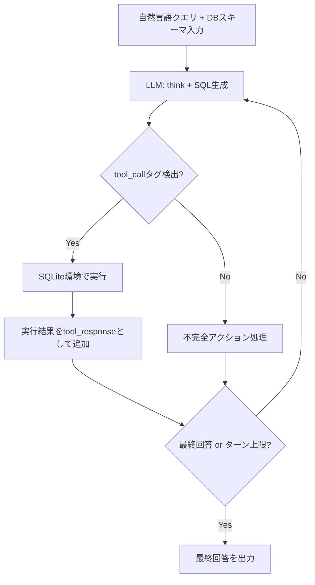

## 論文概要（Abstract）

本記事は [MTIR-SQL: Multi-turn Tool-Integrated Reasoning Reinforcement Learning for Text-to-SQL](https://arxiv.org/abs/2510.25510) の解説記事です。

MTIR-SQLは、Text-to-SQLタスクにおいてデータベースの実行フィードバックを推論の各ステップに組み込むマルチターン強化学習フレームワークである。従来のRLベースText-to-SQL手法が静的な実行フィードバックに依存していたのに対し、MTIR-SQLはSQLの生成・実行・修正ループをエージェント的に繰り返す。著者らはGRPOアルゴリズムにtrajectory filteringとKL損失除去の修正を加え、Qwen3-4Bモデル（パラメータ数40億）でBIRD Dev 64.4%の実行精度を報告している（論文Table 1-3より）。

この記事は [Zenn記事: TRL GRPOのエントロピー崩壊を抑えてSQL生成モデルの正答率を高める](https://zenn.dev/0h_n0/articles/1354c10a7726d5) の深掘りです。

## 情報源

- **会議名**: ICLR 2026（International Conference on Learning Representations）
- **年**: 2026（論文投稿: 2025年10月）
- **arXiv ID**: [2510.25510](https://arxiv.org/abs/2510.25510)
- **著者**: Zekun Xu, Siyu Xia, Chuhuai Yue, Jiajun Chai, Mingxue Tian, Xiaohan Wang, Wei Lin, Haoxuan Li, Guojun Yin（Meituan）
- **ライセンス**: CC BY-NC-ND 4.0

## カンファレンス情報

ICLRは機械学習分野における最高峰の国際会議の1つであり、特に深層学習・表現学習の理論と応用に焦点を当てている。MTIR-SQLはICLR 2026に採択された論文であり、4Bパラメータという比較的小規模なモデルでのText-to-SQL性能向上を示した点が評価されている。

## 背景と動機（Background & Motivation）

Text-to-SQLは、自然言語の質問からSQLクエリを自動生成するタスクである。大規模言語モデルの登場によりSQLの直接生成（Direct Output）が可能になったが、複雑なデータベーススキーマや曖昧な質問への対応には依然として課題がある。

強化学習（RL）によるText-to-SQLの改善は活発に研究されているが、著者らは既存手法に2つの限界を指摘している。第一に、従来のRL手法はSQLを1回生成して実行結果で報酬を決定する**静的フィードバック**に依存しており、生成途中でのリアルタイムな誤り修正ができない。第二に、GRPOのような手法では学習の不安定性やエントロピー崩壊が発生し、方策が特定のパターンに収束して探索が停止する問題がある。

MTIR-SQLはこれらの課題に対し、SQLの生成・実行・フィードバック・修正を複数ターンにわたって繰り返すマルチターンツール統合推論（Multi-turn Tool-Integrated Reasoning）を提案している。

## 主要な貢献（Key Contributions）

- **マルチターンツール統合推論**: モデルがSQL生成 → DB実行 → フィードバック受信 → 修正を最大6ターン繰り返す対話型推論パラダイムの提案
- **GRPO修正**: trajectory filteringの導入とKL損失制約の除去により、マルチターン環境での学習安定性を改善
- **小モデルでの高精度**: Qwen3-4B（4Bパラメータ）がBIRD Dev 64.4%を達成し、7Bモデル（SQL-R1: 63.1%）を上回り、ChatGPT + CoTの64.64%に迫る性能を報告

## 技術的詳細（Technical Details）

### マルチターンツール統合推論の仕組み

MTIR-SQLのコアは、LLMがSQLite環境と対話しながら推論を進めるマルチターンループである。従来のDirect Output（1回生成）やStandard Reasoning（思考チェーンのみ）と異なり、実際にSQLを実行して結果を確認しながら段階的に正解へ近づく。



具体的なフローは以下の通りである（論文Appendix B, Algorithm 1より）。

1. モデルは `<think>` タグ内で推論を行い、`<tool_call>` タグでSQL文を出力する
2. システムがSQL文をパースし、SQLiteデータベース上で実行する
3. 実行結果（カラム名と最大10行のデータ）を `<tool_response>` タグに包んでコンテキストに追加する
4. モデルは実行結果を踏まえて次のアクションを選択する（修正SQL生成、または最終回答）
5. `<tool_call>` も `<tool_response>` も出力しない場合は「My action is not correct. Let me rethink.」というテキストが追加され、再推論を促す
6. 最終回答の出力、EOSトークン、またはターン上限（$N=6$）に達した時点でループが終了する

この設計により、モデルは「SQLを書いてみる → 実行結果を確認する → 問題があれば修正する」という人間のデバッグプロセスに近い推論が可能になる。

### GRPOの修正（KL除去とtrajectory filtering）

標準的なGRPO（Group Relative Policy Optimization）は以下の損失関数を最小化する。

$$
\mathcal{L}_{\text{GRPO}} = -\mathbb{E}\left[\frac{\pi_\theta(y \mid x)}{\pi_{\text{ref}}(y \mid x)} \cdot A(x, y)\right] + \beta \cdot \text{KL}(\pi_\theta \| \pi_{\text{ref}})
$$

ここで、
- $\pi_\theta$: 学習中の方策（ポリシー）
- $\pi_{\text{ref}}$: 参照方策（学習初期のスナップショット）
- $A(x, y)$: アドバンテージ関数（グループ内相対報酬）
- $\beta$: KLペナルティ係数
- $x$: 入力（自然言語クエリ + DBスキーマ）
- $y$: 出力（推論 + SQLの系列）

著者らはマルチターン環境に対して以下の2つの修正を加えている。

**KL損失の除去**: $\beta \cdot \text{KL}(\pi_\theta \| \pi_{\text{ref}})$ 項を完全に除去する。著者らは、マルチターン推論ではモデルの出力分布が初期方策から大きく離れる必要があるため、KL制約が学習を妨げると主張している。修正後の損失は以下の通りである。

$$
\mathcal{L}_{\text{MTIR}} = -\mathbb{E}\left[\frac{\pi_\theta(y \mid x)}{\pi_{\text{ref}}(y \mid x)} \cdot A(x, y)\right]
$$

**Trajectory filtering**: 品質の低いロールアウトを学習から除外する。各入力$x$に対して温度0.6で5つの出力をサンプリングし、フィルタ関数$F(x, y) > \tau$を満たすロールアウトのみを学習に使用する。論文ではフィルタ関数$F$と閾値$\tau$の具体的な定義は記載されていないが、Table 4の結果からGRPO-FilterがGRPOを2.8ポイント上回っている（BIRD Dev: 60.3% → 63.1%）。

Zenn記事で解説されているエントロピー崩壊の問題に対して、この2つの修正が有効に機能している。KL除去により方策の更新幅が広がり、trajectory filteringにより低品質な勾配更新を排除することで、崩壊リスクを抑えながら探索を維持する設計である。

### 報酬関数の3層設計

報酬は3つの観点から計算される（論文Section 3.3より）。

**フォーマット報酬 $R_f$**: 出力が `<think>` → オプショナルなtool_call/responseブロック → `<answer>` の正しい順序で構成されているかを評価する。

$$
R_f = \begin{cases} +0.1 & \text{フォーマット正常} \\ -0.1 & \text{フォーマット異常} \end{cases}
$$

**実行報酬 $R_e$**: 生成されたSQLがSQLite上でエラーなく実行できるかを評価する。フォーマットが異常な場合は0とする。

$$
R_e = \begin{cases} +0.1 & \text{実行可能} \\ -0.1 & \text{実行エラー} \\ 0 & \text{フォーマット異常} \end{cases}
$$

**結果報酬 $R_r$**: 実行結果が正解と一致するかを評価する。これが最も大きな報酬であり、学習の主要な駆動力となる。

$$
R_r = \begin{cases} +1.0 & \text{実行結果が正解と一致} \\ -1.0 & \text{実行結果が不一致} \\ 0 & \text{フォーマット異常 or 実行エラー} \end{cases}
$$

合計報酬は $R = R_f + R_e + R_r$ であり、最大値は $+1.2$、最小値は $-1.2$ となる。この階層的設計により、モデルはまず正しいフォーマットで出力することを学び、次に実行可能なSQLを生成し、最終的に正しい結果を返すことを段階的に学習する。

### Python実装例

以下に、MTIR-SQLのマルチターン推論ループとreward計算の擬似実装を示す。

```python
import sqlite3
import re
from dataclasses import dataclass


@dataclass
class TurnResult:
    """1ターンの推論結果を保持する"""
    sql: str | None
    execution_output: str | None
    is_final_answer: bool
    raw_output: str


def execute_sql_safely(db_path: str, sql: str, max_rows: int = 10) -> tuple[bool, str]:
    """SQLをSQLite上で安全に実行し、結果を文字列で返す

    Args:
        db_path: SQLiteデータベースファイルのパス
        sql: 実行するSQL文
        max_rows: 返す最大行数

    Returns:
        (実行成功フラグ, 結果文字列) のタプル
    """
    try:
        conn = sqlite3.connect(db_path, timeout=30)
        cursor = conn.execute(sql)
        columns = [desc[0] for desc in cursor.description] if cursor.description else []
        rows = cursor.fetchmany(max_rows)
        conn.close()
        result_lines = [" | ".join(columns)]
        for row in rows:
            result_lines.append(" | ".join(str(v) for v in row))
        return True, "\n".join(result_lines)
    except Exception as e:
        return False, f"Error: {e}"


def compute_reward(
    format_valid: bool,
    executable: bool,
    result_correct: bool,
) -> dict[str, float]:
    """MTIR-SQLの3層報酬を計算する

    Args:
        format_valid: 出力フォーマットが正しいか
        executable: SQLが実行可能か
        result_correct: 実行結果が正解と一致するか

    Returns:
        各報酬成分と合計を含む辞書
    """
    r_format = 0.1 if format_valid else -0.1
    r_exec = (0.1 if executable else -0.1) if format_valid else 0.0
    r_result = (1.0 if result_correct else -1.0) if (format_valid and executable) else 0.0
    return {
        "r_format": r_format,
        "r_exec": r_exec,
        "r_result": r_result,
        "total": r_format + r_exec + r_result,
    }


def multi_turn_rollout(
    model,
    prompt: str,
    db_path: str,
    max_turns: int = 6,
    temperature: float = 0.6,
) -> list[TurnResult]:
    """マルチターン推論ループを実行する（擬似コード）

    Args:
        model: LLM（generate メソッドを持つオブジェクト）
        prompt: 初期プロンプト（自然言語クエリ + DBスキーマ）
        db_path: SQLiteデータベースのパス
        max_turns: 最大ターン数
        temperature: サンプリング温度

    Returns:
        各ターンの結果リスト
    """
    context = prompt
    results: list[TurnResult] = []

    for turn in range(max_turns):
        output = model.generate(context, temperature=temperature)

        # tool_call タグからSQLを抽出
        sql_match = re.search(r"<tool_call>(.*?)</tool_call>", output, re.DOTALL)
        # 最終回答タグを検出
        answer_match = re.search(r"<answer>(.*?)</answer>", output, re.DOTALL)

        if answer_match:
            results.append(TurnResult(
                sql=None, execution_output=None,
                is_final_answer=True, raw_output=output,
            ))
            break
        elif sql_match:
            sql = sql_match.group(1).strip()
            success, exec_output = execute_sql_safely(db_path, sql)
            # 実行結果をコンテキストに追加
            context += output + f"\n<tool_response>{exec_output}</tool_response>\n"
            results.append(TurnResult(
                sql=sql, execution_output=exec_output,
                is_final_answer=False, raw_output=output,
            ))
        else:
            # 不完全なアクション: 再推論を促す
            context += output + "\nMy action is not correct. Let me rethink.\n"
            results.append(TurnResult(
                sql=None, execution_output=None,
                is_final_answer=False, raw_output=output,
            ))

    return results
```

## 実装のポイント

### SQLite Executorの設計

MTIR-SQLでは学習時に各ロールアウトでSQLを実行するため、Executorの性能と安全性が重要になる。著者らの実装では以下の点が考慮されている。

- **タイムアウト制御**: 無限ループや重いクエリを防ぐため、実行時間制限を設定する（論文では具体値は非公開）
- **結果の切り詰め**: カラム名と最大10行までのデータを返す。これにより、大規模テーブルのSELECT * がコンテキスト長を圧迫することを防ぐ
- **読み取り専用**: UPDATE/DELETE/DROP等の破壊的操作を禁止する設計が推奨される

### ターン数制御

著者らは最大6ターンを使用している。論文のFigure 4に関する記述によると、ターン数を増やすと一般的に性能は向上するが、6ターンでは学習の不安定性やreward collapseが観測される場合がある。1ターンでは収束が速いが最終性能が低い。プロダクション利用では、推論コスト（各ターンでLLM呼び出し + DB実行）とのトレードオフを考慮し、3-4ターンを目安に調整するのが現実的である。

### 学習設定

- **ベースモデル**: Qwen3-4B（Qwen3-Instructバリアント、論文Appendix Cより）
- **バッチサイズ**: 64
- **学習率**: 1e-6
- **サンプリング**: 入力あたり5出力、温度0.6
- **最大系列長**: 8,192トークン
- **推論時**: 貪欲デコーディング（温度0.0）
- **フレームワーク**: RL-Factory（PPO/GRPO対応）
- **ハードウェア**: NVIDIA A100 x 8

## Production Deployment Guide

本セクションでは、MTIR-SQLのマルチターン推論をプロダクション環境でSQL生成サービスとして運用するためのAWS実装パターンを示す。MTIR-SQLの特性として、1リクエストあたり最大6回のLLM推論 + DB実行が発生するため、レイテンシとコストの管理が重要である。

> **注**: 以下のコスト試算は2026年10月時点のAWS ap-northeast-1（東京リージョン）料金に基づく概算値である。実際のコストはトラフィックパターン、リージョン、バースト使用量により変動する。最新料金は[AWS料金計算ツール](https://calculator.aws/)で確認を推奨する。

### AWS実装パターン（コスト最適化重視）

MTIR-SQLは4Bモデルのため、GPUメモリ要件はFP16で約8GBと比較的軽量である。マルチターン推論で1リクエストあたり複数回の推論が必要な点がコスト設計の主要因となる。

| 構成 | トラフィック | AWS構成 | 月額概算 |
|------|------------|---------|---------|
| Small | ~100 req/日 | Lambda + Bedrock (Claude 3.5 Haiku) | $50-150 |
| Medium | ~1,000 req/日 | ECS Fargate (GPU) + vLLM | $800-1,500 |
| Large | 10,000+ req/日 | EKS + Karpenter + Spot G5 + vLLM | $2,500-5,000 |

**Small構成（Serverless）**: Bedrock上のモデルをLambdaから呼び出し、マルチターンロジックをLambda内で制御する。Qwen3-4Bの直接ホスティングは不要で、Bedrock対応モデルでMTIR-SQLプロンプト戦略を適用する。SQLite実行はLambda内のEFSマウントファイルに対して行う。月額はBedrock呼び出し回数に依存し、100 req/日 x 平均4ターン x 30日 = 12,000回/月で約$50-150となる。

**Medium構成（GPU推論）**: ECS Fargate（g6.xlarge相当）でvLLMサーバーを常時起動し、Qwen3-4Bを直接ホスティングする。マルチターン推論はアプリケーション層で制御し、推論エンドポイントへの複数回呼び出しで実現する。Application Auto Scalingでリクエスト数に応じてタスク数を調整する。

**Large構成（Container）**: EKS + Karpenterで Spot g5.xlarge（A10G 24GB）を動的にプロビジョニングする。vLLMのcontinuous batchingにより高スループットを実現し、Spotインスタンス活用で最大90%のコスト削減が見込める。

**コスト削減テクニック**:
- **Spot Instances**: g5.xlargeのSpot価格は約$0.30/時間（オンデマンド$1.00/時間比で約70%削減）
- **vLLM continuous batching**: 複数リクエストのバッチ処理で推論スループットを向上
- **KVキャッシュ最適化**: マルチターン間でKVキャッシュを保持し、再計算を回避
- **Prompt Caching**: DBスキーマ部分のプレフィックスキャッシュで入力トークンコストを30-50%削減

### Terraformインフラコード

#### Small構成（Lambda + Bedrock + EFS）

```hcl
terraform {
  required_version = ">= 1.9"
  required_providers {
    aws = { source = "hashicorp/aws", version = "~> 5.70" }
  }
}
provider "aws" { region = "ap-northeast-1" }

# VPC (NAT Gateway不使用でコスト削減、VPC Endpoint経由でBedrock接続)
module "vpc" {
  source  = "terraform-aws-modules/vpc/aws"
  version = "~> 5.13"
  name    = "mtir-sql-vpc"
  cidr    = "10.0.0.0/16"
  azs             = ["ap-northeast-1a", "ap-northeast-1c"]
  private_subnets = ["10.0.1.0/24", "10.0.2.0/24"]
  enable_nat_gateway = false
}

# EFS (SQLiteデータベースファイル格納)
resource "aws_efs_file_system" "sqlite_store" {
  creation_token = "mtir-sql-db-store"
  encrypted      = true
  throughput_mode = "elastic"
}

# Lambda実行ロール (最小権限)
resource "aws_iam_role" "lambda_role" {
  name = "mtir-sql-lambda-role"
  assume_role_policy = jsonencode({
    Version = "2012-10-17"
    Statement = [{
      Action = "sts:AssumeRole"
      Effect = "Allow"
      Principal = { Service = "lambda.amazonaws.com" }
    }]
  })
}

resource "aws_iam_role_policy" "lambda_bedrock" {
  name = "bedrock-invoke"
  role = aws_iam_role.lambda_role.id
  policy = jsonencode({
    Version = "2012-10-17"
    Statement = [{
      Effect   = "Allow"
      Action   = ["bedrock:InvokeModel"]
      Resource = "arn:aws:bedrock:ap-northeast-1::foundation-model/*"
    }]
  })
}

# Lambda関数 (マルチターン推論ループ)
resource "aws_lambda_function" "mtir_sql" {
  function_name = "mtir-sql-inference"
  runtime       = "python3.12"
  handler       = "handler.lambda_handler"
  role          = aws_iam_role.lambda_role.arn
  timeout       = 300  # マルチターン推論は最大5分
  memory_size   = 1024
  filename      = "lambda.zip"

  environment {
    variables = {
      MAX_TURNS    = "6"
      MODEL_ID     = "anthropic.claude-3-5-haiku-20241022-v1:0"
      EFS_MOUNT    = "/mnt/databases"
    }
  }

  file_system_config {
    arn              = aws_efs_access_point.lambda_ap.arn
    local_mount_path = "/mnt/databases"
  }
}

resource "aws_efs_access_point" "lambda_ap" {
  file_system_id = aws_efs_file_system.sqlite_store.id
  posix_user { gid = 1000; uid = 1000 }
  root_directory { path = "/databases" }
}

# DynamoDB (クエリ履歴・キャッシュ、On-Demand)
resource "aws_dynamodb_table" "query_cache" {
  name         = "mtir-sql-cache"
  billing_mode = "PAY_PER_REQUEST"
  hash_key     = "query_hash"

  attribute { name = "query_hash"; type = "S" }

  server_side_encryption { enabled = true }
  point_in_time_recovery { enabled = true }
}

# CloudWatch アラーム (コスト監視)
resource "aws_cloudwatch_metric_alarm" "lambda_duration" {
  alarm_name          = "mtir-sql-high-duration"
  comparison_operator = "GreaterThanThreshold"
  evaluation_periods  = 3
  metric_name         = "Duration"
  namespace           = "AWS/Lambda"
  period              = 300
  statistic           = "Average"
  threshold           = 60000  # 60秒超過でアラーム
  dimensions = { FunctionName = aws_lambda_function.mtir_sql.function_name }
}
```

#### Large構成（EKS + Karpenter + Spot）

```hcl
# EKSクラスタ
module "eks" {
  source  = "terraform-aws-modules/eks/aws"
  version = "~> 20.24"
  cluster_name    = "mtir-sql-cluster"
  cluster_version = "1.31"
  vpc_id     = module.vpc.vpc_id
  subnet_ids = module.vpc.private_subnets
  cluster_endpoint_public_access = false
}

# Karpenter Provisioner (Spot G5優先)
resource "kubectl_manifest" "karpenter_nodepool" {
  yaml_body = yamlencode({
    apiVersion = "karpenter.sh/v1"
    kind       = "NodePool"
    metadata   = { name = "gpu-spot" }
    spec = {
      template = {
        spec = {
          requirements = [
            { key = "karpenter.sh/capacity-type", operator = "In", values = ["spot", "on-demand"] },
            { key = "node.kubernetes.io/instance-type", operator = "In", values = ["g5.xlarge", "g5.2xlarge"] },
          ]
          nodeClassRef = { group = "karpenter.k8s.aws", kind = "EC2NodeClass", name = "default" }
        }
      }
      limits   = { cpu = "128", "nvidia.com/gpu" = "16" }
      disruption = { consolidationPolicy = "WhenEmptyOrUnderutilized" }
    }
  })
}

# Secrets Manager (モデル設定)
resource "aws_secretsmanager_secret" "model_config" {
  name                    = "mtir-sql/model-config"
  recovery_window_in_days = 7
}

# AWS Budgets (月額予算アラート)
resource "aws_budgets_budget" "monthly" {
  name         = "mtir-sql-monthly"
  budget_type  = "COST"
  limit_amount = "5000"
  limit_unit   = "USD"
  time_unit    = "MONTHLY"
  notification {
    comparison_operator       = "GREATER_THAN"
    threshold                 = 80
    threshold_type            = "PERCENTAGE"
    notification_type         = "ACTUAL"
    subscriber_email_addresses = ["ops-team@example.com"]
  }
}
```

### 運用・監視設定

**CloudWatch Logs Insights クエリ**（マルチターン推論の監視）:

```
# 1時間あたりの平均ターン数とレイテンシ分析
fields @timestamp, turns_used, duration_ms, query_type
| stats avg(turns_used) as avg_turns,
        percentile(duration_ms, 95) as p95_latency,
        percentile(duration_ms, 99) as p99_latency,
        count(*) as request_count
  by bin(1h) as time_bucket
| sort time_bucket desc
```

**CloudWatch アラーム設定（Python）**:

```python
import boto3


def create_mtir_sql_alarms(function_name: str, sns_topic_arn: str) -> None:
    """MTIR-SQL推論サービスの監視アラームを作成する

    Args:
        function_name: Lambda関数名またはECSサービス名
        sns_topic_arn: 通知先SNSトピックARN
    """
    cw = boto3.client("cloudwatch", region_name="ap-northeast-1")

    # マルチターン推論のタイムアウト検知
    cw.put_metric_alarm(
        AlarmName=f"{function_name}-high-turn-count",
        MetricName="TurnsUsed",
        Namespace="MTIR-SQL/Inference",
        Statistic="Average",
        Period=300,
        EvaluationPeriods=3,
        Threshold=5.0,  # 平均5ターン超過 = 難クエリ増加の兆候
        ComparisonOperator="GreaterThanThreshold",
        AlarmActions=[sns_topic_arn],
    )
```

**X-Ray トレーシング設定（Python）**:

```python
from aws_xray_sdk.core import xray_recorder, patch_all

patch_all()  # boto3, sqlite3等を自動計装


@xray_recorder.capture("multi_turn_inference")
def run_inference(query: str, db_path: str, max_turns: int = 6) -> dict:
    """X-Rayトレース付きマルチターン推論

    Args:
        query: 自然言語クエリ
        db_path: SQLiteデータベースパス
        max_turns: 最大ターン数

    Returns:
        推論結果の辞書
    """
    subsegment = xray_recorder.current_subsegment()
    subsegment.put_annotation("max_turns", max_turns)
    subsegment.put_metadata("query", query, "input")
    # ... 推論ロジック ...
    return {"sql": "...", "turns_used": 3}
```

**Cost Explorer自動レポート（Python）**:

```python
import boto3
from datetime import date, timedelta


def daily_cost_report(sns_topic_arn: str, threshold_usd: float = 100.0) -> None:
    """日次コストレポートを取得し、閾値超過時にSNS通知する

    Args:
        sns_topic_arn: 通知先SNSトピックARN
        threshold_usd: アラート閾値（USD/日）
    """
    ce = boto3.client("ce", region_name="us-east-1")
    today = date.today()
    resp = ce.get_cost_and_usage(
        TimePeriod={"Start": str(today - timedelta(days=1)), "End": str(today)},
        Granularity="DAILY",
        Metrics=["UnblendedCost"],
        Filter={"Tags": {"Key": "Project", "Values": ["mtir-sql"]}},
    )
    cost = float(resp["ResultsByTime"][0]["Total"]["UnblendedCost"]["Amount"])
    if cost > threshold_usd:
        sns = boto3.client("sns", region_name="ap-northeast-1")
        sns.publish(
            TopicArn=sns_topic_arn,
            Subject=f"MTIR-SQL日次コスト超過: ${cost:.2f}",
            Message=f"閾値${threshold_usd}を超過しました。確認してください。",
        )
```

### コスト最適化チェックリスト

**アーキテクチャ選択**:
- [ ] トラフィック量に基づく構成選定（~100 req/日: Serverless、~1,000: Fargate GPU、10,000+: EKS + Spot）
- [ ] マルチターン推論のターン数上限を用途に応じて調整（3-4ターンで十分な精度が出るか検証）

**リソース最適化**:
- [ ] EC2/EKS: Spot Instances優先（g5.xlarge Spotで約70%削減）
- [ ] Reserved Instances: 常時稼働分は1年コミットで最大40%削減
- [ ] Savings Plans: Compute Savings Plansの検討
- [ ] Lambda: メモリサイズをプロファイリングで最適化（1024MB推奨）
- [ ] ECS/EKS: 夜間・低トラフィック時にスケールダウン

**LLMコスト削減**:
- [ ] vLLM continuous batching有効化（スループット向上）
- [ ] KVキャッシュのマルチターン間保持（再計算回避）
- [ ] Prompt Caching: DBスキーマのプレフィックスキャッシュ（30-50%削減）
- [ ] モデル量子化: AWQ/GPTQ 4bit量子化でGPUメモリ削減
- [ ] 簡易クエリはターン数1で早期終了（不要なターンを回避）

**監視・アラート**:
- [ ] AWS Budgets: 月次予算アラート設定
- [ ] CloudWatch: マルチターン推論のレイテンシ・ターン数監視
- [ ] Cost Anomaly Detection有効化
- [ ] 日次コストレポートの自動送信

**リソース管理**:
- [ ] 未使用GPUインスタンスの自動停止（Karpenter consolidation）
- [ ] プロジェクトタグ戦略（Cost Allocation Tags）
- [ ] CloudWatch Logsのライフサイクルポリシー（30日保持）
- [ ] ECRイメージのライフサイクルポリシー（未使用イメージ削除）
- [ ] 開発環境の夜間停止スケジュール

## 実験結果（Results）

### 主要ベンチマーク

著者らはBIRD DevとSPIDER Devの2つのベンチマークで評価を行っている。以下に推論パラダイム別の結果を示す（論文Table 4, pass@1）。

| パラダイム | 学習手法 | BIRD Dev (%) | SPIDER Dev (%) | SPIDER Test (%) |
|-----------|---------|-------------|---------------|----------------|
| Direct Output | なし | 46.9 | 69.2 | 70.8 |
| Standard Reasoning | なし | 48.1 | 72.5 | 72.9 |
| Tool-Integrated Reasoning | なし | 47.6 | 71.1 | 73.6 |
| Standard Reasoning | GRPO | 58.9 | 78.2 | 79.1 |
| Multi-turn TIR | PPO | 58.2 | 77.2 | 79.2 |
| Multi-turn TIR | GRPO | 60.3 | 80.1 | 81.4 |
| Multi-turn TIR | GRPO-Filter | 63.1 | 82.4 | 83.4 |

マルチターンTIR + GRPO-Filterが全ベンチマークで最高性能を示している。Standard Reasoning + GRPOとの比較では、BIRD Devで+4.2ポイント、SPIDER Devで+4.2ポイントの改善である。

> **数値の不一致に関する注記**: 論文のAbstractおよびConclusionでは SPIDER Dev 84.6%、BIRD Dev 64.4% と記載されているが、Table 4ではそれぞれ82.4%、63.1%となっている。Table 1-3のモデル比較ではBIRD Dev 64.4%が記載されており、評価設定（pass@1 vs 別の評価方法）の違いが原因と考えられる。本記事ではTable 4の値を主に使用する。

### 他モデルとの比較（BIRD Dev）

10B未満のモデルとの比較（論文Table 1より）:

| モデル | パラメータ数 | BIRD Dev (%) |
|--------|------------|-------------|
| **MTIR-SQL** | **4B** | **64.4** |
| SQL-R1 + Qwen2.5-Coder | 7B | 63.1 |
| CogniSQL-R1-Zero | 7B | 59.17 |
| SFT Code5 | 7B | 57.17 |
| Think2SQL | 7B | 56.1 |
| Qwen2.5-Coder-Instruct | 7B | 50.9 |

4Bモデルが7Bモデルを上回っている点は注目に値する。大規模モデルとの比較では、ChatGPT + CoT（64.64%）にわずか0.24ポイント差まで迫っている（論文Table 3より）。

### Ablation Study

各報酬成分の寄与を評価するablation結果は以下の通りである（論文Table 5, BIRD Dev）。

| 設定 | BIRD Dev (%) | 差分 |
|------|-------------|------|
| Full MTIR-SQL | 63.1 | -- |
| w/o $R_f$ (フォーマット報酬なし) | 62.3 | -0.8 |
| w/o $R_e$ (実行報酬なし) | 59.4 | -3.9 |
| w/o $R_r$ (結果報酬なし) | 58.8 | -4.3 |

結果報酬 $R_r$ の除去が最も大きな性能低下（-4.3ポイント）をもたらし、次いで実行報酬 $R_e$（-3.9ポイント）、フォーマット報酬 $R_f$（-0.8ポイント）の順である。$R_e$ の重要性は、実行可能なSQLを生成する能力がマルチターン推論の前提条件であることを示唆している。

## 実運用への応用（Practical Applications）

MTIR-SQLのマルチターン推論パラダイムは、社内データベースに対するSQL生成アシスタントへの応用が有望である。

**社内BIツール統合**: 営業データやログデータベースに対し、ビジネスユーザーの自然言語クエリからSQLを生成するアシスタントにMTIR-SQLのアプローチを適用できる。マルチターン推論により、最初のSQLが不正確でもDB実行結果を確認しながら自動修正するため、1回生成方式よりも信頼性が向上する。

**制約と注意点**: 4Bモデルのプロダクション利用にはいくつかの課題がある。第一に、1リクエストあたり最大6回のLLM推論が発生するため、レイテンシが通常の6倍程度になりうる。第二に、BIRDやSPIDERはベンチマーク用のスキーマであり、実際の社内DBではスキーマの複雑さやドメイン固有の用語が性能を低下させる可能性がある。著者らはQwen3-4Bの訓練にBIRDとSPIDERの訓練セットを使用しており、新規ドメインへの転移性能は未検証である。

## まとめと今後の展望

MTIR-SQLは、Text-to-SQLタスクにマルチターンのDB対話型推論と修正されたGRPOを組み合わせた手法であり、4Bパラメータモデルで従来の7Bモデルを上回る性能を実現している。KL損失の除去とtrajectory filteringというGRPO修正は、Zenn記事で議論されているエントロピー崩壊の抑制手法として実践的な知見を提供する。

今後の方向性として、著者らはより大規模なモデルへの適用、マルチテーブルJOINの複雑なクエリへの対応、および異なるデータベースエンジン（PostgreSQL, MySQL等）への拡張を挙げている。マルチターン推論のターン数と推論コストのトレードオフの最適化も、実用化に向けた重要な課題である。

## 参考文献

- **arXiv**: [https://arxiv.org/abs/2510.25510](https://arxiv.org/abs/2510.25510)
- **ICLR 2026**: [https://iclr.cc/virtual/2026/10017469](https://iclr.cc/virtual/2026/10017469)
- **Related Zenn article**: [https://zenn.dev/0h_n0/articles/1354c10a7726d5](https://zenn.dev/0h_n0/articles/1354c10a7726d5)
- **BIRD Benchmark**: [https://bird-bench.github.io/](https://bird-bench.github.io/)
- **SPIDER Benchmark**: [https://yale-lily.github.io/spider](https://yale-lily.github.io/spider)
