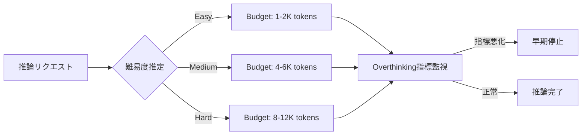

## 論文概要（Abstract）

本記事は [arXiv:2604.10739](https://arxiv.org/abs/2604.10739) の解説記事です。

この記事は [Zenn記事: 推論モデル時代のプロンプト設計転換：CoT不要化とeffort制御の実装パターン](https://zenn.dev/0h_n0/articles/467b9c2f35b4dc) の深掘りです。

Zhou et al.は、LLMのテスト時計算量スケーリング（test-time compute scaling）において、推論トークンを増やすことが必ずしも精度向上に寄与しない「過剰思考（overthinking）」現象を体系的に分析している。追加推論トークンの限界効用が著しく減少すること、拡張推論により以前正解していた回答を放棄するケースがあること、最適な思考長が問題の難易度に依存すること、中程度の計算予算で停止すれば精度を維持しつつ計算量を大幅に削減できることを報告している。

## 情報源

- **arXiv ID**: 2604.10739
- **URL**: [https://arxiv.org/abs/2604.10739](https://arxiv.org/abs/2604.10739)
- **著者**: Shu Zhou, Rui Ling, Junan Chen, Xin Wang, Tao Fan, Hao Wang
- **発表年**: 2026
- **分野**: cs.AI（Artificial Intelligence）

## 背景と動機（Background & Motivation）

Chain-of-Thought（CoT）推論の成功以来、テスト時に計算量を追加することでLLMの性能を高める「テスト時計算量スケーリング」が注目されてきた。DeepSeek-R1やOpenAI o1に代表される推論モデルは、推論トークンを増やすことでより正確な回答を生成するという前提に基づいている。

しかし、著者らはこの前提に疑問を呈する。経済学における限界効用逓減の概念を援用し、「推論トークンを追加するほど正確になる」という仮定が常に成立するわけではないことを示す。具体的には、8,000トークンの推論は500トークンの推論の16倍のコストがかかるが、16倍の精度向上は得られない。さらに深刻な問題として、拡張推論によりモデルが一度正解に到達した後にそれを放棄してしまう「負のフリップ」現象が存在する。

この研究は、推論コストと精度のトレードオフを定量的に明らかにし、適応的な計算予算配分の根拠を提供するという実用的な動機に基づいている。

## 主要な貢献（Key Contributions）

- **限界効用分析**: 推論トークン予算を500トークン刻みで変化させ、追加トークンの限界効用が急速に減少し、最終的に負になることを定量的に示した
- **フリップイベント追跡**: 正解から不正解への遷移（負のフリップ）と不正解から正解への遷移（正のフリップ）を体系的に追跡し、フリップ比率が予算増加に伴い急上昇することを発見した
- **overthinking指標の提案**: 躊躇マーカー（hesitation）、回答振動（oscillation）、確信度低下（confidence drop）の3指標を組み合わせ、負のフリップを82%の相関で予測可能な検出手法を開発した
- **コスト意識のある評価枠組み**: 精度と計算コストを統合したユーティリティ関数$U_\lambda(t)$を提案し、効率フロンティアの報告を推奨した

## 技術的詳細（Technical Details）

### 計算予算の制御

著者らはbudget forcingと呼ばれる手法で推論トークン数を制御している。指定トークン数に未達の場合は"Wait"トークンを付加して推論を継続させ、超過した場合は思考終了デリミタを強制挿入する。予算範囲は500から16,000トークンまで、500トークン刻みで設定されている。

### 限界効用の定義

予算$t$における限界効用は以下で定義される。

$$
MU(t) = \text{Acc}(t + \Delta t) - \text{Acc}(t)
$$

ここで、
- $\text{Acc}(t)$: 推論トークン予算$t$における正答率
- $\Delta t$: 予算の増分（本論文では500トークン）
- $MU(t)$: 予算$t$で追加$\Delta t$トークンを付与したときの正答率の変化

$MU(t) > 0$であれば追加推論は有益であり、$MU(t) < 0$であれば追加推論が逆効果であることを意味する。

### フリップイベント分析

予算$t$から$t + \Delta t$への移行時に、個々の問題レベルで正答状態がどう変化するかを追跡する。

- **正のフリップ（Positive Flip）**: 不正解 → 正解（追加推論が有効に機能したケース）
- **負のフリップ（Negative Flip）**: 正解 → 不正解（追加推論が逆効果となったケース）

フリップ比率は以下で定義される。

$$
\text{Flip Ratio}(t) = \frac{|\text{Negative Flips}(t)|}{|\text{Positive Flips}(t)|}
$$

フリップ比率が1を超える場合、追加推論により失われる正解の数が新たに得られる正解の数を上回っていることを意味する。

### Overthinking指標

著者らは推論トレースから3つの指標を抽出し、負のフリップを予測する。

1. **躊躇マーカー（Hesitation）**: 推論トレース中の「wait」「let me reconsider」等の再考表現の出現頻度
2. **回答振動（Oscillation）**: 推論過程で中間回答が変動する回数
3. **確信度低下（Confidence Drop）**: トークンのlog-probabilityに基づく確信度の推移

論文Table 4より、各指標と負のフリップの相関係数は、躊躇0.71、振動0.78、確信度低下0.63であり、3指標の組み合わせで0.82の相関を達成している。80%リコール時の精度は76.3%と報告されている。

### コスト意識のある評価

精度とコストを統合するユーティリティ関数は以下で定義される。

$$
U_\lambda(t) = \text{Acc}(t) - \lambda \cdot \frac{t}{t_{\max}}
$$

ここで、
- $\lambda$: コスト重み（$\lambda \geq 0$）
- $t_{\max}$: 最大予算（本論文では16,000トークン）
- $\lambda = 0$: コスト無視（精度のみ最大化）
- $\lambda = 0.5$: バランス型
- $\lambda = 1.0$: コスト重視



## 実装のポイント

### 適応的停止戦略

本論文の知見を活用した適応的停止戦略は以下の手順で実装できる。

```python
from dataclasses import dataclass
from typing import Optional


@dataclass
class OverthinkingSignals:
    """Overthinking検出のためのシグナル集約。"""
    hesitation_count: int = 0
    oscillation_count: int = 0
    confidence_trend: float = 0.0

    @property
    def combined_score(self) -> float:
        """3指標の重み付き結合スコア。

        論文Table 4の相関係数を重みとして使用。

        Returns:
            0-1の範囲に正規化されたoverthinkingスコア
        """
        weights = {
            "hesitation": 0.71,
            "oscillation": 0.78,
            "confidence": 0.63,
        }
        raw = (
            weights["hesitation"] * min(self.hesitation_count / 5, 1.0)
            + weights["oscillation"] * min(self.oscillation_count / 3, 1.0)
            + weights["confidence"] * max(-self.confidence_trend, 0.0)
        )
        return raw / sum(weights.values())


def should_stop_reasoning(
    signals: OverthinkingSignals,
    current_tokens: int,
    difficulty: str,
    threshold: float = 0.6,
) -> bool:
    """Overthinkingスコアに基づく早期停止判定。

    Args:
        signals: 推論トレースから抽出したoverthinkingシグナル
        current_tokens: 現在の推論トークン数
        difficulty: 推定難易度 ("easy", "medium", "hard")
        threshold: 停止判定閾値（論文の76.3%精度@80%リコールに基づく）

    Returns:
        停止すべきかどうか
    """
    min_budgets = {"easy": 1000, "medium": 4000, "hard": 8000}
    min_budget = min_budgets.get(difficulty, 4000)
    if current_tokens < min_budget:
        return False
    return signals.combined_score >= threshold
```

### effort制御との関連

Zenn記事で紹介されているeffort制御パラメータ（OpenAI `reasoning_effort`やClaude `budget_tokens`）は、本論文の知見と直接的に対応する。著者らの実験結果は、effort制御を「低」に設定することが、容易な問題では精度を犠牲にせずコストを削減する合理的な戦略であることを裏付けている。MATH-500のLevel 1問題では最適予算が約1,000トークンである一方、Level 5問題では約7,500トークンが最適であり、最大7.5倍の差がある（論文Figure 5より）。

## Production Deployment Guide

本セクションでは、テスト時計算量のoverthinkingを回避しつつ推論コストを最適化するAWSインフラ構成を示す。論文の知見を活かした適応的予算配分（adaptive budget allocation）を実装し、推論リクエストの難易度に応じてトークン予算を動的に制御する。

> **注記**: 以下の料金情報は2026年10月時点のAWS ap-northeast-1（東京）リージョンの概算値です。実際のコストはトラフィックパターン、リージョン、バースト使用量により変動します。最新料金は [AWS料金計算ツール](https://calculator.aws/) で確認してください。

### AWS実装パターン（コスト最適化重視）

| 構成 | トラフィック | アーキテクチャ | 月額概算 |
|------|-------------|---------------|---------|
| **Small** | ~100 req/日 | Lambda + Bedrock | $50-150 |
| **Medium** | ~1,000 req/日 | ECS Fargate + Bedrock | $300-800 |
| **Large** | 10,000+ req/日 | EKS + Karpenter + Bedrock Batch | $2,000-5,000 |

**Small構成（~100 req/日）の内訳**:
- Lambda: $5-15/月（128MB, 平均3秒/実行、1日100回）
- Bedrock Claude Sonnet: $30-80/月（入力500トークン + 出力2,000トークン平均、adaptive budget適用）
- DynamoDB: $5-10/月（On-Demand、難易度キャッシュ保存）
- CloudWatch: $5-10/月（ログ・メトリクス）

**Large構成（10,000+ req/日）の内訳**:
- EKS コントロールプレーン: $73/月
- Karpenter管理ノード（Spot c6i.xlarge x 2-5台）: $100-350/月
- Bedrock Batch API: $800-2,500/月（Batch APIで50%削減、adaptive budgetで追加30-40%削減）
- ALB: $30-50/月
- Secrets Manager + KMS: $10-20/月

**コスト削減テクニック**:
- **Adaptive Budget Allocation**: 本論文の知見に基づき、難易度別にトークン予算を配分。Easy問題（全体の40-60%）は1-2Kトークンで十分であり、全リクエストに16Kトークンを割り当てる場合と比較して50-70%のトークンコスト削減が見込める
- **Bedrock Batch API**: 非同期処理可能なリクエストはBatch APIで50%削減
- **Prompt Caching**: 同一難易度クラスのシステムプロンプトをキャッシュし30-90%削減
- **Spot Instances**: EKSワーカーノードをSpot優先で最大90%削減

### Terraformインフラコード

#### Small構成（Lambda + Bedrock）

```hcl
# --- Small構成: Lambda + Bedrock + DynamoDB ---
# Adaptive Budget Allocationによる推論コスト最適化

terraform {
  required_version = ">= 1.9"
  required_providers {
    aws = {
      source  = "hashicorp/aws"
      version = "~> 5.70"
    }
  }
}

provider "aws" {
  region = "ap-northeast-1"
}

# --- DynamoDB: 難易度推定キャッシュ ---
resource "aws_dynamodb_table" "difficulty_cache" {
  name         = "overthinking-difficulty-cache"
  billing_mode = "PAY_PER_REQUEST"
  hash_key     = "request_hash"

  attribute {
    name = "request_hash"
    type = "S"
  }

  ttl {
    attribute_name = "expires_at"
    enabled        = true
  }

  server_side_encryption {
    enabled = true # AWS managed KMS key
  }

  point_in_time_recovery {
    enabled = true
  }

  tags = {
    Project     = "overthinking-optimizer"
    Environment = "production"
    CostCenter  = "inference-optimization"
  }
}

# --- IAMロール: Lambda用（最小権限） ---
resource "aws_iam_role" "lambda_role" {
  name = "overthinking-optimizer-lambda"

  assume_role_policy = jsonencode({
    Version = "2012-10-17"
    Statement = [{
      Action = "sts:AssumeRole"
      Effect = "Allow"
      Principal = { Service = "lambda.amazonaws.com" }
    }]
  })
}

resource "aws_iam_role_policy" "lambda_policy" {
  name = "overthinking-optimizer-policy"
  role = aws_iam_role.lambda_role.id

  policy = jsonencode({
    Version = "2012-10-17"
    Statement = [
      {
        Effect = "Allow"
        Action = [
          "bedrock:InvokeModel",
          "bedrock:InvokeModelWithResponseStream"
        ]
        Resource = "arn:aws:bedrock:ap-northeast-1::foundation-model/anthropic.claude-*"
      },
      {
        Effect = "Allow"
        Action = [
          "dynamodb:GetItem",
          "dynamodb:PutItem",
          "dynamodb:UpdateItem"
        ]
        Resource = aws_dynamodb_table.difficulty_cache.arn
      },
      {
        Effect = "Allow"
        Action = [
          "logs:CreateLogGroup",
          "logs:CreateLogStream",
          "logs:PutLogEvents"
        ]
        Resource = "arn:aws:logs:ap-northeast-1:*:*"
      },
      {
        Effect   = "Allow"
        Action   = ["xray:PutTraceSegments", "xray:PutTelemetryRecords"]
        Resource = "*"
      }
    ]
  })
}

# --- Lambda関数: Adaptive Budget Controller ---
resource "aws_lambda_function" "budget_controller" {
  function_name = "overthinking-budget-controller"
  runtime       = "python3.12"
  handler       = "handler.lambda_handler"
  role          = aws_iam_role.lambda_role.arn
  timeout       = 60
  memory_size   = 256

  # S3からデプロイパッケージを取得（事前にアップロード）
  s3_bucket = "your-deployment-bucket"
  s3_key    = "overthinking-optimizer/lambda.zip"

  environment {
    variables = {
      DYNAMODB_TABLE     = aws_dynamodb_table.difficulty_cache.name
      # 論文Table 1に基づく難易度別トークン予算
      BUDGET_EASY        = "1500"
      BUDGET_MEDIUM      = "5000"
      BUDGET_HARD        = "10000"
      OVERTHINK_THRESHOLD = "0.6"
    }
  }

  tracing_config {
    mode = "Active" # X-Ray有効化
  }

  tags = {
    Project     = "overthinking-optimizer"
    Environment = "production"
  }
}

# --- CloudWatchアラーム: コスト異常検知 ---
resource "aws_cloudwatch_metric_alarm" "high_token_usage" {
  alarm_name          = "overthinking-high-token-usage"
  comparison_operator = "GreaterThanThreshold"
  evaluation_periods  = 2
  metric_name         = "InvocationCount"
  namespace           = "AWS/Bedrock"
  period              = 3600
  statistic           = "Sum"
  threshold           = 500 # 1時間500回を超過でアラート
  alarm_description   = "Bedrock invocation spike - possible overthinking loop"

  alarm_actions = [aws_sns_topic.alerts.arn]

  tags = {
    Project = "overthinking-optimizer"
  }
}

resource "aws_sns_topic" "alerts" {
  name              = "overthinking-optimizer-alerts"
  kms_master_key_id = "alias/aws/sns"
}
```

#### Large構成（EKS + Karpenter）

```hcl
# --- Large構成: EKS + Karpenter + Bedrock Batch ---
# 10,000+ req/日向け、Spot Instances優先

module "eks" {
  source  = "terraform-aws-modules/eks/aws"
  version = "~> 20.24"

  cluster_name    = "overthinking-optimizer"
  cluster_version = "1.31"

  vpc_id     = module.vpc.vpc_id
  subnet_ids = module.vpc.private_subnets

  # パブリックアクセス最小化
  cluster_endpoint_public_access  = true
  cluster_endpoint_private_access = true

  # KMS暗号化
  cluster_encryption_config = {
    provider_key_arn = aws_kms_key.eks.arn
    resources        = ["secrets"]
  }

  eks_managed_node_groups = {
    # Karpenter管理用の最小ノードグループ
    system = {
      instance_types = ["c6i.large"]
      min_size       = 1
      max_size       = 2
      desired_size   = 1
      labels         = { "node-role" = "system" }
    }
  }

  tags = {
    Project     = "overthinking-optimizer"
    Environment = "production"
    "karpenter.sh/discovery" = "overthinking-optimizer"
  }
}

resource "aws_kms_key" "eks" {
  description             = "EKS cluster encryption key"
  deletion_window_in_days = 7
  enable_key_rotation     = true
}

# --- Karpenter: Spot優先の自動スケーリング ---
resource "helm_release" "karpenter" {
  name       = "karpenter"
  repository = "oci://public.ecr.aws/karpenter"
  chart      = "karpenter"
  version    = "1.1.0"
  namespace  = "kube-system"

  set {
    name  = "settings.clusterName"
    value = module.eks.cluster_name
  }
}

# Karpenter NodePool（Spot優先）
resource "kubectl_manifest" "karpenter_nodepool" {
  yaml_body = <<-YAML
    apiVersion: karpenter.sh/v1
    kind: NodePool
    metadata:
      name: inference-workers
    spec:
      template:
        spec:
          requirements:
            - key: karpenter.sh/capacity-type
              operator: In
              values: ["spot", "on-demand"]  # Spot優先
            - key: node.kubernetes.io/instance-type
              operator: In
              values: ["c6i.xlarge", "c6i.2xlarge", "c7i.xlarge", "c7i.2xlarge"]
          nodeClassRef:
            group: karpenter.k8s.aws
            kind: EC2NodeClass
            name: default
      limits:
        cpu: "64"
        memory: "128Gi"
      disruption:
        consolidationPolicy: WhenEmptyOrUnderutilized
        consolidateAfter: 60s
  YAML
}

# --- AWS Budgets: 月次予算アラート ---
resource "aws_budgets_budget" "monthly" {
  name         = "overthinking-optimizer-monthly"
  budget_type  = "COST"
  limit_amount = "5000"
  limit_unit   = "USD"
  time_unit    = "MONTHLY"

  notification {
    comparison_operator       = "GREATER_THAN"
    threshold                 = 80
    threshold_type            = "PERCENTAGE"
    notification_type         = "ACTUAL"
    subscriber_email_addresses = ["alerts@example.com"]
  }

  notification {
    comparison_operator       = "GREATER_THAN"
    threshold                 = 100
    threshold_type            = "PERCENTAGE"
    notification_type         = "FORECASTED"
    subscriber_email_addresses = ["alerts@example.com"]
  }
}
```

### 運用・監視設定

**CloudWatch Logs Insights: トークン使用量の異常検知**

```
# 1時間あたりのトークン使用量とコスト異常を検知
fields @timestamp, @message
| filter @message like /budget_used/
| stats avg(budget_used) as avg_tokens,
        max(budget_used) as max_tokens,
        count(*) as request_count,
        sum(budget_used) as total_tokens
  by bin(1h) as hour
| filter avg_tokens > 8000
| sort hour desc
```

```
# 難易度別のoverthinking発生率
fields @timestamp, difficulty, overthinking_detected
| filter overthinking_detected = true
| stats count(*) as overthink_count by difficulty
| sort overthink_count desc
```

**CloudWatchアラーム設定（Python boto3）**:

```python
import boto3


def create_overthinking_alarms(sns_topic_arn: str) -> None:
    """Overthinking検出用CloudWatchアラームを作成。

    Args:
        sns_topic_arn: アラート通知先SNSトピックARN
    """
    cw = boto3.client("cloudwatch", region_name="ap-northeast-1")

    # Bedrockトークン使用量スパイク検知
    cw.put_metric_alarm(
        AlarmName="overthinking-token-spike",
        MetricName="TokensUsed",
        Namespace="Overthinking/Inference",
        Statistic="Average",
        Period=300,
        EvaluationPeriods=2,
        Threshold=10000,  # 論文の知見: 10K超は効用が急減
        ComparisonOperator="GreaterThanThreshold",
        AlarmActions=[sns_topic_arn],
        AlarmDescription="Average token budget exceeds 10K - likely overthinking",
    )

    # Lambda実行時間異常検知
    cw.put_metric_alarm(
        AlarmName="overthinking-lambda-duration",
        MetricName="Duration",
        Namespace="AWS/Lambda",
        Statistic="p95",
        Period=300,
        EvaluationPeriods=3,
        Threshold=45000,  # 45秒（タイムアウト60秒の75%）
        ComparisonOperator="GreaterThanThreshold",
        AlarmActions=[sns_topic_arn],
        Dimensions=[
            {"Name": "FunctionName", "Value": "overthinking-budget-controller"}
        ],
    )
```

**X-Rayトレーシング設定（Python boto3）**:

```python
from aws_xray_sdk.core import xray_recorder, patch_all

# boto3の自動計装
patch_all()


@xray_recorder.capture("classify_difficulty")
def classify_difficulty(prompt: str) -> str:
    """プロンプト難易度を分類し、X-Rayにアノテーションを記録。

    Args:
        prompt: ユーザープロンプト

    Returns:
        難易度ラベル ("easy", "medium", "hard")
    """
    subsegment = xray_recorder.current_subsegment()
    difficulty = _estimate_difficulty(prompt)
    subsegment.put_annotation("difficulty", difficulty)
    subsegment.put_metadata("prompt_length", len(prompt))
    return difficulty
```

**Cost Explorer日次レポート（Python boto3）**:

```python
import datetime

import boto3


def get_daily_inference_cost() -> dict:
    """Bedrock + Lambda + EKSの日次コストレポートを取得。

    Returns:
        サービス別コスト辞書
    """
    ce = boto3.client("ce", region_name="us-east-1")
    today = datetime.date.today()
    yesterday = today - datetime.timedelta(days=1)

    response = ce.get_cost_and_usage(
        TimePeriod={
            "Start": yesterday.isoformat(),
            "End": today.isoformat(),
        },
        Granularity="DAILY",
        Metrics=["UnblendedCost"],
        Filter={
            "Dimensions": {
                "Key": "SERVICE",
                "Values": [
                    "Amazon Bedrock",
                    "AWS Lambda",
                    "Amazon Elastic Kubernetes Service",
                ],
            }
        },
        GroupBy=[{"Type": "DIMENSION", "Key": "SERVICE"}],
    )

    costs = {}
    for group in response["ResultsByTime"][0]["Groups"]:
        service = group["Keys"][0]
        amount = float(group["Metrics"]["UnblendedCost"]["Amount"])
        costs[service] = amount

    total = sum(costs.values())
    if total > 100:  # $100/日超過でSNS通知
        sns = boto3.client("sns", region_name="ap-northeast-1")
        sns.publish(
            TopicArn="arn:aws:sns:ap-northeast-1:ACCOUNT:overthinking-alerts",
            Subject=f"Daily cost alert: ${total:.2f}",
            Message=f"Inference cost exceeded $100/day.\n{costs}",
        )

    return costs
```

### コスト最適化チェックリスト

**アーキテクチャ選択**:
- [ ] トラフィック量に応じた構成を選択（100 req/日以下ならServerless、10,000+ならContainer）
- [ ] 非同期処理可能なリクエストはBedrock Batch API経由にルーティング
- [ ] VPC内のプライベートエンドポイントでデータ転送コストを削減

**リソース最適化**:
- [ ] EKSワーカーノードはSpot Instances優先（c6i/c7iファミリー、最大90%削減）
- [ ] Reserved Instances: 安定ベースライン負荷分は1年コミット（最大72%削減）
- [ ] Savings Plans: Compute Savings Plansで柔軟にコミット
- [ ] Lambda: メモリサイズを256MBに最適化（Power Tuningで検証）
- [ ] EKS: Karpenter consolidationPolicyで未使用ノードを60秒で回収
- [ ] NAT Gateway不使用: VPCエンドポイント経由でコスト削減

**LLMコスト削減**:
- [ ] **Adaptive Budget Allocation**: 難易度別トークン予算（Easy: 1.5K, Medium: 5K, Hard: 10K）
- [ ] Bedrock Batch API: 非同期リクエストで50%削減
- [ ] Prompt Caching: 難易度クラス別システムプロンプトをキャッシュ（30-90%削減）
- [ ] モデル選択ロジック: Easy問題はHaiku、Hard問題はSonnetに振り分け
- [ ] Overthinking検出時の早期停止: 論文の指標ベースで97%精度維持・40%コスト削減
- [ ] 最大トークン数制限: 論文の知見に基づき上限を12Kに設定（16Kは逆効果）

**監視・アラート**:
- [ ] AWS Budgets: 月次予算の80%/100%でアラート
- [ ] CloudWatch: 平均トークン使用量10K超でアラーム
- [ ] Cost Anomaly Detection: 日次コスト$100超でSNS通知
- [ ] 難易度別overthinking発生率の週次レポート
- [ ] X-Ray: 推論パイプライン全体のトレーシング有効化

**リソース管理**:
- [ ] 未使用EBSボリューム・スナップショットの定期削除
- [ ] タグ戦略: Project/Environment/CostCenterタグの必須化
- [ ] S3ライフサイクルポリシー: 推論ログを30日後にGlacierへ移行
- [ ] 開発環境: 夜間・週末のEKSノード自動停止

## 実験結果（Results）

### 限界効用の推移（DeepSeek-R1-32B, AIME）

論文Table 1より、推論トークン予算の増加に伴う限界効用の推移を以下に示す。

| 予算範囲 | 正答率 | 限界効用（MU） | 傾向 |
|----------|--------|---------------|------|
| 500 tokens | 28.2% | - | ベースライン |
| 500 → 2K | ~40% | +3.2 / 500tok | 大きな改善 |
| 8K → 12K | ~55% | +0.1 / 500tok | ほぼ飽和 |
| 12K → 16K | 55.8% → 54.9% | -0.3 / 500tok | 逆効果 |

R1モデルの正答率は12Kトークンでピーク（55.8%）に達し、16Kでは54.9%に低下している。

### フリップ比率の推移（DeepSeek-R1-32B, AIME）

論文Table 2より、予算増加に伴うフリップ比率の変化を示す。

| 予算 | フリップ比率 | 解釈 |
|------|------------|------|
| 1K | 0.22 | 正のフリップが圧倒的に多い |
| 6K | 0.87 | 均衡に近づく |
| 7K | 1.09 | **転換点**: 負のフリップが上回る |
| 8K | 1.42 | 追加推論の害が利益を上回る |
| 12K | 3.29 | 負のフリップが正の3倍以上 |
| 16K | 7.55 | 深刻なoverthinking |

7Kトークン付近がcrossoverポイントであり、これを超えると追加推論は平均的に有害となる。論文Table 3の統計検定では、7Kのフリップ比率のブートストラップ95%信頼区間は[1.01, 1.18]であり、1を有意に上回っている（p = 0.014）。

### 難易度別の最適予算（MATH-500）

論文Figure 5より、問題の難易度によって最適な計算予算が大きく異なることが示されている。

| 難易度 | 最適予算（概算） | ベースラインからの改善 |
|--------|----------------|---------------------|
| Level 1 | ~1.0K tokens | 小（初期段階で正解到達） |
| Level 2 | ~1.5K tokens | 小 |
| Level 3 | ~3.0K tokens | 中 |
| Level 4 | ~5.0K tokens | 中 |
| Level 5 | ~7.5K tokens | 大（延長推論が有効） |

Level 1とLevel 5の最適予算には約7.5倍の差があり、均一な予算配分が非効率であることを示している。

### 負のフリップの質的分析

論文Table 7より、80件の負のフリップを手動分析した結果、以下の3カテゴリに分類されている。

- **真のoverthinking（67.5%）**: 正解に到達した後、不要な再検討により誤答に遷移
- **探索の発散（20%）**: 別のアプローチを試みた結果、正解経路から逸脱
- **劣化アーティファクト（12.5%）**: 推論トレースの長大化に伴う品質劣化

## 実運用への応用（Practical Applications）

本論文の知見は、LLM推論サービスの運用コスト最適化に直接適用できる。

**トークンコストの削減**: 全リクエストに最大予算を割り当てる代わりに、難易度推定に基づくadaptive budget allocationを導入することで、精度を維持しつつ50-70%のトークンコスト削減が見込める。Zenn記事で紹介されているeffort制御パラメータは、この適応的配分を実現するAPIレベルのインタフェースである。

**SLA設計**: フリップ比率の転換点（本実験では7Kトークン付近）をSLA上のトークン上限として設定することで、「考えすぎによる精度劣化」を防止できる。ただし、転換点はモデル・タスク依存であるため、本番環境ではA/Bテストによるキャリブレーションが必要である。

**モニタリング**: overthinking指標（躊躇・振動・確信度低下）をリアルタイムに監視し、異常検知に活用できる。指標の組み合わせスコアが閾値を超えた場合に推論を早期停止することで、著者らは97%のピーク精度を維持しつつ40%の計算量削減を達成したと報告している。

**モデル選択への示唆**: s1-32Bモデルは約5Kトークンでoverthinkingの転換点に達するのに対し、R1-32Bは約7Kであり、モデルごとに最適予算が異なる。本番環境でのモデル更新時には、フリップ比率の再評価が必要である。

## 関連研究（Related Work）

Snell et al. (2024) はテスト時計算量スケーリングの初期的な枠組みを提示したが、限界効用の体系的分析は行っていない。Wu et al. (2025b) は推論長と精度のinverted-U関係を報告しており、本論文のフリップ分析はこの知見を問題レベルで精緻化したものと位置づけられる。Srivastava et al. (2025) はoverthinkingの概念を導入したが、本論文はフリップ追跡とコスト意識評価の枠組みを新たに提案している。Ghosal et al. (2025) やZhang et al. (2025) も関連するoverthinking分析を行っており、本論文の指標ベースの検出手法はこれらと相補的な貢献である。

## まとめと今後の展望

Zhou et al.の研究は、「推論トークンを増やせば精度が上がる」という素朴な前提に定量的な反証を提示した。フリップ比率の転換点の特定、3指標による検出手法、コスト意識のある評価枠組みは、推論モデルの実運用において直接活用可能な知見である。

ただし、本研究の対象は数学・科学分野の推論タスクと32Bパラメータの公開モデルに限定されており、自然言語推論や大規模商用モデルへの一般化は検証されていない。また、負のフリップの67.5%が「真のoverthinking」であるという質的分析は因果関係を立証するものではなく、メカニズムの解明は今後の課題である。実務においては、本論文の枠組みを自社タスク・モデルでキャリブレーションした上で適用することが推奨される。

## 参考文献

- **arXiv**: [https://arxiv.org/abs/2604.10739](https://arxiv.org/abs/2604.10739)
- **Related Zenn article**: [推論モデル時代のプロンプト設計転換：CoT不要化とeffort制御の実装パターン](https://zenn.dev/0h_n0/articles/467b9c2f35b4dc)
