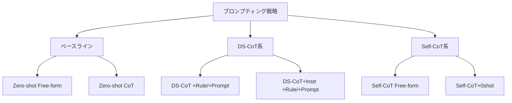

## 論文概要（Abstract）

本記事は [arXiv:2608.03550](https://arxiv.org/abs/2608.03550) の解説記事です。

この記事は [Zenn記事: 推論モデル時代のプロンプト設計転換：CoT不要化とeffort制御の実装パターン](https://zenn.dev/0h_n0/articles/467b9c2f35b4dc) の深掘りです。

Chain-of-Thought（CoT）プロンプティングはLLMの推論能力を評価する標準ベースラインとして広く使われてきた。Pushkin et al.は、推論に特化した最新モデルではfew-shot CoTが性能を低下させることを実証した。Mathstral-7Bでは、GSM8Kにおいてゼロショット自由回答が83.8%であるのに対し、最良のfew-shot CoT（DS-CoT）は74.2%にとどまると報告されている（論文Table 1より）。著者らは、この現象を「guidance-distraction tradeoff」と名づけ、モデルが強くなるにつれCoTが主にdistractionの源として作用するメカニズムを明らかにしている。

## 情報源

- **arXiv ID**: 2608.03550
- **URL**: [https://arxiv.org/abs/2608.03550](https://arxiv.org/abs/2608.03550)
- **著者**: Denys Pushkin, Albert Q. Jiang, Aryo Lotfi, Colin Sandon, Emmanuel Abbe
- **発表年**: 2026
- **分野**: cs.AI（Artificial Intelligence）
- **ライセンス**: CC BY 4.0

## 背景と動機（Background & Motivation）

Wei et al.（2022）がfew-shot CoTプロンプティングを提案して以来、ステップバイステップの推論例示はLLMの推論性能を引き出す標準手法として定着した。Kojima et al.（2022）は「Let's think step by step」のゼロショットCoTが同様の効果を持つことを示し、さらにAuto-CoT（Zhang et al., 2022）やActive-Prompt（Diao et al., 2023）などモデル自身が推論例を生成する手法が発展してきた。

しかし、これらの研究は比較的初期のモデル（GPT-3, PaLM等）を対象としていた。2024年以降、推論に特化した訓練を受けたモデル（Mathstral, Qwen2.5等）が登場し、指示なしでも構造化されたステップバイステップ推論を自発的に生成するようになった。この進化により、既存のCoTプロンプティングが本当に有効なのかという根本的な疑問が生じた。

Pushkin et al.は、CoTプロンプティングの効果を再検証するため、推論特化型と汎用型の中規模モデル（7-8Bパラメータ）をGSM8Kベンチマークで系統的に評価した。著者らは、CoTが「推論を構造化するguidance」と「スタイル適応・フォーマット準拠・追加コンテキスト統合というdistraction」の二面性を持つと主張しており、この仮説の検証が本研究の動機である。

## 主要な貢献（Key Contributions）

- **貢献1**: 推論特化モデルにおいて、ゼロショット評価がランダムに選択されたfew-shot CoTを明確に上回ることを実証した。この性能低下の原因は、スタイル適応やフォーマット準拠の負荷にあるとされる。モデル自身が生成した推論例（Self-CoT）を使用しても、推論特化モデルではゼロショットベースラインを超えられないことも確認された。
- **貢献2**: ゼロショットCoT（「Let's think step by step」プレフィックス）は全モデルで有効だが、推論特化モデルでの効果はわずかであることを示した。zero-shot CoTはMathstralで+2.3ポイント（83.8%から86.1%）にとどまる（論文Table 1より）。
- **貢献3**: few-shot CoTをデフォルト評価ベースラインとして使い続けることへの警鐘を鳴らした。弱体化されたベースラインに対する改善は実質的な進歩を反映しない可能性がある。

## 技術的詳細（Technical Details）

### 実験で比較されたプロンプティング戦略

著者らは6種類のプロンプティング戦略を系統的に比較している。



**DS-CoT（Dataset CoT）**: GSM8Kの訓練セットから人手で作成されたステップバイステップ回答例をfew-shot例として使用する。回答抽出方法として、ルールベース（`#### <数値>`パターン検索、+Rule）とプロンプトベース（最終回答のみを返すよう指示、+Prompt）の2種がある。

**DS-CoT+Instr**: DS-CoTに加え、回答フォーマットの指示（"Please provide only the final numerical answer"等）をプロンプトに追加する。

**Self-CoT**: モデル自身に問題を解かせ、その出力をfew-shot例として再利用する。2段階のパイプラインとなる。

**Self-CoT+0shot**: Self-CoTと同様だが、例の生成時にゼロショットCoTプレフィックス（「Let's think step by step」）を付与する。著者らはこれを最良のfew-shot形式と報告している。

### Guidance-Distraction Tradeoffの定式化

著者らは、few-shot CoTプロンプティングの効果を以下の2つの相反する力の均衡として概念化している。

$$
\Delta_{\text{CoT}} = G(m, n, k) - D(m, n, k)
$$

ここで、
- $\Delta_{\text{CoT}}$: few-shot CoT適用による精度変化
- $G(m, n, k)$: guidance効果（構造化された推論手順の提示による性能向上）
- $D(m, n, k)$: distraction効果（スタイル適応、フォーマット準拠、追加コンテキスト統合による性能低下）
- $m$: モデルの推論能力
- $n$: few-shot例の数
- $k$: 例の品質・出処

著者らの中心的主張は、モデル能力$m$が向上するにつれて$G$は飽和する一方で$D$は減少しないため、十分に強いモデルでは$\Delta_{\text{CoT}} < 0$となるというものである。

これは数式として明示的に定義されたものではなく、論文の議論から筆者が再構成した概念的枠組みであることを注記しておく。論文本文では、guidance効果はモデルが自発的に構造化推論を行うようになると冗長化する一方、distraction効果はfew-shot例のスタイルやフォーマットへの適応負荷として残存すると説明されている。

### 回答抽出の影響

著者らが発見した重要な技術的知見の1つは、回答抽出方法がDS-CoTの見かけの性能に大きな影響を与えることである。ルールベース抽出（`#### <数値>`パターン検索）では、モデルがデータセット固有の回答フォーマットを学習していない場合に無効回答率が急上昇する。

論文Table 2によると、Qwen2.5-7B-Instructの1-shotでの無効回答率はDS-CoT+Ruleで96.5%に達する。これはモデルの推論能力の問題ではなく、出力フォーマットがデータセットの規約に合致しないだけである。プロンプトベース抽出（+Prompt）に切り替えると無効回答率は0.1%に低下し、精度は3.0%から86.9%に回復する。

この結果は、先行研究でのCoT評価が回答抽出方法によって不当に低く見積もられていた可能性を示唆しており、ベンチマーク設計における重要な教訓である。

### アルゴリズム: Self-CoT+0shotパイプライン

本論文で最も効果的と報告されたSelf-CoT+0shotの手順を擬似コードで示す。

```python
from dataclasses import dataclass
from typing import Optional


@dataclass(frozen=True)
class Example:
    """Few-shot例を表す不変データクラス。

    Attributes:
        question: 問題文
        reasoning: ステップバイステップの推論過程
        answer: 最終回答
    """

    question: str
    reasoning: str
    answer: str


def generate_self_cot_examples(
    model: "LLMClient",
    questions: list[str],
    n_examples: int,
    use_zero_shot_cot: bool = True,
) -> list[Example]:
    """モデル自身の出力からfew-shot例を生成する。

    Self-CoT+0shotでは、各問題に対してゼロショットCoTプレフィックスを
    付与してモデルに解かせ、その出力をfew-shot例として再利用する。

    Args:
        model: LLMクライアント
        questions: 例の元となる問題リスト
        n_examples: 生成するfew-shot例の数
        use_zero_shot_cot: Trueの場合、"Let's think step by step"を付与

    Returns:
        生成されたfew-shot例のリスト
    """
    examples: list[Example] = []
    cot_prefix = "Let's think step by step.\n" if use_zero_shot_cot else ""

    for q in questions[:n_examples]:
        prompt = f"{q}\n{cot_prefix}"
        response = model.generate(prompt, greedy=True)
        answer = extract_final_answer(response)

        if answer is not None:
            examples.append(
                Example(question=q, reasoning=response, answer=answer)
            )

    return examples


def evaluate_with_self_cot(
    model: "LLMClient",
    test_questions: list[str],
    examples: list[Example],
    gold_answers: list[str],
) -> float:
    """Self-CoT+0shotで評価を実行する。

    Args:
        model: LLMクライアント
        test_questions: 評価対象の問題リスト
        examples: generate_self_cot_examplesで生成したfew-shot例
        gold_answers: 正解リスト

    Returns:
        正答率（0.0-1.0）
    """
    correct = 0

    for question, gold in zip(test_questions, gold_answers):
        # few-shot例をプロンプトに組み込み
        prompt_parts: list[str] = []
        for ex in examples:
            prompt_parts.append(
                f"Q: {ex.question}\n{ex.reasoning}\n"
                f"The answer is {ex.answer}.\n\n"
            )
        prompt_parts.append(f"Q: {question}\n")
        prompt = "".join(prompt_parts)

        response = model.generate(prompt, greedy=True)
        predicted = extract_final_answer(response)

        if predicted == gold:
            correct += 1

    return correct / len(test_questions)


def extract_final_answer(response: str) -> Optional[str]:
    """モデル出力から最終的な数値回答を抽出する。

    プロンプトベース抽出を模擬。実運用ではモデルに
    "Please provide only the final numerical answer"と再度問い合わせる。

    Args:
        response: モデルの生成テキスト

    Returns:
        抽出された数値文字列、抽出失敗時はNone
    """
    import re

    patterns = [
        r"(?:the answer is|answer:)\s*\$?(\d[\d,]*\.?\d*)",
        r"####\s*(\d[\d,]*\.?\d*)",
        r"(\d[\d,]*\.?\d*)\s*$",
    ]
    for pattern in patterns:
        match = re.search(pattern, response, re.IGNORECASE)
        if match:
            return match.group(1).replace(",", "")

    return None
```

## 実装のポイント

**ゼロショットCoTの最小介入性**: 著者らの実験結果が示す実装上の最も重要な教訓は、推論特化モデルにはfew-shot例を与えないことである。モデルが自発的にステップバイステップ推論を行う場合、外部からの例示はスタイル汚染（style contamination）を引き起こす。ゼロショットCoT（「Let's think step by step」プレフィックス）は最も軽量なguidanceであり、モデルの内在的な推論能力を阻害せずに構造化を促す。

**回答抽出方法の選択**: ルールベース抽出は高速だがデータセット固有のフォーマットに依存する。プロンプトベース抽出は汎用的だが追加のAPI呼び出しが必要となる。論文Table 2が示すように、抽出方法の選択がfew-shot CoTの見かけの性能を最大93ポイント変動させうるため（Qwen 1-shot: 3.0% vs 86.9%）、公正な比較にはプロンプトベース抽出の使用が推奨される。

**Self-CoT+0shotの2段階コスト**: Self-CoT+0shotはfew-shot例の生成に追加のモデル呼び出しが必要となる。$k$個のfew-shot例を生成するために$k$回の追加呼び出しが必要であり、推論コストは$(k + N)$回の呼び出しとなる（$N$はテスト問題数）。例の生成はオフラインで1回実行すれば再利用可能であるため、評価パイプラインではキャッシュを活用すべきである。

**seed平均化の重要性**: 著者らは10個のランダムseedで平均化した結果を報告している。few-shot例のランダム選択が精度に与える影響が大きいためである。特にDS-CoTでは例の選択に大きく依存するため、単一seedでの評価は信頼性が低い。

## Production Deployment Guide

本セクションでは、guidance-distraction tradeoffの知見を実運用のLLM推論パイプラインに組み込む方法を示す。モデルの推論能力に応じてプロンプト戦略を動的に切り替える「Prompt Routing Service」をAWS上に構築するシナリオを想定する。

コスト試算は2026年10月時点のAWS ap-northeast-1（東京）リージョン料金に基づく概算値である。実際のコストはトラフィックパターン、バースト使用量により変動するため、最新料金は[AWS料金計算ツール](https://calculator.aws/)で確認を推奨する。

### AWS実装パターン（コスト最適化重視）

| 構成 | トラフィック | サービス | 月額概算 |
|------|------------|---------|---------|
| Small | ~100 req/日 | Lambda + Bedrock | $30-80 |
| Medium | ~1,000 req/日 | ECS Fargate + Bedrock | $200-500 |
| Large | 10,000+ req/日 | EKS + vLLM + Spot | $1,500-4,000 |

**Small構成（~100 req/日）**: Lambda関数でプロンプト戦略を判定し、Amazon Bedrockのモデルを呼び出す。DynamoDBにモデル別のプロンプト戦略設定と評価結果を格納する。Bedrockのオンデマンド料金で利用し、Prompt Cachingを有効化してゼロショットCoTプレフィックスの繰り返しコストを削減する。

- Lambda (1日100回、平均5秒/回): 約$1/月
- Bedrock (Claude Sonnet, 入力50K tokens/日): 約$15-45/月
- DynamoDB (On-Demand): 約$3/月
- CloudWatch / S3: 約$5/月
- 合計: 約$24-54/月

**Medium構成（~1,000 req/日）**: ECS Fargate上にプロンプトルーティングサービスを常駐させる。リクエストごとにモデル能力プロファイルを参照し、推論特化モデルにはゼロショット、汎用モデルにはSelf-CoT+0shotを適用する。ElastiCacheでSelf-CoT例のキャッシュを管理する。

- Fargate (1 vCPU, 2GB, 常時稼働): 約$35/月
- Bedrock (入力500K tokens/日): 約$100-300/月
- ElastiCache (cache.t4g.micro): 約$15/月
- ALB + CloudWatch: 約$30/月
- 合計: 約$180-380/月

**Large構成（10,000+ req/日）**: EKS上でvLLM/TGIを使ったセルフホスト推論を行い、Karpenter + Spot Instancesでコスト最適化する。プロンプトルーティング、A/Bテスト、精度モニタリングを統合した完全なMLOpsパイプラインを構築する。

- EKS コントロールプレーン: 約$75/月
- g5.xlarge Spot x 2-4台（動的）: 約$800-2,400/月
- プロンプトルーティング用Fargate: 約$35/月
- 監視（CloudWatch, Prometheus, Grafana）: 約$80/月
- 合計: 約$990-2,590/月（Spot適用で最大70%削減後）

### Terraformインフラコード

#### Small構成（Lambda + Bedrock + Prompt Routing）

```hcl
# Small構成: Lambda + Bedrock + DynamoDB Prompt Routing
# 対象: ~100 req/日、月額$30-80

terraform {
  required_version = ">= 1.9"
  required_providers {
    aws = {
      source  = "hashicorp/aws"
      version = "~> 5.70"
    }
  }
}

provider "aws" {
  region = "ap-northeast-1"
}

# --- DynamoDB: プロンプト戦略設定テーブル ---
resource "aws_dynamodb_table" "prompt_strategies" {
  name         = "prompt-routing-strategies"
  billing_mode = "PAY_PER_REQUEST"
  hash_key     = "model_id"

  attribute {
    name = "model_id"
    type = "S"
  }

  # KMS暗号化
  server_side_encryption {
    enabled = true
  }

  tags = {
    Service     = "prompt-routing"
    Environment = "production"
  }
}

# --- IAMロール（最小権限） ---
resource "aws_iam_role" "lambda_exec" {
  name = "prompt-router-lambda-exec"
  assume_role_policy = jsonencode({
    Version = "2012-10-17"
    Statement = [{
      Action = "sts:AssumeRole"
      Effect = "Allow"
      Principal = { Service = "lambda.amazonaws.com" }
    }]
  })
}

resource "aws_iam_role_policy" "lambda_permissions" {
  name = "prompt-router-permissions"
  role = aws_iam_role.lambda_exec.id
  policy = jsonencode({
    Version = "2012-10-17"
    Statement = [
      {
        Effect = "Allow"
        Action = [
          "bedrock:InvokeModel",
          "bedrock:InvokeModelWithResponseStream",
        ]
        Resource = "arn:aws:bedrock:ap-northeast-1::foundation-model/*"
      },
      {
        Effect   = "Allow"
        Action   = ["dynamodb:GetItem", "dynamodb:PutItem", "dynamodb:Query"]
        Resource = aws_dynamodb_table.prompt_strategies.arn
      },
      {
        Effect = "Allow"
        Action = [
          "logs:CreateLogGroup",
          "logs:CreateLogStream",
          "logs:PutLogEvents",
        ]
        Resource = "arn:aws:logs:ap-northeast-1:*:*"
      },
    ]
  })
}

# --- Lambda関数 ---
resource "aws_lambda_function" "prompt_router" {
  function_name = "prompt-router"
  role          = aws_iam_role.lambda_exec.arn
  handler       = "handler.lambda_handler"
  runtime       = "python3.12"
  timeout       = 30
  memory_size   = 256

  filename         = "lambda_package.zip"
  source_code_hash = filebase64sha256("lambda_package.zip")

  environment {
    variables = {
      STRATEGY_TABLE = aws_dynamodb_table.prompt_strategies.name
      DEFAULT_STRATEGY = "zero_shot_cot"  # デフォルトはゼロショットCoT
    }
  }
}

# --- CloudWatch アラーム（コスト監視） ---
resource "aws_cloudwatch_metric_alarm" "lambda_errors" {
  alarm_name          = "prompt-router-errors"
  comparison_operator = "GreaterThanThreshold"
  evaluation_periods  = 2
  metric_name         = "Errors"
  namespace           = "AWS/Lambda"
  period              = 300
  statistic           = "Sum"
  threshold           = 5
  alarm_description   = "Lambda error rate exceeds threshold"

  dimensions = {
    FunctionName = aws_lambda_function.prompt_router.function_name
  }
}
```

#### Large構成（EKS + vLLM + Prompt Routing）

```hcl
# Large構成: EKS + vLLM + Spot + Prompt Routing
# 対象: 10,000+ req/日、月額$1,500-4,000

module "eks" {
  source  = "terraform-aws-modules/eks/aws"
  version = "~> 20.24"

  cluster_name    = "prompt-routing-prod"
  cluster_version = "1.31"
  vpc_id          = module.vpc.vpc_id
  subnet_ids      = module.vpc.private_subnets

  cluster_endpoint_public_access  = true
  cluster_endpoint_private_access = true

  enable_irsa = true
}

# Karpenter NodePool: GPU Spot優先
resource "kubectl_manifest" "karpenter_gpu_pool" {
  yaml_body = yamlencode({
    apiVersion = "karpenter.sh/v1"
    kind       = "NodePool"
    metadata   = { name = "llm-inference-gpu" }
    spec = {
      template = {
        spec = {
          requirements = [
            { key = "karpenter.sh/capacity-type", operator = "In",
              values = ["spot", "on-demand"] },
            { key = "node.kubernetes.io/instance-type", operator = "In",
              values = ["g5.xlarge", "g5.2xlarge", "g6.xlarge"] },
          ]
          nodeClassRef = { name = "default" }
        }
      }
      limits = { "nvidia.com/gpu" = "8" }
      disruption = {
        consolidationPolicy = "WhenEmptyOrUnderutilized"
        consolidateAfter    = "60s"
      }
    }
  })
}

# AWS Budgets: 月額予算アラート
resource "aws_budgets_budget" "monthly" {
  name         = "prompt-routing-monthly"
  budget_type  = "COST"
  limit_amount = "5000"
  limit_unit   = "USD"
  time_unit    = "MONTHLY"

  notification {
    comparison_operator       = "GREATER_THAN"
    threshold                 = 80
    threshold_type            = "PERCENTAGE"
    notification_type         = "ACTUAL"
    subscriber_email_addresses = ["ops-team@example.com"]
  }
}
```

### 運用・監視設定

```python
"""Prompt Routing Serviceの運用監視設定。

CloudWatch Logs Insights / アラーム / X-Ray / Cost Explorerの設定例。
"""

import boto3
from datetime import datetime, timedelta
from typing import Any


# --- CloudWatch Logs Insights: プロンプト戦略別精度分析 ---
STRATEGY_ACCURACY_QUERY = """
fields @timestamp, model_id, strategy, is_correct
| stats count(*) as total,
        sum(is_correct) as correct,
        avg(is_correct) * 100 as accuracy_pct
  by model_id, strategy
| sort accuracy_pct desc
"""

DISTRACTION_DETECTION_QUERY = """
fields @timestamp, model_id, strategy, latency_ms, token_count
| filter strategy = 'few_shot_cot'
| stats avg(latency_ms) as avg_latency,
        avg(token_count) as avg_tokens,
        count(*) as requests
  by model_id, bin(1h)
| filter avg_latency > 5000
| sort @timestamp desc
"""


def setup_strategy_monitoring_alarm(
    function_name: str,
    sns_topic_arn: str,
) -> dict[str, Any]:
    """プロンプト戦略のエラー率監視アラームを設定する。

    Args:
        function_name: Lambda関数名
        sns_topic_arn: 通知先SNSトピックARN

    Returns:
        作成されたアラームの情報
    """
    client = boto3.client("cloudwatch", region_name="ap-northeast-1")
    return client.put_metric_alarm(
        AlarmName=f"{function_name}-strategy-error-rate",
        MetricName="Errors",
        Namespace="AWS/Lambda",
        Statistic="Sum",
        Period=300,
        EvaluationPeriods=3,
        Threshold=10.0,
        ComparisonOperator="GreaterThanThreshold",
        AlarmActions=[sns_topic_arn],
        Dimensions=[
            {"Name": "FunctionName", "Value": function_name},
        ],
    )


def get_daily_cost_report() -> dict[str, float]:
    """日次コストレポートを取得しサービス別に集計する。

    Returns:
        サービス名をキー、日次コスト(USD)を値とする辞書
    """
    client = boto3.client("ce", region_name="us-east-1")
    today = datetime.utcnow().date()
    yesterday = today - timedelta(days=1)

    response = client.get_cost_and_usage(
        TimePeriod={
            "Start": yesterday.isoformat(),
            "End": today.isoformat(),
        },
        Granularity="DAILY",
        Metrics=["UnblendedCost"],
        GroupBy=[{"Type": "DIMENSION", "Key": "SERVICE"}],
    )

    costs: dict[str, float] = {}
    for group in response["ResultsByTime"][0]["Groups"]:
        service = group["Keys"][0]
        amount = float(group["Metrics"]["UnblendedCost"]["Amount"])
        if amount > 0.01:
            costs[service] = round(amount, 2)

    return costs
```

### コスト最適化チェックリスト

**アーキテクチャ選択**
- [ ] トラフィック量に応じた構成選択（Serverless/Hybrid/Container）
- [ ] モデル能力に応じたプロンプト戦略の事前設定（推論特化: ゼロショット、汎用: Self-CoT+0shot）
- [ ] Prompt Cachingの有効化でゼロショットCoTプレフィックスの繰り返しコスト削減

**リソース最適化**
- [ ] EC2/EKS: GPU Spot Instances優先（g5/g6系、最大70%削減）
- [ ] Reserved Instances: 常時稼働のルーティングサービスは1年コミットで最大40%削減
- [ ] Savings Plans: Compute Savings Plansで柔軟に最大20%削減
- [ ] Lambda: メモリサイズ最適化（256MBで十分な場合が多い）
- [ ] ECS/EKS: Karpenterで不要ノード自動回収

**LLMコスト削減**
- [ ] ゼロショット戦略: few-shot例削除でプロンプトトークン50-80%削減
- [ ] Bedrock Prompt Caching: システムプロンプト部分のキャッシュで30-90%削減
- [ ] Bedrock Batch API: 非リアルタイム処理で50%削減
- [ ] トークン数制限: 不要に長いCoT例の除去
- [ ] モデルルーティング: 簡易タスクはHaikuクラス、複雑タスクはSonnet/Opusクラス

**監視・アラート**
- [ ] AWS Budgets: 月額予算上限設定（80%/100%でアラート）
- [ ] CloudWatch アラーム: Lambda実行時間、Bedrockトークン使用量
- [ ] Cost Anomaly Detection: 異常コスト自動検知
- [ ] 日次コストレポート: Cost Explorer APIで自動取得・SNS通知
- [ ] プロンプト戦略別精度ダッシュボード: CloudWatch Metrics

**リソース管理**
- [ ] DynamoDBのTTL設定（古い評価結果の自動削除）
- [ ] CloudWatch Logsの保持期間設定（30日推奨）
- [ ] コスト配分タグ戦略（Environment, Service, PromptStrategy）
- [ ] 開発環境の夜間停止（EKSノードスケールダウン）
- [ ] Self-CoT例キャッシュの定期更新（モデルバージョンアップ時）

## 実験結果

### GSM8K精度の全体比較

論文Table 1より、GSM8Kにおける各プロンプティング戦略の精度（%）を以下に示す。10個のランダムseedの平均値である。

| モデル | Zero-shot Free-form | Zero-shot CoT | Best DS-CoT+Prompt | Best Self-CoT | Best Self-CoT+0shot |
|--------|:--:|:--:|:--:|:--:|:--:|
| Mathstral-7B | 83.8 | **86.1** | 74.2 (8-shot) | 83.6 (16-shot) | 85.5 (4-shot) |
| Qwen2.5-7B-Instruct | 88.6 | 90.9 | 87.6 (4-shot) | 89.6 (4-shot) | **91.6** (4-shot) |
| Llama-3.1-8B-Instruct | 67.3 | 81.4 | 80.3 (2-shot) | 77.7 (4-shot) | **84.4** (16-shot) |

**推論特化モデル（Mathstral）の特異性**: Mathstralでは、全てのfew-shot CoT（DS-CoT, Self-CoT, Self-CoT+0shot）がゼロショットCoT（86.1%）を下回る。最良のSelf-CoT+0shotでも85.5%にとどまり、ゼロショットCoTに対して-0.6ポイントである。DS-CoTに至っては最良でも74.2%であり、ゼロショット自由回答（83.8%）を9.6ポイント下回る。

**汎用モデルでのニュアンス**: Qwen2.5とLlamaでは、Self-CoT+0shotがゼロショットCoTをそれぞれ+0.7ポイント、+3.0ポイント上回る。ただし、DS-CoTはQwenでもゼロショット自由回答（88.6%）を最良でも87.6%と下回る。Llamaのみ、DS-CoT+Instrがゼロショット自由回答を上回る（80.3% vs 67.3%）が、これはLlamaのゼロショット自由回答能力がそもそも低いためである。

### 無効回答率の分析

論文Table 2より、DS-CoTにおけるルールベース抽出（+Rule）の無効回答率を示す。

| モデル | 1-shot | 2-shot | 4-shot | 8-shot | 16-shot |
|--------|:--:|:--:|:--:|:--:|:--:|
| Mathstral-7B | 17.3% | 2.0% | 1.0% | 0.7% | 0.7% |
| Qwen2.5-7B-Instruct | **96.5%** | 82.4% | 39.9% | 16.1% | 4.6% |
| Llama-3.1-8B-Instruct | **87.3%** | 35.7% | 10.0% | 2.4% | 1.0% |

Qwenでは1-shotでの無効回答率が96.5%に達している。これはモデルがGSM8Kの`####`フォーマットを1例だけでは学習しきれないことを示す。プロンプトベース抽出（+Prompt）では全条件で無効回答率が0-1%に低下するため、この問題はフォーマット学習の困難さに起因し、推論能力の欠如ではない。

### ポストプロセッシングの効果

論文Table 3では、モデル生成例のクリーニング（計算ミスの修正、フォーマット統一）の効果を検証している。クリーニングの精度変化は-0.5から+2.2ポイントの範囲で、一貫した改善は見られない。Self-CoT+0shotに対するクリーニング効果はほぼゼロであり、ゼロショットCoTプレフィックスで生成された例は既にクリーンであることを示唆している。

## 実運用への応用

本論文の知見は、Zenn記事「推論モデル時代のプロンプト設計転換」で論じられている「廃れた4つのプロンプト習慣」を実証的に裏付けるものである。

**few-shot例の積極的な削除**: Zenn記事が指摘する「few-shot例を並べる習慣」の非効率性は、本論文のDS-CoT結果によって定量的に裏付けられた。Mathstralで83.8%から74.2%への低下は、推論特化モデルへのfew-shot例付与が明確に有害であることを示す。プロダクション環境では、モデルの推論能力を事前に評価し、推論特化モデルにはゼロショット戦略を自動選択するルーティングロジックの導入が推奨される。

**プロンプトトークンの削減とコスト効果**: few-shot例を削除することでプロンプトトークン数が大幅に減少する。GSM8Kの8-shot CoTでは数千トークンの例示が含まれるが、ゼロショットCoTでは「Let's think step by step」の6トークンのみで済む。APIコスト（入力トークン課金）の観点からも、ゼロショット戦略への移行は合理的である。

**effort制御との関連**: Zenn記事で紹介されているreasoning effort制御（Anthropic, OpenAI等が提供）は、本論文のguidance-distraction tradeoffと相補的な関係にある。外部からのCoTガイダンス（few-shot例）を減らしつつ、モデル内部の推論リソース配分をeffortパラメータで制御することで、distractionなしに推論品質を調整できる。

## 関連研究

- **Mind Your Step（Cheng et al., 2025, arXiv:2506.14641）**: 本論文と同時期の研究で、最新モデルではゼロショットプロンプティングがfew-shot CoTより効果的であるという同様の結論に到達している。Pushkin et al.はこの研究を「concurrent work」として引用している。
- **AlignedCoT（Yang et al., 2023）**: モデルのネイティブスタイルに合わせた推論例を使用する手法であり、本論文のSelf-CoTと類似のアプローチを先行して提案している。Self-CoTの有効性は、AlignedCoTの知見と一致する。
- **Auto-CoT（Zhang et al., 2022）**: モデル生成例と多様な例選択を組み合わせた手法。本論文のSelf-CoT+0shotはAuto-CoTの発展形と位置づけられるが、著者らはランダム選択でも十分な結果が得られることを示している。

## まとめと今後の展望

Pushkin et al.は、推論に特化した最新LLMにおいてfew-shot CoTプロンプティングが性能を低下させることを実証し、その原因を「guidance-distraction tradeoff」として概念化した。モデルが強くなるにつれCoTのguidance効果は飽和する一方、スタイル適応・フォーマット準拠によるdistraction効果が残存し、結果としてCoTが逆効果になるメカニズムが明らかになった。

本研究の主な限界として、著者ら自身が認めるように、中規模（7-8B）モデルのみの評価であること、GSM8K単一ベンチマークであること、そしてfew-shot例がランダム選択であることが挙げられる。高度な例選択手法（similarity-based retrieval等）との組み合わせや、より大規模なモデル（70B以上）、より多様なベンチマーク（MATH, MMLU等）での検証が今後の課題である。それでもなお、プロンプトエンジニアリングの慣行を見直す上で重要な実証的根拠を提供する研究である。

## 参考文献

- **arXiv**: [https://arxiv.org/abs/2608.03550](https://arxiv.org/abs/2608.03550)
- **Related Zenn article**: [推論モデル時代のプロンプト設計転換：CoT不要化とeffort制御の実装パターン](https://zenn.dev/0h_n0/articles/467b9c2f35b4dc)
- Wei, J., et al. (2022). "Chain-of-Thought Prompting Elicits Reasoning in Large Language Models." NeurIPS 2022.
- Kojima, T., et al. (2022). "Large Language Models are Zero-Shot Reasoners." NeurIPS 2022.
- Zhang, Z., et al. (2022). "Automatic Chain of Thought Prompting in Large Language Models." arXiv:2210.03493.
- Diao, S., et al. (2023). "Active Prompting with Chain-of-Thought for Large Language Models." arXiv:2302.12246.
- Cheng, D., et al. (2025). "Mind Your Step (by Step): Chain-of-Thought can Reduce Performance on Tasks where Thinking Makes Humans Worse." arXiv:2506.14641.
